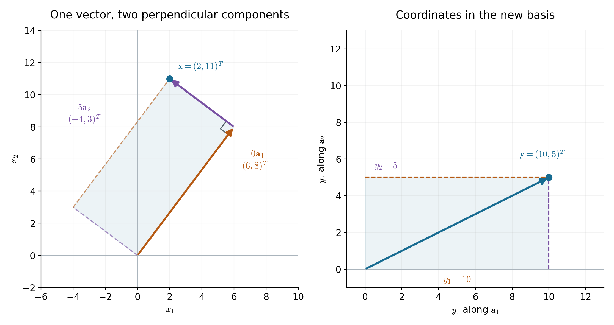
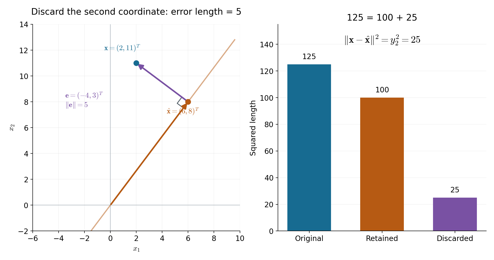
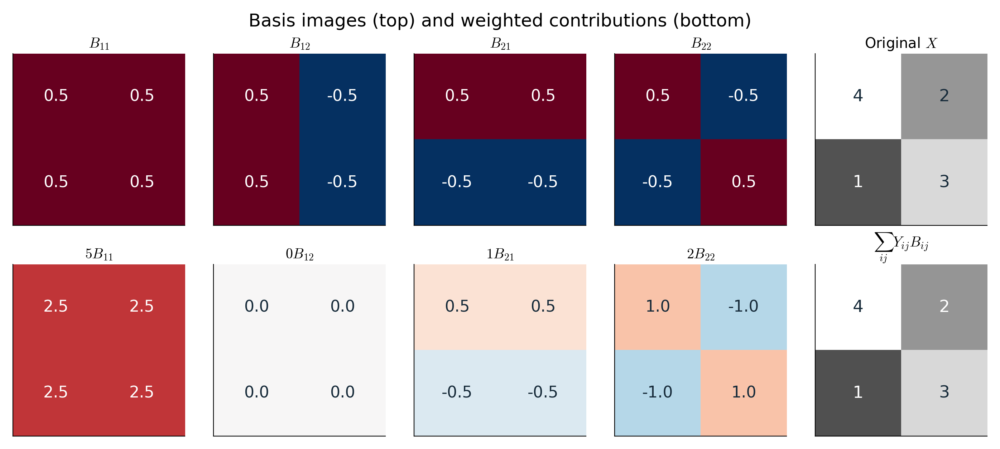

# Lecture 10 · KP02：換一組座標，讓資料成為新特徵（Changing coordinates to generate features）

> 程度：研究生（grad）／Level: Graduate (grad)
>
> 週次：第 10 週（2026-11-09）｜主題：Feature Generation I
>
> Week 10 (2026-11-09) | Topic: Feature Generation I

## 學習目標（Learning objectives）

- 用基底的加權和表示一個向量（Express a vector as a weighted sum of basis vectors）。
- 算出正交單位基底下的座標，並重建資料（Compute coordinates in an orthonormal basis and reconstruct the data）。
- 區分換座標與降維，驗算捨棄方向的誤差（Distinguish coordinate changes from dimensionality reduction and verify the reconstruction error）。
- 將向量展開推廣到基底影像（Extend vector expansions to basis images）。

## KP02：新特徵是沿著新方向量出的座標（New features are coordinates along new directions）

**一句話重點**：基底決定量測方向，座標記錄各方向的份量。保留完整座標可重建資料；捨棄座標才可能失去資訊。

**One-sentence summary**: A basis specifies directions, and coordinates specify their contributions. Complete coordinates reconstruct the data. Discarding coordinates can lose information.

### 1. 先把必要的數學工具找回來（Recovering the prerequisites）

你已知道資料可以排成一串數字。
現在要問：同一筆資料，能否換一種量法？
先從資料的排列、加權相加與長度開始。

You already know that data can be arranged as numbers.
Can the same observation be measured in another way?
First recall vectors, weighted sums, and lengths.

**向量**：有順序的一串數字，用來表示一筆資料。
本講將它直排成一欄。

**Vector**: an ordered collection of numbers representing one observation.
We write vectors as columns.

**純量**：一個數字，可用來放大、縮小或反轉向量。
**線性組合**是先乘上純量，再把向量相加。

**Scalar**: a single number that scales or reverses a vector.
A **linear combination** adds vectors after scaling them.

例如，把 $\mathbf{u}=(1,0)^T$ 乘上 $2$，再加上 $\mathbf{v}=(0,1)^T$，便得到 $(2,1)^T$。
上標 $T$ 表示轉置；這裡把橫排改成直排。

For example, scaling $\mathbf{u}=(1,0)^T$ by $2$ and adding $\mathbf{v}=(0,1)^T$ gives $(2,1)^T$.
The superscript $T$ denotes transposition, which changes a row into a column here.

**內積**：將同位置的數字相乘，再把乘積相加。
它能量出兩個方向的對應程度。

**Inner product**: multiply corresponding entries and add the products.
It measures how two directions align.

$$
\mathbf{u}^T\mathbf{v}=u_1v_1+u_2v_2,\qquad
\|\mathbf{u}\|=\sqrt{u_1^2+u_2^2}.
$$

雙豎線表示向量的長度。
這裡使用平面上的直線距離。
非零向量的內積為 $0$，表示兩個方向垂直。

Double bars denote vector length, using ordinary straight-line distance here.
Two nonzero vectors are perpendicular when their inner product is $0$.

**先備自測**：先口算，再核對括號內的結果。
這些小題只用來找出需要補課的地方。

**Prerequisite check**: try these mentally before checking the answers in parentheses.
They identify which prerequisites need review.

- 向量相加：$(1,2)^T+(2,-1)^T$ 是多少？答案為 $(3,1)^T$（Vector addition: the result is $(3,1)^T$）。
- 純量與線性組合：$2(1,0)^T+3(0,1)^T$ 是多少？答案為 $(2,3)^T$（Scaling and combination: the result is $(2,3)^T$）。
- 內積：$(1,0)^T$ 與 $(0,1)^T$ 的內積是多少？答案為 $0$（Inner product: the result is $0$）。
- 長度：$(3,4)^T$ 的長度是多少？答案為 $5$（Length: the result is $5$）。

### 2. 換量測方向，資料本身不必改變（Changing directions without changing the observation）

上面的工具讓你能沿不同方向量資料。
想像你在地圖上描述同一個位置。
向東與向北的距離是一組座標。
改用兩條傾斜的垂直方向，也能描述同一位置。

These tools let you measure an observation along different directions.
Imagine describing one location on a map.
Eastward and northward distances form one coordinate system.
Two rotated perpendicular directions can describe the same location.

**白話說明**：資料沒有被搬走，只是換了描述方式。
地圖比喻適合說明座標旋轉。
它不代表每一種特徵生成都只是旋轉。

**Plain explanation**: the observation stays in place; its description changes.
The map analogy explains rotating coordinates.
It does not imply that every feature-generation method is a rotation.

**基底**：一組方向，能以唯一的線性組合表示空間中的每個向量。
在平面上，需要兩個不在同一直線上的方向。

**Basis**: directions that represent every vector in a space through a unique linear combination.
In a plane, two directions must not lie on the same line.

**正交單位基底**：每個方向的長度是 $1$，不同方向彼此垂直。
這兩個條件讓新座標可以直接用內積計算。

**Orthonormal basis**: each direction has unit length, and different directions are perpendicular.
Together, these conditions let inner products directly give the new coordinates.

以下固定用矩陣的「欄」放基底。
矩陣是將數字排成行與欄的表。
它在這裡記錄全部量測方向。

We consistently place basis vectors in the columns of a matrix.
A matrix is an array of numbers in rows and columns.
Here it records all measurement directions.

**符號表（Notation）**：先辨認每個量的角色，再開始算例。

**Symbol table**: identify each quantity before working through the example.

| 符號 | 中文意義與維度 | English meaning and dimension |
|---|---|---|
| $\mathbf{x}$ | 原始資料，實數欄向量，維度 $N\times1$ | Original real observation, an $N\times1$ column |
| $N$ | 原始資料的座標數 | Number of original coordinates |
| $\mathbf{a}_i$ | 第 $i$ 個基底向量，維度 $N\times1$ | Basis vector $i$, with dimension $N\times1$ |
| $A=[\mathbf{a}_1\ \cdots\ \mathbf{a}_N]$ | 基底矩陣，維度 $N\times N$ | Basis matrix, with dimension $N\times N$ |
| $A^T$、$I$ | 轉置與單位矩陣；單位矩陣不改變輸入 | Transpose and identity matrix; the identity leaves an input unchanged |
| $\mathbf{y}$、$y_i$ | 新座標向量及其第 $i$ 個係數 | New coordinate vector and its coefficient $i$ |
| $m$ | 保留的基底方向數，$1\le m\le N$ | Number of retained directions, $1\le m\le N$ |
| $\hat{\mathbf{x}}$、$\mathbf{e}$ | 重建向量，以及原資料減去重建的差；維度均為 $N\times1$ | Reconstruction and residual, both $N\times1$ |

**正式定義**：正交單位基底滿足下式。
對角線上的 $1$ 表示單位長度。
其餘的 $0$ 表示不同方向垂直。

**Formal definition**: an orthonormal basis satisfies the following identity.
Diagonal entries of $1$ express unit length.
Off-diagonal entries of $0$ express perpendicular directions.

$$
A^TA=I.
$$

**例子**：下列數值為 `[補充]` 教學設定。
原始資料與兩個基底固定如下。
本講的向量計算都沿用這一組數值。

**Example**: the following values are an `[Added]` teaching example.
We fix the observation and both basis vectors below.
All main vector calculations use these values.

$$
\mathbf{x}=\begin{bmatrix}2\\11\end{bmatrix},\qquad
\mathbf{a}_1=\begin{bmatrix}3/5\\4/5\end{bmatrix},\qquad
\mathbf{a}_2=\begin{bmatrix}-4/5\\3/5\end{bmatrix}.
$$

$$
A=\begin{bmatrix}3/5&-4/5\\4/5&3/5\end{bmatrix}.
$$

先檢查長度與內積。
若這一步不成立，後面的簡便公式就不能直接使用。

First check the lengths and inner product.
If these checks fail, the simple coordinate formula cannot be used directly.

$$
\begin{aligned}
\|\mathbf{a}_1\|^2&=(3/5)^2+(4/5)^2=1,\\
\|\mathbf{a}_2\|^2&=(-4/5)^2+(3/5)^2=1.
\end{aligned}
$$

$$
\mathbf{a}_1^T\mathbf{a}_2=(3/5)(-4/5)+(4/5)(3/5)=0.
$$

兩支箭頭合格了。
接下來要量出資料沿每支箭頭有多少份量。

Both arrows meet the conditions.
We can now measure the observation's contribution along each direction.

### 3. 沿著單位方向量出的份量就是新座標（Measuring the new coordinates）

基底已經選好，但座標還沒算出來。
**投影**是沿指定方向留下的分量。
沿單位方向的有號長度，就是該方向的係數。
負號表示朝基底箭頭的反方向。

The basis is fixed, but its coordinates remain unknown.
A **projection** retains the component along a specified direction.
Its signed length along a unit direction is the corresponding coefficient.
A negative value points against the basis arrow.

這些係數不是分類器的權重。
它們是同一筆資料在新方向上的量測結果。
當它們被交給後續模型時，就扮演新特徵。

These coefficients are not classifier weights.
They measure this observation along the new directions.
They serve as new features when passed to a later model.

$$
y_i=\mathbf{a}_i^T\mathbf{x},\qquad
\mathbf{y}=A^T\mathbf{x}.
$$

為什麼內積剛好給出係數？
假設資料已寫成所有基底的加權和。
在兩側與第 $j$ 個基底取內積。
其他方向的項都因垂直而變成 $0$。

Why does an inner product return a coefficient?
Suppose the observation is written as a weighted sum of basis vectors.
Take the inner product with basis vector $j$ on both sides.
Perpendicular directions contribute $0$.

$$
\mathbf{x}=\sum_{i=1}^{N}y_i\mathbf{a}_i
\quad\Longrightarrow\quad
\mathbf{a}_j^T\mathbf{x}
=\sum_{i=1}^{N}y_i(\mathbf{a}_j^T\mathbf{a}_i)
=y_j.
$$

代入主例子，分別做兩次內積。
每一項的分母相同，可以直接相加。

For the running example, calculate both inner products.
The common denominator makes the additions straightforward.

$$
y_1=(3/5)\times2+(4/5)\times11
=6/5+44/5=10,
$$

$$
y_2=(-4/5)\times2+(3/5)\times11
=-8/5+33/5=5.
$$

$$
\mathbf{y}=\begin{bmatrix}10\\5\end{bmatrix}.
$$

原座標的 $2$ 與 $11$，變成新座標的 $10$ 與 $5$。
原來有兩個數字，現在仍有兩個。
所以，這一步尚未降低維度。

The original coordinates $2$ and $11$ become $10$ and $5$.
There were two numbers before, and there are still two.
Dimensionality has not yet decreased.



圖說 `lec10-kp02-coordinate-change`：先看左圖兩支有色箭頭如何接到原資料，再看右圖沿新軸讀出的係數。位置使用本例的真實座標；橙色與紫色分別代表兩個基底分量。兩圖的軸定義不同，不能直接比較點在紙面上的位置。〔功能：1、2、3〕

Caption `lec10-kp02-coordinate-change`: First follow the two colored components to the original observation, then read the new coordinates on the right. Positions use the stated values. Orange and purple identify the two basis components. The axes differ, so paper positions cannot be directly compared. [Function: 1, 2, 3]

### 4. 把各方向的分量加回去，就能重建（Adding the components reconstructs the observation）

新座標已經算出，現在反過來檢查資訊是否還在。
把每個係數乘回相應基底，再逐項相加。
得到原向量，就表示這次換座標沒有丟失資訊。

The new coordinates are available. Now check whether they retain the observation.
Multiply each coefficient by its basis vector and add the contributions.
Recovering the original vector confirms that no information was lost.

$$
\mathbf{x}=A\mathbf{y}=\sum_{i=1}^{N}y_i\mathbf{a}_i.
$$

在主例子中，兩個分量分別如下。
注意：係數是數字，分量則是向量。

The two contributions in the running example are shown below.
A coefficient is a number, while its contribution is a vector.

$$
10\mathbf{a}_1=\begin{bmatrix}6\\8\end{bmatrix},\qquad
5\mathbf{a}_2=\begin{bmatrix}-4\\3\end{bmatrix},\qquad
A\mathbf{y}=\begin{bmatrix}6-4\\8+3\end{bmatrix}
=\begin{bmatrix}2\\11\end{bmatrix}.
$$

若你只收到新座標，卻不知道基底，就無法唯一還原位置。
特徵生成因此需要保存變換設定。
同一組係數，配上不同基底，通常代表不同資料。

Coordinates alone do not uniquely recover the observation unless the basis is known.
Feature generation therefore requires retaining the transformation.
The same coefficients generally represent different observations under different bases.

完整的正交座標轉換也保留平方長度。
矩陣是完整的方陣，因此 $AA^T=I$。
將它放回內積，就能驗證長度不變。

A complete orthonormal coordinate change preserves squared length.
Because the matrix is square and complete, $AA^T=I$.
Substituting this identity verifies the preservation.

$$
\|\mathbf{y}\|^2
=(A^T\mathbf{x})^T(A^T\mathbf{x})
=\mathbf{x}^TAA^T\mathbf{x}
=\|\mathbf{x}\|^2.
$$

$$
2^2+11^2=125,\qquad 10^2+5^2=125.
$$

這裡的「能量」只指數值的平方和。
它不自動代表分類資訊的重要程度。
相同長度也不代表相同類別。

Here, “energy” means only the sum of squared entries.
It does not automatically measure useful classification information.
Equal lengths do not imply equal class labels.

### 5. 少留一個方向，才真正降低維度（Discarding a direction reduces dimensionality）

完整座標能還原資料，但我們有時只想保存少量數字。
現在只保留主例子的 $y_1=10$。
另一個係數不再傳給後續模型。
重建時，把被捨棄的係數設成 $0$。

Complete coordinates reconstruct the observation, but sometimes fewer numbers are desired.
Now retain only $y_1=10$ from the running example.
The other coefficient is no longer passed to the next model.
Set its value to $0$ during reconstruction.

$$
\hat{\mathbf{x}}=y_1\mathbf{a}_1
=\begin{bmatrix}6\\8\end{bmatrix},\qquad
\mathbf{e}=\mathbf{x}-\hat{\mathbf{x}}
=\begin{bmatrix}-4\\3\end{bmatrix}.
$$

**殘差**：原資料減去重建資料留下的向量。
本例的殘差正好是被捨棄的基底分量。
它的長度是 $5$，平方長度是 $25$。

**Residual**: the vector remaining after subtracting the reconstruction from the original observation.
Here it equals the discarded basis component.
Its length is $5$, and its squared length is $25$.

$$
\|\mathbf{e}\|=\sqrt{(-4)^2+3^2}=5,\qquad
\|\mathbf{e}\|^2=16+9=25=y_2^2.
$$

這個結果不只是數字巧合。
保留前 $m$ 個正交方向時，殘差只含其餘方向。
不同方向的交叉內積為 $0$。
因此，平方誤差就是被捨棄係數的平方和。

This is not a numerical coincidence.
After retaining the first $m$ orthonormal directions, the residual contains only the others.
Cross-inner-products between different directions are $0$.
The squared error is therefore the sum of squared discarded coefficients.

$$
\hat{\mathbf{x}}=\sum_{i=1}^{m}y_i\mathbf{a}_i,\qquad
\mathbf{e}=\sum_{i=m+1}^{N}y_i\mathbf{a}_i,
$$

$$
\|\mathbf{e}\|^2
=\sum_{i=m+1}^{N}\sum_{j=m+1}^{N}
y_i y_j\mathbf{a}_i^T\mathbf{a}_j
=\sum_{i=m+1}^{N}y_i^2.
$$



圖說 `lec10-kp02-truncation-error`：先看左圖的橙色重建點，再沿紫色殘差走回原資料。殘差與保留方向垂直。右圖的長條高度分別是原平方長度 $125$、保留部分 $100$ 與捨棄部分 $25$；長度誤差為 $5$，不可與平方誤差 $25$ 混淆。〔功能：1、2、3〕

Caption `lec10-kp02-truncation-error`: First locate the orange reconstruction, then follow the purple residual to the original observation. The residual is perpendicular to the retained direction. Bar heights are squared lengths: $125$ originally, $100$ retained, and $25$ discarded. The length error is $5$, not $25$. [Function: 1, 2, 3]

**常見迷思**：變換後的數字比較少，表示資訊一定全部保留？
若被捨棄的係數不是 $0$，答案就是否定的。
而且，對一筆資料誤差小的方向，不一定適合全部資料。

**Common misconception**: do fewer output numbers guarantee that all information is preserved?
No, unless every discarded coefficient is $0$.
A direction with little error for one observation may also be unsuitable for the full dataset.

我們已能量出「丟掉多少」，還沒有決定「該留哪個」。
下一個知識點將用整批資料選擇方向。
這正是主成分分析（PCA）要回答的問題。

We can now measure the loss, but have not selected which directions to retain.
The next concept chooses directions using an entire dataset.
That is the question addressed by principal component analysis, or PCA.

### 6. 影像也能寫成基底影像的加權和（Images as weighted sums of basis images）

向量已能展開，影像能不能做同樣的事？
一張小影像可以看成像素數值組成的矩陣。
把方向向量換成小圖樣，係數仍記錄各圖樣的份量。
這些圖樣稱為**基底影像**。

Can an image be expanded in the same way as a vector?
A small image can be represented as a matrix of pixel values.
Replace direction vectors with image patterns, while coefficients still measure their contributions.
These patterns are called **basis images**.

這裡新增一個 `[補充]` 的 $2\times2$ 影像算例。
它讓你直接看見每格像素如何加回去。
這個小例子不代表真實照片的統計特性。

We add a $2\times2$ image example marked `[Added]`.
It shows how contributions add at every pixel.
It does not model the statistics of real photographs.

| 符號 | 中文意義與維度 | English meaning and dimension |
|---|---|---|
| $X$ | 原始影像矩陣，本例為 $2\times2$ | Original image matrix, $2\times2$ here |
| $U,V$ | 分別處理影像兩個方向的正交單位基底矩陣 | Orthonormal basis matrices for the two image directions |
| $\mathbf{u}_i,\mathbf{v}_j$ | $U,V$ 的第 $i,j$ 欄 | Columns $i,j$ of $U,V$ |
| $B_{ij}$ | 基底影像 $\mathbf{u}_i\mathbf{v}_j^T$ | Basis image $\mathbf{u}_i\mathbf{v}_j^T$ |
| $Y,Y_{ij}$ | 係數矩陣及第 $i,j$ 個係數 | Coefficient matrix and entry $i,j$ |

**外積**：一個欄向量乘上一個列向量，形成矩陣。
每一格是兩個對應元素的乘積。
因此，$\mathbf{u}_i\mathbf{v}_j^T$ 可以產生一張小圖樣。

**Outer product**: multiplying a column vector by a row vector produces a matrix.
Each entry is the product of the corresponding elements.
Thus $\mathbf{u}_i\mathbf{v}_j^T$ produces an image pattern.

對兩個影像方向分別換座標，再反向重建。
本節使用實數，因此使用普通轉置。

Change coordinates along both image directions, then reverse the transformation.
This section uses real numbers, so ordinary transposes apply.

$$
Y=U^TXV,\qquad
X=UYV^T=\sum_i\sum_jY_{ij}\mathbf{u}_i\mathbf{v}_j^T.
$$

選擇下列基底與影像。
兩個方向使用同一個基底矩陣。
每個基底向量的長度都是 $1$。

Choose the following bases and image.
Both image directions use the same basis matrix.
Every basis vector has unit length.

$$
U=V=\frac{1}{\sqrt2}\begin{bmatrix}1&1\\1&-1\end{bmatrix},\qquad
X=\begin{bmatrix}4&2\\1&3\end{bmatrix}.
$$

兩次矩陣相乘的中間結果如下。
第一步先合併影像的兩行。
第二步再合併兩欄。

The intermediate products are shown below.
The first step combines the two rows.
The second combines the two columns.

$$
U^TX=\frac{1}{\sqrt2}\begin{bmatrix}5&5\\3&-1\end{bmatrix},\qquad
Y=\frac12\begin{bmatrix}10&0\\2&4\end{bmatrix}
=\begin{bmatrix}5&0\\1&2\end{bmatrix}.
$$

四張基底影像各有不同的明暗配置。
負數表示相對於零的負貢獻。
它不是說原始影像必須有負的亮度。

The four basis images have different intensity patterns.
Negative values describe negative contributions relative to zero.
They do not require negative brightness in the original image.

$$
\begin{aligned}
B_{11}&=\frac12\begin{bmatrix}1&1\\1&1\end{bmatrix},\quad
B_{12}=\frac12\begin{bmatrix}1&-1\\1&-1\end{bmatrix},\\
B_{21}&=\frac12\begin{bmatrix}1&1\\-1&-1\end{bmatrix},\quad
B_{22}=\frac12\begin{bmatrix}1&-1\\-1&1\end{bmatrix}.
\end{aligned}
$$

現在用剛才的係數相加。
原影像的每個像素都能逐格驗算。

Now combine these patterns using the calculated coefficients.
Every pixel of the original image can be checked separately.

$$
\begin{aligned}
X&=5B_{11}+0B_{12}+B_{21}+2B_{22}\\
&=\begin{bmatrix}2.5&2.5\\2.5&2.5\end{bmatrix}
+\begin{bmatrix}0&0\\0&0\end{bmatrix}\\
&\quad+\begin{bmatrix}0.5&0.5\\-0.5&-0.5\end{bmatrix}
+\begin{bmatrix}1&-1\\-1&1\end{bmatrix}\\
&=\begin{bmatrix}4&2\\1&3\end{bmatrix}.
\end{aligned}
$$



圖說 `lec10-kp02-basis-images`：先看上排四種基底圖樣，再看下排乘上係數後的貢獻。藍色為負、紅色為正；上排色階為 $[-0.5,0.5]$，下排為 $[-3.5,3.5]$，每格均印出實際值。右側灰階範圍為 $[0,4]$；兩張相同影像顯示重建成功。跨排比較請讀數值，不以顏色深淺推算倍率。〔功能：1、2〕

Caption `lec10-kp02-basis-images`: First inspect the four basis patterns, then their weighted contributions below. Blue is negative and red is positive. Top and bottom ranges are $[-0.5,0.5]$ and $[-3.5,3.5]$; cells show actual values. The right-hand grayscale range is $[0,4]$. Matching images verify reconstruction. Compare printed values across rows, not color intensity. [Function: 1, 2]

一般的係數矩陣不一定只有對角線非零。
本例的 $Y_{21}=1$ 就在對角線之外。
要讓係數集中成對角形式，需要另外選擇基底。
後續的奇異值分解（SVD）會處理這個問題。

A general coefficient matrix need not be diagonal.
Here, $Y_{21}=1$ is off the diagonal.
Obtaining a diagonal coefficient matrix requires a particular choice of bases.
Singular value decomposition, or SVD, addresses that choice later.

完整的 $2\times2$ 影像空間需要四張基底影像。
本例剛好有一個係數為 $0$。
這不代表任意影像都能只用同樣三張基底精確表示。

The complete space of $2\times2$ images requires four basis images.
One coefficient happens to be $0$ in this example.
That does not let every image be represented exactly by the same three patterns.

### 7. 想深入：哪些條件不能省略（Going deeper: conditions that matter）

前面的計算依靠正交與單位長度。
一般基底也能表示資料，卻不能直接套用相同的內積公式。
下面沿用原資料，換一組不垂直的基底來檢查。

The earlier calculations rely on orthogonality and unit length.
A general basis still represents observations, but the same inner-product formula no longer applies.
Keep the original observation and try nonperpendicular basis vectors.

$$
\mathbf{b}_1=\begin{bmatrix}1\\0\end{bmatrix},\qquad
\mathbf{b}_2=\begin{bmatrix}1\\1\end{bmatrix},\qquad
B=\begin{bmatrix}1&1\\0&1\end{bmatrix}.
$$

若錯用內積，得到的數字為 $2$ 與 $13$。
把它們乘回基底，卻重建出另一筆資料。

Incorrectly taking inner products gives $2$ and $13$.
Multiplying them back by the basis reconstructs a different observation.

$$
B^T\mathbf{x}=\begin{bmatrix}2\\13\end{bmatrix},\qquad
B(B^T\mathbf{x})=\begin{bmatrix}15\\13\end{bmatrix}
\ne\begin{bmatrix}2\\11\end{bmatrix}.
$$

正確做法是解 $B\mathbf{c}=\mathbf{x}$。
下方方程先給出 $c_2=11$。
再代回上方，得到 $c_1=-9$。

The correct approach solves $B\mathbf{c}=\mathbf{x}$.
The second equation first gives $c_2=11$.
Substitution into the first gives $c_1=-9$.

$$
c_1+c_2=2,\qquad c_2=11,\qquad
\mathbf{c}=\begin{bmatrix}-9\\11\end{bmatrix},\qquad
B\mathbf{c}=\begin{bmatrix}2\\11\end{bmatrix}.
$$

所以，唯一座標不等於可以直接用內積取座標。
前者需要一組基底，後者還需要正交單位條件。
一般情況可用線性方程求解，不必手動計算反矩陣。

Unique coordinates do not imply that inner products directly return them.
A basis ensures uniqueness; orthonormality enables the simple inner-product formula.
Use a linear solver in the general case rather than explicitly computing a matrix inverse.

來源也使用複數版本。
複數包含實部與虛部。
這裡只說明記號差別。

The source also uses a complex-valued formulation.
Complex numbers have real and imaginary parts.
Here we only explain the notation.

上標 $H$ 表示先轉置，再將虛部變號。
它稱為共軛轉置。

The superscript $H$ transposes an array and reverses the sign of its imaginary parts.
This operation is called the conjugate transpose.

滿足 $A^HA=I$ 的方陣稱為么正矩陣。
複數版本把前面的 $T$ 換成 $H$。
若所有元素都是實數，兩種寫法一致。

A square matrix satisfying $A^HA=I$ is called unitary.
In the complex formulation, replace the earlier $T$ with $H$.
For entirely real entries, the two operations agree.

$$
\mathbf{y}=A^H\mathbf{x},\qquad
\mathbf{x}=A\mathbf{y},\qquad
Y=U^HXV,\qquad
X=UYV^H.
$$

### 8. 把公式寫成可驗算的程式（Implementing the calculation）

條件與例子已經確認，現在用程式重算。
NumPy 是 Python 的陣列運算工具。
符號 `@` 執行矩陣乘法，`.T` 執行轉置。
程式沿用主例子的基底與資料。

With the conditions and example established, verify the calculation in code.
NumPy provides array operations in Python.
The `@` operator performs matrix multiplication, and `.T` transposes an array.
The code uses the same basis and observation.

```python
import numpy as np

A = np.array([[3/5, -4/5], [4/5, 3/5]])
x = np.array([2.0, 11.0])
assert np.allclose(A.T @ A, np.eye(2))
y = A.T @ x
reconstructed = A @ y
approximation = A[:, :1] @ y[:1]
residual = x - approximation
print(y)                    # [10.  5.]
print(reconstructed)        # [ 2. 11.]
print(approximation)        # [6. 8.]
print(residual @ residual)  # 25.0
```

這個陣列有兩個元素，代表一筆二維資料。
多筆資料可以分別放在矩陣的各欄。
此時，對全部資料取新座標的寫法仍是左乘 $A^T$。

This array has two entries and represents one two-dimensional observation.
Multiple observations can be stored as separate columns of a matrix.
Their coordinate transformation still multiplies by $A^T$ on the left.

若改成每行一筆資料，乘法方向也要跟著改。
先標示陣列維度，再決定程式寫法。
浮點運算可能留下極小的非零值，應以容許誤差比較。

If observations are stored as rows, the multiplication order must change accordingly.
Label array dimensions before choosing an implementation.
Floating-point arithmetic may leave tiny nonzero values, so comparisons need a tolerance.

### 9. 小練習：先預測，再計算（Practice: predict before calculating）

**小練習**：先完成下列題目，再閱讀解題示範。
每題都使用前面已定義的量。

**Practice**: attempt these questions before reading the worked solutions.
Each uses quantities already defined above.

1. 保持原基底，把輸入換成 $\mathbf{x}'=(4,2)^T$。求新座標並重建（Keep the basis, use $\mathbf{x}'=(4,2)^T$, and compute coordinates and reconstruction）。
2. 主例子若只保留第二個係數，重建向量及平方誤差是多少（For the running example, retain only the second coefficient. Find the reconstruction and squared error）。
3. 小影像只保留 $Y_{11}=5$ 時，四格像素各是多少？平方誤差的總和是多少（Retain only $Y_{11}=5$ for the image. Find every reconstructed pixel and the total squared error）。
4. 新座標有兩個數字，就代表已經降維嗎？只保留一個座標，又是否一定損失資訊（Do two new coordinates imply dimensionality reduction? Does keeping one coordinate always lose information）。

### 10. 解題示範：把每一步接回定義（Worked solutions linked to the definitions）

**題 1 解題示範**：分別沿兩個基底取內積。
第二個係數是負的，表示其貢獻朝反方向。

**Question 1 worked solution**: take the inner product with each basis vector.
The negative second coefficient reverses that component's direction.

$$
y'_1=(3/5)4+(4/5)2=4,\qquad
y'_2=(-4/5)4+(3/5)2=-2,
$$

$$
4\mathbf{a}_1-2\mathbf{a}_2
=\begin{bmatrix}12/5+8/5\\16/5-6/5\end{bmatrix}
=\begin{bmatrix}4\\2\end{bmatrix}.
$$

**題 2 解題示範**：現在捨棄的是第一個分量。
重建只留下第二個分量，因此殘差等於第一個分量。

**Question 2 worked solution**: this time the first component is discarded.
The reconstruction contains only the second, so the residual equals the first component.

$$
\begin{aligned}
\hat{\mathbf{x}}&=5\mathbf{a}_2=\begin{bmatrix}-4\\3\end{bmatrix},\\
\mathbf{x}-\hat{\mathbf{x}}&=\begin{bmatrix}6\\8\end{bmatrix},\\
\|\mathbf{x}-\hat{\mathbf{x}}\|^2&=6^2+8^2=100.
\end{aligned}
$$

這比保留第一個分量的平方誤差 $25$ 更大。
但這只比較本例的兩個候選方向。
它沒有證明第一個基底適合所有資料。

This exceeds the squared error of $25$ when the first component is retained.
It compares only two candidate directions for this observation.
It does not establish that the first basis vector suits every dataset.

**題 3 解題示範**：第一張基底影像的四格都是 $1/2$。
乘上係數 $5$，每格便都是 $2.5$。
平方誤差要逐格相加，不能只看亮度平均。

**Question 3 worked solution**: every cell of the first basis image equals $1/2$.
Multiplication by $5$ makes each reconstructed pixel $2.5$.
Add squared errors over all pixels; average brightness alone is insufficient.

下標 $F$ 表示把矩陣每格平方後相加，再取平方根的長度。
以下計算這個長度的平方，因此直接加總各格平方誤差。

The subscript $F$ denotes the square root of the sum of squared matrix entries.
Below, its square directly adds the squared pixel errors.

$$
\hat X=5B_{11}=\begin{bmatrix}2.5&2.5\\2.5&2.5\end{bmatrix},
$$

$$
\begin{aligned}
\|X-\hat X\|_F^2
&=(4-2.5)^2+(2-2.5)^2\\
&\quad+(1-2.5)^2+(3-2.5)^2\\
&=2.25+0.25+2.25+0.25=5.
\end{aligned}
$$

它也等於捨棄係數的平方和 $0^2+1^2+2^2=5$。

It also equals the sum of squared discarded coefficients, $0^2+1^2+2^2=5$.

**題 4 解題示範**：二維資料換成兩個新座標，維度仍為 $2$。
只保留一個座標，表示空間降為一維。
若被捨棄係數剛好是 $0$，這筆資料仍可精確重建。
能否對整批資料都如此，必須另外檢查。

**Question 4 worked solution**: transforming two coordinates into two new coordinates leaves dimension $2$.
Retaining one coordinate reduces the representation to one dimension.
An observation is still reconstructed exactly if its discarded coefficient is $0$.
Whether this holds for an entire dataset requires a separate check.

## 小結（Summary）

- 基底提供方向，係數描述資料沿各方向的份量（Basis vectors specify directions; coefficients measure their contributions）。
- 正交單位條件讓內積直接給出座標（Orthonormality lets inner products directly return coordinates）。
- 完整換座標可重建資料，捨棄方向才可能產生誤差（Complete coordinates reconstruct data; discarded directions can cause error）。
- 基底影像將同一想法推廣到像素矩陣（Basis images extend the same idea to pixel matrices）。
- 下一步要用整批資料，決定哪些方向值得保留（The next step selects useful directions using an entire dataset）。

## 術語表（Glossary）

| 中文術語 | English term | 本講意義 |
|---|---|---|
| 向量 | Vector | 表示一筆資料的有序數字 |
| 純量 | Scalar | 用來縮放或反轉向量的單一數字 |
| 線性組合 | Linear combination | 縮放向量後相加 |
| 內積 | Inner product | 對應元素相乘後加總 |
| 基底 | Basis | 能唯一表示空間中每個向量的一組方向 |
| 正交單位基底 | Orthonormal basis | 彼此垂直且各自長度為 1 的基底 |
| 座標／係數 | Coordinate / coefficient | 一筆資料沿某基底方向的份量 |
| 投影 | Projection | 沿指定方向或方向集合留下的分量 |
| 重建 | Reconstruction | 將係數乘回基底並相加 |
| 殘差 | Residual | 原資料減去重建資料 |
| 降維 | Dimensionality reduction | 以較少座標表示資料 |
| 基底影像 | Basis image | 影像展開時使用的小圖樣 |
| 外積 | Outer product | 欄向量與列向量相乘形成矩陣 |
| 共軛轉置 | Conjugate transpose | 轉置後將虛部變號 |
| 么正矩陣 | Unitary matrix | 共軛轉置乘以本身得到單位矩陣的方陣 |
| 主成分分析 | Principal component analysis, PCA | 依整批資料的變異選擇投影方向，於 KP03 展開 |
| 奇異值分解 | Singular value decomposition, SVD | 用特定的兩側基底分解矩陣，於 KP04 展開 |
| NumPy | NumPy | 本講用來驗算陣列的 Python 工具 |

## 延伸閱讀與來源（Further reading and sources）

- 課程教材：[Feature Generation I，§6.2 基底向量與基底影像](https://ndhuccc.github.io/CCC-LNS/PR_115/Ch06-feature-generation-i/index.html#kp2)，讀取日期 2026-11-06（Course source: §6.2, accessed 2026-11-06）。
- 教科書：Theodoridis 與 Koutroumbas，*Pattern Recognition*，第 4 版，Feature Generation I 相關章節；書目見[參考資料](../references/README.md)（Textbook reference: the corresponding Feature Generation I chapter; see the bibliography）。

本講依來源概念重新撰寫，並統一以欄向量放置基底。
主向量算例、小影像、反例、程式與練習為 `[補充]` 教學設計。
來源未提供這些數字；本講的算例均另外驗算。

This lecture independently explains the source concepts and consistently stores basis vectors as columns.
The numerical examples, counterexample, code, and exercises are `[Added]` teaching material.
These values do not come from the source; all have been independently checked.
