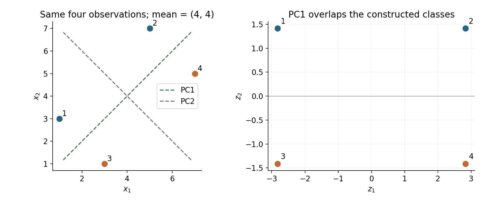
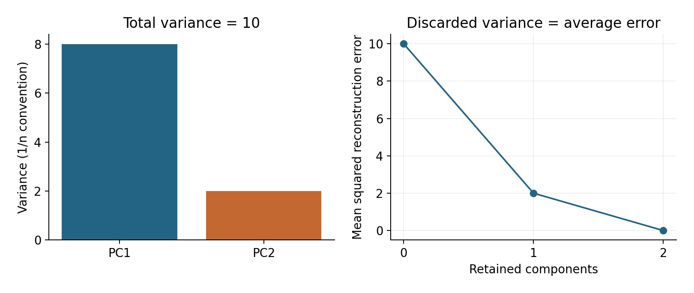

# Lecture 10 · KP03：讓資料決定投影方向（Letting data choose the projection directions）

> 程度：研究生（grad）／Level: Graduate (grad)
>
> 第 10 週（2026-11-09）｜Feature Generation I · A03
>
> Week 10 (2026-11-09) | Feature Generation I · A03

## 學習目標（Learning objectives）

- 從投影變異量推導主成分方向（Derive principal directions from projected variance）。
- 手算中心化、座標與重建誤差（Calculate centering, coordinates, and reconstruction error）。
- 區分保留變異、互不相關與分類能力（Distinguish retained variance, decorrelation, and classification ability）。

## KP03：保留變異最大的方向（Retaining the directions with greatest variance）

**一句話重點**：先扣掉平均位置，再保留變動最大的方向。這使正交投影的平均平方重建誤差最小。

**One-sentence summary**: Subtract the mean, then retain directions of greatest variation. This minimizes mean squared reconstruction error among orthogonal projections.

### 1. 從指定基底走向學習基底（From choosing a basis to learning one）

KP02 已說明怎樣換座標。
但你仍得自己指定保留方向。
若只有一個儲存欄位，該留下哪一個座標？
這次讓整批訓練資料回答。

KP02 explained coordinate changes.
You still had to choose the retained direction.
Which coordinate deserves the only available storage slot?
Now let the training observations answer.

**白話說明**：把一團資料想成地上的足跡。
沿著足跡展開最長的方向量測，通常能留下較多差異。
這個比喻只談幾何形狀。
它沒有告訴你哪些差異對分類有用。

**Plain explanation**: Imagine observations as footprints on the ground.
Measuring along their longest spread usually retains more variation.
This analogy concerns geometry.
It does not identify which differences matter for classification.

**先備自測**：確認你會扣平均、算內積與做投影。
不熟的部分可回到 KP02。

**Prerequisite check**: Check centering, inner products, and projections.
Return to KP02 for unfamiliar steps.

- $(1,3)^T-(4,4)^T=(-3,-1)^T$（Subtracting the mean gives $(-3,-1)^T$）。
- $(1,1)^T/\sqrt2$ 的長度是 $1$（Its length is $1$）。
- $(1,1)^T$ 與 $(-1,1)^T$ 內積為 $0$（Their inner product is $0$）。
- 向量投影係數為 $z=\mathbf u^T\mathbf x$（A projection coefficient is $z=\mathbf u^T\mathbf x$）。

### 2. 先說清楚資料與符號（Specifying data and notation）

**正式定義**：主成分分析依序尋找單位方向。
第一個方向使投影變異量最大。
之後的方向彼此垂直，依序保留剩餘變異。
樣本版本也稱為 Karhunen–Loève 變換。

**Formal definition**: Principal component analysis finds unit directions in sequence.
The first maximizes projected variance.
Later directions are mutually perpendicular and retain the greatest remaining variance.
The sample construction is also called the Karhunen–Loève transform.

理論上的變換使用母體共變異數。
實作通常用有限訓練樣本估計它。
因此樣本方向也有估計誤差。
本講統一以 $1/n$ 計算變異。

The population transform uses population covariance.
Implementations usually estimate it from finite training observations.
Estimated directions therefore have sampling error.
This lecture consistently uses the $1/n$ variance convention.

| 符號 | 中文意義 | English meaning |
|---|---|---|
| $n,d,m$ | 樣本數、原維度、保留維度 | Observations, input dimension, retained dimension |
| $X\in\mathbb R^{n\times d}$ | 每列一筆實數資料 | Real data with observations in rows |
| $\mu\in\mathbb R^d$ | 訓練平均向量 | Training mean vector |
| $X_c$ | 每列扣掉平均後的資料 | Centered data matrix |
| $C=X_c^TX_c/n$ | 共變異數矩陣，單位為特徵單位的乘積 | Covariance matrix, in products of feature units |
| $\lambda_j,\mathbf u_j$ | 第 $j$ 個特徵值與單位特徵向量 | Eigenvalue and unit eigenvector |
| $U_m\in\mathbb R^{d\times m}$ | 前 $m$ 個方向排成欄 | Retained directions stored as columns |
| $\mathbf z,\hat{\mathbf x}$ | 新座標與原空間重建值 | Scores and input-space reconstruction |

共變異數量測兩個座標是否一起變動。
對角元素是各座標的變異數。
本講的數值例採相同量尺、無物理單位的特徵。
量尺不同時，不能把大數值直接當重要資訊。

Covariance measures whether coordinates vary together.
Diagonal entries are individual variances.
Our numerical example uses equally scaled, dimensionless features.
With different scales, large numbers alone do not establish importance.

### 3. 為什麼特徵向量會出現（Why eigenvectors appear）

令 $\mathbf x_c=\mathbf x-\mu$。
沿單位方向 $\mathbf u$ 量出的座標為 $z=\mathbf u^T\mathbf x_c$。
中心化使座標平均為零。
所以變異就是平方座標的平均。

Let $\mathbf x_c=\mathbf x-\mu$.
The score along a unit direction is $z=\mathbf u^T\mathbf x_c$.
Centering makes the score mean zero.
Its variance is therefore the average squared score.

$$
\operatorname{Var}(z)
=\frac1n\sum_{i=1}^n(\mathbf u^T\mathbf x_{c,i})^2
=\mathbf u^TC\mathbf u.
$$

若不限制長度，把方向乘十就會讓變異乘百。
那只是在放大刻度，沒有找到更好的方向。
因此加入 $\mathbf u^T\mathbf u=1$。
拉格朗日乘數把這個限制放入同一個式子。

Without a length constraint, multiplying a direction by ten multiplies its variance by one hundred.
That changes the scale without improving the direction.
We therefore impose $\mathbf u^T\mathbf u=1$.
A Lagrange multiplier incorporates this constraint.

$$
\begin{aligned}
\mathcal L(\mathbf u,\lambda)
&=\mathbf u^TC\mathbf u-\lambda(\mathbf u^T\mathbf u-1),\\
\nabla_{\mathbf u}\mathcal L=0
&\ \Longrightarrow\ C\mathbf u=\lambda\mathbf u.
\end{aligned}
$$

特徵向量乘上 $C$ 後只改變長度。
對應特徵值就是該方向的變異量。
因為 $C$ 對稱且半正定，可取正交單位方向。
將特徵值由大排小，即得到主成分順序。

An eigenvector changes only in scale when multiplied by $C$.
Its eigenvalue equals the variance along that direction.
Since $C$ is symmetric and positive semidefinite, an orthonormal eigenbasis exists.
Sort eigenvalues in descending order to order the components.

### 4. 四筆資料的完整計算（A complete four-observation example）

**例子** `[補充]`：沿用 KP01 的四筆資料。
前兩筆標成 A，後兩筆標成 B。
標籤只供事後觀察，計算方向時完全不用。
這是人造算例，沒有訓練分類器。

**Example** `[Added]`: Reuse the four observations from KP01.
The first two have label A; the last two have label B.
Labels support interpretation only; direction estimation never uses them.
This constructed example does not train a classifier.

$$
X=\begin{bmatrix}1&3\\5&7\\3&1\\7&5\end{bmatrix},\qquad
\mu=\begin{bmatrix}4\\4\end{bmatrix}.
$$

$$
X_c=\begin{bmatrix}-3&-1\\1&3\\-1&-3\\3&1\end{bmatrix},\qquad
C=\frac14\begin{bmatrix}20&12\\12&20\end{bmatrix}
=\begin{bmatrix}5&3\\3&5\end{bmatrix}.
$$

解 $\det(C-\lambda I)=(5-\lambda)^2-9=0$。
得到 $\lambda_1=8$ 與 $\lambda_2=2$。
以下選定方向符號，方便跨單元核對。
將任一方向與全部對應座標同時反號，不會改變重建。

Solve $\det(C-\lambda I)=(5-\lambda)^2-9=0$.
The eigenvalues are $\lambda_1=8$ and $\lambda_2=2$.
We fix direction signs for comparison across units.
Reversing a direction and all corresponding scores leaves reconstruction unchanged.

$$
U=\frac1{\sqrt2}\begin{bmatrix}1&-1\\1&1\end{bmatrix},\qquad
Z=X_cU=\begin{bmatrix}
-2\sqrt2&\sqrt2\\2\sqrt2&\sqrt2\\
-2\sqrt2&-\sqrt2\\2\sqrt2&-\sqrt2
\end{bmatrix}.
$$



圖 1：先看左圖的長軸，再比右圖同一橫座標的點。
第一主成分保留較大變異，卻使 A、B 投影重疊。
顏色是另外指定的標籤。〔功能：1、2、3〕

Figure 1: Inspect the long axis on the left, then points sharing horizontal coordinates on the right.
PC1 retains more variance but overlaps A and B.
Colors represent separately assigned labels. [Function: 1, 2, 3]

### 5. 從座標回到重建誤差（From scores to reconstruction error）

對一筆新資料，先扣訓練平均，再做投影。
重建時必須把平均加回去。
若忘記這一步，你重建的是相對位置。
那不是原來的觀測值。

For a new observation, subtract the training mean before projection.
Add that mean back during reconstruction.
Omitting this step reconstructs a relative position.
It does not recover the original observation.

$$
\mathbf z=U_m^T(\mathbf x-\mu),\qquad
\hat{\mathbf x}=\mu+U_m\mathbf z.
$$

只留第一方向，四筆重建依序為 $(2,2)$、$(6,6)$、$(2,2)$、$(6,6)$。
每筆平方誤差都是 $2$。
總平方誤差為 $8$，平均為 $2$。
保留變異比例則為 $8/(8+2)=80\%$。

Keeping only PC1 reconstructs $(2,2)$, $(6,6)$, $(2,2)$, and $(6,6)$.
Each squared error is $2$.
Total squared error is $8$; the mean is $2$.
The retained variance ratio is $8/(8+2)=80\%$.

想深入：正交方向使誤差平方可以逐方向相加。
平均後，每個捨棄方向貢獻它的特徵值。
所以要減少誤差，就應捨棄最小的特徵值。
最佳性限於指定維度的正交線性投影。

Going deeper: Orthogonality lets squared errors add across directions.
After averaging, each discarded direction contributes its eigenvalue.
Discard the smallest eigenvalues to minimize error.
This optimality concerns orthogonal linear projections of the chosen dimension.

$$
\frac1n\sum_{i=1}^n\|\mathbf x_i-\hat{\mathbf x}_i\|^2
=\sum_{j=m+1}^d\lambda_j.
$$



圖 2：先把左圖兩柱相加得到總變異，再看右圖保留一維的位置。
平均誤差正好等於捨棄的變異 $2$。〔功能：1、2〕

Figure 2: Sum the left bars for total variance, then inspect one retained component on the right.
The mean error equals the discarded variance, $2$. [Function: 1, 2]

### 6. 不相關為何不等於獨立（Why uncorrelated does not mean independent）

全維座標的共變異數為 $U^TCU=\operatorname{diag}(8,2)$。
非對角元素為零，稱為互不相關。
這只排除了線性共變動。
仍可能存在非線性依賴。

The full score covariance is $U^TCU=\operatorname{diag}(8,2)$.
Zero off-diagonal entries mean the scores are uncorrelated.
This excludes linear covariation only.
Nonlinear dependence can remain.

**常見迷思**：主成分互不相關，所以一定獨立。
若資料共同服從多變量高斯分布，這個推論成立。
一般分布則沒有此保證。
同樣地，最大變異不能無條件改寫成最大資訊熵。

**Common misconception**: Uncorrelated principal scores must be independent.
That implication holds for jointly multivariate Gaussian data.
General distributions provide no such guarantee.
Likewise, maximum variance does not unconditionally imply maximum information entropy.

想深入：對變異數為 $\lambda>0$ 的一維高斯座標，微分熵如下。
在這個條件下，較大變異對應較大熵。
任意分布若只知道變異數，仍不足以決定熵。
因此這是有條件的連結，不是所有資料共有的等價。

Going deeper: A one-dimensional Gaussian score with variance $\lambda>0$ has the differential entropy below.
Under this condition, greater variance implies greater entropy.
Variance alone does not determine entropy for arbitrary distributions.
This is a conditional connection rather than a universal equivalence.

$$
h(z)=\frac12\log(2\pi e\lambda).
$$

### 7. 把公式變成可檢查的程式（Turning formulas into checkable code）

程式以每列一筆資料儲存。
對稱矩陣使用專門的特徵分解，再倒序排列。
下面只列印對符號反轉不敏感的結果。
輸出依序為特徵值、保留比例與總平方誤差。

The code stores observations in rows.
It uses a symmetric eigensolver and reverses the order.
Printed results are insensitive to eigenvector sign reversals.
Outputs are eigenvalues, retained variance ratio, and total squared error.

```python
import numpy as np
X = np.array([[1., 3.], [5., 7.], [3., 1.], [7., 5.]])
mean = X.mean(axis=0)
Xc = X - mean
values, vectors = np.linalg.eigh(Xc.T @ Xc / len(X))
order = np.argsort(values)[::-1]
values, vectors = values[order], vectors[:, order]
Z = Xc @ vectors[:, :1]
reconstruction = Z @ vectors[:, :1].T + mean
print(values.round(6))
print(round(values[0] / values.sum(), 6))
print(round(np.sum((X - reconstruction)**2), 6))
# [8. 2.]
# 0.8
# 8.0
```

### 8. 何時應該停下來檢查（When to stop and check assumptions）

中心化不等於標準化。
前者扣平均，後者還會調整各欄的尺度。
兩者得到的主軸可能不同。
應先依任務與量測單位決定，不能只挑圖較好看的版本。

Centering is different from standardization.
Centering subtracts means; standardization also adjusts feature scales.
They can produce different principal directions.
Choose using the task and measurement units, rather than visual appeal.

平均、尺度與方向都只能由訓練資料估計。
測試資料沿用這些數值。
若先把全資料一起分解，測試分布就提前影響了表示。
這稱為資料洩漏。

Estimate means, scales, and directions using training data only.
Reuse them for test observations.
Decomposing the entire dataset lets the test distribution influence the representation prematurely.
This is data leakage.

若改用 $1/(n-1)$，本例特徵值變為 $32/3$、$8/3$。
方向與保留比例不變，誤差公式則須配合分母。
特徵值相等時，對應子空間內的方向可能不唯一。
中心化矩陣的秩也不超過 $\min(d,n-1)$。

Using $1/(n-1)$ changes our eigenvalues to $32/3$ and $8/3$.
Directions and variance ratios stay unchanged; error formulas must use matching normalization.
Equal eigenvalues allow nonunique directions within their shared subspace.
Centered data have rank at most $\min(d,n-1)$.

### 9. 小練習與解題示範（Practice and worked solutions）

**小練習** `[補充]`：先寫理由，再看解答。

**Practice** `[Added]`: Write your reasoning before reading the solutions.

1. 題 1：驗算第一筆的兩個新座標（Verify both scores of the first observation）。
2. 題 2：只留第二方向，平均平方誤差是多少（What is the mean squared error when retaining only PC2）？
3. 題 3：保留 $80\%$ 變異是否表示 $80\%$ 準確率（Does $80\%$ retained variance imply $80\%$ accuracy）？

**題 1 解題示範**：中心化後為 $(-3,-1)^T$。
第一內積為 $(-3-1)/\sqrt2=-2\sqrt2$。
第二內積為 $(3-1)/\sqrt2=\sqrt2$。

**Question 1 worked solution**: The centered observation is $(-3,-1)^T$.
Its first inner product is $(-3-1)/\sqrt2=-2\sqrt2$.
The second is $(3-1)/\sqrt2=\sqrt2$.

**題 2 解題示範**：捨棄第一方向，平均誤差為 $\lambda_1=8$。
第一筆重建為 $(3,5)^T$，平方誤差為 $4+4=8$。
其餘三筆也各為 $8$，總和為 $32$。

**Question 2 worked solution**: Discarding PC1 gives mean error $\lambda_1=8$.
The first reconstruction is $(3,5)^T$, with squared error $4+4=8$.
Each remaining observation also contributes $8$, giving total error $32$.

**題 3 解題示範**：沒有這個推論。
本例第一方向甚至讓兩類座標重疊。
分類準確率需要明確模型、資料切分與獨立評估。

**Question 3 worked solution**: That implication is invalid.
Our first direction even overlaps the two classes.
Classification accuracy requires a specified model, data split, and independent evaluation.

## 術語表（Glossary）

| 中文術語 | English term |
|---|---|
| 主成分分析 | Principal component analysis, PCA |
| Karhunen–Loève 變換 | Karhunen–Loève transform, KLT |
| 中心化／標準化 | Centering / standardization |
| 共變異數／變異數 | Covariance / variance |
| 特徵值／特徵向量 | Eigenvalue / eigenvector |
| 半正定 | Positive semidefinite |
| 拉格朗日乘數 | Lagrange multiplier |
| 互不相關／獨立 | Uncorrelated / independent |
| 高斯分布／資訊熵 | Gaussian distribution / information entropy |
| 平方誤差／秩 | Squared error / rank |
| 資料洩漏 | Data leakage |
| NumPy | Python array-computing library |

## 銜接與來源（Connections and sources）

下一講用矩形資料矩陣直接取得相同方向。
你會看到共變異數特徵值與奇異值如何相連。

The next lecture obtains the same directions directly from a rectangular data matrix.
It connects covariance eigenvalues with singular values.

- 前一單元：[KP02 基底、投影與重建](lec10-kp02-basis-projection.md)（Previous unit: basis, projection, and reconstruction）。
- 下一單元：[KP04 奇異值分解](lec10-kp04-svd.md)（Next unit: singular value decomposition）。
- 來源：[Feature Generation I §6.3／A03](https://ndhuccc.github.io/CCC-LNS/PR_115/Ch06-feature-generation-i/index.html#kp3)，讀取日期 2026-11-06（Source accessed 2026-11-06）。
- 書目：Theodoridis and Koutroumbas, *Pattern Recognition*, 4th ed., 2008；見[參考資料](../references/README.md)（See the bibliography）。

本講以自己的文字解釋來源。
數值資料、圖、程式與習題為 `[補充]`。
中心化、矩陣方向與高斯條件已明確補足。

This lecture independently explains the source.
Data, figures, code, and exercises are `[Added]`.
Centering, matrix orientation, and Gaussian qualifications are made explicit.
