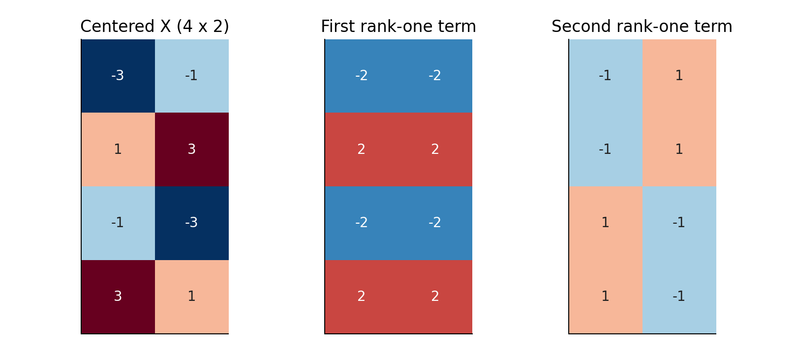
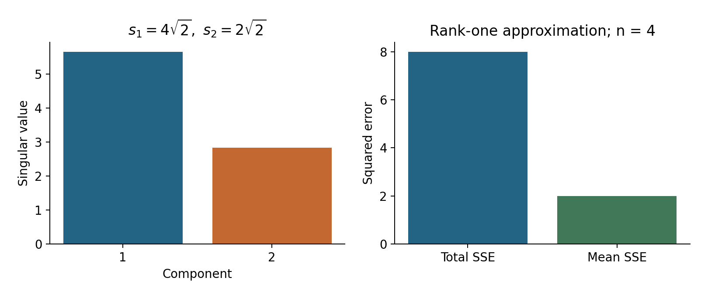

# Lecture 10 · KP04：把矩陣拆成可排序的成分（Splitting a matrix into ordered components）

> 程度：研究生（grad）／Level: Graduate (grad)
>
> 第 10 週（2026-11-09）｜Feature Generation I · A04
>
> Week 10 (2026-11-09) | Feature Generation I · A04

## 學習目標（Learning objectives）

- 說明矩形矩陣分解中各矩陣的角色與大小（Explain the roles and dimensions in a rectangular decomposition）。
- 用外積重建資料並驗算低秩誤差（Reconstruct data through outer products and verify low-rank error）。
- 連結奇異值分解與主成分分析（Connect singular value decomposition with principal component analysis）。

## KP04：由大到小保留矩陣成分（Keeping matrix components in descending order）

**一句話重點**：奇異值分解把矩陣寫成正交成分的加總。保留最大的幾項，得到指定秩下的最佳平方誤差近似。

**One-sentence summary**: Singular value decomposition expresses a matrix as a sum of orthogonal components. Keeping the largest terms minimizes squared approximation error at a specified rank.

### 1. 為什麼還需要另一種分解（Why another decomposition is useful）

KP03 先建立方形共變異數矩陣。
但實際資料往往是長方形的表格。
奇異值分解可以直接處理這張表。
它也能處理單張影像，不必先假裝影像是母體分布。

KP03 first constructed a square covariance matrix.
Actual data often form a rectangular table.
Singular value decomposition works directly with that table.
It also processes one image without treating it as a population distribution.

**白話說明**：想像把表格拆成幾張可相加的圖樣。
每張圖樣都有一個強度。
先保留最強圖樣，逐步加回較弱的部分。
這個說法指矩陣近似，不保證每張圖樣有清楚語意。

**Plain explanation**: Imagine splitting a table into additive patterns.
Each pattern has a strength.
Keep the strongest patterns first, then add weaker ones.
This describes matrix approximation; patterns need not have clear semantic meanings.

**先備自測**：外積把兩串數字組成表格。
矩陣的秩量測獨立方向的數量。
以下四題可幫你檢查必要工具。

**Prerequisite check**: An outer product turns two vectors into a table.
Matrix rank counts independent directions.
These four checks review the required tools.

- $4\times2$ 矩陣轉置後為 $2\times4$（Transposing a $4\times2$ matrix gives $2\times4$）。
- 欄向量乘列向量得到矩陣（A column times a row produces a matrix）。
- $\left\|\begin{bmatrix}1&2\end{bmatrix}\right\|_F^2=5$（The sum of squared entries is $5$）。
- 中心化資料的平均列為零（Centered observations have a zero mean row）。

### 2. 每個矩陣究竟有多大（Tracking every matrix dimension）

**正式定義**：對實數矩陣 $A$，奇異值分解為 $A=P\Sigma Q^T$。
本講使用只列出非零奇異值的緊縮形式。
左右方向各自正交單位化。
中間對角線上的非負數稱為奇異值。

**Formal definition**: For a real matrix $A$, its singular value decomposition is $A=P\Sigma Q^T$.
We use the compact form containing nonzero singular values.
Left and right directions are separately orthonormal.
The nonnegative diagonal entries are singular values.

| 符號 | 中文意義 | English meaning |
|---|---|---|
| $A\in\mathbb R^{n\times d}$ | 待分解的矩陣 | Matrix to decompose |
| $r=\operatorname{rank}(A)$ | 非零獨立方向的數量 | Number of independent nonzero directions |
| $P\in\mathbb R^{n\times r}$ | 左奇異向量為欄 | Left singular vectors in columns |
| $Q\in\mathbb R^{d\times r}$ | 右奇異向量為欄 | Right singular vectors in columns |
| $\Sigma=\operatorname{diag}(s_1,\ldots,s_r)$ | 由大排小的正奇異值 | Positive singular values in descending order |
| $A_m$ | 保留前 $m$ 項的近似矩陣 | Approximation retaining the first $m$ terms |
| $\|A\|_F$ | 所有元素平方和的平方根 | Frobenius norm |

完整形式會補齊正交方向與零區塊。
它的 $P$ 為 $n\times n$，$Q$ 為 $d\times d$。
數值工具的精簡形式常保留 $\min(n,d)$ 項。
若矩陣缺秩，其中仍可能包含零奇異值。

The full form completes the orthogonal directions and adds zero blocks.
Its $P$ is $n\times n$ and $Q$ is $d\times d$.
Numerical libraries often return a reduced form with $\min(n,d)$ terms.
Rank-deficient matrices can still have zero singular values in that form.

### 3. 為什麼需要左右兩組方向（Why there are two sets of directions）

矩陣把輸入方向映到輸出空間。
若 $\mathbf q_j$ 是右方向，輸出為 $s_j\mathbf p_j$。
反向轉置則把左方向映回 $s_j\mathbf q_j$。
因此長方形矩陣可以有不同長度的左右向量。

A matrix maps an input direction into an output space.
For right direction $\mathbf q_j$, its output is $s_j\mathbf p_j$.
The transpose maps the left direction back to $s_j\mathbf q_j$.
Rectangular matrices therefore have left and right vectors of different lengths.

本講限定實數，因此使用轉置 $T$。
複數版本要改用共軛轉置，常記成 $H$。
共軛轉置會在轉置後把虛部變號。
對應的正交單位條件也改成共軛內積。

We restrict examples to real numbers and therefore use transpose $T$.
Complex matrices require a conjugate transpose, commonly denoted $H$.
It transposes entries and reverses their imaginary signs.
Orthonormality then uses the conjugate inner product.

$$
A\mathbf q_j=s_j\mathbf p_j,\qquad
A^T\mathbf p_j=s_j\mathbf q_j.
$$

兩式連用，得到 $A^TA\mathbf q_j=s_j^2\mathbf q_j$。
另一側得到 $AA^T\mathbf p_j=s_j^2\mathbf p_j$。
兩個方陣共享非零特徵值，而不是共享同長度的向量。
實作可直接分解 $A$，避免額外建立平方矩陣。

Combining these equations gives $A^TA\mathbf q_j=s_j^2\mathbf q_j$.
The other side gives $AA^T\mathbf p_j=s_j^2\mathbf p_j$.
These square matrices share nonzero eigenvalues, rather than equal-length eigenvectors.
Implementations can decompose $A$ directly instead of explicitly forming its products.

想深入：若小奇異值很重要，直接分解通常較穩定。
因為 $A^TA$ 的非零特徵值是奇異值的平方。
最大與最小值的比例因此再平方。
有限精度下，小方向較容易受到捨入誤差影響。

Going deeper: Direct decomposition is often more stable when small singular values matter.
The nonzero eigenvalues of $A^TA$ are squared singular values.
Their largest-to-smallest ratio is therefore squared.
Finite precision can then obscure weak directions through rounding errors.

### 4. 同一組資料的兩個外積（Two outer products for the same data）

**例子** `[補充]`：使用 KP03 扣掉平均後的資料。
以下選定符號，讓左右方向能與上一講對照。
這不是唯一的符號選擇。
成對反轉左右向量，不會改變乘積。

**Example** `[Added]`: Use the centered observations from KP03.
Signs are fixed to match the previous lecture.
This sign choice is not unique.
Reversing both vectors in a pair leaves their product unchanged.

$$
A=\begin{bmatrix}-3&-1\\1&3\\-1&-3\\3&1\end{bmatrix},\qquad
A^TA=\begin{bmatrix}20&12\\12&20\end{bmatrix}.
$$

$$
P=\frac12\begin{bmatrix}-1&1\\1&1\\-1&-1\\1&-1\end{bmatrix}.
$$

$$
\Sigma=\begin{bmatrix}4\sqrt2&0\\0&2\sqrt2\end{bmatrix},\qquad
Q=\frac1{\sqrt2}\begin{bmatrix}1&-1\\1&1\end{bmatrix}.
$$

每一項 $s_j\mathbf p_j\mathbf q_j^T$ 都只有一個獨立方向。
所以它是秩一矩陣。
把兩項相加，你可以逐格核對原矩陣。
第一項已保留主要變動，第二項補回細節。

Each term $s_j\mathbf p_j\mathbf q_j^T$ has one independent direction.
It is therefore a rank-one matrix.
Add both terms to verify the original entries.
The first retains dominant variation; the second restores the remainder.

$$
A=
\begin{bmatrix}-2&-2\\2&2\\-2&-2\\2&2\end{bmatrix}
+\begin{bmatrix}-1&1\\-1&1\\1&-1\\1&-1\end{bmatrix}.
$$



圖 1：先讀左圖，再把中、右圖相同位置的數字相加。
色彩呈現正負號，數字提供精確值。〔功能：1、2〕

Figure 1: Read the left matrix, then add matching entries in the middle and right matrices.
Color encodes signs; numbers provide exact values. [Function: 1, 2]

### 5. 最佳低秩究竟保證什麼（What optimal low rank guarantees）

保留前 $m$ 項得到 $A_m$。
在所有秩不超過 $m$ 的矩陣中，它使平方和誤差最小。
這個結果稱為最佳低秩近似定理。
它不要求資料先中心化。

Retaining the first $m$ terms gives $A_m$.
It minimizes squared entrywise error among matrices with rank at most $m$.
This is the optimal low-rank approximation theorem.
It does not require centering.

$$
A_m=\sum_{j=1}^m s_j\mathbf p_j\mathbf q_j^T,
\qquad \|A-A_m\|_F^2=\sum_{j=m+1}^r s_j^2.
$$

為什麼誤差能直接相加？
左右向量的正交性使不同外積彼此垂直。
每一項的平方大小就是 $s_j^2$。
因此捨棄哪些項，就累加哪些平方。

Why can errors be added directly?
Orthogonality makes distinct outer products perpendicular under the matrix inner product.
Each term has squared magnitude $s_j^2$.
Sum the squared strengths of discarded terms.

本例只留一項，平方誤差為 $(2\sqrt2)^2=8$。
注意範數本身是 $\sqrt8=2\sqrt2$。
平方範數與範數不可混用。
近似也不保證逐筆距離或分類決策都被保留。

Keeping one term gives squared error $(2\sqrt2)^2=8$.
The norm itself is $\sqrt8=2\sqrt2$.
Do not confuse a norm with its square.
Approximation does not guarantee preservation of every pairwise distance or classification decision.



圖 2：先將左圖第二個奇異值平方，得到右圖總誤差。
再除以四筆資料，得到平均誤差 $2$。〔功能：1、2〕

Figure 2: Square the second singular value to obtain the total error on the right.
Divide by four observations to obtain mean error $2$. [Function: 1, 2]

### 6. 這與主成分分析其實相連（Connecting the decomposition to PCA）

當 $A=X_c$，共變異數為 $C=A^TA/n$。
所以右奇異向量就是主成分方向。
座標矩陣為 $Z=AQ=P\Sigma$。
這說明兩種分解如何描述同一批資料。

When $A=X_c$, covariance is $C=A^TA/n$.
Right singular vectors are therefore principal directions.
The score matrix is $Z=AQ=P\Sigma$.
The two decompositions then describe the same observations.

$$
\lambda_j=\frac{s_j^2}{n},\qquad
\lambda_1=\frac{32}{4}=8,\qquad
\lambda_2=\frac8{4}=2.
$$

**常見迷思**：奇異值就是共變異數特徵值。
中間其實隔著平方與樣本數。
若把原始 $X$ 直接分解，方向還會受到平均位置影響。
要重現中心化主成分，必須先扣平均。

**Common misconception**: Singular values equal covariance eigenvalues.
Squaring and division by the sample count separate them.
Directly decomposing raw $X$ also lets the mean influence directions.
Subtract the mean to reproduce centered principal components.

### 7. 用程式重建並核對（Reconstructing and checking with code）

下例不用計算共變異數，直接分解矩形資料。
重建中心化表格後，再加回平均。
程式印出奇異值平方、總誤差與平均誤差。
符號反轉不會影響這三項輸出。

This example decomposes the rectangular data directly without computing covariance.
It reconstructs the centered table, then adds the mean back.
Outputs are squared singular values, total error, and mean error.
Sign reversals do not affect these outputs.

```python
import numpy as np
X = np.array([[1., 3.], [5., 7.], [3., 1.], [7., 5.]])
mean = X.mean(axis=0)
A = X - mean
P, s, Qt = np.linalg.svd(A, full_matrices=False)
A1 = (P[:, :1] * s[:1]) @ Qt[:1, :]
X1 = A1 + mean
error = np.sum((X - X1)**2)
print(np.round(s**2, 6))
print(round(error, 6), round(error / len(X), 6))
# [32.  8.]
# 8.0 2.0
```

### 8. 從壓縮走向任務選擇（From compression to task choices）

奇異值大只表示矩陣能量大。
若重要訊號幅度很小，它也可能被截掉。
因此維度必須依驗證集與任務選擇。
不能只因重建圖看起來平滑就宣布學習成功。

A large singular value indicates substantial matrix energy.
A low-amplitude signal can still be important and get discarded.
Choose dimension using validation data and the actual task.
A smooth reconstruction alone does not establish successful learning.

例如潛在語意索引將詞彙與文件排成矩陣。
低秩近似提供較少維度的文件表示。
影像壓縮與推薦資料也可借用這種表示想法。
但重建的代數保證，不等於檢索或推薦品質的保證。

Latent semantic indexing, for example, arranges terms and documents in a matrix.
A low-rank approximation gives lower-dimensional document representations.
Image compression and recommendation data can use related representations.
The algebraic reconstruction guarantee does not establish retrieval or recommendation quality.

若將矩陣當影像，少量外積有時可節省儲存。
但本例的矩陣太小，因子未必比較省。
實數參數數量約為 $m(n+d+1)$。
它須小於 $nd$ 才有直接的參數數量優勢。

For an image matrix, a few outer products can sometimes reduce storage.
Our matrix is too small to ensure savings.
The factors store approximately $m(n+d+1)$ real parameters.
This must be below $nd$ for a direct parameter-count advantage.

而且正交成分可含負數。
若資料代表濃度或亮度，負成分的解釋可能困難。
下一講會改變限制條件，要求因子都非負。
代價是失去這裡簡潔的全域最佳解。

Orthogonal components can also contain negative entries.
Negative components can be hard to interpret for concentrations or brightness.
The next lecture instead requires nonnegative factors.
The cost is losing this simple global optimum.

### 9. 小練習與解題示範（Practice and worked solutions）

**小練習** `[補充]`：把大小、平方與平均分開核對。

**Practice** `[Added]`: Check dimensions, squares, and averaging separately.

1. 題 1：本例緊縮分解三個矩陣多大（What are the three compact factor dimensions）？
2. 題 2：捨棄第二項的範數及平方範數各是多少（What are the residual norm and squared norm）？
3. 題 3：若 $n=4$ 且奇異值為 $6$，共變異數特徵值是多少（For $n=4$ and singular value $6$, what is the covariance eigenvalue）？

**題 1 解題示範**：秩為 $2$。
所以大小依序是 $4\times2$、$2\times2$、$2\times2$。
乘積仍為 $4\times2$。

**Question 1 worked solution**: The rank is $2$.
Factor dimensions are $4\times2$, $2\times2$, and $2\times2$.
Their product is $4\times2$.

**題 2 解題示範**：殘差是圖 1 的第二項。
八個元素的平方都為 $1$。
平方範數為 $8$，範數為 $2\sqrt2$。

**Question 2 worked solution**: The residual is the second term in Figure 1.
All eight entries have squared value $1$.
The squared norm is $8$; the norm is $2\sqrt2$.

**題 3 解題示範**：在中心化及 $1/n$ 慣例下，$\lambda=6^2/4=9$。
若改用另一種分母，必須重新換算。

**Question 3 worked solution**: With centering and the $1/n$ convention, $\lambda=6^2/4=9$.
A different denominator requires conversion.

## 術語表（Glossary）

| 中文術語 | English term |
|---|---|
| 奇異值分解 | Singular value decomposition, SVD |
| 奇異值／奇異向量 | Singular value / singular vector |
| 緊縮形式／秩 | Compact form / rank |
| 外積 | Outer product |
| Frobenius 範數 | Frobenius norm |
| 最佳低秩近似 | Optimal low-rank approximation |
| 共變異數／主成分分析 | Covariance / principal component analysis, PCA |
| 特徵值／正交單位 | Eigenvalue / orthonormal |
| 有限精度／捨入誤差 | Finite precision / rounding error |
| 共軛轉置／潛在語意索引 | Conjugate transpose / latent semantic indexing, LSI |
| 驗證集 | Validation set |
| NumPy | Python array-computing library |

## 銜接與來源（Connections and sources）

- 前一單元：[KP03 主成分分析](lec10-kp03-pca-klt.md)（Previous unit: principal component analysis）。
- 下一單元：[KP05 非負矩陣分解](lec10-kp05-nmf.md)（Next unit: nonnegative matrix factorization）。
- 來源：[Feature Generation I §6.4／A04](https://ndhuccc.github.io/CCC-LNS/PR_115/Ch06-feature-generation-i/index.html#kp4)，讀取日期 2026-11-06（Source accessed 2026-11-06）。
- 書目：Theodoridis and Koutroumbas, *Pattern Recognition*, 4th ed., 2008；見[參考資料](../references/README.md)（See the bibliography）。

文字為重新講解，數值、圖、程式與習題為 `[補充]`。
本講分開使用奇異值 $s_j$ 與共變異數特徵值 $\lambda_j$。
所有平方誤差都標示是否除以樣本數。

Explanations are independently written; examples, figures, code, and exercises are `[Added]`.
Singular values $s_j$ are distinguished from covariance eigenvalues $\lambda_j$.
Squared errors explicitly state whether division by sample count is used.
