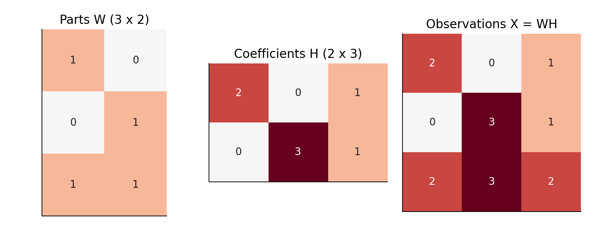
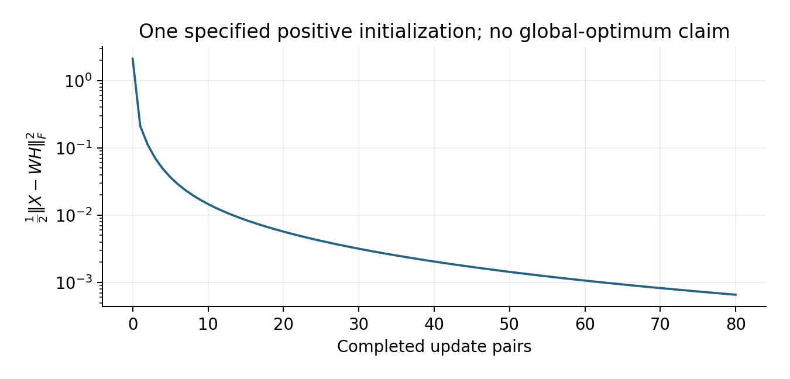

# Lecture 10 · KP05：用非負部件組合資料（Building data from nonnegative parts）

> 程度：研究生（grad）／Level: Graduate (grad)
>
> 第 10 週（2026-11-09）｜Feature Generation I · A06
>
> Week 10 (2026-11-09) | Feature Generation I · A06

## 學習目標（Learning objectives）

- 解釋非負限制如何改變分解的意義（Explain how nonnegativity changes a factorization）。
- 算出部件的加法重建及損失（Calculate additive reconstruction and its loss）。
- 理解更新方法、非唯一性與使用限制（Understand updates, nonuniqueness, and practical limits）。

## KP05：限制加法，換取可解釋的可能性（Using additive constraints for potential interpretability）

**一句話重點**：把非負資料拆成非負部件與用量。部件只能相加，但不保證自然產生唯一或稀疏的解。

**One-sentence summary**: Factor nonnegative data into nonnegative parts and amounts. Contributions add, but uniqueness and sparsity are not guaranteed.

### 1. 負數成分為什麼可能不方便（Why negative components can be inconvenient）

上一講允許正負成分互相抵消。
這能得到漂亮的正交最佳解。
但若你量的是化學濃度，負的部件用量很難解釋。
非負矩陣分解因此改變了允許的表示方式。

The previous lecture allowed positive and negative contributions to cancel.
That produces an elegant orthogonal optimum.
For chemical concentrations, however, negative component amounts are difficult to interpret.
Nonnegative matrix factorization changes the allowed representation.

**白話說明**：想像用幾種原料調配一杯飲料。
每種原料的用量只能是零或正數。
這有助於理解組合，卻不保證原料就是真實成分。
飲料比喻也沒有描述所有資料的物理機制。

**Plain explanation**: Imagine mixing a drink from several ingredients.
Each amount must be zero or positive.
This aids interpretation but does not identify the true ingredients automatically.
The drink analogy also need not match a dataset's physical mechanism.

**先備自測**：本講將每筆資料改放在一欄。
這讓字典乘係數的大小更容易辨認。

**Prerequisite check**: This lecture stores each observation in a column.
That orientation clarifies dictionary-times-coefficients dimensions.

- $3\times2$ 乘 $2\times3$ 得到 $3\times3$（The product has shape $3\times3$）。
- $2(1,0,1)^T+(0,1,1)^T=(2,1,3)^T$（The weighted sum is $(2,1,3)^T$）。
- 非負包含零（Nonnegative includes zero）。
- 平方和為零表示每個殘差都為零（A zero sum of squares means every residual is zero）。

### 2. 非負限制取代正交限制（Nonnegativity replaces orthogonality）

**正式定義**：給定逐元素非負的矩陣 $X$。
選擇較小的成分數 $r$，尋找 $X\approx WH$。
兩個因子也必須逐元素非負。
通常不要求部件方向彼此垂直。

**Formal definition**: Given an entrywise nonnegative matrix $X$, choose a small component count $r$ and seek $X\approx WH$.
Both factors must also be entrywise nonnegative.
The part directions generally need not be orthogonal.

| 符號 | 中文意義 | English meaning |
|---|---|---|
| $X\in\mathbb R_{\ge0}^{d\times n}$ | 每欄一筆非負觀測 | Nonnegative observations in columns |
| $r<\min(d,n)$ | 選定的部件數 | Selected number of parts |
| $W\in\mathbb R_{\ge0}^{d\times r}$ | 每欄一個部件或字典向量 | Parts or dictionary columns |
| $H\in\mathbb R_{\ge0}^{r\times n}$ | 每筆資料使用各部件的量 | Component amounts per observation |
| $F(W,H)$ | 平方殘差的一半，單位為輸入單位平方 | Half the squared residual, in squared input units |
| $\odot,\oslash$ | 逐元素相乘與相除 | Entrywise multiplication and division |

字典指可供組合的一組向量。
若 $W$ 的欄表示原料，$H$ 的欄就記錄配方。
部件尺度可以自行約定。
一旦固定尺度，係數的大小才有一致解釋。

A dictionary is a collection of available component vectors.
If columns of $W$ are ingredients, columns of $H$ are recipes.
Component scales require a convention.
Coefficient magnitudes become comparable only after that convention is fixed.

### 3. 一個可逐格重建的例子（An entrywise reconstruction example）

**例子** `[補充]`：三個量測欄位、三筆觀測、兩個部件。
以下各值都是無單位的人造數字。
這組已知因子只用來示範重建。
它不表示演算法一定會找回這組因子。

**Example** `[Added]`: Use three measurement dimensions, three observations, and two parts.
All values are constructed and dimensionless.
Known factors demonstrate reconstruction.
An algorithm need not recover these particular factors.

$$
W=\begin{bmatrix}1&0\\0&1\\1&1\end{bmatrix},\qquad
H=\begin{bmatrix}2&0&1\\0&3&1\end{bmatrix}.
$$

$$
X=WH=\begin{bmatrix}2&0&1\\0&3&1\\2&3&2\end{bmatrix}.
$$

第一筆取兩份第一部件，得到 $(2,0,2)^T$。
第二筆取三份第二部件，得到 $(0,3,3)^T$。
第三筆各取一份，得到 $(1,1,2)^T$。
兩個部件的內積是 $1$，因此並不正交。

The first observation uses two units of part one, giving $(2,0,2)^T$.
The second uses three units of part two, giving $(0,3,3)^T$.
The third uses one of each, giving $(1,1,2)^T$.
The parts have inner product $1$, so they are not orthogonal.



圖 1：先看左圖兩欄，再用中圖的一欄作配方。
乘完相加後，核對右圖對應的一欄。〔功能：1、2〕

Figure 1: Read the two left columns, then use one middle column as a recipe.
Multiply and add to verify the corresponding right column. [Function: 1, 2]

### 4. 要最小化哪種差異（Choosing the mismatch measure）

最常見的版本使用平方損失。
它對較大的殘差給較重的處罰。
本講放上 $1/2$，只是讓微分後的係數簡單。
這個常數不會改變最佳因子的位置。

The common squared-loss version penalizes large residuals more heavily.
Our factor $1/2$ simplifies differentiation.
That constant does not change which factors minimize the objective.

$$
\min_{W,H\ge0}F(W,H),\qquad F=\frac12\|X-WH\|_F^2.
$$

另一種版本是廣義相對熵損失。
它逐格比較實際值與預測值的比例。
以下 $x,y$ 分別代表 $X_{ij}$ 與 $(WH)_{ij}$。
當 $x=0$ 時，約定 $x\log(x/y)=0$。

Another version uses generalized relative entropy.
It compares observed and predicted entrywise ratios.
Below, $x,y$ denote $X_{ij}$ and $(WH)_{ij}$.
For $x=0$, define $x\log(x/y)=0$.

$$
D(X\|WH)=\sum_{ij}\left[x\log\frac{x}{y}-x+y\right].
$$

若 $x>0$ 而 $y=0$，損失為無限大。
兩邊元素總和相等時，線性項會抵消。
兩邊都採機率正規化時，就對應通常的相對熵。
不能只正規化其中一方，就直接宣稱等價。

If $x>0$ but $y=0$, the loss is infinite.
Equal total masses cancel the linear terms.
With both arguments probability-normalized, the expression yields ordinary relative entropy.
Normalizing only one argument does not establish equivalence.

### 5. 乘法更新如何運作（How multiplicative updates work）

固定一個因子時，另一個因子的平方損失是凸的。
但同時求兩個因子，整體問題通常不是凸的。
因此初始值可能影響最後結果。
我們通常交替更新兩邊。

With one factor fixed, squared loss is convex in the other.
Joint optimization is generally nonconvex.
Initialization can therefore affect the result.
We typically alternate between the factors.

想深入：先微分，再把正負貢獻分開看。
分子代表資料支持的增加量。
分母代表目前重建造成的抑制量。
以下除法及乘法都逐元素執行。

Going deeper: Differentiate, then separate positive and negative contributions.
The numerator encourages contributions supported by data.
The denominator suppresses contributions already explained by the reconstruction.
The divisions and multiplications below are entrywise.

$$
\begin{aligned}
\nabla_HF&=W^TWH-W^TX,\\
\nabla_WF&=WHH^T-XH^T.
\end{aligned}
$$

$$
H\leftarrow H\odot\frac{W^TX}{W^TWH},\qquad
W\leftarrow W\odot\frac{XH^T}{WHH^T}.
$$

先更新 $H$，再用新的 $H$ 更新 $W$。
非負初始值與有效分母可保持非負性。
精確更新具有損失不增加的性質。
這不等於保證找到全域最佳解或真正的部件。

Update $H$ first, then update $W$ using the new $H$.
Nonnegative initialization and valid denominators preserve nonnegativity.
Exact updates have a nonincreasing-loss property.
This does not guarantee a global optimum or recovery of true parts.

### 6. 實際跑一次，再看損失（Running the updates and checking loss）

以下使用指定的正初始值，執行八十次更新對。
分母加上數值下限以避免除零。
下限是實作保護，不是新的最佳性定理。
應實際記錄損失，而非只看演算法名稱。

The code uses specified positive initial factors and eighty update pairs.
A denominator floor prevents division by zero.
This is a numerical safeguard, rather than an additional optimality theorem.
Record the loss instead of trusting an algorithm name.

乘法更新不是唯一方法。
投影梯度法會走梯度步，再把因子投回非負區域。
也可使用牛頓類方法等數值最佳化程序。
選擇方法仍須核對非負限制、停止條件與損失。

Multiplicative updates are not the only option.
Projected gradient methods take gradient steps and project factors back into the nonnegative region.
Newton-type numerical optimization methods are also available.
Regardless of the solver, check nonnegativity, stopping conditions, and loss.

```python
import numpy as np
X = np.array([[2., 0., 1.], [0., 3., 1.], [2., 3., 2.]])
W = np.array([[1., .2], [.2, 1.], [.8, .8]])
H = np.array([[1.5, .2, .8], [.2, 2., .8]])
loss = [0.5 * np.sum((X - W @ H)**2)]
for _ in range(80):
    H *= (W.T @ X) / np.maximum(W.T @ W @ H, 1e-12)
    W *= (X @ H.T) / np.maximum(W @ H @ H.T, 1e-12)
    loss.append(0.5 * np.sum((X - W @ H)**2))
assert np.all(np.diff(loss) <= 1e-10)
assert np.all(W >= 0) and np.all(H >= 0)
print(loss[-1] < loss[0])
# True
```



圖 2：橫軸是已完成的更新對，縱軸使用對數刻度。
先看是否持續下降，再注意它沒有證明唯一或全域最佳。〔功能：1、2〕

Figure 2: The horizontal axis counts completed update pairs; the vertical axis is logarithmic.
Check loss reduction, then remember that it proves neither uniqueness nor global optimality. [Function: 1, 2]

### 7. 可解釋之前，先處理不確定性（Handling ambiguity before interpretation）

**常見迷思**：非負就一定稀疏，且每個部件都是真實物件。
非負只限制正負號，沒有要求大量係數等於零。
若需要稀疏性，通常須另加限制或懲罰。
部件的意義也須靠領域知識與穩定性檢查支持。

**Common misconception**: Nonnegativity guarantees sparsity and physically real parts.
It restricts signs without requiring many coefficients to be zero.
Sparsity generally requires another constraint or penalty.
Interpretation also needs domain knowledge and stability checks.

即使重建完全正確，因子仍可能不唯一。
令 $S=\operatorname{diag}(2,1/2)$。
則 $(WS)(S^{-1}H)=WH$。
此外，交換部件與對應係數的順序也不改變結果。

Even exact reconstruction need not produce unique factors.
Let $S=\operatorname{diag}(2,1/2)$.
Then $(WS)(S^{-1}H)=WH$.
Permuting parts and their matching coefficient rows also leaves the product unchanged.

零初始係數在乘法更新中會一直為零。
這稱為零鎖定，可能妨礙探索。
常用正初始值並比較多次起點。
還要記錄成分數、停止準則與最後損失。

A zero initial entry stays zero under multiplicative updates.
This zero-locking effect can restrict exploration.
Positive initialization and multiple starts are common safeguards.
Record component count, stopping criterion, and final loss as well.

### 8. 新資料與負值要怎麼處理（Handling new observations and negative entries）

用訓練資料學好 $W$ 後，測試時固定字典。
只替新觀測求非負係數。
若測試時重新學字典，表示空間就改了。
這不能直接當成同一個下游模型的輸入。

After learning $W$ from training data, keep it fixed at test time.
Estimate only nonnegative coefficients for a new observation.
Relearning the dictionary changes the representation.
Those coefficients cannot automatically feed the same downstream model.

中心化後的資料常有負值，因此不能直接套本版分解。
也不能悄悄把負值截成零。
截值會改變資料與損失的意義。
應先決定量測表示是否適合非負假設。

Centered data often contain negative entries, violating this formulation.
Do not silently clip negatives to zero.
Clipping changes both data and the objective's meaning.
First decide whether the measurement representation supports nonnegativity.

### 9. 小練習與解題示範（Practice and worked solutions）

**小練習** `[補充]`：分別檢查重建、尺度與條件。

**Practice** `[Added]`: Check reconstruction, scaling, and assumptions separately.

1. 題 1：係數 $(1,2)^T$ 會組成哪筆資料（Which observation results from coefficients $(1,2)^T$）？
2. 題 2：第一部件放大兩倍，係數要怎麼改（How must coefficients change if part one doubles）？
3. 題 3：已知例子的平方損失是多少（What is the known factorization's squared loss）？

**題 1 解題示範**：$W(1,2)^T=(1,2,3)^T$。
第三座標是兩個部件的貢獻相加，得到 $1+2=3$。

**Question 1 worked solution**: $W(1,2)^T=(1,2,3)^T$.
The third coordinate adds both contributions, giving $1+2=3$.

**題 2 解題示範**：把 $H$ 第一列除以二。
每個乘積仍相同；第二部件與第二列不必改。
這證明非負因子的尺度不唯一。

**Question 2 worked solution**: Divide the first row of $H$ by two.
Each contribution stays unchanged; the second part and coefficient row need no change.
This demonstrates scale ambiguity.

**題 3 解題示範**：已知因子滿足 $X=WH$。
因此九個殘差全為零，平方損失也為零。
這不保證任意初始值的迭代都能找到它。

**Question 3 worked solution**: The given factors satisfy $X=WH$.
All nine residuals and the squared loss are zero.
Iterations from arbitrary initial values need not find those factors.

## 術語表（Glossary）

| 中文術語 | English term |
|---|---|
| 非負矩陣分解 | Nonnegative matrix factorization, NMF |
| 字典／係數 | Dictionary / coefficient |
| 平方損失 | Squared loss |
| 廣義相對熵 | Generalized Kullback–Leibler divergence, KL divergence |
| 乘法更新 | Multiplicative update |
| 投影梯度法／牛頓法 | Projected gradient method / Newton method |
| 凸／非凸 | Convex / nonconvex |
| 全域最佳解 | Global optimum |
| 稀疏性／零鎖定 | Sparsity / zero locking |
| 尺度不唯一 | Scale ambiguity |
| NumPy | Python array-computing library |

## 銜接與來源（Connections and sources）

- 前一單元：[KP04 奇異值分解](lec10-kp04-svd.md)（Previous unit: singular value decomposition）。
- 下一單元：[KP06 非線性降維與流形](lec10-kp06-manifold.md)（Next unit: nonlinear reduction and manifolds）。
- 來源：[Feature Generation I §6.6／A06](https://ndhuccc.github.io/CCC-LNS/PR_115/Ch06-feature-generation-i/index.html#kp6)，讀取日期 2026-11-06（Source accessed 2026-11-06）。
- 書目：Theodoridis and Koutroumbas, *Pattern Recognition*, 4th ed., 2008；見[參考資料](../references/README.md)（See the bibliography）。

部件算例、更新初始值、圖與習題均為 `[補充]`。
來源的收斂敘述在此限定為適用更新條件下的損失性質。
未宣稱全域最佳、唯一性或必然稀疏。

Parts, initialization, figures, and exercises are `[Added]`.
The source's convergence statement is qualified by the applicable update conditions.
No global optimality, uniqueness, or automatic sparsity is claimed.
