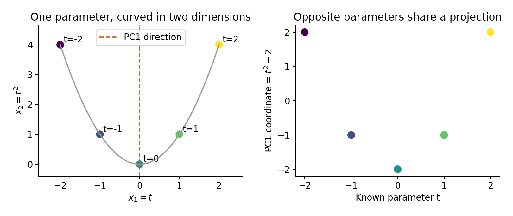
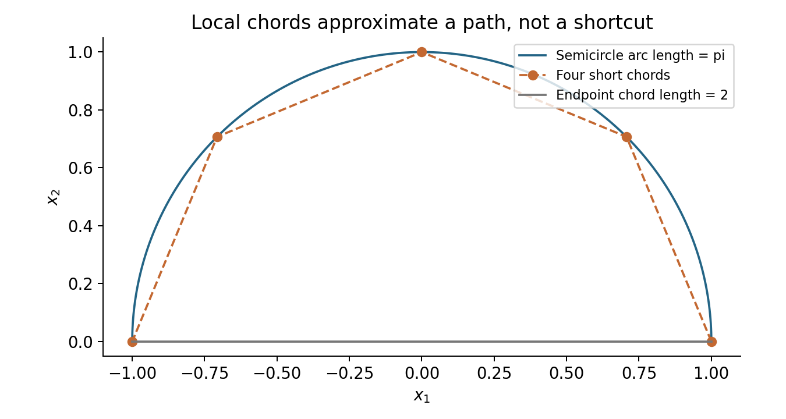

# Lecture 10 · KP06：彎曲資料需要保留什麼（What to preserve in curved data）

> 程度：研究生（grad）／Level: Graduate (grad)
>
> 第 10 週（2026-11-09）｜Feature Generation I · A07
>
> Week 10 (2026-11-09) | Feature Generation I · A07

## 學習目標（Learning objectives）

- 分辨觀測維度與內在維度（Distinguish ambient and intrinsic dimension）。
- 用算例說明最大變異與展開曲線的差異（Explain why maximum variance and unfolding a curve differ）。
- 比較直線距離、沿面距離與鄰接圖（Compare straight-line distance, surface distance, and neighborhood graphs）。

## KP06：先選擇要保留的結構（First decide which structure matters）

**一句話重點**：資料可能只由少數參數控制，卻彎在高維空間中。非線性降維要保留的結構，必須先說清楚。

**One-sentence summary**: A few parameters can generate data curved through a higher-dimensional space. Specify the structure a nonlinear representation should preserve.

### 1. 座標很多，不代表自由變化很多（Many coordinates need not mean many degrees of freedom）

前幾講在整個資料集上使用固定方向。
現在想像一張捲起的紙。
紙上的位置需要兩個局部座標，外部位置卻用三個座標描述。
紙面可以彎曲，因此一個平面投影未必保留鄰近關係。

Earlier lectures used fixed directions across the entire dataset.
Now imagine a rolled sheet of paper.
Positions on the sheet need two local coordinates but three external coordinates.
Its curvature means a planar projection may distort neighborhood relationships.

**白話說明**：拍到的座標數，是儲存方式的大小。
真正能獨立改動的參數數，是資料的自由度。
兩者未必相同。
紙張比喻需要紙面連續、沒有任意破裂等條件。

**Plain explanation**: Recorded coordinates measure the size of a representation.
Independently adjustable parameters measure degrees of freedom.
Those counts need not match.
The paper analogy assumes a continuous sheet without arbitrary tears.

**先備自測**：請先區分資料點、參數與距離。

**Prerequisite check**: Distinguish observations, generating parameters, and distances.

- $(t,t^2)$ 有兩個座標，但只由一個 $t$ 決定（Two coordinates depend on one parameter）。
- $(1,0)$ 與 $(-1,0)$ 的直線距離是 $2$（Their straight-line distance is $2$）。
- 單位半圓的弧長是 $\pi$（A unit semicircle has arc length $\pi$）。
- 投影可能把不同資料點變成相同座標（A projection can map distinct observations to the same coordinate）。

### 2. 流形假設到底假設了什麼（What the manifold hypothesis assumes）

**正式定義**：流形是在局部可用少量連續座標描述的空間。
局部是指每個點附近的一小片。
整體可以彎曲，卻不必是一個平面。
內在維度是描述這種局部變化所需的座標數。

**Formal definition**: A manifold is a space describable locally using a small number of continuous coordinates.
Locally means within a small region around each point.
The whole space can curve instead of forming a plane.
Intrinsic dimension counts coordinates needed for that local variation.

流形假設主張：觀測大致靠近某個低維流形。
它是建模前提，不是每個資料集都符合的定理。
雜訊、交叉結構及不連通族群都可能破壞簡單圖像。
有限資料也未必足以辨認其維度。

The manifold hypothesis proposes that observations lie near a low-dimensional manifold.
It is a modeling assumption rather than a universal theorem.
Noise, intersections, and disconnected populations can complicate this picture.
Finite samples may not identify its dimension reliably.

主成分數量量測資料需要幾個線性方向。
內在維度則量測局部自由變化。
一條彎曲線可能需要多個線性方向才能低誤差重建。
所以不能把主成分的個數直接當成內在維度。

Component counts measure how many linear directions represent the data.
Intrinsic dimension measures local degrees of freedom.
A curved line can need several linear directions for accurate reconstruction.
Principal-component counts therefore need not equal intrinsic dimension.

| 符號 | 中文意義 | English meaning |
|---|---|---|
| $d,q$ | 觀測維度與內在維度 | Ambient and intrinsic dimension |
| $\mathbf t\in\mathbb R^q$ | 局部控制參數 | Local generating parameters |
| $\mathbf x=f(\mathbf t)\in\mathbb R^d$ | 映射後的觀測 | Generated observation |
| $d_E(\mathbf x,\mathbf x')$ | 直線的歐氏距離 | Euclidean straight-line distance |
| $d_M(\mathbf x,\mathbf x')$ | 限在流形上的最短路徑長 | Geodesic distance on a manifold |
| $k,\epsilon$ | 鄰居數與距離半徑 | Neighbor count and distance radius |
| $W_{ij}$ | 兩點是否相鄰及相鄰權重 | Adjacency or neighborhood weight |

### 3. 五個點就能看見投影碰撞（Seeing projection collisions with five points）

**例子** `[補充]`：取 $t=-2,-1,0,1,2$，令 $\mathbf x=(t,t^2)^T$。
資料都在拋物線上。
儘管觀測有兩個座標，生成參數只有一個。
現在看看最大變異投影會選什麼。

**Example** `[Added]`: Take $t=-2,-1,0,1,2$ and $\mathbf x=(t,t^2)^T$.
All observations lie on a parabola.
They have two observed coordinates but one generating parameter.
Consider which direction maximum-variance projection selects.

$$
X=\begin{bmatrix}-2&4\\-1&1\\0&0\\1&1\\2&4\end{bmatrix},\qquad
\mu=\begin{bmatrix}0\\2\end{bmatrix}.
$$

$$
C=\frac15X_c^TX_c
=\begin{bmatrix}2&0\\0&2.8\end{bmatrix}.
$$

第二座標變異比較大，所以第一主軸為垂直方向。
投影依序為 $2,-1,-2,-1,2$。
其中 $t=-2$ 與 $t=2$ 得到相同座標。
因此這個表示不能辨認曲線上的每個位置。

The second coordinate has greater variance, so PC1 is vertical.
Scores are $2,-1,-2,-1,2$.
Parameters $t=-2$ and $t=2$ share a score.
This representation cannot distinguish every location on the curve.



圖 1：先按顏色沿左圖曲線走，再讀右圖投影值。
成對相反的參數在縱座標上重合。〔功能：1、2、3〕

Figure 1: Follow colors along the left curve, then inspect the right projection values.
Opposite parameters share vertical scores. [Function: 1, 2, 3]

**常見迷思**：這證明所有線性投影都無法展開曲線。
其實本例投到水平軸就直接得到 $t$。
它只證明最大變異目標未必符合辨認曲線位置的需求。
不能拿這個算例宣稱非線性方法一定比較好。

**Common misconception**: This proves every linear projection fails to unfold a curve.
Projecting horizontally actually returns $t$ directly.
The example only shows that maximum variance may conflict with identifying curve positions.
It does not establish universal superiority of nonlinear methods.

### 4. 鄰近的直線為何可以代替小段曲線（Why short chords can approximate a curved path）

測地距離是沿指定空間走的最短路徑長。
它通常不同於穿過空間的直線距離。
若流形平滑，兩點夠近時，短弦可以近似短弧。
但不能把這個局部近似直接套到遠處。

Geodesic distance is the shortest path constrained to the specified space.
It generally differs from a straight line through the ambient space.
On a smooth manifold, sufficiently short chords approximate short arcs.
This local approximation need not hold for distant points.

在單位半圓上，兩端的直線距離為 $2$。
沿半圓走則長 $\pi\approx3.141593$。
分成四段短弦，每段長 $\sqrt{2-\sqrt2}$。
總長約 $3.061467$，比單一長弦更接近弧長。

The endpoints of a unit semicircle have straight-line distance $2$.
Their semicircular path length is $\pi\approx3.141593$.
Four equal short chords each have length $\sqrt{2-\sqrt2}$.
Their total is about $3.061467$, closer to the arc length than the single long chord.



圖 2：先比較底部長弦與上方弧線，再追蹤四段短弦。
短距離累加可以近似路徑，但取樣太疏就會失準。〔功能：1、2、3〕

Figure 2: Compare the bottom chord with the arc, then follow the four short chords.
Accumulating local distances can approximate a path, but sparse sampling weakens that approximation. [Function: 1, 2, 3]

### 5. 鄰接圖如何把假設交給演算法（Encoding assumptions in a neighborhood graph）

圖由節點與連線組成，每筆資料是一個節點。
你可以連接半徑內的點，或每點最近的幾個鄰居。
連線宣告哪些局部關係可信。
因此建圖已經是模型的一部分。

A graph contains nodes and edges; each observation becomes a node.
Connect points within a radius or connect each point to its nearest neighbors.
Edges declare which local relationships are trusted.
Graph construction is therefore part of the model.

半徑太小，圖可能斷成多塊。
半徑太大，可能跨過彎曲表面的空隙形成捷徑。
最近鄰規則也有同樣取捨。
不同密度區域未必適合相同的尺度。

A radius that is too small can disconnect the graph.
A radius that is too large can create shortcuts across folded surfaces.
Nearest-neighbor rules face similar tradeoffs.
Regions with different densities may require different scales.

若採最近鄰，每點的鄰居關係可能不對稱。
需要明確選擇聯集或交集等對稱化規則。
後續的對稱特徵問題仰賴這個處理。
不能把它當成不影響結果的排版細節。

Nearest-neighbor relationships can be asymmetric.
Specify a symmetrization rule, such as union or intersection.
Later symmetric eigenproblems depend on that choice.
It can materially affect the result.

### 6. 方法名稱背後是不同保留目標（Different methods preserve different structures）

核方法先定義非線性相似度，再在隱含特徵空間做線性分析。
圖方法先選可信鄰居，再定義低維表示的代價。
這是方便入門的分法，不是互斥分類。
某些圖方法也能改寫成核形式。

Kernel methods define nonlinear similarity and perform linear analysis in an implicit feature space.
Graph methods choose trusted neighbors and define a low-dimensional objective.
This introductory division is not mutually exclusive.
Some graph methods also admit kernel formulations.

| 方法 | 主要保留目標 | Main preservation target |
|---|---|---|
| Kernel PCA | 特徵空間的變異 | Feature-space variance |
| Laplacian Eigenmaps | 高權重鄰居接近 | Closeness of strongly connected neighbors |
| LLE | 同一組局部重建權重 | Fixed local reconstruction weights |
| ISOMAP | 圖最短路徑距離 | Graph shortest-path distances |

### 7. 實際核對，而不是只看圖（Checking numbers rather than appearances）

以下程式核對拋物線共變異數與短弦長。
它沒有執行任何非線性學習器。
生成參數 $t$ 是我們預先知道的答案。
不能把已知參數的圖當成演算法成功的證據。

This code checks parabola covariance and chord length.
It does not run a nonlinear learner.
The generating parameter $t$ is known by construction.
A plot of known parameters is not evidence of algorithmic success.

```python
import numpy as np
t = np.arange(-2., 3.)
X = np.column_stack([t, t**2])
Xc = X - X.mean(axis=0)
print(np.round(Xc.T @ Xc / len(X), 6))
print(round(4 * np.sqrt(2 - np.sqrt(2)), 6))
# [[2.  0. ]
#  [0.  2.8]]
# 3.061467
```

### 8. 評估之前先定義成功（Defining success before evaluation）

想深入：生成參數未必就是距離座標。
拋物線的相同 $t$ 增量，在不同位置有不同弧長。
所以恢復參數與保留測地距離是兩個問題。
演算法目標不同，不能只用一張漂亮的圖排名。

Going deeper: A generating parameter need not be a distance coordinate.
Equal increments of $t$ give different arc lengths along a parabola.
Recovering parameters and preserving geodesic distances are different tasks.
Do not rank distinct objectives using visual appeal alone.

應檢查鄰居是否穩定、圖是否連通，以及下游任務表現。
若已有標籤，評估時才依預先設計的切分使用。
無監督表示不自動保證類別分離。
圖方法對新資料的延伸也需要另外定義。

Check neighbor stability, graph connectivity, and downstream performance.
When labels exist, use them under a predefined evaluation split.
Unsupervised representations do not automatically separate classes.
Graph-based extension to new observations also requires an explicit rule.

### 9. 小練習與解題示範（Practice and worked solutions）

**小練習** `[補充]`：先說明你要保留什麼。

**Practice** `[Added]`: State the target structure first.

1. 題 1：拋物線例子的觀測維度與內在維度是多少（What are the ambient and intrinsic dimensions）？
2. 題 2：第一主成分為何合併 $t=-1$ 與 $t=1$（Why does PC1 merge $t=-1$ and $t=1$）？
3. 題 3：把半圓兩端直接連邊，對路徑估計有何影響（How does directly connecting semicircle endpoints affect path estimation）？

**題 1 解題示範**：觀測在二維平面，故 $d=2$。
曲線局部只需一個參數，故 $q=1$。
這使用生成曲線的已知結構，不是只憑五點估計出的定理。

**Question 1 worked solution**: Observations lie in a plane, so $d=2$.
The generating curve locally needs one parameter, so $q=1$.
This uses known generating structure rather than a theorem inferred from five samples.

**題 2 解題示範**：第一主成分取第二欄扣平均。
兩點的第二欄都是 $1$，故座標都是 $1-2=-1$。
若改取第一欄，兩點仍可區分。

**Question 2 worked solution**: PC1 uses the centered second coordinate.
Both observations have second coordinate $1$, so both scores equal $1-2=-1$.
The first coordinate would distinguish them.

**題 3 解題示範**：端點最短路徑立即變成 $2$。
這條捷徑低估真正弧長 $\pi$。
建圖規則因而改變了你宣稱要保留的幾何。

**Question 3 worked solution**: The endpoint shortest path immediately becomes $2$.
That shortcut underestimates the true arc length $\pi$.
Graph construction has changed the geometry being modeled.

## 術語表（Glossary）

| 中文術語 | English term |
|---|---|
| 流形／流形假設 | Manifold / manifold hypothesis |
| 觀測維度／內在維度 | Ambient dimension / intrinsic dimension |
| 自由度／局部座標 | Degree of freedom / local coordinate |
| 歐氏距離／測地距離 | Euclidean distance / geodesic distance |
| 鄰接圖／對稱化 | Neighborhood graph / symmetrization |
| 核方法／圖方法 | Kernel method / graph method |
| 核主成分分析 | Kernel principal component analysis, Kernel PCA |
| 拉普拉斯特徵映射 | Laplacian Eigenmaps |
| 局部線性嵌入 | Locally linear embedding, LLE |
| 等距映射／多維尺度法 | ISOMAP / multidimensional scaling, MDS |
| NumPy | Python array-computing library |

## 銜接與來源（Connections and sources）

- 前一單元：[KP05 非負矩陣分解](lec10-kp05-nmf.md)（Previous unit: nonnegative factorization）。
- 下一單元：[KP07 核主成分分析](lec10-kp07-kernel-pca.md)（Next unit: kernel principal component analysis）。
- 來源：[Feature Generation I §6.7／A07](https://ndhuccc.github.io/CCC-LNS/PR_115/Ch06-feature-generation-i/index.html#kp7)，讀取日期 2026-11-06（Source accessed 2026-11-06）。
- 書目：Theodoridis and Koutroumbas, *Pattern Recognition*, 4th ed., 2008；見[參考資料](../references/README.md)（See the bibliography）。

拋物線、半圓、數字、圖與習題為 `[補充]`。
局部距離近似有平滑與取樣條件。
本講未將所有曲線或所有資料都宣稱為必須非線性降維。

The parabola, semicircle, numbers, figures, and exercises are `[Added]`.
Local distance approximation requires smoothness and suitable sampling.
This lecture does not claim all curves or datasets require nonlinear reduction.
