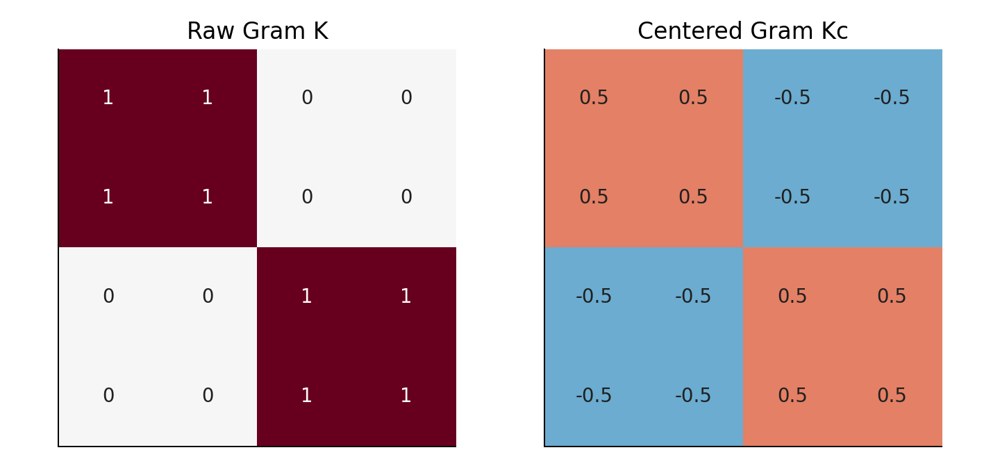
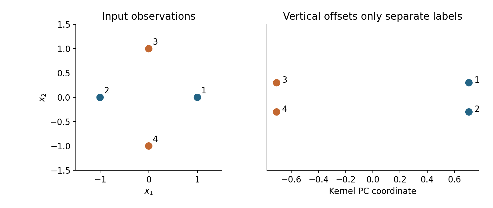

# Lecture 10 · KP07：用相似度完成非線性投影（Nonlinear projection through similarities）

> 程度：研究生（grad）／Level: Graduate (grad)
>
> 第 10 週（2026-11-09）｜Feature Generation I · A08
>
> Week 10 (2026-11-09) | Feature Generation I · A08

## 學習目標（Learning objectives）

- 用明確映射驗證核函數（Verify a kernel using an explicit feature map）。
- 計算中心化核矩陣與正規化投影（Compute a centered Gram matrix and normalized projections）。
- 正確投影新資料並說明最佳性的範圍（Project new observations and qualify the optimality claim）。

## KP07：在隱含空間裡做主成分分析（Doing PCA in an implicit space）

**一句話重點**：核函數提供新空間的內積。中心化並正規化後，可以只用樣本相似度求出主成分座標。

**One-sentence summary**: A kernel supplies inner products in a feature space. Centering and normalization let sample similarities determine principal-component scores.

### 1. 先改特徵，再找方向（Changing features before finding directions）

KP06 提醒你，固定線性方向未必符合彎曲資料。
一種做法是先建立非線性特徵，再做主成分分析。
例如把座標平方，原來彎曲的關係可能更容易表示。
問題是新空間可能太大，無法把所有座標逐項存下。

KP06 showed that fixed linear directions may not suit curved data.
One approach creates nonlinear features before applying principal component analysis.
Squared coordinates, for example, can simplify certain curved relationships.
The resulting space may be too large to store explicitly.

**白話說明**：若只需要比較兩筆資料，不一定要列出完整新座標。
可以直接算它們在新空間的內積。
這稱為核技巧。
它省去明寫特徵，不表示計算成本一定低。

**Plain explanation**: Comparing observations need not require listing every new coordinate.
Compute their feature-space inner product directly instead.
This is the kernel trick.
Avoiding explicit features does not guarantee low computational cost.

**先備自測**：本講沿用中心化與單位方向。

**Prerequisite check**: We reuse centering and unit directions.

- $(1,0)^T\cdot(-1,0)^T=-1$（Their inner product is $-1$）。
- $(-1)^2=1$，平方會消除符號（Squaring removes the sign）。
- 主成分先扣平均（Principal component analysis starts by subtracting the mean）。
- 單位向量的長度為 $1$（A unit vector has length $1$）。

### 2. 不是任意相似度都能當核（Not every similarity is a valid kernel）

**正式定義**：核函數滿足 $k(\mathbf x,\mathbf x')=\phi(\mathbf x)^T\phi(\mathbf x')$。
映射 $\phi$ 可以是顯式或隱式。
樣本兩兩核值組成 Gram 矩陣。
有效的實數內積核，其 Gram 矩陣須對稱半正定。

**Formal definition**: A kernel satisfies $k(\mathbf x,\mathbf x')=\phi(\mathbf x)^T\phi(\mathbf x')$.
The map $\phi$ may be explicit or implicit.
Pairwise kernel values form a Gram matrix.
A valid real inner-product kernel produces symmetric positive-semidefinite Gram matrices.

半正定表示對任意向量 $\mathbf a$，$\mathbf a^TK\mathbf a\ge0$。
若自訂相似度有明顯負特徵值，不能直接套用本講推導。
浮點運算造成的極小負值則需按誤差尺度判讀。
這與任意刪掉真正負特徵值是不同的處理。

Positive semidefiniteness means $\mathbf a^TK\mathbf a\ge0$ for every $\mathbf a$.
A custom similarity with substantial negative eigenvalues violates this derivation.
Tiny negative values from floating-point error require scale-aware interpretation.
That differs from silently discarding genuine negative eigenvalues.

| 符號 | 中文意義 | English meaning |
|---|---|---|
| $n,d$ | 訓練樣本數與輸入維度 | Training count and input dimension |
| $\phi(\mathbf x)$ | 新空間的特徵向量 | Feature-space vector |
| $K\in\mathbb R^{n\times n}$ | 未中心化的 Gram 矩陣 | Uncentered Gram matrix |
| $J=I-\mathbf1\mathbf1^T/n$ | 扣樣本平均的矩陣 | Centering matrix |
| $K_c=JKJ$ | 中心化後的 Gram 矩陣 | Centered Gram matrix |
| $\ell_j,\mathbf v_j$ | Gram 特徵值與長度一的向量 | Gram eigenvalue and Euclidean-unit eigenvector |
| $\alpha_j=\mathbf v_j/\sqrt{\ell_j}$ | 單位特徵方向的展開係數 | Expansion coefficients for a unit feature direction |
| $\lambda_j=\ell_j/n$ | 特徵空間共變異數的特徵值 | Feature-space covariance eigenvalue |

### 3. 為什麼核矩陣也要扣平均（Why the Gram matrix needs centering）

主成分分析要描述相對平均的變動。
即使原始座標平均為零，非線性特徵平均也可能不為零。
因此必須在特徵空間重新中心化。
直接扣核矩陣的一個總平均，通常還不夠。

PCA describes variation around a mean.
Zero input mean does not imply zero nonlinear-feature mean.
Feature-space centering is therefore necessary.
Subtracting only one grand mean from the kernel matrix generally is insufficient.

$$
\begin{aligned}
(K_c)_{ij}
&=K_{ij}-\frac1n\sum_aK_{aj}-\frac1n\sum_bK_{ib}\\
&\quad+\frac1{n^2}\sum_{a,b}K_{ab}.
\end{aligned}
$$

它分別扣欄平均與列平均，再加回總平均。
最後一項修正重複扣除的部分。
中心化後各列、各欄總和皆為零。
這是很好用的程式檢查。

Subtract column and row means, then restore the grand mean.
The last term corrects double subtraction.
Centered rows and columns both sum to zero.
This provides a useful implementation check.

### 4. 四筆資料與一個平方核（Four observations and a quadratic kernel）

**例子** `[補充]`：依序取 $(1,0)$、$(-1,0)$、$(0,1)$、$(0,-1)$。
使用 $k(\mathbf x,\mathbf x')=(\mathbf x^T\mathbf x')^2$。
可以明確寫出三維映射，驗證此核有效。
它把互為相反數的點視為相同特徵。

**Example** `[Added]`: Take $(1,0)$, $(-1,0)$, $(0,1)$, and $(0,-1)$ in that order.
Use $k(\mathbf x,\mathbf x')=(\mathbf x^T\mathbf x')^2$.
An explicit three-dimensional map verifies the kernel.
It gives opposite points identical features.

$$
\phi(\mathbf x)=(x_1^2,\sqrt2x_1x_2,x_2^2)^T.
$$

$$
K=\begin{bmatrix}1&1&0&0\\1&1&0&0\\0&0&1&1\\0&0&1&1\end{bmatrix}.
$$

每列平均與總平均都是 $1/2$。
所以本例剛好可寫成 $K_c=K-\tfrac12\mathbf1\mathbf1^T$。
這個簡化來自本例的相同平均。
一般資料仍須使用完整中心化公式。

Every row mean and the grand mean equal $1/2$.
Here, $K_c=K-\tfrac12\mathbf1\mathbf1^T$.
This simplification relies on these equal means.
General data require the full centering formula.



圖 1：先看左圖同組的相似度，再看右圖每列正負各半。
右圖可出現負值，因為中心化後比較的是偏離平均的方向。〔功能：1、2〕

Figure 1: Inspect within-group similarities on the left, then balanced signs in each row on the right.
Centered entries can be negative because they compare deviations from the mean. [Function: 1, 2]

### 5. 特徵值相同，正規化卻不能省（Normalization cannot be omitted）

令中心化特徵以列排成 $\Phi_c$，則 $K_c=\Phi_c\Phi_c^T$。
解出 $K_c\mathbf v=\ell\mathbf v$，且 $\|\mathbf v\|=1$。
當 $\ell>0$，單位主方向可寫為下式。
分母確保方向長度為一。

Stack centered features as rows of $\Phi_c$, so $K_c=\Phi_c\Phi_c^T$.
Solve $K_c\mathbf v=\ell\mathbf v$, with $\|\mathbf v\|=1$.
For $\ell>0$, the unit principal direction has the following form.
The denominator makes its length one.

$$
\mathbf u=\frac{\Phi_c^T\mathbf v}{\sqrt\ell},\qquad
\|\mathbf u\|^2=\frac{\mathbf v^TK_c\mathbf v}{\ell}=1.
$$

投影全部訓練資料得到 $\mathbf z=\sqrt\ell\mathbf v$。
本例唯一非零特徵值為 $\ell=2$。
選 $\mathbf v=(1,1,-1,-1)^T/2$。
座標因此為 $(1,1,-1,-1)^T/\sqrt2$。

Training scores are $\mathbf z=\sqrt\ell\mathbf v$.
The example has one nonzero eigenvalue, $\ell=2$.
Choose $\mathbf v=(1,1,-1,-1)^T/2$.
Scores are therefore $(1,1,-1,-1)^T/\sqrt2$.

特徵平均為 $(1/2,0,1/2)^T$。
顯式主方向是 $(1,0,-1)^T/\sqrt2$。
你可以直接算內積，得到完全相同的座標。
特徵空間的共變異數特徵值則是 $2/4=1/2$。

The feature mean is $(1/2,0,1/2)^T$.
The explicit principal direction is $(1,0,-1)^T/\sqrt2$.
Direct inner products give the same scores.
The feature covariance eigenvalue is $2/4=1/2$.



圖 2：先依編號找點，再比右圖的橫座標。
右圖縱向錯開只為看清編號，不是第二個學到的特徵。〔功能：1、2、3〕

Figure 2: Match point numbers, then compare horizontal scores on the right.
Vertical offsets separate labels visually; they are not another learned feature. [Function: 1, 2, 3]

### 6. 新資料要沿用訓練平均（New observations must reuse training means）

新資料先計算與每筆訓練資料的核值。
令這串值為 $k_i^*=k(\mathbf x_i,\mathbf x^*)$。
中心化時使用訓練列平均與訓練總平均。
只從新核向量求它自己的平均，不重估訓練表示。

A new observation first needs kernel values against every training observation.
Write these as $k_i^*=k(\mathbf x_i,\mathbf x^*)$.
Center them using training row means and the training grand mean.
Use the new vector's own mean without refitting the training representation.

$$
\begin{aligned}
(k_c^*)_i&=k_i^*-\frac1n\sum_a k_a^*
-\frac1n\sum_b K_{ib}+\frac1{n^2}\sum_{a,b}K_{ab},\\
z^*&=\frac{\mathbf v^Tk_c^*}{\sqrt\ell}.
\end{aligned}
$$

取 $\mathbf x^*=(2,0)^T$，原核向量為 $(4,4,0,0)^T$。
中心化後為 $(2,2,-2,-2)^T$。
代入投影得到 $z^*=2\sqrt2$。
這與顯式特徵中心化後的內積一致。

For $\mathbf x^*=(2,0)^T$, the raw kernel vector is $(4,4,0,0)^T$.
Its centered version is $(2,2,-2,-2)^T$.
Projection gives $z^*=2\sqrt2$.
The explicit centered-feature inner product agrees.

### 7. 實作與數值檢查（Implementation and numerical checks）

以下固定第一個特徵向量元素為正，以便對照符號。
極小或零特徵值不能拿來除以平方根。
實務需要依資料尺度設定保留門檻。
本例唯一非零方向沒有這個歧義。

The code makes the first eigenvector entry positive for sign consistency.
Do not divide by the square root of a zero or numerically negligible eigenvalue.
Practical implementations need a scale-aware threshold.
Our single nonzero direction avoids that ambiguity.

```python
import numpy as np
X = np.array([[1., 0.], [-1., 0.], [0., 1.], [0., -1.]])
K = (X @ X.T)**2
row_mean, grand_mean = K.mean(axis=1), K.mean()
Kc = K - row_mean[:, None] - row_mean[None, :] + grand_mean
values, vectors = np.linalg.eigh(Kc)
ell, v = values[-1], vectors[:, -1]
if v[0] < 0:
    v = -v
raw = (X @ np.array([2., 0.]))**2
new_centered = raw - raw.mean() - row_mean + grand_mean
print(round(ell, 6), round(ell / len(X), 6))
print(round(v @ new_centered / np.sqrt(ell), 6))
# 2.0 0.5
# 2.828427
```

### 8. 最佳性與成本的邊界（Limits of optimality and computational cost）

**常見迷思**：核主成分能最小化原始資料的重建誤差。
它的平方誤差最佳性是在所選特徵空間內。
把座標變回輸入的逆像問題，未必有解或唯一解。
本例平方映射甚至已經失去正負號。

**Common misconception**: Kernel PCA minimizes raw-input reconstruction error.
Its squared-error optimality holds in the selected feature space.
Finding an input preimage can lack existence or uniqueness.
Our squared feature map already loses input signs.

互不相關也只指學到的特徵座標。
獨立與最大熵仍需要額外分布條件。
線性核在正確中心化下可重現線性主成分座標。
但不同的核定義不同幾何，沒有通用最佳選擇。

Decorrelation also concerns learned feature coordinates.
Independence and maximum entropy still require additional distributional assumptions.
A properly centered linear kernel reproduces linear principal-component scores.
Different kernels define different geometries; no kernel is universally best.

例如高斯核的帶寬太大，相似度幾乎都相等。
帶寬太小，相異樣本的核矩陣則近似單位矩陣。
兩端都可能失去有用結構。
核與帶寬應由訓練及驗證流程選擇。

With an excessively broad Gaussian kernel, similarities become nearly equal.
An excessively narrow kernel gives approximately an identity matrix for distinct observations.
Either extreme can obscure useful structure.
Choose the kernel and bandwidth through training and validation.

稠密 Gram 儲存需要約 $n^2$ 個數字。
完整特徵分解的典型成本為 $O(n^3)$。
樣本很多時可能需要近似方法。
核技巧避免明寫高維特徵，並沒有消除樣本數成本。

A dense Gram matrix stores approximately $n^2$ numbers.
A full eigendecomposition typically costs $O(n^3)$.
Large datasets may require approximations.
The kernel trick avoids explicit high-dimensional features without eliminating sample-count costs.

### 9. 小練習與解題示範（Practice and worked solutions）

**小練習** `[補充]`：把 Gram 特徵值與共變異數特徵值分開。

**Practice** `[Added]`: Distinguish Gram eigenvalues from covariance eigenvalues.

1. 題 1：$K_c$ 第一列總和是多少（What is the first centered row sum）？
2. 題 2：為何不能直接把長度一的 $\mathbf v$ 當投影係數（Why is a Euclidean-unit $\mathbf v$ not the projection coefficient vector）？
3. 題 3：本例能唯一還原輸入的正負號嗎（Can this example uniquely recover input signs）？

**題 1 解題示範**：第一列為 $(1/2,1/2,-1/2,-1/2)$。
相加為零，符合中心化要求。

**Question 1 worked solution**: The first row is $(1/2,1/2,-1/2,-1/2)$.
Its zero sum agrees with centering.

**題 2 解題示範**：單位特徵方向需要係數 $\alpha=\mathbf v/\sqrt\ell$。
本例分母為 $\sqrt2$。
若省略它，對應方向的平方長度就會變成 $2$。

**Question 2 worked solution**: A unit feature direction needs coefficients $\alpha=\mathbf v/\sqrt\ell$.
Here the denominator is $\sqrt2$.
Without it, the corresponding direction has squared length $2$.

**題 3 解題示範**：不能。
因為 $\phi(\mathbf x)=\phi(-\mathbf x)$，不同輸入已有相同特徵。
任何只依這些特徵的逆推，都無法唯一決定符號。

**Question 3 worked solution**: No.
Since $\phi(\mathbf x)=\phi(-\mathbf x)$, distinct inputs already share identical features.
An inverse based only on those features cannot uniquely determine the sign.

## 術語表（Glossary）

| 中文術語 | English term |
|---|---|
| 核主成分分析 | Kernel principal component analysis, Kernel PCA |
| 核函數／核技巧 | Kernel function / kernel trick |
| 特徵映射／Gram 矩陣 | Feature map / Gram matrix |
| 半正定／中心化 | Positive semidefinite / centering |
| 特徵值／正規化 | Eigenvalue / normalization |
| 逆像 | Preimage |
| 高斯核／帶寬 | Gaussian kernel / bandwidth |
| 資訊熵／獨立 | Information entropy / independence |
| NumPy | Python array-computing library |

## 銜接與來源（Connections and sources）

- 前一單元：[KP06 非線性降維與流形](lec10-kp06-manifold.md)（Previous unit: nonlinear reduction and manifolds）。
- 下一單元：[KP08 拉普拉斯特徵映射](lec10-kp08-laplacian-eigenmaps.md)（Next unit: Laplacian Eigenmaps）。
- 來源：[Feature Generation I §6.7.1／A08](https://ndhuccc.github.io/CCC-LNS/PR_115/Ch06-feature-generation-i/index.html#kp8)，讀取日期 2026-11-06（Source accessed 2026-11-06）。
- 書目：Theodoridis and Koutroumbas, *Pattern Recognition*, 4th ed., 2008；見[參考資料](../references/README.md)（See the bibliography）。

四點算例、圖、程式與習題為 `[補充]`。
本講明列來源簡述中省略的中心化與係數正規化。
重建與熵的敘述也加上適用空間及條件。

The four-point example, figures, code, and exercises are `[Added]`.
Centering and coefficient normalization expand the source's brief description.
Reconstruction and entropy claims specify their applicable space and conditions.
