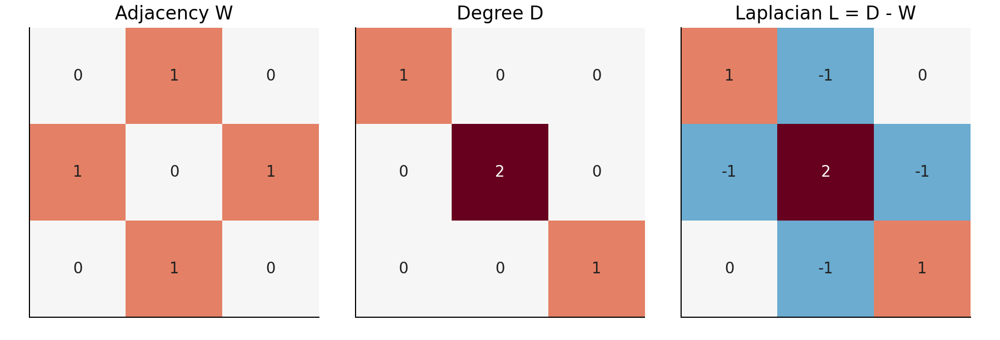
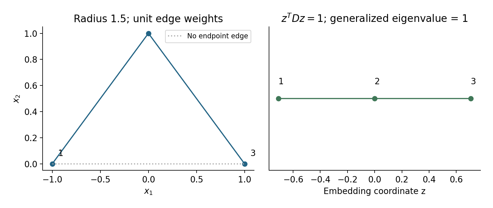

# Lecture 10 · KP08：讓相鄰資料在新座標中靠近（Keeping neighbors close in new coordinates）

> 程度：研究生（grad）／Level: Graduate (grad)
>
> 第 10 週（2026-11-09）｜Feature Generation I · A09
>
> Week 10 (2026-11-09) | Feature Generation I · A09

## 學習目標（Learning objectives）

- 從三點建圖並算出度數與拉普拉斯矩陣（Construct a three-point graph, degrees, and Laplacian）。
- 從鄰居差異推導廣義特徵問題（Derive a generalized eigenproblem from neighbor differences）。
- 說明常數解、連通性與新資料延伸限制（Explain constant solutions, connectivity, and out-of-sample limits）。

## KP08：用圖上的平滑性產生座標（Generating coordinates from smoothness on a graph）

**一句話重點**：先宣告哪些點是鄰居，再尋找沿強連線變化不大的座標。中心與尺度限制避免全部點縮成同一點。

**One-sentence summary**: Declare neighbors, then seek coordinates that vary little across strong edges. Centering and scale constraints prevent complete collapse.

### 1. 從整體變異轉向局部關係（From overall variance to local relationships）

前一講在核定義的特徵空間最大化變異。
這次不從整體形狀開始。
我們只先相信每個點附近的關係。
再要求低維座標不要把這些鄰居任意拉遠。

The previous lecture maximized variance in a kernel-defined feature space.
Now we start without specifying the overall shape.
We first trust relationships near each observation.
Low-dimensional coordinates should avoid pulling those neighbors far apart.

**白話說明**：把資料點當珠子，鄰接邊當橡皮筋。
強連線會懲罰珠子分離。
但若沒有額外限制，全部疊在一起就最省力。
橡皮筋比喻說明目標，並非真正的物理模擬。

**Plain explanation**: Treat observations as beads and edges as elastic bands.
Strong edges penalize separation.
Without additional constraints, collapsing all beads together is cheapest.
This analogy explains the objective rather than a literal physical simulation.

**先備自測**：本講先學一維座標。
多維版本再取數個相互正交的座標方向。

**Prerequisite check**: We begin with a one-dimensional embedding.
A multidimensional embedding uses several mutually orthogonal coordinate directions.

- 對稱鄰接矩陣滿足 $W_{ij}=W_{ji}$（Symmetric adjacency satisfies $W_{ij}=W_{ji}$）。
- 一點的加權度數是連線權重總和（Weighted degree sums incident edge weights）。
- 差的平方不會是負數（A squared difference is nonnegative）。
- 所有座標相同時，每條邊的差都是零（Constant coordinates give zero difference on every edge）。

### 2. 先把圖定義完整（Specifying the graph completely）

**正式定義**：拉普拉斯特徵映射以資料為節點。
用對稱、非負的權重矩陣 $W$ 表示鄰接關係。
令 $D$ 收集每點度數，圖拉普拉斯矩陣為 $L=D-W$。
低維座標來自其受限制的平滑目標。

**Formal definition**: Laplacian Eigenmaps represents observations as graph nodes.
A symmetric nonnegative matrix $W$ records neighborhood weights.
Collect weighted degrees in $D$ and define graph Laplacian $L=D-W$.
Coordinates follow from a constrained smoothness objective.

| 符號 | 中文意義 | English meaning |
|---|---|---|
| $n$ | 節點數 | Node count |
| $W\in\mathbb R^{n\times n}$ | 對稱非負鄰接權重，對角為零 | Symmetric nonnegative weights, with zero diagonal |
| $D_{ii}=\sum_jW_{ij}$ | 節點的加權度數 | Weighted node degree |
| $L=D-W$ | 圖拉普拉斯矩陣 | Graph Laplacian |
| $\mathbf z\in\mathbb R^n$ | 每個節點的一維新座標 | One embedding coordinate per node |
| $\epsilon,\sigma$ | 距離半徑與熱核尺度 | Distance radius and heat-kernel scale |
| $\eta$ | 廣義特徵值 | Generalized eigenvalue |

你可先連半徑內的點，再給每條邊權重一。
也可使用熱核 $\exp(-\|\mathbf x_i-\mathbf x_j\|^2/\sigma^2)$。
前者只記錄相鄰，後者還反映距離。
本講選前者，讓矩陣能手算。

You can connect points within a radius and assign unit edge weights.
Alternatively, use heat weights $\exp(-\|\mathbf x_i-\mathbf x_j\|^2/\sigma^2)$.
Unit weights record adjacency; heat weights also reflect distances.
We choose unit weights for hand calculation.

本講的半徑比較式是距離 $<\epsilon$。
若程式比較的是平方距離，就要使用 $\epsilon^2$。
兩者單位不同，不可共用數字。
最近鄰圖也必須先說清楚對稱化規則。

Our radius rule compares distance with $\epsilon$.
An implementation using squared distances must compare with $\epsilon^2$.
These have different units and cannot share a threshold indiscriminately.
Nearest-neighbor graphs also require a stated symmetrization rule.

### 3. 三個點如何變成三個矩陣（From three points to three matrices）

**例子** `[補充]`：依序取 $(-1,0)$、$(0,1)$、$(1,0)$。
相鄰兩段長度均為 $\sqrt2$，端點直線距離為 $2$。
設距離半徑 $\epsilon=1.5$，只保留兩段相鄰連線。
所有邊使用權重一。

**Example** `[Added]`: Take $(-1,0)$, $(0,1)$, and $(1,0)$ in order.
Adjacent distances are $\sqrt2$; the endpoint distance is $2$.
Radius $\epsilon=1.5$ keeps only the two adjacent edges.
Every retained edge has unit weight.

$$
W=\begin{bmatrix}0&1&0\\1&0&1\\0&1&0\end{bmatrix},\quad
D=\begin{bmatrix}1&0&0\\0&2&0\\0&0&1\end{bmatrix}.
$$

$$
L=D-W=\begin{bmatrix}1&-1&0\\-1&2&-1\\0&-1&1\end{bmatrix}.
$$

每一列總和為零，所以 $L\mathbf1=0$。
這說明常數座標是零特徵方向。
但此座標沒有區分任何資料點。
因此接下來必須排除它。

Each row sums to zero, so $L\mathbf1=0$.
A constant coordinate is therefore a zero-eigenvalue direction.
It distinguishes no observations.
We must exclude it when constructing useful coordinates.



圖 1：先用左圖逐列加總，核對中圖對角。
再用中圖減左圖，得到右圖。〔功能：1、2〕

Figure 1: Sum each left row and check the middle diagonal.
Subtract the left matrix from the middle matrix to obtain the right one. [Function: 1, 2]

### 4. 從邊的差推導目標（Deriving the objective from edge differences）

若兩個強連線節點的新座標相差很遠，就給較大處罰。
把所有節點對相加，對稱圖的每條邊會被算兩次。
本講乘上 $1/2$ 消除重複計數。
這個常數不改變最小化解。

Penalize large coordinate differences across strong edges.
Summing all ordered pairs counts each symmetric edge twice.
Our factor $1/2$ removes double counting.
That constant does not change the minimizer.

$$
\begin{aligned}
J(\mathbf z)&=\frac12\sum_{i,j}W_{ij}(z_i-z_j)^2\\
&=\sum_i D_{ii}z_i^2-\sum_{i,j}W_{ij}z_iz_j\\
&=\mathbf z^TL\mathbf z.
\end{aligned}
$$

這也證明 $L$ 半正定，因為每一項都是非負數。
但所有 $z_i=0$ 就能使目標為零。
所以還要固定尺度，並排除常數方向。
這裡使用依度數加權的限制。

This also proves $L$ positive semidefinite because every term is nonnegative.
However, setting all $z_i=0$ gives zero loss.
We therefore fix scale and exclude constant directions.
The constraints here use degree weighting.

$$
\mathbf z^TD\mathbf z=1,\qquad \mathbf z^TD\mathbf1=0.
$$

### 5. 為什麼是廣義特徵問題（Why the eigenproblem is generalized）

想深入：最小化分子 $\mathbf z^TL\mathbf z$，並固定分母 $\mathbf z^TD\mathbf z$。
將尺度限制加入拉格朗日式，微分後得到下式。
右邊多了一個 $D$，所以不是普通的特徵問題。
取最小的非平凡特徵方向，讓座標沿邊盡量平滑。

Going deeper: Minimize $\mathbf z^TL\mathbf z$ while fixing $\mathbf z^TD\mathbf z$.
Including the scale constraint in a Lagrangian and differentiating gives the equation below.
The extra $D$ makes it a generalized eigenproblem.
Choose the smallest nontrivial direction for maximum edgewise smoothness.

$$
L\mathbf z=\eta D\mathbf z.
$$

本例廣義特徵值為 $0,1,2$。
取 $\mathbf z=(-1,0,1)^T/\sqrt2$，對應 $\eta=1$。
可驗算 $\mathbf z^TD\mathbf z=1$ 與加權平均為零。
兩條邊各貢獻 $1/2$，總目標為 $1$。

The example's generalized eigenvalues are $0,1,2$.
Take $\mathbf z=(-1,0,1)^T/\sqrt2$, with $\eta=1$.
It satisfies $\mathbf z^TD\mathbf z=1$ and zero weighted mean.
Each edge contributes $1/2$, giving total objective $1$.



圖 2：先看左圖缺少端點連線，再看右圖的節點順序。
座標尺度來自限制式，不是原始距離單位。〔功能：1、2、3〕

Figure 2: Notice the missing endpoint edge, then inspect node order on the right.
Coordinate scale comes from the constraint rather than original distance units. [Function: 1, 2, 3]

### 6. 連通性決定要丟幾個零方向（Connectivity determines how many zero modes exist）

連通表示任兩節點間都存在路徑。
若圖連通，零特徵值只有一個。
如果圖有多個連通分量，零特徵值數量也跟著增加。
每個分量都可各自給一個常數而不付邊差代價。

A connected graph has a path between every pair of nodes.
Its zero eigenvalue is unique.
Multiple connected components produce multiple zero eigenvalues.
Each component can take its own constant without any edge-difference cost.

**常見迷思**：任何圖都只要刪掉第一個特徵向量。
這只在適用的連通條件下成立。
如果有孤立節點，它的度數甚至為零。
此時需要調整圖或明確分開處理，而非照抄公式。

**Common misconception**: Every graph requires removing exactly one eigenvector.
That rule relies on the appropriate connectivity condition.
An isolated node even has zero degree.
Adjust the graph or handle components explicitly instead of blindly applying the formula.

### 7. 兩種等價的數值解法（Two equivalent numerical formulations）

可直接使用接受 $(L,D)$ 的對稱廣義求解器。
也可對 $D^{-1/2}LD^{-1/2}$ 做普通對稱分解。
後者求到 $\mathbf u$ 後，還要轉回 $\mathbf z=D^{-1/2}\mathbf u$。
本例度數都正，兩種方法皆可使用。

Use a symmetric generalized solver accepting $(L,D)$.
Alternatively, diagonalize $D^{-1/2}LD^{-1/2}$.
Then convert its vector $\mathbf u$ back using $\mathbf z=D^{-1/2}\mathbf u$.
All example degrees are positive, so either method applies.

```python
import numpy as np
from scipy.linalg import eigh
W = np.array([[0., 1., 0.], [1., 0., 1.], [0., 1., 0.]])
D = np.diag(W.sum(axis=1))
L = D - W
values, vectors = eigh(L, D)
z = vectors[:, 1]
objective = 0.5 * np.sum(W * (z[:, None] - z[None, :])**2)
print(values.round(6))
print(round(z @ D @ z, 6), round(objective, 6))
assert np.allclose(L @ z, values[1] * D @ z)
assert np.isclose(z @ D @ np.ones(3), 0)
# [0. 1. 2.]
# 1.0 1.0
```

### 8. 保持鄰居接近，不代表保持所有距離（Neighbor closeness is not preservation of every distance）

目標只懲罰有邊的節點對。
沒有邊的點，並未被直接要求保持原來距離。
因此本法不保證全域等距，也不保證類別分離。
若特徵圖好看，仍要核對實際任務與參數穩定性。

The objective directly penalizes only connected pairs.
Unconnected pairs have no direct original-distance constraint.
The method therefore guarantees neither global isometry nor class separation.
An attractive plot still needs task evaluation and parameter-stability checks.

大型稀疏圖可用稀疏特徵求解器。
實際成本仍取決於圖大小、非零邊與收斂情況。
不能只因矩陣稀疏就宣稱一定快速。
建鄰居與資料尺度也可能成為主要成本。

Large sparse graphs can use sparse eigensolvers.
Actual cost still depends on graph size, nonzero edges, and convergence.
Sparsity alone does not guarantee speed.
Neighbor construction and feature scaling may also dominate costs.

例如 Lanczos 類方法可只求少數特徵方向。
它避免每次都做完整稠密分解。
但能否收斂及需要多少迭代，仍取決於譜與容許誤差。
因此本講不給出無條件的低於平方成本保證。

Lanczos-type methods, for example, can compute only a few eigenvectors.
They avoid a full dense decomposition.
Convergence and iteration counts still depend on the spectrum and tolerance.
We therefore make no unconditional subquadratic-cost guarantee.

得到的是這批節點的座標，不自動是一個新資料轉換函數。
新點需要明確的延伸方法或重新嵌入規則。
若讓測試點一起建圖，這是傳導式設定。
必須預先宣告，不能與只看訓練資料的評估混為一談。

The result assigns coordinates to these nodes rather than automatically defining a new-data transform.
New observations need an explicit extension or re-embedding rule.
Including test nodes during graph construction is a transductive setting.
Declare it in advance and distinguish it from training-only representation fitting.

### 9. 小練習與解題示範（Practice and worked solutions）

**小練習** `[補充]`：先用三點圖逐項代入。

**Practice** `[Added]`: Substitute values into the three-node graph.

1. 題 1：為何中點度數是 $2$（Why is the middle degree $2$）？
2. 題 2：若不加尺度限制，最簡單的零損失解是什麼（What is the simplest zero-loss solution without a scale constraint）？
3. 題 3：若刪掉中點到第三點的邊，有幾個零方向（How many zero modes remain after deleting the second edge）？

**題 1 解題示範**：它連到兩個端點，每邊權重一。
因此度數是 $1+1=2$。
度數不是座標數，也不是到原點的距離。

**Question 1 worked solution**: It connects to two endpoints with unit edge weights.
Its degree is $1+1=2$.
Degree is neither coordinate count nor distance from the origin.

**題 2 解題示範**：所有座標都設零。
每條邊的差都為零，因此目標為零。
但 $\mathbf z^TD\mathbf z=0$，違反固定尺度為一的要求。

**Question 2 worked solution**: Set all coordinates to zero.
Every edge difference and the objective are zero.
However, $\mathbf z^TD\mathbf z=0$ violates the unit-scale constraint.

**題 3 解題示範**：圖分成兩個連通分量。
普通拉普拉斯有兩個零方向。
第三點度數為零，故此時不能直接把奇異的 $D$ 交給正定廣義求解器。

**Question 3 worked solution**: The graph has two connected components.
Its ordinary Laplacian has two zero modes.
Node three has zero degree, so a positive-definite generalized solver cannot directly use this singular $D$.

## 術語表（Glossary）

| 中文術語 | English term |
|---|---|
| 拉普拉斯特徵映射 | Laplacian Eigenmaps |
| 鄰接權重／加權度數 | Adjacency weight / weighted degree |
| 圖拉普拉斯矩陣 | Graph Laplacian |
| 熱核／對稱化 | Heat kernel / symmetrization |
| 半正定／廣義特徵問題 | Positive semidefinite / generalized eigenproblem |
| 連通分量／孤立節點 | Connected component / isolated node |
| 稀疏求解器 | Sparse eigensolver |
| Lanczos 方法 | Lanczos method |
| 傳導式設定 | Transductive setting |
| NumPy／SciPy | Python numerical-computing libraries |

## 銜接與來源（Connections and sources）

- 前一單元：[KP07 核主成分分析](lec10-kp07-kernel-pca.md)（Previous unit: kernel principal component analysis）。
- 下一單元：[KP09 局部線性嵌入與等距映射](lec10-kp09-lle-isomap.md)（Next unit: LLE and ISOMAP）。
- 來源：[Feature Generation I §6.7.2／A09](https://ndhuccc.github.io/CCC-LNS/PR_115/Ch06-feature-generation-i/index.html#kp9)，讀取日期 2026-11-06（Source accessed 2026-11-06）。
- 書目：Theodoridis and Koutroumbas, *Pattern Recognition*, 4th ed., 2008；見[參考資料](../references/README.md)（See the bibliography）。

三點圖、數值、圖、程式與習題為 `[補充]`。
本講明列雙重計邊的 $1/2$ 與連通性條件。
稀疏運算效率沒有被當作無條件保證。

The three-node example, values, figures, code, and exercises are `[Added]`.
The factor $1/2$ and connectivity conditions are explicit.
Sparse-computation efficiency is not presented as an unconditional guarantee.
