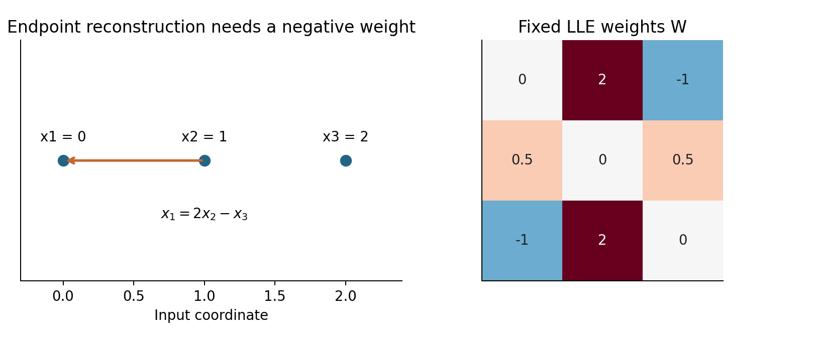
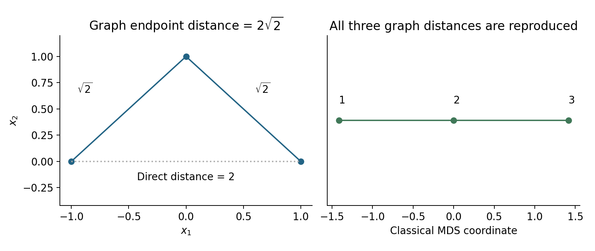

# Lecture 10 · KP09：保留局部配方，或保留沿圖距離（Preserving local recipes or graph distances）

> 程度：研究生（grad）／Level: Graduate (grad)
>
> 第 10 週（2026-11-09）｜Feature Generation I · A10
>
> Week 10 (2026-11-09) | Feature Generation I · A10

## 學習目標（Learning objectives）

- 算出局部重建權重並固定它們求新座標（Compute local reconstruction weights and preserve them in an embedding）。
- 從圖距離推導經典多維尺度法（Derive classical multidimensional scaling from graph distances）。
- 比較三種圖方法的目標及失效情況（Compare the objectives and failure modes of three graph methods）。

## KP09：同樣建圖，保留目標可以不同（The same graph idea can support different objectives）

**一句話重點**：局部線性嵌入保留鄰居的重建配方；等距映射保留圖上的最短路徑距離。兩者不是同一種最佳化問題。

**One-sentence summary**: Locally linear embedding preserves neighbor reconstruction recipes; ISOMAP preserves graph shortest-path distances. They solve different optimization problems.

### 1. 從鄰居接近，走向兩種不同問題（Moving beyond neighbor closeness）

KP08 讓連線兩端的新座標盡量接近。
現在你還能問兩種問題。
第一種：同一組鄰居用量，能否在新空間重建此點？
第二種：沿資料走的路徑長，能否變成新空間的直線距離？

KP08 encouraged connected nodes to stay close.
Two additional questions are possible.
First: can the same neighbor contributions reconstruct a point in the new space?
Second: can path lengths through data become straight-line distances in the embedding?

**白話說明**：第一種像保留一個位置相對鄰居的配方。
第二種像把彎路攤開後保留里程。
兩種比喻對應不同數學目標。
不能只因它們都畫成一條線，就宣稱效果相同。

**Plain explanation**: The first preserves a location's recipe relative to its neighbors.
The second unfolds a route while retaining its mileage.
These analogies correspond to different mathematical objectives.
Two line-shaped plots do not establish equivalent results.

**先備自測**：本講使用兩個分開標示的小算例。
共線資料適合驗算配方；彎折路徑適合驗算距離。

**Prerequisite check**: We use two explicitly separate examples.
Collinear observations simplify recipe calculations; a bent path illustrates distances.

- 權重和為一時，共同平移不改變重建殘差（Weights summing to one preserve residuals under common translation）。
- 最短路徑只走圖上存在的邊（Shortest paths use existing graph edges）。
- $(2\sqrt2)^2=8$（Squaring $2\sqrt2$ gives $8$）。
- $J=I-\mathbf1\mathbf1^T/n$ 會扣平均（Multiplication by $J$ centers coordinates）。

### 2. 先定義符號與兩個目標（Notation and two objectives）

**正式定義**：局部線性嵌入先用鄰居重建每筆資料。
求得權重後，固定權重再尋找低維座標。
等距映射則先用鄰接圖估計路徑距離。
再以經典多維尺度法尋找能表達距離的座標。

**Formal definition**: Locally linear embedding first reconstructs each observation from neighbors.
It then fixes those weights while finding low-dimensional coordinates.
ISOMAP instead estimates path distances through a neighborhood graph.
Classical multidimensional scaling then finds coordinates representing those distances.

| 符號 | 中文意義 | English meaning |
|---|---|---|
| $X\in\mathbb R^{n\times d}$ | 每列一筆輸入 | Input observations in rows |
| $N_i$ | 第 $i$ 點的鄰居索引 | Neighbor indices for observation $i$ |
| $W\in\mathbb R^{n\times n}$ | 局部重建權重，不是非負鄰接矩陣 | Local reconstruction weights, not nonnegative adjacency |
| $Y\in\mathbb R^{n\times m}$ | 新空間的座標 | Embedding coordinates |
| $M=(I-W)^T(I-W)$ | 重建代價矩陣 | Reconstruction-cost matrix |
| $\Delta_{ij}$ | 圖最短路徑距離，與輸入同單位 | Graph distance, in input distance units |
| $B=-J\Delta^{\circ2}J/2$ | 雙重中心化後的內積矩陣 | Double-centered inner-product matrix |
| $\Delta^{\circ2}$ | 距離逐元素平方 | Entrywise squared distances |

特別注意：這裡的 $W$ 與 KP08 用法不同。
局部重建係數可以是負數，也可以不對稱。
它們不是機率，亦不要求兩方向權重相等。
只有每列總和必須是一。

Notice that $W$ has a different meaning from KP08.
Local reconstruction coefficients can be negative and asymmetric.
They are not probabilities and need not agree in opposite directions.
Each row must sum to one.

### 3. 逐點找局部配方（Finding each local recipe）

對每點先選 $k$ 個鄰居。
只允許鄰居有非零權重，自身權重設零。
然後最小化重建殘差。
每列和為一，使方法不依賴共同平移的位置。

Choose $k$ neighbors for each observation.
Only neighbors may receive nonzero weights; self-weights are zero.
Minimize reconstruction residuals next.
The row-sum constraint removes dependence on a common translation.

$$
\min_W\sum_i\left\|\mathbf x_i-\sum_{j\in N_i}W_{ij}\mathbf x_j\right\|^2,
\qquad \sum_{j\in N_i}W_{ij}=1.
$$

想深入：令局部差向量為 $\mathbf x_i-\mathbf x_j$。
其兩兩內積組成局部矩陣 $C_i$。
第 $i$ 點的目標便是 $\mathbf w_i^TC_i\mathbf w_i$。
若 $C_i$ 可逆，可用下式解出權重。

Going deeper: Form local differences $\mathbf x_i-\mathbf x_j$.
Their pairwise inner products form a local matrix $C_i$.
The local objective becomes $\mathbf w_i^TC_i\mathbf w_i$.
If $C_i$ is invertible, solve using the expression below.

$$
\mathbf w_i=\frac{C_i^{-1}\mathbf1}{\mathbf1^TC_i^{-1}\mathbf1}.
$$

程式應解線性方程，不必真的計算反矩陣。
局部矩陣奇異時可用受限制求解或適當正則化。
正則化是在矩陣加上小量以改善穩定性。
它也會改變配方，不能當成完全無影響的操作。

Solve linear equations rather than explicitly computing an inverse.
A singular local matrix needs a constrained solver or suitable regularization.
Regularization adds a small matrix term to improve stability.
It can also change the recipe and must be reported.

**例子** `[補充]`：取 $\mathbf x_1=(0,0)$、$\mathbf x_2=(1,0)$、$\mathbf x_3=(2,0)$。
每點使用另外兩點作鄰居。
端點需要外插，所以會出現負權重。
三個重建都可以精確成立。

**Example** `[Added]`: Take $\mathbf x_1=(0,0)$, $\mathbf x_2=(1,0)$, and $\mathbf x_3=(2,0)$.
Each uses the other two points as neighbors.
Endpoints require extrapolation, producing negative weights.
All three reconstructions can be exact.

$$
\begin{aligned}
\mathbf x_1&=2\mathbf x_2-\mathbf x_3,\\
\mathbf x_2&=\tfrac12\mathbf x_1+\tfrac12\mathbf x_3,\\
\mathbf x_3&=-\mathbf x_1+2\mathbf x_2.
\end{aligned}
$$

$$
W=\begin{bmatrix}0&2&-1\\1/2&0&1/2\\-1&2&0\end{bmatrix}.
$$



圖 1：先核對左圖端點的配方，再看右圖第一列。
負號代表外插，並非負機率。〔功能：1、2、3〕

Figure 1: Verify the left endpoint recipe, then inspect the first row on the right.
The negative entry represents extrapolation rather than a negative probability. [Function: 1, 2, 3]

### 4. 固定配方，再求低維座標（Fixing recipes before solving for coordinates）

現在固定 $W$，最小化新空間的相同重建代價。
若重新學一組權重，就換了問題。
一維時令新座標為 $\mathbf z$。
目標可整理成對稱半正定矩陣的二次式。

Keep $W$ fixed and minimize the same reconstruction cost in the embedding.
Relearning weights would define a different problem.
For one dimension, write coordinates as $\mathbf z$.
The objective becomes a quadratic form with a symmetric positive-semidefinite matrix.

$$
\|(I-W)\mathbf z\|^2=\mathbf z^TM\mathbf z,
\qquad M=(I-W)^T(I-W).
$$

限制 $\mathbf1^T\mathbf z=0$ 排除共同平移。
限制 $\mathbf z^T\mathbf z=1$ 排除縮成零。
這裡採單位長度，若要求樣本變異為一，座標要再乘 $\sqrt n$。
兩種慣例只差整體尺度。

Require $\mathbf1^T\mathbf z=0$ to remove common translation.
Require $\mathbf z^T\mathbf z=1$ to prevent collapse.
We use unit length; unit sample variance would multiply coordinates by $\sqrt n$.
These conventions differ only in overall scale.

本例令 $\mathbf a=(1,-2,1)^T$，可得 $M=\tfrac94\mathbf a\mathbf a^T$。
其特徵值為 $0,0,13.5$。
取 $\mathbf z=(-1,0,1)^T/\sqrt2$，重建損失為零。
但此例有兩個零方向，不能任取求解器回傳的第二欄。

Here, with $\mathbf a=(1,-2,1)^T$, we obtain $M=\tfrac94\mathbf a\mathbf a^T$.
Its eigenvalues are $0,0,13.5$.
The centered vector $\mathbf z=(-1,0,1)^T/\sqrt2$ gives zero reconstruction loss.
Two zero modes mean an arbitrary solver's second column need not be the desired direction.

必須在與常數向量正交的空間內求解。
下面程式明確建立該空間的基底 $Q$。
再對 $Q^TMQ$ 分解並映回來。
這也示範為什麼退化情況需要額外處理。

Solve within the subspace orthogonal to the constant vector.
The code explicitly constructs a basis $Q$ for that subspace.
It diagonalizes $Q^TMQ$ and maps the result back.
This illustrates the care needed for degenerate eigenvalues.

```python
import numpy as np
from scipy.linalg import null_space
X = np.array([[0., 0.], [1., 0.], [2., 0.]])
W = np.zeros((3, 3))
for i in range(3):
    neighbors = [j for j in range(3) if j != i]
    differences = X[i] - X[neighbors]
    C = differences @ differences.T
    # Constrained solve also works for these singular local C matrices.
    A = np.block([[C, np.ones((2, 1))],
                  [np.ones((1, 2)), np.zeros((1, 1))]])
    W[i, neighbors] = np.linalg.solve(A, [0., 0., 1.])[:2]
M = (np.eye(3) - W).T @ (np.eye(3) - W)
Q = null_space(np.ones((1, 3)))
values, vectors = np.linalg.eigh(Q.T @ M @ Q)
z = Q @ vectors[:, 0]
print(np.round(W, 6))
print(np.round(np.linalg.eigvalsh(M), 6) + 0.0)
assert np.allclose(W @ X, X)
assert np.isclose(z.sum(), 0) and np.isclose(z @ z, 1)
assert np.linalg.norm((np.eye(3) - W) @ z) < 1e-10
# W rows: [0, 2, -1], [0.5, 0, 0.5], [-1, 2, 0]
# Eigenvalues: approximately [0, 0, 13.5]
```

### 5. 等距映射先估計沿圖里程（ISOMAP first estimates graph mileage）

現在換回 KP08 的三個彎折點，展示另一個目標。
半徑仍為 $1.5$，但邊權改用真實長度 $\sqrt2$。
先找每對點的最短路徑。
這些圖距離是流形距離的估計，不是自動等於真實測地距離。

Return to the bent three-point example from KP08 to illustrate a different objective.
Keep radius $1.5$, but use actual edge lengths $\sqrt2$.
Compute shortest paths between all pairs.
Graph distances estimate manifold distances without automatically equaling true geodesic distances.

端點間沒有直接邊，必須經過中點。
所以路徑長為 $\sqrt2+\sqrt2=2\sqrt2$。
這不同於端點直線距離 $2$。
以下把圖距離逐元素平方，供下一步使用。

Endpoints have no direct edge, so their route passes through the middle point.
Its length is $\sqrt2+\sqrt2=2\sqrt2$.
This differs from their straight-line distance $2$.
Square graph distances entrywise for the next step.

$$
\Delta^{\circ2}=\begin{bmatrix}0&2&8\\2&0&2\\8&2&0\end{bmatrix}.
$$

### 6. 從距離回推出座標（Recovering coordinates from distances）

經典多維尺度法利用距離與內積的關係。
平方距離等於兩點平方長度之和，再扣兩倍內積。
左右同時中心化，會消掉單點長度項。
留下的就是中心化座標的內積矩陣。

Classical multidimensional scaling uses the relation between distances and inner products.
Squared distance equals two squared lengths minus twice the inner product.
Centering on both sides removes the individual squared-length terms.
The remainder is the Gram matrix of centered coordinates.

$$
\begin{aligned}
\|\mathbf y_i-\mathbf y_j\|^2
&=\|\mathbf y_i\|^2+\|\mathbf y_j\|^2-2\mathbf y_i^T\mathbf y_j,\\
B&=-\tfrac12J\Delta^{\circ2}J.
\end{aligned}
$$

本例可算得下列矩陣，特徵值為 $4,0,0$。
取正特徵值的平方根，乘上其單位特徵向量。
得到一維座標 $(-\sqrt2,0,\sqrt2)^T$。
三組點對距離都精確等於本例的圖距離。

Here the matrix below has eigenvalues $4,0,0$.
Multiply the unit eigenvector by the square root of its positive eigenvalue.
This gives coordinates $(-\sqrt2,0,\sqrt2)^T$.
All three pairwise distances exactly match this example's graph distances.

$$
B=\begin{bmatrix}2&0&-2\\0&0&0\\-2&0&2\end{bmatrix},\qquad
Y=V_m\operatorname{diag}(\sqrt{\beta_1},\ldots,\sqrt{\beta_m}).
$$

其中 $\beta_j$ 表示保留的正特徵值。
一般圖距離不一定能在指定歐氏維度精確表示。
若 $B$ 有顯著負特徵值，應報告這個失配。
只保留正方向是一種近似，不能宣稱所有距離都不變。

Here $\beta_j$ are retained positive eigenvalues.
General graph distances need not embed exactly in the selected Euclidean dimension.
Substantial negative eigenvalues of $B$ signal a mismatch that should be reported.
Keeping positive directions is then an approximation rather than exact distance preservation.



圖 2：先沿左圖兩條邊累加長度，再看右圖的端點間距。
右圖保留的是圖路徑，不是左圖端點間的直線。〔功能：1、2、3〕

Figure 2: Add lengths along the two left edges, then inspect endpoint separation on the right.
The embedding preserves graph paths rather than the original endpoint chord. [Function: 1, 2, 3]

### 7. 實際算最短路徑與新座標（Computing shortest paths and coordinates）

程式先把不存在的邊設為無限大。
最短路徑更新會找到經中點的有限路徑。
這個小例子使用所有點對最短路徑工具。
接著雙重中心化並保留最大正特徵值。

The code marks missing edges with infinity.
Shortest-path computation finds finite routes through the middle node.
This small example uses an all-pairs shortest-path routine.
It then double-centers and retains the largest positive eigenvalue.

本例使用 Floyd–Warshall 方法，方便一次求所有點對。
稀疏圖也常對各起點使用 Dijkstra 方法。
最短路徑之後仍要儲存大量點對距離。
因此等距映射可能比只處理稀疏局部矩陣更昂貴。

We use Floyd–Warshall to compute all pairs conveniently in this small example.
Sparse graphs often use Dijkstra from individual source nodes.
Many pairwise distances must still be stored afterward.
ISOMAP can therefore cost more than methods operating mainly on sparse local matrices.

```python
import numpy as np
from scipy.sparse.csgraph import shortest_path
edge = np.array([[0., np.sqrt(2), np.inf],
                 [np.sqrt(2), 0., np.sqrt(2)],
                 [np.inf, np.sqrt(2), 0.]])
distance = shortest_path(edge, directed=False, method='FW')
assert np.isfinite(distance).all()
J = np.eye(3) - np.ones((3, 3)) / 3
B = -0.5 * J @ (distance**2) @ J
values, vectors = np.linalg.eigh(B)
y = vectors[:, -1] * np.sqrt(values[-1])
print(np.round(B, 6) + 0.0)
print(round(values[-1], 6))
assert np.allclose(np.abs(y[:, None] - y[None, :]), distance)
# B = [[2, 0, -2], [0, 0, 0], [-2, 0, 2]] up to rounding
# 4.0
```

### 8. 比較目標，也比較失效方式（Comparing objectives and failure modes）

| 方法 | 保留什麼 | Preservation target | 主要風險 | Main risk |
|---|---|---|---|---|
| Laplacian Eigenmaps | 鄰居座標接近 | Neighbor closeness | 圖斷裂或錯誤連邊 | Disconnection or incorrect edges |
| LLE | 局部重建權重 | Local reconstruction weights | 局部矩陣不穩、權重敏感 | Unstable local systems and sensitive weights |
| ISOMAP | 圖最短路徑距離 | Graph shortest-path distances | 捷徑或路徑不存在 | Shortcuts or missing paths |

**常見迷思**：局部線性嵌入的權重與鄰接權重一樣非負。
本例已出現 $-1$。
它保留的是仿射配方，而非距離或機率。
旋轉、平移與一致縮放不變性，也不代表任意非線性變形都無影響。

**Common misconception**: LLE weights are nonnegative adjacency weights.
Our example already contains $-1$.
The method preserves affine recipes rather than distances or probabilities.
Rotation, translation, and uniform-scale invariance do not imply invariance to arbitrary nonlinear deformations.

局部重建對共同旋轉與平移保持相同配方。
一致縮放把所有殘差同比例放大，未改變精確目標的最小解集合。
但正則化方式與數值門檻也要配合尺度。
不同起點或退化局部幾何仍可能造成歧義。

Common rotations and translations preserve local reconstruction recipes.
Uniform scaling multiplies residuals equally without changing the exact objective's minimizer set.
Regularization and numerical thresholds must still respect scale.
Degenerate local geometry or different numerical choices can introduce ambiguity.

等距映射若建出錯誤捷徑，最短路徑會低估沿面距離。
圖不連通時，跨分量距離為無限大。
此時不可直接把距離交給中心化公式。
應調整合理的建圖方式，或明確分開分析分量。

Incorrect shortcut edges make ISOMAP underestimate surface distances.
Disconnected components produce infinite cross-component distances.
Do not feed those distances directly into double centering.
Revise graph construction on justified grounds or analyze components separately.

兩種方法都不是自動提供新資料的轉換函數。
重新建圖可能改變既有座標。
比較前應固定鄰居規則、尺度、維度與評估流程。
也要交代是否讓測試點參與建圖。

Neither method automatically defines a transform for new observations.
Rebuilding a graph can move existing coordinates.
Fix neighbor rules, scales, dimensions, and evaluation protocols before comparison.
State whether test observations participate in graph construction.

### 9. 小練習與解題示範（Practice and worked solutions）

**小練習** `[補充]`：請把配方權重與路徑長分開。

**Practice** `[Added]`: Keep recipe weights distinct from path lengths.

1. 題 1：為何端點配方 $(2,-1)$ 符合限制（Why does endpoint recipe $(2,-1)$ satisfy the constraint）？
2. 題 2：共線例子的 $M$ 為何有兩個零方向（Why does the collinear example have two zero modes in $M$）？
3. 題 3：彎折例子若加入端點邊，端點最短路徑是多少（What is the endpoint shortest path after adding the direct edge）？
4. 題 4：等距映射的特徵值 $4$ 對座標縮放多少（What coordinate scale corresponds to ISOMAP eigenvalue $4$）？

**題 1 解題示範**：兩數相加為一。
對第一點，$2(1,0)-(2,0)=(0,0)$。
負係數沒有違反局部線性嵌入的條件。

**Question 1 worked solution**: The weights sum to one.
For the first observation, $2(1,0)-(2,0)=(0,0)$.
The negative coefficient does not violate LLE's conditions.

**題 2 解題示範**：常數向量由每列和為一得到零殘差。
線性位置向量 $(0,1,2)^T$ 也被原配方精確重建。
兩者線性獨立，因此零空間至少二維。
本例 $M$ 秩一，所以恰為二維。

**Question 2 worked solution**: Row sums of one make constant coordinates reconstruct exactly.
The linear-position vector $(0,1,2)^T$ also reconstructs exactly.
These vectors are independent, giving at least two zero modes.
Since $M$ has rank one, its nullspace is exactly two-dimensional.

**題 3 解題示範**：新邊長度為 $2$。
它比經中點的 $2\sqrt2$ 短，因此新最短路徑是 $2$。
這說明建圖一步就能改變最後表示的幾何。

**Question 3 worked solution**: The new edge has length $2$.
It is shorter than the route of length $2\sqrt2$, so the shortest path becomes $2$.
Graph construction alone can change the final geometry.

**題 4 解題示範**：縮放因子是 $\sqrt4=2$。
乘上單位方向 $(-1,0,1)^T/\sqrt2$。
得到 $(-\sqrt2,0,\sqrt2)^T$，不是把方向直接乘四。

**Question 4 worked solution**: The scale factor is $\sqrt4=2$.
Multiply the unit direction $(-1,0,1)^T/\sqrt2$ by two.
The result is $(-\sqrt2,0,\sqrt2)^T$, rather than four times the direction.

## 術語表（Glossary）

| 中文術語 | English term |
|---|---|
| 局部線性嵌入 | Locally linear embedding, LLE |
| 等距映射 | ISOMAP |
| 拉普拉斯特徵映射 | Laplacian Eigenmaps |
| 局部重建／外插 | Local reconstruction / extrapolation |
| 仿射配方／正則化 | Affine recipe / regularization |
| 最短路徑／測地距離 | Shortest path / geodesic distance |
| Floyd–Warshall／Dijkstra 方法 | Floyd–Warshall / Dijkstra algorithm |
| 經典多維尺度法 | Classical multidimensional scaling, MDS |
| 雙重中心化／Gram 矩陣 | Double centering / Gram matrix |
| 零空間／退化 | Nullspace / degeneracy |
| NumPy／SciPy | Python numerical-computing libraries |

## 銜接與來源（Connections and sources）

- 前一單元：[KP08 拉普拉斯特徵映射](lec10-kp08-laplacian-eigenmaps.md)（Previous unit: Laplacian Eigenmaps）。
- 來源：[Feature Generation I §6.7.2／A10](https://ndhuccc.github.io/CCC-LNS/PR_115/Ch06-feature-generation-i/index.html#kp10)，讀取日期 2026-11-06（Source accessed 2026-11-06）。
- 書目：Theodoridis and Koutroumbas, *Pattern Recognition*, 4th ed., 2008；見[參考資料](../references/README.md)（See the bibliography）。

兩個算例、數字、圖、程式與習題為 `[補充]`。
本講明列尺度慣例與多個零方向的處理。
所有結果都是教學驗算，沒有宣稱真實資料的效能勝負。

Both examples, values, figures, code, and exercises are `[Added]`.
Scaling conventions and multiple-zero-mode handling are explicit.
Results are teaching calculations rather than empirical performance comparisons.
