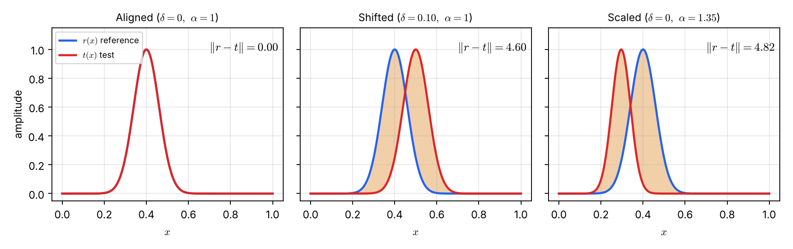
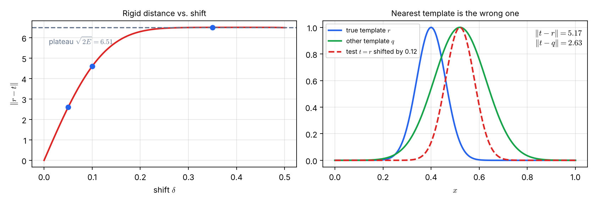
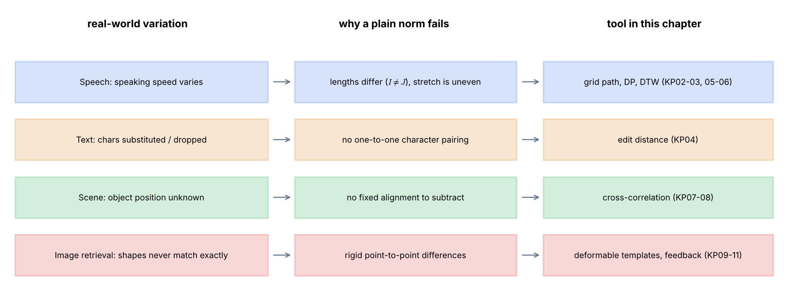

# Lecture 11 · KP01：為什麼不能直接相減（Why we cannot simply subtract）

> 程度：研究生（grad）／Level: Graduate (grad)
>
> 第 11 週（2026-11-16）｜Template Matching · KP01
>
> Week 11 (2026-11-16) | Template Matching · KP01

## 學習目標（Learning objectives）

- 說出樣板匹配與一般分類的差別，並舉出四類應用（State how template matching differs from ordinary classification, with four application types）。
- 解釋長度不同、位置未知與形變三種變異，為何讓直接相減失效（Explain why unequal length, unknown position, and deformation break direct subtraction）。
- 手算位移與縮放下的歐氏距離，並指出距離最小的樣板可能是錯的（Compute Euclidean distance under shift and scale, and show that the nearest template can be wrong）。
- 把一個實際情境對應到本章的工具（Map a real scenario to the tool this chapter offers）。

## KP01：樣板匹配的動機（Why template matching is needed）

**一句話重點**：樣板匹配不是在決策邊界上分類。它是從一組已知的參考樣板中，找出和測試樣板最契合的那一個。

**One-sentence summary**: Template matching does not classify with a decision boundary. It finds, among known reference templates, the one that fits the test pattern best.

### 1. 從「分到哪一類」走向「找最像誰」（From "which class" to "who matches best"）

前面幾週的分類器，都是把一個特徵向量放進決策區域。
區域在哪一側，就判成哪一類。
這一講換一種問法：你手上有一批參考樣板，要找哪一個和測試樣板最像。

The classifiers of earlier weeks place a feature vector into a decision region.
The side it lands on decides the class.
This lecture asks a different question: given reference templates, which one resembles the test pattern most?

**白話說明**：想像你在失物招領處，手上有一張照片。
你不是把照片分成「鑰匙」或「雨傘」，而是拿它去和架上每件物品逐一比對。
這個比喻只說明「逐一比對」。
它沒說明比對時怎麼容忍角度與距離的差異，那正是本章要解決的事。

**Plain explanation**: Imagine a lost-and-found desk where you hold one photo.
You do not label it "key" or "umbrella"; you compare it with every item on the shelf.
This analogy only covers "compare one by one". It does not say how to tolerate differences in angle or distance, which is the job of this chapter.

**先備自測**：確認你會算向量長度與兩向量的差。
不熟的話，回到第 10 週 KP02 複習內積與投影。

**Prerequisite check**: Make sure you can compute a vector length and a difference of two vectors.
If not, review inner products and projections in Week 10 KP02.

- $\|\mathbf{a}\|=\sqrt{\sum_k a_k^2}$ 是向量 $\mathbf{a}$ 的歐氏長度（This is the Euclidean length of $\mathbf{a}$）。
- 兩個向量要相減，維度必須相同（Subtraction needs equal dimensions）。
- $\|\mathbf{a}-\mathbf{b}\|$ 越小，兩向量越接近（A smaller $\|\mathbf{a}-\mathbf{b}\|$ means closer vectors）。

### 2. 先說清楚問題與符號（Stating the problem and the symbols）

**正式定義**：**樣板匹配**（template matching）給定參考樣板 $\mathbf{r}_1,\dots,\mathbf{r}_M$ 與一個測試樣板 $\mathbf{t}$。
目標是找出和 $\mathbf{t}$ 最匹配的參考樣板，或算出兩者的相似程度。
最常見的寫法是選出距離最小者：

**Formal definition**: **Template matching** takes reference templates $\mathbf{r}_1,\dots,\mathbf{r}_M$ and a test pattern $\mathbf{t}$.
The goal is to find the reference that matches $\mathbf{t}$ best, or to measure how similar the two are.
The most common form selects the smallest distance:

$$
\hat{k}=\arg\min_{k\in\{1,\dots,M\}} D(\mathbf{t},\mathbf{r}_k)
$$

這裡的 $D$ 是待設計的距離或相似度度量。
本章的每個知識點，都是在為不同問題設計不同的 $D$。

Here $D$ is a distance or similarity measure still to be designed.
Every knowledge point in this chapter designs a different $D$ for a different problem.

| 符號 | 中文意義 | English meaning |
|---|---|---|
| $\mathbf{r}_k$ | 第 $k$ 個參考樣板 | The $k$-th reference template |
| $\mathbf{t}$ | 測試樣板（待辨識的資料） | The test pattern to identify |
| $D(\cdot,\cdot)$ | 距離度量，越小越像 | Distance measure; smaller means more similar |
| $\hat{k}$ | 被選中的樣板編號 | Index of the selected template |
| $r(x),\,t(x)$ | 參考與測試訊號（以位置 $x$ 為變數） | Reference and test signals as functions of position $x$ |
| $\delta,\ \alpha$ | 位移量與縮放係數 | Shift and scale factor |
| $I,\ J$ | 參考與測試序列的長度 | Lengths of the reference and test sequences |

**常見迷思**：「有了 $D$，就等於有了分類器。」
這是真的，但前提是 $D$ 量到了對的東西。
下面三節說明為什麼最直接的 $D$ 常量錯東西。

**Common misconception**: "Once you have $D$, you have a classifier."
That is true only if $D$ measures the right thing.
The next sections show why the most direct $D$ often measures the wrong thing.

### 3. 四類應用，四種變異（Four applications, four kinds of variation）

上一節留下的問題是：什麼樣的 $D$ 才量得對？
先看現實中的資料怎麼變。
同一個東西，每次出現的樣子都不一樣。

The question left open is: which $D$ measures the right thing?
First look at how real data varies.
The same thing never looks identical twice.

| 應用 | Application | 資料怎麼變 | How the data varies |
|---|---|---|---|
| 語音辨識 | Speech recognition | 同一個詞，說快說慢，持續時間不同 | The same word lasts longer or shorter with speaking speed |
| 文字字串辨識 | Written-text matching | 字元被讀錯、多讀或漏讀 | Characters are substituted, inserted, or dropped |
| 場景分析與機器人視覺 | Scene analysis and robot vision | 目標在影像裡，但位置事先未知 | The target is in the image at an unknown position |
| 以內容檢索影像 | Content-based image retrieval | 使用者畫的形狀與資料庫形狀不會完全重合 | The queried shape never overlaps a stored shape exactly |

以文字為例，目標單字是 "beauty"。
感測器可能讀成 "beety" 或 "beaut"。
這兩個讀法的長度都是 $5$，目標的長度是 $6$。

Take text as an example: the target word is "beauty".
A sensor may read "beety" or "beaut".
Both readings have length $5$, while the target has length $6$.

### 4. 為什麼剛性距離會失靈（Why rigid distance breaks）

三種變異各有一個共同點：測試樣板和參考樣板「對不齊」。
直接相減要求兩者逐點對齊。
下面用一個可以手算的例子，看對不齊會讓距離變成什麼樣。

All three kinds of variation share one feature: the test and reference are misaligned.
Direct subtraction demands point-by-point alignment.
A computable example shows what misalignment does to the distance.

**例子**：`[補充]` 設參考樣板是一個高斯脈衝，中心在 $x=0.40$，寬度為 $0.06$。
在區間 $[0,1]$ 取 $N=200$ 個等距點。
測試樣板依來源的模型，是參考樣板的位移與縮放：

**Example**: `[Added]` Let the reference be a Gaussian pulse centered at $x=0.40$ with width $0.06$.
Sample $N=200$ equally spaced points on $[0,1]$.
Following the source model, the test pattern is a shifted and scaled copy of the reference:

$$
t(x)=r(\alpha x-\delta)
$$

距離取取樣點上的歐氏距離：

The distance is the Euclidean distance over the sampled points:

$$
\|\mathbf{r}-\mathbf{t}\|=\sqrt{\sum_{k=1}^{N}\bigl(r(x_k)-t(x_k)\bigr)^2}
$$

下表是固定 $\alpha=1$、只改變位移 $\delta$ 的結果。
$\delta=0$ 時兩個訊號重合，距離為 $0$。

The table fixes $\alpha=1$ and varies only the shift $\delta$.
At $\delta=0$ the signals coincide and the distance is $0$.

| 位移 $\delta$ | Shift $\delta$ | $\|\mathbf{r}-\mathbf{t}\|$ |
|---|---|---|
| $0$ | $0$ | $0.00$ |
| $0.02$ | $0.02$ | $1.08$ |
| $0.05$ | $0.05$ | $2.60$ |
| $0.10$ | $0.10$ | $4.60$ |
| $0.20$ | $0.20$ | $6.30$ |
| $0.35$ | $0.35$ | $6.51$ |

只位移 $0.02$，距離就從 $0$ 跳到 $1.08$。
這個位移只有整個區間的 $2\%$。
這時兩個脈衝其實幾乎重疊，卻已被判為不同。

A shift of just $0.02$ lifts the distance from $0$ to $1.08$.
That shift is only $2\%$ of the interval.
The two pulses still nearly overlap, yet the distance already calls them different.



圖說 `lec11-kp01-motivation-f1-shift-scale`：先看左圖，藍線與紅線重合，距離為 $0.00$。再看中圖，紅線只向右移了 $0.10$，橘色面積就是被平方累加的差，距離升到 $4.60$。右圖只縮放（$\alpha=1.35$），脈衝變窄並左移，距離為 $4.82$。〔功能：1、2〕

Figure `lec11-kp01-motivation-f1-shift-scale`: In the left panel the blue and red curves coincide, so the distance is $0.00$. In the middle panel the red curve moved right by only $0.10$; the orange area is the difference that gets squared and summed, and the distance rises to $4.60$. The right panel only rescales ($\alpha=1.35$): the pulse narrows and moves left, with distance $4.82$. [Function: 1, 2]

位移繼續加大，距離不會一直增加。
$\delta=0.20$ 時是 $6.30$，$\delta=0.35$ 時只有 $6.51$。
原因是兩個脈衝已經完全分開。

Increasing the shift further does not keep raising the distance.
It is $6.30$ at $\delta=0.20$ and only $6.51$ at $\delta=0.35$.
The two pulses have fully separated.

分開之後，兩者的內積幾乎是 $0$。
先把平方展開：

Once separated, the inner product of the two is nearly $0$.
Expand the square first:

$$
\|\mathbf{r}-\mathbf{t}\|^2=\sum r^2+\sum t^2-2\sum rt
$$

單一脈衝的能量是 $E=\sum r^2=21.16$。
位移後 $\sum t^2$ 仍約為 $E$，而 $\sum rt\approx 0$。
所以距離停在 $\sqrt{2E}=\sqrt{42.33}=6.51$。

A single pulse has energy $E=\sum r^2=21.16$.
After shifting, $\sum t^2$ is still about $E$, and $\sum rt\approx 0$.
So the distance stalls at $\sqrt{2E}=\sqrt{42.33}=6.51$.

這帶來比「距離變大」更嚴重的後果。
距離一旦飽和，它就說不出「差一點點」和「差很遠」的差別。
而在飽和之前，微小的位移已經讓距離快速上升。

This has a worse consequence than a larger distance.
Once saturated, the distance cannot separate "slightly off" from "far off".
Before saturation, a tiny shift already inflates the distance quickly.

**最近的樣板可能是錯的**：`[補充]` 再加一個別類樣板 $q$。
它的峰在 $x=0.52$，寬度是 $0.108$。
測試樣板其實是參考樣板 $r$ 位移 $0.12$ 的結果，所以它的真正出處是 $r$。

**The nearest template can be wrong**: `[Added]` Add another template $q$ of a different class.
Its peak is at $x=0.52$ and its width is $0.108$.
The test pattern is in fact $r$ shifted by $0.12$, so its true source is $r$.

$$
\|\mathbf{t}-\mathbf{r}\|=5.17,\qquad \|\mathbf{t}-\mathbf{q}\|=2.63
$$

$\|\mathbf{t}-\mathbf{q}\|$ 比較小，所以「選距離最小者」會把測試樣板判給 $q$。
錯誤的原因不是 $q$ 長得像 $t$。
是 $r$ 的位置和 $t$ 差了一點，距離就被放大。

$\|\mathbf{t}-\mathbf{q}\|$ is smaller, so "pick the smallest distance" assigns the test pattern to $q$.
The cause is not that $q$ really resembles $t$.
It is that $r$ sits slightly off from $t$, which inflates its distance.



圖說 `lec11-kp01-motivation-f2-distance-curve`：先看左圖，紅線是距離隨位移 $\delta$ 的變化，灰色虛線是飽和值 $6.51$。藍點是表中 $\delta=0.05,\ 0.10,\ 0.35$ 的三個值。再看右圖，紅色虛線（測試）和綠線 $q$ 的峰對齊，所以距離只有 $2.63$。藍線 $r$ 是真正的來源，距離卻有 $5.17$。〔功能：2〕

Figure `lec11-kp01-motivation-f2-distance-curve`: In the left panel the red line is the distance versus shift $\delta$; the gray dashed line is the saturation value $6.51$. The blue dots are the values at $\delta=0.05,\ 0.10,\ 0.35$ from the table. In the right panel the red dashed curve (test) aligns its peak with the green curve $q$, so the distance is only $2.63$. The blue curve $r$ is the true source, yet its distance is $5.17$. [Function: 2]

**字串與序列也一樣**：兩個長度不同的資料，連相減都做不到。
語音的例子是：參考詞 "love" 切成 $I=24$ 個音框，測試詞 "love" 只有 $J=21$ 個。
每個音框用 $50$ 個頻譜特徵描述，所以兩者是 $24\times 50$ 與 $21\times 50$ 的矩陣，不能相減。

**Strings and sequences behave the same way**: two items of different length cannot even be subtracted.
In the speech example, the reference "love" has $I=24$ frames while the test "love" has $J=21$.
Each frame has $50$ spectral features, so the matrices are $24\times 50$ and $21\times 50$ and cannot be subtracted.

就算硬把字串對齊，也會出錯。
比較 "beauty" 與 "eauty"（漏掉第一個字母），逐位置比對前 $5$ 個位置，$5$ 個位置全部不同。
可是只要刪掉一個字母，兩者就一樣了。

Forcing an alignment also fails.
Compare "beauty" with "eauty" (first letter dropped) position by position over the first $5$ positions: all $5$ differ.
Yet deleting a single letter makes them identical.

**常見迷思**：「把兩個序列縮放成一樣長，再相減就好。」
來源指出，語速的伸縮並不是等比例均勻變化。
均勻縮放只能對齊整體長度，快慢不均的地方仍然對不上。

**Common misconception**: "Rescale both sequences to the same length, then subtract."
The source notes that speaking-speed changes are not uniform.
Uniform rescaling fixes the total length only; unevenly sped-up parts stay misaligned.

**想深入**（選讀）：飽和值 $\sqrt{2E}$ 假設位移後的脈衝完全落在區間內，且兩脈衝不重疊。
脈衝被區間邊界截掉時，$\sum t^2$ 會小於 $E$，飽和值也會略低。
本例中，$\delta=0.35$ 的脈衝仍完整落在區間內。

**Going deeper** (optional): The saturation value $\sqrt{2E}$ assumes the shifted pulse stays inside the interval and the pulses do not overlap.
If the boundary cuts the pulse, $\sum t^2$ falls below $E$ and the plateau is slightly lower.
In this example the pulse at $\delta=0.35$ still lies fully inside the interval.

### 5. 本章的路線與留下的問題（The route of this chapter and the open question）

上一節說明：直接相減在三個地方失效。
本章針對不同的失效原因，各給一個工具。
口訣是：長度不同難相減，彈性對齊找最佳；位置未知相關找，形狀變形能量調。

The previous section showed that direct subtraction fails in three places.
This chapter gives one tool per cause of failure.
The mnemonic: unequal lengths cannot be subtracted, so align elastically; unknown position, so use correlation; deformed shapes, so trade off energy.



圖說 `lec11-kp01-motivation-f3-route-map`：由左往右讀每一列。第一欄是現實中的變異，第二欄是直接相減失效的原因，第三欄是本章的工具與對應的知識點編號。語音與文字都屬於序列比對，所以前三個工具先處理序列。〔功能：1〕

Figure `lec11-kp01-motivation-f3-route-map`: Read each row from left to right. The first column is the real-world variation, the second the reason direct subtraction fails, the third the tool of this chapter with its knowledge-point numbers. Speech and text both belong to sequence matching, so the first tools handle sequences. [Function: 1]

**與實作的連結**：下面的程式重現上表的 $\delta=0.10$ 那一列。
`dist` 回傳取樣點上的歐氏距離。
`np.linalg.norm` 就是公式中的平方和開根號。

**Connection to practice**: The code below reproduces the $\delta=0.10$ row of the table.
`dist` returns the Euclidean distance over the sampled points.
`np.linalg.norm` is the square-root-of-sum-of-squares in the formula.

```python
import numpy as np

x = np.linspace(0, 1, 200)                          # N = 200 個取樣點
r = lambda u: np.exp(-(u - 0.40) ** 2 / (2 * 0.06 ** 2))   # 參考脈衝 / reference pulse

def dist(alpha, delta):
    """t(x) = r(alpha*x - delta) 與 r(x) 的歐氏距離 / Euclidean distance."""
    return np.linalg.norm(r(x) - r(alpha * x - delta))

print(round(dist(1, 0.10), 2))   # 4.6
```

**留給下一節的問題**：序列長度不同時，哪些元素要互相配對？
最直接的想法是把所有可能的配對方式列成一張圖，再找最省力的走法。
下一節把這個想法寫成二維格網上的路徑。

**The question for the next section**: When sequences differ in length, which elements should be paired?
The most direct idea is to draw all possible pairings as a diagram and find the cheapest walk.
The next section turns this into a path on a two-dimensional grid.

### 6. 小練習與解題示範（Practice and worked solutions）

**小練習** `[補充]`：先寫下理由，再看解答。

**Practice** `[Added]`: Write your reasoning before reading the solutions.

1. 題 1：參考詞 $I=24$ 個音框、測試詞 $J=21$ 個，各用 $l=50$ 個特徵。直接用 Frobenius 範數算 $\|\mathbf{R}-\mathbf{T}\|_F$ 會遇到什麼問題（What goes wrong if you compute $\|\mathbf{R}-\mathbf{T}\|_F$ directly）？
2. 題 2：測試訊號是參考脈衝位移 $0.35$ 的結果。它和參考脈衝的距離是多少？這個數字能告訴你位移有多大嗎（What is the distance, and does it tell you the size of the shift）？
3. 題 3：掃描器把 "beauty" 讀成 "beuty"。這屬於本章四類問題的哪一類？該用哪一個工具（Which of the four problem types is this, and which tool applies）？

**題 1 解題示範**：兩個矩陣的形狀是 $24\times 50$ 與 $21\times 50$。
形狀不同的矩陣不能逐元素相減。
所以連差矩陣 $\mathbf{R}-\mathbf{T}$ 都無法定義，範數更無從算起。

**Question 1 worked solution**: The shapes are $24\times 50$ and $21\times 50$.
Matrices of different shapes cannot be subtracted element by element.
So the difference $\mathbf{R}-\mathbf{T}$ is undefined, and no norm can be computed.

**題 2 解題示範**：查表得 $\|\mathbf{r}-\mathbf{t}\|=6.51$。
這幾乎等於飽和值 $\sqrt{2E}=6.51$。
所以這個數字只說「兩個脈衝不重疊」，無法分辨位移是 $0.35$ 還是 $0.50$。

**Question 2 worked solution**: The table gives $\|\mathbf{r}-\mathbf{t}\|=6.51$.
This nearly equals the plateau $\sqrt{2E}=6.51$.
The number only says "the pulses do not overlap". It cannot tell a shift of $0.35$ from $0.50$.

**題 3 解題示範**：這是文字字串辨識，變異是漏掉一個字元。
"beuty" 長度為 $5$，"beauty" 長度為 $6$，不能逐位置比對。
該用編輯距離（KP04），它計算把一個字串改成另一個所需的最少操作。

**Question 3 worked solution**: This is written-text matching, and the variation is a dropped character.
"beuty" has length $5$ and "beauty" has length $6$, so position-wise comparison fails.
Use edit distance (KP04), which counts the fewest operations that turn one string into the other.

## 術語表（Glossary）

| 中文術語 | English term |
|---|---|
| 樣板匹配 | Template matching |
| 參考樣板／測試樣板 | Reference template / test pattern |
| 距離度量 | Distance measure |
| 歐氏距離 | Euclidean distance |
| Frobenius 範數 | Frobenius norm |
| 位移／縮放 | Shift / scale |
| 飽和 | Saturation |
| 取樣點 | Sampling point |
| 音框 | Speech frame |
| 能量 | Energy |
| 編輯距離 | Edit distance |
| NumPy | Python array-computing library |

## 銜接與來源（Connections and sources）

下一講把「哪些元素互相配對」寫成二維格網上的路徑。
你會看到路徑的總代價就是兩個序列的距離。

The next lecture writes "which elements pair up" as a path on a two-dimensional grid.
You will see that the total cost of a path is the distance between the two sequences.

- 前一單元：[KP09 局部重建與圖距離](lec10-kp09-lle-isomap.md)（Previous unit: local reconstruction and graph distances）。
- 下一單元：[KP02 格網、路徑與代價](lec11-kp02-grid-path.md)（Next unit: grids, paths, and costs）。
- 來源：[Template Matching §8.1](https://ndhuccc.github.io/CCC-LNS/PR_115/Ch08-template-matching/index.html#kp1)，讀取日期 2026-11-12（Source accessed 2026-11-12）。
- 書目：Theodoridis and Koutroumbas, *Pattern Recognition*, 4th ed., 2008；見[參考資料](../references/README.md)（See the bibliography）。

本講以自己的文字解釋來源。
高斯脈衝、距離表、錯誤樣板、字串比對、圖與程式皆為 `[補充]`。
位移與縮放模型、四類應用與音框數字取自來源。

This lecture independently explains the source.
The Gaussian pulse, distance table, wrong-template case, string comparison, figures, and code are `[Added]`.
The shift-and-scale model, four applications, and frame counts come from the source.
