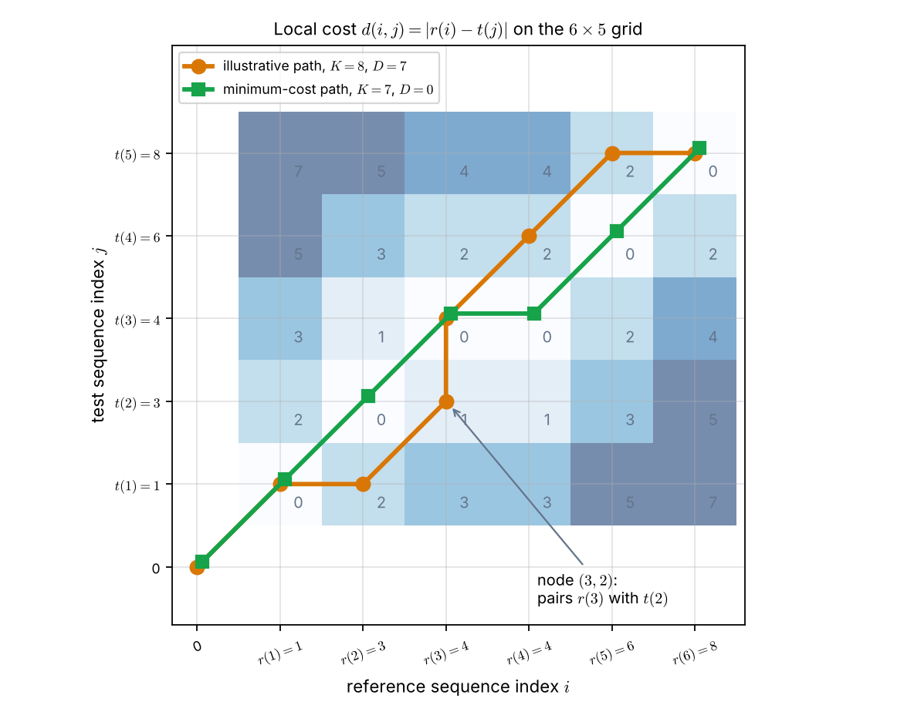
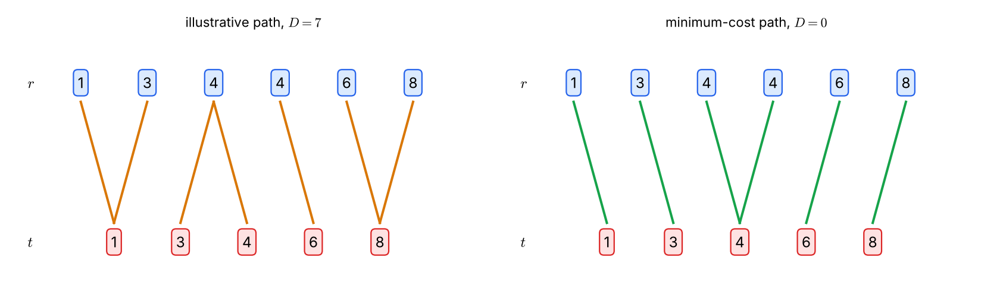

# Lecture 11 · KP02：把序列比對畫成格網上的路徑（Turning sequence matching into a path on a grid）

> 程度：研究生（grad）／Level: Graduate (grad)
>
> 第 11 週（2026-11-16）｜Template Matching · KP02
>
> Week 11 (2026-11-16) | Template Matching · KP02

## 學習目標（Learning objectives）

- 說出二維格網上的節點、局部代價、路徑與總代價各代表什麼（State what nodes, local costs, paths, and overall cost mean on a two-dimensional grid）。
- 讀懂水平、垂直與對角三種步，各自對應哪種元素配對（Read what horizontal, vertical, and diagonal steps mean as element pairings）。
- 手算一條路徑的總代價，並找出最低代價路徑（Compute the overall cost of a path and find the minimum-cost path）。
- 解釋為什麼逐條列舉路徑不可行（Explain why enumerating paths one by one is infeasible）。

## KP02：格網、路徑與代價（Grids, paths, and costs）

**一句話重點**：把兩個長度不同的序列放在格網的兩條軸上。兩序列的距離，就是從左下角走到右上角的最低總代價。這條最低代價路徑同時給出元素的對應。

**One-sentence summary**: Put two sequences of different length on the two axes of a grid. Their distance is the minimum total cost of walking from the lower-left corner to the upper-right corner. That cheapest path also gives the element correspondence.

### 1. 從「誰配誰」到一張地圖（From "who pairs with whom" to a map）

上一節留下的問題是：序列長度不同時，哪些元素要互相配對？
這一節的做法是把所有可能的配對畫在同一張圖上。
每一種配對方式，就是圖上的一條路線。

The previous section left this question: when sequences differ in length, which elements pair up?
This section draws every possible pairing on a single diagram.
Each way of pairing is one route on that diagram.

**白話說明**：想像兩個人沿著同一條小路各走一段，但步伐不一樣快。
你要記錄他們什麼時候並肩，什麼時候一個人停下來等另一個。
格網上的路徑就是這份記錄。
這個比喻只對應「配對的過程」，沒有說明每次配對要花多少代價。

**Plain explanation**: Picture two people walking along the same road at different paces.
You record when they walk side by side and when one waits for the other.
A path on the grid is that record.
This analogy covers only the pairing process, not how much each pairing costs.

**先備自測**：確認你會讀二維座標，也會做加總。
不熟的話，先回到 KP01 看一次兩序列為何不能直接相減。

**Prerequisite check**: Make sure you can read two-dimensional coordinates and add up numbers.
If not, revisit KP01 to see why two sequences cannot be subtracted directly.

- 節點 $(i,j)$ 表示橫軸第 $i$ 格與縱軸第 $j$ 格的交點（Node $(i,j)$ is where column $i$ meets row $j$）。
- $\sum_{k=0}^{K-1} a_k$ 是把 $a_0$ 到 $a_{K-1}$ 全部加起來（This adds $a_0$ through $a_{K-1}$）。
- 絕對值 $|a-b|$ 是兩數的差距，不分正負（The absolute value $|a-b|$ is the gap between two numbers）。

### 2. 先說清楚格網與符號（Specifying the grid and the symbols）

**正式定義**：參考序列是 $\mathbf{r}(i),\ i=1,\dots,I$。
測試序列是 $\mathbf{t}(j),\ j=1,\dots,J$。
一般情況下 $I\neq J$。

**Formal definition**: The reference sequence is $\mathbf{r}(i),\ i=1,\dots,I$.
The test sequence is $\mathbf{t}(j),\ j=1,\dots,J$.
In general $I\neq J$.

橫軸（$i$ 軸）放參考序列，縱軸（$j$ 軸）放測試序列。
格點 $(i,j)$ 表示把 $\mathbf{r}(i)$ 與 $\mathbf{t}(j)$ 配成一對。
這個配對的代價是局部代價 $d(i,j)$，用來衡量兩個元素有多不像。

The horizontal axis ($i$) carries the reference and the vertical axis ($j$) carries the test sequence.
Grid point $(i,j)$ pairs $\mathbf{r}(i)$ with $\mathbf{t}(j)$.
The cost of that pairing is the local cost $d(i,j)$, which measures how different the two elements are.

**路徑**（path）是從起點 $(i_0,j_0)$ 到終點 $(i_f,j_f)$ 的有序節點：

A **path** is an ordered list of nodes from the start $(i_0,j_0)$ to the end $(i_f,j_f)$:

$$
(i_0,j_0),\ (i_1,j_1),\ (i_2,j_2),\ \dots,\ (i_f,j_f)
$$

沿路徑上 $K$ 個節點把局部代價加起來，就是總代價：

Adding the local costs along the $K$ nodes of a path gives the overall cost:

$$
D=\sum_{k=0}^{K-1} d(i_k,j_k)
$$

慣例上 $D(0,0)=0$ 且 $d(0,0)=0$。
起點 $(0,0)$ 是虛擬的起點，它不代表任何真實的配對。
**完整路徑**（complete path）從 $(0,0)$ 開始，到 $(I,J)$ 結束。

By convention $D(0,0)=0$ and $d(0,0)=0$.
The point $(0,0)$ is a virtual start and stands for no real pairing.
A **complete path** starts at $(0,0)$ and ends at $(I,J)$.

兩個序列的距離，定義為所有完整路徑中的最小總代價。
這條最低代價路徑同時給出兩序列的逐點對應。

The distance of the two sequences is the minimum overall cost over all complete paths.
That minimum-cost path also gives the element-by-element correspondence.

| 符號 | 中文意義 | English meaning |
|---|---|---|
| $\mathbf{r}(i)$ | 參考序列第 $i$ 個元素 | The $i$-th element of the reference sequence |
| $\mathbf{t}(j)$ | 測試序列第 $j$ 個元素 | The $j$-th element of the test sequence |
| $I,\ J$ | 兩序列的長度 | Lengths of the two sequences |
| $(i,j)$ | 格網節點：配對 $\mathbf{r}(i)$ 與 $\mathbf{t}(j)$ | Grid node: pairs $\mathbf{r}(i)$ with $\mathbf{t}(j)$ |
| $d(i,j)$ | 節點的局部代價 | Local cost of a node |
| $K$ | 路徑的節點數（含起點 $(0,0)$） | Number of nodes on a path, including $(0,0)$ |
| $D$ | 路徑總代價 | Overall cost of a path |

來源還列出四種常見的變形。
它們都沿用同一張格網，只改代價的算法或端點的規定。

The source lists four common variants.
They all keep the same grid and change only how cost is computed or how the end points are fixed.

| 變形 | Variant | 做法 | What changes |
|---|---|---|---|
| 轉移代價 | Transition cost | 代價也看由哪個前驅節點走來：$d(i_k,j_k\mid i_{k-1},j_{k-1})$ | Cost also depends on the predecessor node |
| 乘法代價 | Multiplicative cost | 總代價用連乘 $D=\prod_k d(\cdot)$ | Overall cost is a product instead of a sum |
| 放寬端點 | Relaxed end points | 起點與終點不必是 $(0,0)$ 與 $(I,J)$ | Start and end need not be $(0,0)$ and $(I,J)$ |
| 最大化 | Maximization | $d$ 是相似度時，找得分最大的路徑 | Seek the maximum score when $d$ is a similarity |

**常見迷思**：「路徑上的節點越多，代表配得越仔細。」
總代價是把每個節點的代價加起來。
節點多的路徑，通常累加的項也多，所以不能用節點數衡量配對品質。

**Common misconception**: "More nodes on the path means a more careful pairing."
The overall cost adds the cost of every node.
A path with more nodes usually adds more terms, so the node count does not measure pairing quality.

### 3. 一個可以手算的例子（A worked example）

上一節只給了符號。
下面用兩段很短的數列，把格網、路徑與代價都算一遍。

The previous section gave only symbols.
Two very short sequences now let you compute the grid, a path, and a cost by hand.

**例子**：`[補充]` 參考序列 $r=(1,3,4,4,6,8)$，所以 $I=6$。
測試序列 $t=(1,3,4,6,8)$，所以 $J=5$。
局部代價取元素差的絕對值：$d(i,j)=|r(i)-t(j)|$。

**Example**: `[Added]` The reference is $r=(1,3,4,4,6,8)$, so $I=6$.
The test sequence is $t=(1,3,4,6,8)$, so $J=5$.
The local cost is the absolute difference: $d(i,j)=|r(i)-t(j)|$.

測試序列比參考序列少一個 $4$。
你可以把它想成「同一個詞，說得比較快」。
路徑要怎麼走，才能把這個差異處理掉？

The test sequence has one fewer $4$ than the reference.
Think of it as "the same word, spoken faster".
How should the path go to absorb that difference?

先看一條形狀取自來源 Figure 8.1 的路徑，共 $K=8$ 個節點：

First take a path whose shape comes from Figure 8.1 of the source, with $K=8$ nodes:

$$
(0,0)\to(1,1)\to(2,1)\to(3,2)\to(3,3)\to(4,4)\to(5,5)\to(6,5)
$$

逐點代入 $d(i,j)=|r(i)-t(j)|$：

Substitute point by point into $d(i,j)=|r(i)-t(j)|$:

| 節點 | Node | 配對 | Pairing | 局部代價 | Local cost |
|---|---|---|---|---|---|
| $(0,0)$ | $(0,0)$ | 虛擬起點 | Virtual start | $0$ | $0$ |
| $(1,1)$ | $(1,1)$ | $\lvert 1-1\rvert$ | $\lvert 1-1\rvert$ | $0$ | $0$ |
| $(2,1)$ | $(2,1)$ | $\lvert 3-1\rvert$ | $\lvert 3-1\rvert$ | $2$ | $2$ |
| $(3,2)$ | $(3,2)$ | $\lvert 4-3\rvert$ | $\lvert 4-3\rvert$ | $1$ | $1$ |
| $(3,3)$ | $(3,3)$ | $\lvert 4-4\rvert$ | $\lvert 4-4\rvert$ | $0$ | $0$ |
| $(4,4)$ | $(4,4)$ | $\lvert 4-6\rvert$ | $\lvert 4-6\rvert$ | $2$ | $2$ |
| $(5,5)$ | $(5,5)$ | $\lvert 6-8\rvert$ | $\lvert 6-8\rvert$ | $2$ | $2$ |
| $(6,5)$ | $(6,5)$ | $\lvert 8-8\rvert$ | $\lvert 8-8\rvert$ | $0$ | $0$ |

總代價是 $D=0+0+2+1+0+2+2+0=7$。

The overall cost is $D=0+0+2+1+0+2+2+0=7$.

三種步各有不同的意思：

The three kinds of step mean different things:

- 對角步，$(i,j)\to(i+1,j+1)$：兩個序列各前進一格，一對一配對（Diagonal: both sequences advance one element, a one-to-one pairing）。
- 水平步，$(i,j)\to(i+1,j)$：同一個 $t(j)$ 再配上下一個 $r(i+1)$（Horizontal: the same $t(j)$ also pairs with the next $r(i+1)$）。
- 垂直步，$(i,j)\to(i,j+1)$：同一個 $r(i)$ 再配上下一個 $t(j+1)$（Vertical: the same $r(i)$ also pairs with the next $t(j+1)$）。

例如路徑裡的 $(1,1)\to(2,1)$ 是水平步：$t(1)$ 同時配 $r(1)$ 與 $r(2)$。
$(3,2)\to(3,3)$ 是垂直步：$r(3)$ 同時配 $t(2)$ 與 $t(3)$。
節點 $(3,2)$ 的意思，是把 $r(3)=4$ 與 $t(2)=3$ 配成一對。

For example $(1,1)\to(2,1)$ in the path is a horizontal step: $t(1)$ pairs with both $r(1)$ and $r(2)$.
$(3,2)\to(3,3)$ is a vertical step: $r(3)$ pairs with both $t(2)$ and $t(3)$.
Node $(3,2)$ pairs $r(3)=4$ with $t(2)=3$.



圖說 `lec11-kp02-grid-path-f1-grid`：先看格子裡的數字，那是局部代價 $d(i,j)$，顏色越深代價越大。再看橘色路徑，它依序經過 $8$ 個節點，總代價 $7$。綠色路徑只經過 $7$ 個節點，沿途的格子代價全是 $0$，所以總代價為 $0$。〔功能：1、2〕

Figure `lec11-kp02-grid-path-f1-grid`: First read the numbers inside the cells: they are local costs $d(i,j)$, and darker cells cost more. Then follow the orange path through $8$ nodes with overall cost $7$. The green path passes through only $7$ nodes, all on cells of cost $0$, so its overall cost is $0$. [Function: 1, 2]

綠色路徑才是最低代價路徑。
它是 $(0,0),(1,1),(2,2),(3,3),(4,3),(5,4),(6,5)$，總代價 $D=0$。
其中 $(3,3)\to(4,3)$ 是水平步：$t(3)=4$ 同時配上兩個 $r=4$。

The green path is the minimum-cost path.
It is $(0,0),(1,1),(2,2),(3,3),(4,3),(5,4),(6,5)$ with $D=0$.
The step $(3,3)\to(4,3)$ is horizontal: $t(3)=4$ pairs with both elements $r=4$.



圖說 `lec11-kp02-grid-path-f2-alignment`：上排藍框是參考序列，下排紅框是測試序列。每條連線是路徑上的一個配對節點。左圖的連線有些把 $4$ 配成 $3$、把 $4$ 配成 $6$，所以代價為 $7$。右圖的每條連線都連到相同的數字，兩個 $4$ 共用同一個測試的 $4$，代價為 $0$。〔功能：1、3〕

Figure `lec11-kp02-grid-path-f2-alignment`: The top row of blue boxes is the reference sequence and the bottom row of red boxes is the test sequence. Each line is one paired node on the path. In the left panel some lines pair $4$ with $3$ and $4$ with $6$, so the cost is $7$. In the right panel every line joins equal numbers, and the two $4$'s share one test $4$, so the cost is $0$. [Function: 1, 3]

### 4. 為什麼不能把所有路徑都列出來（Why we cannot enumerate every path）

上一節找最低代價路徑時，其實是把所有路徑都算了一遍。
本例用了前面的三種步，並規定 $(0,0)$ 只能接 $(1,1)$。
這樣從 $(0,0)$ 走到 $(6,5)$ 一共有 $681$ 條完整路徑。

The previous section found the minimum-cost path by checking every path.
This example uses the three steps above and lets $(0,0)$ connect only to $(1,1)$.
That gives $681$ complete paths from $(0,0)$ to $(6,5)$.

這 $681$ 條路徑的總代價各不相同。
最大是 $32$，平均約 $9.55$，只有一條是 $0$。
最低代價路徑其實很少見，要靠比較才找得到。

The $681$ paths have different overall costs.
The largest is $32$, the mean is about $9.55$, and only one equals $0$.
A minimum-cost path is rare and has to be found by comparison.

路徑數量隨序列長度爆炸性成長。
把語音例子的長度 $I=24$、$J=21$ 代入同一套規則，會有約 $3.06\times10^{15}$ 條完整路徑。
即使每秒檢查一億條，也要算約 $354$ 天。

The number of paths explodes with sequence length.
Plugging in the speech example, $I=24$ and $J=21$, gives about $3.06\times10^{15}$ complete paths under the same rules.
Checking one hundred million paths per second would still take about $354$ days.

所以來源在下一節引入貝爾曼最適性原理與動態規劃。
它們不列舉所有路徑，仍能保證找到最低代價路徑。

So the source introduces Bellman's principle of optimality and dynamic programming next.
They find the minimum-cost path without listing every path.

**常見迷思**：「最低總代價小，就表示兩個序列很像。」
總代價是節點代價的加總，節點數不同的路徑項數也不同。
要比較不同長度的序列，需要把總代價正規化，KP06 會處理這件事。

**Common misconception**: "A small minimum overall cost means the two sequences are similar."
The overall cost sums node costs, and paths with different node counts sum different numbers of terms.
Comparing sequences of different lengths needs a normalized cost. KP06 handles this.

**想深入**（選讀）：路徑的節點數有範圍。
本例從 $(1,1)$ 走到 $(6,5)$，最少用 $5$ 步，其中 $4$ 步是對角步。
再加上 $(0,0)$ 與 $(1,1)$ 兩個節點，最少 $K=7$。
全部用水平步和垂直步最多走 $9$ 步，最多 $K=11$。

**Going deeper** (optional): The node count of a path has a range.
In this example, going from $(1,1)$ to $(6,5)$ takes at least $5$ steps, $4$ of them diagonal.
Counting the nodes $(0,0)$ and $(1,1)$ as well, the minimum is $K=7$.
Using only horizontal and vertical steps takes at most $9$ steps, so the maximum is $K=11$.

**與實作的連結**：下面的程式用遞迴列舉本例的所有路徑。
它重現了 $681$ 條路徑與最低總代價 $0$。
這種寫法只適合很短的序列；序列一長，就需要下一節的動態規劃。

**Connection to practice**: The code below enumerates every path of this example by recursion.
It reproduces the $681$ paths and the minimum overall cost $0$.
This style suits only very short sequences; longer ones need the dynamic programming of the next section.

```python
r = [1, 3, 4, 4, 6, 8]          # 參考序列 / reference, I = 6
t = [1, 3, 4, 6, 8]             # 測試序列 / test, J = 5
I, J = len(r), len(t)

def d(i, j):
    """局部代價 / local cost: |r(i) - t(j)|，下標從 1 開始。"""
    return abs(r[i - 1] - t[j - 1])

def walk(i, j, cost, out):
    """從節點 (i, j) 走到 (I, J)，把每條完整路徑的總代價放進 out。"""
    if (i, j) == (I, J):
        out.append(cost)
        return
    for di, dj in ((1, 0), (0, 1), (1, 1)):          # 水平、垂直、對角
        if i + di <= I and j + dj <= J:
            walk(i + di, j + dj, cost + d(i + di, j + dj), out)

costs = []
walk(1, 1, d(1, 1), costs)      # (0,0) 只接 (1,1)，d(0,0) = 0
print(len(costs), min(costs))   # 681 0
```

### 5. 小結與留下的問題（Summary and the open question）

這一節把序列比對變成格網上的最短路徑問題。
節點代表一次配對，路徑代表整組配對，總代價是兩序列的距離。
但路徑多到列不完，所以還缺一個有效率的找法。

This section turned sequence matching into a shortest-path problem on a grid.
A node is one pairing, a path is the whole set of pairings, and the overall cost is the distance of the two sequences.
But there are too many paths to list, so an efficient search is still missing.

**留給下一節的問題**：怎樣在不列舉所有路徑的情況下，仍保證找到最低代價路徑？
關鍵是：最佳路徑的任何一段前綴，也必須是到達那個節點的最佳前綴。
下一節把這個性質寫成遞迴式。

**The question for the next section**: How can we guarantee the minimum-cost path without listing all paths?
The key is that any prefix of an optimal path must itself be an optimal way to reach its last node.
The next section writes this property as a recursion.

### 6. 小練習與解題示範（Practice and worked solutions）

**小練習** `[補充]`：先寫下理由，再看解答。

**Practice** `[Added]`: Write your reasoning before reading the solutions.

1. 題 1：用本節的 $r$ 與 $t$，算路徑 $(0,0),(1,1),(2,2),(3,3),(4,4),(5,5),(6,5)$ 的總代價（Compute the overall cost of this path for the same $r$ and $t$）。
2. 題 2：路徑中的 $(3,2)\to(3,3)$ 是哪一種步？它表示哪個元素配了幾個元素（Which kind of step is $(3,2)\to(3,3)$, and which element pairs with how many）？
3. 題 3：對 $I=6$、$J=5$，一條完整路徑最少與最多有幾個節點（What are the minimum and maximum node counts of a complete path for $I=6$, $J=5$）？

**題 1 解題示範**：逐點算局部代價。
$(1,1)$ 為 $0$，$(2,2)$ 為 $|3-3|=0$，$(3,3)$ 為 $|4-4|=0$。
$(4,4)$ 為 $|4-6|=2$，$(5,5)$ 為 $|6-8|=2$，$(6,5)$ 為 $|8-8|=0$。
總代價是 $0+0+0+0+2+2+0=4$。

**Question 1 worked solution**: Compute each local cost.
$(1,1)$ costs $0$, $(2,2)$ costs $|3-3|=0$, and $(3,3)$ costs $|4-4|=0$.
$(4,4)$ costs $|4-6|=2$, $(5,5)$ costs $|6-8|=2$, and $(6,5)$ costs $|8-8|=0$.
The overall cost is $0+0+0+0+2+2+0=4$.

**題 2 解題示範**：$i$ 不變、$j$ 增加一格，是垂直步。
這表示同一個 $r(3)=4$，同時配上 $t(2)=3$ 與 $t(3)=4$，共配了 $2$ 個測試元素。
這兩個配對的代價分別是 $1$ 與 $0$。

**Question 2 worked solution**: $i$ stays and $j$ increases by one, so this is a vertical step.
The same $r(3)=4$ pairs with both $t(2)=3$ and $t(3)=4$, so it pairs with $2$ test elements.
The two pairings cost $1$ and $0$.

**題 3 解題示範**：從 $(1,1)$ 到 $(6,5)$，$i$ 要增加 $5$，$j$ 要增加 $4$。
最少的步數是 $5$：$4$ 個對角步，加 $1$ 個水平步。
節點數是 $(0,0)$、$(1,1)$ 再加 $5$ 步，最少 $7$ 個。
最多是 $5+4=9$ 步，都不用對角步，節點數最多 $11$ 個。

**Question 3 worked solution**: From $(1,1)$ to $(6,5)$, $i$ must grow by $5$ and $j$ by $4$.
The fewest steps is $5$: $4$ diagonal steps and $1$ horizontal step.
The nodes are $(0,0)$, $(1,1)$, and $5$ more, so the minimum is $7$.
The most is $5+4=9$ steps with no diagonal step, giving at most $11$ nodes.

## 術語表（Glossary）

| 中文術語 | English term |
|---|---|
| 格網 | Grid |
| 節點 | Node |
| 局部代價 | Local cost |
| 路徑 | Path |
| 完整路徑 | Complete path |
| 總代價 | Overall cost |
| 轉移代價 | Transition cost |
| 乘法代價 | Multiplicative cost |
| 前驅節點 | Predecessor node |
| 對角步／水平步／垂直步 | Diagonal / horizontal / vertical step |
| 序列對齊 | Sequence alignment |
| 正規化代價 | Normalized cost |
| 貝爾曼最適性原理 | Bellman's principle of optimality |
| 動態規劃 | Dynamic programming |

## 銜接與來源（Connections and sources）

下一講寫出遞迴式，讓每個節點只算一次。
你會用它在幾個節點之間做完整的手算。

The next lecture writes a recursion so that each node is computed only once.
You will use it for a complete hand calculation over a few nodes.

- 前一單元：[KP01 為什麼不能直接相減](lec11-kp01-motivation.md)（Previous unit: why we cannot simply subtract）。
- 下一單元：KP03 貝爾曼最適性原理與動態規劃（Next unit: Bellman's principle and dynamic programming；撰寫中）。
- 來源：[Template Matching §8.2](https://ndhuccc.github.io/CCC-LNS/PR_115/Ch08-template-matching/index.html#kp2)，讀取日期 2026-11-12（Source accessed 2026-11-12）。
- 書目：Theodoridis and Koutroumbas, *Pattern Recognition*, 4th ed., 2008；見[參考資料](../references/README.md)（See the bibliography）。

本講以自己的文字解釋來源。
格網、路徑、總代價、四種變形與 $K=8$ 路徑的形狀取自來源。
數列、局部代價數字、路徑計數、圖與程式為 `[補充]`。
$(0,0)$ 只接 $(1,1)$ 與三種步的規定是本講為了計數所做的假設，來源的局部限制將在 KP06 說明。

This lecture independently explains the source.
The grid, path, overall cost, four variants, and the shape of the $K=8$ path come from the source.
The sequences, local-cost numbers, path counts, figures, and code are `[Added]`.
The rule that $(0,0)$ connects only to $(1,1)$, and the three-step rule, are assumptions made here for counting; the source's local constraints appear in KP06.
