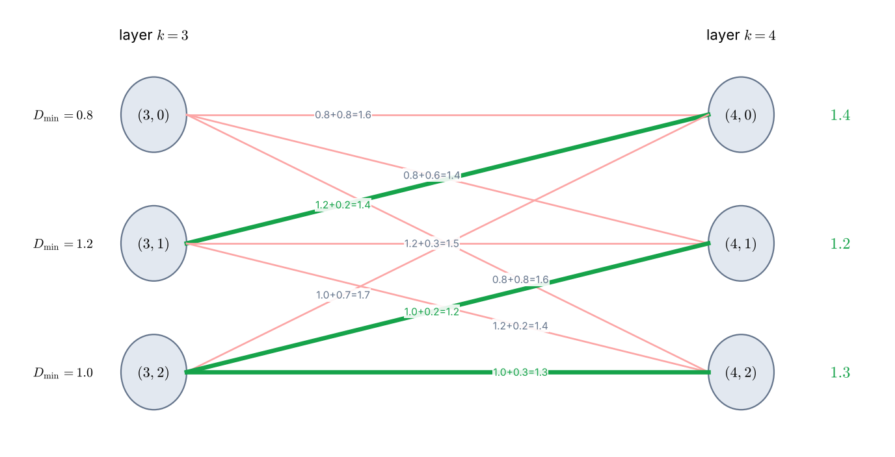
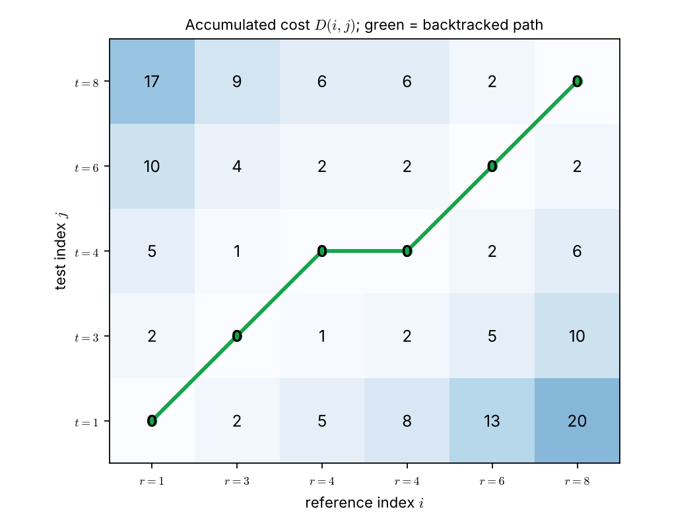

# Lecture 11 · KP03：不列舉也能找到最低代價（Finding the cheapest path without listing paths）

> 程度：研究生（grad）／Level: Graduate (grad)
>
> 第 11 週（2026-11-16）｜Template Matching · KP03
>
> Week 11 (2026-11-16) | Template Matching · KP03

## 學習目標（Learning objectives）

- 說出 Bellman 最適性原理，並用「最佳前段加最佳後段」解釋它（State Bellman's principle of optimality as "best first part plus best second part"）。
- 用遞迴式從前一層的累積代價算出下一層每個節點的最低累積代價（Use the recursion to get each node's minimum accumulated cost from the previous layer）。
- 手算 Example 8.1，並說明局部最低的節點為什麼不一定勝出（Work Example 8.1 by hand and explain why the locally cheapest node need not win）。
- 回溯最低代價路徑，並比較動態規劃與列舉的運算量（Backtrack the cheapest path and compare the work of dynamic programming with enumeration）。

## KP03：Bellman 最適性原理與動態規劃（Bellman's principle and dynamic programming）

**一句話重點**：把「走到每個節點的最低累積代價」一層一層算出來，就能組出整條最低代價路徑，不必列舉所有路徑。

**One-sentence summary**: Compute the minimum accumulated cost of reaching each node, layer by layer, and the whole cheapest path follows without enumerating any path.

### 1. 從「列不完」走向「重複利用」（From "too many" to "reuse"）

上一講留下的問題是：路徑多到列不完，怎樣仍保證找到最低代價？
語音例子有約 $3.06\times10^{15}$ 條路徑，逐條算根本做不到。
關鍵觀察是：不同路徑常常共用同一段前綴。

The previous lecture left this question: with too many paths to list, how can we still guarantee the minimum cost?
The speech example has about $3.06\times10^{15}$ paths, so computing them one by one is out of reach.
The key observation is that different paths often share the same prefix.

**白話說明**：想像你要從山腳走到山頂，每個岔路口都有人記下「到這裡最快要多久」。
你不必重算每條路，只要在岔路口查表。
這個比喻說明「記住中間結果」。
它沒說明為什麼只記最小值就夠，那要靠下面的原理。

**Plain explanation**: Imagine walking from a mountain base to the summit, with someone noting at every junction "the fastest time to get here".
You do not recompute every route; you look up the junction.
This analogy explains "remember intermediate results".
It does not explain why remembering only the minimum is enough, which the principle below does.

**先備自測**：確認你記得 KP02 的格網、節點與總代價。

**Prerequisite check**: Make sure you remember the grid, nodes, and overall cost of KP02.

- 路徑總代價是各節點局部代價的加總（The overall cost is the sum of node costs）。
- 完整路徑從 $(0,0)$ 到 $(I,J)$（A complete path runs from $(0,0)$ to $(I,J)$）。

### 2. 最適性原理與遞迴式（The principle and the recursion）

**正式定義**：若從起點 $(i_0,j_0)$ 到終點 $(i_f,j_f)$ 的最佳路徑被限制必須經過中間節點 $(i,j)$，則整條受限最佳路徑，等於起點到 $(i,j)$ 的最佳前段，接上 $(i,j)$ 到終點的最佳後段。
這就是 **Bellman 最適性原理**（Bellman's principle of optimality）。

**Formal definition**: Suppose the best path from the start $(i_0,j_0)$ to the end $(i_f,j_f)$ is forced through an intermediate node $(i,j)$.
Then that constrained best path equals the best first part from the start to $(i,j)$ joined to the best second part from $(i,j)$ to the end.
This is **Bellman's principle of optimality**.

$$
(i_0,j_0)\xrightarrow[(i,j)]{\text{opt}}(i_f,j_f)=(i_0,j_0)\xrightarrow{\text{opt}}(i,j)\ \oplus\ (i,j)\xrightarrow{\text{opt}}(i_f,j_f)
$$

符號 $\oplus$ 表示把兩段路徑接起來。
設路徑第 $k$ 個節點是 $(i_k,j_k)$，到達它的最低累積代價是 $D_{\min}(i_k,j_k)$。
每個節點只能由符合局部限制的前驅節點進入，所以：

The symbol $\oplus$ joins two path segments.
Let the $k$-th node of a path be $(i_k,j_k)$, and let $D_{\min}(i_k,j_k)$ be the minimum accumulated cost of reaching it.
A node can be entered only from predecessors allowed by the local constraints, so:

$$
D_{\min}(i_k,j_k)=\min_{i_{k-1},j_{k-1}}\Bigl[D_{\min}(i_{k-1},j_{k-1})+d(i_k,j_k\mid i_{k-1},j_{k-1})\Bigr]
\tag{8.1}
$$

用一句話記：前一節的最低累積代價，加上這一步的轉移代價，在允許的前驅中取最小。
算到終點以後，沿著造成最小值的前驅往回走，就得到最低代價路徑。

In one sentence: take the previous node's minimum accumulated cost, add this step's transition cost, and minimize over the allowed predecessors.
After reaching the end, walk back along the predecessors that achieved the minima to recover the cheapest path.

| 符號 | 中文意義 | English meaning |
|---|---|---|
| $(i_k,j_k)$ | 路徑第 $k$ 個節點 | The $k$-th node of a path |
| $D_{\min}(i_k,j_k)$ | 到達該節點的最低累積代價 | Minimum accumulated cost of reaching the node |
| $d(i_k,j_k\mid i_{k-1},j_{k-1})$ | 由前驅轉移到該節點的代價 | Cost of moving to the node from its predecessor |
| $\oplus$ | 把兩段路徑串接 | Concatenation of two path segments |

**常見迷思**：「每一步都挑累積代價最低的前驅，就是貪心，會出錯。」
遞迴式不是貪心：它把**累積代價與轉移代價相加後**才比較。
累積代價最低的前驅，加上轉移代價後可能反而最貴，下一節的算例就是這種情況。

**Common misconception**: "Always picking the predecessor with the lowest accumulated cost is greedy and wrong."
The recursion is not greedy: it compares **after adding** the transition cost to the accumulated cost.
The predecessor with the lowest accumulated cost may become the most expensive after adding the transition, as the next example shows.

### 3. Example 8.1：手算一層（Example 8.1 by hand）

上一節只給了公式。
下面用來源的 Example 8.1，把一層的轉移完整算一次。

The previous section gave only the formula.
The source's Example 8.1 lets us compute one full layer of transitions.

**例子**：第 $k=3$ 層三個節點的最低累積代價已知：

**Example**: The minimum accumulated costs of the three nodes in layer $k=3$ are known:

$$
D_{\min}(3,0)=0.8,\qquad D_{\min}(3,1)=1.2,\qquad D_{\min}(3,2)=1.0
\tag{8.2}
$$

轉移代價 $d(4,j_4\mid3,j_3)$ 來自來源的 Table 8.1（列是前驅，欄是目標）：

The transition costs $d(4,j_4\mid3,j_3)$ come from the source's Table 8.1 (rows are predecessors, columns are targets):

| 前驅＼目標 | Predecessor＼target | $(4,0)$ | $(4,1)$ | $(4,2)$ |
|---|---|---|---|---|
| $(3,0)$ | $(3,0)$ | $0.8$ | $0.6$ | $0.8$ |
| $(3,1)$ | $(3,1)$ | $0.2$ | $0.3$ | $0.2$ |
| $(3,2)$ | $(3,2)$ | $0.7$ | $0.2$ | $0.3$ |

先算節點 $(4,0)$，三個前驅各有一個候選：

Take node $(4,0)$ first; each of the three predecessors gives one candidate:

$$
0.8+0.8=1.6,\qquad 1.2+0.2=1.4,\qquad 1.0+0.7=1.7
$$

最小值是 $1.4$，所以 $D_{\min}(4,0)=1.4$，最佳前驅是 $(3,1)$。
同樣的算法得到 $(4,1)$：候選 $1.4,\ 1.5,\ 1.2$，取 $1.2$，前驅是 $(3,2)$。
$(4,2)$：候選 $1.6,\ 1.4,\ 1.3$，取 $1.3$，前驅也是 $(3,2)$。

The minimum is $1.4$, so $D_{\min}(4,0)=1.4$ with best predecessor $(3,1)$.
The same computation for $(4,1)$ gives candidates $1.4,\ 1.5,\ 1.2$; the minimum is $1.2$ via $(3,2)$.
For $(4,2)$ the candidates are $1.6,\ 1.4,\ 1.3$; the minimum is $1.3$, again via $(3,2)$.



圖說 `lec11-kp03-dp-bellman-f1-example81`：左欄是第 $3$ 層節點與它們已知的 $D_{\min}$，右欄是第 $4$ 層節點。每條線標出「累積代價＋轉移代價＝候選總和」。粗綠線是每個右側節點選中的最佳前驅，右側綠字是算出的 $D_{\min}$。〔功能：1、2〕

Figure `lec11-kp03-dp-bellman-f1-example81`: The left column holds the layer-$3$ nodes with their known $D_{\min}$, the right column the layer-$4$ nodes. Each line is labeled "accumulated + transition = candidate sum". Thick green lines mark the best predecessor chosen for each right-hand node, and the green numbers are the computed $D_{\min}$. [Function: 1, 2]

注意 $(3,0)$：它自己的累積代價 $0.8$ 最低。
但走到 $(4,0)$ 要再付 $0.8$，總和是 $1.6$，反而輸給 $(3,1)$ 的 $1.4$。
局部最低不等於最終最低，這正是遞迴式必須「先相加再比較」的原因。

Look at $(3,0)$: its own accumulated cost $0.8$ is the lowest.
But reaching $(4,0)$ costs another $0.8$, giving $1.6$, which loses to $1.4$ from $(3,1)$.
Locally cheapest is not finally cheapest, which is why the recursion must add before comparing.

另一個提醒：節點不是任意相連。
局部限制決定哪些前驅可以進入，全域限制還可能讓部分格點根本不參與。
所以某條早期看起來不錯的路徑，之後可能無法延伸。

One more reminder: nodes are not connected arbitrarily.
Local constraints decide which predecessors may enter, and global constraints may exclude some grid points entirely.
So a path that looks good early may be unable to continue.

### 4. 用動態規劃解 KP02 的例子（Solving the KP02 example by dynamic programming）

上一節算的是一層。
把同樣的規則套到整個格網，就是**動態規劃**（dynamic programming）：從起點開始，逐格填表。

The previous section computed one layer.
Applying the same rule across the whole grid is **dynamic programming**: fill the table cell by cell from the start.

**例子**：`[補充]` 沿用 KP02 的 $r=(1,3,4,4,6,8)$、$t=(1,3,4,6,8)$，局部代價 $d(i,j)=|r(i)-t(j)|$。
假設前驅是左、下、左下三格，且 $D(1,1)=d(1,1)=0$。
每一格計算：

**Example**: `[Added]` Reuse $r=(1,3,4,4,6,8)$ and $t=(1,3,4,6,8)$ from KP02 with local cost $d(i,j)=|r(i)-t(j)|$.
Assume the predecessors are the left, below, and lower-left cells, with $D(1,1)=d(1,1)=0$.
Each cell computes:

$$
D(i,j)=d(i,j)+\min\bigl\{D(i-1,j),\ D(i,j-1),\ D(i-1,j-1)\bigr\}
$$

例如 $D(2,2)=d(2,2)+\min\{D(1,2),D(2,1),D(1,1)\}=0+\min\{2,2,0\}=0$。
填完整張表，終點是 $D(6,5)=0$。
這個值與 KP02 窮舉 $681$ 條路徑得到的最小值相同。

For example, $D(2,2)=d(2,2)+\min\{D(1,2),D(2,1),D(1,1)\}=0+\min\{2,2,0\}=0$.
Filling the whole table gives $D(6,5)=0$ at the end.
This equals the minimum found by enumerating all $681$ paths in KP02.



圖說 `lec11-kp03-dp-bellman-f2-dp-table`：每格的數字是累積代價 $D(i,j)$，顏色越深越大。綠線是從 $(6,5)$ 往回走、每次回到造成最小值的前驅所得的路徑。它經過 $(4,3)\to(3,3)$ 的水平關係，與 KP02 的最低代價路徑一致。〔功能：1、2〕

Figure `lec11-kp03-dp-bellman-f2-dp-table`: Each number is the accumulated cost $D(i,j)$; darker cells are larger. The green line is obtained by walking back from $(6,5)$, each time to the predecessor that achieved the minimum. It uses the horizontal step between $(3,3)$ and $(4,3)$, matching the cheapest path of KP02. [Function: 1, 2]

運算量的差別很大。
本例只要計算 $6\times5=30$ 個格子，窮舉卻要檢查 $681$ 條路徑。
語音例子 $24\times21$ 只需 $504$ 格，窮舉則是約 $3.06\times10^{15}$ 條。

The difference in work is large.
This example needs only $6\times5=30$ cells, while enumeration checks $681$ paths.
The speech example $24\times21$ needs just $504$ cells, against about $3.06\times10^{15}$ paths.

**常見迷思**：「動態規劃是近似解，所以不保證最佳。」
在最適性原理成立時，它保證最佳。
條件是：路徑代價可以逐節點相加，而且節點的最佳前段與後面的選擇互不影響。

**Common misconception**: "Dynamic programming is approximate and does not guarantee optimality."
When the principle of optimality holds, it does guarantee the optimum.
The condition is that path cost adds node by node and that the best first part does not depend on later choices.

**想深入**（選讀）：每個格子最多比較 $3$ 個前驅，所以總工作量約是 $3\times I\times J$ 次加法與比較。
它隨 $I$、$J$ 的乘積成長，而不是指數成長。
局部限制若讓前驅更少，工作量更小。

**Going deeper** (optional): Each cell compares at most $3$ predecessors, so the total work is about $3\times I\times J$ additions and comparisons.
It grows with the product $I\times J$, not exponentially.
Fewer allowed predecessors lower the work further.

**與實作的連結**：下面的程式填表並回溯。
`back` 記錄每格選中的前驅，最後從終點往回走。

**Connection to practice**: The code below fills the table and backtracks.
`back` records the chosen predecessor of each cell, and the path is read from the end backwards.

```python
r = [1, 3, 4, 4, 6, 8]; t = [1, 3, 4, 6, 8]
I, J = len(r), len(t)
d = lambda i, j: abs(r[i - 1] - t[j - 1])          # 下標從 1 開始 / 1-based

D = {(1, 1): d(1, 1)}; back = {}
for i in range(1, I + 1):
    for j in range(1, J + 1):
        if (i, j) == (1, 1):
            continue
        preds = [p for p in ((i - 1, j), (i, j - 1), (i - 1, j - 1)) if p in D]
        best = min(preds, key=lambda p: D[p])        # 前驅的累積代價最小者
        D[(i, j)] = d(i, j) + D[best]
        back[(i, j)] = best

path, node = [], (I, J)
while node != (1, 1):                                # 從終點回溯
    path.append(node); node = back[node]
path.append((1, 1))
print(D[(I, J)], path[::-1])   # 0 [(1, 1), (2, 2), (3, 3), (4, 3), (5, 4), (6, 5)]
```

**留給下一節的問題**：同樣的表格，若兩邊是字串、代價改成「改一個字母算 $1$」，距離會是什麼？
下一節把這個想法用在字串，得到編輯距離。

**The question for the next section**: With the same table, if both sides are strings and each edit costs $1$, what is the distance?
The next section applies the idea to strings and obtains the edit distance.

### 5. 小練習與解題示範（Practice and worked solutions）

**小練習** `[補充]`：先寫下理由，再看解答。

**Practice** `[Added]`: Write your reasoning before reading the solutions.

1. 題 1：Example 8.1 中，若 $D_{\min}(3,2)$ 改為 $0.5$，其餘不變，$D_{\min}(4,0)$ 與最佳前驅變成什麼（If $D_{\min}(3,2)$ becomes $0.5$, what are $D_{\min}(4,0)$ and its best predecessor）？
2. 題 2：用 KP02 的表，算 $D(3,2)$（Compute $D(3,2)$ from the table）。
3. 題 3：為什麼最適性原理不需要「列舉所有完整路徑」（Why does the principle not need all complete paths）？

**題 1 解題示範**：三個候選變成 $0.8+0.8=1.6$、$1.2+0.2=1.4$、$0.5+0.7=1.2$。
最小值是 $1.2$，最佳前驅換成 $(3,2)$。

**Question 1 worked solution**: The three candidates become $0.8+0.8=1.6$, $1.2+0.2=1.4$, and $0.5+0.7=1.2$.
The minimum is $1.2$ and the best predecessor switches to $(3,2)$.

**題 2 解題示範**：$d(3,2)=|4-3|=1$。
前驅是 $D(2,2)=0$、$D(3,1)=5$、$D(2,1)=2$，最小值為 $0$。
所以 $D(3,2)=1+0=1$。

**Question 2 worked solution**: $d(3,2)=|4-3|=1$.
The predecessors are $D(2,2)=0$, $D(3,1)=5$, and $D(2,1)=2$, with minimum $0$.
So $D(3,2)=1+0=1$.

**題 3 解題示範**：最佳路徑的任何前綴，都必須是到達該節點的最佳前綴。
否則換成更便宜的前綴，整條路徑就更便宜，與「最佳」矛盾。
所以每個節點只需保留一個最小值，不必保留所有走法。

**Question 3 worked solution**: Any prefix of an optimal path must itself be an optimal way to reach its last node.
Otherwise swapping in a cheaper prefix would make the whole path cheaper, contradicting optimality.
So each node needs to keep only one minimum, not every way of arriving.

## 術語表（Glossary）

| 中文術語 | English term |
|---|---|
| Bellman 最適性原理 | Bellman's principle of optimality |
| 動態規劃 | Dynamic programming |
| 累積代價 | Accumulated cost |
| 最低累積代價 | Minimum accumulated cost |
| 轉移代價 | Transition cost |
| 前驅節點 | Predecessor node |
| 局部限制／全域限制 | Local / global constraint |
| 回溯 | Backtracking |
| 貪心 | Greedy |
| 串接 | Concatenation |

## 銜接與來源（Connections and sources）

下一講把代價設成「改一個字母算 $1$」，用同一張表算字串的編輯距離。

The next lecture sets each edit to cost $1$ and uses the same table to compute the edit distance between strings.

- 前一單元：[KP02 格網、路徑與代價](lec11-kp02-grid-path.md)（Previous unit: grids, paths, and costs）。
- 下一單元：[KP04 編輯距離](lec11-kp04-edit-distance.md)（Next unit: edit distance）。
- 來源：[Template Matching §8.2.1](https://ndhuccc.github.io/CCC-LNS/PR_115/Ch08-template-matching/index.html#kp3)，讀取日期 2026-11-12（Source accessed 2026-11-12）。
- 書目：Theodoridis and Koutroumbas, *Pattern Recognition*, 4th ed., 2008；見[參考資料](../references/README.md)（See the bibliography）。

本講以自己的文字解釋來源。
Bellman 原理、遞迴式 (8.1)、Example 8.1 的數字與 Table 8.1 取自來源。
KP02 算例的動態規劃表、運算量對照、程式與練習為 `[補充]`。

This lecture independently explains the source.
Bellman's principle, recursion (8.1), and the numbers of Example 8.1 and Table 8.1 come from the source.
The dynamic-programming table of the KP02 example, the work comparison, code, and exercises are `[Added]`.
