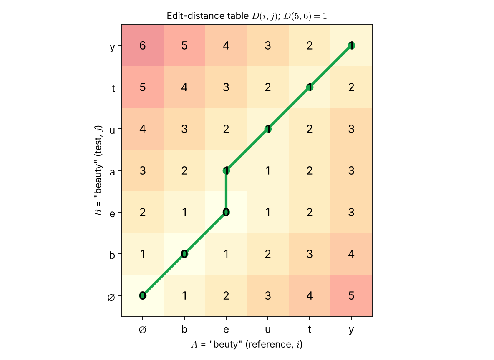
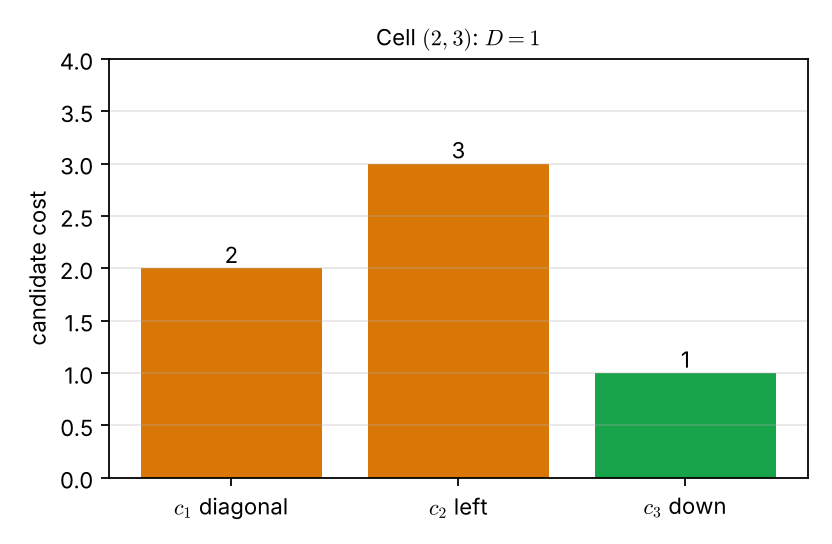

# Lecture 11 · KP04：把一個字串改成另一個要幾步（How many edits turn one string into another）

> 程度：研究生（grad）／Level: Graduate (grad)
>
> 第 11 週（2026-11-16）｜Template Matching · KP04
>
> Week 11 (2026-11-16) | Template Matching · KP04

## 學習目標（Learning objectives）

- 說出編輯距離的定義，以及變更、插入、刪除三種操作（State the definition of edit distance and its three operations: change, insert, delete）。
- 用三路取最小的遞迴式填出整張距離表（Fill the whole distance table with the three-way minimum recursion）。
- 手算 "beuty" 與 "beauty" 的距離，並回溯最佳對齊（Compute the distance between "beuty" and "beauty" and backtrack the alignment）。
- 指出基本編輯距離的限制：它不看字串長度（Name the limitation of basic edit distance: it ignores string length）。

## KP04：編輯距離（Edit distance）

**一句話重點**：編輯距離是把字串 $A$ 變成字串 $B$ 所需的最少變更、插入與刪除次數。它用的就是 KP03 的動態規劃表。

**One-sentence summary**: Edit distance is the minimum number of changes, insertions, and deletions that turn string $A$ into string $B$. It uses the dynamic-programming table of KP03.

### 1. 從一般代價走向字串（From general costs to strings）

上一講留下的問題是：兩邊是字串、改一個字母算 $1$，距離會是什麼？
文字辨識的錯誤很單純：讀錯一個字母、多讀一個、漏讀一個。
這三種錯誤，正好可以各算一次代價。

The previous lecture asked: with strings on both sides and each edit costing $1$, what is the distance?
Errors in text recognition are simple: a letter misread, an extra letter, or a missing letter.
Each of these three errors can be charged one unit.

**白話說明**：想像你在修一份打錯字的文件。
你每改一個字、補一個字、刪一個字，都算一次動作。
距離就是修好整份文件最少需要的動作數。
這個比喻只算動作數，它沒有區分哪一種錯字比較嚴重，基本編輯距離也不區分。

**Plain explanation**: Imagine proofreading a document with typos.
Every letter you change, add, or delete counts as one action.
The distance is the fewest actions needed to fix it.
This analogy counts actions only; it does not rank which typo is worse, and neither does the basic edit distance.

**先備自測**：確認你會填 KP03 的累積代價表，並會用 $\min$ 取三者最小。

**Prerequisite check**: Make sure you can fill the accumulated-cost table of KP03 and take the minimum of three values.

- $\min\{2,3,1\}=1$（The minimum of $2,3,1$ is $1$）。
- 格子 $(i,j)$ 的前驅是左、下、左下三格（The predecessors of $(i,j)$ are the left, lower, and lower-left cells）。

### 2. 定義與遞迴式（Definition and recursion）

**正式定義**：對有順序符號組成的兩個樣板 $A$ 與 $B$，**編輯距離**（edit distance）定義為：

**Formal definition**: For two ordered-symbol templates $A$ and $B$, the **edit distance** is:

$$
D(A,B)=\min_{j}\bigl[C(j)+I(j)+R(j)\bigr]
\tag{8.3}
$$

$j$ 遍歷所有把 $A$ 變成 $B$ 的操作組合。
$C$ 是變更符號的次數，$I$ 是插入次數，$R$ 是刪除次數。
三者各對應一種辨識錯誤：讀錯符號（"beauty" 讀成 "befuty"）、多讀（"bearuty"）、漏讀（"beuty"）。

Here $j$ ranges over all combinations of operations that turn $A$ into $B$.
$C$ counts symbol changes, $I$ counts insertions, and $R$ counts deletions.
Each matches one recognition error: a misread symbol ("befuty" for "beauty"), an extra symbol ("bearuty"), and a missing symbol ("beuty").

把參考字串 $A$ 放橫軸、測試字串 $B$ 放縱軸。
每個節點 $(i,j)$ 只能由 $(i-1,j-1)$、$(i-1,j)$、$(i,j-1)$ 三個前驅到達。
三種轉移的代價如下：

Put the reference string $A$ on the horizontal axis and the test string $B$ on the vertical axis.
Each node $(i,j)$ can be reached only from the three predecessors $(i-1,j-1)$, $(i-1,j)$, and $(i,j-1)$.
The three transitions cost:

$$
d(i,j\mid i-1,j-1)=\begin{cases}0 & r(i)=t(j)\\ 1 & r(i)\neq t(j)\end{cases},\qquad
d(i,j\mid i-1,j)=d(i,j\mid i,j-1)=1
$$

對角步：兩個符號相同算 $0$，不同算一次變更 $1$。
水平步與垂直步各付 $1$。
來源把水平步稱為插入、垂直步稱為刪除。

A diagonal step costs $0$ if the two symbols are equal and $1$ for a change if they differ.
Horizontal and vertical steps each cost $1$.
The source calls the horizontal step an insertion and the vertical step a deletion.

這兩個名稱依「從哪個字串改成哪個」而互換，所以讀格網時請以「哪個符號沒有對手」為準。
水平步：$A$ 的一個符號在 $B$ 裡沒有對手。
垂直步：$B$ 的一個符號在 $A$ 裡沒有對手。
總成本都是 $1$，不影響距離。

The two names swap depending on which string is changed into which, so read the grid by "which symbol has no partner".
Horizontal step: a symbol of $A$ has no partner in $B$.
Vertical step: a symbol of $B$ has no partner in $A$.
Either way the cost is $1$ and the distance is unchanged.

先處理邊界，再填內部：

Handle the boundary first, then the interior:

$$
D(0,0)=0,\qquad D(i,0)=D(i-1,0)+1,\qquad D(0,j)=D(0,j-1)+1
$$

$$
\begin{aligned}
c_1&=D(i-1,j-1)+d(i,j\mid i-1,j-1),\\
c_2&=D(i-1,j)+1,\\
c_3&=D(i,j-1)+1,\\
D(i,j)&=\min(c_1,c_2,c_3)
\end{aligned}
$$

填完以後，$D(A,B)=D(I,J)$。
再沿造成最小值的前驅往回走，就得到最佳對齊。

After filling, $D(A,B)=D(I,J)$.
Walking back along the predecessors that gave the minima yields the best alignment.

| 符號 | 中文意義 | English meaning |
|---|---|---|
| $A,\ B$ | 參考字串與測試字串 | Reference and test strings |
| $r(i),\ t(j)$ | $A$ 的第 $i$ 個符號、$B$ 的第 $j$ 個符號 | The $i$-th symbol of $A$ and the $j$-th symbol of $B$ |
| $C,\ I,\ R$ | 變更、插入、刪除的次數 | Numbers of changes, insertions, deletions |
| $c_1,\ c_2,\ c_3$ | 對角、水平、垂直三個候選 | The diagonal, horizontal, and vertical candidates |
| $D(i,j)$ | $A$ 的前 $i$ 個與 $B$ 的前 $j$ 個符號的編輯距離 | Edit distance of the first $i$ symbols of $A$ and the first $j$ of $B$ |

**常見迷思**：「變更一定比一次插入加一次刪除便宜，所以不用考慮後者。」
在基本版本裡，變更算 $1$，插入加刪除算 $2$，所以變更較便宜。
但這是代價設定的結果；若改變代價，答案就會變。

**Common misconception**: "A change always beats an insertion plus a deletion, so ignore the latter."
In the basic version a change costs $1$ and an insertion plus a deletion costs $2$, so the change is cheaper.
That follows from the chosen costs; change the costs and the answer can change.

### 3. 手算 "beuty" 與 "beauty"（Computing "beuty" and "beauty"）

上一節只給了規則。
下面用來源的例子，把整張表填完。

The previous section gave only rules.
The source's example lets us fill an entire table.

**例子**：$A=\text{beuty}$（$I=5$），$B=\text{beauty}$（$J=6$）。
邊界是 $D(i,0)=i$ 與 $D(0,j)=j$。
以格子 $(2,3)$ 為例，$r(2)=\text{e}$、$t(3)=\text{a}$，兩者不同：

**Example**: $A=\text{beuty}$ ($I=5$) and $B=\text{beauty}$ ($J=6$).
The boundary is $D(i,0)=i$ and $D(0,j)=j$.
Take cell $(2,3)$, where $r(2)=\text{e}$ and $t(3)=\text{a}$ differ:

$$
c_1=D(1,2)+1=1+1=2,\quad c_2=D(1,3)+1=2+1=3,\quad c_3=D(2,2)+1=0+1=1
$$

所以 $D(2,3)=\min\{2,3,1\}=1$，最佳前驅是 $(2,2)$。
這一步是垂直步：$B$ 的 $\text{a}$ 在 $A$ 裡沒有對手。

So $D(2,3)=\min\{3,3,1\}=1$, with best predecessor $(2,2)$.
This is a vertical step: the "a" of $B$ has no partner in $A$.



圖說 `lec11-kp04-edit-distance-f1-table`：橫軸是 $A=\text{beuty}$，縱軸是 $B=\text{beauty}$，$\varnothing$ 表示空字串。每格的數字是 $D(i,j)$，顏色越紅越大。綠線是從終點 $D(5,6)=1$ 往回走的最佳對齊：先對角配 $\text{b}$、$\text{e}$，再垂直補一個 $\text{a}$，最後對角配 $\text{u}$、$\text{t}$、$\text{y}$。〔功能：1、2〕

Figure `lec11-kp04-edit-distance-f1-table`: The horizontal axis is $A$ = "beuty" and the vertical axis is $B$ = "beauty"; $\varnothing$ is the empty string. Each number is $D(i,j)$, and redder cells are larger. The green line is the best alignment traced back from the end $D(5,6)=1$: diagonal for "b" and "e", one vertical step for the extra "a", then diagonal for "u", "t", and "y". [Function: 1, 2]

終點是 $D(5,6)=1$。
也就是說，把 "beuty" 補上一個 $\text{a}$ 就是 "beauty"，只要一個動作。
圖中沿綠線經過的格子數字依序是 $0,0,0,1,1,1,1$。

The end value is $D(5,6)=1$.
Adding a single "a" to "beuty" gives "beauty", one action.
The numbers along the green line are $0,0,0,1,1,1,1$.



圖說 `lec11-kp04-edit-distance-f2-candidates`：三根長條是格子 $(2,3)$ 的三個候選：對角 $c_1=2$、水平 $c_2=3$、垂直 $c_3=1$。綠色的最低者決定 $D(2,3)=1$。〔功能：2〕

Figure `lec11-kp04-edit-distance-f2-candidates`: The three bars are the candidates of cell $(2,3)$: diagonal $c_1=2$, horizontal $c_2=3$, vertical $c_3=1$. The lowest, in green, fixes $D(2,3)=1$. [Function: 2]

同一對字串有多種改法，例如先變更再插入。
編輯距離會在所有組合中取最小值，所以不管怎麼改，答案都是 $1$。

The same pair has many edit sequences, such as changing first and then inserting.
Edit distance takes the minimum over all combinations, so the answer is $1$ regardless.

### 4. 不看長度的限制（The length-blind limitation）

上一節的結果很直接：差一個字母，距離就是 $1$。
但這個直接也帶來限制。

The previous section's result was direct: one letter off gives distance $1$.
That directness also brings a limitation.

`[補充]` 比較 "ab" 與 "ac"（長度 $2$）。
再比較兩個長度 $50$、只有最後一個字母不同的字串。
兩對的編輯距離都是 $1$。

`[Added]` Compare "ab" with "ac" (length $2$).
Then compare two strings of length $50$ that differ only in the last letter.
Both pairs have edit distance $1$.

長度 $2$ 的字串錯了一半，長度 $50$ 的字串只錯了 $2\%$。
基本編輯距離卻給出相同的數字。
原因是它只數操作次數，沒有依最佳路徑長度做正規化。

In the length-$2$ pair half the string is wrong; in the length-$50$ pair only $2\%$ is.
The basic edit distance still returns the same number.
It counts operations only and does not normalize by the length of the best path.

來源還舉了第二個例子。
"beauty" 與 "beuaty"（兩個相鄰字母對調）、"beauty" 與 "besrty"（兩個字母被換掉），基本編輯距離都是 $2$。
`[補充]` 這兩個值可用上面的遞迴式驗算。
來源指出，Markov 編輯距離會利用相鄰符號的局部互動，讓前者因為像局部重排而得到較低成本；本講不展開。

The source gives a second example.
"beauty" versus "beuaty" (two adjacent letters swapped) and "beauty" versus "besrty" (two letters replaced) both have basic edit distance $2$.
`[Added]` You can verify both values with the recursion above.
The source notes that the Markov edit distance uses local interactions of adjacent symbols so that the former gets a lower cost as a local rearrangement; this lecture does not expand on it.

**常見迷思**：「編輯距離小就一定是同一個詞。」
短字串很容易因為一兩次操作而變成另一個詞。
要跨長度比較，需要把距離除以長度，或改用更細的代價設定。

**Common misconception**: "A small edit distance means the same word."
Short strings can become another word with just one or two operations.
To compare across lengths, divide by a length or use finer costs.

**想深入**（選讀）：基本方法也稱 Levenshtein 距離。
實務上可依應用調整變更的成本，或加入合併、拆分與雙字母替換等操作。
格網上走路徑的架構不變，只是增加了前驅與代價。

**Going deeper** (optional): The basic method is also called the Levenshtein distance.
In practice the cost of a change can be adjusted, or operations such as merging, splitting, and two-letter substitution can be added.
The path-on-a-grid framework stays the same; only predecessors and costs are added.

**與實作的連結**：下面的程式用一列一列的方式填表。
`prev` 是上一列，`cur` 是目前這一列，只用 $O(J)$ 的記憶體。

**Connection to practice**: The code below fills the table row by row.
`prev` is the previous row and `cur` the current one, using only $O(J)$ memory.

```python
def edit_distance(a, b):
    """基本編輯距離（變更、插入、刪除各算 1）/ basic edit distance."""
    prev = list(range(len(b) + 1))                    # D(0, j) = j
    for i, ca in enumerate(a, start=1):
        cur = [i]                                     # D(i, 0) = i
        for j, cb in enumerate(b, start=1):
            c1 = prev[j - 1] + (0 if ca == cb else 1)  # 對角 / diagonal
            c2 = prev[j] + 1                           # 水平 / horizontal
            c3 = cur[j - 1] + 1                        # 垂直 / vertical
            cur.append(min(c1, c2, c3))
        prev = cur
    return prev[-1]

print(edit_distance("beuty", "beauty"))   # 1
```

**留給下一節的問題**：語音不是字母，而是一串連續的特徵向量，長度也不同。
同一個架構還能用嗎？
下一節說明語音如何被切成影格並變成特徵序列。

**The question for the next section**: Speech is not letters but a stream of continuous feature vectors of different lengths.
Can the same framework still be used?
The next section shows how speech is cut into frames and turned into a feature sequence.

### 5. 小練習與解題示範（Practice and worked solutions）

**小練習** `[補充]`：先寫下理由，再看解答。

**Practice** `[Added]`: Write your reasoning before reading the solutions.

1. 題 1：用遞迴式算 "ab" 與 "ba" 的編輯距離（Compute the edit distance of "ab" and "ba"）。
2. 題 2：邊界 $D(i,0)=i$ 的意義是什麼（What does the boundary $D(i,0)=i$ mean）？
3. 題 3：為什麼 "beauty" 與 "bearuty" 的距離是 $1$，而不是更大（Why is the distance between "beauty" and "bearuty" $1$）？

**題 1 解題示範**：邊界為 $D(0,\cdot)=0,1,2$ 與 $D(\cdot,0)=0,1,2$。
$D(1,1)$：$a\neq b$，$\min\{0+1,\ 1+1,\ 1+1\}=1$。
$D(1,2)$：$a=a$，$\min\{D(0,1)+0,\ \dots\}=1$。
$D(2,1)$ 同樣為 $1$。
$D(2,2)$：$b\neq a$，$\min\{D(1,1)+1,\ D(1,2)+1,\ D(2,1)+1\}=2$。
所以距離是 $2$。

**Question 1 worked solution**: The boundary is $D(0,\cdot)=0,1,2$ and $D(\cdot,0)=0,1,2$.
$D(1,1)$: $a\neq b$, so $\min\{0+1,\ 1+1,\ 1+1\}=1$.
$D(1,2)$: $a=a$, so $\min\{D(0,1)+0,\ \dots\}=1$.
$D(2,1)$ is likewise $1$.
$D(2,2)$: $b\neq a$, so $\min\{D(1,1)+1,\ D(1,2)+1,\ D(2,1)+1\}=2$.
So the distance is $2$.

**題 2 解題示範**：$D(i,0)=i$ 表示把 $A$ 的前 $i$ 個符號全部刪掉，才能變成空字串。
每刪一個付 $1$，共 $i$。
這是只靠單向步走到邊界的唯一方式。

**Question 2 worked solution**: $D(i,0)=i$ means deleting all of the first $i$ symbols of $A$ to reach the empty string.
Each deletion costs $1$, totaling $i$.
It is the only way to reach the boundary, using steps in one direction.

**題 3 解題示範**："bearuty" 比 "beauty" 多了一個 $\text{r}$。
刪掉那個 $\text{r}$ 就一樣，只要一個動作，距離為 $1$。
別的改法至少要兩個動作，取最小值仍是 $1$。

**Question 3 worked solution**: "bearuty" has one extra "r" compared with "beauty".
Deleting that "r" makes them equal with one action, so the distance is $1$.
Any other way needs at least two actions, and the minimum remains $1$.

## 術語表（Glossary）

| 中文術語 | English term |
|---|---|
| 編輯距離 | Edit distance |
| 變更／插入／刪除 | Change / insertion / deletion |
| 參考字串／測試字串 | Reference string / test string |
| 距離表 | Distance table |
| 對齊 | Alignment |
| 空字串 | Empty string |
| 正規化 | Normalization |
| Levenshtein 距離 | Levenshtein distance |
| Markov 編輯距離 | Markov edit distance |

## 銜接與來源（Connections and sources）

下一講把格網的兩側換成語音特徵序列，成為動態時間校正。

The next lecture replaces the two sides of the grid with speech feature sequences, giving dynamic time warping.

- 前一單元：[KP03 Bellman 最適性原理與動態規劃](lec11-kp03-dp-bellman.md)（Previous unit: Bellman's principle and dynamic programming）。
- 下一單元：[KP05 動態時間校正：語音的問題設定與特徵](lec11-kp05-dtw-setup.md)（Next unit: dynamic time warping, problem setup and features）。
- 來源：[Template Matching §8.2.2](https://ndhuccc.github.io/CCC-LNS/PR_115/Ch08-template-matching/index.html#kp4)，讀取日期 2026-11-12（Source accessed 2026-11-12）。
- 書目：Theodoridis and Koutroumbas, *Pattern Recognition*, 4th ed., 2008；見[參考資料](../references/README.md)（See the bibliography）。

本講以自己的文字解釋來源。
定義 (8.3)、三種轉移代價、遞迴式、beuty 與 beauty 的例子取自來源。
長度 $2$ 與 $50$ 的對照、題解與程式為 `[補充]`；格子 $(2,3)$ 的三個候選由本講重算，與來源圖提示的 $2,3,1$ 一致。

This lecture independently explains the source.
Definition (8.3), the three transition costs, the recursion, and the beuty/beauty example come from the source.
The length-$2$ versus length-$50$ contrast, solutions, and code are `[Added]`; the three candidates at cell $(2,3)$ were recomputed here and agree with the $2,3,1$ in the source's figure prompt.
