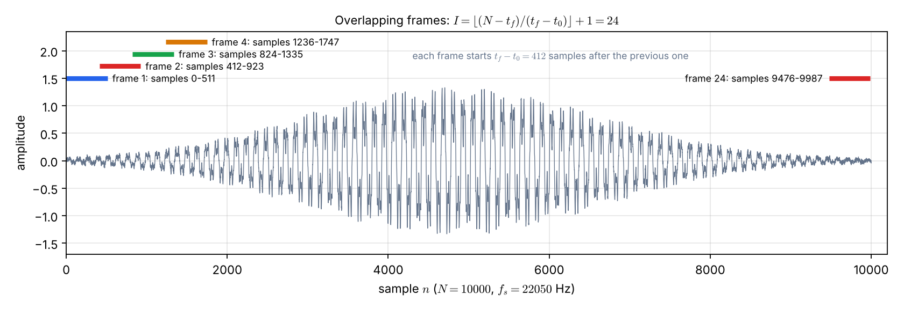
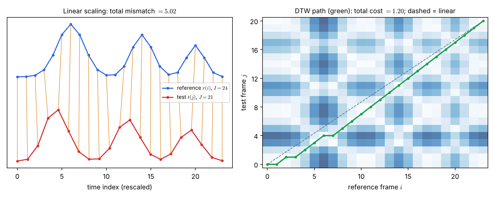

# Lecture 11 · KP05：語音怎麼變成可以對齊的序列（How speech becomes a sequence we can align）

> 程度：研究生（grad）／Level: Graduate (grad)
>
> 第 11 週（2026-11-16）｜Template Matching · KP05
>
> Week 11 (2026-11-16) | Template Matching · KP05

## 學習目標（Learning objectives）

- 說出獨立詞辨識中，參考樣板與測試樣板各是什麼（State what the reference and test templates are in isolated word recognition）。
- 用影格長度與重疊量，算出一段訊號被切成幾個影格（Compute how many frames a signal is cut into from frame length and overlap）。
- 解釋為什麼只取前 $l$ 個低頻 DFT 振幅當特徵（Explain why only the first $l$ low-frequency DFT magnitudes are kept as features）。
- 說明線性時間伸縮為何對不齊，以及 DTW 搜尋要先定下哪四個要素（Explain why linear time scaling misaligns, and which four elements a DTW search must fix）。

## KP05：動態時間校正的問題設定與特徵（Dynamic time warping: problem setup and features）

**一句話重點**：同一個人說同一個詞，快慢不同。先把語音切成影格、取低頻頻譜當特徵，就把時間對齊變成 KP02 那樣的格網路徑問題。

**One-sentence summary**: The same person says the same word at different speeds. Cutting speech into frames and taking low-frequency spectra as features turns time alignment into the grid-path problem of KP02.

### 1. 從字串走向語音（From strings to speech）

上一講留下的問題是：語音是連續的特徵向量，長度也不同，同一個架構還能用嗎？
答案是可以，但要先把連續的聲音變成一串離散的向量。
這一串向量，就是格網兩側的序列。

The previous lecture asked: speech is a stream of feature vectors of different length; can the same framework still apply?
The answer is yes, but the continuous sound must first become a sequence of discrete vectors.
That sequence is what sits on the two sides of the grid.

**白話說明**：想像用連拍相機拍一個人說話的嘴型。
每張照片是一個影格，連拍的張數取決於說話多久。
你再把每張照片換成幾個數字描述。
這個比喻只對應「切成一張一張」；真正的影格是互相重疊的，相機連拍則不重疊。

**Plain explanation**: Imagine a burst-mode camera photographing a mouth as someone speaks.
Each photo is a frame, and the number of photos depends on how long the speech lasts.
You then describe each photo with a few numbers.
This analogy covers only "cut into pieces"; real speech frames overlap each other, while burst photos do not.

**先備自測**：確認你記得 KP02 的格網與 KP03 的動態規劃。
也需要知道 DFT 把一段訊號拆成不同頻率的成分。

**Prerequisite check**: Make sure you remember the grid of KP02 and the dynamic programming of KP03.
You also need to know that the DFT splits a signal into components of different frequencies.

- 取樣率 $22050$ Hz 表示每秒 $22050$ 個樣點（A rate of $22050$ Hz means $22050$ samples per second）。
- 長度 $N$ 的訊號有 $N$ 個樣點（A signal of length $N$ has $N$ samples）。

### 2. 切影格與取特徵（Framing and features）

**正式定義**：在**獨立詞辨識**（isolated word recognition）中，參考樣板與測試樣板各是一個特徵向量序列：

**Formal definition**: In **isolated word recognition**, the reference and test templates are each a sequence of feature vectors:

$$
\mathbf{r}(i),\ i=1,\dots,I,\qquad \mathbf{t}(j),\ j=1,\dots,J
$$

來源的設定是取樣率 $22050$ Hz。
訊號被切成長度 $t_f=512$ 個樣點的影格，相鄰影格重疊 $t_0=100$ 個樣點。
第 $i$ 個影格的樣點是 $x_i(n),\ n=0,\dots,511$，它的 DFT 是：

The source uses a sampling rate of $22050$ Hz.
The signal is cut into frames of $t_f=512$ samples, with consecutive frames overlapping by $t_0=100$ samples.
The samples of the $i$-th frame are $x_i(n),\ n=0,\dots,511$, and its DFT is:

$$
X_i(m)=\frac{1}{\sqrt{512}}\sum_{n=0}^{511}x_i(n)\exp\!\Bigl(-j\frac{2\pi}{512}mn\Bigr),\qquad m=0,\dots,511
$$

高頻係數的振幅很小，對訊號貢獻微弱。
所以只取前 $l$ 個低頻振幅（例如 $l=50$）組成特徵向量：

High-frequency coefficients have small magnitudes and contribute little.
So only the first $l$ low-frequency magnitudes (for example $l=50$) form the feature vector:

$$
\mathbf{r}(i)=\bigl[X_i(0),\ X_i(1),\ \dots,\ X_i(l-1)\bigr]^T
$$

這裡取的是振幅，所以向量的元素是實數。
`[補充]` 頻率間隔是 $22050/512\approx43.07$ Hz，前 $50$ 個係數涵蓋約 $0$ 到 $2153$ Hz。

The magnitudes are taken, so the vector entries are real numbers.
`[Added]` The frequency spacing is $22050/512\approx43.07$ Hz, so the first $50$ coefficients cover roughly $0$ to $2153$ Hz.

| 符號 | 中文意義 | English meaning |
|---|---|---|
| $t_f$ | 影格長度（樣點數） | Frame length in samples |
| $t_0$ | 相鄰影格的重疊量 | Overlap of consecutive frames |
| $N$ | 訊號總樣點數 | Total number of samples |
| $X_i(m)$ | 第 $i$ 個影格的第 $m$ 個 DFT 係數 | The $m$-th DFT coefficient of frame $i$ |
| $l$ | 保留的低頻係數個數 | Number of low-frequency coefficients kept |
| $I,\ J$ | 參考與測試的影格數 | Frame counts of the reference and the test |

**影格數怎麼算**：每個新影格比前一個晚 $t_f-t_0$ 個樣點開始。
一段長度 $N$ 的訊號，完整放得進去的影格數是：

**How many frames**: Each new frame starts $t_f-t_0$ samples after the previous one.
For a signal of length $N$, the number of frames that fit completely is:

$$
I=\left\lfloor\frac{N-t_f}{t_f-t_0}\right\rfloor+1
$$

來源的參考詞 "love" 取 $N=10000$ 個樣點，所以：

The source's reference word "love" uses $N=10000$ samples, so:

$$
I=\left\lfloor\frac{10000-512}{412}\right\rfloor+1=\lfloor 23.03\rfloor+1=24
$$



圖說 `lec11-kp05-dtw-setup-f1-frames`：先看灰色波形，它是 $N=10000$ 的合成訊號（`[補充]`，非來源的錄音）。再看上方的色條，每條是一個影格，長 $512$ 個樣點，下一條比上一條晚 $412$ 個樣點開始。最後一個色條是第 $24$ 個影格，涵蓋樣點 $9476$ 到 $9987$。〔功能：1、2〕

Figure `lec11-kp05-dtw-setup-f1-frames`: First look at the gray waveform, a synthetic signal with $N=10000$ (`[Added]`, not the source's recording). Then the colored bars above: each is one frame of $512$ samples, and each starts $412$ samples after the previous one. The last bar is frame $24$, covering samples $9476$ to $9987$. [Function: 1, 2]

重疊越多，影格越多。
若 $t_0=0$（完全不重疊），同樣的 $N=10000$ 只有 $\lfloor 9488/512\rfloor+1=19$ 個影格。
重疊 $100$ 個樣點後增加到 $24$ 個。

More overlap means more frames.
With $t_0=0$ (no overlap), the same $N=10000$ gives only $\lfloor 9488/512\rfloor+1=19$ frames.
An overlap of $100$ samples raises this to $24$.

**常見迷思**：「影格數就是語音的秒數。」
影格數同時取決於影格長度與重疊量。
來源中 "love" 的 $24$ 影格對應約 $0.45$ 秒，是 $N=10000$ 個樣點，也就是 $10000/22050\approx0.4535$ 秒。
若直接用 $0.45\times22050=9922$ 個樣點，公式給出的是 $23$ 個影格，所以「約 $0.45$ 秒」只是四捨五入的說法。

**Common misconception**: "The frame count is just the number of seconds."
The frame count depends on both frame length and overlap.
In the source, the $24$ frames of "love" correspond to about $0.45$ seconds, which is $N=10000$ samples, or $10000/22050\approx0.4535$ s.
Using $0.45\times22050=9922$ samples directly gives $23$ frames by the formula, so "about $0.45$ s" is only a rounded description.

### 3. 為什麼線性伸縮不夠（Why linear scaling is not enough）

兩個樣板都有了特徵序列以後，可以直接比嗎？
來源的三個資料是：參考 "love" 有 $I=24$ 個影格，測試 "love" 有 $J=21$ 個，測試 "kiss" 有 $J=23$ 個。
同一個詞說得快一點，長度就變短，但**不是每一段都等比例變短**。

With both templates turned into feature sequences, can we compare them directly?
The source gives three data: the reference "love" has $I=24$ frames, a test "love" has $J=21$, and a test "kiss" has $J=23$.
Saying the same word faster shortens it, but **not every part shortens by the same ratio**.

最簡單的做法是線性時間伸縮：把測試序列等比例拉長到 $24$ 格，再逐格相減。
下面用一個可重現的例子比較它與 DTW。

The simplest approach is linear time scaling: stretch the test sequence evenly to $24$ steps and subtract frame by frame.
A reproducible example compares it with DTW.

**例子**：`[補充]` 參考序列 $r(i)$ 有 $I=24$ 個影格，有三個峰，位置在 $i=6,\ 14,\ 20$。
測試序列 $t(j)$ 有 $J=21$ 個影格，是同一個形狀經**不均勻**的時間彎折：前段被拉長、後段被壓縮。
結果它的峰落在 $j=4,\ 11,\ 17$。

**Example**: `[Added]` The reference $r(i)$ has $I=24$ frames with three peaks at $i=6,\ 14,\ 20$.
The test $t(j)$ has $J=21$ frames and is the same shape under a **non-uniform** time warp: the early part is stretched and the late part compressed.
Its peaks land at $j=4,\ 11,\ 17$.

線性伸縮把 $j$ 對應到 $i=\mathrm{round}\bigl(j\cdot 23/20\bigr)$。
峰值的位置因此對不上：$j=4$ 配到 $i=5$，而真正的峰在 $i=6$。
逐格絕對差的總和是 $5.02$。

Linear scaling maps $j$ to $i=\mathrm{round}\bigl(j\cdot 23/20\bigr)$.
The peaks fail to line up: $j=4$ maps to $i=5$, but the true peak is at $i=6$.
The sum of frame-by-frame absolute differences is $5.02$.

用 KP03 的動態規劃，在同一張格網上找最低代價路徑，總代價降到 $1.20$。
路徑自己彎折，讓每個峰對到對的峰。

Using the dynamic programming of KP03 on the same grid, the minimum path cost drops to $1.20$.
The path bends by itself so that every peak meets its own peak.



圖說 `lec11-kp05-dtw-setup-f2-linear-vs-dtw`：左圖上方藍線是參考序列、下方紅線是測試序列，橘色細線是線性縮放的逐格配對，峰與峰沒有對齊，總差異為 $5.02$。右圖是局部代價格網（顏色越深越不像），虛線是線性縮放，綠線是 DTW 路徑，它偏離虛線去對齊峰，總代價為 $1.20$。〔功能：1、2、3〕

Figure `lec11-kp05-dtw-setup-f2-linear-vs-dtw`: In the left panel the blue line is the reference and the red line the test sequence; thin orange lines are the frame-by-frame pairing of linear scaling, whose peaks do not line up, with total mismatch $5.02$. The right panel is the local-cost grid (darker means less alike); the dashed line is linear scaling and the green line the DTW path, which departs from the dashed line to align the peaks, with total cost $1.20$. [Function: 1, 2, 3]

DTW 允許兩種彎折：一個測試影格對應多個參考影格（拉伸），或多個測試影格對應一個參考影格（壓縮）。
這正是 KP02 的水平步與垂直步。
動態規劃讓搜尋仍然有效率。

DTW allows two kinds of bending: one test frame matching several reference frames (stretching), or several test frames matching one reference frame (compression).
These are exactly the horizontal and vertical steps of KP02.
Dynamic programming keeps the search efficient.

**一個完整的 DTW 搜尋要先定下四個要素：**

**A complete DTW search must fix four elements:**

- 端點限制：路徑從哪裡開始、在哪裡結束（End-point constraints: where the path starts and ends）。
- 全域限制：整張格網裡哪些區域允許搜尋（Global constraints: which regions of the grid may be searched）。
- 局部限制：相鄰節點之間允許的轉移與步幅（Local constraints: allowed transitions and step sizes between neighboring nodes）。
- 轉移代價：兩個特徵向量之間的比對距離（Transition cost: the matching distance between two feature vectors）。

下一講依序說明這四項。

The next lecture covers them in turn.

**想深入**（選讀）：來源把這個設定放在獨立詞辨識。
它的難度比連續語音辨識低，因為詞與詞之間的邊界已知。
連續語音還要同時決定詞在哪裡切開，本章不處理。

**Going deeper** (optional): The source places this setup in isolated word recognition.
It is easier than continuous speech recognition because the word boundaries are known.
Continuous speech must also decide where words split, which this chapter does not treat.

**與實作的連結**：下面的程式算影格數，並用 NumPy 取一個影格的前 $l$ 個 DFT 振幅。

**Connection to practice**: The code below computes the frame count and takes the first $l$ DFT magnitudes of one frame with NumPy.

```python
import numpy as np

def n_frames(N, tf=512, t0=100):
    """可以完整放進長度 N 的訊號的影格數 / number of complete frames."""
    return (N - tf) // (tf - t0) + 1

def features(frame, l=50):
    """DFT 振幅的前 l 個係數（含 1/sqrt(512) 正規化）/ first l DFT magnitudes."""
    X = np.fft.fft(frame) / np.sqrt(len(frame))
    return np.abs(X[:l])

print(n_frames(10000))              # 24
print(n_frames(10000, t0=0))        # 19
print(features(np.ones(512)).shape) # (50,)
```

**留給下一節的問題**：沒有限制時，路徑可能時間倒退，或無限次水平移動。
該加哪些限制？
又怎麼公平地比較不同長度的路徑總代價？

**The question for the next section**: Without constraints, a path could go back in time or move horizontally without bound.
Which constraints should be added?
And how can path costs of different length be compared fairly?

### 4. 小練習與解題示範（Practice and worked solutions）

**小練習** `[補充]`：先寫下理由，再看解答。

**Practice** `[Added]`: Write your reasoning before reading the solutions.

1. 題 1：取樣率 $22050$ Hz、$t_f=512$、$t_0=100$，一段 $N=8820$ 個樣點的訊號有幾個影格（How many frames does a signal of $N=8820$ samples have）？
2. 題 2：若重疊改為 $t_0=256$，$N=10000$ 的影格數是多少（How many frames for $N=10000$ if the overlap is $t_0=256$）？
3. 題 3：為什麼線性伸縮會把峰對錯（Why does linear scaling misalign the peaks）？

**題 1 解題示範**：步長是 $512-100=412$。
$(8820-512)/412=8308/412\approx20.17$，取整數部分 $20$，再加 $1$。
所以有 $21$ 個影格，這和來源測試詞 "love" 的 $J=21$ 一致。

**Question 1 worked solution**: The step is $512-100=412$.
$(8820-512)/412=8308/412\approx20.17$; take the integer part $20$ and add $1$.
So there are $21$ frames, matching $J=21$ of the source's test word "love".

**題 2 解題示範**：步長是 $512-256=256$。
$(10000-512)/256=9488/256\approx37.06$，取整數部分 $37$，再加 $1$。
所以有 $38$ 個影格。重疊越多，影格越多。

**Question 2 worked solution**: The step is $512-256=256$.
$(10000-512)/256=9488/256\approx37.06$; take the integer part $37$ and add $1$.
So there are $38$ frames. More overlap gives more frames.

**題 3 解題示範**：線性伸縮假設整段語音以同一個比例變快或變慢。
實際上前段被拉長、後段被壓縮，比例隨時間變化。
等比例對應只能對齊兩端，中間的峰就錯開了。

**Question 3 worked solution**: Linear scaling assumes the whole utterance speeds up or slows down by one ratio.
In reality the early part is stretched and the late part compressed, so the ratio changes over time.
An even mapping aligns only the two ends, so peaks in the middle are displaced.

## 術語表（Glossary）

| 中文術語 | English term |
|---|---|
| 動態時間校正 | Dynamic time warping, DTW |
| 獨立詞辨識 | Isolated word recognition |
| 影格 | Frame |
| 取樣率 | Sampling rate |
| 離散傅立葉轉換 | Discrete Fourier transform, DFT |
| 特徵向量 | Feature vector |
| 線性時間伸縮 | Linear time scaling |
| 端點限制 | End-point constraint |
| 全域限制／局部限制 | Global / local constraint |
| 轉移代價 | Transition cost |
| NumPy | Python array-computing library |

## 銜接與來源（Connections and sources）

下一講說明端點、全域與局部限制，以及怎樣公平地比較總代價。

The next lecture explains the end-point, global, and local constraints, and how to compare total costs fairly.

- 前一單元：[KP04 編輯距離](lec11-kp04-edit-distance.md)（Previous unit: edit distance）。
- 下一單元：[KP06 DTW 的限制條件](lec11-kp06-dtw-constraints.md)（Next unit: the constraints of DTW）。
- 來源：[Template Matching §8.2.3](https://ndhuccc.github.io/CCC-LNS/PR_115/Ch08-template-matching/index.html#kp5)，讀取日期 2026-11-12（Source accessed 2026-11-12）。
- 書目：Theodoridis and Koutroumbas, *Pattern Recognition*, 4th ed., 2008；見[參考資料](../references/README.md)（See the bibliography）。

本講以自己的文字解釋來源。
取樣率、影格設定、DFT 特徵、$I=24$、$J=21$、$J=23$ 與四個要素取自來源。
合成波形、合成特徵序列與線性伸縮對照、頻率間隔、其餘影格數與程式為 `[補充]`。

This lecture independently explains the source.
The sampling rate, framing parameters, DFT features, $I=24$, $J=21$, $J=23$, and the four elements come from the source.
The synthetic waveform, the synthetic feature sequences and linear-scaling comparison, the frequency spacing, the other frame counts, and the code are `[Added]`.
