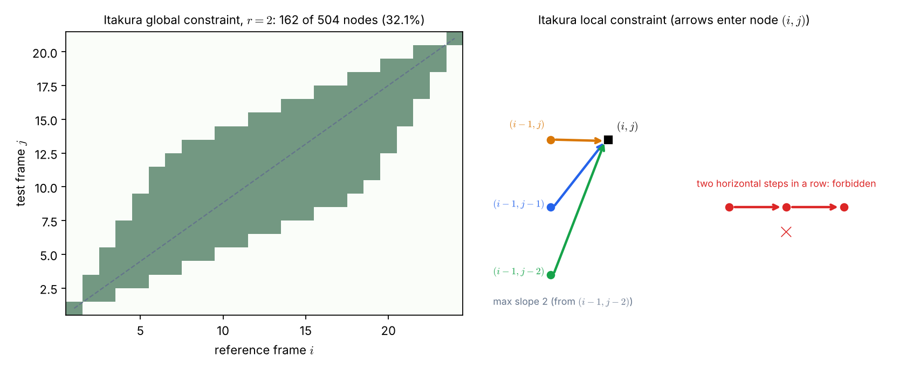
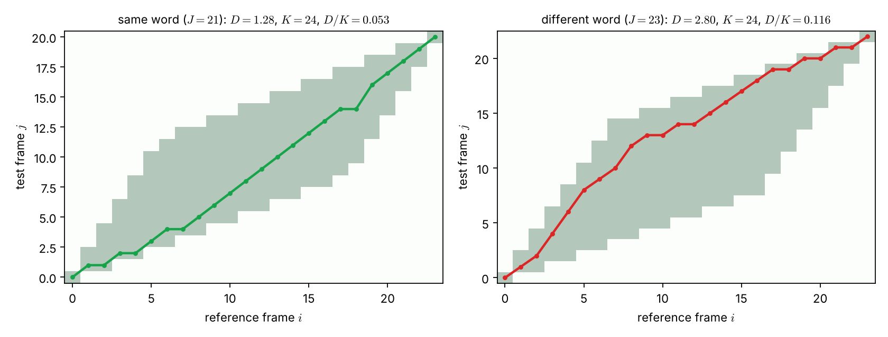

# Lecture 11 · KP06：給路徑畫出合理的範圍（Drawing the boundaries of a sensible path）

> 程度：研究生（grad）／Level: Graduate (grad)
>
> 第 11 週（2026-11-16）｜Template Matching · KP06
>
> Week 11 (2026-11-16) | Template Matching · KP06

## 學習目標（Learning objectives）

- 說出端點、全域、局部限制各限制什麼，並寫出單調性條件（State what the end-point, global, and local constraints restrict, and write the monotonicity condition）。
- 算出 Itakura 全域限制保留的格點比例，並解釋為什麼約是三分之一（Compute the fraction of nodes an Itakura global constraint keeps and explain why it is about one third）。
- 說明禁止連續水平步為什麼能限制斜率（Explain why forbidding consecutive horizontal steps bounds the slope）。
- 解釋總代價為什麼要正規化，並讀懂 love 對 love 與 love 對 kiss 的比較（Explain why total cost must be normalized and read the love-versus-love and love-versus-kiss comparison）。

## KP06：DTW 的端點、全域與局部限制（End-point, global, and local constraints of DTW）

**一句話重點**：限制條件規定時間彎折的合理範圍。它防止時間倒退、減少運算量，最後用正規化後的累積代價判斷哪個詞最匹配。

**One-sentence summary**: Constraints define the sensible range of time warping. They prevent going back in time, cut computation, and the normalized accumulated cost finally decides which word matches best.

### 1. 為什麼要加限制（Why constraints are needed）

上一講留下的問題是：沒有限制時，路徑可能時間倒退，或無限次水平移動。
時間倒退會把 "from" 配成 "form"。
無限次水平移動會讓測試裡一個短暫的雜訊，對上參考裡一大段語音。

The previous lecture asked: without constraints a path could go back in time or move horizontally without bound.
Going back in time can match "from" to "form".
Unbounded horizontal moves let one brief noise in the test match a long stretch of the reference.

**白話說明**：想像導航軟體幫你規劃回家的路。
它不允許你走回頭路，也不會讓你在同一個路口站上一小時。
這個比喻只對應「合理的行進」；它沒有說明為什麼限制還能讓計算變快，那要看下面的全域限制。

**Plain explanation**: Imagine navigation software planning your way home.
It does not let you retrace steps, and it does not let you stand at one junction for an hour.
This analogy covers only "sensible movement"; it does not explain why constraints also speed up computation, which the global constraint below shows.

**先備自測**：確認你記得 KP05 的四個要素，以及 KP03 的遞迴式。

**Prerequisite check**: Make sure you remember the four elements of KP05 and the recursion of KP03.

- 水平步是 $(i-1,j)\to(i,j)$（A horizontal step is $(i-1,j)\to(i,j)$）。
- 斜率是 $j$ 的增量除以 $i$ 的增量（The slope is the increase of $j$ divided by the increase of $i$）。

### 2. 三種限制與代價（The three constraints and the cost）

**正式定義**：

**Formal definition**:

- **端點限制**（end-point）：預設路徑從 $(1,1)$ 走到 $(I,J)$，假設起訖落在靜音片段。若放寬，起點與終點可在距 $(1,1)$、$(I,J)$ 為 $\epsilon$ 的鄰域內由演算法尋找。
- **全域限制**（global）：限制最佳路徑可以搜尋的格網區域。
- **局部限制**（local）：限制相鄰節點的轉移，必須滿足**單調性**。

- **End-point constraint**: By default the path runs from $(1,1)$ to $(I,J)$, assuming both ends fall in silence. If relaxed, the start and end may be found by the algorithm within a neighborhood of radius $\epsilon$ around $(1,1)$ and $(I,J)$.
- **Global constraint**: restricts the region of the grid in which the best path may be searched.
- **Local constraint**: restricts transitions between neighboring nodes and must satisfy **monotonicity**.

$$
i_{k-1}\le i_k\quad\text{and}\quad j_{k-1}\le j_k
$$

單調性表示所有前驅都在目前節點的左方、下方或左下方，時間不會倒退。

Monotonicity means every predecessor lies to the left of, below, or lower-left of the current node, so time never runs backward.

節點的轉移代價用兩個特徵向量的歐氏距離：

The transition cost of a node is the Euclidean distance between the two feature vectors:

$$
d(i_k,j_k\mid i_{k-1},j_{k-1})=\|\mathbf{r}(i_k)-\mathbf{t}(j_k)\|\equiv d(i_k,j_k)
$$

算出的總累積代價 $D$ 還要除以路徑長度（節點總數）做**正規化**，才能公平比較。

The total accumulated cost $D$ is then divided by the path length (number of nodes) for **normalization**, to allow a fair comparison.

| 符號 | 中文意義 | English meaning |
|---|---|---|
| $\epsilon$ | 放寬端點時的鄰域大小 | Neighborhood size when the end points are relaxed |
| $r$ | Itakura 全域限制的最大伸縮倍率 | Maximum stretch ratio of the Itakura global constraint |
| $K$ | 路徑的節點數 | Number of nodes on the path |
| $D$ | 路徑的總累積代價 | Total accumulated cost of the path |
| $D/K$ | 正規化後的平均代價 | Normalized (average) cost |

**常見迷思**：「限制只是為了省時間。」
限制還有「意義」的功能：它排除物理上不合理的對齊，例如時間倒退。
省時間是額外的好處。

**Common misconception**: "Constraints are only there to save time."
They also carry meaning: they rule out physically unreasonable alignments such as going back in time.
Saving time is an extra benefit.

### 3. Itakura 全域限制：平行四邊形（The Itakura global constraint: a parallelogram）

上一節定義了三種限制。
先看全域限制。
Itakura 全域限制規定膨脹與壓縮的最大倍率是 $r=2$。

The previous section defined the three constraints.
Look at the global constraint first.
The Itakura global constraint sets the maximum expansion and compression ratio to $r=2$.

從起點 $(1,1)$ 與終點 $(I,J)$ 各畫兩條斜率為 $1/r$ 與 $r$ 的線，四條線圍成一個平行四邊形。
只有平行四邊形內的格點才參與搜尋。
當 $I\approx J$ 時，來源指出搜尋格點約減少為三分之一。

Draw two lines of slope $1/r$ and $r$ from the start $(1,1)$ and from the end $(I,J)$; the four lines enclose a parallelogram.
Only the nodes inside it take part in the search.
The source states that when $I\approx J$ the number of searched nodes drops to about one third.

格點比例的連續極限是：

The continuous limit of the node fraction is:

$$
\frac{r-1}{r+1}
$$

代入 $r=2$ 得 $\dfrac{2-1}{2+1}=\dfrac{1}{3}$。
`[補充]` 實際逐格計數：$24\times24$ 格網有 $192$ 個允許格點，佔 $192/576=33.3\%$。
$24\times21$ 格網有 $162$ 個，佔 $162/504=32.1\%$。
格網越大越接近極限：$1000\times1000$ 的比例是 $33.3334\%$。

Substituting $r=2$ gives $\dfrac{2-1}{2+1}=\dfrac{1}{3}$.
`[Added]` Counting node by node: the $24\times24$ grid has $192$ allowed nodes, $192/576=33.3\%$.
The $24\times21$ grid has $162$, or $162/504=32.1\%$.
Larger grids approach the limit: the $1000\times1000$ fraction is $33.3334\%$.



圖說 `lec11-kp06-dtw-constraints-f1-itakura`：左圖是 $24\times21$ 格網，綠色是 $r=2$ 的平行四邊形，共 $162$ 個允許格點，虛線是對角線。右圖是局部限制：三個箭頭是允許進入節點 $(i,j)$ 的前驅，其中從 $(i-1,j-2)$ 來的斜率最大，為 $2$；紅色那排表示連續兩次水平步是禁止的。〔功能：1、2〕

Figure `lec11-kp06-dtw-constraints-f1-itakura`: The left panel is the $24\times21$ grid, with the $r=2$ parallelogram in green holding $162$ allowed nodes, and the dashed diagonal. The right panel shows the local constraint: the three arrows are the predecessors allowed to enter node $(i,j)$, and the one from $(i-1,j-2)$ has the largest slope, $2$; the red row marks that two consecutive horizontal steps are forbidden. [Function: 1, 2]

兩端被擠成一個點，因為起點與終點都固定。
中間最寬。
所以限制既是意義上的規定，也直接減少了 KP03 動態規劃要算的格子。

Both corners narrow to a point because the start and end are fixed.
The middle is widest.
So the constraint is a rule of meaning and also directly cuts the cells that the dynamic programming of KP03 must compute.

**想深入**（選讀）：$r$ 越接近 $1$，平行四邊形越窄，比例趨近 $0$。
$r$ 越大，比例趨近 $1$，限制形同虛設。
例如 $r=1.5$ 時比例是 $(1.5-1)/(1.5+1)=0.2$。

**Going deeper** (optional): As $r$ approaches $1$ the parallelogram narrows and the fraction tends to $0$.
As $r$ grows the fraction tends to $1$ and the constraint becomes meaningless.
For example, at $r=1.5$ the fraction is $(1.5-1)/(1.5+1)=0.2$.

### 4. 局部限制：Itakura 與 Sakoe-Chiba（Local constraints: Itakura and Sakoe-Chiba）

全域限制管整體區域。
局部限制管一步能怎麼走。

The global constraint governs the overall region.
The local constraint governs how one step may move.

**Itakura 局部限制**：最大斜率為 $2$，來自 $(i-1,j-2)\to(i,j)$ 的轉移。
水平轉移允許，但**嚴格禁止連續兩步水平轉移**，避免斜率無限大。
它是非對稱的：允許跳過測試影格 $j-1$，參考影格卻不可以跳過。

**Itakura local constraint**: The maximum slope is $2$, from the transition $(i-1,j-2)\to(i,j)$.
Horizontal transitions are allowed, but **two consecutive horizontal steps are strictly forbidden** to avoid infinite slope.
It is asymmetric: the test frame $j-1$ may be skipped, but a reference frame may not.

**Sakoe-Chiba 局部限制**：來源給出四種常見型態，最大斜率分別是 $\infty$（圖 8.11a）、$2$（8.11b）、$3$（8.11c）與 $3/2$（8.11d）。
斜率上限越小，路徑越接近對角線。

**Sakoe-Chiba local constraints**: The source gives four common types, with maximum slopes $\infty$ (Figure 8.11a), $2$ (8.11b), $3$ (8.11c), and $3/2$ (8.11d).
The smaller the slope bound, the closer the path stays to the diagonal.

**常見迷思**：「只要禁止倒退，路徑就一定合理。」
單調性只保證時間不倒退。
它沒有限制水平步連續出現幾次，所以還需要斜率上限或像 Itakura 那樣的禁止規則。

**Common misconception**: "Forbidding backward moves is enough to make a path sensible."
Monotonicity only guarantees that time does not go back.
It does not limit how many horizontal steps in a row, so a slope bound or an Itakura-style prohibition is still needed.

### 5. 正規化與辨識結果（Normalization and the recognition result）

上面的限制都讓路徑合理，但還有最後一步：怎麼比較兩個候選的總代價？
路徑長度不同，累加的項數就不同。
所以要用總代價除以路徑長度，才是公平的基準。

The constraints above make paths sensible, but one step remains: how to compare the total costs of two candidates?
Paths of different length add different numbers of terms.
Dividing the total by the path length gives the fair basis.

來源報告了真實實驗的結果：以 "love"（$I=24$）為參考，在 Itakura 限制下比對兩個測試樣板。

The source reports real experimental results: with "love" ($I=24$) as reference, two test templates are matched under the Itakura constraints.

| 測試樣板 | Test template | $J$ | $D$ | 正規化代價 | Normalized cost |
|---|---|---|---|---|---|
| "love" | "love" | $21$ | $11.473$ | $0.221$ | $0.221$ |
| "kiss" | "kiss" | $23$ | $25.155$ | $0.559$ | $0.559$ |

"love" 對 "love" 的代價遠低於 "love" 對 "kiss"。
所以系統正確辨識了這個詞。
兩個代價的比值是 $0.221/0.559\approx0.40$。

The cost of "love" against "love" is far below "love" against "kiss".
So the system recognizes the word correctly.
The ratio of the two costs is $0.221/0.559\approx0.40$.

**一個我無法驗證的地方**：把來源的 $D$ 除以正規化代價，得到 $11.473/0.221\approx51.9$ 與 $25.155/0.559=45.0$。
若除數是路徑節點數，$24\times21$ 格網上單調路徑最多只有 $I+J-1=44$ 個節點，$51.9$ 超過這個上限，也不是整數。
`[補充]` 推測書中的正規化用了權重（例如某些步算兩單位），但網頁沒有說明，本講無法確認；請以教科書為準。
下面的例子改用本講可重算的設定。

**One thing I cannot verify**: dividing the source's $D$ by its normalized cost gives $11.473/0.221\approx51.9$ and $25.155/0.559=45.0$.
If the divisor is the number of path nodes, a monotone path on a $24\times21$ grid has at most $I+J-1=44$ nodes, so $51.9$ exceeds that bound and is not an integer.
`[Added]` I guess the book's normalization uses weights (for example some steps counting two units), but the webpage does not say, so this lecture cannot confirm it; defer to the textbook.
The example below uses a setting this lecture can recompute.

**例子**：`[補充]` 用 KP05 的合成序列：參考 $r$ 有 $I=24$ 個影格，「同一個詞」$t_{\text{same}}$ 有 $J=21$ 個，「另一個詞」$t_{\text{other}}$ 有 $J=23$ 個。
局部限制取 Itakura 型：每一步 $i$ 加 $1$，$j$ 加 $0,1,2$，且不連續兩次加 $0$。
全域限制取 $r=2$ 的平行四邊形，$d=|r(i)-t(j)|$。

**Example**: `[Added]` Use the synthetic sequences of KP05: the reference $r$ has $I=24$ frames, the "same word" $t_{\text{same}}$ has $J=21$, and the "other word" $t_{\text{other}}$ has $J=23$.
The local constraint is Itakura-type: each step adds $1$ to $i$ and $0,1,2$ to $j$, never $0$ twice in a row.
The global constraint is the $r=2$ parallelogram and $d=|r(i)-t(j)|$.

| 候選 | Candidate | 允許格點 | Allowed nodes | $D$ | $K$ | $D/K$ |
|---|---|---|---|---|---|---|
| 同一個詞 | Same word | $162$ | $162$ | $1.28$ | $24$ | $0.053$ |
| 另一個詞 | Other word | $184$ | $184$ | $2.80$ | $24$ | $0.116$ |

這個局部限制每步都讓 $i$ 加 $1$，所以任何路徑的節點數都是 $K=24$。
此時正規化只是同除以 $24$，不改變排序。
但路徑長度可變時（例如允許水平與垂直步），正規化就能改變結果，見練習題 3。

This local constraint adds $1$ to $i$ at every step, so every path has $K=24$ nodes.
Normalization then divides everything by $24$ and does not change the ranking.
When the path length can vary (for example with horizontal and vertical steps), normalization can change the outcome; see Practice 3.



圖說 `lec11-kp06-dtw-constraints-f2-love-vs-kiss`：兩張圖的灰綠色底是平行四邊形允許區，線是最低代價路徑。左圖是同一個詞（$J=21$），總代價 $1.28$。右圖是另一個詞（$J=23$），總代價 $2.80$。兩條路徑都留在平行四邊形內，且沒有連續兩次水平步。〔功能：1、2〕

Figure `lec11-kp06-dtw-constraints-f2-love-vs-kiss`: In both panels the gray-green background is the allowed parallelogram and the line is the minimum-cost path. The left is the same word ($J=21$) with total cost $1.28$. The right is a different word ($J=23$) with total cost $2.80$. Both paths stay inside the parallelogram and never take two horizontal steps in a row. [Function: 1, 2]

**與實作的連結**：下面的程式建立 Itakura 全域限制的遮罩，並數出允許的格點。

**Connection to practice**: The code below builds the mask of the Itakura global constraint and counts the allowed nodes.

```python
import numpy as np

def itakura_mask(I, J, r=2.0):
    """Itakura 平行四邊形：從 (1,1) 與 (I,J) 看出去，斜率都在 [1/r, r] 內。"""
    m = np.zeros((I, J), bool)
    for i in range(1, I + 1):
        for j in range(1, J + 1):
            a, b, c, d = i - 1, j - 1, I - i, J - j        # 距起點與終點的格數
            m[i - 1, j - 1] = (b <= r * a and a <= r * b and d <= r * c and c <= r * d)
    return m

print(itakura_mask(24, 21).sum())    # 162
print(itakura_mask(24, 24).mean())   # 0.3333333333333333
```

**留給下一節的問題**：到目前為止比對的是一維序列。
如果要找的是影像裡一個目標的位置，沒有時間軸，該怎麼比？
下一節改用相關性來找位置。

**The question for the next section**: So far we have matched one-dimensional sequences.
If we want the position of an object in an image, with no time axis, how do we match?
The next section uses correlation to find positions.

### 6. 小練習與解題示範（Practice and worked solutions）

**小練習** `[補充]`：先寫下理由，再看解答。

**Practice** `[Added]`: Write your reasoning before reading the solutions.

1. 題 1：$r=3$ 時，Itakura 全域限制的格點比例（連續極限）是多少（What is the continuous-limit node fraction for $r=3$）？
2. 題 2：路徑 $(3,3)\to(4,2)$ 為什麼不合局部限制（Why does the step $(3,3)\to(4,2)$ violate the local constraints）？
3. 題 3：候選甲的 $D=12$、$K=24$，候選乙的 $D=20$、$K=45$。只看 $D$ 與看 $D/K$，各選誰（Candidate A has $D=12$, $K=24$; candidate B has $D=20$, $K=45$. Whom does each criterion pick）？

**題 1 解題示範**：代入 $(r-1)/(r+1)=(3-1)/(3+1)=1/2$。
所以約有一半的格點仍在搜尋範圍內。

**Question 1 worked solution**: Substituting gives $(r-1)/(r+1)=(3-1)/(3+1)=1/2$.
About half of the nodes remain in the search region.

**題 2 解題示範**：這一步 $j$ 從 $3$ 變成 $2$，即 $j_k<j_{k-1}$。
單調性要求 $j_{k-1}\le j_k$，所以它是時間倒退，被禁止。

**Question 2 worked solution**: In this step $j$ goes from $3$ to $2$, so $j_k<j_{k-1}$.
Monotonicity requires $j_{k-1}\le j_k$, so this is a backward move and is forbidden.

**題 3 解題示範**：只看 $D$，甲 $12$ 小於乙 $20$，選甲。
看 $D/K$，甲是 $12/24=0.5$，乙是 $20/45\approx0.444$，選乙。
兩個準則的選擇相反，因為乙的路徑長，累加了較多項。

**Question 3 worked solution**: By $D$ alone, A's $12$ is less than B's $20$, so pick A.
By $D/K$, A is $12/24=0.5$ and B is $20/45\approx0.444$, so pick B.
The criteria disagree because B's path is long and accumulates more terms.

## 術語表（Glossary）

| 中文術語 | English term |
|---|---|
| 端點限制 | End-point constraint |
| 全域限制 | Global constraint |
| 局部限制 | Local constraint |
| 單調性 | Monotonicity |
| 平行四邊形 | Parallelogram |
| 斜率 | Slope |
| 正規化 | Normalization |
| 路徑長度 | Path length |
| 歐氏距離 | Euclidean distance |
| 鬆弛端點限制 | Relaxed end-point constraint |

## 銜接與來源（Connections and sources）

下一講離開序列，改用相關性在影像裡找目標位置。

The next lecture leaves sequences and uses correlation to find an object's position in an image.

- 前一單元：[KP05 動態時間校正：語音的問題設定與特徵](lec11-kp05-dtw-setup.md)（Previous unit: dynamic time warping, problem setup and features）。
- 下一單元：[KP07 互相關樣板匹配](lec11-kp07-cross-correlation.md)（Next unit: cross-correlation template matching）。
- 來源：[Template Matching §8.2.3](https://ndhuccc.github.io/CCC-LNS/PR_115/Ch08-template-matching/index.html#kp6)，讀取日期 2026-11-12（Source accessed 2026-11-12）。
- 書目：Theodoridis and Koutroumbas, *Pattern Recognition*, 4th ed., 2008；見[參考資料](../references/README.md)（See the bibliography）。

本講以自己的文字解釋來源。
三種限制、Itakura 與 Sakoe-Chiba 的規則、格點比例公式與 love 對 kiss 的數字取自來源。
格點計數、合成序列的受限 DTW、除數的推算與程式、練習為 `[補充]`。

This lecture independently explains the source.
The three constraints, the Itakura and Sakoe-Chiba rules, the node-fraction formula, and the love-versus-kiss numbers come from the source.
The node counts, the constrained DTW on synthetic sequences, the divisor inference, the code, and the exercises are `[Added]`.
