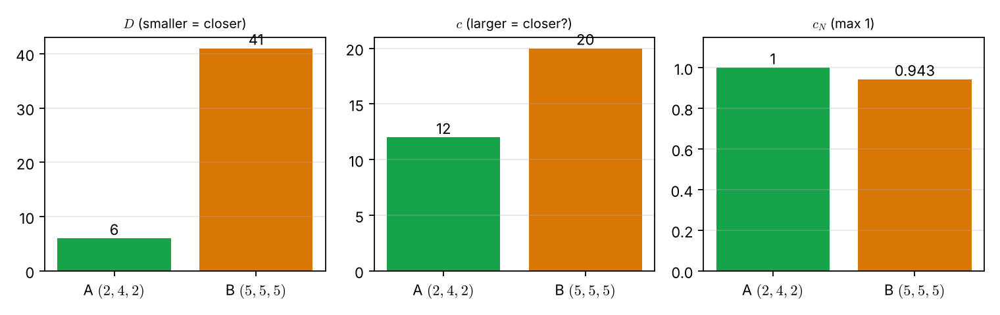
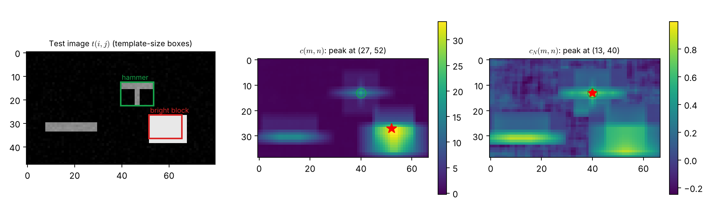

# Lecture 11 · KP07：目標在影像的哪裡（Where in the image is the target）

> 程度：研究生（grad）／Level: Graduate (grad)
>
> 第 11 週（2026-11-16）｜Template Matching · KP07
>
> Week 11 (2026-11-16) | Template Matching · KP07

## 學習目標（Learning objectives）

- 從平方差距離 $D(m,n)$ 展開出互相關 $c(m,n)$，並說明何時兩者等價（Expand the squared-difference distance $D(m,n)$ into the cross-correlation $c(m,n)$ and say when the two are equivalent）。
- 說明為什麼要用標準化互相關 $c_N(m,n)$，並用 Cauchy-Schwarz 不等式說明它不超過 $1$（Explain why the normalized correlation $c_N(m,n)$ is used and why Cauchy-Schwarz keeps it at most $1$）。
- 手算一組向量的 $D$、$c$、$c_N$，並指出亮度如何誤導 $c$（Compute $D$, $c$, $c_N$ for a small pair and show how brightness misleads $c$）。
- 說出相關匹配只容許平移，以及旋轉與縮放的處理方向（State that correlation matching tolerates translation only, and the directions for rotation and scale）。

## KP07：基於相關性的樣板匹配（Template matching by correlation）

**一句話重點**：在影像上滑動樣板，每個位置算一個相似度。把平方差展開後，找最小距離等於找最大相關；亮度變動大時改用標準化相關，上限是 $1$。

**One-sentence summary**: Slide the template over the image and compute one similarity per position. Expanding the squared difference turns "smallest distance" into "largest correlation"; when brightness varies, use the normalized correlation, whose maximum is $1$.

### 1. 從序列走向影像（From sequences to images）

上一講留下的問題是：要找的是影像裡一個目標的位置，沒有時間軸，該怎麼比？
目標確實在影像裡，但位置事先不知道。
所以辦法是把樣板放到每一個可能的位置，逐一打分數。

The previous lecture asked: to find an object's position in an image, with no time axis, how do we match?
The object is in the image, but its position is not known in advance.
So we place the template at every possible position and score each one.

**白話說明**：想像你拿著一張透明片，上面印著鐵鎚的形狀。
你把它在一張雜物照片上慢慢滑動，看哪個位置最吻合。
這個比喻只說明「滑動並比對」。
它沒有說明怎麼打分，也沒有說明亮度不同的照片該怎麼辦。

**Plain explanation**: Imagine holding a transparent sheet printed with the outline of a hammer.
You slide it slowly over a photo of clutter and look for the best fit.
This analogy only covers "slide and compare".
It does not say how to score, or what to do when photos differ in brightness.

**先備自測**：確認你記得向量的內積，以及 KP01 的歐氏距離。

**Prerequisite check**: Make sure you remember the inner product of vectors and the Euclidean distance of KP01.

- 向量 $(1,2,1)$ 與 $(2,4,2)$ 的內積是 $2+8+2=12$（The inner product of $(1,2,1)$ and $(2,4,2)$ is $2+8+2=12$）。
- 把所有元素平方後相加，就是向量長度的平方（Summing all squared entries gives the squared length）。

### 2. 距離、相關與標準化相關（Distance, correlation, and normalized correlation）

**正式定義**：參考樣板 $r(i,j)$ 的大小是 $M\times N$。
測試影像 $t(i,j)$ 的大小是 $I\times J$，且 $M\le I$、$N\le J$。
樣板左上角放在 $(m,n)$ 時，**平方差距離**是：

**Formal definition**: The reference template $r(i,j)$ has size $M\times N$.
The test image $t(i,j)$ has size $I\times J$, with $M\le I$ and $N\le J$.
With the template's corner at $(m,n)$, the **squared-difference distance** is:

$$
D(m,n)=\sum_{i=m}^{m+M-1}\sum_{j=n}^{n+N-1}\bigl|t(i,j)-r(i-m,\,j-n)\bigr|^2
\tag{8.5}
$$

把平方展開：

Expanding the square:

$$
D(m,n)=\sum_i\sum_j|t(i,j)|^2+\sum_i\sum_j|r(i,j)|^2-2\sum_i\sum_j t(i,j)\,r(i-m,\,j-n)
\tag{8.6}
$$

第二項對給定的樣板是常數。
若測試影像局部灰度變化不大，第一項也近似常數。
這時最小化 $D(m,n)$，等價於最大化**互相關**（cross-correlation）：

The second term is constant for a given template.
If the local gray level of the test image varies little, the first term is nearly constant too.
Then minimizing $D(m,n)$ is equivalent to maximizing the **cross-correlation**:

$$
c(m,n)=\sum_i\sum_j t(i,j)\,r(i-m,\,j-n)
\tag{8.7}
$$

灰度變化大時，$c(m,n)$ 會被亮度主導。
所以改用**標準化互相關係數**（normalized cross-correlation）：

When the gray level varies a lot, $c(m,n)$ is dominated by brightness.
So we use the **normalized cross-correlation coefficient**:

$$
c_N(m,n)=\frac{c(m,n)}{\sqrt{\sum_i\sum_j|t(i,j)|^2\ \sum_i\sum_j|r(i,j)|^2}}
\tag{8.8}
$$

由 Cauchy-Schwarz 不等式，分子的絕對值不會超過分母。
所以 $|c_N(m,n)|\le1$。
等號成立的充要條件是局部影像 $t(i,j)=\alpha\,r(i-m,j-n)$，$\alpha$ 是任意常數，也就是形狀相同、只差一個倍數。

By the Cauchy-Schwarz inequality, the absolute value of the numerator cannot exceed the denominator.
So $|c_N(m,n)|\le1$.
Equality holds exactly when the local patch satisfies $t(i,j)=\alpha\,r(i-m,j-n)$ for some constant $\alpha$, that is, the same shape up to a scale factor.

| 符號 | 中文意義 | English meaning |
|---|---|---|
| $r(i,j)$ | $M\times N$ 的參考樣板 | The $M\times N$ reference template |
| $t(i,j)$ | $I\times J$ 的測試影像 | The $I\times J$ test image |
| $(m,n)$ | 樣板放置的位移 | Placement offset of the template |
| $D(m,n)$ | 平方差距離，越小越像 | Squared-difference distance; smaller is closer |
| $c(m,n)$ | 互相關，未標準化 | Cross-correlation, unnormalized |
| $c_N(m,n)$ | 標準化互相關，最大為 $1$ | Normalized cross-correlation, at most $1$ |

**常見迷思**：「互相關越大，就越像。」
這只有在局部能量近似不變時才成立。
一塊很亮的非目標區域，能量很大，$c(m,n)$ 也會很大，下面的算例會看到這件事。

**Common misconception**: "A larger correlation means more similar."
This holds only when the local energy is nearly constant.
A very bright non-target region has large energy and thus a large $c(m,n)$, as the examples below show.

### 3. 手算：亮度怎麼騙過 $c$（By hand: how brightness fools $c$）

上一節給了三個式子。
先用三個數字的小例子，算一遍。

The previous section gave three formulas.
First compute them on a tiny three-number example.

**例子**：`[補充]` 樣板 $\mathbf{r}=(1,2,1)$，所以 $\sum r^2=1+4+1=6$。
候選甲是 $(2,4,2)$，形狀和樣板相同，只是亮度加倍。
候選乙是 $(5,5,5)$，是一塊平坦的亮區。

**Example**: `[Added]` The template is $\mathbf{r}=(1,2,1)$, so $\sum r^2=1+4+1=6$.
Candidate A is $(2,4,2)$, the same shape as the template with doubled brightness.
Candidate B is $(5,5,5)$, a flat bright region.

甲：$D=1+4+1=6$，$c=2+8+2=12$，$\sum t^2=24$，所以 $c_N=12/\sqrt{24\times6}=12/12=1$。
乙：$D=16+9+16=41$，$c=5+10+5=20$，$\sum t^2=75$，所以 $c_N=20/\sqrt{75\times6}=20/21.21=0.943$。

A: $D=1+4+1=6$, $c=2+8+2=12$, $\sum t^2=24$, so $c_N=12/\sqrt{24\times6}=12/12=1$.
B: $D=16+9+16=41$, $c=5+10+5=20$, $\sum t^2=75$, so $c_N=20/\sqrt{75\times6}=20/21.21=0.943$.

用式 (8.6) 驗算：甲 $24+6-2\times12=6$，乙 $75+6-2\times20=41$，與直接算的 $D$ 相同。
三個準則的選擇不同：$D$ 選甲，$c$ 選乙（$20>12$），$c_N$ 選甲（$1>0.943$）。
乙的 $c$ 比較大，只因為它比較亮。

Check with (8.6): A gives $24+6-2\times12=6$ and B gives $75+6-2\times20=41$, equal to the directly computed $D$.
The three criteria choose differently: $D$ picks A, $c$ picks B ($20>12$), and $c_N$ picks A ($1>0.943$).
B has the larger $c$ only because it is brighter.



圖說 `lec11-kp07-cross-correlation-f2-hand-example`：三張長條圖分別是 $D$、$c$、$c_N$，每張都比較甲（綠）與乙（橘）。$D$ 與 $c_N$ 的最佳者是甲，只有 $c$ 的最大值落在乙。〔功能：2〕

Figure `lec11-kp07-cross-correlation-f2-hand-example`: The three bar charts show $D$, $c$, and $c_N$, each comparing A (green) with B (orange). The best by $D$ and by $c_N$ is A; only the maximum of $c$ falls on B. [Function: 2]

### 4. 在影像上滑動（Sliding over an image）

接著把同樣的事放到二維影像上。
來源的 Example 8.2 在一張有螺絲起子與鐵鎚的影像裡找鐵鎚，互相關的峰值出現在 $(13,66)$，正是鐵鎚所在處。
網頁沒有提供那張影像，下面改用一張可重現的合成影像。

Now do the same on a two-dimensional image.
The source's Example 8.2 searches for a hammer in an image with a screwdriver and a hammer, and the correlation peak lands at $(13,66)$, exactly where the hammer is.
The webpage does not provide that image, so a reproducible synthetic one is used below.

**例子**：`[補充]` 影像大小 $48\times80$，背景有 $0.02$ 的小雜訊。
樣板是 $10\times14$ 的 T 形，有 $56$ 個像素，強度 $0.6$，所以 $\sum r^2=56\times0.36=20.16$。
影像裡放了三樣東西：與樣板相同的 T 形（左上角在 $(13,40)$）、一條細長物件、一個亮度 $1.0$ 的大方塊（涵蓋 $(27..38,\ 52..67)$）。

**Example**: `[Added]` The image is $48\times80$ with small background noise of $0.02$.
The template is a $10\times14$ T-shape with $56$ pixels of intensity $0.6$, so $\sum r^2=56\times0.36=20.16$.
The image holds three things: a T-shape identical to the template (corner at $(13,40)$), a thin bar, and a large block of intensity $1.0$ (covering $(27..38,\ 52..67)$).

在 T 形處：$c\approx0.36\times56=20.16$，實算（含雜訊）$20.35$，而 $c_N=0.998$。
在方塊裡，整個樣板視窗都落在亮度 $1.0$ 的區域內，$c=1.0\times\sum r=0.6\times56=33.6$。
視窗面積是 $10\times14=140$，所以 $c_N=33.6/\sqrt{140\times20.16}=33.6/53.13=0.632$。

At the T-shape: $c\approx0.36\times56=20.16$, computed $20.35$ with noise, and $c_N=0.998$.
Inside the block, the whole template window lies in intensity $1.0$, so $c=1.0\times\sum r=0.6\times56=33.6$.
The window area is $10\times14=140$, so $c_N=33.6/\sqrt{140\times20.16}=33.6/53.13=0.632$.

結果是：$c$ 在方塊裡最大（$33.6>20.35$），會找錯。
$c_N$ 的最大值在 $(13,40)$，是 T 形所在處。
平方差 $D$ 的最小值也在 $(13,40)$，那裡 $D=0.065$，方塊處 $D=92.96$。

The outcome: $c$ is largest inside the block ($33.6>20.35$) and would pick wrongly.
The maximum of $c_N$ is at $(13,40)$, where the T-shape is.
The minimum of $D$ is also at $(13,40)$, with $D=0.065$ against $92.96$ at the block.



圖說 `lec11-kp07-cross-correlation-f1-heatmaps`：左圖是測試影像，綠框是 T 形，紅框是亮方塊，框的大小等於樣板。中圖是 $c(m,n)$，紅星是最大值，落在亮方塊（平台的第一個位置 $(27,52)$），綠圈標示真正的位置 $(13,40)$。右圖是 $c_N(m,n)$，紅星正好落在綠圈。〔功能：1、2〕

Figure `lec11-kp07-cross-correlation-f1-heatmaps`: The left panel is the test image; the green box is the T-shape and the red box the bright block, both the size of the template. The middle panel is $c(m,n)$; the red star marks the maximum, which falls on the bright block (the first position $(27,52)$ of a plateau), and the green circle marks the true position $(13,40)$. The right panel is $c_N(m,n)$, whose red star lands exactly on the green circle. [Function: 1, 2]

方塊處的 $c$ 是一整片平台，因為樣板只要完全落在方塊內，$c$ 的值都相同。
圖中的紅星標在平台的第一個位置。

The $c$ at the block is a flat plateau: wherever the template lies fully inside the block, $c$ takes the same value.
The red star marks the first position of the plateau.

標準化只是除以兩個能量的乘積開根號。
它把「形狀像不像」和「亮不亮」分開，所以對光線變動不敏感。
但它仍然只容許**平移**。

Normalization just divides by the square root of the product of the two energies.
It separates "does the shape match" from "how bright is it", so it is insensitive to lighting changes.
But it still tolerates **translation** only.

### 5. 限制：旋轉與縮放（Limits: rotation and scale）

上一節的方法在目標只有平移時有效。
若目標被旋轉或縮放，標準相關匹配就會失敗。
來源列出幾個處理方向。

The method above works when the target is only translated.
If the target is rotated or scaled, standard correlation matching fails.
The source lists several directions.

- 不變矩（invariant moments）：用不隨旋轉與縮放改變的量描述形狀（Invariant moments: describe shape with quantities unchanged by rotation and scale）。
- Fourier-Mellin 轉換：把旋轉與縮放變成平移（The Fourier-Mellin transform turns rotation and scale into translation）。
- 多角度樣板庫：事先準備許多旋轉後的樣板（A library of templates at many rotations）。
- Karhunen-Loève 轉換：把旋轉樣板投影到低維特徵空間，降低計算量（The KL transform projects rotated templates into a low-dimensional feature space to cut computation）。

**常見迷思**：「$c_N$ 接近 $1$，目標一定在那裡。」
$c_N=1$ 只表示局部影像是樣板的倍數。
若目標被旋轉，真正的位置反而可能得到很低的 $c_N$。

**Common misconception**: "If $c_N$ is near $1$, the target is surely there."
$c_N=1$ only says the patch is a multiple of the template.
If the target is rotated, its true position may even yield a low $c_N$.

**想深入**（選讀）：把 $D$ 換成 $c$ 還有一個好處。
$c$ 是乘積的總和，結構上可以用傅立葉轉換一次算出所有位置。
這是下一講的第一種加速法。

**Going deeper** (optional): Replacing $D$ with $c$ has another benefit.
$c$ is a sum of products, so it can be computed for all positions at once with the Fourier transform.
That is the first speed-up of the next lecture.

**與實作的連結**：下面的程式在一張小影像上算 $c_N$ 並找最大值。
分母只包含窗內像素的能量，所以每個位置都要重算。

**Connection to practice**: The code below computes $c_N$ on a small image and finds its maximum.
The denominator holds only the energy of the pixels inside the window, so it must be recomputed at each position.

```python
import numpy as np

def ncc_map(t, r):
    """標準化互相關 c_N(m, n)；t 為影像，r 為樣板 / normalized cross-correlation map."""
    M, N = r.shape
    er = np.sum(r ** 2)                                   # 樣板能量，只算一次
    out = np.zeros((t.shape[0] - M + 1, t.shape[1] - N + 1))
    for m in range(out.shape[0]):
        for n in range(out.shape[1]):
            w = t[m:m + M, n:n + N]                       # 目前視窗
            out[m, n] = np.sum(w * r) / np.sqrt(np.sum(w ** 2) * er)
    return out

r = np.array([[1., 2., 1.]])                              # 一維例的樣板（1x3）
print(ncc_map(np.array([[2., 4., 2.]]), r))               # [[1.]]
print(round(float(ncc_map(np.array([[5., 5., 5.]]), r)[0, 0]), 3))   # 0.943
```

**留給下一節的問題**：這個迴圈在每個位置都要做 $MN$ 次乘加。
影像大、搜尋範圍大時，時間無法接受。
有沒有辦法不逐點算？

**The question for the next section**: This loop does $MN$ multiply-adds at every position.
For a large image and a large search range the time is unacceptable.
Is there a way to avoid computing point by point?

### 6. 小練習與解題示範（Practice and worked solutions）

**小練習** `[補充]`：先寫下理由，再看解答。

**Practice** `[Added]`: Write your reasoning before reading the solutions.

1. 題 1：樣板 $\mathbf{r}=(1,2,1)$，候選 $(3,6,3)$，算 $c$、$c_N$（Compute $c$ and $c_N$ for candidate $(3,6,3)$）。
2. 題 2：樣板 $\mathbf{r}=(1,2,1)$，候選 $(1,0,-1)$，算 $c_N$，並說明符號（Compute $c_N$ for candidate $(1,0,-1)$ and explain the sign）。
3. 題 3：為什麼 $c_N$ 不會超過 $1$（Why can $c_N$ not exceed $1$）？

**題 1 解題示範**：$c=3+12+3=18$。
$\sum t^2=9+36+9=54$，$\sum r^2=6$，所以 $c_N=18/\sqrt{54\times6}=18/\sqrt{324}=18/18=1$。
候選是樣板的 $3$ 倍，所以 $c_N=1$。

**Question 1 worked solution**: $c=3+12+3=18$.
$\sum t^2=9+36+9=54$ and $\sum r^2=6$, so $c_N=18/\sqrt{54\times6}=18/\sqrt{324}=18/18=1$.
The candidate is $3$ times the template, so $c_N=1$.

**題 2 解題示範**：$c=1+0-1=0$。
所以 $c_N=0$。
內積為 $0$ 表示兩個向量互相垂直，形狀上沒有任何相像。

**Question 2 worked solution**: $c=1+0-1=0$.
So $c_N=0$.
A zero inner product means the vectors are perpendicular, with no resemblance in shape.

**題 3 解題示範**：Cauchy-Schwarz 不等式說 $|\sum t\,r|\le\sqrt{\sum t^2\ \sum r^2}$。
$c_N$ 正好是左邊除以右邊，所以絕對值不超過 $1$。
等號只在 $t$ 是 $r$ 的常數倍時成立。

**Question 3 worked solution**: The Cauchy-Schwarz inequality says $|\sum t\,r|\le\sqrt{\sum t^2\ \sum r^2}$.
$c_N$ is exactly the left side divided by the right side, so its absolute value is at most $1$.
Equality holds only when $t$ is a constant multiple of $r$.

## 術語表（Glossary）

| 中文術語 | English term |
|---|---|
| 互相關 | Cross-correlation |
| 標準化互相關係數 | Normalized cross-correlation coefficient |
| 平方差距離 | Squared-difference distance |
| 灰度 | Gray level |
| 能量 | Energy |
| Cauchy-Schwarz 不等式 | Cauchy-Schwarz inequality |
| 平移 | Translation |
| 不變矩 | Invariant moments |
| Fourier-Mellin 轉換 | Fourier-Mellin transform |
| Karhunen-Loève 轉換 | Karhunen-Loève transform |
| 熱圖 | Heat map |
| NumPy | Python array-computing library |

## 銜接與來源（Connections and sources）

下一講介紹四種不逐點計算的加速法。

The next lecture introduces four ways to speed up the computation without going point by point.

- 前一單元：[KP06 DTW 的限制條件](lec11-kp06-dtw-constraints.md)（Previous unit: the constraints of DTW）。
- 下一單元：[KP08 相關匹配的計算加速](lec11-kp08-correlation-speedup.md)（Next unit: speeding up correlation matching）。
- 來源：[Template Matching §8.3](https://ndhuccc.github.io/CCC-LNS/PR_115/Ch08-template-matching/index.html#kp7)，讀取日期 2026-11-12（Source accessed 2026-11-12）。
- 書目：Theodoridis and Koutroumbas, *Pattern Recognition*, 4th ed., 2008；見[參考資料](../references/README.md)（See the bibliography）。

本講以自己的文字解釋來源。
式 (8.5)–(8.8)、Cauchy-Schwarz 的等號條件、旋轉與縮放的處理方向與 Example 8.2 的峰值位置取自來源。
三個數字的手算例、合成影像與其數值、程式與練習為 `[補充]`。

This lecture independently explains the source.
Formulas (8.5)–(8.8), the equality condition of Cauchy-Schwarz, the directions for rotation and scale, and the peak position of Example 8.2 come from the source.
The three-number hand example, the synthetic image and its numbers, the code, and the exercises are `[Added]`.
