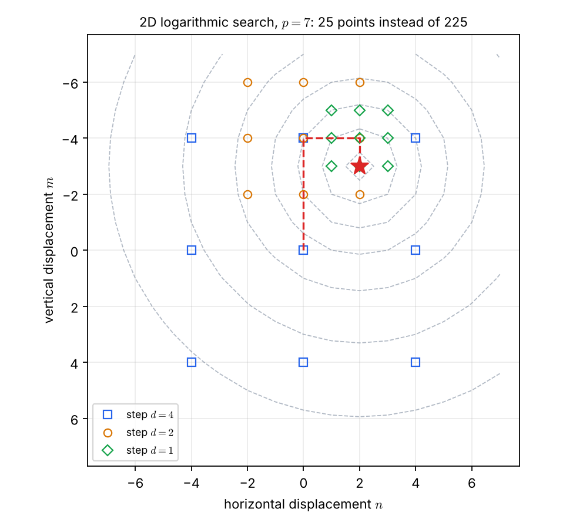
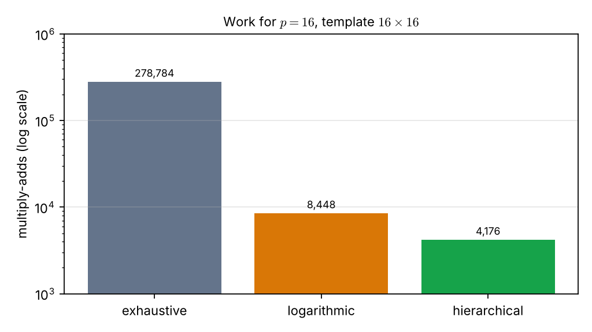

# Lecture 11 · KP08：不用每個位置都算（Not computing every position）

> 程度：研究生（grad）／Level: Graduate (grad)
>
> 第 11 週（2026-11-16）｜Template Matching · KP08
>
> Week 11 (2026-11-16) | Template Matching · KP08

## 學習目標（Learning objectives）

- 算出窮舉搜尋的乘加次數，並說明它為什麼太慢（Compute the multiply-add count of exhaustive search and say why it is too slow）。
- 說出四種加速法各省在哪裡：FFT、對數搜尋、階層式搜尋、序列法（Say where each of the four speed-ups saves work: FFT, logarithmic search, hierarchical search, sequential method）。
- 手動追蹤 $p=7$ 的二維對數搜尋，並算出評估點數 $8k+1$（Trace the 2D logarithmic search for $p=7$ by hand and obtain $8k+1$ evaluated points）。
- 指出各方法的代價：階層式可能找不到全域最佳，對數搜尋需要單峰假設（State the price of each method: hierarchical may miss the global optimum, logarithmic search needs unimodality）。

## KP08：相關匹配的計算加速（Speeding up correlation matching）

**一句話重點**：窮舉全圖要 $(2p+1)^2MN$ 次乘加。FFT 在頻域相乘、對數搜尋逐輪對折步幅、階層式從粗到細、序列法超標就剪，各用不同方式少算很多點。

**One-sentence summary**: Exhaustive search costs $(2p+1)^2MN$ multiply-adds. FFT multiplies in the frequency domain, logarithmic search halves its step, hierarchical search goes coarse to fine, and the sequential method prunes on overrun; each skips a lot of work in its own way.

### 1. 從「算得對」走向「算得動」（From "correct" to "affordable"）

上一講留下的問題是：每個位置都要做 $MN$ 次乘加，有沒有辦法不逐點算？
先算清楚成本。
搜尋區域是位移範圍 $[-p,p]\times[-p,p]$，共有 $(2p+1)^2$ 個候選位置。

The previous lecture asked: with $MN$ multiply-adds at every position, can we avoid going point by point?
First get the cost straight.
The search region is the displacement range $[-p,p]\times[-p,p]$, with $(2p+1)^2$ candidate positions.

每個位置要做 $MN$ 次乘加，所以窮舉的總量是：

Each position needs $MN$ multiply-adds, so exhaustive search costs:

$$
(2p+1)^2\,MN
$$

來源舉例：電視廣播取 $p=15$，體育賽事取 $p=63$。
`[補充]` 若樣板是 $16\times16$（$MN=256$），$p=16$ 就要 $33^2\times256=278{,}784$ 次乘加，只為了一個樣板。

The source gives examples: $p=15$ for television broadcast and $p=63$ for sports events.
`[Added]` For a $16\times16$ template ($MN=256$), $p=16$ already needs $33^2\times256=278{,}784$ multiply-adds, for a single template.

**白話說明**：想像在一棟大樓裡找一個人。
窮舉是每間房都開門看一眼。
加速法是：先看總機、先看樓層分布，或看了一眼就知道不是就換下一間。
這個比喻只對應「少看幾間」；每種加速法少看的理由都不同，下面分別說明。

**Plain explanation**: Imagine looking for a person in a large building.
Exhaustive search opens every room.
Speed-ups consult the switchboard first, look at the floor plan, or move on once a glance shows it is not the person.
This analogy only covers "look at fewer rooms"; each method has its own reason for skipping, explained below.

**先備自測**：確認你記得 KP07 的 $c(m,n)$ 與 $c_N(m,n)$，以及 DFT 把時域的乘積總和變成頻域的點乘。

**Prerequisite check**: Make sure you remember $c(m,n)$ and $c_N(m,n)$ of KP07, and that the DFT turns a sum of products in the time domain into a pointwise product in the frequency domain.

- $\lceil\log_2 7\rceil=3$（The ceiling of $\log_2 7$ is $3$）。
- $(2\cdot7+1)^2=225$（$(2\cdot7+1)^2=225$）。

### 2. 四種加速法（Four speed-ups）

**正式定義**：

**Formal definition**:

**（一）FFT 頻域加速**：時域的互相關，等於頻域的點乘：

**(1) FFT in the frequency domain**: A time-domain cross-correlation equals a frequency-domain pointwise product:

$$
C(k,l)=T(k,l)\,R^{*}(k,l)
\tag{8.9}
$$

$T(k,l)$、$R(k,l)$ 分別是 $t(i,j)$ 與 $r(i,j)$ 的二維 DFT，較小者要**補零**到相同大小，$*$ 是複數共軛。
最後對 $C(k,l)$ 做逆轉換，得到 $c(m,n)$。
這一次算出所有位置，適合大範圍、不知道目標在哪裡的搜尋。

$T(k,l)$ and $R(k,l)$ are the 2D DFTs of $t(i,j)$ and $r(i,j)$, the smaller one **zero-padded** to the same size, and $*$ is the complex conjugate.
Applying the inverse transform to $C(k,l)$ gives $c(m,n)$.
It yields all positions at once, which suits wide searches with no idea where the target is.

**（二）二維對數搜尋**：從中心與周圍 $8$ 個點開始，每輪把中心移到最佳點，步幅減半。
令 $k=\lceil\log_2 p\rceil$，起始步幅是 $d_1=2^{k-1}$，之後 $d_2=d_1/2$，直到 $d=1$。
總計算量降為 $MN(8k+1)$。

**(2) 2D logarithmic search**: Start from the center and its $8$ surrounding points, move the center to the best point each round, and halve the step.
Let $k=\lceil\log_2 p\rceil$; the first step is $d_1=2^{k-1}$, then $d_2=d_1/2$, until $d=1$.
The total work drops to $MN(8k+1)$.

**（三）階層式搜尋**：用第 6 章的低通濾波加二分之一降採樣做多解析度。
第 2 層用 $4\times4$ 樣板，在 $[-p/4,p/4]^2$ 找最佳點。
第 1 層用 $8\times8$ 樣板，只在那點附近 $[-1,1]^2$（$9$ 個點）細找。
第 0 層用 $16\times16$ 樣板，同樣在附近 $9$ 個點確定最終位置。

**(3) Hierarchical search**: Use multiresolution from low-pass filtering and subsampling by $2$, as in Chapter 6.
Level 2 uses a $4\times4$ template and finds the best point in $[-p/4,p/4]^2$.
Level 1 uses an $8\times8$ template and refines only around that point in $[-1,1]^2$ ($9$ points).
Level 0 uses the $16\times16$ template and again checks $9$ points nearby to fix the final position.

**（四）序列法**：計算累積絕對差，視窗 $p\times q$ 由小逐漸加大：

**(4) Sequential method**: Accumulate absolute differences, growing the window $p\times q$ from small:

$$
D_{pq}(m,n)=\sum_{i=0}^{p-1}\sum_{j=0}^{q-1}\bigl|t(i+m,\,j+n)-r(i,j)\bigr|
\tag{8.10}
$$

一旦累積值超過預設門檻，就停止這個位置，跳到下一個。

As soon as the accumulated value exceeds a preset threshold, stop at this position and move on to the next.

| 符號 | 中文意義 | English meaning |
|---|---|---|
| $p$ | 搜尋半徑（位移範圍 $[-p,p]$） | Search radius (displacement range $[-p,p]$) |
| $M\times N$ | 樣板大小 | Template size |
| $k$ | $\lceil\log_2p\rceil$，對數搜尋的輪數 | $\lceil\log_2p\rceil$, the number of logarithmic-search rounds |
| $d_1,d_2,\dots$ | 各輪的步幅 | Steps of successive rounds |
| $C,\ T,\ R$ | $c,\ t,\ r$ 的二維 DFT | 2D DFTs of $c,\ t,\ r$ |
| $D_{pq}$ | 窗 $p\times q$ 內的累積絕對差 | Accumulated absolute difference over a $p\times q$ window |

**常見迷思**：「加速法都只是更快，答案一樣。」
FFT 的結果與直接法相同。
但對數搜尋與階層式搜尋是搜尋策略，不保證找到全域最佳；序列法只在門檻設得合適時才安全。

**Common misconception**: "All speed-ups are just faster, with the same answer."
FFT returns the same result as the direct method.
But logarithmic and hierarchical search are search strategies that do not guarantee the global optimum, and the sequential method is safe only if the threshold is set appropriately.

### 3. 手動追蹤對數搜尋（Tracing the logarithmic search）

上一節給了規則。
下面追蹤 $p=7$ 的例子，看評估點怎麼少到 $25$ 個。

The previous section gave the rules.
Tracing the $p=7$ example shows how the evaluated points drop to $25$.

**例子**：$p=7$，所以 $k=\lceil\log_2 7\rceil=3$，$d_1=2^{3-1}=4$。
`[補充]` 為了可重現，設相關面是單峰：$c(m,n)=-\bigl((m+3)^2+(n-2)^2\bigr)$，最大值在 $(m,n)=(-3,2)$，與來源圖提示的終點一致。
每輪評估中心與周圍 $8$ 個點，取最大者當新中心。

**Example**: $p=7$, so $k=\lceil\log_2 7\rceil=3$ and $d_1=2^{3-1}=4$.
`[Added]` For reproducibility the correlation surface is unimodal: $c(m,n)=-\bigl((m+3)^2+(n-2)^2\bigr)$, with its maximum at $(m,n)=(-3,2)$, matching the end point in the source's figure prompt.
Each round evaluates the center and its $8$ neighbors and takes the best as the new center.

- 第 1 輪，$d=4$：評估 $(0,0)$ 與周圍 $8$ 點，最佳是 $(-4,0)$。
- 第 2 輪，$d=2$：以 $(-4,0)$ 為中心評估周圍 $8$ 點，最佳是 $(-4,2)$。
- 第 3 輪，$d=1$：以 $(-4,2)$ 為中心評估周圍 $8$ 點，最佳是 $(-3,2)$，即真正的峰。

- Round 1, $d=4$: evaluate $(0,0)$ and its $8$ neighbors; the best is $(-4,0)$.
- Round 2, $d=2$: evaluate the $8$ neighbors around $(-4,0)$; the best is $(-4,2)$.
- Round 3, $d=1$: evaluate the $8$ neighbors around $(-4,2)$; the best is $(-3,2)$, the true peak.

共評估 $9+8+8=25=8k+1$ 個點。
窮舉要 $(2\cdot7+1)^2=225$ 個點。
節省了 $1-25/225\approx88.9\%$。

In total $9+8+8=25=8k+1$ points are evaluated.
Exhaustive search needs $(2\cdot7+1)^2=225$ points.
That saves $1-25/225\approx88.9\%$.

注意第 1 輪有並列：$(-4,0)$ 與 $(-4,4)$ 的值相同。
本例用固定的掃描順序決定，取先出現的 $(-4,0)$；並列時的選擇不影響這個單峰面的結果。

Note the tie in round 1: $(-4,0)$ and $(-4,4)$ have the same value.
This example uses a fixed scan order and takes the first, $(-4,0)$; the tie-break does not change the result on this unimodal surface.



圖說 `lec11-kp08-correlation-speedup-f1-log-search`：灰色虛線是相關面的等高線，紅星是峰值 $(m,n)=(-3,2)$。方塊、圓、菱形依序是第 1、2、3 輪評估的點，紅色虛線是中心的移動軌跡 $(0,0)\to(-4,0)\to(-4,2)\to(-3,2)$。圖上共 $25$ 個標記點。〔功能：1、3〕

Figure `lec11-kp08-correlation-speedup-f1-log-search`: The gray dashed lines are contours of the correlation surface and the red star is the peak $(m,n)=(-3,2)$. Squares, circles, and diamonds are the points evaluated in rounds 1, 2, and 3, and the red dashed line is the center's path $(0,0)\to(-4,0)\to(-4,2)\to(-3,2)$. There are $25$ markers in total. [Function: 1, 3]

這個方法有前提：相關面要「單峰」，往好的方向走才會一路走到頂。
若有多個峰，它可能停在其中一個局部峰上。
所以它適合已經有初始估計位置的情況，例如視訊的動態補償。

The method has a premise: the correlation surface must be unimodal so that climbing leads to the top.
With several peaks it may stop at one local peak.
So it suits cases where an initial position estimate exists, such as motion compensation in video.

### 4. 比較運算量（Comparing the work）

三種搜尋策略的成本可以並排比較。

The costs of the three search strategies can be compared side by side.

**例子**：`[補充]` 樣板 $16\times16$（$MN=256$），$p=16$，所以 $k=4$。

**Example**: `[Added]` The template is $16\times16$ ($MN=256$) and $p=16$, so $k=4$.

- 窮舉：$(2\cdot16+1)^2\times256=1089\times256=278{,}784$。
- 對數搜尋：$(8\times4+1)\times256=33\times256=8448$。
- 階層式：第 2 層 $(2\cdot4+1)^2=81$ 個位置、每個 $16$ 次乘加，共 $1296$。第 1 層 $9$ 個位置、每個 $64$ 次，共 $576$。第 0 層 $9$ 個位置、每個 $256$ 次，共 $2304$。總計 $4176$。

- Exhaustive: $(2\cdot16+1)^2\times256=1089\times256=278{,}784$.
- Logarithmic: $(8\times4+1)\times256=33\times256=8448$.
- Hierarchical: level 2 has $(2\cdot4+1)^2=81$ positions at $16$ multiply-adds each, totaling $1296$. Level 1 has $9$ positions at $64$ each, totaling $576$. Level 0 has $9$ positions at $256$ each, totaling $2304$. The total is $4176$.

階層式比窮舉少約 $278784/4176\approx66.8$ 倍。

Hierarchical search needs about $278784/4176\approx66.8$ times less work than exhaustive search.



圖說 `lec11-kp08-correlation-speedup-f2-operations`：縱軸是乘加次數，取對數。灰色是窮舉（$278{,}784$），橘色是對數搜尋（$8448$），綠色是階層式（$4176$）。注意縱軸是對數刻度，每格是 $10$ 倍。〔功能：2〕

Figure `lec11-kp08-correlation-speedup-f2-operations`: The vertical axis is the number of multiply-adds on a log scale. Gray is exhaustive ($278{,}784$), orange is logarithmic ($8448$), and green is hierarchical ($4176$). Note that the axis is logarithmic, so each gridline is a factor of $10$. [Function: 2]

階層式的代價有兩個。
它需要額外的記憶體存放多層影像。
而且若樣板中的小物件在低解析度下因降採樣而消失，搜尋可能走向錯的方向，無法保證全域最佳。
實務上可設門檻做剪枝，來保住全域最佳。

Hierarchical search has two costs.
It needs extra memory for the multi-level images.
And if a small object in the template vanishes under subsampling at low resolution, the search may head the wrong way and cannot guarantee the global optimum.
In practice a threshold can be set for pruning, to preserve the global optimum.

### 5. FFT 與序列法（FFT and the sequential method）

FFT 與序列法不是改變搜尋位置，而是改變每個位置的算法。

FFT and the sequential method do not change which positions are searched; they change how each position is computed.

**FFT**：`[補充]` 在 KP07 的 $48\times80$ 合成影像上，用 FFT 算出的 $c(m,n)$ 與直接法逐點相比，最大絕對差是 $1.8\times10^{-14}$，只是浮點誤差。
補零是必要的：兩個陣列尺寸不同時，不能直接點乘。
FFT 沒有帶來近似，只是換了算法。

**FFT**: `[Added]` On the $48\times80$ synthetic image of KP07, the $c(m,n)$ from FFT differs from the direct point-by-point result by at most $1.8\times10^{-14}$, only floating-point error.
Zero padding is necessary: arrays of different sizes cannot be multiplied pointwise directly.
FFT brings no approximation; it only changes the algorithm.

**序列法**：`[補充]` 在同一張影像上，取累積絕對差的門檻 $T=5$。
全部 $2613$ 個位置若都算完整，需要 $2613\times140=365{,}820$ 次運算。
用序列法，每個位置一超過 $T$ 就停，總共只做了 $27{,}911$ 次，約佔 $7.6\%$。
唯一存活（沒被中途停掉）的位置是 $(13,40)$，正是 T 形所在處。

**Sequential method**: `[Added]` On the same image, take the accumulated-absolute-difference threshold $T=5$.
Computing all $2613$ positions in full would need $2613\times140=365{,}820$ operations.
With the sequential method, each position stops as soon as it exceeds $T$, for only $27{,}911$ operations, about $7.6\%$.
The only surviving position, never stopped midway, is $(13,40)$, exactly where the T-shape is.

門檻是關鍵。
太低，真正的位置也會被誤剪掉；太高，剪不掉多少。

The threshold is the crux.
Too low, and even the true position is pruned by mistake; too high, and little is pruned.

**常見迷思**：「FFT 一定比直接法快。」
FFT 的好處在大範圍搜尋；若只搜尋一個小視窗，對數搜尋或序列法常常更划算。
來源的建議是：FFT 適合全圖無差別搜尋，對數搜尋與序列法適合已有初始位置的視窗快速收斂。

**Common misconception**: "FFT is always faster than the direct method."
FFT's benefit lies in wide searches; for a small window, logarithmic search or the sequential method is often cheaper.
The source's advice: FFT suits undiscriminating whole-image search, while logarithmic and sequential methods suit fast convergence in a window around an initial position.

**想深入**（選讀）：對數搜尋共評估 $8k+1$ 個點。
當 $p=7$ 時，$k=3$，所以 $25$ 個；$p=16$ 時 $k=4$，所以 $33$ 個。
它隨 $\log_2 p$ 成長，而窮舉隨 $p^2$ 成長。

**Going deeper** (optional): Logarithmic search evaluates $8k+1$ points.
For $p=7$, $k=3$ gives $25$; for $p=16$, $k=4$ gives $33$.
It grows with $\log_2 p$, while exhaustive search grows with $p^2$.

**與實作的連結**：下面的程式用 NumPy 做補零的 FFT 相關，並與直接法的一個位置對照。

**Connection to practice**: The code below does zero-padded FFT correlation with NumPy and checks one position against the direct method.

```python
import numpy as np

def fft_correlation(t, r):
    """用頻域點乘算互相關 c(m, n)；較小的 r 補零到 t 的大小 / FFT cross-correlation."""
    I, J = t.shape
    M, N = r.shape
    T = np.fft.rfft2(t, s=(I, J))                 # s=(I,J) 讓 r 在轉換前自動補零
    R = np.fft.rfft2(r, s=(I, J))
    c = np.fft.irfft2(T * np.conj(R), s=(I, J))   # C = T R*，再做逆轉換
    return c[:I - M + 1, :J - N + 1]              # 只保留樣板完全落在影像內的位置

t = np.arange(20.).reshape(4, 5)
r = np.array([[1., 0.], [0., 1.]])
c = fft_correlation(t, r)
print(np.isclose(c[1, 2], t[1, 2] * 1 + t[2, 3] * 1))   # True
```

**留給下一節的問題**：到目前為止，目標只有位置的變化，形狀固定不變。
如果目標本身會彎曲變形呢？
下一節把樣板視為一條橡皮筋。

**The question for the next section**: So far the target changes only in position, with a fixed shape.
What if the target itself bends and deforms?
The next section treats the template as a rubber band.

### 6. 小練習與解題示範（Practice and worked solutions）

**小練習** `[補充]`：先寫下理由，再看解答。

**Practice** `[Added]`: Write your reasoning before reading the solutions.

1. 題 1：$p=15$、樣板 $8\times8$，窮舉需要幾次乘加；對數搜尋呢（How many multiply-adds for exhaustive search, and for logarithmic search）？
2. 題 2：$p=15$ 時，對數搜尋的 $k$ 與起始步幅 $d_1$ 是多少（What are $k$ and the first step $d_1$ for $p=15$）？
3. 題 3：為什麼 FFT 需要補零（Why does the FFT method need zero padding）？

**題 1 解題示範**：窮舉是 $(2\cdot15+1)^2\times64=961\times64=61{,}504$。
$k=\lceil\log_2 15\rceil=4$，對數搜尋是 $(8\times4+1)\times64=33\times64=2112$。

**Question 1 worked solution**: Exhaustive is $(2\cdot15+1)^2\times64=961\times64=61{,}504$.
$k=\lceil\log_2 15\rceil=4$, so logarithmic search is $(8\times4+1)\times64=33\times64=2112$.

**題 2 解題示範**：$\log_2 15\approx3.91$，向上取整得 $k=4$。
起始步幅 $d_1=2^{4-1}=8$。
之後步幅依序是 $4,2,1$，共 $4$ 輪。

**Question 2 worked solution**: $\log_2 15\approx3.91$, rounded up gives $k=4$.
The first step is $d_1=2^{4-1}=8$.
The steps then follow as $4,2,1$, for $4$ rounds in total.

**題 3 解題示範**：頻域的點乘要求兩個陣列大小相同。
樣板比影像小，所以要補零到影像大小，才能逐元素相乘。
補零不改變樣板的內容，只增加零元素。

**Question 3 worked solution**: Pointwise multiplication in the frequency domain requires arrays of the same size.
The template is smaller than the image, so it is zero-padded to the image size to allow elementwise multiplication.
Padding adds only zeros and does not change the template's content.

## 術語表（Glossary）

| 中文術語 | English term |
|---|---|
| 窮舉搜尋 | Exhaustive search |
| 快速傅立葉轉換 | Fast Fourier transform, FFT |
| 補零 | Zero padding |
| 複數共軛 | Complex conjugate |
| 二維對數搜尋 | 2D logarithmic search |
| 階層式搜尋 | Hierarchical search |
| 多解析度 | Multiresolution |
| 降採樣 | Subsampling |
| 序列法 | Sequential method |
| 剪枝 | Pruning |
| 單峰 | Unimodal |
| 全域最佳 | Global optimum |
| NumPy | Python array-computing library |

## 銜接與來源（Connections and sources）

下一講讓樣板可以彎曲，用能量的權衡取代剛性比對。

The next lecture lets the template bend, replacing rigid matching with an energy trade-off.

- 前一單元：[KP07 互相關樣板匹配](lec11-kp07-cross-correlation.md)（Previous unit: cross-correlation template matching）。
- 下一單元：[KP09 可變形樣板：內部與外部能量](lec11-kp09-deformable-energy.md)（Next unit: deformable templates, internal and external energy）。
- 來源：[Template Matching §8.3](https://ndhuccc.github.io/CCC-LNS/PR_115/Ch08-template-matching/index.html#kp8)，讀取日期 2026-11-12（Source accessed 2026-11-12）。
- 書目：Theodoridis and Koutroumbas, *Pattern Recognition*, 4th ed., 2008；見[參考資料](../references/README.md)（See the bibliography）。

本講以自己的文字解釋來源。
運算量公式、四種加速法的規則、式 (8.9)–(8.10)、$p=7$ 的 $25$ 點對 $225$ 點、階層式的三層設定與代價取自來源。
單峰面的追蹤、$p=16$ 的運算量、FFT 與序列法的數值、程式與練習為 `[補充]`。

This lecture independently explains the source.
The work formula, the rules of the four speed-ups, formulas (8.9)–(8.10), the $25$-versus-$225$ points for $p=7$, and the three levels and costs of hierarchical search come from the source.
The unimodal-surface trace, the $p=16$ work counts, the FFT and sequential-method numbers, the code, and the exercises are `[Added]`.
