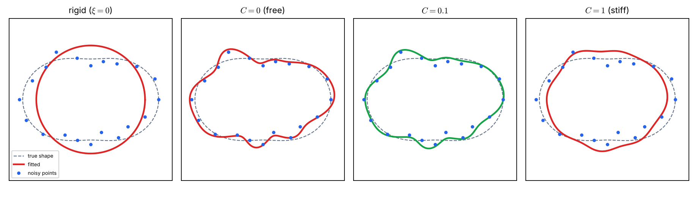
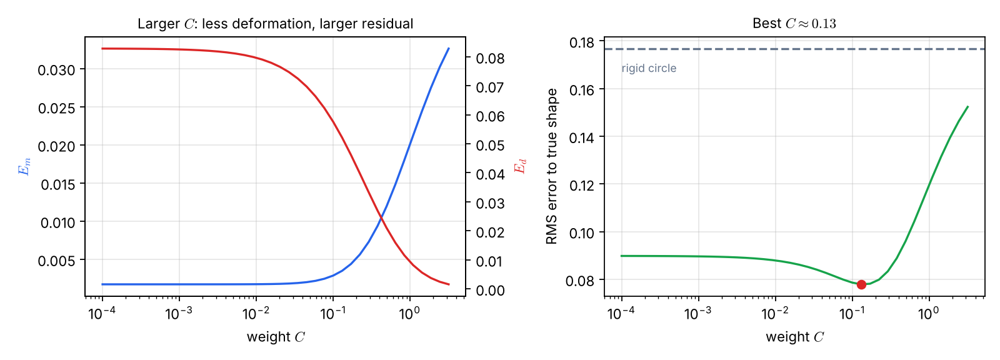

# Lecture 11 · KP09：讓樣板彎曲，但不要彎過頭（Letting the template bend, but not too far）

> 程度：研究生（grad）／Level: Graduate (grad)
>
> 第 11 週（2026-11-16）｜Template Matching · KP09
>
> Week 11 (2026-11-16) | Template Matching · KP09

## 學習目標（Learning objectives）

- 說出可變形樣板的三個要素，以及外部能量與內部能量各量什麼（Name the three elements of a deformable template and what the external and internal energies measure）。
- 解釋為什麼只最小化匹配能量會過度變形（Explain why minimizing only the matching energy over-deforms）。
- 手算一個單參數的權衡，並說明權重 $C$ 如何改變最佳解（Work out a one-parameter trade-off by hand and show how the weight $C$ moves the optimum）。
- 讀懂擬合圖與權衡曲線：$C$ 太小與太大各出什麼問題（Read the fitting plots and trade-off curves: what goes wrong when $C$ is too small or too large）。

## KP09：可變形樣板的能量權衡（The energy trade-off of deformable templates）

**一句話重點**：可變形樣板把原型輪廓當成一條橡皮筋。它在「貼合影像」的外部能量 $E_m$ 與「保持原型」的內部能量 $E_d$ 之間，找總和最小的彎曲方式。

**One-sentence summary**: A deformable template treats the prototype contour as a rubber band. It finds the bending that minimizes the sum of the external energy $E_m$ ("fit the image") and the internal energy $E_d$ ("stay close to the prototype").

### 1. 從平移走向變形（From translation to deformation）

上一講留下的問題是：目標本身會彎曲變形時，怎麼辦？
相關匹配只容許平移，形狀必須和樣板一模一樣。
但成像條件改變、被遮擋、分割不完美，或使用者畫的草圖與資料庫形狀不吻合時，目標與樣板就是對不上。

The previous lecture asked: what if the target itself bends and deforms?
Correlation matching tolerates translation only, and the shape must equal the template exactly.
But when imaging conditions change, an object is occluded, segmentation is imperfect, or a user's sketch does not match a stored shape, the target and the template simply do not agree.

**白話說明**：想像一圈橡皮筋套在一個物體的輪廓外面。
你用手拉扯它去貼合物體。
拉得越變形，橡皮筋的彈性位能越高。
這個比喻說明兩股拉力的權衡；但真實的原型不是均勻的橡皮筋，它的「彈性」由我們定義的能量函數決定。

**Plain explanation**: Imagine a rubber band looped around an object's outline.
You pull it by hand to fit the object.
The more it deforms, the higher its elastic energy.
This analogy shows the tug-of-war between two forces; but a real prototype is not a uniform rubber band, and its "stiffness" is set by the energy functions we define.

**先備自測**：確認你記得 KP07 的距離與相關，並知道「最小化一個總和」的意思。

**Prerequisite check**: Make sure you remember the distance and correlation of KP07 and know what "minimizing a sum" means.

- $\min_t f(t)$ 是找出使 $f$ 最小的 $t$（$\min_t f(t)$ finds the $t$ that makes $f$ smallest）。
- 導數為零的位置是候選的極值點（A point where the derivative is zero is a candidate extremum）。

### 2. 三個要素與總能量（Three elements and the total energy）

**正式定義**：套用**可變形樣板**（deformable template）需要三個要素：

**Formal definition**: Applying a **deformable template** needs three elements:

- **原型**（prototype）$r(i,j)$：物體邊界的輪廓影像，是該形狀類別的「平均形狀」。
- **參數化變形** $T_{\boldsymbol{\xi}}$：用參數向量 $\boldsymbol{\xi}$ 控制的連續變形，得到變形後的樣板 $T_{\boldsymbol{\xi}}[r(i,j)]$。
- **兩種能量**：外部能量 $E_m(\boldsymbol{\xi})$ 與內部能量 $E_d(\boldsymbol{\xi})$。

- **Prototype** $r(i,j)$: a contour image of the object's boundary, the "average shape" of the class.
- **Parametrized deformation** $T_{\boldsymbol{\xi}}$: a continuous deformation controlled by a parameter vector $\boldsymbol{\xi}$, giving the deformed template $T_{\boldsymbol{\xi}}[r(i,j)]$.
- **Two energies**: the external energy $E_m(\boldsymbol{\xi})$ and the internal energy $E_d(\boldsymbol{\xi})$.

**外部能量**（matching energy）$E_m$ 衡量變形後的樣板與測試影像（灰度、梯度或邊界）有多契合。
它取決於輸入的測試資料，所以叫「外部」。
**內部能量**（deformation energy）$E_d$ 衡量為了貼合目標付出的形變代價。
它只取決於原型本身怎麼被拉扯，所以叫「內部」。

The **external energy** (matching energy) $E_m$ measures how well the deformed template agrees with the test image (gray level, gradient, or boundary).
It depends on the input test data, hence "external".
The **internal energy** (deformation energy) $E_d$ measures the price paid in deformation to fit the target.
It depends only on how the prototype itself is pulled, hence "internal".

最佳的參數向量要在「貼合良好」與「形變不過度」之間取得平衡：

The best parameter vector balances "good fit" against "not too much deformation":

$$
\boldsymbol{\xi}:\ \min_{\boldsymbol{\xi}}\bigl\{E_m(\boldsymbol{\xi})+E_d(\boldsymbol{\xi})\bigr\}
\tag{8.11}
$$

引入權重 $C$ 以調整兩者的相對重要性：

A weight $C$ adjusts their relative importance:

$$
\boldsymbol{\xi}:\ \min_{\boldsymbol{\xi}}\bigl\{E_m(\boldsymbol{\xi})+C\,E_d(\boldsymbol{\xi})\bigr\}
\tag{8.12}
$$

| 符號 | 中文意義 | English meaning |
|---|---|---|
| $r(i,j)$ | 原型輪廓 | Prototype contour |
| $T_{\boldsymbol{\xi}}$ | 以 $\boldsymbol{\xi}$ 為參數的變形 | Deformation with parameter vector $\boldsymbol{\xi}$ |
| $E_m(\boldsymbol{\xi})$ | 外部（匹配）能量，越小越貼合 | External (matching) energy; smaller means a better fit |
| $E_d(\boldsymbol{\xi})$ | 內部（變形）能量，越小越接近原型 | Internal (deformation) energy; smaller means closer to the prototype |
| $C$ | 內部能量的權重 | Weight of the internal energy |

**常見迷思**：「樣板能彎曲得越自由，匹配就越好。」
只看 $E_m$ 時，樣板會被扭曲去湊雜訊與無關細節，失去原型的形狀意義。
所以必須有 $E_d$ 把形變幅度壓住。

**Common misconception**: "The more freely the template bends, the better the match."
With $E_m$ alone, the template is distorted to chase noise and irrelevant detail and loses the meaning of the prototype's shape.
That is why $E_d$ is needed to hold the deformation in check.

### 3. 一個參數的手算（A one-parameter calculation by hand）

上一節給了式 (8.12)。
先用只有一個變形量 $t\in[0,1]$ 的小例子，手算最佳解。

The previous section gave (8.12).
First compute the optimum by hand in a small example with a single deformation amount $t\in[0,1]$.

**例子**：`[補充]` 設外部能量 $E_m(t)=(1-t)^2$，表示「完全變形 $t=1$ 時完全貼合」。
內部能量 $E_d(t)=t^2$，表示變形越大代價越高。
總能量是：

**Example**: `[Added]` Let the external energy be $E_m(t)=(1-t)^2$, meaning a perfect fit at full deformation $t=1$.
Let the internal energy be $E_d(t)=t^2$, meaning larger deformation costs more.
The total energy is:

$$
E(t)=(1-t)^2+C\,t^2
$$

對 $t$ 微分並令其為零：$-2(1-t)+2Ct=0$。
解得最佳形變量：

Differentiating with respect to $t$ and setting it to zero: $-2(1-t)+2Ct=0$.
The optimal deformation is:

$$
t^{*}=\frac{1}{1+C}
$$

| 權重 $C$ | Weight $C$ | $t^*$ | $E_m(t^*)$ | $E_d(t^*)$ | 總能量 | Total |
|---|---|---|---|---|---|---|
| $0$ | $0$ | $1$ | $0$ | $1$ | $0$ | $0$ |
| $1$ | $1$ | $0.5$ | $0.25$ | $0.25$ | $0.5$ | $0.5$ |
| $9$ | $9$ | $0.1$ | $0.81$ | $0.01$ | $0.9$ | $0.9$ |

$C=0$ 時沒有任何約束，樣板完全變形到 $t=1$。
$C=9$ 時形變被壓到 $t=0.1$，幾乎保持原型，外部殘差 $E_m=0.81$ 卻很大。
權重 $C$ 就是「形狀防護力」的旋鈕。

At $C=0$ there is no restraint and the template deforms fully to $t=1$.
At $C=9$ the deformation is held to $t=0.1$, nearly the prototype, but the external residual $E_m=0.81$ is large.
The weight $C$ is the knob of "shape protection".

### 4. 擬合一條帶雜訊的輪廓（Fitting a noisy contour）

一個參數看不出「過度變形」的樣子。
下面用一條輪廓，讓樣板有 $16$ 個自由度。

One parameter cannot show what over-deformation looks like.
The example below lets the template have $16$ degrees of freedom on a contour.

**例子**：`[補充]` 原型是單位圓。
真實的目標形狀是 $\rho(\theta)=1+0.25\cos2\theta$，是一個橢圓般的形狀。
我們只看到 $20$ 個含雜訊的點：半徑加上標準差 $0.12$ 的雜訊（固定種子 $7$）。

**Example**: `[Added]` The prototype is the unit circle.
The true target shape is $\rho(\theta)=1+0.25\cos2\theta$, an ellipse-like shape.
We see only $20$ noisy points: the radius plus noise with standard deviation $0.12$ (fixed seed $7$).

變形取徑向的傅立葉形式 $r(\theta)=1+\sum_{k=1}^{8}\bigl(a_k\cos k\theta+b_k\sin k\theta\bigr)$，共 $16$ 個係數 $\boldsymbol{\xi}$。
外部能量是點的均方殘差，內部能量是係數平方和：

The deformation is a radial Fourier form $r(\theta)=1+\sum_{k=1}^{8}\bigl(a_k\cos k\theta+b_k\sin k\theta\bigr)$ with $16$ coefficients $\boldsymbol{\xi}$.
The external energy is the mean squared residual at the points, and the internal energy is the sum of squared coefficients:

$$
E_m=\frac{1}{20}\sum_{i=1}^{20}\bigl(r(\theta_i)-R_i\bigr)^2,\qquad E_d=\sum_{k=1}^{8}\bigl(a_k^2+b_k^2\bigr)
$$

總能量 $E_m+C\,E_d$ 對係數是二次式，令梯度為零就能直接解出係數。
下表是不同 $C$ 的結果。最後一欄是擬合曲線與**無雜訊真形狀**的均方根差，它在實務上看不到，這裡只用來評估。

The total $E_m+C\,E_d$ is quadratic in the coefficients, so setting the gradient to zero solves them directly.
The table shows the results for different $C$. The last column is the RMS difference between the fitted curve and the **noise-free true shape**; it is unobservable in practice and is used here only for evaluation.

| $C$ | $C$ | $E_m$ | $E_d$ | 與真形狀的均方根差 | RMS error to true shape |
|---|---|---|---|---|---|
| 剛性（$\boldsymbol{\xi}=\mathbf{0}$） | rigid | $0.0431$ | $0$ | $0.1768$ | $0.1768$ |
| $0$ | $0$ | $0.0017$ | $0.0828$ | $0.0898$ | $0.0898$ |
| $0.1$ | $0.1$ | $0.0029$ | $0.0575$ | $0.0786$ | $0.0786$ |
| $1$ | $1$ | $0.0201$ | $0.0092$ | $0.1197$ | $0.1197$ |



圖說 `lec11-kp09-deformable-energy-f1-fits`：虛線是無雜訊的真形狀，藍點是 $20$ 個含雜訊的觀測點，粗線是擬合曲線。最左是剛性圓，離所有點都有明顯間隙。第二張 $C=0$ 的曲線緊貼每個點，連雜訊造成的小起伏也跟著走。第三張 $C=0.1$ 的綠線平滑貼合主要的橢圓形。最右 $C=1$ 太僵硬，又偏離了形狀。〔功能：1、2〕

Figure `lec11-kp09-deformable-energy-f1-fits`: The dashed line is the noise-free true shape, the blue dots are the $20$ noisy observations, and the thick line is the fit. The leftmost panel is the rigid circle, with clear gaps from the points. In the second panel, $C=0$, the curve hugs every point, following even the small wiggles caused by noise. The green line in the third panel, $C=0.1$, fits the main elliptical form smoothly. In the rightmost panel, $C=1$ is too stiff and again departs from the shape. [Function: 1, 2]

$C=0$ 的 $E_m$ 最小（$0.0017$），但它離真形狀的距離（$0.0898$）卻比 $C=0.1$（$0.0786$）大。
也就是說，貼合觀測點得最好的曲線，不是最接近真形狀的曲線。
這就是過度變形：把雜訊也當成形狀。

$C=0$ has the smallest $E_m$ ($0.0017$), yet its distance to the true shape ($0.0898$) is larger than that of $C=0.1$ ($0.0786$).
In other words, the curve that fits the observed points best is not the one closest to the true shape.
This is over-deformation: treating noise as shape.



圖說 `lec11-kp09-deformable-energy-f2-tradeoff`：左圖橫軸是 $C$（對數刻度）。藍線 $E_m$ 隨 $C$ 變大而上升，紅線 $E_d$ 隨 $C$ 變大而下降，兩條線朝相反方向走。右圖是與真形狀的均方根差：$C$ 極小時約 $0.09$，在 $C\approx0.13$ 附近降到最低約 $0.078$，$C$ 再變大就快速上升，虛線是剛性圓的 $0.177$。〔功能：1、2〕

Figure `lec11-kp09-deformable-energy-f2-tradeoff`: In the left panel the horizontal axis is $C$ (log scale). The blue $E_m$ rises as $C$ grows and the red $E_d$ falls as $C$ grows, moving in opposite directions. The right panel is the RMS difference to the true shape: about $0.09$ for tiny $C$, falling to a minimum of about $0.078$ near $C\approx0.13$, then rising quickly for larger $C$; the dashed line is the rigid circle at $0.177$. [Function: 1, 2]

最佳的 $C$ 在兩個極端之間。
在實務上看不到真形狀，所以 $C$ 要靠經驗、驗證資料，或像 KP10 那樣由機率模型來決定。

The best $C$ lies between the two extremes.
In practice the true shape is unseen, so $C$ must come from experience, validation data, or a probabilistic model as in KP10.

**常見迷思**：「$C$ 越大越安全。」
$C$ 太大時，樣板幾乎不動，變成剛性樣板，就失去可變形的意義。
右圖中 $C=1$ 的誤差已經超過 $C=0$。

**Common misconception**: "A larger $C$ is always safer."
With too large a $C$ the template hardly moves and becomes a rigid template, losing the point of being deformable.
In the right panel the error at $C=1$ already exceeds that at $C=0$.

**想深入**（選讀）：本例的最佳點約是 $C\approx0.13$，這個數字依雜訊大小、點數與自由度而定，不是普遍常數。
換一組種子或雜訊，最佳 $C$ 會移動，但「兩端都不好」的形狀不變。

**Going deeper** (optional): The optimum here is about $C\approx0.13$, a number that depends on the noise level, the number of points, and the degrees of freedom; it is not a universal constant.
With another seed or noise level the best $C$ moves, but the "bad at both ends" shape remains.

**與實作的連結**：下面的程式用脊迴歸的閉式解求 $\boldsymbol{\xi}$。
`C` 越大，解越接近零向量。

**Connection to practice**: The code below solves for $\boldsymbol{\xi}$ with the closed form of ridge regression.
The larger `C` is, the closer the solution is to the zero vector.

```python
import numpy as np

def fit_deformation(A, y, C):
    """最小化 E_m + C*E_d，其中 E_m = mean((A@xi - y)^2)、E_d = sum(xi^2)。
    A: (N, P) 基底矩陣；y: (N,) 殘差目標（半徑減 1）/ closed-form ridge solution."""
    N, P = A.shape
    return np.linalg.solve(A.T @ A / N + C * np.eye(P), A.T @ y / N)

A = np.array([[1.0], [2.0]]); y = np.array([1.0, 2.0])      # 完美線性關係 y = 1 * x
print(np.round(fit_deformation(A, y, 0.0), 3))               # [1.]
print(np.round(fit_deformation(A, y, 1.0), 3))               # [0.714]
```

**留給下一節的問題**：這些能量具體怎麼寫？
變形函數用什麼基底？
外部能量怎麼量輪廓與影像的距離？

**The question for the next section**: How are these energies actually written?
What basis does the deformation function use?
How does the external energy measure the distance between contour and image?

### 5. 小練習與解題示範（Practice and worked solutions）

**小練習** `[補充]`：先寫下理由，再看解答。

**Practice** `[Added]`: Write your reasoning before reading the solutions.

1. 題 1：若 $E_m(t)=(2-t)^2$、$E_d(t)=t^2$，$C=3$，最佳 $t^*$ 與總能量是多少（If $E_m(t)=(2-t)^2$, $E_d(t)=t^2$, and $C=3$, what are $t^*$ and the total energy）？
2. 題 2：$C\to\infty$ 時樣板會變成什麼（What does the template become as $C\to\infty$）？
3. 題 3：為什麼 $E_m$ 取決於測試影像，而 $E_d$ 不取決於（Why does $E_m$ depend on the test image while $E_d$ does not）？

**題 1 解題示範**：總能量 $(2-t)^2+3t^2$，微分得 $-2(2-t)+6t=0$，即 $8t=4$。
所以 $t^*=0.5$。
總能量是 $(1.5)^2+3\times0.25=2.25+0.75=3$。

**Question 1 worked solution**: The total is $(2-t)^2+3t^2$; differentiating gives $-2(2-t)+6t=0$, that is $8t=4$.
So $t^*=0.5$.
The total energy is $(1.5)^2+3\times0.25=2.25+0.75=3$.

**題 2 解題示範**：$C$ 無限大時，任何形變都付不起代價，所以 $\boldsymbol{\xi}\to\mathbf{0}$。
樣板退回原型，也就是剛性樣板。
這正是本講表中「剛性」那一列。

**Question 2 worked solution**: With $C$ infinite, no deformation is affordable, so $\boldsymbol{\xi}\to\mathbf{0}$.
The template reverts to the prototype, a rigid template.
That is the "rigid" row of the table in this lecture.

**題 3 解題示範**：$E_m$ 量變形後的樣板與測試影像的契合度，所以要用到測試影像的資料。
$E_d$ 只量參數 $\boldsymbol{\xi}$ 讓原型偏離了多少，不看影像。
所以同一個原型的 $E_d$ 對任何測試影像都相同。

**Question 3 worked solution**: $E_m$ measures how well the deformed template agrees with the test image, so it uses the test image's data.
$E_d$ measures only how far the parameters $\boldsymbol{\xi}$ pull the prototype away, without looking at the image.
So $E_d$ of a given prototype is the same for any test image.

## 術語表（Glossary）

| 中文術語 | English term |
|---|---|
| 可變形樣板 | Deformable template |
| 原型 | Prototype |
| 變形 | Deformation |
| 外部（匹配）能量 | External (matching) energy |
| 內部（變形）能量 | Internal (deformation) energy |
| 權重 | Weight |
| 過度變形 | Over-deformation |
| 剛性樣板 | Rigid template |
| 脊迴歸 | Ridge regression |
| 殘差 | Residual |
| 輪廓 | Contour |
| NumPy | Python array-computing library |

## 銜接與來源（Connections and sources）

下一講把變形函數、兩個能量與機率觀點都寫成具體公式。

The next lecture writes the deformation function, both energies, and the probabilistic view as concrete formulas.

- 前一單元：[KP08 相關匹配的計算加速](lec11-kp08-correlation-speedup.md)（Previous unit: speeding up correlation matching）。
- 下一單元：[KP10 可變形樣板的三要素與公式](lec11-kp10-deformable-formulas.md)（Next unit: the three elements and formulas of deformable templates）。
- 來源：[Template Matching §8.4](https://ndhuccc.github.io/CCC-LNS/PR_115/Ch08-template-matching/index.html#kp9)，讀取日期 2026-11-12（Source accessed 2026-11-12）。
- 書目：Theodoridis and Koutroumbas, *Pattern Recognition*, 4th ed., 2008；見[參考資料](../references/README.md)（See the bibliography）。

本講以自己的文字解釋來源。
三個要素、外部與內部能量的定義、式 (8.11)–(8.12)、橡皮筋比喻與「只最小化 $E_m$ 會過度變形」取自來源。
一維手算例、輪廓擬合例與其數值、程式與練習為 `[補充]`；來源網頁的互動示範使用另一個未公開的能量函數，本講沒有重現它。

This lecture independently explains the source.
The three elements, the definitions of the external and internal energies, formulas (8.11)–(8.12), the rubber-band analogy, and "minimizing $E_m$ alone over-deforms" come from the source.
The one-dimensional hand example, the contour-fitting example and its numbers, the code, and the exercises are `[Added]`; the source webpage's interactive demo uses a different, unpublished energy function, which this lecture does not reproduce.
