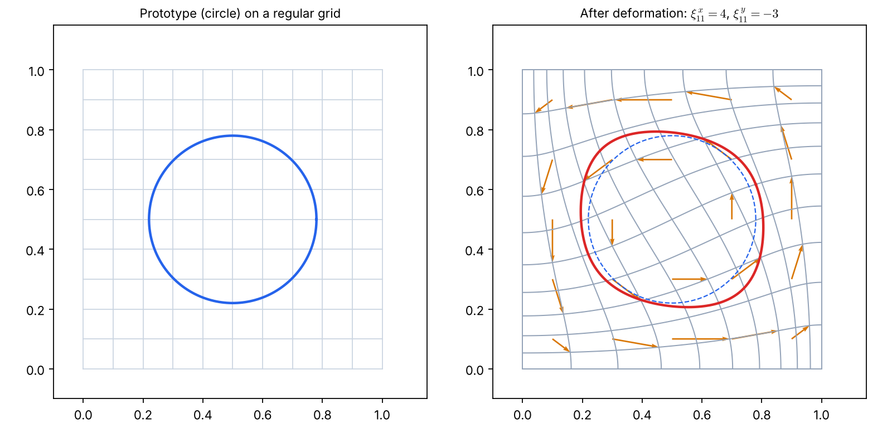
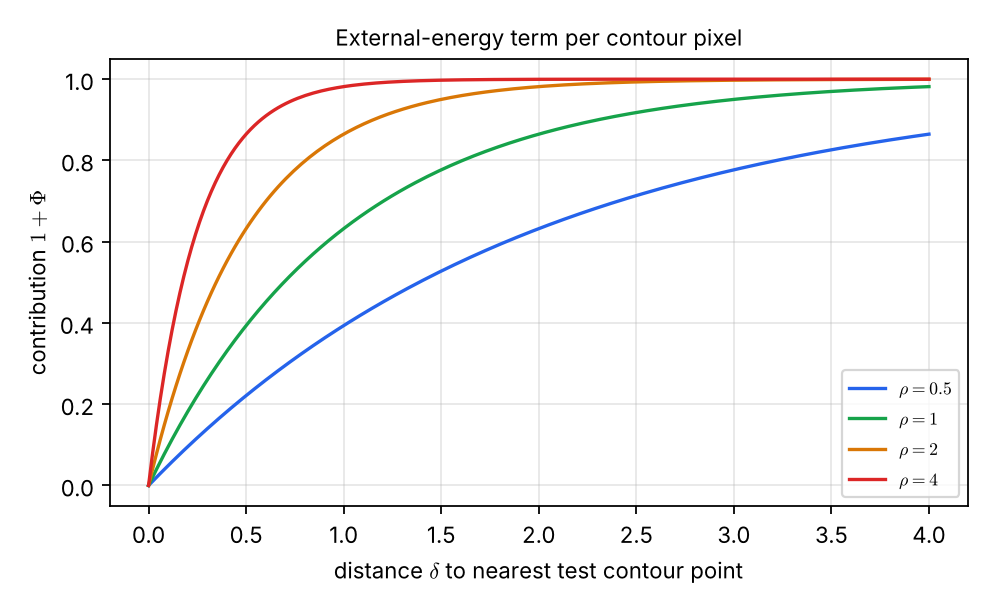

# Lecture 11 · KP10：把橡皮筋寫成公式（Writing the rubber band as formulas）

> 程度：研究生（grad）／Level: Graduate (grad)
>
> 第 11 週（2026-11-16）｜Template Matching · KP10
>
> Week 11 (2026-11-16) | Template Matching · KP10

## 學習目標（Learning objectives）

- 寫出正弦餘弦基底的變形函數，並算出 $M=N=1$ 時的位移（Write the sine-cosine deformation function and compute the displacement for $M=N=1$）。
- 說明內部能量為什麼是係數平方和，並算出一組係數的 $E_d$（Explain why the internal energy is the sum of squared coefficients and compute $E_d$ for a coefficient set）。
- 算出外部能量 $E_m=\frac{1}{N_d}\sum(1+\Phi)$ 在給定距離下的值（Compute the external energy $E_m=\frac{1}{N_d}\sum(1+\Phi)$ for given distances）。
- 從最大後驗機率推出 $E_m+E_d$，並指出權重 $C$ 的機率意義（Derive $E_m+E_d$ from maximum a posteriori estimation and state the probabilistic meaning of the weight $C$）。

## KP10：可變形樣板的公式（The formulas of deformable templates）

**一句話重點**：變形用正弦餘弦的疊加，內部能量是係數的平方和，外部能量量輪廓到影像輪廓的距離。從貝氏觀點看，最小化 $E_m+E_d$ 就是最大後驗機率估計。

**One-sentence summary**: Deformation is a superposition of sines and cosines, the internal energy is the sum of squared coefficients, and the external energy measures the distance from the contour to the image contour. From the Bayesian view, minimizing $E_m+E_d$ is maximum a posteriori estimation.

### 1. 從「橡皮筋」走向「公式」（From "rubber band" to "formulas"）

上一講留下的問題是：這些能量具體怎麼寫？
KP09 的橡皮筋只是比喻，也只用了一個參數。
這一講用來源給的具體公式，把三個要素都寫成可以計算的形式。

The previous lecture asked: how are these energies actually written?
The rubber band of KP09 was only an analogy and used a single parameter.
This lecture uses the source's concrete formulas to write all three elements in computable form.

**白話說明**：想像在一張透明薄膜上畫了原型，再用幾個「波浪」去推擠薄膜。
每個波浪有自己的推力大小，就是一個係數。
推得越用力，原型被扭得越厲害。
這個比喻只說明「用波浪疊加出變形」；每個波浪在每個位置推多少，要看下面的公式。

**Plain explanation**: Imagine a prototype drawn on a transparent membrane that you push with a few "waves".
Each wave has its own strength, which is one coefficient.
The harder you push, the more the prototype is twisted.
This analogy only covers "building the deformation from superposed waves"; how much each wave pushes at each position is given by the formulas below.

**先備自測**：確認你記得 KP09 的 $E_m+C\,E_d$，以及正弦與餘弦在 $0$、$\pi/2$、$\pi$ 的值。

**Prerequisite check**: Make sure you remember $E_m+C\,E_d$ of KP09 and the values of sine and cosine at $0$, $\pi/2$, and $\pi$.

- $\sin(\pi/2)=1$，$\cos(\pi/2)=0$（$\sin(\pi/2)=1$ and $\cos(\pi/2)=0$）。
- $\sin(\pi/4)=\cos(\pi/4)\approx0.707$（$\sin(\pi/4)=\cos(\pi/4)\approx0.707$）。

### 2. 三個要素的公式（Formulas for the three elements）

**正式定義**：設連續座標 $(x,y)\in[0,1]\times[0,1]$。
**變形**把每一點推到新的位置：

**Formal definition**: Let the continuous coordinates be $(x,y)\in[0,1]\times[0,1]$.
The **deformation** pushes each point to a new position:

$$
(x,y)\rightarrow(x,y)+\bigl(D^x(x,y),\,D^y(x,y)\bigr)
\tag{8.13}
$$

位移場用一組基底函數（來源採用 Amit 的設計）疊加：

The displacement field is a superposition of basis functions (the source adopts a design by Amit):

$$
D^x(x,y)=\sum_{m=1}^{M}\sum_{n=1}^{N}\xi^x_{mn}\,e^x_{mn}(x,y),\qquad
D^y(x,y)=\sum_{m=1}^{M}\sum_{n=1}^{N}\xi^y_{mn}\,e^y_{mn}(x,y)
\tag{8.14, 8.15}
$$

$$
e^x_{mn}(x,y)=\alpha_{mn}\sin(\pi nx)\cos(\pi my),\qquad
e^y_{mn}(x,y)=\alpha_{mn}\cos(\pi mx)\sin(\pi ny)
\tag{8.16, 8.17}
$$

$$
\alpha_{mn}=\frac{1}{\pi^2\,(n^2+m^2)}
$$

$M$、$N$ 是截斷的階數。
來源也說，其他基底，例如 splines 與 wavelets，同樣可用。

$M$ and $N$ are the truncation orders.
The source also says that other bases, such as splines and wavelets, can be used as well.

**內部能量**是係數的平方和。
沒有變形（$\boldsymbol{\xi}=\mathbf{0}$）時它是 $0$，這是它應有的最小值：

The **internal energy** is the sum of squared coefficients.
With no deformation ($\boldsymbol{\xi}=\mathbf{0}$) it is $0$, as a minimum should be:

$$
E_d(\boldsymbol{\xi})=\sum_m\sum_n\Bigl(\bigl(\xi^x_{mn}\bigr)^2+\bigl(\xi^y_{mn}\bigr)^2\Bigr)
\tag{8.18}
$$

**外部能量**衡量變形後的樣板在位置、方向與尺度 $\boldsymbol{\theta}$ 下，與測試影像 $I$ 的契合度。
來源的例子用輪廓點到測試影像最近輪廓點的距離：

The **external energy** measures how well the deformed template, at position, orientation, and scale $\boldsymbol{\theta}$, agrees with the test image $I$.
The source's example uses the distance from each contour point to the nearest contour point of the test image:

$$
E_m(\boldsymbol{\xi},\boldsymbol{\theta},I)=\frac{1}{N_d}\sum_{i,j}\bigl(1+\Phi(i,j)\bigr),\qquad
\Phi(i,j)=-\exp\!\Bigl(-\rho\,\bigl(\delta_i^2+\delta_j^2\bigr)^{1/2}\Bigr)
\tag{8.19, 8.20}
$$

$N_d$ 是變形樣板的輪廓像素數。
$(\delta_i,\delta_j)$ 是樣板上 $(i,j)$ 像素到最近測試輪廓點的位移，$\rho$ 是常數。

$N_d$ is the number of contour pixels of the deformed template.
$(\delta_i,\delta_j)$ is the displacement from the template pixel $(i,j)$ to the nearest test contour point, and $\rho$ is a constant.

| 符號 | 中文意義 | English meaning |
|---|---|---|
| $D^x,\ D^y$ | $x$ 與 $y$ 方向的位移場 | Displacement fields in the $x$ and $y$ directions |
| $\xi^x_{mn},\ \xi^y_{mn}$ | 變形係數 | Deformation coefficients |
| $e^x_{mn},\ e^y_{mn}$ | 基底函數 | Basis functions |
| $\alpha_{mn}$ | 正規化常數 | Normalization constant |
| $\boldsymbol{\theta}$ | 樣板的位置、方向、尺度 | Position, orientation, and scale of the template |
| $\delta_i,\ \delta_j$ | 到最近測試輪廓點的位移 | Displacement to the nearest test contour point |
| $\rho$ | 距離的衰減常數 | Decay constant of the distance |
| $N_d$ | 變形樣板的輪廓像素數 | Number of contour pixels of the deformed template |

**常見迷思**：「變形函數一定要用正弦餘弦。」
不必。正弦餘弦是來源採用的一組基底，splines 或 wavelets 也行。
真正的要求是：變形要連續，且零係數時完全沒有變形。

**Common misconception**: "The deformation function must use sines and cosines."
It need not. Sines and cosines are the basis the source adopts; splines or wavelets work too.
The real requirement is that the deformation be continuous and vanish completely at zero coefficients.

### 3. 最簡單的情形：$M=N=1$（The simplest case: $M=N=1$）

上一節的式子看起來很多。
從只有一組係數的情形開始，逐項算一遍。

The previous section looks like a lot of formulas.
Start from the case with a single coefficient pair and compute term by term.

$M=N=1$ 時，$\alpha_{11}=\dfrac{1}{\pi^2(1+1)}=\dfrac{1}{2\pi^2}\approx0.05066$。
位移場只剩兩項：

For $M=N=1$, $\alpha_{11}=\dfrac{1}{\pi^2(1+1)}=\dfrac{1}{2\pi^2}\approx0.05066$.
The displacement field has only two terms:

$$
D^x=\xi^x_{11}\,\alpha_{11}\sin(\pi x)\cos(\pi y),\qquad
D^y=\xi^y_{11}\,\alpha_{11}\cos(\pi x)\sin(\pi y)
$$

**例子**：`[補充]` 取 $\xi^x_{11}=4$、$\xi^y_{11}=-3$。
在 $(0.25,0.25)$：$\sin(\pi/4)\cos(\pi/4)=0.5$，所以 $D^x=4\times0.05066\times0.5=0.1013$，$D^y=-3\times0.05066\times0.5=-0.0760$。
在 $(0.5,0)$：$\sin(\pi/2)\cos 0=1$，所以 $D^x=4\times0.05066=0.2026$；而 $\sin 0=0$，所以 $D^y=0$。
在 $(0.5,0.5)$：$\cos(\pi/2)=0$，所以兩個位移都是 $0$。

**Example**: `[Added]` Take $\xi^x_{11}=4$ and $\xi^y_{11}=-3$.
At $(0.25,0.25)$: $\sin(\pi/4)\cos(\pi/4)=0.5$, so $D^x=4\times0.05066\times0.5=0.1013$ and $D^y=-3\times0.05066\times0.5=-0.0760$.
At $(0.5,0)$: $\sin(\pi/2)\cos 0=1$, so $D^x=4\times0.05066=0.2026$; and $\sin 0=0$, so $D^y=0$.
At $(0.5,0.5)$: $\cos(\pi/2)=0$, so both displacements are $0$.

這組係數的內部能量是 $E_d=4^2+(-3)^2=16+9=25$。
係數全為 $0$ 時，位移處處為 $0$，格網與輪廓完全不動，$E_d=0$。

The internal energy of this coefficient set is $E_d=4^2+(-3)^2=16+9=25$.
With all coefficients $0$, the displacement vanishes everywhere, the grid and contour do not move, and $E_d=0$.



圖說 `lec11-kp10-deformable-formulas-f1-displacement`：左圖是規則的格網與藍色的圓形原型。右圖是 $\xi^x_{11}=4$、$\xi^y_{11}=-3$ 之後，格網線連續地彎曲。橘色箭頭是網格點上的位移 $(D^x,D^y)$，箭頭的長度與方向與公式一致。紅色是變形後的輪廓，藍色虛線是原本的圓。〔功能：1、3〕

Figure `lec11-kp10-deformable-formulas-f1-displacement`: The left panel is the regular grid with the blue circular prototype. The right panel shows the grid lines bending continuously after $\xi^x_{11}=4$ and $\xi^y_{11}=-3$. The orange arrows are the displacements $(D^x,D^y)$ at grid points, with lengths and directions matching the formulas. The red curve is the deformed contour and the blue dashed curve is the original circle. [Function: 1, 3]

階數升高時，$\alpha_{mn}$ 會壓小高頻的貢獻：
`[補充]` $\alpha_{12}=1/(5\pi^2)\approx0.0203$、$\alpha_{22}=1/(8\pi^2)\approx0.0127$，都比 $\alpha_{11}$ 小。
同樣大的係數，高頻項造成的位移比低頻項小，所以大幅度的變形先由低頻負責。

At higher orders $\alpha_{mn}$ damps the high-frequency contributions:
`[Added]` $\alpha_{12}=1/(5\pi^2)\approx0.0203$ and $\alpha_{22}=1/(8\pi^2)\approx0.0127$, both smaller than $\alpha_{11}$.
For equal coefficients, high-frequency terms cause smaller displacements than low-frequency terms, so large deformations are carried first by the low frequencies.

### 4. 外部能量怎麼量距離（How the external energy measures distance）

位移場決定輪廓怎麼動。
外部能量決定動完以後貼得好不好。

The displacement field decides how the contour moves.
The external energy decides how well it fits afterwards.

每個輪廓像素對 $E_m$ 的貢獻是 $1+\Phi=1-e^{-\rho\delta}$，$\delta$ 是它到最近測試輪廓點的距離。
距離為 $0$ 時貢獻是 $0$。
距離趨近無限大時，貢獻趨近 $1$，所以每個點的貢獻最多是 $1$。

Each contour pixel contributes $1+\Phi=1-e^{-\rho\delta}$ to $E_m$, where $\delta$ is its distance to the nearest test contour point.
At distance $0$ the contribution is $0$.
As the distance grows without bound the contribution tends to $1$, so each point contributes at most $1$.

**例子**：`[補充]` 設 $\rho=1$，變形樣板有四個輪廓像素，到最近測試輪廓點的距離是 $0,\ 0.5,\ 1,\ 2$。
各點的貢獻是 $0,\ 0.3935,\ 0.6321,\ 0.8647$。
所以 $E_m=(0+0.3935+0.6321+0.8647)/4=0.4726$。
若 $\rho=2$，貢獻是 $0,\ 0.6321,\ 0.8647,\ 0.9817$。

**Example**: `[Added]` Let $\rho=1$ and the deformed template have four contour pixels at distances $0,\ 0.5,\ 1,\ 2$ from the nearest test contour point.
The contributions are $0,\ 0.3935,\ 0.6321,\ 0.8647$.
So $E_m=(0+0.3935+0.6321+0.8647)/4=0.4726$.
With $\rho=2$ the contributions are $0,\ 0.6321,\ 0.8647,\ 0.9817$.



圖說 `lec11-kp10-deformable-formulas-f2-external-energy`：橫軸是到最近測試輪廓點的距離 $\delta$，縱軸是貢獻 $1+\Phi$。四條曲線都從 $0$ 開始，往上趨近 $1$。$\rho$ 越大（紅色 $\rho=4$），曲線越快貼到 $1$；$\rho$ 越小（藍色 $\rho=0.5$），曲線上升得越慢。〔功能：2〕

Figure `lec11-kp10-deformable-formulas-f2-external-energy`: The horizontal axis is the distance $\delta$ to the nearest test contour point and the vertical axis is the contribution $1+\Phi$. All four curves start at $0$ and approach $1$ from below. The larger $\rho$ is (red, $\rho=4$), the faster the curve reaches $1$; the smaller $\rho$ is (blue, $\rho=0.5$), the slower it rises. [Function: 2]

來源也說，這個能量是非線性的，用梯度下降容易陷入局部極小值。
建議的多解析度策略是：在較粗的層級用較大的 $\rho$，在較細的層級用較小的 $\rho$，以可負擔的計算成本跳出局部陷阱。
來源沒有說明為什麼這樣排，本講不另作解釋。

The source also notes that this energy is nonlinear and gradient descent easily gets trapped in local minima.
The recommended multiresolution strategy uses a larger $\rho$ at coarser levels and a smaller $\rho$ at finer levels, to escape local traps at an affordable cost.
The source does not say why it is arranged this way, and this lecture adds no explanation of its own.

### 5. 貝氏觀點：$E_m+E_d$ 就是 MAP（The Bayesian view: $E_m+E_d$ is MAP）

上一節的能量是直接定義的。
這一節說明它其實有機率上的來源。

The energies of the previous section were defined directly.
This section shows that they actually have a probabilistic origin.

由貝氏規則：

By Bayes' rule:

$$
p(\boldsymbol{\xi},\boldsymbol{\theta}\mid I)=\frac{p(\boldsymbol{\xi},\boldsymbol{\theta})\,p(I\mid\boldsymbol{\xi},\boldsymbol{\theta})}{p(I)}
\tag{8.21}
$$

假設每個係數獨立，且服從零均值高斯 $p(\boldsymbol{\xi})=\mathcal{N}(0,\sigma^2)$。
$\sigma^2$ 越大，係數取大值的機率越高。
這時 $-\log p(\boldsymbol{\xi})$ 正比於式 (8.18) 的 $E_d$。
再假設影像的似然是：

Assume each coefficient is independent and zero-mean Gaussian, $p(\boldsymbol{\xi})=\mathcal{N}(0,\sigma^2)$.
The larger $\sigma^2$ is, the more probable large coefficients are.
Then $-\log p(\boldsymbol{\xi})$ is proportional to $E_d$ of (8.18).
Further assume the image likelihood is:

$$
p(I\mid\boldsymbol{\xi},\boldsymbol{\theta})=\alpha\exp\bigl(-E_m(\boldsymbol{\xi},\boldsymbol{\theta},I)\bigr)
\tag{8.22}
$$

$\alpha$ 是正規化常數。
於是最大化後驗機率 $p(\boldsymbol{\xi},\boldsymbol{\theta}\mid I)$，等價於最小化 $E_m+E_d$。

$\alpha$ is a normalizing constant.
Then maximizing the posterior $p(\boldsymbol{\xi},\boldsymbol{\theta}\mid I)$ is equivalent to minimizing $E_m+E_d$.

`[補充]` 把比例常數寫清楚：$-\log\mathcal{N}(\xi;0,\sigma^2)=\dfrac{\xi^2}{2\sigma^2}+\dfrac12\log(2\pi\sigma^2)$。
所以後驗最大化是 $\min\{E_m+E_d/(2\sigma^2)\}$，也就是 KP09 的式 (8.12)，權重 $C=1/(2\sigma^2)$。
來源的 (8.11) 相當於把這個比例吸收進 $E_d$ 的尺度。
數值核對：取 $\sigma^2=2$、$\xi=3$，則 $-\log p(3)-(-\log p(0))=9/(2\times2)=2.25$，與 $E_d/(2\sigma^2)=9/4=2.25$ 相同。

`[Added]` Spelling out the constant of proportionality: $-\log\mathcal{N}(\xi;0,\sigma^2)=\dfrac{\xi^2}{2\sigma^2}+\dfrac12\log(2\pi\sigma^2)$.
So maximizing the posterior is $\min\{E_m+E_d/(2\sigma^2)\}$, which is (8.12) of KP09 with weight $C=1/(2\sigma^2)$.
The source's (8.11) corresponds to absorbing this ratio into the scale of $E_d$.
Numerical check: with $\sigma^2=2$ and $\xi=3$, $-\log p(3)-(-\log p(0))=9/(2\times2)=2.25$, equal to $E_d/(2\sigma^2)=9/4=2.25$.

這給了 KP09 留下的問題一個答案：$C$ 不只是調出來的旋鈕。
$C=1/(2\sigma^2)$ 表示：先驗認為形變可以多大（$\sigma^2$），就決定了 $C$ 多大。
先驗允許大形變，$\sigma^2$ 大，$C$ 就小。

This answers the question KP09 left open: $C$ is not just a knob to tune.
$C=1/(2\sigma^2)$ says that how large the prior believes deformation can be ($\sigma^2$) fixes how large $C$ is.
If the prior allows large deformations, $\sigma^2$ is large and $C$ is small.

**常見迷思**：「用了貝氏觀點，答案就一定比較正確。」
貝氏只是給了能量一個機率解釋。
假設（係數獨立、高斯、似然形式）不成立時，MAP 的結論也不成立。

**Common misconception**: "With the Bayesian view, the answer is surely more correct."
The Bayesian view only gives the energies a probabilistic reading.
If the assumptions (independent coefficients, Gaussian, the likelihood form) fail, the MAP conclusion fails too.

**想深入**（選讀）：辨識時，測試樣板屬於哪一類還不知道。
來源的做法是，對每個候選原型各自找出最小能量的變形版本，再互相比較，總能量最小的原型就是辨識結果。
另一大類可變形模型用橢圓、拋物線等解析形狀描述原型，本講不涉及。

**Going deeper** (optional): At recognition time the class of the test pattern is unknown.
The source finds, for each candidate prototype, its minimum-energy deformed version and compares them; the prototype with the smallest total energy is the recognition result.
Another large class of deformable models describes prototypes by analytic shapes such as ellipses and parabolas, which this lecture does not cover.

**與實作的連結**：下面的程式算 $\alpha_{mn}$、單點位移與 $E_d$。

**Connection to practice**: The code below computes $\alpha_{mn}$, the displacement at a point, and $E_d$.

```python
import numpy as np

def alpha(m, n):
    """正規化常數 alpha_mn = 1 / (pi^2 (n^2 + m^2)) / normalization constant."""
    return 1.0 / (np.pi ** 2 * (n ** 2 + m ** 2))

def displacement(x, y, xi_x, xi_y):
    """M = N = 1 的位移 (D^x, D^y) / displacement for M = N = 1."""
    a = alpha(1, 1)
    return (xi_x * a * np.sin(np.pi * x) * np.cos(np.pi * y),
            xi_y * a * np.cos(np.pi * x) * np.sin(np.pi * y))

dx, dy = displacement(0.25, 0.25, 4.0, -3.0)
print(round(dx, 4), round(dy, 4))     # 0.1013 -0.076
print(4.0 ** 2 + (-3.0) ** 2)         # 25.0
```

**留給下一節的問題**：目前的相似度都是兩個物件之間的距離或能量。
如果要從一個龐大的資料庫裡，找出「使用者心裡想的那一類」圖片，相似度又怎麼定義？
下一節談內容檢索與相關性回饋。

**The question for the next section**: So far the similarity has been a distance or energy between two objects.
If we must find, in a huge database, the images of "the class the user has in mind", how is similarity defined?
The next section covers content-based retrieval and relevance feedback.

### 6. 小練習與解題示範（Practice and worked solutions）

**小練習** `[補充]`：先寫下理由，再看解答。

**Practice** `[Added]`: Write your reasoning before reading the solutions.

1. 題 1：$\xi^x_{11}=2$、$\xi^y_{11}=0$，求 $D^x(0.5,0)$ 與 $E_d$（Find $D^x(0.5,0)$ and $E_d$）。
2. 題 2：三個輪廓像素的距離是 $0,\ 1,\ 2$，$\rho=1$，求 $E_m$（Find $E_m$ for three contour pixels at distances $0,\ 1,\ 2$ with $\rho=1$）。
3. 題 3：先驗變異 $\sigma^2=0.5$，對應的 $C$ 是多少（What $C$ corresponds to a prior variance $\sigma^2=0.5$）？

**題 1 解題示範**：$D^x(0.5,0)=2\times0.05066\times\sin(\pi/2)\cos 0=2\times0.05066=0.1013$。
$E_d=2^2+0^2=4$。

**Question 1 worked solution**: $D^x(0.5,0)=2\times0.05066\times\sin(\pi/2)\cos 0=2\times0.05066=0.1013$.
$E_d=2^2+0^2=4$.

**題 2 解題示範**：貢獻是 $1-e^{0}=0$、$1-e^{-1}=0.6321$、$1-e^{-2}=0.8647$。
$E_m=(0+0.6321+0.8647)/3=0.4989$。

**Question 2 worked solution**: The contributions are $1-e^{0}=0$, $1-e^{-1}=0.6321$, and $1-e^{-2}=0.8647$.
$E_m=(0+0.6321+0.8647)/3=0.4989$.

**題 3 解題示範**：$C=1/(2\sigma^2)=1/(2\times0.5)=1$。
先驗的變異越小，形變被認為越不可能，所以 $C$ 越大。

**Question 3 worked solution**: $C=1/(2\sigma^2)=1/(2\times0.5)=1$.
The smaller the prior variance, the less probable deformation is considered, so the larger $C$ is.

## 術語表（Glossary）

| 中文術語 | English term |
|---|---|
| 位移場 | Displacement field |
| 基底函數 | Basis function |
| 變形係數 | Deformation coefficient |
| 正規化常數 | Normalization constant |
| 外部能量／內部能量 | External / internal energy |
| 最大後驗機率 | Maximum a posteriori, MAP |
| 先驗 | Prior |
| 似然 | Likelihood |
| 多解析度 | Multiresolution |
| 局部極小值 | Local minimum |
| 梯度下降 | Gradient descent |
| 高斯分布 | Gaussian distribution |
| NumPy | Python array-computing library |

## 銜接與來源（Connections and sources）

下一講把「相似」的定義推廣到影像資料庫的檢索。

The next lecture generalizes the definition of "similar" to retrieval from image databases.

- 前一單元：[KP09 可變形樣板：內部與外部能量](lec11-kp09-deformable-energy.md)（Previous unit: deformable templates, internal and external energy）。
- 下一單元：[KP11 內容檢索與相關性回饋](lec11-kp11-retrieval-feedback.md)（Next unit: content-based retrieval and relevance feedback）。
- 來源：[Template Matching §8.4](https://ndhuccc.github.io/CCC-LNS/PR_115/Ch08-template-matching/index.html#kp10)，讀取日期 2026-11-12（Source accessed 2026-11-12）。
- 書目：Theodoridis and Koutroumbas, *Pattern Recognition*, 4th ed., 2008；見[參考資料](../references/README.md)（See the bibliography）。

本講以自己的文字解釋來源。
式 (8.13)–(8.22)、$\alpha_{mn}$、$M=N=1$ 的 $\alpha_{11}$、貝氏推導與多解析度的建議取自來源。
係數取值與位移數值、外部能量的手算、$C=1/(2\sigma^2)$ 的比例常數、程式與練習為 `[補充]`。

This lecture independently explains the source.
Formulas (8.13)–(8.22), $\alpha_{mn}$, $\alpha_{11}$ for $M=N=1$, the Bayesian derivation, and the multiresolution recommendation come from the source.
The coefficient values and displacement numbers, the hand calculation of the external energy, the constant of proportionality $C=1/(2\sigma^2)$, the code, and the exercises are `[Added]`.
