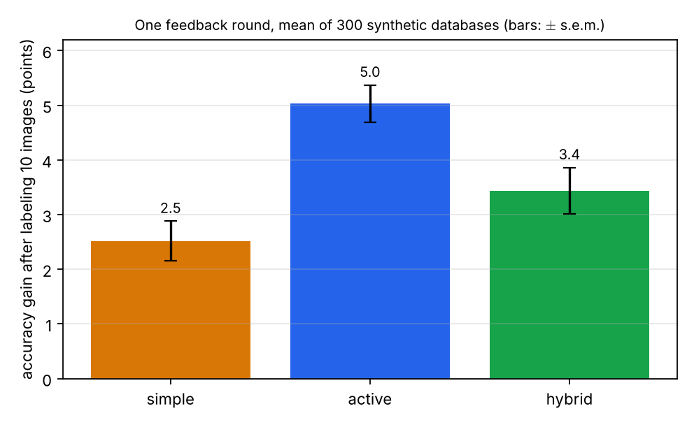
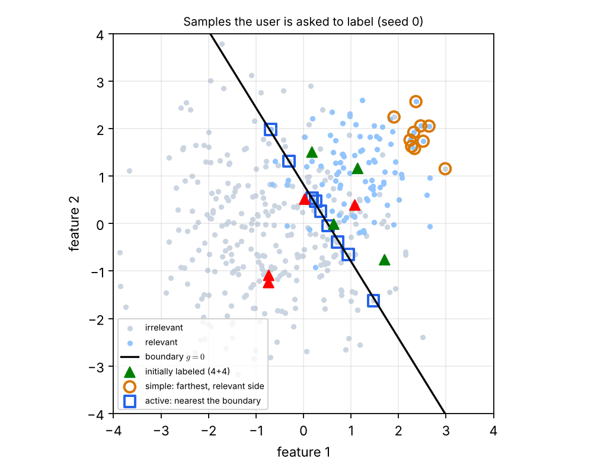

# Lecture 11 · KP11：讓使用者教系統「像什麼」（Letting the user teach the system what "similar" means）

> 程度：研究生（grad）／Level: Graduate (grad)
>
> 第 11 週（2026-11-16）｜Template Matching · KP11
>
> Week 11 (2026-11-16) | Template Matching · KP11

## 學習目標（Learning objectives）

- 說出內容檢索如何用低階特徵與加權 $l_p$ 距離找相似，以及語意鴻溝是什麼（State how content-based retrieval finds similar items with low-level features and a weighted $l_p$ distance, and what the semantic gap is）。
- 寫出相關性回饋迴圈的三個步驟（Write the three steps of the relevance-feedback loop）。
- 比較簡單、主動學習與混合三種樣本選擇策略的取捨（Compare the trade-offs of the simple, active-learning, and hybrid sample-selection strategies）。
- 用精確率判斷一次檢索的好壞（Judge a retrieval with precision）。

## KP11：內容檢索與相關性回饋（Content-based retrieval and relevance feedback）

**一句話重點**：內容檢索用顏色、紋理、形狀等低階特徵與距離找相似，但低階特徵和人的語意之間有鴻溝。相關性回饋讓使用者在少數幾輪裡標註「相關或不相關」，由分類器學會使用者心中的概念。

**One-sentence summary**: Content-based retrieval finds similar items with low-level features such as color, texture, and shape plus a distance, but a gap separates low-level features from human semantics. Relevance feedback lets the user label "relevant or irrelevant" over a few rounds so that a classifier learns the concept in the user's mind.

### 1. 從一個樣板走向一個資料庫（From one template to a database）

上一講留下的問題是：要從龐大的資料庫裡，找出「使用者心裡想的那一類」圖片，相似度怎麼定義？
傳統的做法是人工為每張圖加文字標註，再用文字搜尋。
這很耗時、昂貴，而且帶有主觀誤差。

The previous lecture asked: to find, in a huge database, the images of "the class the user has in mind", how is similarity defined?
The traditional way is to annotate every image with text by hand and then search the text.
This is slow, expensive, and subjectively biased.

**內容檢索**（content-based retrieval）改成直接從影像內容取出低階特徵，例如顏色、紋理、形狀，自動建立索引。
相似度就用特徵空間裡的距離。
這其實就是本章的樣板匹配：以使用者的查詢當樣板，在資料庫裡找最像的。

**Content-based retrieval** instead extracts low-level features such as color, texture, and shape directly from the image content and indexes them automatically.
Similarity is the distance in the feature space.
This is in fact this chapter's template matching: the user's query is the template, and we look for the closest items in the database.

**白話說明**：想像你向店員描述想找的東西，你說不清楚，只能先看幾件。
你告訴他「這件對、那件不對」，他逐漸懂你要什麼。
這個比喻說明「邊看邊教」。
它沒有說明系統怎麼用你的回答，也沒有說明該先給你看哪幾件，下面兩節處理這兩件事。

**Plain explanation**: Imagine describing what you want to a shop assistant, but you cannot say it clearly and can only look at a few items first.
You tell them "this one is right, that one is wrong", and they gradually understand what you want.
This analogy shows "teaching while looking".
It does not say how the system uses your answers or which items to show you first, which the next two sections address.

**先備自測**：確認你記得 KP01 的歐氏距離，以及 KP10 的 MAP 與分類的基本概念。

**Prerequisite check**: Make sure you remember the Euclidean distance of KP01 and the basics of MAP and classification from KP10.

- $\sqrt{1+4+0}=\sqrt5\approx2.236$（$\sqrt{1+4+0}=\sqrt5\approx2.236$）。
- 分類器對一個樣本給出一個分數，分數正負表示偏哪一邊（A classifier gives each sample a score whose sign says which side it leans toward）。

### 2. 距離、語意鴻溝與回饋迴圈（Distance, the semantic gap, and the feedback loop）

**正式定義**：特徵向量 $\mathbf{x}$ 與 $\mathbf{y}$ 的**加權 $l_p$ 距離**是：

**Formal definition**: The **weighted $l_p$ distance** between feature vectors $\mathbf{x}$ and $\mathbf{y}$ is:

$$
d(\mathbf{x},\mathbf{y})=\Bigl(\sum_{i=1}^{l}w_i\,|x_i-y_i|^p\Bigr)^{1/p}
$$

$p=2$ 且所有 $w_i=1$ 時是歐氏距離；$p=1$ 時是加權的 Manhattan 距離。

For $p=2$ and all $w_i=1$ this is the Euclidean distance; for $p=1$ it is the weighted Manhattan distance.

**例子**：`[補充]` $\mathbf{x}=(1,2,3)$、$\mathbf{y}=(2,0,3)$、權重 $\mathbf{w}=(1,2,1)$。
各維的差是 $1,\ 2,\ 0$。
$p=1$：$1\times1+2\times2+1\times0=5$。
$p=2$：$\sqrt{1\times1+2\times4+1\times0}=\sqrt9=3$。
不加權的歐氏距離是 $\sqrt5\approx2.236$，所以權重改變了距離。

**Example**: `[Added]` $\mathbf{x}=(1,2,3)$, $\mathbf{y}=(2,0,3)$, weights $\mathbf{w}=(1,2,1)$.
The per-dimension differences are $1,\ 2,\ 0$.
$p=1$: $1\times1+2\times2+1\times0=5$.
$p=2$: $\sqrt{1\times1+2\times4+1\times0}=\sqrt9=3$.
The unweighted Euclidean distance is $\sqrt5\approx2.236$, so the weights change the distance.

低階特徵和人類感知的高階語意之間有落差，稱為**語意鴻溝**（semantic gap）。
人工智慧在受限領域之外，還無法可靠地彌合它。
所以**相關性回饋**（relevance feedback, RF）採取務實的路線：讓使用者直接參與學習迴圈。

The gap between low-level features and the high-level semantics of human perception is called the **semantic gap**.
Artificial intelligence cannot yet bridge it reliably outside restricted domains.
So **relevance feedback** (RF) takes a practical route: let the user take part in the learning loop.

RF 迴圈有三個步驟，重複到使用者滿意為止：

The RF loop has three steps, repeated until the user is satisfied:

1. **初始檢索**：用 $l_p$ 等相似度度量，取回與查詢樣板相似的初始集合（Initial retrieval: fetch an initial set similar to the query with a measure such as $l_p$）。
2. **使用者標註**：使用者把取回的樣板標成「相關」或「不相關」。相關的定義是共享的感知或語意特徵（User labeling: the user marks returned templates "relevant" or "irrelevant", where relevance means shared perceptual or semantic features）。
3. **學習**：用標註結果訓練分類器，學習使用者的概念。常用的是二元分類器，支撐向量機（SVM）最受歡迎（Learning: train a classifier on the labels to learn the user's concept; a binary classifier is typical, and the support vector machine (SVM) is the most popular）。

整個流程要在少數幾次迭代內收斂，而且要即時操作。
所以特徵必須盡可能有鑑別力，這也是為什麼特徵選擇很重要。

The process must converge within a few iterations and run in real time.
So the features must be as discriminative as possible, which is why feature selection matters.

| 符號 | 中文意義 | English meaning |
|---|---|---|
| $d(\mathbf{x},\mathbf{y})$ | 加權 $l_p$ 距離 | Weighted $l_p$ distance |
| $w_i$ | 第 $i$ 維的權重 | Weight of dimension $i$ |
| $g(\mathbf{x})$ | 分類器的決策值，正偏相關 | Decision value of the classifier; positive leans relevant |
| $|g(\mathbf{x})|$ | 離決策邊界的遠近，即信心度 | Distance from the boundary, that is the confidence |
| $\mathrm{Pr}$ | 精確率 | Precision |

**常見迷思**：「特徵越多，檢索一定越準。」
迴圈要即時收斂，樣本又很少，特徵多會讓分類器難以學好。
所以特徵要有鑑別力，而不是越多越好。

**Common misconception**: "More features always make retrieval more accurate."
The loop must converge in real time with very few labels, and many features make the classifier hard to learn.
So features must be discriminative, not merely numerous.

### 3. 該請使用者標註哪幾張（Which images to ask the user to label）

迴圈中最關鍵的是第 2 步：每輪要把哪些樣板呈現給使用者標註？
系統依分類器的信心度排序。
以 SVM 為例，信心度是特徵向量到決策超平面的距離，正比於 $|g(\mathbf{x})|$。

The crux of the loop is step 2: which templates to present to the user for labeling in each round?
The system ranks them by the classifier's confidence.
For an SVM, the confidence is the distance from the feature vector to the decision hyperplane, proportional to $|g(\mathbf{x})|$.

來源介紹三種策略：

The source describes three strategies:

- **簡單（確定性）策略**：取離超平面最遠、位於相關側的樣板，排在最前面，請使用者標註前 $10$ 到 $20$ 個。好處是使用者很早就看到真正相關的結果；壞處是收斂較慢。
- **主動學習（不確定性）策略**：最有資訊的樣本是最不確定的，也就是最靠近決策邊界的。請使用者標註邊界附近的樣本，理論上最快消除不確定性，收斂較快。
- **混合策略**：回傳 $M$ 個樣板，其中 $K\le M$ 個是相關側離超平面最遠的，另外 $M-K$ 個是離超平面最近的。標註後以迄今所有標註重新訓練。

- **Simple (deterministic) strategy**: rank templates on the relevant side farthest from the hyperplane first, and ask the user to label the top $10$ to $20$. The benefit is that users see truly relevant results early; the drawback is slower convergence.
- **Active-learning (uncertainty) strategy**: the most informative samples are the most uncertain, that is, those nearest the decision boundary. Asking the user to label samples near the boundary removes uncertainty fastest in theory and converges faster.
- **Hybrid strategy**: return $M$ templates, of which $K\le M$ are the farthest on the relevant side of the hyperplane and the other $M-K$ are the nearest to it. Retrain on all labels so far after labeling.

來源還提到另一條路線：**查詢點移動法**（query point movement）。
它假設特徵空間裡存在一個理想的查詢點，學習的目標是調整各維度的權重，讓查詢點移向它。
可只用正例，也可同時用正負例。

The source mentions another route: **query point movement**.
It assumes an ideal query point in the feature space and learns by adjusting per-dimension weights to move the query point toward it.
It can use positive examples only or both positive and negative ones.

**常見迷思**：「最有把握是相關的樣本，標註起來最有價值。」
這些樣本離邊界遠，分類器本來就判得對，標註了也幾乎沒有新資訊。
最不確定的樣本一旦被標註，就能校正分類器對邊界的認知。

**Common misconception**: "The samples we are most sure are relevant are the most valuable to label."
They lie far from the boundary and the classifier already gets them right, so labeling them adds almost no information.
A most uncertain sample, once labeled, corrects the classifier's idea of the boundary.

### 4. 一個可重現的小實驗（A small reproducible experiment）

來源的 Figure 8.16 在 Wang 資料庫上用 SVM 比較完整的迴圈，網頁沒有給數字。
下面改用一個合成資料庫，只比較**一輪**回饋，數字都可以重現。

The source's Figure 8.16 compares full loops on the Wang database with an SVM, without giving numbers on the webpage.
Below, a synthetic database compares **one round** of feedback only, with all numbers reproducible.

**例子**：`[補充]` 資料庫有 $400$ 張圖，各用二維特徵描述：$100$ 張相關（平均 $(1.2,1.0)$、標準差 $0.8$），$300$ 張不相關（平均 $(-0.6,-0.2)$、標準差 $1.3$），兩群有重疊。
起始時使用者只標了 $4$ 張相關與 $4$ 張不相關，用 $L_2$ 正則化的邏輯迴歸（線性分類器，在這裡當作 SVM 的簡化替身）訓練，整個資料庫的分類準確率平均是 $79.3\%$。
接著三種策略各選 $10$ 張未標註的圖請使用者標註，重訓後再量準確率。

**Example**: `[Added]` The database has $400$ images described by two features: $100$ relevant (mean $(1.2,1.0)$, standard deviation $0.8$) and $300$ irrelevant (mean $(-0.6,-0.2)$, standard deviation $1.3$), with the two groups overlapping.
Initially the user has labeled only $4$ relevant and $4$ irrelevant images; an $L_2$-regularized logistic regression (a linear classifier, here a simplified stand-in for the SVM) is trained, and the classification accuracy over the whole database averages $79.3\%$.
Then each of the three strategies selects $10$ unlabeled images for the user to label, and the accuracy is measured again after retraining.

重複 $300$ 個不同的合成資料庫（種子 $0$ 到 $299$），結果如下（準確率增益的單位是百分點，$\pm$ 是平均的標準誤）：

Repeating over $300$ different synthetic databases (seeds $0$ to $299$) gives the following (the unit of accuracy gain is percentage points, and $\pm$ is the standard error of the mean):

| 策略 | Strategy | 準確率增益 | Accuracy gain | 選出的 $10$ 張中相關的平均張數 | Mean relevant among the $10$ picked |
|---|---|---|---|---|---|
| 簡單 | Simple | $2.5\pm0.4$ | $2.5\pm0.4$ | $7.5$ | $7.5$ |
| 主動學習 | Active | $5.0\pm0.3$ | $5.0\pm0.3$ | $2.6$ | $2.6$ |
| 混合（$K=5$） | Hybrid ($K=5$) | $3.4\pm0.4$ | $3.4\pm0.4$ | $5.0$ | $5.0$ |

主動學習的增益約是簡單策略的兩倍。
在 $300$ 個資料庫中，主動學習的準確率高於簡單策略的有 $209$ 個，低於的有 $82$ 個，相同的有 $9$ 個。
但是簡單策略選出的圖裡有 $7.5$ 張是相關的，使用者很早就看到許多真正相關的結果。
混合策略介於兩者之間。

Active learning gains about twice as much as the simple strategy.
Of the $300$ databases, active learning's accuracy is higher than the simple strategy's in $209$, lower in $82$, and equal in $9$.
But $7.5$ of the images picked by the simple strategy are relevant, so the user sees many truly relevant results early.
The hybrid strategy lies between the two.



圖說 `lec11-kp11-retrieval-feedback-f1-gain`：三根長條是單輪回饋後的準確率增益（百分點），細線是標準誤。主動學習（藍）最高，約 $5.0$；混合（綠）約 $3.4$；簡單（橘）最低，約 $2.5$。〔功能：2〕

Figure `lec11-kp11-retrieval-feedback-f1-gain`: The three bars are the accuracy gain after one round of feedback (percentage points), with error bars showing the standard error. Active (blue) is highest at about $5.0$; hybrid (green) is about $3.4$; simple (orange) is lowest at about $2.5$. [Function: 2]

為什麼會這樣？看一個資料庫的幾何。

Why does this happen? Look at the geometry of one database.



圖說 `lec11-kp11-retrieval-feedback-f2-selection`：淺藍點是相關、灰點是不相關，黑線是起始分類器的決策邊界 $g=0$，三角形是最初標註的 $8$ 張（綠為相關、紅為不相關）。橘色圓圈是簡單策略挑的 $10$ 張，擠在右上方、離邊界很遠；藍色方塊是主動學習挑的 $10$ 張，沿著黑線排開。這個資料庫中橘圈有 $8$ 張相關，藍方塊只有 $3$ 張相關。〔功能：1、3〕

Figure `lec11-kp11-retrieval-feedback-f2-selection`: Light-blue dots are relevant and gray dots irrelevant; the black line is the initial classifier's decision boundary $g=0$, and the triangles are the $8$ initially labeled images (green relevant, red irrelevant). The orange circles are the $10$ picked by the simple strategy, bunched in the upper right far from the boundary; the blue squares are the $10$ picked by active learning, lined up along the black line. In this database $8$ of the orange circles are relevant and only $3$ of the blue squares. [Function: 1, 3]

橘色圓圈離邊界平均 $|g|\approx2.4$，分類器本來就判成相關，標了也不會改變邊界。
藍色方塊離邊界平均 $|g|\approx0.017$，正是分類器最拿不準的地方，標註後邊界被移到正確的位置。
這與來源的說法一致：離邊界遠的樣本讓使用者早點看到相關結果，邊界附近的樣本讓分類器學得更快。

The orange circles lie at an average $|g|\approx2.4$ from the boundary; the classifier already calls them relevant, and labeling them would not move the boundary.
The blue squares lie at an average $|g|\approx0.017$, exactly where the classifier is least sure, and labeling them moves the boundary to the right place.
This agrees with the source: far-from-boundary samples let the user see relevant results early, while near-boundary samples let the classifier learn faster.

**這個實驗的限制**：它只做**一輪**，用的是邏輯迴歸而不是 SVM，量的是整個資料庫的準確率而不是檢索的精確率。
它也不重現來源 Figure 8.16 的完整迴圈與數字。
所以只能說這個實驗支持「邊界附近的樣本資訊量較大」的直覺，不能當作 Figure 8.16 的複驗。

**Limits of this experiment**: It runs only **one** round, uses logistic regression instead of an SVM, and measures the accuracy over the whole database rather than the precision of retrieval.
It also does not reproduce the full loop or the numbers of the source's Figure 8.16.
So the experiment only supports the intuition that "near-boundary samples carry more information"; it is not a replication of Figure 8.16.

### 5. 精確率與使用者耐心（Precision and user patience）

評估一次檢索，常用**精確率**（precision）：

To evaluate a retrieval, **precision** is commonly used:

$$
\mathrm{Pr}=\frac{\text{相關的回傳數}}{\text{總回傳數}}
$$

$$
\mathrm{Pr}=\frac{\text{number of relevant items returned}}{\text{total number returned}}
$$

理想的收斂值是 $\mathrm{Pr}=1$。

The ideal value at convergence is $\mathrm{Pr}=1$.

來源的 Figure 8.16 比較了兩種使用者。
「偷懶的使用者」每輪最多標 $2$ 張相關與 $2$ 張不相關；「耐心的使用者」標註當輪回傳的全部樣板。
來源報告的結論有兩點：耐心的使用者收斂到 $\mathrm{Pr}=1$ 比偷懶的快得多；兩種使用者下，主動學習（靠近邊界）都比簡單策略更快逼近 $\mathrm{Pr}=1$。
所有曲線的起點相同，因為初始檢索用的是同一個 $l_p$ 度量。

The source's Figure 8.16 compares two kinds of users.
The "lazy user" labels at most $2$ relevant and $2$ irrelevant images per round; the "patient user" labels all templates returned in the round.
The source reports two conclusions: the patient user converges to $\mathrm{Pr}=1$ much faster than the lazy one, and under both kinds of user active learning (near the boundary) approaches $\mathrm{Pr}=1$ faster than the simple strategy.
All curves start at the same point because the initial retrieval uses the same $l_p$ measure.

**常見迷思**：「精確率高就表示找得完整。」
精確率只看回傳的東西裡有多少是對的，不看有多少相關的東西被漏掉。
完整程度要用另外的指標，例如召回率；本講不展開。

**Common misconception**: "High precision means the retrieval is complete."
Precision only counts how many of the returned items are right, not how many relevant items were missed.
Completeness needs another measure such as recall, which this lecture does not expand.

**想深入**（選讀）：混合策略解決一個實務問題。
純主動學習收斂快，但前幾輪使用者可能看不到任何真正相關的結果而失去耐心。
混合策略同時給「高信心的相關樣本」讓使用者滿意，與「邊界樣本」讓分類器學習。
RF 在內容檢索領域最為成功，已有商用產品。

**Going deeper** (optional): The hybrid strategy solves a practical problem.
Pure active learning converges fast, but in the first rounds the user may see no truly relevant result and lose patience.
The hybrid gives "high-confidence relevant samples" to satisfy the user and "boundary samples" for the classifier to learn from.
RF has been most successful in content-based retrieval, and commercial products exist.

**與實作的連結**：下面的程式實作三種策略的挑選規則。
`g` 是分類器對每個候選的決策值。

**Connection to practice**: The code below implements the selection rules of the three strategies.
`g` holds the classifier's decision value for each candidate.

```python
import numpy as np

def pick(strategy, g, k=10):
    """g：各候選的決策值（正偏相關）；回傳要請使用者標註的索引 / indices to label."""
    far = np.argsort(-g)                       # 由「最相關側、離邊界最遠」排起
    near = np.argsort(np.abs(g))               # 由「離邊界最近」排起
    if strategy == "simple":
        return far[:k]
    if strategy == "active":
        return near[:k]
    chosen = list(far[: k // 2])               # 混合：一半最遠的正側，一半最近的
    chosen += [i for i in near if i not in chosen][: k - k // 2]
    return np.array(chosen)

g = np.array([2.0, 0.1, -0.2, 1.5, -2.5, 0.05])
print(pick("simple", g, 2), pick("active", g, 2))   # [0 3] [5 1]
```

**這一章的總結**：KP01 提出樣板匹配要設計能容忍變異的距離。
序列用格網路徑、動態規劃、編輯距離與 DTW；位置未知用相關；形狀變形用能量；資料庫檢索則把「相似」交給使用者在迴圈中教會系統。
這些方法全部是在定義不同的 $D$。

**Summary of the chapter**: KP01 posed the need for distances that tolerate variation.
Sequences use grid paths, dynamic programming, edit distance, and DTW; unknown position uses correlation; shape deformation uses energy; and database retrieval lets the user teach the system "similar" in a loop.
All of these methods define a different $D$.

**留給下一週的問題**：樣板匹配把每一筆資料獨立地比對。
但語音與文字裡，前後的符號互相影響。
下一週用馬可夫模型描述這種前後關係。

**The question for next week**: Template matching compares each datum independently.
But in speech and text, neighboring symbols influence each other.
Next week uses Markov models to describe this context.

### 6. 小練習與解題示範（Practice and worked solutions）

**小練習** `[補充]`：先寫下理由，再看解答。

**Practice** `[Added]`: Write your reasoning before reading the solutions.

1. 題 1：$\mathbf{x}=(2,1)$、$\mathbf{y}=(0,4)$、$\mathbf{w}=(1,4)$，求 $p=1$ 與 $p=2$ 的加權距離（Find the weighted distances for $p=1$ and $p=2$）。
2. 題 2：一次檢索回傳 $20$ 張，其中 $14$ 張相關，精確率是多少（What is the precision if $14$ of $20$ returned images are relevant）？
3. 題 3：為什麼主動學習在前幾輪可能讓使用者不耐煩（Why can active learning frustrate the user in the first rounds）？

**題 1 解題示範**：各維的差是 $2$ 與 $3$。
$p=1$：$1\times2+4\times3=14$。
$p=2$：$\sqrt{1\times4+4\times9}=\sqrt{40}\approx6.325$。

**Question 1 worked solution**: The per-dimension differences are $2$ and $3$.
$p=1$: $1\times2+4\times3=14$.
$p=2$: $\sqrt{1\times4+4\times9}=\sqrt{40}\approx6.325$.

**題 2 解題示範**：$\mathrm{Pr}=14/20=0.7$。
這表示回傳的東西裡有七成是對的。

**Question 2 worked solution**: $\mathrm{Pr}=14/20=0.7$.
That means seventy percent of what was returned is right.

**題 3 解題示範**：主動學習挑的是邊界附近的樣本，其中相關與不相關各占一部分。
本講的實驗裡，$10$ 張中平均只有 $2.6$ 張相關，而簡單策略有 $7.5$ 張。
使用者前幾輪看到的相關結果少，可能失去耐心，這就是混合策略要補上的缺點。

**Question 3 worked solution**: Active learning picks samples near the boundary, a mix of relevant and irrelevant ones.
In this lecture's experiment only $2.6$ of the $10$ are relevant on average, against $7.5$ for the simple strategy.
The user sees few relevant results in the first rounds and may lose patience, which is the drawback the hybrid strategy repairs.

## 術語表（Glossary）

| 中文術語 | English term |
|---|---|
| 內容檢索 | Content-based retrieval |
| 低階特徵 | Low-level feature |
| 加權 $l_p$ 距離 | Weighted $l_p$ distance |
| 語意鴻溝 | Semantic gap |
| 相關性回饋 | Relevance feedback, RF |
| 支撐向量機 | Support vector machine, SVM |
| 決策超平面 | Decision hyperplane |
| 信心度 | Confidence |
| 主動學習 | Active learning |
| 查詢點移動法 | Query point movement |
| 精確率 | Precision |
| 邏輯迴歸 | Logistic regression |
| 標準誤 | Standard error of the mean |
| NumPy | Python array-computing library |

## 銜接與來源（Connections and sources）

下一週進入上下文相關的分類，從馬可夫模型開始。

Next week moves to context-dependent classification, starting with Markov models.

- 前一單元：[KP10 可變形樣板的三要素與公式](lec11-kp10-deformable-formulas.md)（Previous unit: the three elements and formulas of deformable templates）。
- 下一單元：第 12 週馬可夫模型（Next: Week 12, Markov models）。
- 來源：[Template Matching §8.5](https://ndhuccc.github.io/CCC-LNS/PR_115/Ch08-template-matching/index.html#kp11)，讀取日期 2026-11-12（Source accessed 2026-11-12）。
- 書目：Theodoridis and Koutroumbas, *Pattern Recognition*, 4th ed., 2008；見[參考資料](../references/README.md)（See the bibliography）。

本講以自己的文字解釋來源。
內容檢索與加權 $l_p$ 距離、語意鴻溝、RF 三步驟、三種策略、查詢點移動法、精確率與 Figure 8.16 的定性結論取自來源。
加權距離的手算、合成資料庫的單輪實驗與其數值、程式與練習為 `[補充]`。

This lecture independently explains the source.
Content-based retrieval and the weighted $l_p$ distance, the semantic gap, the three RF steps, the three strategies, query point movement, precision, and the qualitative conclusions of Figure 8.16 come from the source.
The weighted-distance hand calculation, the one-round experiment on a synthetic database and its numbers, the code, and the exercises are `[Added]`.
