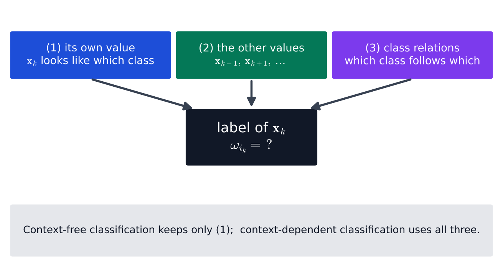
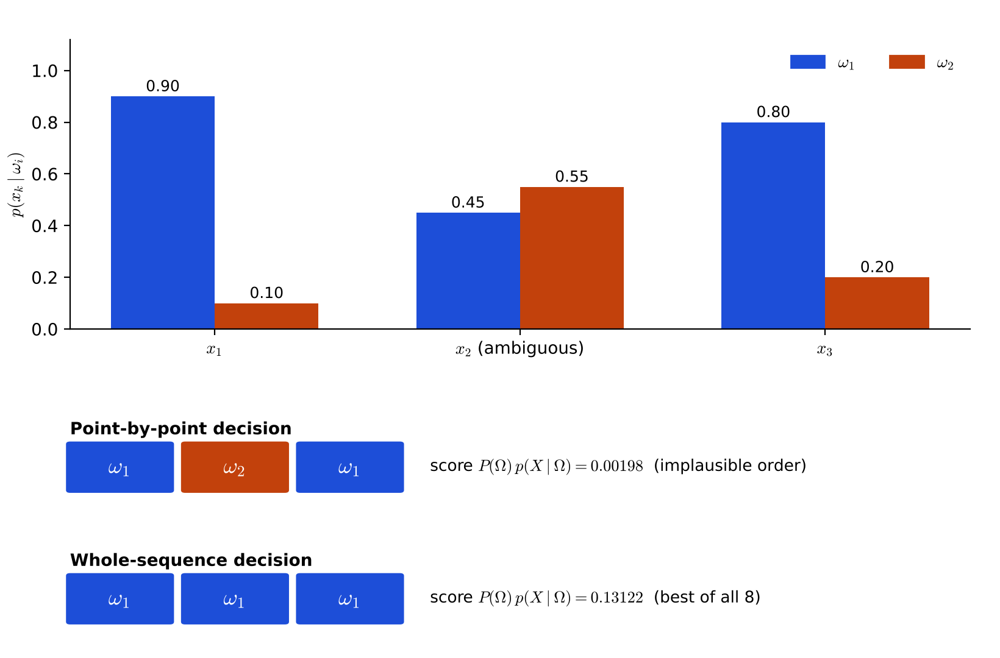

# Lecture 12 · KP01：當相鄰觀測不再獨立（When neighboring observations are no longer independent）

> 程度：研究生（grad）／Level: Graduate (grad)
>
> 第 12 週（2026-11-23）｜Context-Dependent Classification · KP01
>
> Week 12 (2026-11-23) | Context-Dependent Classification · KP01

## 學習目標（Learning objectives）

- 說出情境無關與情境相依分類的差別，並列出決定一個類別標籤的三件事（State the difference between context-free and context-dependent classification, and list the three things that decide a label）。
- 把「對一串觀測分類」寫成對序列 $X$ 的 Bayes 決策問題（Write "classify a whole stream of observations" as a Bayes decision problem on a sequence $X$）。
- 用一個三步例子算出：逐點判斷與整串判斷可以給出不同答案（Compute, on a three-step example, that point-by-point and whole-sequence decisions can disagree）。
- 判斷一個實際情境是否需要情境相依分類（Decide whether a real scenario needs context-dependent classification）。

## KP01：當相鄰觀測不再獨立（Why neighbors matter）

**一句話重點**：當前後觀測彼此牽連時，分類的單位不再是一個特徵向量，而是一整串。

**One-sentence summary**: When neighboring observations depend on each other, the unit of classification is no longer one feature vector but a whole sequence.

### 1. 從「一個一個分」到「一串一起分」（From one at a time to a whole stream）

前面幾週的分類器，每次只看一個特徵向量 $\mathbf{x}$。
它落在哪個決策區域，就判成哪一類。
下一個向量來時，分類器把前一個忘得一乾二淨。

The classifiers of earlier weeks look at one feature vector $\mathbf{x}$ at a time.
The decision region it lands in decides its class.
When the next vector arrives, the classifier forgets the previous one completely.

這樣做有一個隱藏前提：每個向量的類別，和其他向量無關。
本章拿掉這個前提。
資料變成一串依序出現的觀測，而且前後有關。

This way of working hides an assumption: the class of each vector has nothing to do with the others.
This chapter removes the assumption.
The data become a stream of observations in order, and neighbors are related.

**白話說明**：想像你在嘈雜的車站，聽廣播說一句話。
單獨一個音節可能聽不清，是「三」還是「山」。
但放回整句話，你立刻知道是哪一個。
這個比喻只說明「前後文能消除歧義」，沒說明機器怎麼量化前後文。

**Plain explanation**: Imagine listening to an announcement in a noisy station.
One syllable alone may be unclear.
Put back into the whole sentence, you know at once which word it was.
This analogy only shows that context removes ambiguity; it does not say how a machine quantifies context.

**先備自測**：確認你記得 Bayes 決策規則與先驗、似然的意思。
不熟的話，回到第 2 週複習。

**Prerequisite check**: Make sure you remember the Bayes decision rule and the meaning of prior and likelihood.
If not, review Week 2.

- $P(\omega_i\mid\mathbf{x})$ 是看到 $\mathbf{x}$ 之後，類別為 $\omega_i$ 的後驗機率（The posterior probability of class $\omega_i$ after seeing $\mathbf{x}$）。
- $P(\omega_i)$ 是先驗，$p(\mathbf{x}\mid\omega_i)$ 是似然（$P(\omega_i)$ is the prior, $p(\mathbf{x}\mid\omega_i)$ the likelihood）。
- Bayes 規則選後驗最大的類別（The Bayes rule picks the class with the largest posterior）。

### 2. 先說清楚問題與符號（Stating the problem and the symbols）

上一節留下的問題是：怎麼把「前後有關」寫進分類規則？
先把兩種情況分開。

The question left open is: how do we write "neighbors are related" into the classification rule?
First separate the two situations.

**正式定義**：在**情境無關分類**（context-free classification）中，若某個特徵向量來自類別 $\omega_i$，下一個向量可以來自任何類別。
類別之間沒有順序關係。
決策規則是對每個 $\mathbf{x}$ 單獨比較後驗機率：

**Formal definition**: In **context-free classification**, if one feature vector comes from class $\omega_i$, the next vector can come from any class.
The classes have no order relation.
The rule compares posteriors for each $\mathbf{x}$ separately:

$$
P(\omega_i\mid\mathbf{x})>P(\omega_j\mid\mathbf{x}),\qquad \forall\, j\neq i
$$

在**情境相依分類**（context-dependent classification）中，連續的特徵向量不再獨立。
把觀測寫成一串 $X:\ \mathbf{x}_1,\mathbf{x}_2,\dots,\mathbf{x}_N$，並且必須照原本發生的順序一起處理。
決定 $\mathbf{x}_k$ 屬於哪一類的因素有三個：

In **context-dependent classification**, consecutive feature vectors are no longer independent.
Write the observations as a stream $X:\ \mathbf{x}_1,\mathbf{x}_2,\dots,\mathbf{x}_N$, to be processed together in their original order.
Three factors decide which class $\mathbf{x}_k$ belongs to:



**圖說 `lec12-kp01-context-f2-three-influences`**：先看上排三個色塊，再看它們都指向同一個問號。
左邊是傳統分類唯一使用的資訊，中間與右邊是本章新增的兩件事。
這張圖把三個因素擺在同一個決策上。〔功能：1〕

**Caption `lec12-kp01-context-f2-three-influences`**: Read the three colored blocks on top first, then see that all of them point to the same question mark.
The left one is the only information that ordinary classification uses; the middle and right ones are the two additions of this chapter.
The figure puts the three factors on one decision. [Function: 1]

| 符號 | 中文意義 | English meaning |
|---|---|---|
| $\mathbf{x}_k$ | 第 $k$ 個觀測（特徵向量） | The $k$-th observation (feature vector) |
| $X$ | 整串觀測 $\mathbf{x}_1,\dots,\mathbf{x}_N$ | The whole stream $\mathbf{x}_1,\dots,\mathbf{x}_N$ |
| $N$ | 序列長度 | Sequence length |
| $\omega_{i_k}$ | 第 $k$ 個位置被指派的類別 | The class assigned at position $k$ |
| $\Omega$ | 一整串類別標籤 $\omega_{i_1},\dots,\omega_{i_N}$ | A whole label sequence $\omega_{i_1},\dots,\omega_{i_N}$ |
| $P(\Omega)$ | 這串標籤本身有多合理（先驗） | How plausible the label sequence is by itself (prior) |
| $p(X\mid\Omega)$ | 這串標籤對觀測的貼合程度（似然） | How well the label sequence fits the observations (likelihood) |

**常見迷思**：「前後有關，只是代表資料多了一點雜訊。」
不對。
相關性是資訊，不是雜訊。
類別之間的順序規律，正是能拿來糾錯的線索。

**Common misconception**: "Neighbors being related only means a little more noise."
That is wrong.
The relation is information, not noise.
The ordering pattern among classes is exactly the clue that can correct mistakes.

### 3. 三個領域的樣子（What it looks like in three fields）

上一節定義了問題。
接著看這類問題在哪裡出現。
三個領域各有不同形式的前後關係。

The previous section defined the problem.
Next see where such problems appear.
Each of three fields has its own kind of relation between neighbors.

| 領域 | Field | 一串觀測 | The stream | 前後關係 | The relation |
|---|---|---|---|---|---|
| 通訊 | Communications | 接收到的取樣值 | Received samples | 一個位元的影響會延續到後面的取樣 | One bit's effect lasts into later samples |
| 語音辨識 | Speech recognition | 依序出現的聲音片段 | Consecutive sound segments | 音素有合理的先後順序 | Phonemes follow plausible orders |
| 影像處理 | Image processing | 相鄰的像素 | Neighboring pixels | 相鄰像素常屬於同一區域 | Neighbors often belong to one region |

本週後面的內容會用通訊當主應用：通道等化（KP06、KP07）。
語音與影像的版本會在隱藏馬可夫模型與馬可夫隨機場出現。

The rest of this week uses communications as the main application: channel equalization (KP06, KP07).
The speech and image versions appear later, in hidden Markov models and Markov random fields.

### 4. 為什麼逐點判斷會出錯（Why point-by-point decisions go wrong）

上一節的三個例子都說「前後有關」。
但關係有多強，才值得改用整串判斷？
下面用一個可以手算的例子看。

All three examples say "neighbors are related".
But how strong must the relation be before a whole-sequence decision pays off?
A computable example shows it.

**例子**：`[補充]` 兩個類別 $\omega_1,\omega_2$，序列長度 $N=3$。
每個位置的似然 $p(\mathbf{x}_k\mid\omega_i)$ 由下表給定。
第二個觀測 $\mathbf{x}_2$ 很含糊：兩類的似然只差 $0.10$。

**Example**: `[Added]` Two classes $\omega_1,\omega_2$ and a sequence of length $N=3$.
The likelihood $p(\mathbf{x}_k\mid\omega_i)$ at each position is given in the table.
The second observation $\mathbf{x}_2$ is ambiguous: the two likelihoods differ by only $0.10$.

| 位置 $k$ | $p(\mathbf{x}_k\mid\omega_1)$ | $p(\mathbf{x}_k\mid\omega_2)$ |
|---|---|---|
| 1 | $0.90$ | $0.10$ |
| 2 | $0.45$ | $0.55$ |
| 3 | $0.80$ | $0.20$ |

先做**逐點判斷**。
假設兩類先驗相等，每個位置選似然較大的類別。
結果是 $\omega_1,\omega_2,\omega_1$。
位置 2 的後驗是 $0.55/(0.45+0.55)=0.55$，只比一半多一點。

First make a **point-by-point decision**.
Assume equal priors and choose the class with the larger likelihood at each position.
The result is $\omega_1,\omega_2,\omega_1$.
The posterior at position 2 is $0.55/(0.45+0.55)=0.55$, barely above one half.

現在加入一個事實：這串標籤很少換類別。
`[補充]` 設第一個位置兩類各 $0.5$，之後每一步「維持原類別」的機率是 $0.9$，「換類別」是 $0.1$。
一串標籤的合理程度 $P(\Omega)$ 就是起點機率乘上每一步的機率。
KP03 會正式說明這個乘法從哪裡來。

Now add one fact: the label sequence rarely switches class.
`[Added]` Let each class have probability $0.5$ at the first position, and let each later step "stay in the same class" with probability $0.9$ and "switch" with $0.1$.
The plausibility $P(\Omega)$ of a label sequence is the start probability times the probability of each step.
KP03 explains formally where this product comes from.

比較兩串候選標籤，各算兩個量：貼合度 $p(X\mid\Omega)$ 與合理度 $P(\Omega)$。

Compare two candidate label sequences, computing two quantities each: the fit $p(X\mid\Omega)$ and the plausibility $P(\Omega)$.

| 候選 $\Omega$ | 貼合度 $p(X\mid\Omega)$ | 合理度 $P(\Omega)$ | 乘積 |
|---|---|---|---|
| $\omega_1,\omega_1,\omega_1$ | $0.9\times0.45\times0.8=0.324$ | $0.5\times0.9\times0.9=0.405$ | $0.13122$ |
| $\omega_1,\omega_2,\omega_1$ | $0.9\times0.55\times0.8=0.396$ | $0.5\times0.1\times0.1=0.005$ | $0.00198$ |

逐點判斷選的 $\omega_1,\omega_2,\omega_1$ 貼合度較高（$0.396>0.324$），但要連換兩次類別，合理度只有 $0.005$。
整串的乘積差了約 $66$ 倍。
KP02 會列出全部 $8$ 條候選，$\omega_1,\omega_1,\omega_1$ 是其中最大的。

The point-by-point choice $\omega_1,\omega_2,\omega_1$ fits better ($0.396>0.324$), but it switches class twice and has plausibility only $0.005$.
The products differ by about $66$ times.
KP02 lists all $8$ candidates, and $\omega_1,\omega_1,\omega_1$ is the largest among them.



**圖說 `lec12-kp01-context-f1-pointwise-vs-sequence`**：先看上方長條，注意 $\mathbf{x}_2$ 的橘色只比藍色高一點。
再看下方兩列色塊：逐點判斷在位置 2 改選 $\omega_2$，整串判斷卻維持 $\omega_1$。
右側的分數說明原因。〔功能：1、2〕

**Caption `lec12-kp01-context-f1-pointwise-vs-sequence`**: Look at the bars on top first, and note that the orange bar of $\mathbf{x}_2$ is only slightly taller than the blue one.
Then look at the two rows of blocks below: the point-by-point decision switches to $\omega_2$ at position 2, while the whole-sequence decision keeps $\omega_1$.
The scores on the right explain why. [Function: 1, 2]

**常見迷思**：「整串判斷只是把逐點的答案平均一下。」
不是。
整串判斷會推翻一個逐點看起來較好的答案，因為它同時考慮了類別的順序。
如果換類別和不換一樣常見（各 $0.5$），兩種判斷的答案會一致。

**Common misconception**: "Whole-sequence decisions just average the point-by-point answers."
They do not.
A whole-sequence decision can overturn an answer that looks better point by point, because it also considers the order of classes.
If switching were as common as staying (each $0.5$), the two decisions would agree.

### 5. 與實作的連結（Connection to implementation）

這個例子可以用幾行程式驗證。
`itertools.product` 產生所有候選標籤，`score` 對每一串算兩個量的乘積。
注意：當 $N$ 變大，候選數 $2^N$ 會暴增。
這是 KP02 的主題。

The example can be checked in a few lines of code.
`itertools.product` generates every candidate label sequence, and `score` computes the product of the two quantities for each.
Note that when $N$ grows, the number of candidates $2^N$ explodes.
This is the topic of KP02.

```python
import itertools
import numpy as np

lik = np.array([[0.90, 0.10],      # p(x_k | omega_i)，列 = 位置 k / rows = position k
                [0.45, 0.55],
                [0.80, 0.20]])
STAY = 0.9                          # 維持原類別的機率 / probability of staying in the class

def score(seq):
    """回傳 P(Omega) * p(X | Omega)；seq 的元素為 0 或 1（對應 omega_1 或 omega_2）。"""
    s = 0.5 * lik[0, seq[0]]                        # 起點機率與第一個似然
    for k in range(1, len(seq)):
        move = STAY if seq[k] == seq[k - 1] else 1 - STAY
        s *= move * lik[k, seq[k]]                  # 一步轉移乘一個似然
    return s

print(round(score((0, 1, 0)), 5))   # 0.00198
print(round(score((0, 0, 0)), 5))   # 0.13122
```

**留給下一節的問題**：整串判斷要比較的是哪一個量？候選有幾條？
下一節把它寫成一條 Bayes 決策規則，並數出候選的數量。

**The question for the next section**: Which quantity does a whole-sequence decision compare, and how many candidates are there?
The next section writes it as one Bayes decision rule and counts the candidates.

### 6. 小練習與解題示範（Practice and worked solutions）

**小練習** `[補充]`：先寫下理由，再看解答。

**Practice** `[Added]`: Write your reasoning before reading the solutions.

1. 題 1：若「換類別」和「維持」一樣常見（各 $0.5$），第 4 節的兩串候選乘積各是多少？哪一串較大（If switching and staying are equally likely, $0.5$ each, what are the two products of Section 4, and which is larger）？
2. 題 2：若維持機率是 $0.6$、換類別是 $0.4$，$\omega_1,\omega_1,\omega_1$ 還贏嗎（If staying has probability $0.6$ and switching $0.4$, does $\omega_1,\omega_1,\omega_1$ still win）？
3. 題 3：一個語音系統逐個音框判斷音素，結果出現「ㄅ、ㄚ、ㄅ、ㄚ、ㄅ」快速交替。這最可能違反本節三件事中的哪一件（A speech system labels each frame independently and outputs rapidly alternating phonemes. Which of the three factors does this most likely ignore）？

**題 1 解題示範**：換與不換的機率都是 $0.5$ 時，任何標籤串的合理度都是 $0.5\times0.5\times0.5=0.125$，沒有差別。
所以乘積只由貼合度決定：$\omega_1,\omega_2,\omega_1$ 是 $0.396\times0.125=0.0495$，$\omega_1,\omega_1,\omega_1$ 是 $0.324\times0.125=0.0405$。
這時逐點的答案較大，整串判斷與逐點判斷一致。

**Question 1 worked solution**: When switching and staying both have probability $0.5$, every label sequence has plausibility $0.5\times0.5\times0.5=0.125$, so there is no difference.
The product is then decided by the fit alone: $\omega_1,\omega_2,\omega_1$ gives $0.396\times0.125=0.0495$, and $\omega_1,\omega_1,\omega_1$ gives $0.324\times0.125=0.0405$.
The point-by-point answer is larger, so the whole-sequence and point-by-point decisions agree.

**題 2 解題示範**：維持機率 $0.6$ 時，$\omega_1,\omega_1,\omega_1$ 的合理度是 $0.5\times0.6\times0.6=0.18$，乘積 $0.324\times0.18=0.05832$。
$\omega_1,\omega_2,\omega_1$ 的合理度是 $0.5\times0.4\times0.4=0.08$，乘積 $0.396\times0.08=0.03168$。
前者仍然較大，但差距縮到約 $1.84$ 倍。

**Question 2 worked solution**: With staying probability $0.6$, the plausibility of $\omega_1,\omega_1,\omega_1$ is $0.5\times0.6\times0.6=0.18$, and the product is $0.324\times0.18=0.05832$.
For $\omega_1,\omega_2,\omega_1$ the plausibility is $0.5\times0.4\times0.4=0.08$ and the product is $0.396\times0.08=0.03168$.
The former still wins, but the gap shrinks to about $1.84$ times.

**題 3 解題示範**：最可能忽略的是第 (3) 件：類別之間的關係。
一個音素通常會持續好幾個音框，不會每個音框都換。
逐個音框獨立判斷時，系統沒有用到「換得太快不合理」這條知識。

**Question 3 worked solution**: It most likely ignores factor (3), the relations between classes.
A phoneme usually lasts several frames and does not change at every frame.
When each frame is judged independently, the system never uses the knowledge that switching too fast is implausible.

## 術語表（Glossary）

| 中文術語 | English term |
|---|---|
| 情境無關分類 | Context-free classification |
| 情境相依分類 | Context-dependent classification |
| 觀測序列 | Observation sequence |
| 類別序列 | Class (label) sequence |
| 先驗 | Prior |
| 似然 | Likelihood |
| 後驗 | Posterior |
| 貼合度 | Fit (likelihood of the observations) |
| 合理度 | Plausibility (prior of the label sequence) |
| 逐點判斷 | Point-by-point decision |
| 整串判斷 | Whole-sequence decision |
| 決策區域 | Decision region |
| 音素 | Phoneme |
| 音框 | Speech frame |
| 通道等化 | Channel equalization |

## 銜接與來源（Connections and sources）

下一講把整串判斷寫成一條 Bayes 決策規則。
你會看到候選標籤串的數量是 $M^N$。

The next lecture writes the whole-sequence decision as one Bayes rule.
You will see that the number of candidate label sequences is $M^N$.

- 前一單元：[KP11 內容檢索與相關性回饋](lec11-kp11-retrieval-feedback.md)（Previous unit: content-based retrieval and relevance feedback）。
- 下一單元：[KP02 序列的貝氏分類器](lec12-kp02-sequence-bayes.md)（Next unit: the Bayes classifier for sequences）。
- 來源：[Context-Dependent Classification §9.1](https://ndhuccc.github.io/CCC-LNS/PR_115/Ch09-context-dependent-classification/index.html)，讀取日期 2026-11-13（Source accessed 2026-11-13）。
- 書目：Theodoridis and Koutroumbas, *Pattern Recognition*, 4th ed., 2008；見[參考資料](../references/README.md)（See the bibliography）。

本講以自己的文字解釋來源。
兩類三步的數值例、維持與換類別的機率、候選比較、圖與程式皆為 `[補充]`。
情境無關與相依的區別、三個影響因素與三個應用領域取自來源。

This lecture independently explains the source.
The two-class three-step numeric example, the stay and switch probabilities, the candidate comparison, the figures, and the code are `[Added]`.
The context-free versus context-dependent distinction, the three factors, and the three application fields come from the source.
