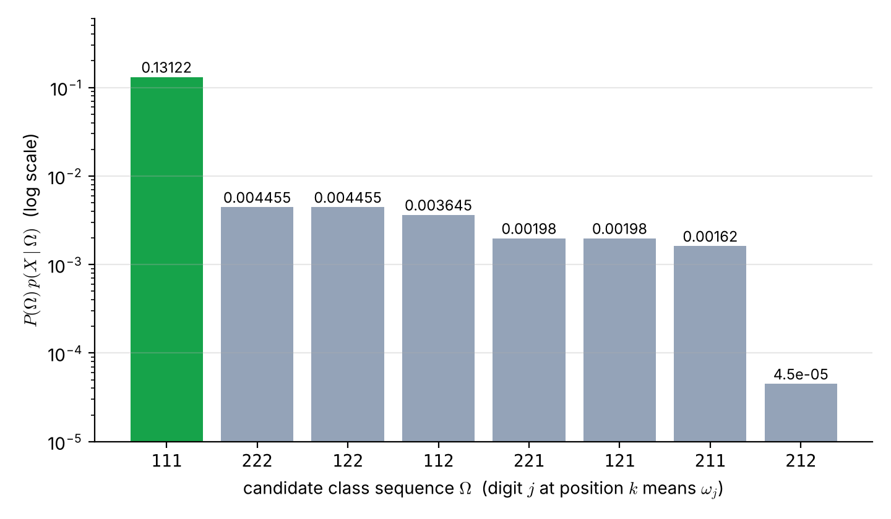
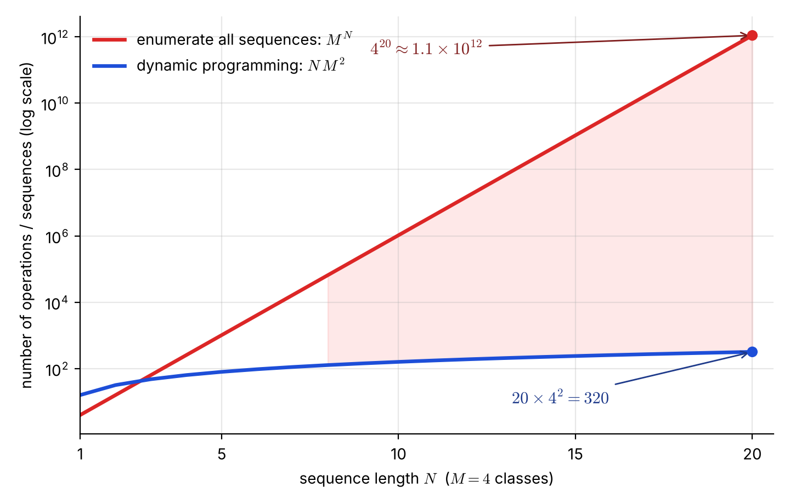

# Lecture 12 · KP02：序列的貝氏分類器（The Bayes classifier for sequences）

> 程度：研究生（grad）／Level: Graduate (grad)
>
> 第 12 週（2026-11-23）｜Context-Dependent Classification · KP02
>
> Week 12 (2026-11-23) | Context-Dependent Classification · KP02

## 學習目標（Learning objectives）

- 把整串觀測看成一個超級特徵向量，把每一串類別標籤看成一個超級類別（Treat a whole observation stream as one super feature vector and each label sequence as one super class）。
- 推出序列的 Bayes 決策規則：比較 $P(\Omega)\,p(X\mid\Omega)$，不必算 $p(X)$（Derive the sequence Bayes rule: compare $P(\Omega)\,p(X\mid\Omega)$ without computing $p(X)$）。
- 數出候選標籤串共有 $M^N$ 條，並手算一個 $M=2$、$N=3$ 的例子（Count the $M^N$ candidate label sequences and compute a case with $M=2$, $N=3$）。
- 說出為什麼直接窮舉在實務上不可行（Explain why direct enumeration is infeasible in practice）。

## KP02：序列的貝氏分類器（The Bayes classifier for sequences）

**一句話重點**：把一整串觀測當成一個超級向量，分類就是從 $M^N$ 條候選標籤串裡，選出讓 $P(\Omega)\,p(X\mid\Omega)$ 最大的那一條。

**One-sentence summary**: Treat the whole observation stream as one super vector; classification then picks, among $M^N$ candidate label sequences, the one that maximizes $P(\Omega)\,p(X\mid\Omega)$.

### 1. 接住上一講的問題（Picking up the question）

上一講的例子留下兩個問題。
整串判斷到底在比較哪一個量？
候選的標籤串有幾條？

The example of the last lecture left two questions.
Which quantity does a whole-sequence decision compare?
How many candidate label sequences are there?

答案不需要新工具。
把整串觀測當成「一個很長的特徵向量」，Bayes 規則原封不動就能用。
新的麻煩只有一個：候選答案的數量。

The answer needs no new tool.
Treat the whole stream as "one very long feature vector", and the Bayes rule works unchanged.
There is only one new trouble: the number of candidate answers.

**白話說明**：想像你要猜一份三題的是非題答案卷。
你可以每題各猜各的，也可以把整份答案卷當成一個答案，在所有 $2^3=8$ 種答案卷裡挑最像的。
這個比喻只對應「把整串當一個答案」，沒說明各題之間有關時如何計分。

**Plain explanation**: Imagine guessing the answer sheet of a three-question true-false quiz.
You can guess each question on its own, or treat the whole sheet as one answer and pick the best among all $2^3=8$ possible sheets.
This analogy only covers "treat the whole stream as one answer"; it does not say how to score when the questions are related.

**先備自測**：確認你會用 Bayes 規則把後驗寫成先驗乘似然再除以證據。
不熟的話，回到第 2 週複習。

**Prerequisite check**: Make sure you can write a posterior as prior times likelihood divided by evidence with the Bayes rule.
If not, review Week 2.

- $P(A\mid B)=P(B\mid A)P(A)/P(B)$ 是 Bayes 規則（This is the Bayes rule）。
- 分母 $P(B)$ 不依賴 $A$（The denominator $P(B)$ does not depend on $A$）。
- 比較大小時，常數分母可以省略（A constant denominator can be dropped when comparing）。

### 2. 候選與決策規則（Candidates and the decision rule）

設有 $M$ 個類別 $\omega_1,\dots,\omega_M$，觀測序列長度為 $N$。
一個候選標籤串，是為每個位置各選一個類別。
每個位置有 $M$ 種選擇，所以全部共有 $M^N$ 條。

Suppose there are $M$ classes $\omega_1,\dots,\omega_M$ and the observation stream has length $N$.
A candidate label sequence picks one class for each position.
Each position has $M$ choices, so there are $M^N$ sequences in total.

**正式定義**：第 $i$ 條候選標籤串寫成：

**Formal definition**: The $i$-th candidate label sequence is written as:

$$
\Omega_i:\ \omega_{i_1},\omega_{i_2},\dots,\omega_{i_N},\qquad i_k\in\{1,2,\dots,M\}
$$

意思是把 $\mathbf{x}_1$ 指派給 $\omega_{i_1}$，$\mathbf{x}_2$ 指派給 $\omega_{i_2}$，一路到 $\mathbf{x}_N$。
把 $X$ 看成延伸後的超級特徵向量，$\Omega_i$ 看成超級類別，Bayes 規則選後驗最大的標籤串：

This assigns $\mathbf{x}_1$ to $\omega_{i_1}$, $\mathbf{x}_2$ to $\omega_{i_2}$, and so on up to $\mathbf{x}_N$.
Viewing $X$ as an extended super feature vector and $\Omega_i$ as a super class, the Bayes rule picks the label sequence with the largest posterior:

$$
P(\Omega_i\mid X)>P(\Omega_j\mid X),\qquad \forall\, i\neq j
$$

用 Bayes 規則展開 $P(\Omega\mid X)=P(\Omega)\,p(X\mid\Omega)/p(X)$。
分母 $p(X)$ 只和觀測有關，對每一條候選都一樣。
所以比較後驗，等於比較先驗乘上似然：

Expand with the Bayes rule: $P(\Omega\mid X)=P(\Omega)\,p(X\mid\Omega)/p(X)$.
The denominator $p(X)$ depends only on the observations and is the same for every candidate.
So comparing posteriors is the same as comparing prior times likelihood:

$$
P(\Omega_i)\,p(X\mid\Omega_i)>P(\Omega_j)\,p(X\mid\Omega_j),\qquad \forall\, i\neq j
$$

| 符號 | 中文意義 | English meaning |
|---|---|---|
| $M$ | 類別數 | Number of classes |
| $N$ | 觀測序列長度 | Length of the observation stream |
| $\Omega_i$ | 第 $i$ 條候選標籤串，共 $M^N$ 條 | The $i$-th candidate label sequence, $M^N$ in total |
| $i_k$ | 第 $k$ 個位置選的類別編號 | Class index chosen at position $k$ |
| $P(\Omega_i)$ | 這串標籤的先驗（合理度） | Prior of the label sequence (plausibility) |
| $p(X\mid\Omega_i)$ | 這串標籤下觀測的似然（貼合度） | Likelihood of the observations under the label sequence (fit) |
| $p(X)$ | 觀測本身的機率（證據） | Probability of the observations (evidence) |

**常見迷思**：「超級向量表示要把維度加起來，所以要重新訓練一個很高維的分類器。」
概念上是這樣，但實際上不可行。
每個超級類別 $\Omega_i$ 都需要自己的 $P(\Omega_i)$ 與 $p(X\mid\Omega_i)$，而 $M^N$ 條裡大部分在訓練資料中從未出現過。

**Common misconception**: "The super vector means adding up the dimensions and training one very high-dimensional classifier."
Conceptually yes, but it is not feasible in practice.
Every super class $\Omega_i$ needs its own $P(\Omega_i)$ and $p(X\mid\Omega_i)$, and most of the $M^N$ sequences never appear in the training data.

### 3. 主例子：八條候選（Main example: eight candidates）

上一節給出規則與符號。
現在把規則用在上一講的三步例子，實際數一數。

The previous section gave the rule and the symbols.
Now apply the rule to the three-step example of the last lecture and count.

**例子**：`[補充]` 沿用上一講的設定：$M=2$、$N=3$，似然如下表，起點兩類各 $0.5$，每步維持原類別的機率 $0.9$、換類別 $0.1$。
候選共 $2^3=8$ 條。
每一條的分數是 $P(\Omega)\,p(X\mid\Omega)$。

**Example**: `[Added]` Reuse the setting of the last lecture: $M=2$, $N=3$, the likelihoods below, start probability $0.5$ per class, and each step stays in the same class with probability $0.9$ or switches with $0.1$.
There are $2^3=8$ candidates.
The score of each one is $P(\Omega)\,p(X\mid\Omega)$.

| 位置 $k$ | $p(\mathbf{x}_k\mid\omega_1)$ | $p(\mathbf{x}_k\mid\omega_2)$ |
|---|---|---|
| 1 | $0.90$ | $0.10$ |
| 2 | $0.45$ | $0.55$ |
| 3 | $0.80$ | $0.20$ |

| 候選 $\Omega$ | $p(X\mid\Omega)$ | $P(\Omega)$ | 分數 $P(\Omega)\,p(X\mid\Omega)$ |
|---|---|---|---|
| $\omega_1\omega_1\omega_1$ | $0.324$ | $0.405$ | $0.13122$ |
| $\omega_1\omega_1\omega_2$ | $0.081$ | $0.045$ | $0.003645$ |
| $\omega_1\omega_2\omega_1$ | $0.396$ | $0.005$ | $0.00198$ |
| $\omega_1\omega_2\omega_2$ | $0.099$ | $0.045$ | $0.004455$ |
| $\omega_2\omega_1\omega_1$ | $0.036$ | $0.045$ | $0.00162$ |
| $\omega_2\omega_1\omega_2$ | $0.009$ | $0.005$ | $0.000045$ |
| $\omega_2\omega_2\omega_1$ | $0.044$ | $0.045$ | $0.00198$ |
| $\omega_2\omega_2\omega_2$ | $0.011$ | $0.405$ | $0.004455$ |

分數最大的是 $\omega_1\omega_1\omega_1$，為 $0.13122$。
八個分數加起來是 $p(X)=0.1494$，所以這一串的後驗是 $0.13122/0.1494\approx0.878$。
逐點判斷選的 $\omega_1\omega_2\omega_1$，後驗只有 $0.00198/0.1494\approx0.013$。

The largest score is $\omega_1\omega_1\omega_1$ with $0.13122$.
The eight scores sum to $p(X)=0.1494$, so the posterior of this sequence is $0.13122/0.1494\approx0.878$.
The point-by-point choice $\omega_1\omega_2\omega_1$ has posterior only $0.00198/0.1494\approx0.013$.

注意：求最大者時完全沒用到 $0.1494$。
它只在想知道「有多確定」時才需要。

Note that finding the maximum never used $0.1494$.
It is needed only when you want to know "how certain".



**圖說 `lec12-kp02-sequence-bayes-f2-eight-scores`**：先看最左邊的綠色長條，它是唯一遠高於其他的候選。
再看縱軸是對數刻度：其餘七條彼此相差不大，但都比最大者至少低一個半數量級。
這張圖用精確的分數說明「整串的最佳解不是逐點最佳解」。〔功能：2〕

**Caption `lec12-kp02-sequence-bayes-f2-eight-scores`**: Look first at the green bar on the left, the only candidate far above the others.
Then note the log scale on the vertical axis: the other seven are not far from one another, but all are at least one and a half orders of magnitude below the best.
The figure uses exact scores to show that the best whole sequence is not the best point by point. [Function: 2]

### 4. 候選數會爆炸（The number of candidates explodes）

三步、兩類時，列出八條很輕鬆。
但上一節的做法，是把每一條都算一遍。
問題是當 $M$ 和 $N$ 變大，這個數字長得非常快。

With two classes and three steps, listing eight candidates is easy.
But the method of the last section computes every one of them.
The problem is that this number grows extremely fast when $M$ and $N$ increase.

| 序列長度 $N$ | 候選數 $4^N$（$M=4$） |
|---|---|
| 1 | $4$ |
| 5 | $1{,}024$ |
| 10 | $1{,}048{,}576$ |
| 20 | $1{,}099{,}511{,}627{,}776\approx1.1\times10^{12}$ |

每條候選要乘 $N$ 項左右，所以總乘法量的階數是 $N\,M^N$。
$N=20$、$M=4$ 時約 $2.2\times10^{13}$ 次。
`[補充]` 若一台機器每秒做 $10^9$ 次乘法，要算約 $21{,}990$ 秒，也就是約 $6.1$ 小時，而序列只有 $20$ 個觀測。

Each candidate needs about $N$ multiplications, so the total number of multiplications is of order $N\,M^N$.
For $N=20$, $M=4$ this is about $2.2\times10^{13}$.
`[Added]` On a machine doing $10^9$ multiplications per second, this takes about $21{,}990$ seconds, roughly $6.1$ hours, for a sequence of only $20$ observations.



**圖說 `lec12-kp02-sequence-bayes-f1-explosion`**：先看紅線：縱軸是對數刻度，所以一條直線代表指數成長。
再看藍線：它是 KP04 會推出的 $N\,M^2$，在同一張圖上幾乎貼著底部。
右端兩個點標出 $N=20$ 時的 $1.1\times10^{12}$ 與 $320$。〔功能：1、2〕

**Caption `lec12-kp02-sequence-bayes-f1-explosion`**: Look at the red line first: the vertical axis is logarithmic, so a straight line means exponential growth.
Then look at the blue line: it is the $N\,M^2$ that KP04 will derive, and it hugs the bottom of the same plot.
The two dots at the right end mark $1.1\times10^{12}$ and $320$ at $N=20$. [Function: 1, 2]

**想深入**（選讀）：圖中藍線的 $N\,M^2$ 之所以成立，是因為最佳序列有「最佳子結構」。
這是 KP04 的內容。
在此只需記住：指數成長不是這個問題的本性，是做法造成的。

**Going deeper** (optional): The blue line $N\,M^2$ holds because the best sequence has "optimal substructure".
That is the content of KP04.
For now remember only: exponential growth is not the nature of the problem, but of the method.

### 5. 與實作的連結（Connection to implementation）

下面的程式窮舉八條候選，並算出後驗。
它能跑，是因為 $M^N$ 只有 $8$。
把 $N$ 改成 $25$，同一段程式就跑不完了。

The code below enumerates the eight candidates and computes the posterior.
It runs only because $M^N$ is just $8$.
Change $N$ to $25$ and the same code will not finish.

```python
import itertools
import numpy as np

lik = np.array([[0.90, 0.10], [0.45, 0.55], [0.80, 0.20]])  # p(x_k | omega_i)
STAY = 0.9

def score(seq):
    """P(Omega) * p(X | Omega)，seq 的元素 0/1 對應 omega_1/omega_2。"""
    s = 0.5 * lik[0, seq[0]]
    for k in range(1, len(seq)):
        s *= (STAY if seq[k] == seq[k - 1] else 1 - STAY) * lik[k, seq[k]]
    return s

cands = list(itertools.product((0, 1), repeat=3))   # M**N = 8 條候選 / 8 candidates
scores = {c: score(c) for c in cands}
p_x = sum(scores.values())                           # 證據 p(X)，只用來算後驗 / evidence
best = max(scores, key=scores.get)                   # 選最大者不需要 p_x / argmax needs no p_x
print(best, round(scores[best], 5), round(scores[best] / p_x, 3))   # (0, 0, 0) 0.13122 0.878
```

**留給下一節的問題**：$P(\Omega)$ 與 $p(X\mid\Omega)$ 各是一個關於整串的機率，怎麼把它們拆成可以逐步計算的小項？
下一節用「一階馬可夫」假設，把 $P(\Omega)$ 拆成「起點機率乘上一連串相鄰轉移」。

**The question for the next section**: $P(\Omega)$ and $p(X\mid\Omega)$ are each a probability over the whole stream; how can they be split into small terms that can be computed step by step?
The next section uses the "first-order Markov" assumption to split $P(\Omega)$ into "a start probability times a chain of adjacent transitions".

### 6. 小練習與解題示範（Practice and worked solutions）

**小練習** `[補充]`：先寫下理由，再看解答。

**Practice** `[Added]`: Write your reasoning before reading the solutions.

1. 題 1：$M=3$ 個類別、序列長度 $N=6$，候選標籤串有幾條？$N$ 加到 $7$ 呢（With $M=3$ classes and length $N=6$, how many candidate label sequences are there? And for $N=7$）？
2. 題 2：第 3 節的例子中，$\omega_2\omega_2\omega_2$ 的分數是多少？它的後驗是多少（In the example of Section 3, what is the score of $\omega_2\omega_2\omega_2$, and what is its posterior）？
3. 題 3：為什麼找最佳標籤串時可以不算 $p(X)$？什麼時候又非算不可（Why can you skip $p(X)$ when finding the best label sequence, and when must you compute it）？

**題 1 解題示範**：$N=6$ 時有 $3^6=729$ 條。
每多一個位置，數量乘上 $M=3$：$N=7$ 時是 $729\times3=2187$ 條。

**Question 1 worked solution**: For $N=6$ there are $3^6=729$ sequences.
Each extra position multiplies the count by $M=3$: for $N=7$ it is $729\times3=2187$.

**題 2 解題示範**：貼合度 $0.1\times0.55\times0.2=0.011$，合理度 $0.5\times0.9\times0.9=0.405$，分數 $0.011\times0.405=0.004455$。
後驗是 $0.004455/0.1494\approx0.0298$。
它和 $\omega_1\omega_2\omega_2$ 的分數剛好相同。

**Question 2 worked solution**: The fit is $0.1\times0.55\times0.2=0.011$, the plausibility is $0.5\times0.9\times0.9=0.405$, and the score is $0.011\times0.405=0.004455$.
The posterior is $0.004455/0.1494\approx0.0298$.
It happens to equal the score of $\omega_1\omega_2\omega_2$.

**題 3 解題示範**：$p(X)$ 對每條候選都是同一個數，所有候選同乘同除一個正數，大小順序不變。
所以只選最大者時可以省略。
當你想知道「這個答案有多可信」，例如要報告後驗 $0.878$，就必須算 $p(X)$，也就是把所有候選的分數加起來。

**Question 3 worked solution**: $p(X)$ is the same number for every candidate, and dividing all candidates by the same positive number does not change their order.
So it can be skipped when you only pick the maximum.
When you want to know "how trustworthy the answer is", for example to report the posterior $0.878$, you must compute $p(X)$, which means summing the scores of all candidates.

## 術語表（Glossary）

| 中文術語 | English term |
|---|---|
| 序列的貝氏分類器 | Bayes classifier for sequences |
| 超級特徵向量 | Super feature vector |
| 超級類別 | Super class |
| 候選標籤串 | Candidate label sequence |
| 組合爆炸 | Combinatorial explosion |
| 後驗 | Posterior |
| 先驗 | Prior |
| 似然 | Likelihood |
| 證據 | Evidence |
| 貼合度 | Fit |
| 合理度 | Plausibility |
| 對數刻度 | Logarithmic scale |
| 最佳子結構 | Optimal substructure |

## 銜接與來源（Connections and sources）

下一講用一階馬可夫假設拆開 $P(\Omega)$。
你會看到整串的機率變成起點加上逐步的轉移。

The next lecture splits $P(\Omega)$ with the first-order Markov assumption.
You will see the probability of the whole stream become a start term plus step-by-step transitions.

- 前一單元：[KP01 當相鄰觀測不再獨立](lec12-kp01-context.md)（Previous unit: when neighboring observations are no longer independent）。
- 下一單元：[KP03 一階馬可夫鏈](lec12-kp03-markov-chain.md)（Next unit: the first-order Markov chain）。
- 來源：[Context-Dependent Classification §9.2](https://ndhuccc.github.io/CCC-LNS/PR_115/Ch09-context-dependent-classification/index.html)，讀取日期 2026-11-13（Source accessed 2026-11-13）。
- 書目：Theodoridis and Koutroumbas, *Pattern Recognition*, 4th ed., 2008；見[參考資料](../references/README.md)（See the bibliography）。

本講以自己的文字解釋來源。
八條候選的完整計算、時間估計、答案卷比喻、圖與程式皆為 `[補充]`。
超級向量的觀點、$M^N$ 的候選數與決策規則取自來源。

This lecture independently explains the source.
The full computation of eight candidates, the time estimate, the answer-sheet analogy, the figures, and the code are `[Added]`.
The super-vector view, the $M^N$ candidate count, and the decision rule come from the source.
