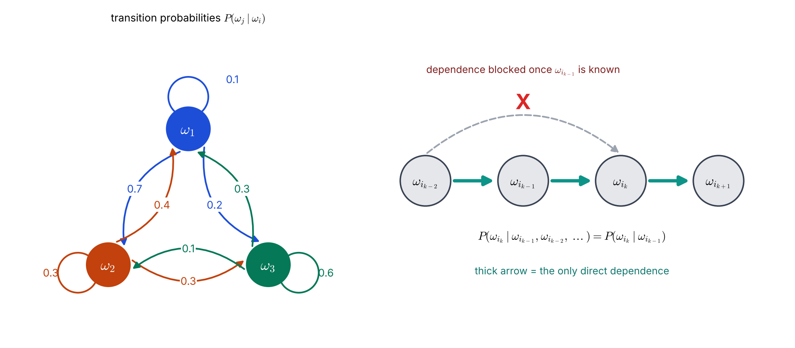
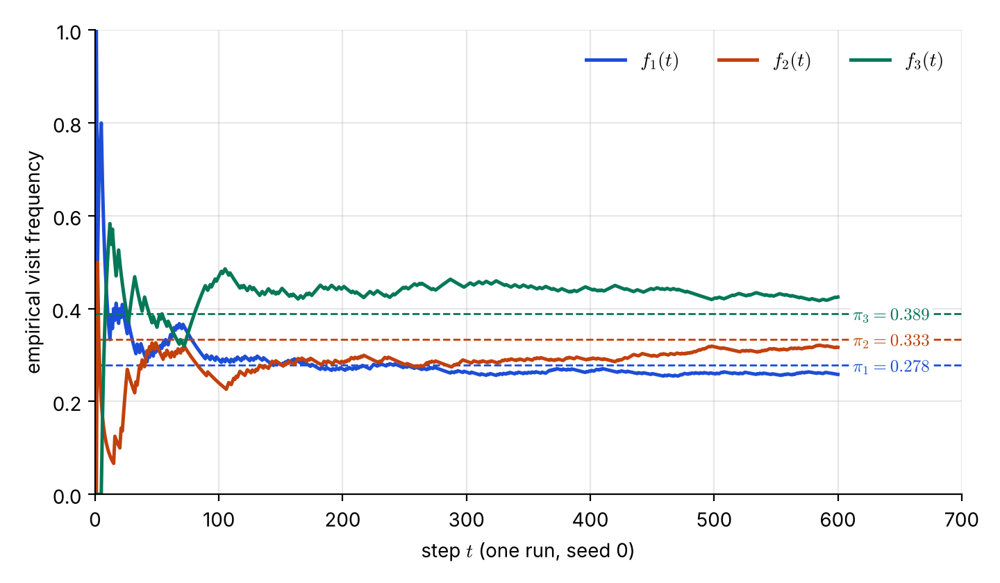

# Lecture 12 · KP03：一階馬可夫鏈（The first-order Markov chain）

> 程度：研究生（grad）／Level: Graduate (grad)
>
> 第 12 週（2026-11-23）｜Context-Dependent Classification · KP03
>
> Week 12 (2026-11-23) | Context-Dependent Classification · KP03

## 學習目標（Learning objectives）

- 寫出一階馬可夫假設，並說明它「濃縮」而不是「丟掉」更早的歷史（State the first-order Markov assumption and explain that it condenses, not discards, earlier history）。
- 用轉移機率把類別序列的先驗拆成起點機率乘一連串轉移（Split the prior of a label sequence into a start probability times a chain of transitions）。
- 寫出馬可夫模型下整串的目標式，並手算一條路徑的機率（Write the objective of the whole sequence under the Markov model and compute a path probability by hand）。
- 說出這個假設省下多少參數，以及為什麼窮舉仍然太貴（State how many parameters the assumption saves and why enumeration is still too expensive）。

## KP03：一階馬可夫鏈（The first-order Markov chain）

**一句話重點**：一階馬可夫假設說，目前的類別只需要看前一個類別，所以整串標籤的機率可以拆成「起點乘上一連串相鄰轉移」。

**One-sentence summary**: The first-order Markov assumption says the current class depends only on the previous class, so the probability of a whole label sequence splits into "a start term times a chain of adjacent transitions".

### 1. 接住上一講的問題（Picking up the question）

上一講把整串判斷寫成比較 $P(\Omega)\,p(X\mid\Omega)$。
但 $P(\Omega)$ 是一個關於整串的機率，$M^N$ 條各有一個值。
你不可能為每一條各存一個數字。

The last lecture wrote the whole-sequence decision as comparing $P(\Omega)\,p(X\mid\Omega)$.
But $P(\Omega)$ is a probability over the whole sequence, with one value for each of the $M^N$ sequences.
You cannot store one number for each of them.

這一講的做法是加上一個合理的結構假設。
它讓整串的機率只需要少數幾個基本數字就能算出來。
KP01 與 KP02 的例子其實已經偷偷用過它。

This lecture adds a reasonable structural assumption.
It lets the probability of the whole sequence be computed from only a few basic numbers.
The examples of KP01 and KP02 have already used it quietly.

**白話說明**：想像你預測明天的天氣。
你只看今天的天氣，不管昨天與前天。
這不是說昨天不重要，而是昨天的影響已經反映在今天的天氣裡。
這個比喻只對應「只看前一步」，不適用於「天氣真的只由前一天決定」這個物理事實。

**Plain explanation**: Imagine forecasting tomorrow's weather.
You look only at today's weather and ignore yesterday and the day before.
That does not say yesterday is unimportant; its effect is already reflected in today's weather.
This analogy only covers "look at one step back"; it does not claim that weather is physically determined by the previous day alone.

**先備自測**：確認你會用機率的連鎖律，把聯合機率拆成一連串條件機率。
不熟的話，回到第 2 週複習。

**Prerequisite check**: Make sure you can use the chain rule of probability to split a joint probability into a chain of conditional probabilities.
If not, review Week 2.

- $P(A,B,C)=P(A)\,P(B\mid A)\,P(C\mid A,B)$ 是連鎖律（This is the chain rule）。
- 條件機率的每一列加起來等於 $1$（Each row of conditional probabilities sums to $1$）。
- 條件獨立：給定 $B$ 後，$A$ 與 $C$ 不再互相影響（Conditional independence: given $B$, $A$ and $C$ no longer affect each other）。

### 2. 假設與公式（The assumption and the formulas）

先用連鎖律，不加任何假設，把類別序列的先驗拆開。
每一項都以「前面所有類別」為條件：

First use the chain rule, with no assumption, to split the prior of the label sequence.
Every factor is conditioned on "all the earlier classes":

$$
P(\Omega_i)=P(\omega_{i_N}\mid\omega_{i_{N-1}},\dots,\omega_{i_1})\,P(\omega_{i_{N-1}}\mid\omega_{i_{N-2}},\dots,\omega_{i_1})\cdots P(\omega_{i_1})
$$

**正式定義**：**一階馬可夫假設**（first-order Markov assumption）規定，給定前一個類別後，目前類別不再依賴更早的類別：

**Formal definition**: The **first-order Markov assumption** states that, given the previous class, the current class no longer depends on earlier classes:

$$
P(\omega_{i_k}\mid\omega_{i_{k-1}},\omega_{i_{k-2}},\dots,\omega_{i_1})=P(\omega_{i_k}\mid\omega_{i_{k-1}})
$$

套入連鎖律，每一項只剩一個條件，先驗變成起點機率乘上相鄰轉移：

Substitute into the chain rule: each factor keeps a single condition, and the prior becomes a start probability times adjacent transitions:

$$
P(\Omega_i)=P(\omega_{i_1})\prod_{k=2}^{N}P(\omega_{i_k}\mid\omega_{i_{k-1}})
$$

觀測似然也要拆。
來源採用兩個常見假設：給定整串標籤後，各觀測彼此獨立；每一類的密度只由自己的類別決定。於是：

The observation likelihood must be split too.
The source adopts two common assumptions: given the whole label sequence, the observations are independent of one another; and each class density depends only on its own class. Then:

$$
p(X\mid\Omega_i)=\prod_{k=1}^{N}p(\mathbf{x}_k\mid\omega_{i_k})
$$

兩式相乘，馬可夫模型下的 Bayes 目標就是最大化：

Multiplying the two, the Bayes objective under the Markov model is to maximize:

$$
p(X\mid\Omega_i)\,P(\Omega_i)=P(\omega_{i_1})\,p(\mathbf{x}_1\mid\omega_{i_1})\prod_{k=2}^{N}P(\omega_{i_k}\mid\omega_{i_{k-1}})\,p(\mathbf{x}_k\mid\omega_{i_k})
$$

可以這樣記：起點是「先驗乘發射」，之後每一步都是「轉移乘發射」。
這裡的「發射」指目前類別產生目前觀測的密度 $p(\mathbf{x}_k\mid\omega_{i_k})$。

You can remember it this way: the start is "prior times emission", and every later step is "transition times emission".
Here "emission" means the density $p(\mathbf{x}_k\mid\omega_{i_k})$ with which the current class produces the current observation.

| 符號 | 中文意義 | English meaning |
|---|---|---|
| $P(\omega_{i_1})$ | 起點機率（第一個位置的類別先驗） | Start probability (prior of the first class) |
| $P(\omega_j\mid\omega_i)$ | 轉移機率：前一類是 $\omega_i$ 時，這一類是 $\omega_j$ 的機率 | Transition probability: probability of $\omega_j$ given the previous class $\omega_i$ |
| $p(\mathbf{x}_k\mid\omega_{i_k})$ | 發射密度：類別 $\omega_{i_k}$ 產生觀測 $\mathbf{x}_k$ 的密度 | Emission density: density of $\mathbf{x}_k$ under class $\omega_{i_k}$ |
| $\prod_{k=2}^{N}$ | 從第 2 項連乘到第 $N$ 項 | Product from term 2 to term $N$ |

**常見迷思**：「一階馬可夫表示更早的歷史完全不重要。」
不對。
更早的歷史仍然透過前一個類別間接影響現在。
假設只說：已知前一個類別時，再看更早的類別不會提供新資訊。

**Common misconception**: "First-order Markov means earlier history is completely unimportant."
That is wrong.
Earlier history still affects the present indirectly through the previous class.
The assumption only says that, once the previous class is known, looking further back adds no new information.

### 3. 主例子：把 KP01 的數字拆開（Main example: unpacking the KP01 numbers）

上一節給出公式。
先回頭看 KP01、KP02 的兩類例子，它其實就是一條馬可夫鏈。

The previous section gave the formulas.
Look back at the two-class example of KP01 and KP02: it is in fact a Markov chain.

**例子**：`[補充]` 兩個類別，起點兩類各 $0.5$，轉移矩陣是「維持 $0.9$、換類別 $0.1$」：

**Example**: `[Added]` Two classes, start probability $0.5$ each, and a transition matrix of "stay $0.9$, switch $0.1$":

| 前一類 \ 這一類 | $\omega_1$ | $\omega_2$ |
|---|---|---|
| $\omega_1$ | $0.9$ | $0.1$ |
| $\omega_2$ | $0.1$ | $0.9$ |

用公式算 $\omega_1\omega_1\omega_1$ 的先驗：$P(\Omega)=0.5\times0.9\times0.9=0.405$。
而 $\omega_1\omega_2\omega_1$ 是 $0.5\times0.1\times0.1=0.005$。
這兩個數字就是 KP01 與 KP02 表中的「合理度」。

Use the formula for the prior of $\omega_1\omega_1\omega_1$: $P(\Omega)=0.5\times0.9\times0.9=0.405$.
For $\omega_1\omega_2\omega_1$ it is $0.5\times0.1\times0.1=0.005$.
These two numbers are the "plausibility" in the tables of KP01 and KP02.

沒有馬可夫假設時，$\omega_1\omega_2\omega_1$ 的最後一項是 $P(\omega_1\mid\omega_2,\omega_1)$，要看前兩個類別。
假設把它換成 $P(\omega_1\mid\omega_2)=0.1$，只看前一個。

Without the Markov assumption, the last factor of $\omega_1\omega_2\omega_1$ is $P(\omega_1\mid\omega_2,\omega_1)$, which looks at the two previous classes.
The assumption replaces it with $P(\omega_1\mid\omega_2)=0.1$, which looks at one.

再看目標式的前兩步。
`[補充]` 沿用 KP01 的似然 $p(\mathbf{x}_1\mid\omega_1)=0.9$、$p(\mathbf{x}_2\mid\omega_2)=0.55$，路徑 $\omega_1\omega_2$ 的前兩步分數是：

Now the first two steps of the objective.
`[Added]` With the likelihoods of KP01, $p(\mathbf{x}_1\mid\omega_1)=0.9$ and $p(\mathbf{x}_2\mid\omega_2)=0.55$, the score of the first two steps of the path $\omega_1\omega_2$ is:

$$
0.5\times0.9\times0.1\times0.55=0.02475
$$

起點項是 $0.5\times0.9$，第二步是 $0.1\times0.55$。
KP04 會看到，這種「逐步累積」的分數正是動態規劃要用的東西。

The start term is $0.5\times0.9$ and the second step is $0.1\times0.55$.
KP04 will show that this "step-by-step accumulation" is exactly what dynamic programming uses.

### 4. 三個類別的鏈與它省下的參數（A three-class chain and the saved parameters）

兩類太簡單。
下面用來源的三類轉移表，看這個假設省下多少東西。

Two classes are too simple.
Below, the source's three-class transition table shows how much the assumption saves.

**例子**：來源 Table 9.1 給出三類的轉移機率（列是前一類，欄是這一類），每一列的和都是 $1$：

**Example**: The source's Table 9.1 gives the three-class transition probabilities (rows are the previous class, columns the current class), and each row sums to $1$:

| 前一類 \ 這一類 | $\omega_1$ | $\omega_2$ | $\omega_3$ |
|---|---|---|---|
| $\omega_1$ | $0.1$ | $0.7$ | $0.2$ |
| $\omega_2$ | $0.4$ | $0.3$ | $0.3$ |
| $\omega_3$ | $0.3$ | $0.1$ | $0.6$ |



**圖說 `lec12-kp03-markov-chain-f1-transition-and-chain`**：先看左圖，每個箭頭上的數字是該方向的轉移機率，顏色與出發節點相同，從同一個節點出發的三個數字加起來是 $1$。
再看右圖：粗箭頭是唯一的直接相依，灰色虛線跳過一步，被打叉。
左邊是模型的全部參數，右邊是假設的意思。〔功能：1、2〕

**Caption `lec12-kp03-markov-chain-f1-transition-and-chain`**: Read the left graph first: the number on each arrow is the transition probability in that direction, colored like the node it leaves, and the three numbers leaving one node sum to $1$.
Then read the right chain: the thick arrows are the only direct dependence, and the gray dashed line that skips one step is crossed out.
The left shows all the parameters of the model; the right shows what the assumption means. [Function: 1, 2]

`[補充]` 設起點三類各 $1/3$。路徑 $\omega_1\omega_2\omega_2\omega_3$ 的先驗是：

`[Added]` Let each of the three classes start with probability $1/3$. The prior of the path $\omega_1\omega_2\omega_2\omega_3$ is:

$$
\tfrac13\times0.7\times0.3\times0.3=0.021
$$

另兩條對照：$\omega_1\omega_3\omega_3\omega_3$ 是 $\tfrac13\times0.2\times0.6\times0.6=0.024$，$\omega_2\omega_2\omega_2\omega_2$ 是 $\tfrac13\times0.3^3=0.009$。
這三條裡最大的是「在 $\omega_3$ 停留」的路徑，因為 $0.6$ 是表中最大的自轉移。

Two more for comparison: $\omega_1\omega_3\omega_3\omega_3$ gives $\tfrac13\times0.2\times0.6\times0.6=0.024$, and $\omega_2\omega_2\omega_2\omega_2$ gives $\tfrac13\times0.3^3=0.009$.
Among these three, the path that stays in $\omega_3$ is the largest, because $0.6$ is the largest self-transition in the table.

**省下多少參數**：不做假設時，$M=3$、$N=4$ 的整串先驗要 $3^4-1=80$ 個自由數字。
一階馬可夫只需要起點 $M-1=2$ 個，加上轉移表 $M(M-1)=6$ 個，共 $8$ 個。
$M=4$、$N=5$ 時，從 $1023$ 個降到 $15$ 個。

**How many parameters are saved**: Without the assumption, the prior of whole sequences with $M=3$, $N=4$ needs $3^4-1=80$ free numbers.
A first-order Markov chain needs the start probabilities, $M-1=2$ numbers, plus the transition table, $M(M-1)=6$ numbers, for $8$ in total.
For $M=4$, $N=5$ it falls from $1023$ to $15$.

**想深入**（選讀）：馬可夫鏈跑得夠久，各類別出現的比例會趨近一組固定值，叫**穩態分布**（stationary distribution）$\boldsymbol{\pi}$，滿足 $\boldsymbol{\pi}P=\boldsymbol{\pi}$ 且各項和為 $1$。
Table 9.1 的穩態分布是 $\boldsymbol{\pi}=(5/18,\ 1/3,\ 7/18)\approx(0.278,\ 0.333,\ 0.389)$。
下圖是一次模擬，$600$ 步後頻率為 $(0.258,\ 0.317,\ 0.425)$，已經靠近但還沒有重合。

**Going deeper** (optional): If a Markov chain runs long enough, the proportion of time spent in each class approaches a fixed set of values called the **stationary distribution** $\boldsymbol{\pi}$, which satisfies $\boldsymbol{\pi}P=\boldsymbol{\pi}$ and sums to $1$.
For Table 9.1 it is $\boldsymbol{\pi}=(5/18,\ 1/3,\ 7/18)\approx(0.278,\ 0.333,\ 0.389)$.
The figure below is one simulation; after $600$ steps the frequencies are $(0.258,\ 0.317,\ 0.425)$, close but not yet coincident.



**圖說 `lec12-kp03-markov-chain-f2-stationary`**：先看三條虛線，它們是用 $\boldsymbol{\pi}P=\boldsymbol{\pi}$ 算出的理論值。
再看三條實線：它們一開始劇烈擺動，隨著步數增加才逐漸靠近對應的虛線。
這張圖說明「長期比例」是模型本身的性質，不依賴起點。〔功能：2〕

**Caption `lec12-kp03-markov-chain-f2-stationary`**: Look at the three dashed lines first: they are the theoretical values computed from $\boldsymbol{\pi}P=\boldsymbol{\pi}$.
Then look at the three solid lines: they swing wildly at first and approach the matching dashed line only as steps accumulate.
The figure shows that the long-run proportion is a property of the model and does not depend on the start. [Function: 2]

### 5. 還不夠：窮舉仍然太貴（Still not enough）

目標式現在有結構了：每一步只需要「轉移」與「發射」兩個小數字。
但如果仍然對 $M^N$ 條序列各算一次，每條要乘約 $N$ 項，總量還是約 $N\,M^N$ 次乘法。
馬可夫假設省下的是參數，不是計算量。

The objective now has structure: each step needs only two small numbers, a "transition" and an "emission".
But if we still evaluate each of the $M^N$ sequences, each needs about $N$ multiplications, and the total remains about $N\,M^N$.
The Markov assumption saves parameters, not computation.

下面的程式用轉移表算一條路徑的先驗。
注意迴圈只走 $N-1$ 步，因為每一步只看前一個類別。

The code below computes the prior of a path from the transition table.
Note that the loop runs only $N-1$ steps, because each step looks only at the previous class.

```python
import numpy as np

T = np.array([[0.1, 0.7, 0.2],      # 來源 Table 9.1：列 = 前一類，欄 = 這一類
              [0.4, 0.3, 0.3],
              [0.3, 0.1, 0.6]])
start = np.full(3, 1 / 3)           # 起點機率（補充：三類相等）/ start probabilities (assumed equal)

def prior(path):
    """path 的元素為類別編號 1、2、3；回傳 P(Omega)。"""
    p = start[path[0] - 1]
    for prev, cur in zip(path, path[1:]):           # 只看相鄰的兩個類別
        p *= T[prev - 1, cur - 1]
    return p

print(round(prior([1, 2, 2, 3]), 3))   # 0.021
```

**留給下一節的問題**：目標式是逐步累積的乘積。能不能利用這個結構，每一步只保留最好的，不再列舉全部序列？
下一節的 Viterbi 演算法，就是用動態規劃做這件事。

**The question for the next section**: The objective is a step-by-step accumulated product. Can we use this structure to keep only the best at each step instead of listing all sequences?
The Viterbi algorithm of the next section does exactly this with dynamic programming.

### 6. 小練習與解題示範（Practice and worked solutions）

**小練習** `[補充]`：先寫下理由，再看解答。

**Practice** `[Added]`: Write your reasoning before reading the solutions.

1. 題 1：用 Table 9.1 與等機率起點，算路徑 $\omega_3\omega_3\omega_1$ 的先驗（Using Table 9.1 and equal start probabilities, compute the prior of the path $\omega_3\omega_3\omega_1$）。
2. 題 2：$M=4$、$N=5$，不做假設與做一階馬可夫假設，各需要多少個自由參數（For $M=4$, $N=5$, how many free parameters are needed without and with the first-order Markov assumption）？
3. 題 3：式中假設「給定標籤串後，各觀測獨立」。這是否表示 $\mathbf{x}_k$ 與 $\mathbf{x}_{k-1}$ 本來就不相關（The model assumes the observations are independent given the label sequence. Does this mean $\mathbf{x}_k$ and $\mathbf{x}_{k-1}$ are unrelated to begin with）？

**題 1 解題示範**：$\tfrac13\times T_{33}\times T_{31}=\tfrac13\times0.6\times0.3=0.06$。
第一個 $\omega_3$ 是起點，所以只有兩步轉移：$\omega_3\to\omega_3$ 與 $\omega_3\to\omega_1$。

**Question 1 worked solution**: $\tfrac13\times T_{33}\times T_{31}=\tfrac13\times0.6\times0.3=0.06$.
The first $\omega_3$ is the start, so there are only two transitions: $\omega_3\to\omega_3$ and $\omega_3\to\omega_1$.

**題 2 解題示範**：不做假設是 $4^5-1=1023$ 個。
做假設是起點 $4-1=3$ 個，加上轉移表 $4\times3=12$ 個，共 $15$ 個。

**Question 2 worked solution**: Without the assumption it is $4^5-1=1023$.
With it: $4-1=3$ start numbers plus $4\times3=12$ transition numbers, for $15$.

**題 3 解題示範**：不是。
「條件獨立」只是說，**已知**標籤串之後，觀測之間不再有額外的關係。
但相鄰標籤彼此相關，所以沒有條件時，$\mathbf{x}_k$ 與 $\mathbf{x}_{k-1}$ 會透過各自的標籤間接相關。
這正是情境相依分類要利用的相關性。

**Question 3 worked solution**: No.
"Conditional independence" only says that, **once** the label sequence is known, the observations have no further relation.
But neighboring labels are related, so without the condition $\mathbf{x}_k$ and $\mathbf{x}_{k-1}$ are related indirectly through their labels.
That is exactly the correlation that context-dependent classification exploits.

## 術語表（Glossary）

| 中文術語 | English term |
|---|---|
| 一階馬可夫假設 | First-order Markov assumption |
| 馬可夫鏈 | Markov chain |
| 轉移機率 | Transition probability |
| 轉移矩陣（轉移表） | Transition matrix (table) |
| 起點機率 | Start probability |
| 發射密度 | Emission density |
| 連鎖律 | Chain rule of probability |
| 條件獨立 | Conditional independence |
| 穩態分布 | Stationary distribution |
| 自由參數 | Free parameter |
| 自轉移 | Self-transition |

## 銜接與來源（Connections and sources）

下一講把目標式的結構交給動態規劃。
你會看到每一步只留最佳前驅，計算量降到 $N\,M^2$。

The next lecture hands the structure of the objective to dynamic programming.
You will see that keeping only the best predecessor at each step reduces the work to $N\,M^2$.

- 前一單元：[KP02 序列的貝氏分類器](lec12-kp02-sequence-bayes.md)（Previous unit: the Bayes classifier for sequences）。
- 下一單元：[KP04 Viterbi 演算法](lec12-kp04-viterbi.md)（Next unit: the Viterbi algorithm）。
- 來源：[Context-Dependent Classification §9.3](https://ndhuccc.github.io/CCC-LNS/PR_115/Ch09-context-dependent-classification/index.html)，讀取日期 2026-11-13（Source accessed 2026-11-13）。
- 書目：Theodoridis and Koutroumbas, *Pattern Recognition*, 4th ed., 2008；見[參考資料](../references/README.md)（See the bibliography）。

本講以自己的文字解釋來源。
天氣比喻、兩類例子的拆解、等機率起點、參數個數的計算、穩態分布的數值與模擬、圖與程式皆為 `[補充]`。
一階馬可夫假設、先驗的拆法、觀測似然的拆法、整串目標式與 Table 9.1 取自來源。

This lecture independently explains the source.
The weather analogy, the unpacking of the two-class example, the equal start probabilities, the parameter counts, the stationary-distribution numbers and simulation, the figures, and the code are `[Added]`.
The first-order Markov assumption, the split of the prior, the split of the likelihood, the whole-sequence objective, and Table 9.1 come from the source.
