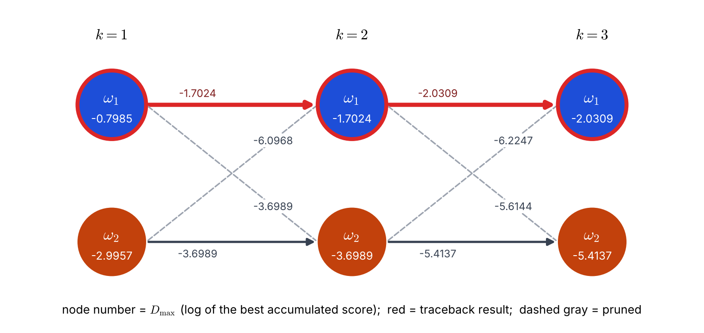

# Lecture 12 · KP04：Viterbi 演算法（The Viterbi algorithm）

> 程度：研究生（grad）／Level: Graduate (grad)
>
> 第 12 週（2026-11-23）｜Context-Dependent Classification · KP04
>
> Week 12 (2026-11-23) | Context-Dependent Classification · KP04

## 學習目標（Learning objectives）

- 把馬可夫模型的目標式改寫成逐步相加的對數成本（Rewrite the Markov objective as step-by-step log costs）。
- 寫出 Bellman 遞迴，並說明為什麼每個節點只留一個最佳前驅是安全的（Write the Bellman recursion and explain why keeping only one best predecessor per node is safe）。
- 在網格上手算 Viterbi，並用回溯指標還原最佳類別序列（Run Viterbi by hand on a trellis and recover the best label sequence from backpointers）。
- 說出計算量為什麼從 $N\,M^N$ 降到 $N\,M^2$（Explain why the work drops from $N\,M^N$ to $N\,M^2$）。

## KP04：Viterbi 演算法（The Viterbi algorithm）

**一句話重點**：Viterbi 演算法在每一欄的每個節點只保留「到達它的最佳前驅」，所以不必列舉 $M^N$ 條序列，只要約 $N\,M^2$ 次運算。

**One-sentence summary**: At every node of every column, the Viterbi algorithm keeps only "the best predecessor that reaches it", so it needs about $N\,M^2$ operations instead of listing $M^N$ sequences.

### 1. 接住上一講的問題（Picking up the question）

上一講留下的問題是：目標式是逐步累積的乘積，能不能每一步只保留最好的？
答案是可以，而且理由很直接。
未來的步驟只看「現在在哪個類別」，不看「怎麼走到這裡」。

The last lecture left this question: the objective is a step-by-step accumulated product, so can we keep only the best at each step?
The answer is yes, for a direct reason.
Future steps look only at "which class we are in now", not at "how we got here".

所以走到同一個節點的許多條路徑，只有分數最高的那一條有可能成為全域最佳。
其他的可以丟掉。
這就是動態規劃。

So among the many paths that reach the same node, only the highest-scoring one can become the global best.
The others can be thrown away.
This is dynamic programming.

**白話說明**：想像開車從甲地到乙地，中途一定經過某個路口 $A$。
到路口 $A$ 有好幾條路，你只需要記住其中最快的那一條。
其他到 $A$ 的路，不管後面怎麼走，都不可能比它更好。
這個比喻只對應「同一節點只留最佳」，沒說明成本必須能逐段相加這個前提。

**Plain explanation**: Imagine driving from town A to town B, and you must pass a junction $J$.
There are several roads to $J$, and you only need to remember the fastest one.
No matter how you continue afterwards, the other roads to $J$ can never do better.
This analogy only covers "keep only the best per node"; it does not state the prerequisite that costs must add up segment by segment.

**先備自測**：確認你記得 KP03 的目標式，並會算自然對數。
不熟的話，回到 KP03 與第 2 週複習。

**Prerequisite check**: Make sure you remember the objective of KP03 and can compute natural logarithms.
If not, review KP03 and Week 2.

- 起點是「先驗乘發射」，每步是「轉移乘發射」（The start is "prior times emission", each step is "transition times emission"）。
- $\ln(ab)=\ln a+\ln b$，且 $\ln$ 是遞增函數（$\ln(ab)=\ln a+\ln b$, and $\ln$ is increasing）。
- 機率小於 $1$ 時，$\ln$ 為負數（For probabilities below $1$, $\ln$ is negative）。

### 2. 公式與遞迴（Formulas and the recursion）

把一個觀測 $\mathbf{x}_k$ 當作網格的第 $k$ 欄。
每一欄有 $M$ 個節點，分別是 $\omega_1,\dots,\omega_M$。
從前一欄的某個類別走到這一欄的某個類別，是一步轉移；整條路徑就是一個候選標籤串。

Treat each observation $\mathbf{x}_k$ as the $k$-th column of a grid.
Each column has $M$ nodes, namely $\omega_1,\dots,\omega_M$.
Going from a class in the previous column to a class in this column is one transition; a whole path is one candidate label sequence.

**正式定義**：從 $\omega_{i_{k-1}}$ 走到 $\omega_{i_k}$ 並看到 $\mathbf{x}_k$ 的乘法分數（**分支分數**）是：

**Formal definition**: The multiplicative score (the **branch score**) of going from $\omega_{i_{k-1}}$ to $\omega_{i_k}$ and seeing $\mathbf{x}_k$ is:

$$
\hat d(\omega_{i_k},\omega_{i_{k-1}})=P(\omega_{i_k}\mid\omega_{i_{k-1}})\,p(\mathbf{x}_k\mid\omega_{i_k})
$$

第一步沒有前一個類別，改用 $\hat d(\omega_{i_1},\omega_{i_0})=P(\omega_{i_1})\,p(\mathbf{x}_1\mid\omega_{i_1})$。
整條路徑的分數是所有分支分數的連乘 $\hat D=\prod_{k=1}^{N}\hat d(\omega_{i_k},\omega_{i_{k-1}})$。
取對數把連乘變成連加：

For the first step there is no previous class, so use $\hat d(\omega_{i_1},\omega_{i_0})=P(\omega_{i_1})\,p(\mathbf{x}_1\mid\omega_{i_1})$.
The score of a whole path is the product of all branch scores, $\hat D=\prod_{k=1}^{N}\hat d(\omega_{i_k},\omega_{i_{k-1}})$.
Taking the logarithm turns the product into a sum:

$$
D=\ln\hat D=\sum_{k=1}^{N}d(\omega_{i_k},\omega_{i_{k-1}}),\qquad d(\cdot,\cdot)=\ln\hat d(\cdot,\cdot)
$$

取對數不會改變誰最大，因為 $\ln$ 是遞增函數。
它還有一個實際的好處：連乘很多個小機率會**下溢**。
`[補充]` $0.1$ 連乘 $400$ 次，在雙精度浮點數中變成 $0.0$；但取對數後只是 $400\ln0.1=-921.034$，毫無問題。

Taking the logarithm does not change which path is largest, because $\ln$ is increasing.
It also has a practical benefit: a product of many small probabilities **underflows**.
`[Added]` Multiplying $0.1$ by itself $400$ times gives $0.0$ in double precision, but the logarithm is simply $400\ln0.1=-921.034$.

到達第 $k$ 欄節點 $\omega_{i_k}$ 的最佳累積分數記為 $D_{\max}(\omega_{i_k})$。
**Bellman 遞迴**說：它等於「所有前驅的最佳累積分數，加上這一步的分支分數」中最大的：

Write $D_{\max}(\omega_{i_k})$ for the best accumulated score reaching node $\omega_{i_k}$ of column $k$.
The **Bellman recursion** says it equals the largest of "each predecessor's best accumulated score plus this step's branch score":

$$
D_{\max}(\omega_{i_k})=\max_{i_{k-1}}\Big[D_{\max}(\omega_{i_{k-1}})+d(\omega_{i_k},\omega_{i_{k-1}})\Big],\qquad D_{\max}(\omega_{i_0})=0
$$

在最後一欄選分數最大的終點，再沿著每個節點記下的最佳前驅**回溯**：

At the last column, pick the end node with the largest score, then **trace back** along the best predecessor recorded at every node:

$$
\omega^{*}_{i_N}=\arg\max_{\omega_{i_N}}D_{\max}(\omega_{i_N})
$$

| 符號 | 中文意義 | English meaning |
|---|---|---|
| $\hat d(\cdot,\cdot)$ | 一步的乘法分支分數 | Multiplicative branch score of one step |
| $d(\cdot,\cdot)=\ln\hat d$ | 對數分支分數（可加） | Log branch score (additive) |
| $D_{\max}(\omega_{i_k})$ | 到達第 $k$ 欄該節點的最佳累積對數分數 | Best accumulated log score reaching that node of column $k$ |
| $\omega^{*}_{i_N}$ | 最佳終點類別 | Best end class |
| 回溯指標 | 每個節點記下的最佳前驅 | Backpointer: the best predecessor stored at each node |

**為什麼丟掉其他前驅是安全的**：假設全域最佳路徑經過節點 $v$，但它到 $v$ 的前半段不是到 $v$ 的最佳前半段。
那就把前半段換成到 $v$ 的最佳前半段，後半段不動。
因為分數是逐步相加，總分會變高，與「它是全域最佳」矛盾。
所以全域最佳路徑到 $v$ 的前半段，必然是到 $v$ 的最佳前半段。

**Why discarding the other predecessors is safe**: Suppose the global best path passes through node $v$, but its first half up to $v$ is not the best first half reaching $v$.
Replace that first half by the best first half reaching $v$ and keep the second half.
Because scores add step by step, the total rises, which contradicts "it is the global best".
So the first half of the global best path up to $v$ must be the best first half reaching $v$.

**常見迷思**：「現在分數低的路徑以後也不會好，所以才丟掉。」
不對。
丟掉的理由不是它「以後不會好」，而是「同一個節點上，有一條在過去就已經更好」。
兩條路徑到了同一節點，它們的未來完全一樣，所以較差的過去永遠追不上。

**Common misconception**: "We discard a path whose score is low now because it will not get good later."
That is wrong.
The reason to discard is not "it will not get good later" but "at the same node, another path is already better in the past".
Two paths that reach the same node have exactly the same future, so the worse past can never catch up.

### 3. 主例子：用同一個三步例子跑一遍（Main example: running the same three-step case）

上一節給出遞迴。
現在用 KP01–KP03 的例子手算：兩類、三步、起點各 $0.5$、維持 $0.9$、換類別 $0.1$，似然 $(0.90,0.10)$、$(0.45,0.55)$、$(0.80,0.20)$。

The previous section gave the recursion.
Now run it by hand on the example of KP01–KP03: two classes, three steps, start probability $0.5$ each, stay $0.9$, switch $0.1$, and likelihoods $(0.90,0.10)$, $(0.45,0.55)$, $(0.80,0.20)$.

**第 1 欄（初始化）**：$D_{\max}(\omega_1)=\ln(0.5\times0.9)=-0.7985$，$D_{\max}(\omega_2)=\ln(0.5\times0.1)=-2.9957$。

**Column 1 (initialization)**: $D_{\max}(\omega_1)=\ln(0.5\times0.9)=-0.7985$ and $D_{\max}(\omega_2)=\ln(0.5\times0.1)=-2.9957$.

**第 2 欄**：每個節點比較兩個前驅。

**Column 2**: Each node compares two predecessors.

| 到達節點 | 前驅 $\omega_1$ | 前驅 $\omega_2$ | $D_{\max}$ | 存活前驅 |
|---|---|---|---|---|
| $\omega_1$ | $-0.7985+\ln(0.9\times0.45)=-1.7024$ | $-2.9957+\ln(0.1\times0.45)=-6.0968$ | $-1.7024$ | $\omega_1$ |
| $\omega_2$ | $-0.7985+\ln(0.1\times0.55)=-3.6989$ | $-2.9957+\ln(0.9\times0.55)=-3.6989$ | $-3.6989$ | 兩者相同 |

到達 $\omega_2$ 的兩個候選剛好相等。
這叫**平手**：因為 $0.5\times0.9\times0.1$ 與 $0.5\times0.1\times0.9$ 乘出同一個數。
平手時任選一個保留即可，圖中保留 $\omega_2\to\omega_2$。
這不影響答案，因為這個節點最後不在最佳路徑上。

The two candidates reaching $\omega_2$ are exactly equal.
This is a **tie**: $0.5\times0.9\times0.1$ and $0.5\times0.1\times0.9$ give the same product.
On a tie, keep either one; the figure keeps $\omega_2\to\omega_2$.
This does not affect the answer, because this node ends up off the best path.

**第 3 欄**：

**Column 3**:

| 到達節點 | 前驅 $\omega_1$ | 前驅 $\omega_2$ | $D_{\max}$ | 存活前驅 |
|---|---|---|---|---|
| $\omega_1$ | $-1.7024+\ln(0.9\times0.8)=-2.0309$ | $-3.6989+\ln(0.1\times0.8)=-6.2247$ | $-2.0309$ | $\omega_1$ |
| $\omega_2$ | $-1.7024+\ln(0.1\times0.2)=-5.6144$ | $-3.6989+\ln(0.9\times0.2)=-5.4137$ | $-5.4137$ | $\omega_2$ |

**選終點與回溯**：最後一欄最大的是 $\omega_1$，$D_{\max}=-2.0309$。
它的存活前驅是第 2 欄的 $\omega_1$，再往前是第 1 欄的 $\omega_1$。
最佳序列是 $\omega_1\omega_1\omega_1$，和 KP02 窮舉八條得到的答案一樣。
還原機率：$e^{-2.0309}=0.13122$，正好是 KP02 表中最大的分數。

**End node and traceback**: The largest in the last column is $\omega_1$ with $D_{\max}=-2.0309$.
Its surviving predecessor is $\omega_1$ in column 2, and before that $\omega_1$ in column 1.
The best sequence is $\omega_1\omega_1\omega_1$, the same answer as enumerating eight candidates in KP02.
Converting back: $e^{-2.0309}=0.13122$, exactly the largest score in the KP02 table.



**圖說 `lec12-kp04-viterbi-f1-trellis`**：先看三欄六個節點，節點內的數字是 $D_{\max}$。
再看邊：灰色虛線是被淘汰的前驅，深色實線是存活前驅，紅色粗線是回溯出的最佳路徑，邊上的數字是經由該前驅的候選值。
注意第 2 欄 $\omega_2$ 的兩個候選都是 $-3.6989$。〔功能：1、2〕

**Caption `lec12-kp04-viterbi-f1-trellis`**: Look first at the six nodes in three columns; the number in a node is $D_{\max}$.
Then look at the edges: gray dashed lines are pruned predecessors, dark solid lines are surviving predecessors, the thick red line is the traced-back best path, and the number on an edge is the candidate value through that predecessor.
Note that both candidates for $\omega_2$ in column 2 are $-3.6989$. [Function: 1, 2]

### 4. 計算量與限制（Cost and limits）

每一欄有 $M$ 個節點，每個節點比較 $M$ 個前驅，所以一欄約 $M^2$ 次比較。
共 $N$ 欄，總量是 $N\,M^2$。
$N=20$、$M=4$ 時是 $320$ 次，窮舉要 $4^{20}\approx1.1\times10^{12}$ 條。
這和 KP02 圖中藍線與紅線的差距是同一件事。

Each column has $M$ nodes, and each node compares $M$ predecessors, so a column needs about $M^2$ comparisons.
With $N$ columns the total is $N\,M^2$.
For $N=20$, $M=4$ that is $320$ operations, versus $4^{20}\approx1.1\times10^{12}$ sequences for enumeration.
This is the same gap as between the blue and red lines in the figure of KP02.

這個演算法有三個前提，缺一不可：

The algorithm rests on three prerequisites, and none can be dropped:

- 路徑的成本能逐步相加，也就是有「最佳子結構」（Path cost adds up step by step, that is, "optimal substructure"）。
- 每一步只依賴前一個類別，也就是一階（Each step depends only on the previous class, that is, first order）。
- 要存回溯指標，記憶體約 $N\times M$ 個（Backpointers must be stored, about $N\times M$ entries of memory）。

原文也提醒：這裡從 Bayes 推出 Viterbi，但只要成本仍有最佳子結構，$d(\cdot,\cdot)$ 可以換成其他轉移成本。
KP06 會把它換成觀測與群集中心的距離。
若依賴兩步以前，就要把「前兩個類別」合起來當成一個節點，節點數變成 $M^2$。

The source also notes that Viterbi is derived here from Bayes, but as long as the cost keeps optimal substructure, $d(\cdot,\cdot)$ can be replaced by other transition costs.
KP06 will replace it by a distance between the observation and a cluster center.
If the dependence reaches two steps back, pair "the last two classes" into one node, and the number of nodes becomes $M^2$.

### 5. 與實作的連結（Connection to implementation）

下面是完整的實作。
注意兩點：用對數相加；每個節點同時存分數與回溯指標。

Below is the full implementation.
Note two points: it adds logarithms, and each node stores both the score and a backpointer.

```python
import numpy as np

lik = np.array([[0.90, 0.10], [0.45, 0.55], [0.80, 0.20]])   # p(x_k | omega_i)，列 = 位置 k
T = np.array([[0.9, 0.1], [0.1, 0.9]])                        # 轉移 / transitions
start = np.array([0.5, 0.5])

def viterbi(lik, T, start):
    """回傳 (最佳類別序列, 最佳累積對數分數)；類別編號從 0 起算。"""
    N, M = lik.shape
    D = np.zeros((N, M)); back = np.zeros((N, M), dtype=int)
    D[0] = np.log(start * lik[0])                             # 初始化
    for k in range(1, N):
        # cand[i, j] = 前驅 i 走到 j 的候選分數 / candidate through predecessor i to node j
        cand = D[k - 1][:, None] + np.log(T * lik[k][None, :])
        back[k] = cand.argmax(axis=0)                         # 每個節點只留最佳前驅
        D[k] = cand.max(axis=0)
    path = [int(D[-1].argmax())]
    for k in range(N - 1, 0, -1):                             # 回溯 / traceback
        path.append(int(back[k][path[-1]]))
    return path[::-1], float(D[-1].max())

path, score = viterbi(lik, T, start)
print([p + 1 for p in path], round(score, 4))                 # [1, 1, 1] -2.0309
```

**留給下一節的問題**：上面的例子太小，看不出遞迴的威力，也看不出數字很多時怎麼不出錯。
下一節用來源的 Example 9.1，在三個類別上手算一整步更新。

**The question for the next section**: The example above is too small to show the power of the recursion, or how to avoid mistakes when there are many numbers.
The next section uses the source's Example 9.1 and carries out one full update step by hand on three classes.

### 6. 小練習與解題示範（Practice and worked solutions）

**小練習** `[補充]`：先寫下理由，再看解答。

**Practice** `[Added]`: Write your reasoning before reading the solutions.

1. 題 1：$M=10$ 個類別、$N=100$ 步，Viterbi 約需多少次運算？窮舉要看幾條序列（For $M=10$ classes and $N=100$ steps, about how many operations does Viterbi need, and how many sequences does enumeration face）？
2. 題 2：把第 1 個觀測的似然改成 $(0.6,0.4)$，第 2 個維持 $(0.45,0.55)$，其餘不變。算第 2 欄兩個節點的 $D_{\max}$ 與存活前驅（Change the first likelihoods to $(0.6,0.4)$, keep the second at $(0.45,0.55)$, and compute $D_{\max}$ and the surviving predecessor for both nodes in column 2）。
3. 題 3：有人說「丟掉分數低的前驅，可能會丟掉之後才變好的路徑」。這個說法錯在哪（Someone says "discarding the lower-scoring predecessor may throw away a path that would improve later". What is wrong with this）？

**題 1 解題示範**：Viterbi 約 $N\,M^2=100\times10^2=10{,}000$ 次。
窮舉要面對 $10^{100}$ 條序列，遠超過可觀測宇宙的原子數量級，完全不可能。

**Question 1 worked solution**: Viterbi needs about $N\,M^2=100\times10^2=10{,}000$ operations.
Enumeration faces $10^{100}$ sequences, far beyond the order of the number of atoms in the observable universe, so it is impossible.

**題 2 解題示範**：第 1 欄：$D_{\max}(\omega_1)=\ln(0.5\times0.6)=-1.2040$，$D_{\max}(\omega_2)=\ln(0.5\times0.4)=-1.6094$。
到 $\omega_1$：從 $\omega_1$ 是 $-1.2040+\ln(0.9\times0.45)=-2.1078$，從 $\omega_2$ 是 $-1.6094+\ln(0.1\times0.45)=-4.7105$。
所以 $D_{\max}(\omega_1)=-2.1078$，前驅是 $\omega_1$。
到 $\omega_2$：從 $\omega_1$ 是 $-1.2040+\ln(0.1\times0.55)=-4.1044$，從 $\omega_2$ 是 $-1.6094+\ln(0.9\times0.55)=-2.3126$。
所以 $D_{\max}(\omega_2)=-2.3126$，前驅是 $\omega_2$。這次沒有平手。

**Question 2 worked solution**: Column 1: $D_{\max}(\omega_1)=\ln(0.5\times0.6)=-1.2040$ and $D_{\max}(\omega_2)=\ln(0.5\times0.4)=-1.6094$.
To $\omega_1$: from $\omega_1$ it is $-1.2040+\ln(0.9\times0.45)=-2.1078$, from $\omega_2$ it is $-1.6094+\ln(0.1\times0.45)=-4.7105$.
So $D_{\max}(\omega_1)=-2.1078$ with predecessor $\omega_1$.
To $\omega_2$: from $\omega_1$ it is $-1.2040+\ln(0.1\times0.55)=-4.1044$, from $\omega_2$ it is $-1.6094+\ln(0.9\times0.55)=-2.3126$.
So $D_{\max}(\omega_2)=-2.3126$ with predecessor $\omega_2$. There is no tie this time.

**題 3 解題示範**：錯在把「同一節點上的比較」誤當成「不同節點上的比較」。
被丟掉的前驅，是和一條**到達同一個節點**、且更高分的路徑比。
兩者的未來完全相同，所以丟掉的那條不可能後來居上。
如果是兩條停在不同節點的路徑，Viterbi 都保留，不會互相丟棄。

**Question 3 worked solution**: It mistakes a comparison at the same node for a comparison between different nodes.
The discarded predecessor is compared with a higher-scoring path **reaching the same node**.
Their futures are identical, so the discarded one can never overtake.
Paths ending at different nodes are all kept by Viterbi and never discard one another.

## 術語表（Glossary）

| 中文術語 | English term |
|---|---|
| Viterbi 演算法 | Viterbi algorithm |
| 動態規劃 | Dynamic programming |
| 網格 | Trellis |
| 分支分數 | Branch score |
| 累積分數 | Accumulated score |
| Bellman 遞迴 | Bellman recursion |
| 最佳子結構 | Optimal substructure |
| 前驅 | Predecessor |
| 回溯 | Traceback |
| 回溯指標 | Backpointer |
| 下溢 | Underflow |
| 平手 | Tie |
| 終點 | End node |

## 銜接與來源（Connections and sources）

下一講用來源的 Example 9.1，在三個類別上做一整步更新。
你會看到每個節點各辦一場「前驅選拔」。

The next lecture uses the source's Example 9.1 and carries out one full update step on three classes.
You will see each node hold its own "predecessor election".

- 前一單元：[KP03 一階馬可夫鏈](lec12-kp03-markov-chain.md)（Previous unit: the first-order Markov chain）。
- 下一單元：[KP05 Viterbi 手算實例](lec12-kp05-viterbi-example.md)（Next unit: a worked Viterbi example）。
- 來源：[Context-Dependent Classification §9.4](https://ndhuccc.github.io/CCC-LNS/PR_115/Ch09-context-dependent-classification/index.html)，讀取日期 2026-11-13（Source accessed 2026-11-13）。
- 書目：Theodoridis and Koutroumbas, *Pattern Recognition*, 4th ed., 2008；見[參考資料](../references/README.md)（See the bibliography）。

本講以自己的文字解釋來源。
開車比喻、安全性的反證、二類三步的完整手算與平手討論、下溢示範、$M=10$ 的運算量、程式與圖皆為 `[補充]`。
乘法分支分數、取對數、Bellman 遞迴、初始條件、終點選擇與 $N\,M^2$ 的運算量取自來源。

This lecture independently explains the source.
The driving analogy, the proof of safety by contradiction, the full hand computation with the tie discussion, the underflow demonstration, the $M=10$ operation count, the code, and the figure are `[Added]`.
The multiplicative branch score, the logarithm, the Bellman recursion, the initial condition, the end-node choice, and the $N\,M^2$ operation count come from the source.
