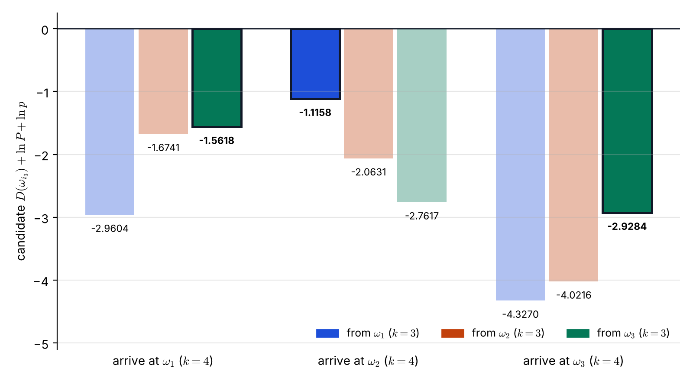
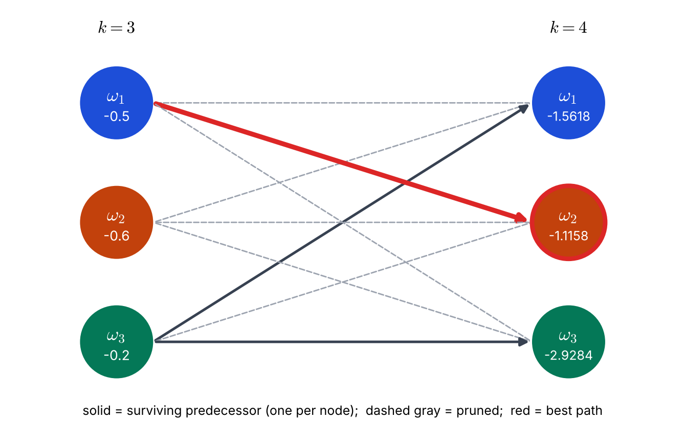

# Lecture 12 · KP05：Viterbi 手算實例（A worked Viterbi example）

> 程度：研究生（grad）／Level: Graduate (grad)
>
> 第 12 週（2026-11-23）｜Context-Dependent Classification · KP05
>
> Week 12 (2026-11-23) | Context-Dependent Classification · KP05

## 學習目標（Learning objectives）

- 在三個類別上，完整做一步 Viterbi 更新：九個候選、三個最大值（Carry out one full Viterbi update on three classes: nine candidates, three maxima）。
- 正確讀轉移表，並用對數成本比較（Read the transition table correctly and compare in log costs）。
- 選出最佳終點，沿回溯指標還原路徑（Pick the best end node and recover the path along the backpointers）。
- 說出最佳路徑的終點，為什麼可能不是「這一步似然最大」的類別（Explain why the end node of the best path may not be the class with the largest likelihood at this step）。

## KP05：Viterbi 手算實例（A worked Viterbi example）

**一句話重點**：每個終點各辦一場前驅選拔，三個終點選出各自的最佳前驅，最後從最後一欄挑總分最大的，再往回追。

**One-sentence summary**: Each end node holds its own predecessor election; the three nodes pick their best predecessors, then the largest total in the last column wins, and you trace back from it.

### 1. 接住上一講的問題（Picking up the question）

上一講的例子只有兩個類別，看不出做一步更新要處理多少數字。
這一講用來源的 Example 9.1：三個類別，一個新的觀測。
目標是把「九個候選、三個最大值」做得又準又穩。

The example of the last lecture had two classes, so it did not show how many numbers one update step involves.
This lecture uses the source's Example 9.1: three classes and one new observation.
The goal is to carry out "nine candidates, three maxima" accurately and steadily.

**白話說明**：想像三個隊伍的接力賽，前一棒結束時各隊累積了不同的成績。
下一棒每個隊伍都可以接前面任一隊的成績，再加上這一棒的表現。
每個隊伍只保留「接誰最划算」，最後比較三個隊伍誰最好。
這個比喻只說明選拔流程，沒說明轉移機率怎麼影響「接誰」。

**Plain explanation**: Imagine a relay race of three teams, each with a different cumulative result after the previous leg.
In the next leg every team may take over the result of any team, then add its own performance.
Each team keeps only "whom to take over from is cheapest", and finally the three teams are compared.
This analogy only shows the election process; it does not show how transition probabilities affect "whom to take over from".

**先備自測**：確認你記得 KP04 的遞迴與回溯，並讀得懂轉移表的列與欄。
不熟的話，回到 KP04 與 KP03 複習。

**Prerequisite check**: Make sure you remember the recursion and traceback of KP04 and can read the rows and columns of a transition table.
If not, review KP04 and KP03.

- 轉移表的列是「前一個類別」，欄是「這一個類別」（Rows are the previous class, columns the current class）。
- 對數分數相加；數值越大越好（Log scores add; larger is better）。
- 負數之間比較，$-1.1$ 大於 $-1.6$（Among negatives, $-1.1$ is larger than $-1.6$）。

### 2. 已知條件（Given data）

**正式定義**：問題有三個類別 $\omega_1,\omega_2,\omega_3$，觀測是一維。
已知第 $k=3$ 欄三個節點的最佳累積分數：

**Formal definition**: The problem has three classes $\omega_1,\omega_2,\omega_3$ and one-dimensional observations.
The best accumulated scores of the three nodes in column $k=3$ are known:

$$
D(\omega_1)=-0.5,\qquad D(\omega_2)=-0.6,\qquad D(\omega_3)=-0.2
$$

轉移機率與 KP03 的 Table 9.1 相同。
新的觀測是 $x_4=1.2$，來源給出它在三個類別下的對數似然：

The transition probabilities are the same as Table 9.1 in KP03.
The new observation is $x_4=1.2$, and the source gives its log likelihood under each class:

| 前一類 \ 這一類 | $\omega_1$ | $\omega_2$ | $\omega_3$ | 這一類的 $\ln p(x_4=1.2\mid\omega_j)$ |
|---|---|---|---|---|
| $\omega_1$ | $0.1$ | $0.7$ | $0.2$ | 到 $\omega_1$：$-0.1578$ |
| $\omega_2$ | $0.4$ | $0.3$ | $0.3$ | 到 $\omega_2$：$-0.2591$ |
| $\omega_3$ | $0.3$ | $0.1$ | $0.6$ | 到 $\omega_3$：$-2.2176$ |

三個式子共用同一個遞迴，每個終點 $\omega_j$ 都要算：

All three computations share one recursion; for each end node $\omega_j$ compute:

$$
D(\omega_j)=\max_{i}\Big[D(\omega_i)+\ln P(\omega_j\mid\omega_i)+\ln p(x_4\mid\omega_j)\Big]
$$

| 符號 | 中文意義 | English meaning |
|---|---|---|
| $D(\omega_i)$ | 第 3 欄到達 $\omega_i$ 的最佳累積分數 | Best accumulated score reaching $\omega_i$ in column 3 |
| $\ln P(\omega_j\mid\omega_i)$ | 從 $\omega_i$ 轉到 $\omega_j$ 的對數轉移機率 | Log transition probability from $\omega_i$ to $\omega_j$ |
| $\ln p(x_4\mid\omega_j)$ | 類別 $\omega_j$ 產生 $x_4$ 的對數似然 | Log likelihood of $x_4$ under class $\omega_j$ |

`[來源疑點]` 來源也給了高斯參數 $\mu_1=1.0,\sigma_1^2=0.03$；$\mu_2=1.5,\sigma_2^2=0.02$；$\mu_3=0.5,\sigma_3^2=0.01$。
用這組參數按高斯公式算 $\ln p(1.2\mid\omega_j)$，得到 $0.1677$、$-1.2129$、$-23.1164$，與來源的三個數字對不上。
本講以來源直接給出的三個對數似然為準，因為遞迴只需要它們；參數與數字的差異請老師核對來源。

`[Source issue]` The source also gives Gaussian parameters $\mu_1=1.0,\sigma_1^2=0.03$; $\mu_2=1.5,\sigma_2^2=0.02$; $\mu_3=0.5,\sigma_3^2=0.01$.
Computing $\ln p(1.2\mid\omega_j)$ from these parameters with the Gaussian formula gives $0.1677$, $-1.2129$, and $-23.1164$, which do not match the source's three numbers.
This lecture uses the three log likelihoods the source states directly, because the recursion needs only them; please check the discrepancy against the source.

**常見迷思**：「轉移表可以逐欄讀。」
不對。
$P(\omega_j\mid\omega_i)$ 是給定前一類 $\omega_i$ 的機率，所以**每一列**加起來才是 $1$。
要算「到 $\omega_1$」時，取的是**第一欄**的三個數 $0.1,0.4,0.3$，但它們分屬三個不同的前驅。

**Common misconception**: "The transition table can be read column by column."
Not so.
$P(\omega_j\mid\omega_i)$ is conditioned on the previous class $\omega_i$, so it is **each row** that sums to $1$.
To compute "arriving at $\omega_1$" you take the three numbers of the **first column**, $0.1,0.4,0.3$, but they belong to three different predecessors.

### 3. 三個終點的前驅選拔（Three predecessor elections）

上一節備好了數字。
現在對三個終點各算三個候選。
`[補充]` 下面的候選值是用程式以 $\ln0.1=-2.3026$ 等精確對數算出的；來源列出的末位在三處差 $0.0001$，是來源取小數位數的結果，不影響誰最大。

The previous section prepared the numbers.
Now compute three candidates for each end node.
`[Added]` The candidate values below were computed by program with exact logarithms such as $\ln0.1=-2.3026$; in three places the source's last digit differs by $0.0001$, a result of its rounding, and it does not change which is largest.

**到達 $\omega_1$**（用 $\ln p=-0.1578$）：

**Arriving at $\omega_1$** (using $\ln p=-0.1578$):

| 前驅 | 算式 | 候選值 |
|---|---|---|
| $\omega_1$ | $-0.5+\ln0.1-0.1578$ | $-2.9604$ |
| $\omega_2$ | $-0.6+\ln0.4-0.1578$ | $-1.6741$ |
| $\omega_3$ | $-0.2+\ln0.3-0.1578$ | $-1.5618$ |

最大的是 $-1.5618$，最佳前驅是 $\omega_3$。

The largest is $-1.5618$, and the best predecessor is $\omega_3$.

**到達 $\omega_2$**（用 $\ln p=-0.2591$）：

**Arriving at $\omega_2$** (using $\ln p=-0.2591$):

| 前驅 | 算式 | 候選值 |
|---|---|---|
| $\omega_1$ | $-0.5+\ln0.7-0.2591$ | $-1.1158$ |
| $\omega_2$ | $-0.6+\ln0.3-0.2591$ | $-2.0631$ |
| $\omega_3$ | $-0.2+\ln0.1-0.2591$ | $-2.7617$ |

最大的是 $-1.1158$，最佳前驅是 $\omega_1$。

The largest is $-1.1158$, and the best predecessor is $\omega_1$.

**到達 $\omega_3$**（用 $\ln p=-2.2176$）：

**Arriving at $\omega_3$** (using $\ln p=-2.2176$):

| 前驅 | 算式 | 候選值 |
|---|---|---|
| $\omega_1$ | $-0.5+\ln0.2-2.2176$ | $-4.3270$ |
| $\omega_2$ | $-0.6+\ln0.3-2.2176$ | $-4.0216$ |
| $\omega_3$ | $-0.2+\ln0.6-2.2176$ | $-2.9284$ |

最大的是 $-2.9284$，最佳前驅是 $\omega_3$ 自己，也就是自轉移。

The largest is $-2.9284$, and the best predecessor is $\omega_3$ itself, that is, a self-transition.



**圖說 `lec12-kp05-viterbi-example-f1-candidates`**：先看三個群組，每組是一個終點節點。
組內三根長條是三個前驅的候選值，顏色對應前驅 $\omega_1,\omega_2,\omega_3$。
圖上顏色深、有黑框的是該終點的勝出前驅，越接近 $0$ 越好。〔功能：2〕

**Caption `lec12-kp05-viterbi-example-f1-candidates`**: Look at the three groups first; each is one end node.
The three bars in a group are the candidate values of the three predecessors, colored by predecessor $\omega_1,\omega_2,\omega_3$.
The dark bar with a black frame is the winning predecessor of that end node; the closer to $0$, the better. [Function: 2]

### 4. 選終點與回溯（Choosing the end node and tracing back）

三個終點的最佳累積分數是 $-1.5618$、$-1.1158$、$-2.9284$。
如果 $k=4$ 是最後一欄，最大的是 $-1.1158$，所以最佳終點是 $\omega_2$。
它的存活前驅是第 3 欄的 $\omega_1$。

The best accumulated scores of the three end nodes are $-1.5618$, $-1.1158$, and $-2.9284$.
If $k=4$ is the last column, the largest is $-1.1158$, so the best end node is $\omega_2$.
Its surviving predecessor is $\omega_1$ in column 3.



**圖說 `lec12-kp05-viterbi-example-f2-trellis`**：先看右欄三個節點內的數字，它們是三場選拔的結果。
再看每個右側節點只有一條深色實線進來，其餘灰色虛線被淘汰；紅色粗線是通往最佳終點的那一步。
注意 $\omega_1$ 與 $\omega_3$ 的勝出前驅都是 $\omega_3$。〔功能：1、2〕

**Caption `lec12-kp05-viterbi-example-f2-trellis`**: Look first at the numbers inside the three right-hand nodes, the results of the three elections.
Then see that each right node has exactly one dark solid line entering it, the rest are pruned gray dashed lines, and the thick red line is the step into the best end node.
Note that the winning predecessor of both $\omega_1$ and $\omega_3$ is $\omega_3$. [Function: 1, 2]

來源接著說，沿著它圖中的回溯指標一路往前，最佳路徑是：

The source then states that, following the backpointers in its figure, the best path is:

$$
x_4\to\omega_2,\quad x_3\to\omega_1,\quad x_2\to\omega_2,\quad x_1\to\omega_1,\quad x_0\to\omega_2
$$

本講只驗證了最後一步 $x_4\to\omega_2$、$x_3\to\omega_1$：它們來自上面的計算。
更早的 $x_2,x_1,x_0$ 取自來源的圖，沒有在這個例子的已知條件中，所以標為「未獨立驗證」。
來源路徑中還出現了 $x_0$，但這一欄的起點定義沒有說明，請以來源為準。

This lecture verifies only the last step, $x_4\to\omega_2$ and $x_3\to\omega_1$: they come from the computation above.
The earlier $x_2,x_1,x_0$ are taken from the source's figure and are not part of this example's given data, so they are marked "not independently verified".
The source's path also contains $x_0$, whose starting convention is not explained, so rely on the source.

**怎麼記**：口訣是「每個終點各辦一場選拔，再從最後一欄選冠軍，往回追」。
因為分數是對數機率的和，所以值常是負的；比較時還是選**較大**的，例如 $-1.1158$ 大於 $-1.5618$。

**How to remember it**: The mantra is "each end node holds its own election, then pick the champion in the last column and trace back".
Because scores are sums of log probabilities, values are often negative; you still choose the **larger** one, for example $-1.1158$ is larger than $-1.5618$.

### 5. 為什麼終點不是似然最大的那個（Why the end node is not the most likely one）

這一步的觀測 $x_4=1.2$ 在 $\omega_1$ 下似然最大：$\ln p=-0.1578$，比 $\omega_2$ 的 $-0.2591$ 高。
如果逐點判斷，答案是 $\omega_1$。
但 Viterbi 選了 $\omega_2$，因為 $\omega_2$ 前面接的是 $\omega_1$，那一步轉移機率 $0.7$ 很大。

The observation $x_4=1.2$ has the largest likelihood under $\omega_1$: $\ln p=-0.1578$, higher than $-0.2591$ for $\omega_2$.
A point-by-point decision would answer $\omega_1$.
But Viterbi chose $\omega_2$, because $\omega_2$ is preceded by $\omega_1$ and that transition has a large probability $0.7$.

這和 KP01 的現象一樣：整串判斷會推翻一個逐點看起來較好的答案。
差別在於這次是用遞迴系統地算出來，不是只比兩條路徑。

This is the same phenomenon as in KP01: the whole-sequence decision can overturn a point-by-point answer.
The difference is that this time it is computed systematically by the recursion, not by comparing just two paths.

下面的程式把這一步寫成矩陣運算。
`cand[i, j]` 是前驅 $\omega_i$ 到終點 $\omega_j$ 的候選，沿著第 0 軸取最大就是三場選拔。

The code below writes this step as a matrix operation.
`cand[i, j]` is the candidate from predecessor $\omega_i$ to end node $\omega_j$, and taking the maximum along axis 0 gives the three elections.

```python
import numpy as np

D3 = np.array([-0.5, -0.6, -0.2])                     # 第 3 欄的最佳累積分數 / best scores of column 3
T = np.array([[0.1, 0.7, 0.2], [0.4, 0.3, 0.3], [0.3, 0.1, 0.6]])   # 列 = 前一類 / rows = previous class
ll = np.array([-0.1578, -0.2591, -2.2176])            # 來源給的 ln p(x4 | omega_j) / given by the source

cand = D3[:, None] + np.log(T) + ll[None, :]          # 九個候選 / the nine candidates
D4 = cand.max(axis=0)                                 # 三個終點的最佳值 / three best values
pred = cand.argmax(axis=0) + 1                        # 最佳前驅（類別編號從 1 起算）
print(np.round(D4, 4), pred, D4.argmax() + 1)         # [-1.5618 -1.1158 -2.9284] [3 1 3] 2
```

**留給下一節的問題**：到目前為止，類別是抽象的 $\omega_i$，觀測是一維的數。
這個方法在真實問題裡長什麼樣？
下一節看通訊中的通道等化，它的類別是「群集」，觀測是二維向量。

**The question for the next section**: So far the classes are abstract $\omega_i$ and the observations are one-dimensional numbers.
What does this method look like in a real problem?
The next section looks at channel equalization in communications, where the classes are "clusters" and the observations are two-dimensional vectors.

### 6. 小練習與解題示範（Practice and worked solutions）

**小練習** `[補充]`：先寫下理由，再看解答。

**Practice** `[Added]`: Write your reasoning before reading the solutions.

1. 題 1：把 $\ln p(x_4\mid\omega_3)$ 從 $-2.2176$ 改成 $-0.5$，其餘不變。重算到達 $\omega_3$ 的三個候選，並判斷最佳終點是否改變（Change $\ln p(x_4\mid\omega_3)$ from $-2.2176$ to $-0.5$ and keep the rest. Recompute the three candidates arriving at $\omega_3$ and decide whether the best end node changes）。
2. 題 2：這一步一共做了幾個候選加總、幾次取最大（How many candidate sums and how many maximum selections does this step perform）？
3. 題 3：只比較三個 $\ln p(x_4\mid\omega_j)$，會選哪個類別？它和 Viterbi 的終點一樣嗎（Comparing only the three $\ln p(x_4\mid\omega_j)$, which class is chosen, and is it the same as the Viterbi end node）？

**題 1 解題示範**：三個候選是 $-0.5+\ln0.2-0.5=-2.6094$、$-0.6+\ln0.3-0.5=-2.3040$、$-0.2+\ln0.6-0.5=-1.2108$。
最大的是 $-1.2108$，前驅仍是 $\omega_3$。
$\omega_3$ 的新分數 $-1.2108$ 仍小於 $\omega_2$ 的 $-1.1158$，所以最佳終點不變，仍是 $\omega_2$，但差距縮小了。

**Question 1 worked solution**: The three candidates are $-0.5+\ln0.2-0.5=-2.6094$, $-0.6+\ln0.3-0.5=-2.3040$, and $-0.2+\ln0.6-0.5=-1.2108$.
The largest is $-1.2108$, still with predecessor $\omega_3$.
The new score $-1.2108$ of $\omega_3$ is still smaller than $-1.1158$ of $\omega_2$, so the best end node does not change and stays $\omega_2$, but the gap narrows.

**題 2 解題示範**：每個終點 $3$ 個候選，三個終點共 $3\times3=9$ 個候選加總（每個再各加上三項），以及 $3$ 次取最大；最後在三個結果中再取一次最大選終點。
這就是 $M^2=9$ 的來源。

**Question 2 worked solution**: Each end node has $3$ candidates, so $3\times3=9$ candidate sums for three end nodes (each sums three terms), plus $3$ maximum selections; finally one more maximum picks the end node among the three results.
This is where $M^2=9$ comes from.

**題 3 解題示範**：$\ln p$ 最大的是 $\omega_1$（$-0.1578$），逐點會選 $\omega_1$。
Viterbi 的終點是 $\omega_2$，兩者不同。
原因是 Viterbi 還考慮了轉移：到 $\omega_1$ 的最佳總分是 $-1.5618$，低於到 $\omega_2$ 的 $-1.1158$。

**Question 3 worked solution**: The largest $\ln p$ is under $\omega_1$ ($-0.1578$), so a point-by-point decision picks $\omega_1$.
The Viterbi end node is $\omega_2$, which differs.
The reason is that Viterbi also accounts for transitions: the best total reaching $\omega_1$ is $-1.5618$, lower than $-1.1158$ reaching $\omega_2$.

## 術語表（Glossary）

| 中文術語 | English term |
|---|---|
| 對數似然 | Log likelihood |
| 轉移表 | Transition table |
| 候選 | Candidate |
| 前驅選拔 | Predecessor election |
| 最佳前驅 | Best predecessor |
| 自轉移 | Self-transition |
| 最佳終點 | Best end node |
| 回溯 | Traceback |
| 累積分數 | Accumulated score |

## 銜接與來源（Connections and sources）

下一講把類別換成通訊中的群集，把分支分數換成距離。
你會看到 Viterbi 不只能用在機率，也能用在距離。

The next lecture replaces classes by clusters from communications and the branch score by a distance.
You will see that Viterbi works not only with probabilities but also with distances.

- 前一單元：[KP04 Viterbi 演算法](lec12-kp04-viterbi.md)（Previous unit: the Viterbi algorithm）。
- 下一單元：[KP06 通道等化（一）：符號間干擾與群集](lec12-kp06-equalization-isi.md)（Next unit: channel equalization I, intersymbol interference and clusters）。
- 來源：[Context-Dependent Classification §9.4，Example 9.1](https://ndhuccc.github.io/CCC-LNS/PR_115/Ch09-context-dependent-classification/index.html)，讀取日期 2026-11-13（Source accessed 2026-11-13）。
- 書目：Theodoridis and Koutroumbas, *Pattern Recognition*, 4th ed., 2008；見[參考資料](../references/README.md)（See the bibliography）。

本講以自己的文字解釋來源。
接力賽比喻、轉移表讀法的迷思、高斯參數與對數似然不一致的核對、勝出前驅的討論、程式、圖與練習皆為 `[補充]`。
已知的三個累積分數、轉移表、三個對數似然、九個候選與三個終點值取自來源。

This lecture independently explains the source.
The relay analogy, the misconception about reading the transition table, the check that the Gaussian parameters and log likelihoods disagree, the discussion of winning predecessors, the code, the figures, and the practice are `[Added]`.
The three accumulated scores, the transition table, the three log likelihoods, the nine candidates, and the three end values come from the source.
