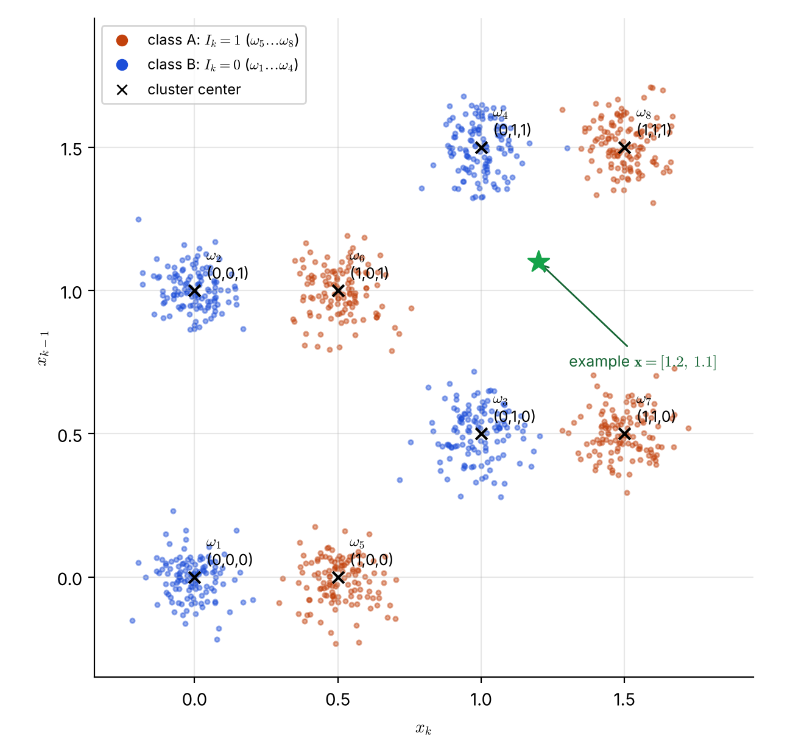
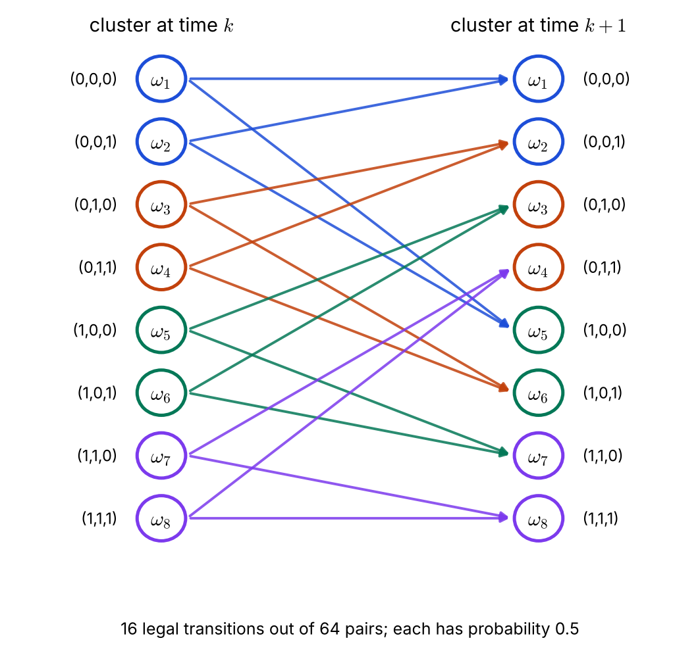

# Lecture 12 · KP06：通道等化（一）：符號間干擾與群集（Channel equalization I: intersymbol interference and clusters）

> 程度：研究生（grad）／Level: Graduate (grad)
>
> 第 12 週（2026-11-23）｜Context-Dependent Classification · KP06
>
> Week 12 (2026-11-23) | Context-Dependent Classification · KP06

## 學習目標（Learning objectives）

- 說明符號間干擾（ISI）如何使接收樣本依賴多個發送位元（Explain how intersymbol interference makes a received sample depend on several transmitted bits）。
- 算出給定通道與等化器長度下的群集數與群集中心（Compute the number of clusters and the cluster centers for a given channel and equalizer length）。
- 依「滑動視窗」規則寫出合法的群集轉移，並指出來源一處分組的錯誤（Write the legal cluster transitions from the sliding-window rule and point out an error in one of the source's groupings）。
- 說出為什麼逐點最近中心判決在雜訊大時會出錯，而情境資訊能補救（Explain why nearest-center decisions point by point fail under heavy noise and how context helps）。

## KP06：通道等化（一）：符號間干擾與群集（Channel equalization I）

**一句話重點**：通道讓一個位元的影響延續到後面的取樣，所以連續的接收取樣聚成 $2^{n+l-1}$ 個群集，而群集之間只能按固定規則轉移，這使等化成為情境相依分類。

**One-sentence summary**: The channel lets one bit's effect last into later samples, so consecutive received samples gather into $2^{n+l-1}$ clusters, and the clusters can move only by a fixed rule; this makes equalization a context-dependent classification problem.

### 1. 接住上一講的問題（Picking up the question）

前面五講都用抽象的類別 $\omega_i$。
這一講換成一個真實的工程問題：數位通訊。
它的類別是「群集」，分支分數是「距離」。

The previous five lectures used abstract classes $\omega_i$.
This lecture switches to a real engineering problem: digital communications.
Its classes are "clusters", and its branch score is a "distance".

發送端送出一串二進位位元 $I_k\in\{0,1\}$。
訊號經過通道並混入雜訊，接收端在時刻 $k$ 取樣到 $x_k$。
問題是：從取樣值還原出發送的位元。

The transmitter sends a stream of binary bits $I_k\in\{0,1\}$.
The signal goes through a channel and picks up noise, and the receiver samples $x_k$ at time $k$.
The problem is to recover the transmitted bits from the samples.

**白話說明**：想像在山谷裡喊話，聲音會有回音。
你剛喊的字，和前一個字的回音疊在一起，聽的人收到的是兩個字的混合。
這個比喻只說明「前面的字會混進現在」，沒說明回音的大小怎麼用公式描述。

**Plain explanation**: Imagine shouting in a valley with echoes.
The word you just shouted overlaps with the echo of the previous word, and the listener receives a mixture of two words.
This analogy only shows that "earlier words leak into the present"; it does not say how the size of the echo is described by a formula.

**先備自測**：確認你會算兩點的歐氏距離，並記得 KP04 的 Viterbi 遞迴。
不熟的話，回到第 10 週與 KP04 複習。

**Prerequisite check**: Make sure you can compute the Euclidean distance of two points and remember the Viterbi recursion of KP04.
If not, review Week 10 and KP04.

- 點 $\mathbf{a}$ 與 $\mathbf{b}$ 的歐氏距離是 $\|\mathbf{a}-\mathbf{b}\|=\sqrt{\sum_j(a_j-b_j)^2}$（The Euclidean distance between $\mathbf{a}$ and $\mathbf{b}$）。
- Viterbi 的分支分數可以換成別的成本（The Viterbi branch score can be replaced by another cost）。
- 距離越小越像（$A$ smaller distance means more similar）。

### 2. 通道、等化器與群集（The channel, the equalizer, and the clusters）

**正式定義**：通道的輸出是目前與過去幾個位元的函數，加上雜訊 $\eta_k$：

**Formal definition**: The channel output is a function of the current and several past bits, plus noise $\eta_k$:

$$
x_k=f(I_k,I_{k-1},\dots,I_{k-n+1})+\eta_k
$$

通道的影響跨越 $n$ 個位元，這個現象叫**符號間干擾**（intersymbol interference, ISI）。
**等化器**（equalizer）是通道的逆向系統：它取連續 $l$ 個取樣，組成觀測向量 $\mathbf{x}_k=[x_k,x_{k-1},\dots,x_{k-l+1}]^\top$，估計發送的位元 $\hat I_k$。

The channel affects a span of $n$ bits, and this phenomenon is called **intersymbol interference** (ISI).
The **equalizer** is the inverse system of the channel: it takes $l$ consecutive samples, forms the observation vector $\mathbf{x}_k=[x_k,x_{k-1},\dots,x_{k-l+1}]^\top$, and estimates the transmitted bit $\hat I_k$.

本講用來源的一個經典通道：

This lecture uses a classic channel from the source:

$$
x_k=0.5\,I_k+I_{k-1}+\eta_k
$$

它的 $n=2$。
取 $l=2$ 個取樣，觀測向量是 $\mathbf{x}_k=[x_k,x_{k-1}]^\top$。
$x_k$ 含 $I_k,I_{k-1}$，$x_{k-1}$ 含 $I_{k-1},I_{k-2}$，所以整個向量取決於**連續三個位元** $(I_k,I_{k-1},I_{k-2})$。

It has $n=2$.
Take $l=2$ samples, so the observation vector is $\mathbf{x}_k=[x_k,x_{k-1}]^\top$.
$x_k$ contains $I_k,I_{k-1}$ and $x_{k-1}$ contains $I_{k-1},I_{k-2}$, so the whole vector depends on **three consecutive bits** $(I_k,I_{k-1},I_{k-2})$.

三個位元共有 $2^3=8$ 種組合。
不考慮雜訊時，每種組合對應平面上一個固定的點；有雜訊時，觀測向量聚集在這 $8$ 個點周圍，形成 $8$ 個**群集** $\omega_1,\dots,\omega_8$。
一般的群集數是 $2^{n+l-1}$；這裡是 $2^{2+2-1}=8$。

Three bits have $2^3=8$ combinations.
Without noise, each combination corresponds to one fixed point in the plane; with noise, the observation vectors gather around these $8$ points to form $8$ **clusters** $\omega_1,\dots,\omega_8$.
In general the number of clusters is $2^{n+l-1}$; here it is $2^{2+2-1}=8$.

| 群集 | $(I_k,I_{k-1},I_{k-2})$ | 中心 $(x_k,x_{k-1})$ | $I_k$ | 類別 |
|---|---|---|---|---|
| $\omega_1$ | $(0,0,0)$ | $(0,\ 0)$ | $0$ | B |
| $\omega_2$ | $(0,0,1)$ | $(0,\ 1)$ | $0$ | B |
| $\omega_3$ | $(0,1,0)$ | $(1,\ 0.5)$ | $0$ | B |
| $\omega_4$ | $(0,1,1)$ | $(1,\ 1.5)$ | $0$ | B |
| $\omega_5$ | $(1,0,0)$ | $(0.5,\ 0)$ | $1$ | A |
| $\omega_6$ | $(1,0,1)$ | $(0.5,\ 1)$ | $1$ | A |
| $\omega_7$ | $(1,1,0)$ | $(1.5,\ 0.5)$ | $1$ | A |
| $\omega_8$ | $(1,1,1)$ | $(1.5,\ 1.5)$ | $1$ | A |

把 $\mathbf{x}_k$ 判成 $I_k=1$（類別 $A$）或 $I_k=0$（類別 $B$），就是把觀測指派給群集：$\omega_5\sim\omega_8$ 的聯集是 $A$，$\omega_1\sim\omega_4$ 的聯集是 $B$。

Deciding $\mathbf{x}_k$ as $I_k=1$ (class A) or $I_k=0$ (class B) means assigning the observation to a cluster: the union of $\omega_5\sim\omega_8$ is A, and the union of $\omega_1\sim\omega_4$ is B.

| 符號 | 中文意義 | English meaning |
|---|---|---|
| $I_k$ | 時刻 $k$ 發送的位元 | Bit transmitted at time $k$ |
| $n$ | 通道記憶長度（影響跨越的位元數） | Channel memory length (span of bits affecting a sample) |
| $l$ | 等化器使用的連續取樣數 | Number of consecutive samples used by the equalizer |
| $\eta_k$ | 雜訊 | Noise |
| $\mathbf{x}_k$ | 觀測向量 $[x_k,x_{k-1}]^\top$ | Observation vector $[x_k,x_{k-1}]^\top$ |
| $2^{n+l-1}$ | 群集數（二進位） | Number of clusters (binary) |



**圖說 `lec12-kp06-equalization-isi-f1-eight-clusters`**：先看八個黑色叉號，它們是無雜訊時的群集中心，括弧內是對應的三個位元。
再看顏色：藍色是類別 $B$（$I_k=0$），橘色是類別 $A$（$I_k=1$）；點雲是雜訊 $\sigma=0.08$ 下的模擬觀測。
注意最近的 $A$、$B$ 群集中心只隔 $0.5$，綠色星號是下一節的例子。〔功能：1、2、3〕

**Caption `lec12-kp06-equalization-isi-f1-eight-clusters`**: Look first at the eight black crosses, the noiseless cluster centers, with the three bits in parentheses.
Then look at color: blue is class B ($I_k=0$) and orange is class A ($I_k=1$); the clouds are simulated observations with noise $\sigma=0.08$.
Note that the nearest A and B centers are only $0.5$ apart, and the green star is the example of the next section. [Function: 1, 2, 3]

**常見迷思**：「等化器一定要先估出通道公式 $f$。」
不一定。
群集法只需要在訓練時送已知位元序列，統計各群集的中心與共變異數，不需要知道 $f$ 的形式。
來源指出，當有同通道干擾（雜訊不是白雜訊）或通道高度非線性時，估計 $f$ 很困難，群集法反而更穩健。

**Common misconception**: "An equalizer must first estimate the channel formula $f$."
Not necessarily.
The cluster method only needs, during training, to send known bit sequences and collect each cluster's center and covariance; it does not need the form of $f$.
The source notes that with cochannel interference (noise that is not white) or a highly nonlinear channel, estimating $f$ is hard, and the cluster method is more robust.

### 3. 合法轉移：滑動視窗（Legal transitions: the sliding window）

上一節的群集是「某一時刻」的狀況。
情境相依的來源，是相鄰時刻的群集不能任意轉移。

The clusters of the previous section describe "one moment".
The source of context dependence is that clusters at adjacent moments cannot move arbitrarily.

時刻 $k$ 的三元組是 $(I_k,I_{k-1},I_{k-2})$，時刻 $k+1$ 的是 $(I_{k+1},I_k,I_{k-1})$。
新三元組的後兩個位元，必定繼承舊三元組的前兩個位元。
只有 $I_{k+1}$ 是新發送的，可以是 $0$ 或 $1$。

The triple at time $k$ is $(I_k,I_{k-1},I_{k-2})$ and at time $k+1$ it is $(I_{k+1},I_k,I_{k-1})$.
The last two bits of the new triple must inherit the first two bits of the old triple.
Only $I_{k+1}$ is newly transmitted and can be $0$ or $1$.

例如 $\omega_2=(0,0,1)$ 的下一步只能是 $(d,0,0)$，也就是 $\omega_1$（$d=0$）或 $\omega_5$（$d=1$），其他 $6$ 個轉移都不合法，機率是 $0$。
若發送位元等機率，每個合法轉移的機率是 $0.5$。
全部 $8\times8=64$ 個可能的轉移中，只有 $16$ 個合法。

For example, the next step of $\omega_2=(0,0,1)$ can only be $(d,0,0)$, that is $\omega_1$ ($d=0$) or $\omega_5$ ($d=1$); the other $6$ transitions are illegal, with probability $0$.
If the transmitted bits are equiprobable, each legal transition has probability $0.5$.
Among all $8\times8=64$ possible transitions, only $16$ are legal.



**圖說 `lec12-kp06-equalization-isi-f2-legal-transitions`**：先看左欄任一個群集，它恰好有兩條箭頭射向右欄。
再看顏色：同色的兩個群集（例如 $\omega_1,\omega_2$）射向相同的兩個目標，這是 KP07 能把八個群集縮成四個狀態的原因。
圖上共 $16$ 條箭頭，對應 $16$ 個合法轉移。〔功能：1〕

**Caption `lec12-kp06-equalization-isi-f2-legal-transitions`**: Look at any cluster in the left column first; exactly two arrows leave it for the right column.
Then look at color: the two clusters of the same color (for example $\omega_1,\omega_2$) point to the same two targets, and this is why KP07 can shrink eight clusters to four states.
There are $16$ arrows in total, matching the $16$ legal transitions. [Function: 1]

`[來源疑點]` 來源在 9.5（二）列出成對群集的目標：「$\omega_5,\omega_6$ 的下一步是 $\omega_1$ 或 $\omega_5$」「$\omega_7,\omega_8$ 的下一步是 $\omega_2$ 或 $\omega_6$」。
依上面的滑動視窗規則，$\omega_5=(1,0,0)$ 的下一步是 $(d,1,0)$，即 $\omega_3$ 或 $\omega_7$；$\omega_7=(1,1,0)$ 的下一步是 $(d,1,1)$，即 $\omega_4$ 或 $\omega_8$。
來源的這兩組似乎是把前兩組複製貼上，本講採用規則推出的結果，並用程式列舉驗證。

`[Source issue]` In 9.5 (II) the source lists the targets of paired clusters: "the next step of $\omega_5,\omega_6$ is $\omega_1$ or $\omega_5$" and "the next step of $\omega_7,\omega_8$ is $\omega_2$ or $\omega_6$".
By the sliding-window rule above, the next step of $\omega_5=(1,0,0)$ is $(d,1,0)$, that is $\omega_3$ or $\omega_7$, and the next step of $\omega_7=(1,1,0)$ is $(d,1,1)$, that is $\omega_4$ or $\omega_8$.
These two groups in the source look like a copy of the first two; this lecture uses the result of the rule and verifies it by enumeration in code.

### 4. 轉移代價：把機率換成距離（Branch cost: from probability to distance）

KP04 說過，只要成本有最佳子結構，Viterbi 的分支分數可以換掉。
等化問題給 $\mathbf{x}_k$ 一個群集 $\omega_{i_k}$，分支成本取觀測向量到該群集中心的距離，距離越小越好：

KP04 said that the Viterbi branch score can be replaced as long as the cost has optimal substructure.
In equalization, the cost of assigning $\mathbf{x}_k$ to a cluster $\omega_{i_k}$ is the distance from the observation vector to that cluster's center; the smaller, the better:

$$
d_{\omega_{i_k}}(\mathbf{x}_k)=\|\mathbf{x}_k-\boldsymbol{\mu}_{i_k}\|
$$

若各群集的形狀不同，改用**馬氏距離**（Mahalanobis distance），把共變異數 $\Sigma_{i_k}$ 納入：

If clusters have different shapes, use the **Mahalanobis distance**, which includes the covariance $\Sigma_{i_k}$:

$$
d_{\omega_{i_k}}(\mathbf{x}_k)=\Big((\mathbf{x}_k-\boldsymbol{\mu}_{i_k})^\top\Sigma_{i_k}^{-1}(\mathbf{x}_k-\boldsymbol{\mu}_{i_k})\Big)^{1/2}
$$

中心 $\boldsymbol{\mu}_i$ 與共變異數 $\Sigma_i$ 在訓練期間，由發送已知位元序列後統計而得。
若 $l=1$ 且雜訊是獨立高斯，來源還給出純量形式 $-(x_k-\hat f)^2$，即把模型預測值 $\hat f$ 當中心的負平方誤差；它等於上式平方後取負號、再乘上一個依雜訊變異數而定的正數，因為最大化 $\ln p$ 等於最小化平方距離。

The centers $\boldsymbol{\mu}_i$ and covariances $\Sigma_i$ are collected during training after sending known bit sequences.
For $l=1$ and independent Gaussian noise, the source also gives the scalar form $-(x_k-\hat f)^2$, a negative squared error with the model prediction $\hat f$ as the center; it equals the formula above squared, negated, and multiplied by a positive scale that depends on the noise variance, because maximizing $\ln p$ equals minimizing the squared distance.

### 5. 主例子：一個含糊的觀測（Main example: an ambiguous observation）

上一節定義了距離。
現在拿一個實際的觀測向量，看逐點判決會發生什麼。

The previous section defined the distance.
Now take an actual observation vector and see what a point-by-point decision does.

**例子**：`[補充]` 設某時刻觀測向量 $\mathbf{x}=[1.2,\ 1.1]^\top$（圖 f1 的綠色星號）。
到八個群集中心的歐氏距離如下：

**Example**: `[Added]` Let the observation vector at some moment be $\mathbf{x}=[1.2,\ 1.1]^\top$ (the green star in figure f1).
The Euclidean distances to the eight cluster centers are:

| 群集 | 中心 | 距離 $\|\mathbf{x}-\boldsymbol{\mu}\|$ |
|---|---|---|
| $\omega_4$ | $(1,\ 1.5)$ | $\sqrt{0.04+0.16}=0.4472$ |
| $\omega_8$ | $(1.5,\ 1.5)$ | $\sqrt{0.09+0.16}=0.5000$ |
| $\omega_3$ | $(1,\ 0.5)$ | $\sqrt{0.04+0.36}=0.6325$ |
| $\omega_7$ | $(1.5,\ 0.5)$ | $\sqrt{0.09+0.36}=0.6708$ |
| $\omega_6$ | $(0.5,\ 1)$ | $\sqrt{0.49+0.01}=0.7071$ |
| $\omega_2$ | $(0,\ 1)$ | $\sqrt{1.44+0.01}=1.2042$ |
| $\omega_5$ | $(0.5,\ 0)$ | $\sqrt{0.49+1.21}=1.3038$ |
| $\omega_1$ | $(0,\ 0)$ | $\sqrt{1.44+1.21}=1.6279$ |

最近的是 $\omega_4$，屬於類別 $B$，所以逐點判成 $I_k=0$。
但最近的 $A$ 群集 $\omega_8$ 只差 $0.0528$，差距很小。
只要雜訊稍大，這個判決就會翻轉。

The nearest is $\omega_4$, which belongs to class B, so the point-by-point decision is $I_k=0$.
But the nearest A cluster $\omega_8$ is behind by only $0.0528$, a tiny margin.
A slightly larger noise would flip this decision.

這不是特例。
`[補充]` 我們用固定種子模擬了 $20{,}001$ 個連續位元，每個觀測向量都各自取最近中心，只輸出 $I_k$：雜訊標準差 $\sigma=0.1$ 時錯了 $126$ 個，錯誤率 $0.63\%$；$\sigma=0.2$ 時錯了 $2509$ 個，錯誤率 $12.5\%$。
最近的 $A$、$B$ 中心只隔 $0.5$，所以雜訊一大，錯誤率急速上升。

This is not a special case.
`[Added]` We simulated $20{,}001$ consecutive bits with a fixed seed, with every observation vector taking its nearest center independently and outputting only $I_k$: with noise standard deviation $\sigma=0.1$ there were $126$ errors, an error rate of $0.63\%$; with $\sigma=0.2$ there were $2509$ errors, an error rate of $12.5\%$.
The nearest A and B centers are only $0.5$ apart, so the error rate climbs rapidly as the noise grows.

逐點判決完全忽略了合法轉移：它可能先判出 $\omega_4$，下一刻判出一個根本不能接在 $\omega_4$ 後面的群集。
KP07 把合法轉移放進 Viterbi，在同一份模擬資料上錯誤率會大幅下降。

The point-by-point decision ignores legal transitions completely: it may judge $\omega_4$ first and then a cluster that cannot possibly follow $\omega_4$.
KP07 puts the legal transitions into Viterbi, and on the same simulated data the error rate falls sharply.

### 6. 與實作的連結（Connection to implementation）

下面的程式建立八個群集中心，並用「新三元組的後兩位元繼承舊三元組的前兩位元」的規則列舉所有合法轉移。
它印出 $16$，與圖 f2 的箭頭數一致。

The code below builds the eight cluster centers and enumerates all legal transitions with the rule "the last two bits of the new triple inherit the first two bits of the old triple".
It prints $16$, matching the number of arrows in figure f2.

```python
import itertools
import numpy as np

# 群集以 (I_k, I_{k-1}, I_{k-2}) 索引；中心 = (x_k, x_{k-1}) 的無雜訊值
centers = {t: np.array([0.5 * t[0] + t[1], 0.5 * t[1] + t[2]])
           for t in itertools.product((0, 1), repeat=3)}
keys = list(centers)                                   # 順序即 omega_1..omega_8

legal = [(a, (d, a[0], a[1]))                          # 新三元組 = (新位元, 舊 I_k, 舊 I_{k-1})
         for a in keys for d in (0, 1)]
print(len(legal))                                      # 16

x = np.array([1.2, 1.1])                               # 示例觀測向量
dist = {f"w{keys.index(t) + 1}": round(float(np.linalg.norm(x - c)), 4) for t, c in centers.items()}
print(min(dist, key=dist.get), dist["w4"])             # w4 0.4472
```

**留給下一節的問題**：八個群集的網格，每一步要維護八個節點。
但圖 f2 顯示成對的群集有相同的目標，這是不是浪費？
下一節把「最近的兩個位元」定義成狀態，只剩四個節點。

**The question for the next section**: A grid of eight clusters needs eight nodes per step.
But figure f2 shows that paired clusters share the same targets; is this wasteful?
The next section defines "the latest two bits" as the state, leaving only four nodes.

### 7. 小練習與解題示範（Practice and worked solutions）

**小練習** `[補充]`：先寫下理由，再看解答。

**Practice** `[Added]`: Write your reasoning before reading the solutions.

1. 題 1：位元三元組 $(1,0,1)$ 的群集中心是什麼？它是第幾個群集（What is the cluster center of the bit triple $(1,0,1)$, and which cluster is it）？
2. 題 2：從 $\omega_7$ 出發，合法的下一個群集有哪些（From $\omega_7$, which clusters are legal next steps）？
3. 題 3：若通道記憶 $n=3$、等化器取 $l=2$ 個取樣，二進位下有幾個群集？若 $n=2$、$l=1$ 呢（If the channel memory is $n=3$ and the equalizer takes $l=2$ samples, how many clusters are there in binary? And for $n=2$, $l=1$）？

**題 1 解題示範**：$(I_k,I_{k-1},I_{k-2})=(1,0,1)$：$x_k=0.5\times1+0=0.5$，$x_{k-1}=0.5\times0+1=1$。
中心是 $(0.5,\ 1)$，也就是 $\omega_6$。

**Question 1 worked solution**: For $(I_k,I_{k-1},I_{k-2})=(1,0,1)$: $x_k=0.5\times1+0=0.5$ and $x_{k-1}=0.5\times0+1=1$.
The center is $(0.5,\ 1)$, which is $\omega_6$.

**題 2 解題示範**：$\omega_7=(1,1,0)$。
新三元組是 $(d,1,1)$：$d=0$ 得 $(0,1,1)=\omega_4$，$d=1$ 得 $(1,1,1)=\omega_8$。
所以合法的下一步是 $\omega_4$ 與 $\omega_8$（不是來源文字寫的 $\omega_2,\omega_6$）。

**Question 2 worked solution**: $\omega_7=(1,1,0)$.
The new triple is $(d,1,1)$: $d=0$ gives $(0,1,1)=\omega_4$ and $d=1$ gives $(1,1,1)=\omega_8$.
So the legal next steps are $\omega_4$ and $\omega_8$ (not the $\omega_2,\omega_6$ written in the source text).

**題 3 解題示範**：$n=3$、$l=2$：$2^{n+l-1}=2^{4}=16$ 個群集。
$n=2$、$l=1$：$2^{2+1-1}=2^2=4$ 個群集。
取樣越多、通道記憶越長，群集數翻倍成長。

**Question 3 worked solution**: For $n=3$, $l=2$: $2^{n+l-1}=2^{4}=16$ clusters.
For $n=2$, $l=1$: $2^{2+1-1}=2^2=4$ clusters.
More samples or a longer channel memory doubles the number of clusters each time.

## 術語表（Glossary）

| 中文術語 | English term |
|---|---|
| 通道等化 | Channel equalization |
| 等化器 | Equalizer |
| 符號間干擾 | Intersymbol interference (ISI) |
| 通道記憶 | Channel memory |
| 觀測向量 | Observation vector |
| 群集 | Cluster |
| 群集中心 | Cluster center |
| 合法轉移 | Legal transition |
| 滑動視窗 | Sliding window |
| 歐氏距離 | Euclidean distance |
| 馬氏距離 | Mahalanobis distance |
| 共變異數 | Covariance |
| 同通道干擾 | Cochannel interference |
| 訓練序列 | Training sequence |

## 銜接與來源（Connections and sources）

下一講把成對的群集合併成「狀態」，並在狀態網格上跑 Viterbi。
你會看到節點數從八個減到四個。

The next lecture merges paired clusters into "states" and runs Viterbi on a state trellis.
You will see the number of nodes drop from eight to four.

- 前一單元：[KP05 Viterbi 手算實例](lec12-kp05-viterbi-example.md)（Previous unit: a worked Viterbi example）。
- 下一單元：[KP07 通道等化（二）：狀態與有限狀態機](lec12-kp07-state-fsm.md)（Next unit: channel equalization II, states and finite state machines）。
- 來源：[Context-Dependent Classification §9.5（一）](https://ndhuccc.github.io/CCC-LNS/PR_115/Ch09-context-dependent-classification/index.html)，讀取日期 2026-11-13（Source accessed 2026-11-13）。
- 書目：Theodoridis and Koutroumbas, *Pattern Recognition*, 4th ed., 2008；見[參考資料](../references/README.md)（See the bibliography）。

本講以自己的文字解釋來源。
山谷回音比喻、含糊觀測的八個距離、逐點判決的模擬錯誤率、合法轉移規則的程式列舉與對來源分組的更正、圖與練習皆為 `[補充]`。
通道模型、群集數 $2^{n+l-1}$、八個群集中心、合法轉移的概念、距離與代價函數取自來源。

This lecture independently explains the source.
The valley-echo analogy, the eight distances for the ambiguous observation, the simulated error rates of the point-by-point decision, the code enumeration of the legal-transition rule and the correction to the source's grouping, the figures, and the practice are `[Added]`.
The channel model, the cluster count $2^{n+l-1}$, the eight cluster centers, the idea of legal transitions, and the distances and cost functions come from the source.
