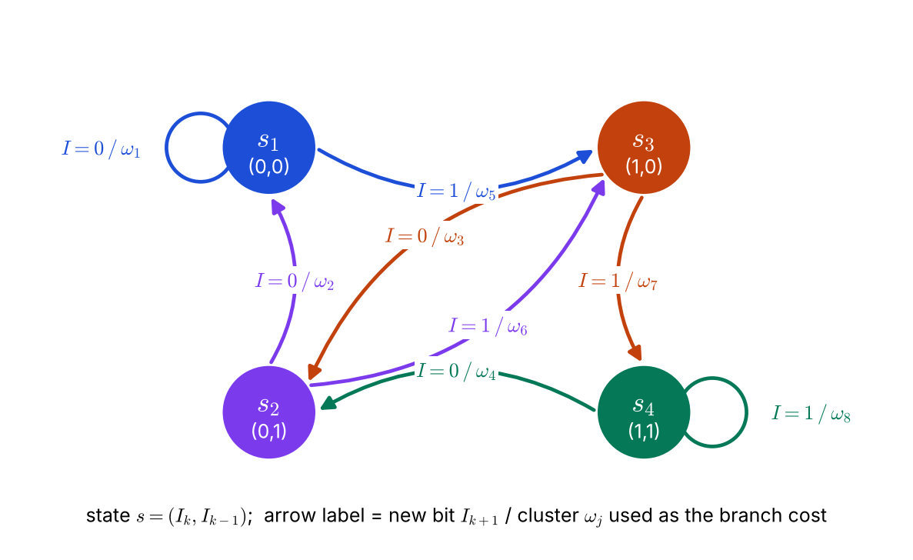
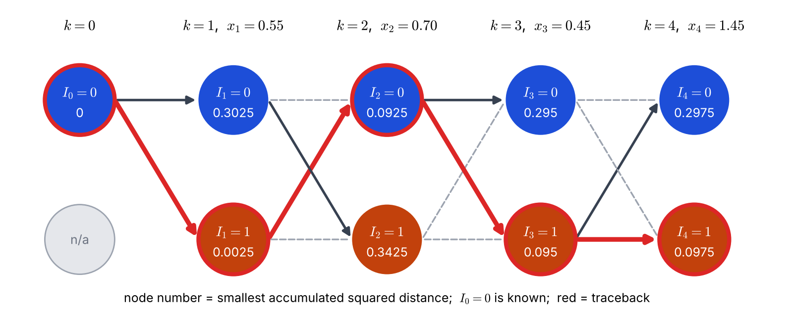

# Lecture 12 · KP07：通道等化（二）：狀態與有限狀態機（Channel equalization II: states and finite state machines）

> 程度：研究生（grad）／Level: Graduate (grad)
>
> 第 12 週（2026-11-23）｜Context-Dependent Classification · KP07
>
> Week 12 (2026-11-23) | Context-Dependent Classification · KP07

## 學習目標（Learning objectives）

- 說明為什麼八個群集的網格可以縮成四個狀態的網格（Explain why a trellis of eight clusters can shrink to a trellis of four states）。
- 寫出狀態的定義，並用狀態與新位元查出下一個狀態與所用的群集（Define a state and use it with the new bit to look up the next state and the cluster used）。
- 在狀態網格上手算一個純量例子的 Viterbi，並與逐點判決比較（Run Viterbi by hand on a scalar example on a state trellis and compare with point-by-point decisions）。
- 說出「狀態是內部記憶」這個觀點如何通向隱藏馬可夫模型（Explain how the view "a state is internal memory" leads to hidden Markov models）。

## KP07：通道等化（二）：狀態與有限狀態機（Channel equalization II）

**一句話重點**：群集之間的合法轉移只由最近的幾個位元決定，把這幾個位元定義成「狀態」，八個群集的網格就縮成四個狀態的有限狀態機，Viterbi 的工作量減半。

**One-sentence summary**: The legal transitions between clusters are decided only by the latest few bits; defining those bits as the "state" shrinks the trellis of eight clusters to a four-state finite state machine and halves the work of Viterbi.

### 1. 接住上一講的問題（Picking up the question）

上一講的圖 f2 有一個值得注意的現象：成對的群集射向相同的兩個目標。
例如 $\omega_1=(0,0,0)$ 與 $\omega_2=(0,0,1)$，下一步都是 $\omega_1$ 或 $\omega_5$。
它們只差最舊的位元 $I_{k-2}$。

Figure f2 of the last lecture showed something worth noticing: paired clusters point to the same two targets.
For example $\omega_1=(0,0,0)$ and $\omega_2=(0,0,1)$ both go next to $\omega_1$ or $\omega_5$.
They differ only in the oldest bit $I_{k-2}$.

這說明合法轉移的方向，與最舊的那個位元無關。
既然如此，在網格上為這兩個群集各留一個節點，就是在重複記同一件事。

This says the direction of a legal transition does not depend on the oldest bit.
If so, keeping one node for each of these two clusters on the trellis means remembering the same thing twice.

**白話說明**：想像一個走廊，你只要知道「最近走過的兩個房間」就能決定下一步能去哪裡。
更早去過哪個房間，不改變你現在能走的路。
把「最近兩個房間」當成你的位置，就不必記更多。
這個比喻只說明「只記最近的」，沒說明這個「位置」要包含幾個位元。

**Plain explanation**: Imagine a corridor where knowing "the last two rooms you passed" is enough to decide where you can go next.
Which room you visited earlier does not change the paths open to you now.
Take "the last two rooms" as your position and you need not remember more.
This analogy only shows "remember only the recent ones"; it does not say how many bits the "position" must contain.

**先備自測**：確認你記得 KP06 的八個群集與合法轉移規則。
不熟的話，回到 KP06 複習。

**Prerequisite check**: Make sure you remember the eight clusters and the legal-transition rule of KP06.
If not, review KP06.

- 群集以 $(I_k,I_{k-1},I_{k-2})$ 索引（A cluster is indexed by $(I_k,I_{k-1},I_{k-2})$）。
- 新三元組的後兩位元繼承舊三元組的前兩位元（The last two bits of the new triple inherit the first two bits of the old triple）。
- 分支成本是觀測向量到群集中心的距離（The branch cost is the distance from the observation to the cluster center）。

### 2. 狀態與有限狀態機（States and the finite state machine）

**正式定義**：合法轉移完全由最近的 $n+l-2$ 個位元決定。
在 $n=2$、$l=2$ 的例子裡，$n+l-2=2$，所以把最近兩個位元定義為時刻 $k$ 的**狀態**（state）：

**Formal definition**: Legal transitions are decided entirely by the latest $n+l-2$ bits.
In the example $n=2$, $l=2$, so $n+l-2=2$, and the latest two bits define the **state** at time $k$:

$$
s_k=(I_k,I_{k-1})
$$

二進位時，狀態總數是 $2^{n+l-2}=2^2=4$：$s_1=(0,0)$、$s_2=(0,1)$、$s_3=(1,0)$、$s_4=(1,1)$。
已知時刻 $k$ 的狀態 $(I_k,I_{k-1})$ 與新發送的位元 $I_{k+1}$，下一個狀態就唯一確定：

With binary bits the number of states is $2^{n+l-2}=2^2=4$: $s_1=(0,0)$, $s_2=(0,1)$, $s_3=(1,0)$, $s_4=(1,1)$.
Given the state $(I_k,I_{k-1})$ at time $k$ and the newly transmitted bit $I_{k+1}$, the next state is uniquely determined:

$$
(I_k,I_{k-1})\ \xrightarrow{\ I_{k+1}\ }\ (I_{k+1},I_k)
$$

這是標準的**有限狀態機**（finite state machine, FSM）。
每一條轉移還對應一個群集：三個位元 $(I_{k+1},I_k,I_{k-1})$ 唯一決定八個群集中的一個。
所以這條分支的成本，就是觀測向量到該群集中心的距離。

This is a standard **finite state machine** (FSM).
Each transition also corresponds to a cluster: the three bits $(I_{k+1},I_k,I_{k-1})$ determine exactly one of the eight clusters.
So the cost of this branch is the distance from the observation vector to that cluster's center.

| 目前狀態 | 新位元 $I_{k+1}=0$ | 新位元 $I_{k+1}=1$ |
|---|---|---|
| $s_1=(0,0)$ | $s_1$，群集 $\omega_1$ | $s_3$，群集 $\omega_5$ |
| $s_2=(0,1)$ | $s_1$，群集 $\omega_2$ | $s_3$，群集 $\omega_6$ |
| $s_3=(1,0)$ | $s_2$，群集 $\omega_3$ | $s_4$，群集 $\omega_7$ |
| $s_4=(1,1)$ | $s_2$，群集 $\omega_4$ | $s_4$，群集 $\omega_8$ |

| 符號 | 中文意義 | English meaning |
|---|---|---|
| $s_k=(I_k,I_{k-1})$ | 時刻 $k$ 的狀態（最近兩個位元） | State at time $k$ (the latest two bits) |
| $2^{n+l-2}$ | 狀態數（二進位） | Number of states (binary) |
| $I_{k+1}$ | 新發送的位元，決定走哪條分支 | The newly transmitted bit, choosing the branch |
| 分支 | 一條狀態轉移，對應一個群集 | A state transition, matched with one cluster |



**圖說 `lec12-kp07-state-fsm-f1-four-states`**：先看四個圓，圓裡是狀態與它的兩個位元。
再看每個圓恰有兩條箭頭射出，標籤「$I=d/\omega_j$」表示新位元是 $d$、該分支用群集 $\omega_j$ 的中心算距離。
左上與右下的圓有自環，分別對應 $\omega_1$ 與 $\omega_8$。〔功能：1、2〕

**Caption `lec12-kp07-state-fsm-f1-four-states`**: Look first at the four circles, each holding a state and its two bits.
Then see that each circle has exactly two outgoing arrows; the label "$I=d/\omega_j$" means the new bit is $d$ and the branch uses the center of cluster $\omega_j$ to compute the distance.
The circles at the top left and bottom right have self-loops, matching $\omega_1$ and $\omega_8$. [Function: 1, 2]

在狀態網格上跑 Viterbi：節點是狀態，分支成本是群集距離，最後最佳路徑上每條分支的新位元標記，就是對發送位元序列的最佳估計 $\hat I_k$。

Run Viterbi on the state trellis: nodes are states, branch costs are cluster distances, and the new-bit labels of the branches on the best path are the best estimate $\hat I_k$ of the transmitted bit sequence.

**為什麼更快**：群集網格每一步有 $8$ 個節點、$16$ 條合法分支要評估；狀態網格只有 $4$ 個節點、$8$ 條分支。
動態規劃的「加、比較、選擇」運算量直接減半，儲存回溯指標的記憶體也減半。

**Why it is faster**: The cluster trellis has $8$ nodes and $16$ legal branches to evaluate per step; the state trellis has only $4$ nodes and $8$ branches.
The "add, compare, select" work of dynamic programming halves directly, and so does the memory for backpointers.

**常見迷思**：「狀態是從通道量得的數值。」
不對。
狀態是通道記憶體裡的位元組合，儀器量不到；能量到的只有帶雜訊的取樣 $x_k$。
這種「內部狀態推動外部觀測」的視角，正是下週隱藏馬可夫模型的核心。

**Common misconception**: "The state is a value measured from the channel."
That is wrong.
The state is a combination of bits in the channel's memory, which instruments cannot measure; all you can measure are the noisy samples $x_k$.
This view of "internal states driving external observations" is exactly the core of next week's hidden Markov models.

### 3. 主例子：一個純量的手算（Main example: a scalar hand computation）

上一節給出狀態網格。
現在用最小的版本手算一遍：取 $l=1$，只用純量取樣 $x_k$。

The previous section gave the state trellis.
Now run the smallest version by hand: take $l=1$, using only the scalar sample $x_k$.

$l=1$ 時狀態數是 $2^{n-1}=2^{1}=2$，狀態就是最近一個位元 $I_k$。
分支「從狀態 $I_{k-1}=b$ 走到 $I_k=a$」使用的群集中心是 $0.5\,a+b$。
四個中心是 $0$、$0.5$、$1$、$1.5$：只要學兩個係數 $0.5$ 與 $1$，其餘靠加法得到。

For $l=1$ the number of states is $2^{n-1}=2^{1}=2$, and the state is simply the latest bit $I_k$.
The branch "from state $I_{k-1}=b$ to $I_k=a$" uses the cluster center $0.5\,a+b$.
The four centers are $0$, $0.5$, $1$, and $1.5$: you only need to learn two coefficients, $0.5$ and $1$, and the rest follow by addition.

**例子**：`[補充]` 設起點 $I_0=0$ 已知，觀測 $x_1,\dots,x_4=0.55,\ 0.70,\ 0.45,\ 1.45$（真實位元是 $I_1,\dots,I_4=1,0,1,1$ 加上雜訊）。
先做**逐點判決**：每個 $x_k$ 取最近的中心 $\{0,0.5,1,1.5\}$。
$0.55\to0.5$、$0.70\to0.5$、$0.45\to0.5$、$1.45\to1.5$，四個中心的 $I_k$ 都是 $1$，所以結果是 $1,1,1,1$，$I_2$ 判錯了。
原因：$0.70$ 離 $0.5$（距離 $0.2$）比離 $1.0$（距離 $0.3$）近，但真正的是中心 $1.0$。

**Example**: `[Added]` Let the start $I_0=0$ be known, and the observations $x_1,\dots,x_4=0.55,\ 0.70,\ 0.45,\ 1.45$ (the true bits $I_1,\dots,I_4=1,0,1,1$ plus noise).
First make **point-by-point decisions**: each $x_k$ takes the nearest center among $\{0,0.5,1,1.5\}$.
$0.55\to0.5$, $0.70\to0.5$, $0.45\to0.5$, $1.45\to1.5$; the $I_k$ of all four centers is $1$, so the result is $1,1,1,1$, and $I_2$ is wrong.
The cause: $0.70$ is closer to $0.5$ (distance $0.2$) than to $1.0$ (distance $0.3$), but the truth is the center $1.0$.

再做 **Viterbi**。分支成本取平方距離 $(x_k-(0.5\,a+b))^2$，每個節點存最小的累積成本。

Now **Viterbi**. The branch cost is the squared distance $(x_k-(0.5\,a+b))^2$, and each node stores the smallest accumulated cost.

| $k$ | 到達節點 | 前驅 $I_{k-1}=0$ | 前驅 $I_{k-1}=1$ | 最小累積成本 | 存活前驅 |
|---|---|---|---|---|---|
| 1 | $I_1=0$ | $0+(0-0.55)^2=0.3025$ | （不可能） | $0.3025$ | $0$ |
| 1 | $I_1=1$ | $0+(0.5-0.55)^2=0.0025$ | （不可能） | $0.0025$ | $0$ |
| 2 | $I_2=0$ | $0.3025+(0-0.70)^2=0.7925$ | $0.0025+(1-0.70)^2=0.0925$ | $0.0925$ | $1$ |
| 2 | $I_2=1$ | $0.3025+(0.5-0.70)^2=0.3425$ | $0.0025+(1.5-0.70)^2=0.6425$ | $0.3425$ | $0$ |
| 3 | $I_3=0$ | $0.0925+(0-0.45)^2=0.295$ | $0.3425+(1-0.45)^2=0.645$ | $0.295$ | $0$ |
| 3 | $I_3=1$ | $0.0925+(0.5-0.45)^2=0.095$ | $0.3425+(1.5-0.45)^2=1.445$ | $0.095$ | $0$ |
| 4 | $I_4=0$ | $0.295+(0-1.45)^2=2.3975$ | $0.095+(1-1.45)^2=0.2975$ | $0.2975$ | $1$ |
| 4 | $I_4=1$ | $0.295+(0.5-1.45)^2=1.1975$ | $0.095+(1.5-1.45)^2=0.0975$ | $0.0975$ | $1$ |

（$k=1$ 的「不可能」是因為已知 $I_0=0$，所以前驅只能是 $0$。）

(The "impossible" entries at $k=1$ arise because $I_0=0$ is known, so the predecessor can only be $0$.)

**成本越小越好**，和 KP04 的「分數越大越好」方向相反，因為這裡的成本是距離。
最後一欄最小的是 $I_4=1$，成本 $0.0975$。
回溯：$I_4=1\leftarrow I_3=1\leftarrow I_2=0\leftarrow I_1=1$。
得到 $I_1,\dots,I_4=1,0,1,1$，和真實位元完全相同，把逐點判決錯掉的 $I_2$ 糾正了。
把 $16$ 條可能的位元串全部列出來，最小的總成本也是 $0.0975$，對應同一串，驗證了演算法。

**Smaller cost is better**, the opposite direction to KP04's "larger score is better", because here the cost is a distance.
The smallest in the last column is $I_4=1$ with cost $0.0975$.
Traceback: $I_4=1\leftarrow I_3=1\leftarrow I_2=0\leftarrow I_1=1$.
This gives $I_1,\dots,I_4=1,0,1,1$, identical to the true bits, and corrects the $I_2$ that the point-by-point decision got wrong.
Listing all $16$ possible bit strings, the smallest total cost is also $0.0975$ for the same string, which verifies the algorithm.



**圖說 `lec12-kp07-state-fsm-f2-scalar-trellis`**：先看每欄頂端的取樣值，$x_2=0.70$ 是含糊的那一個。
再看節點內的數字（最小累積成本）與邊：深色實線是存活前驅，灰色虛線被淘汰，紅色粗線是從最後一欄回溯出的最佳路徑。
路徑在 $k=2$ 回到 $I_2=0$，這正是逐點判決選錯的地方。〔功能：1、2〕

**Caption `lec12-kp07-state-fsm-f2-scalar-trellis`**: Look first at the sample value at the top of each column; $x_2=0.70$ is the ambiguous one.
Then look at the numbers in the nodes (smallest accumulated cost) and the edges: dark solid lines are surviving predecessors, gray dashed lines are pruned, and the thick red line is the best path traced back from the last column.
The path returns to $I_2=0$ at $k=2$, exactly where the point-by-point decision went wrong. [Function: 1, 2]

### 4. 規模更大的證據與限制（Larger-scale evidence and limits）

單一個例子不能證明方法有效。
`[補充]` 我們回到二維觀測（$l=2$）、四個狀態的設定，用固定種子模擬 $20{,}001$ 個連續位元，群集中心用理論值，兩種解碼用同一份資料：

A single example does not prove the method works.
`[Added]` Back in the two-dimensional setting ($l=2$, four states), we simulated $20{,}001$ consecutive bits with a fixed seed, using the theoretical cluster centers, and decoded the same data in two ways:

| 雜訊 $\sigma$ | 逐點最近中心（錯誤位元） | 狀態網格 Viterbi（錯誤位元） |
|---|---|---|
| $0.1$ | $126$ 個（$0.63\%$） | $0$ 個（$0\%$） |
| $0.2$ | $2509$ 個（$12.5\%$） | $75$ 個（$0.375\%$） |

雜訊 $\sigma=0.2$ 時，錯誤率從 $12.5\%$ 降到 $0.375\%$，約少了 $33$ 倍。
這個模擬有三個限制：只有一個隨機種子；使用理論中心而不是訓練估計的中心；位元等機率、通道已知。
真實系統必須用訓練序列估計中心與共變異數，結果會比較差，但「用情境」的好處方向不會變。

At noise $\sigma=0.2$ the error rate falls from $12.5\%$ to $0.375\%$, about $33$ times fewer.
This simulation has three limits: only one random seed; theoretical centers instead of centers estimated in training; and equiprobable bits with a known channel.
A real system must estimate the centers and covariances from a training sequence, with somewhat worse results, but the direction of the benefit of "using context" does not change.

**失效情形**：狀態數是 $2^{n+l-2}$，通道記憶 $n$ 或取樣數 $l$ 一增加，狀態數就翻倍成長，Viterbi 的運算量也跟著成長。
來源另說，改用一維取樣（$l=1$）可以把狀態降到 $2^{n-1}$，代價是不同位元的群集在一維上重疊更多；Viterbi 靠路徑的歷史資訊補回大部分損失。本講只在純量手算例驗證了「$l=1$ 能解碼」，沒有量化這個損失。

**Failure cases**: The number of states is $2^{n+l-2}$, so every increase of the channel memory $n$ or the sample count $l$ doubles the number of states, and the Viterbi work grows with it.
The source adds that using one-dimensional samples ($l=1$) reduces the states to $2^{n-1}$, at the cost of more overlap between clusters of different bits on a line; Viterbi recovers most of the loss from the path history. This lecture only verified in the scalar hand example that "$l=1$ can decode" and did not quantify the loss.

### 5. 與實作的連結（Connection to implementation）

下面的程式在狀態網格上對純量例子跑 Viterbi。
狀態就是 $I_k$，分支成本是平方距離；`INF` 代表起點之前不可能的前驅。

The code below runs Viterbi on the state trellis for the scalar example.
The state is simply $I_k$, the branch cost is the squared distance, and `INF` marks the impossible predecessor before the start.

```python
import numpy as np

x = [0.55, 0.70, 0.45, 1.45]
INF = float("inf")
center = lambda a, b: 0.5 * a + b          # a = I_k（新位元）, b = I_{k-1}（前一個狀態）

D = np.array([0.0, INF])                    # I_0 = 0 已知：狀態 0 成本 0，狀態 1 不可能
back = []
for xx in x:
    cand = np.array([[D[b] + (xx - center(a, b)) ** 2 for b in (0, 1)] for a in (0, 1)])  # cand[a, b]
    back.append(cand.argmin(axis=1))        # 每個節點只留最佳前驅
    D = cand.min(axis=1)
bits = [int(D.argmin())]
for k in range(len(x) - 1, 0, -1):          # 回溯 / traceback
    bits.append(int(back[k][bits[-1]]))
print(bits[::-1], round(float(D.min()), 4))   # [1, 0, 1, 1] 0.0975
```

**留給下一節的問題**：這一週的所有方法，都假設狀態可以由已知的規則推出，例如「最近兩個位元」。
如果狀態看不見，只能從觀測推測，而且連轉移與發射的機率都要學習呢？
這是下一週的隱藏馬可夫模型。

**The question for the next section**: All methods this week assume that states follow from a known rule such as "the latest two bits".
What if the states cannot be seen and must be inferred from observations, and even the transition and emission probabilities must be learned?
This is next week's hidden Markov model.

### 6. 小練習與解題示範（Practice and worked solutions）

**小練習** `[補充]`：先寫下理由，再看解答。

**Practice** `[Added]`: Write your reasoning before reading the solutions.

1. 題 1：目前狀態是 $s_2=(0,1)$，新位元 $I_{k+1}=1$。下一個狀態是什麼？這條分支用哪一個群集（The current state is $s_2=(0,1)$ and the new bit is $I_{k+1}=1$. What is the next state, and which cluster does this branch use）？
2. 題 2：通道記憶 $n=3$：若 $l=2$，狀態數是多少？若 $l=1$ 呢（With channel memory $n=3$: how many states if $l=2$, and how many if $l=1$）？
3. 題 3：處理 $1000$ 個取樣，群集網格與狀態網格各要評估多少條分支（To process $1000$ samples, how many branches does the cluster trellis and the state trellis each evaluate）？

**題 1 解題示範**：下一個狀態是 $(I_{k+1},I_k)=(1,0)=s_3$。
分支用的群集是 $(I_{k+1},I_k,I_{k-1})=(1,0,1)=\omega_6$。
查上面的狀態表，$s_2$ 的新位元 $1$ 欄正是「$s_3$，群集 $\omega_6$」。

**Question 1 worked solution**: The next state is $(I_{k+1},I_k)=(1,0)=s_3$.
The cluster used by the branch is $(I_{k+1},I_k,I_{k-1})=(1,0,1)=\omega_6$.
In the state table above, the new-bit-$1$ column of $s_2$ is exactly "$s_3$, cluster $\omega_6$".

**題 2 解題示範**：$n=3$、$l=2$：$2^{n+l-2}=2^{3}=8$ 個狀態。
$n=3$、$l=1$：$2^{n-1}=2^{2}=4$ 個狀態。
取樣少一個，狀態數減半。

**Question 2 worked solution**: For $n=3$, $l=2$: $2^{n+l-2}=2^{3}=8$ states.
For $n=3$, $l=1$: $2^{n-1}=2^{2}=4$ states.
One fewer sample halves the number of states.

**題 3 解題示範**：群集網格每步 $16$ 條合法分支：$16\times1000=16{,}000$ 條。
狀態網格每步 $8$ 條：$8\times1000=8000$ 條。
狀態網格少一半。

**Question 3 worked solution**: The cluster trellis has $16$ legal branches per step: $16\times1000=16{,}000$.
The state trellis has $8$ per step: $8\times1000=8000$.
The state trellis needs half as many.

## 術語表（Glossary）

| 中文術語 | English term |
|---|---|
| 狀態 | State |
| 有限狀態機 | Finite state machine (FSM) |
| 狀態網格 | State trellis |
| 分支 | Branch |
| 自環 | Self-loop |
| 最小累積成本 | Smallest accumulated cost |
| 錯誤率 | Error rate |
| 訓練序列 | Training sequence |
| 隱藏馬可夫模型 | Hidden Markov model |
| 純量取樣 | Scalar sampling |
| 逐點判決 | Point-by-point decision |

## 銜接與來源（Connections and sources）

下一週進入隱藏馬可夫模型：狀態看不見，只能從觀測推測。
你會用到這一週的轉移、發射與 Viterbi。

Next week enters hidden Markov models: the states cannot be seen and must be inferred from observations.
You will reuse this week's transitions, emissions, and Viterbi.

- 前一單元：[KP06 通道等化（一）：符號間干擾與群集](lec12-kp06-equalization-isi.md)（Previous unit: channel equalization I）。
- 下一單元：第 13 週〈隱藏馬可夫模型〉（Next unit: Week 13, hidden Markov models；講義尚未製作 / not yet written）。
- 來源：[Context-Dependent Classification §9.5（二）](https://ndhuccc.github.io/CCC-LNS/PR_115/Ch09-context-dependent-classification/index.html)，讀取日期 2026-11-13（Source accessed 2026-11-13）。
- 書目：Theodoridis and Koutroumbas, *Pattern Recognition*, 4th ed., 2008；見[參考資料](../references/README.md)（See the bibliography）。

本講以自己的文字解釋來源。
走廊比喻、純量兩狀態的完整手算與窮舉驗證、二維四狀態的模擬錯誤率與其限制、分支數的比較、程式、圖與練習皆為 `[補充]`。
狀態的定義與 $2^{n+l-2}$、有限狀態機的轉移、狀態與群集代價的對應、一維取樣的狀態數 $2^{n-1}$，以及「狀態是內部記憶」的觀點取自來源。

This lecture independently explains the source.
The corridor analogy, the full scalar two-state hand computation with the enumeration check, the simulated error rates of the two-dimensional four-state setting and its limits, the branch-count comparison, the code, the figures, and the practice are `[Added]`.
The definition of a state and $2^{n+l-2}$, the finite-state-machine transitions, the link between states and cluster costs, the one-dimensional state count $2^{n-1}$, and the view "a state is internal memory" come from the source.
