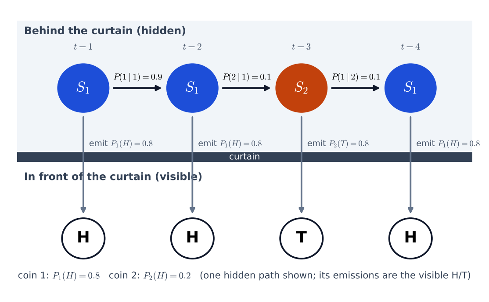
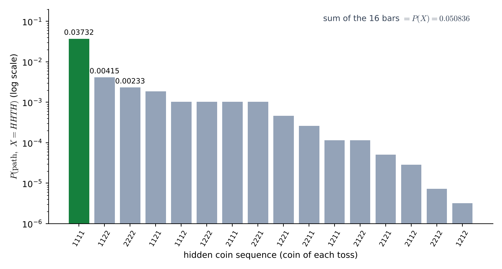

# Lecture 13 · KP01：隱藏狀態的直覺（Intuition of hidden states）

> 程度：研究生（grad）／Level: Graduate (grad)
>
> 第 13 週（2026-11-30）｜Context-Dependent Classification · KP01
>
> Week 13 (2026-11-30) | Context-Dependent Classification · KP01

## 學習目標（Learning objectives）

- 說出隱藏馬可夫模型和上週馬可夫鏈的差別：狀態看不見，只看得到狀態發射的觀測（State how a hidden Markov model differs from last week's Markov chain: the state is invisible and only the emitted observations can be seen）。
- 用單枚、兩枚、三枚硬幣的實驗，數出模型需要的獨立參數個數（Count the independent parameters needed for the one-, two- and three-coin experiments）。
- 解釋為什麼同一個觀測可以來自不同的隱藏狀態（Explain why the same observation can come from different hidden states）。
- 在一個四步例子上，算出每條隱藏路徑與觀測同時發生的機率（Compute, on a four-step example, the probability that each hidden path and the observations occur together）。

## KP01：隱藏狀態的直覺（Hidden states behind a curtain）

**一句話重點**：當系統的內部狀態看不見，只能看到各狀態隨機吐出的觀測時，這個模型叫隱藏馬可夫模型。

**One-sentence summary**: When the internal state of a system cannot be seen and only the observations that each state emits at random can be seen, the model is called a hidden Markov model.

### 1. 接住上一週的問題（Picking up the question）

上一週的最後一講，把通道的位元記憶當成「狀態」。
那時狀態有一個好處：只要知道送出的位元，就能知道狀態。

The last lecture of last week treated the bit memory of the channel as a "state".
That state had one convenient property: if you know the transmitted bits, you know the state.

這一週拿掉這個好處。
狀態看不見，連它怎麼跳轉也是隨機的。
你只看到狀態吐出來的東西。

This week removes that convenience.
The state cannot be seen, and even how it jumps is random.
You only see what the state emits.

**白話說明**：想像你站在布幕前，布幕後有人在擲硬幣。
他每次只讓你看正面或反面，不讓你看他拿的是哪一枚硬幣。
你要從一串正反面，去猜布幕後發生了什麼事。
這個比喻只說明「狀態被擋住」，沒說明他換硬幣的規則是什麼。

**Plain explanation**: Imagine you stand in front of a curtain while someone behind it tosses coins.
Each time he only shows you heads or tails, never which coin he picked.
From a string of heads and tails you must guess what happened behind the curtain.
This analogy only shows that the state is blocked; it does not say what the rule for changing coins is.

**先備自測**：確認你記得馬可夫鏈的轉移機率，與上一週的整串機率寫法。
不熟的話，回到第 12 週 KP03 複習。

**Prerequisite check**: Make sure you remember the transition probability of a Markov chain and the sequence probability of last week.
If not, review Week 12 KP03.

- 轉移機率 $P(i\mid j)$ 是從狀態 $j$ 走到狀態 $i$ 的機率（The transition probability $P(i\mid j)$ is the probability of going from state $j$ to state $i$）。
- 每個狀態射出的轉移機率加起來是 $1$（The transition probabilities leaving each state add up to $1$）。
- 獨立事件的機率可以相乘（Probabilities of independent events multiply）。

### 2. 三個硬幣實驗（Three coin experiments）

布幕後擲硬幣有三種版本。
每一種都問同一件事：要描述它，需要幾個自由數字？

There are three versions of tossing coins behind the curtain.
Each asks the same question: how many free numbers do you need to describe it?

**單枚硬幣**：布幕後只有一枚硬幣。
輸出是一串隨機的正面 $H$ 與反面 $T$。
這時狀態就等於觀測：看到 $H$，就知道是狀態 1。
狀態看得見，所以它還是上週那種馬可夫鏈。

**One coin**: There is only one coin behind the curtain.
The output is a random string of heads $H$ and tails $T$.
Here the state equals the observation: seeing $H$ tells you it is state 1.
The state is visible, so this is still the kind of Markov chain of last week.

只需要一個數字：正面機率 $P(H)$。
反面機率是 $1-P(H)$，轉移機率也由 $P(H)$ 決定。

Only one number is needed: the probability of heads $P(H)$.
The probability of tails is $1-P(H)$, and the transition probabilities are fixed by $P(H)$ too.

**兩枚硬幣**：布幕後有硬幣 1 與硬幣 2，它們各自有偏向。
每一次，實驗者先依轉移機率決定留在原來那枚、或換另一枚，再擲出一次。
我們看到 $H$，卻不知道是哪一枚擲的。
這就是**隱藏狀態**：看不見、卻決定觀測分布的內部狀態。

**Two coins**: Behind the curtain are coin 1 and coin 2, each with its own bias.
Each time, the experimenter first decides by the transition probabilities to stay with the same coin or switch, then tosses once.
We see $H$ but do not know which coin produced it.
This is a **hidden state**: an internal state that cannot be seen but decides the distribution of the observation.

這裡要數兩種參數。
**發射機率**是狀態吐出觀測的機率：$P_1(H)$ 與 $P_2(H)$，共 $2$ 個。
**轉移機率**是狀態之間跳轉的機率：$2\times2=4$ 個，但每個狀態射出的兩個加起來是 $1$，所以只有 $2$ 個自由數字。
合計 $2+2=4$ 個。

Two kinds of parameters are counted here.
The **emission probability** is the probability that a state emits an observation: $P_1(H)$ and $P_2(H)$, $2$ in total.
The **transition probability** is the probability of jumping between states: $2\times2=4$ of them, but the two leaving each state add up to $1$, so only $2$ are free.
The total is $2+2=4$.

**三枚硬幣**：同樣的算法。
發射機率 $3$ 個，轉移機率 $3\times3=9$ 個，扣掉每個狀態一條限制 $3$ 個，剩 $6$ 個。
合計 $3+6=9$ 個。

**Three coins**: The same counting works.
There are $3$ emission probabilities and $3\times3=9$ transition probabilities, minus one constraint for each state, $3$, leaving $6$.
The total is $3+6=9$.

| 硬幣數 $K$ | 發射參數 | 轉移參數 | 合計 |
|---|---|---|---|
| $1$ | $1$ | $0$ | $1$ |
| $2$ | $2$ | $2$ | $4$ |
| $3$ | $3$ | $6$ | $9$ |

一般的 $K$ 枚硬幣：發射 $K$ 個，轉移 $K(K-1)$ 個，合計 $K+K(K-1)=K^2$。
這裡沒有數初始狀態的機率，下一節的正式定義才會把它放進來。

For general $K$ coins: $K$ emission parameters and $K(K-1)$ transition parameters, in total $K+K(K-1)=K^2$.
The probabilities of the initial state are not counted here; the formal definition in the next lecture will bring them in.

| 符號 | 中文意義 | English meaning |
|---|---|---|
| $K$ | 硬幣（狀態）的個數 | Number of coins (states) |
| $P_i(H)$ | 硬幣 $i$ 擲出正面的機率（發射機率） | Probability that coin $i$ lands heads (emission probability) |
| $P(i\mid j)$ | 從狀態 $j$ 走到狀態 $i$ 的機率（轉移機率） | Probability of going from state $j$ to state $i$ (transition probability) |
| $K^2$ | 二元觀測、$K$ 個狀態的獨立參數個數 | Number of independent parameters for binary observations and $K$ states |

### 3. 主例子：看 HHTH 猜硬幣（Main example: guessing the coins from HHTH）

現在把兩枚硬幣的模型填上數字，看一條具體的觀測會發生什麼事。
`[補充]` 設硬幣 1 偏正面 $P_1(H)=0.8$，硬幣 2 偏反面 $P_2(H)=0.2$。
開始時兩枚各 $0.5$，每次留在原硬幣的機率是 $0.9$，換硬幣是 $0.1$。

Now fill numbers into the two-coin model and see what happens to one concrete observation.
`[Added]` Let coin 1 favor heads, $P_1(H)=0.8$, and coin 2 favor tails, $P_2(H)=0.2$.
At the start each coin has $0.5$, and each time the probability of staying with the same coin is $0.9$ and of switching is $0.1$.

你看到的觀測是 $X=H,H,T,H$。
布幕後的硬幣序列有 $2^4=16$ 種可能，每一種叫一條**隱藏路徑**。

The observation you see is $X=H,H,T,H$.
The coin sequence behind the curtain has $2^4=16$ possibilities, and each is called a **hidden path**.



**圖說 `lec13-kp01-hidden-states-f1-curtain`**：先看上方藍橘圓，它們是布幕後的隱藏狀態，水平箭頭是轉移。
再看向下的箭頭，它穿過布幕，在下方變成看得見的 $H$ 或 $T$。
注意第 3 次擲出 $T$，圖上的隱藏狀態卻是硬幣 2，這只是畫出的其中一條路徑。〔功能：1、2〕

**Caption `lec13-kp01-hidden-states-f1-curtain`**: Look first at the blue and orange circles on top, the hidden states, with horizontal arrows for transitions.
Then look at the downward arrows, which pass through the curtain and become the visible $H$ or $T$ below.
Note that the third toss gives $T$ and the hidden state drawn is coin 2; this is only one of the possible paths. [Function: 1, 2]

一條路徑和觀測**同時**發生的機率，是起點、轉移與發射連乘：

The probability that a path and the observation occur **together** is the product of the start, the transitions and the emissions:

$$
P(\text{path},X)=P(s_1)\,P_{s_1}(x_1)\prod_{k=2}^{4}P(s_k\mid s_{k-1})\,P_{s_k}(x_k)
$$

這裡 $s_k$ 是第 $k$ 次用的硬幣，$x_k$ 是第 $k$ 次看到的 $H$ 或 $T$。
這個式子和上週的式 $(9.6)$ 長得一樣：起點一項，之後每步「轉移乘發射」。
差別是現在 $s_k$ 看不見，要把所有可能的 $s_k$ 都考慮。

Here $s_k$ is the coin used at toss $k$, and $x_k$ is the $H$ or $T$ seen at toss $k$.
This formula looks like Eq. $(9.6)$ of last week: one term for the start, then "transition times emission" at each step.
The difference is that $s_k$ is now invisible, so all possible $s_k$ must be considered.

先算路徑 $1111$（四次都是硬幣 1）：

First compute path $1111$ (coin 1 all four times):

$$
0.5\times0.8\;\times\;(0.9\times0.8)\;\times\;(0.9\times0.2)\;\times\;(0.9\times0.8)=0.0373248
$$

再算路徑 $1121$（第 3 次偷偷換成硬幣 2，下一次換回來）：

Then compute path $1121$ (switch secretly to coin 2 at toss 3, and back at the next toss):

$$
0.5\times0.8\;\times\;(0.9\times0.8)\;\times\;(0.1\times0.8)\;\times\;(0.1\times0.8)=0.0018432
$$

雖然 $T$ 由硬幣 2 擲出的機率高達 $0.8$，這條路徑卻小得多，因為它要連換兩次硬幣，各乘一個 $0.1$。
16 條路徑全部算完，最大的是 $1111$，約是第二名 $1122$ 的 $9$ 倍。

Although coin 2 produces $T$ with probability as high as $0.8$, this path is much smaller because it must switch coins twice and multiply by $0.1$ each time.
After all 16 paths are computed, the largest is $1111$, about $9$ times the second, $1122$.



**圖說 `lec13-kp01-hidden-states-f2-path-probabilities`**：先看橫軸，每個標籤是一條硬幣序列，例如 $1121$。
再看縱軸，它是對數刻度，每格差 $10$ 倍，綠色長條是最大的一條。
注意 16 根長條加起來是 $0.050836$，這個和是下一講要算的 $P(X)$。〔功能：1、2〕

**Caption `lec13-kp01-hidden-states-f2-path-probabilities`**: Look first at the horizontal axis; each label is a coin sequence such as $1121$.
Then look at the vertical axis, a logarithmic scale where each grid step is $10$ times, and the green bar is the largest.
Note that the sixteen bars add up to $0.050836$, the $P(X)$ that the next lecture will compute. [Function: 1, 2]

還有一個小檢查：只看一次觀測。
兩枚硬幣的起點機率相同時，看到一個 $H$，它來自硬幣 1 的後驗機率是 $0.8\times0.5/(0.8\times0.5+0.2\times0.5)=0.8$。
看到 $H$ 不等於確定是硬幣 1，只是比較可能。

One more small check: look at a single observation.
With equal start probabilities for the two coins, the posterior probability that one $H$ came from coin 1 is $0.8\times0.5/(0.8\times0.5+0.2\times0.5)=0.8$.
Seeing $H$ does not make coin 1 certain; it only makes it more likely.

### 4. 反直覺處、用途與限制（Counter-intuitive points, uses and limits）

**反直覺處：觀測不等於狀態。**
看到 $H$，不能說「這是硬幣 1」。
兩枚硬幣都可能擲出 $H$，只是機率不同。
同一個觀測，可以由多個隱藏狀態以不同機率發射出來。

**Counter-intuitive point: the observation is not the state.**
Seeing $H$ does not let you say "this is coin 1".
Both coins can land heads, only with different probabilities.
The same observation can be emitted by several hidden states with different probabilities.

**常見迷思**：「看到 $T$，就表示換成硬幣 2 了。」
不對。
上面的例子裡，最可能的路徑是一路硬幣 1，$T$ 只是硬幣 1 偶爾擲出的 $0.2$。
換硬幣要付出 $0.1$ 的代價，通常比「偶爾擲出少見的面」更不容易。

**Common misconception**: "Seeing $T$ means the coin was switched to coin 2."
That is wrong.
In the example above the most likely path is coin 1 all the way, and $T$ is just the $0.2$ that coin 1 occasionally produces.
Switching coins costs $0.1$, which is usually less likely than "occasionally showing the rarer face".

**什麼訊號適合這個模型**：許多真實訊號整體看起來統計特性一直在變，叫非平穩。
但把它切成小段，每段內的統計特性大致固定，這叫**分段平穩**。
HMM 就是替這種訊號建模：段與段之間的切換由隱藏狀態的轉移負責，段內的樣子由發射機率負責。
語音是典型例子：不同音素的聲音特性不同，一個詞是在這些音素之間依序切換。
手寫字也是：筆畫由直線與圓弧等基本形狀依序組成。

**What signals suit this model**: Many real signals look as if their statistics keep changing, which is called nonstationary.
But cut into short pieces, each piece has roughly fixed statistics, which is called **piecewise stationary**.
The HMM models such signals: the transitions of the hidden state handle the switching between pieces, and the emission probabilities handle the look inside a piece.
Speech is a typical example: different phonemes have different acoustic properties, and a word switches among them in order.
Handwriting is another: strokes are built in order from basic shapes such as straight lines and arcs.

**失效情形**：狀態數 $K$ 選得不對。
如果資料其實由 2 枚硬幣產生，卻用 3 枚硬幣的模型，參數從 4 個增加到 9 個。
多出來的自由度會讓估計不穩，這叫過度擬合。
狀態數通常要靠實驗決定，沒有一個公式可以事先算出。

**Failure case**: The number of states $K$ is chosen wrongly.
If the data are really produced by 2 coins but a 3-coin model is used, the parameters grow from 4 to 9.
The extra freedom makes the estimates unstable, which is called overfitting.
The number of states is usually decided by experiment; no formula gives it in advance.

### 5. 與實作的連結（Connection to implementation）

下面的程式枚舉 16 條路徑，找出最大的一條，並把 16 個機率加起來。
注意兩件事：每條路徑的機率是連乘；全部路徑的和，就是「不管硬幣是哪一條」時，這串觀測發生的機率。

The code below enumerates the 16 paths, finds the largest, and adds up the 16 probabilities.
Note two points: the probability of a path is a product, and the sum over all paths is the probability that this observation occurs "no matter which coins were used".

```python
import itertools

emit = {1: {"H": 0.8, "T": 0.2}, 2: {"H": 0.2, "T": 0.8}}   # 發射機率 / emission probabilities
STAY, START = 0.9, 0.5                                        # 留在原硬幣、起點機率 / stay and start
obs = "HHTH"

def joint(path):
    """回傳 P(path, X)：起點、每步轉移與每次發射連乘。"""
    p = START * emit[path[0]][obs[0]]
    for k in range(1, len(obs)):
        move = STAY if path[k] == path[k - 1] else 1 - STAY
        p *= move * emit[path[k]][obs[k]]
    return p

paths = {"".join(map(str, q)): joint(q) for q in itertools.product((1, 2), repeat=4)}
best = max(paths, key=paths.get)
print(best, round(paths[best], 7))            # 1111 0.0373248
print(round(sum(paths.values()), 6))          # 0.050836
```

**留給下一節的問題**：我們一直說「模型有這些參數」，卻還沒有把它寫成正式的定義。
下一節用一個四元組把 HMM 定義清楚，並介紹語音常用的左到右模型。

**The question for the next section**: We keep saying "the model has these parameters" but have not written it as a formal definition.
The next section defines the HMM with a four-element set and introduces the left-to-right model common in speech.

### 6. 小練習與解題示範（Practice and worked solutions）

**小練習** `[補充]`：先寫下理由，再看解答。

**Practice** `[Added]`: Write your reasoning before reading the solutions.

1. 題 1：布幕後有 $K=4$ 枚硬幣，觀測是 $H$ 或 $T$。需要幾個獨立參數（Behind the curtain are $K=4$ coins and the observation is $H$ or $T$. How many independent parameters are needed）？
2. 題 2：兩枚硬幣起點機率相同。看到一個 $T$，它來自硬幣 1 的後驗機率是多少（With equal start probabilities, what is the posterior probability that one $T$ came from coin 1）？
3. 題 3：路徑 $2222$（四次都是硬幣 2）與觀測 $HHTH$ 同時發生的機率是多少？它為什麼比 $1111$ 小（What is the probability that path $2222$ occurs together with $HHTH$, and why is it smaller than $1111$）？

**題 1 解題示範**：發射 $4$ 個，轉移 $4\times3=12$ 個，合計 $4+12=16=K^2$。

**Question 1 worked solution**: $4$ emission and $4\times3=12$ transition parameters, in total $4+12=16=K^2$.

**題 2 解題示範**：$P_1(T)=0.2$、$P_2(T)=0.8$，起點相同。
後驗是 $0.2\times0.5/(0.2\times0.5+0.8\times0.5)=0.2$。
看到 $T$，硬幣 1 的可能性只有 $0.2$。

**Question 2 worked solution**: $P_1(T)=0.2$ and $P_2(T)=0.8$ with the same start.
The posterior is $0.2\times0.5/(0.2\times0.5+0.8\times0.5)=0.2$.
After seeing $T$, coin 1 has only $0.2$.

**題 3 解題示範**：$0.5\times0.2\times(0.9\times0.2)\times(0.9\times0.8)\times(0.9\times0.2)=0.0023328$。
它小，是因為 $HHTH$ 裡有三個 $H$，硬幣 2 每次只有 $0.2$。
$T$ 那一次硬幣 2 的 $0.8$ 只補回一次，補不回三次的損失。

**Question 3 worked solution**: $0.5\times0.2\times(0.9\times0.2)\times(0.9\times0.8)\times(0.9\times0.2)=0.0023328$.
It is small because $HHTH$ has three $H$, and coin 2 gives only $0.2$ each time.
The $0.8$ of coin 2 on the $T$ toss makes up for one toss and cannot make up for the loss of three.

## 術語表（Glossary）

| 中文術語 | English term |
|---|---|
| 隱藏馬可夫模型 | Hidden Markov model (HMM) |
| 隱藏狀態 | Hidden state |
| 觀測 | Observation |
| 發射機率 | Emission probability |
| 轉移機率 | Transition probability |
| 隱藏路徑 | Hidden path |
| 聯合機率 | Joint probability |
| 後驗機率 | Posterior probability |
| 非平穩 | Nonstationary |
| 分段平穩 | Piecewise stationary |
| 獨立參數 | Independent parameter |
| 過度擬合 | Overfitting |
| 音素 | Phoneme |

## 銜接與來源（Connections and sources）

下一講把 HMM 寫成正式的四元組。
你會看到轉移、發射、初始機率與狀態數各自的角色。

The next lecture writes the HMM as a formal four-element set.
You will see the roles of the transitions, emissions, initial probabilities and the number of states.

- 前一單元：[第 12 週 KP07 通道等化（二）：狀態與有限狀態機](lec12-kp07-state-fsm.md)（Previous unit: Week 12 KP07, channel equalization II）。
- 下一單元：[KP02 HMM 的正式定義](lec13-kp02-hmm-definition.md)（Next unit: the formal definition of an HMM）。
- 來源：[Context-Dependent Classification §9.6](https://ndhuccc.github.io/CCC-LNS/PR_115/Ch09-context-dependent-classification/index.html)，讀取日期 2026-11-13（Source accessed 2026-11-13）。
- 書目：Theodoridis and Koutroumbas, *Pattern Recognition*, 4th ed., 2008；見[參考資料](../references/README.md)（See the bibliography）。

本講以自己的文字解釋來源。
布幕後擲硬幣的三個實驗與獨立參數個數、反直覺處、分段平穩的說法與語音、手寫的例子取自來源。
HHTH 的數值例、16 條路徑的機率、單一觀測的後驗、程式、圖與練習皆為 `[補充]`；硬幣偏向取自來源圖，起點與換硬幣的機率為補充設定。

This lecture independently explains the source.
The three coin experiments and the parameter counts, the counter-intuitive point, the piecewise stationary description, and the speech and handwriting examples come from the source.
The HHTH numeric example, the probabilities of the 16 paths, the posterior of a single observation, the code, the figures and the practice are `[Added]`; the coin biases come from the source figure, and the start and switch probabilities are added settings.
