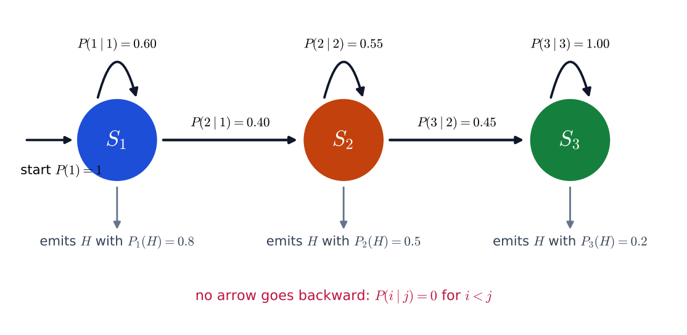
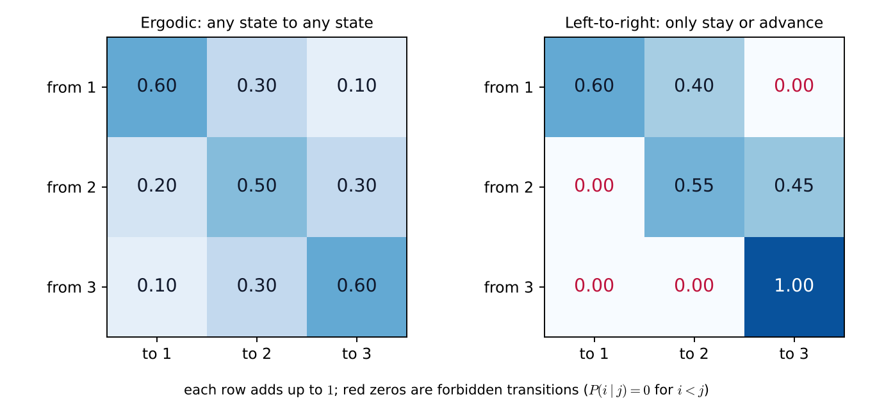

# Lecture 13 · KP02：HMM 的正式定義（The formal definition of an HMM）

> 程度：研究生（grad）／Level: Graduate (grad)
>
> 第 13 週（2026-11-30）｜Context-Dependent Classification · KP02
>
> Week 13 (2026-11-30) | Context-Dependent Classification · KP02

## 學習目標（Learning objectives）

- 寫出 HMM 的四個組成，並說出每一個的意義與限制（Write the four ingredients of an HMM and state the meaning and constraint of each）。
- 區分一般模型與左到右模型，並說明語音為什麼用後者（Distinguish the general model from the left-to-right model and explain why speech uses the latter）。
- 在一個三狀態例子上，檢查轉移表的列和、算一條路徑的機率、數出合法路徑（On a three-state example, check the row sums, compute the probability of a path, and count the legal paths）。
- 說出 HMM 要解的兩個任務：訓練與辨識（State the two tasks an HMM must solve: training and recognition）。

## KP02：HMM 的正式定義（Formal definition of an HMM）

**一句話重點**：HMM 由狀態數、轉移機率、發射機率與初始機率四樣東西定義，語音常用只能前進的左到右模型。

**One-sentence summary**: An HMM is defined by four things, the number of states, the transition, emission and initial probabilities, and speech often uses the left-to-right model that can only move forward.

### 1. 接住上一講的問題（Picking up the question）

上一講用硬幣建立了直覺，也數了參數。
但「模型有這些參數」還只是口頭說法。
要訓練它、拿它做辨識，必須先把它寫成一個明確的定義。

The last lecture built intuition with coins and counted the parameters.
But "the model has these parameters" was still only a spoken description.
To train it and use it for recognition, it must first be written as an explicit definition.

**白話說明**：想像你要寫一份「布幕後的遊戲規則」。
規則要說清楚四件事：有幾枚硬幣、怎麼換硬幣、每枚硬幣怎麼擲、第一次拿哪一枚。
少寫任何一件，別人就沒辦法照規則重演這個遊戲。
這個比喻只說明四件事缺一不可，沒說明它們在數學上怎麼限制。

**Plain explanation**: Imagine writing "the rules of the game behind the curtain".
The rules must say four things: how many coins there are, how to switch coins, how each coin is tossed, and which coin is taken first.
If any one is missing, nobody can replay the game by the rules.
This analogy only shows that all four are needed; it does not say how they are constrained mathematically.

**先備自測**：確認你記得 KP01 的轉移、發射與獨立參數的意思。
不熟的話，回到本週 KP01 複習。

**Prerequisite check**: Make sure you remember the meaning of transition, emission and independent parameters from KP01.
If not, review KP01 of this week.

- 轉移機率描述狀態怎麼跳（Transition probabilities describe how the state jumps）。
- 發射機率描述狀態怎麼吐出觀測（Emission probabilities describe how a state emits an observation）。
- 機率分布加起來是 $1$（A probability distribution adds up to $1$）。

### 2. 四元組與左到右模型（The four-element set and the left-to-right model）

**正式定義**：一個 HMM 記成

**Formal definition**: An HMM is written as

$$
\mathcal{S}=\{P(i\mid j),\ p(\mathbf{x}\mid i),\ P(i),\ K_s\}
$$

四個組成各有一個角色：

Each of the four ingredients has one role:

- **狀態數** $K_s$：內部有幾個離散狀態（The number of discrete internal states）。
- **轉移機率** $P(i\mid j)$：上一刻在狀態 $j$，這一刻到狀態 $i$ 的機率。每個 $j$ 都要滿足 $\sum_{i=1}^{K_s}P(i\mid j)=1$（The probability of going to state $i$ now given state $j$ a moment ago; for every $j$, $\sum_{i=1}^{K_s}P(i\mid j)=1$）。
- **發射機率密度** $p(\mathbf{x}\mid i)$：處在狀態 $i$ 時，吐出觀測 $\mathbf{x}$ 的機率密度。觀測是離散符號時，它就是機率（The probability density of emitting the observation $\mathbf{x}$ in state $i$; for discrete symbols it is a probability）。
- **初始機率** $P(i)$：序列第一步在狀態 $i$ 的機率，加起來是 $1$（The probability that the sequence starts in state $i$, adding up to $1$）。

這裡採用 **Moore 型**：觀測是在「抵達」狀態時發射的。
也就是每走到一個狀態，就吐出一個觀測。

Here the **Moore type** is used: the observation is emitted on "arriving" at a state.
That is, each time a state is reached, one observation is emitted.

| 符號 | 中文意義 | English meaning |
|---|---|---|
| $\mathcal{S}$ | 一個 HMM 的全部參數 | All parameters of one HMM |
| $K_s$ | 狀態數 | Number of states |
| $P(i\mid j)$ | 從狀態 $j$ 到狀態 $i$ 的轉移機率 | Transition probability from state $j$ to state $i$ |
| $p(\mathbf{x}\mid i)$ | 狀態 $i$ 的發射機率密度 | Emission density of state $i$ |
| $P(i)$ | 初始狀態機率 | Initial state probability |

**左到右模型**：在最一般的模型裡，任何兩個狀態可以互相轉移，叫 ergodic 模型。
但許多訊號的時間只往前走。
這時用**左到右模型**（也叫 Bakis 模型）：不准回到編號較小的狀態，也就是 $i<j$ 時 $P(i\mid j)=0$。
狀態只能留在原地（自轉移 $P(i\mid i)$），或往後走一步。

**Left-to-right model**: In the most general model any two states can transition into each other, called an ergodic model.
But the time of many signals only moves forward.
Then the **left-to-right model** (also called the Bakis model) is used: going back to a state with a smaller index is forbidden, that is, $P(i\mid j)=0$ when $i<j$.
A state can only stay where it is (self-transition $P(i\mid i)$) or move one step forward.

語音是最好的例子：發 "cat" 一定是先 $/k/$、再 $/æ/$、最後 $/t/$，不會發完結尾又跳回開頭。
實務上每個音素常用 $3$ 到 $4$ 個狀態，對應發音的起始過渡、穩定核心與結束過渡。
強制反向轉移為 $0$ 不但符合事實，也讓網格搜尋少很多條路。

Speech is the best example: saying "cat" is always $/k/$, then $/æ/$, then $/t/$, and never jumps back to the beginning after the end.
In practice each phoneme often uses $3$ to $4$ states, matching the onset transition, the stable core and the ending transition of the sound.
Forcing backward transitions to $0$ not only matches reality but also removes many paths from the trellis search.

**自轉移與停留時間**：自轉移機率 $P(i\mid i)$ 越大，系統在狀態 $i$ 停得越久。
`[補充]` 每次以機率 $a$ 留下，平均停留 $1/(1-a)$ 步（這是幾何分布的平均）。

**Self-transition and duration**: The larger the self-transition probability $P(i\mid i)$, the longer the system stays in state $i$.
`[Added]` If it stays each time with probability $a$, the mean stay is $1/(1-a)$ steps (the mean of a geometric distribution).

**兩個任務**：假設有 $M$ 個類別，例如 $M$ 個不同的單字，每個類別有自己的 HMM $\mathcal{S}_m$。
HMM 的應用圍繞兩個任務：

**Two tasks**: Suppose there are $M$ classes, for example $M$ different words, each with its own HMM $\mathcal{S}_m$.
The use of HMMs revolves around two tasks:

- **訓練**：給一個類別的已知序列，估計這個類別 HMM 的參數（Training: given known sequences of one class, estimate the parameters of that class's HMM）。
- **辨識**：給一串未知序列 $X=(\mathbf{x}_1,\dots,\mathbf{x}_N)$ 和 $M$ 個已訓練好的模型，找出最像的類別（Recognition: given an unknown sequence $X=(\mathbf{x}_1,\dots,\mathbf{x}_N)$ and $M$ trained models, find the most similar class）。

辨識依 Bayes 規則。
各類別先驗相同時，等價於選出讓觀測序列最可能發生的模型：

Recognition follows the Bayes rule.
When the class priors are equal, this is the same as choosing the model under which the observation sequence is most likely:

$$
\mathcal{S}^{*}=\arg\max_{\mathcal{S}}\;p(X\mid\mathcal{S})\tag{9.22}
$$

**常見迷思**：「左到右模型不能自轉移，否則會卡死。」
不對。
自轉移正是用來表示停留：一個音素發得長，就在該狀態自轉移很多次。
不准的是往回走，不是留在原地。

**Common misconception**: "A left-to-right model cannot have self-transitions or it gets stuck."
That is wrong.
The self-transition is exactly what expresses staying: a phoneme held long is a state with many self-transitions.
What is forbidden is going back, not staying in place.

### 3. 主例子：一個三狀態左到右模型（Main example: a three-state left-to-right model）

用來源圖 9.8 的設定。
三個狀態，觀測是 $H$ 或 $T$。
自轉移機率 $P(1\mid1)=0.60$、$P(2\mid2)=0.55$，第三個狀態只進不出 $P(3\mid3)=1$。
發射機率 $P_1(H)=0.8$、$P_2(H)=0.5$、$P_3(H)=0.2$。
`[補充]` 起點固定在狀態 1，$P(1)=1$。

Use the setting of source Figure 9.8.
Three states, with observations $H$ or $T$.
The self-transition probabilities are $P(1\mid1)=0.60$ and $P(2\mid2)=0.55$, and the third state is absorbing, $P(3\mid3)=1$.
The emission probabilities are $P_1(H)=0.8$, $P_2(H)=0.5$ and $P_3(H)=0.2$.
`[Added]` The start is fixed in state 1, $P(1)=1$.



**圖說 `lec13-kp02-hmm-definition-f1-left-to-right`**：先看三個圓由左到右排開，圓上的弧線是自轉移。
再看兩條向右的箭頭，它們是前進，上面的數字是轉移機率。
注意沒有任何箭頭往左，圓下方的文字是各狀態吐出 $H$ 的機率。〔功能：1、2〕

**Caption `lec13-kp02-hmm-definition-f1-left-to-right`**: Look first at the three circles laid out from left to right; the arcs on the circles are the self-transitions.
Then look at the two arrows pointing right, which are advances, with the transition probabilities on them.
Note that no arrow points left, and the text below each circle is the probability that the state emits $H$. [Function: 1, 2]

**檢查一：每一列的和是 $1$。**
從狀態 1 出發：$0.60+0.40=1$。
從狀態 2 出發：$0.55+0.45=1$。
從狀態 3 出發：$1$。
三列都通過。

**Check 1: every row adds up to $1$.**
Leaving state 1: $0.60+0.40=1$.
Leaving state 2: $0.55+0.45=1$.
Leaving state 3: $1$.
All three rows pass.

**檢查二：平均停留時間。**
狀態 1：$1/(1-0.60)=2.5$ 步。
狀態 2：$1/(1-0.55)\approx2.22$ 步。
狀態 3 不會離開，沒有有限的平均。

**Check 2: mean stay time.**
State 1: $1/(1-0.60)=2.5$ steps.
State 2: $1/(1-0.55)\approx2.22$ steps.
State 3 never leaves, so it has no finite mean.

**計算一條路徑的機率。**
觀測 $X=H,H,T,T$，路徑 $1,1,2,3$（狀態 1 停一次、再前進到 2、再前進到 3）：

**Compute the probability of one path.**
With observation $X=H,H,T,T$ and path $1,1,2,3$ (stay once in state 1, advance to 2, then advance to 3):

$$
1\times0.8\;\times\;(0.60\times0.8)\;\times\;(0.40\times0.5)\;\times\;(0.45\times0.8)=0.027648
$$

每一括號是「轉移乘發射」，第一項是起點乘發射。
`T` 的發射機率用 $1-P(H)$：狀態 2 的 $T$ 是 $0.5$，狀態 3 的 $T$ 是 $0.8$。

Each bracket is "transition times emission", and the first term is start times emission.
The emission probability of `T` is $1-P(H)$: $T$ in state 2 is $0.5$ and $T$ in state 3 is $0.8$.

**不合法的路徑機率為 $0$。**
例如 $1,2,1,3$ 要從狀態 2 回到 1，而 $P(1\mid2)=0$，整條機率是 $0$。
長度 $4$ 的路徑共有 $3^4=81$ 條，其中只有 $7$ 條合法：$1111$、$1112$、$1122$、$1123$、$1222$、$1223$、$1233$。

**Illegal paths have probability $0$.**
For example, $1,2,1,3$ must return from state 2 to 1, and $P(1\mid2)=0$, so the whole probability is $0$.
There are $3^4=81$ paths of length $4$, of which only $7$ are legal: $1111$, $1112$, $1122$, $1123$, $1222$, $1223$, $1233$.

**參數也少很多。**
`[補充]` 二元觀測的三狀態 ergodic 模型有：發射 $3$、轉移 $6$、初始 $2$，共 $11$ 個自由數字。
這個左到右模型只有：發射 $3$、轉移 $2$（兩個自轉移），初始 $0$（固定從狀態 1 開始），共 $5$ 個。

**The parameters are also far fewer.**
`[Added]` A three-state ergodic model with binary observations has $3$ emission, $6$ transition and $2$ initial parameters, in total $11$ free numbers.
This left-to-right model has only $3$ emission, $2$ transition (the two self-transitions) and $0$ initial (always starting in state 1), in total $5$.



**圖說 `lec13-kp02-hmm-definition-f2-transition-matrices`**：先看左圖，九格都有數字，任何狀態都能到任何狀態。
再看右圖，對角線左下方全是紅色的 $0$，這就是「不准回頭」。
注意兩張圖的每一列加起來都是 $1$。〔功能：1、2〕

**Caption `lec13-kp02-hmm-definition-f2-transition-matrices`**: Look first at the left panel: all nine cells have numbers, so any state can go to any state.
Then look at the right panel, where everything below the diagonal is a red $0$, which is "no going back".
Note that every row in both panels adds up to $1$. [Function: 1, 2]

### 4. 為什麼這樣設計、限制在哪（Why this design and where it stops）

**為什麼要左到右**：它不只符合物理，還減少參數與路徑。
參數少，用同樣多的資料就能估得更穩。

**Why left-to-right**: It not only matches the physics but also reduces parameters and paths.
With fewer parameters, the same amount of data gives steadier estimates.

**限制一：自轉移只能表示幾何分布的停留。**
狀態每一步以同樣機率留下，停留時間的分布是幾何分布，最可能的停留時間永遠是 1 步。
真實音素的長度未必長這樣。
這個限制在第 9.7 節處理，本週的主線先不做。

**Limit 1: self-transitions can only express a geometric stay.**
A state stays with the same probability at every step, so the distribution of the stay is geometric and its most likely value is always 1 step.
The lengths of real phonemes may not look like this.
Section 9.7 deals with this limit, and this week's main line leaves it aside.

**限制二：狀態數靠實驗決定。**
音素數可以當估計的基準，但最佳狀態數通常要用交叉驗證與實驗調整，沒有公式能事先算出。

**Limit 2: the number of states is decided by experiment.**
The number of phonemes can serve as a baseline, but the best number of states is usually tuned by cross-validation and experiments, and no formula gives it in advance.

### 5. 與實作的連結（Connection to implementation）

下面的程式把例子寫成矩陣，檢查列和，並枚舉合法路徑。
注意：`A[j, i]` 是從 $j$ 到 $i$ 的機率，所以「每一列加起來是 1」是對第一個索引求和。

The code below writes the example as a matrix, checks the row sums, and enumerates the legal paths.
Note that `A[j, i]` is the probability from $j$ to $i$, so "each row adds up to 1" is a sum over the first index.

```python
import itertools
import numpy as np

A = np.array([[0.60, 0.40, 0.00],     # A[j, i] = P(i | j)，列 = 目前狀態 / rows = current state
              [0.00, 0.55, 0.45],
              [0.00, 0.00, 1.00]])
PH = np.array([0.8, 0.5, 0.2])         # P_i(H)
START = np.array([1.0, 0.0, 0.0])      # 起點固定在狀態 1 / always start in state 1
print(A.sum(axis=1))                    # [1. 1. 1.]

def joint(path, obs):
    """回傳 P(path, X)；狀態編號從 0 起算。"""
    emit = lambda s, x: PH[s] if x == "H" else 1 - PH[s]
    p = START[path[0]] * emit(path[0], obs[0])
    for k in range(1, len(obs)):
        p *= A[path[k - 1], path[k]] * emit(path[k], obs[k])
    return p

print(round(joint((0, 0, 1, 2), "HHTT"), 6))                                     # 0.027648
legal = ["".join(str(s + 1) for s in q) for q in itertools.product(range(3), repeat=4) if joint(q, "HHTT") > 0]
print(len(legal), legal)     # 7 ['1111', '1112', '1122', '1123', '1222', '1223', '1233']
```

**留給下一節的問題**：我們已能算「一條路徑」與觀測同時發生的機率。
但辨識要的是 $p(X\mid\mathcal{S})$，也就是把所有路徑加起來。
路徑有 $K_s^N$ 條，怎麼加？下一節用前向—後向遞迴回答。

**The question for the next section**: We can already compute the probability that "one path" occurs together with the observation.
But recognition needs $p(X\mid\mathcal{S})$, that is, the sum over all paths.
There are $K_s^N$ paths, so how can we add them up? The next section answers with the forward–backward recursion.

### 6. 小練習與解題示範（Practice and worked solutions）

**小練習** `[補充]`：先寫下理由，再看解答。

**Practice** `[Added]`: Write your reasoning before reading the solutions.

1. 題 1：某轉移表第 2 列是 $(0.1,\ 0.5,\ 0.3)$。這列合法嗎（A row of a transition table is $(0.1,\ 0.5,\ 0.3)$. Is it valid）？
2. 題 2：左到右模型某狀態的自轉移機率是 $0.8$，平均停留幾步（A left-to-right state has self-transition probability $0.8$; how many steps does it stay on average）？
3. 題 3：用本講例子，算觀測 $H,H,T,T$ 與路徑 $1,1,1,2$ 同時發生的機率（Using the example of this lecture, compute the probability that $H,H,T,T$ occurs together with path $1,1,1,2$）。

**題 1 解題示範**：$0.1+0.5+0.3=0.9\ne1$，不合法。
每列是從該狀態出發的一個機率分布，必須加起來是 $1$。
缺的 $0.1$ 要補進某一格。

**Question 1 worked solution**: $0.1+0.5+0.3=0.9\ne1$, so it is not valid.
Each row is a probability distribution leaving that state and must add up to $1$.
The missing $0.1$ has to be added to some cell.

**題 2 解題示範**：平均停留 $1/(1-0.8)=5$ 步。
自轉移機率從 $0.6$ 提高到 $0.8$，停留從 $2.5$ 步變成 $5$ 步。

**Question 2 worked solution**: The mean stay is $1/(1-0.8)=5$ steps.
Raising the self-transition from $0.6$ to $0.8$ lengthens the stay from $2.5$ steps to $5$.

**題 3 解題示範**：路徑 $1,1,1,2$ 要用狀態 1 發射 $H,H,T$，再用狀態 2 發射 $T$。
$1\times0.8\times(0.6\times0.8)\times(0.6\times0.2)\times(0.4\times0.5)=0.8\times0.48\times0.12\times0.2=0.009216$。
它比 $1,1,2,3$ 的 $0.027648$ 小，因為狀態 1 吐出 $T$ 只有 $0.2$。

**Question 3 worked solution**: Path $1,1,1,2$ uses state 1 to emit $H,H,T$ and then state 2 to emit $T$.
$1\times0.8\times(0.6\times0.8)\times(0.6\times0.2)\times(0.4\times0.5)=0.8\times0.48\times0.12\times0.2=0.009216$.
It is smaller than the $0.027648$ of $1,1,2,3$ because state 1 emits $T$ with only $0.2$.

## 術語表（Glossary）

| 中文術語 | English term |
|---|---|
| 狀態數 | Number of states |
| 轉移機率 | Transition probability |
| 發射機率密度 | Emission density |
| 初始機率 | Initial probability |
| Moore 型 | Moore type |
| 左到右模型 | Left-to-right model |
| Bakis 模型 | Bakis model |
| 一般模型（ergodic） | Ergodic model |
| 自轉移 | Self-transition |
| 停留時間 | State duration |
| 幾何分布 | Geometric distribution |
| 隱藏馬可夫模型（HMM） | Hidden Markov model (HMM) |
| 訓練 | Training |
| 辨識 | Recognition |
| 似然 | Likelihood |

## 銜接與來源（Connections and sources）

下一講算 $p(X\mid\mathcal{S})$。
你會看到前向機率 $\alpha$ 與後向機率 $\beta$ 怎麼把所有路徑的和一次算完。

The next lecture computes $p(X\mid\mathcal{S})$.
You will see how the forward probability $\alpha$ and the backward probability $\beta$ add up all paths in one pass.

- 前一單元：[KP01 隱藏狀態的直覺](lec13-kp01-hidden-states.md)（Previous unit: intuition of hidden states）。
- 下一單元：[KP03 辨識（一）：任意路徑與前向—後向遞迴](lec13-kp03-forward-backward.md)（Next unit: recognition I, the any-path method）。
- 來源：[Context-Dependent Classification §9.6](https://ndhuccc.github.io/CCC-LNS/PR_115/Ch09-context-dependent-classification/index.html)，讀取日期 2026-11-13（Source accessed 2026-11-13）。
- 書目：Theodoridis and Koutroumbas, *Pattern Recognition*, 4th ed., 2008；見[參考資料](../references/README.md)（See the bibliography）。

本講以自己的文字解釋來源。
四元組與各自的限制、Moore 型、左到右模型與語音的理由、兩個任務與式 9.22、圖 9.8 的參數取自來源。
列和與平均停留時間的檢查、路徑機率與合法路徑數、兩種模型的參數個數、轉移矩陣圖、程式與練習皆為 `[補充]`；起點固定在狀態 1 為補充設定。

This lecture independently explains the source.
The four-element set and the constraint of each, the Moore type, the left-to-right model and the reason for speech, the two tasks with Eq. 9.22, and the parameters of Figure 9.8 come from the source.
The row-sum and mean-stay checks, the path probability and the number of legal paths, the parameter counts of the two models, the transition-matrix figure, the code and the practice are `[Added]`; fixing the start in state 1 is an added setting.
