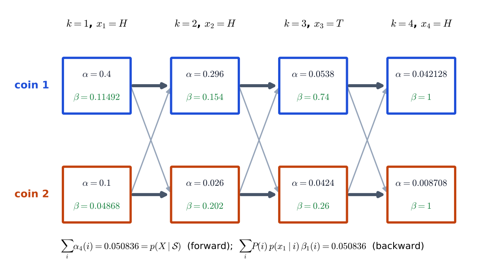
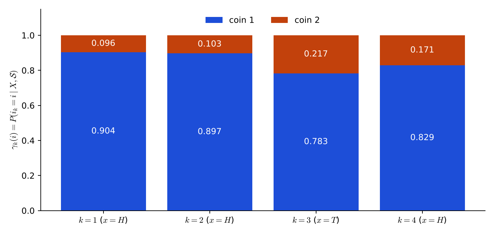

# Lecture 13 · KP03：辨識（一）：任意路徑與前向—後向遞迴（Recognition I: any path and the forward–backward recursion）

> 程度：研究生（grad）／Level: Graduate (grad)
>
> 第 13 週（2026-11-30）｜Context-Dependent Classification · KP03
>
> Week 13 (2026-11-30) | Context-Dependent Classification · KP03

## 學習目標（Learning objectives）

- 說出辨識問題要算的量 $p(X\mid\mathcal{S})$，並解釋為什麼它是對所有隱藏路徑求和（State the quantity $p(X\mid\mathcal{S})$ that recognition needs and explain why it is a sum over all hidden paths）。
- 寫出前向變數 $\alpha$ 與後向變數 $\beta$ 的遞迴與邊界條件（Write the recursions and boundary conditions of the forward variable $\alpha$ and the backward variable $\beta$）。
- 在兩枚硬幣的例子上手算 $\alpha$、$\beta$、$\gamma$，並用三種方式驗證 $p(X\mid\mathcal{S})$（Compute $\alpha$, $\beta$, $\gamma$ by hand on the two-coin example and verify $p(X\mid\mathcal{S})$ in three ways）。
- 說出計算量為什麼是 $O(NK_s^2)$，以及長序列要做縮放的原因（Explain why the cost is $O(NK_s^2)$ and why long sequences need scaling）。

## KP03：辨識（一）：任意路徑與前向—後向遞迴（The any-path method）

**一句話重點**：辨識要算 $p(X\mid\mathcal{S})$，也就是所有隱藏路徑的機率總和；前向—後向遞迴只用 $O(NK_s^2)$ 就把這個總和算完。

**One-sentence summary**: Recognition needs $p(X\mid\mathcal{S})$, the total probability over all hidden paths, and the forward–backward recursion computes this total in only $O(NK_s^2)$.

### 1. 接住上一講的問題（Picking up the question）

上一講留下的問題是：辨識要的是 $p(X\mid\mathcal{S})$，路徑有 $K_s^N$ 條，怎麼加？
KP01 的例子已經給了一個暗示：16 條路徑的機率加起來是 $0.050836$。
但那是把 16 條全部列出來才得到的。

The question left by the last lecture was: recognition needs $p(X\mid\mathcal{S})$, and there are $K_s^N$ paths, so how can they be added?
The example of KP01 already hinted at it: the probabilities of the 16 paths add up to $0.050836$.
But that total came from listing all 16 paths.

**白話說明**：想像你要數一個大停車場裡有多少輛紅車。
一輛一輛數太慢。
你改成一排一排數：每走到下一排，只要記住「目前累計幾輛」，再加上這一排新增的。
這個比喻只說明「逐排累計」，沒說明累計的是哪種機率。

**Plain explanation**: Imagine counting the red cars in a big parking lot.
Counting car by car is too slow.
You count row by row instead: at each new row you only remember the running total and add what this row contributes.
This analogy only shows "running totals row by row"; it does not say which kind of probability is being accumulated.

**先備自測**：確認你記得 HMM 的四個組成，與 KP01 的路徑聯合機率。
不熟的話，回到本週 KP01、KP02 複習。

**Prerequisite check**: Make sure you remember the four ingredients of an HMM and the joint probability of a path from KP01.
If not, review KP01 and KP02 of this week.

- 一條路徑與觀測的聯合機率是起點、轉移與發射的連乘（The joint probability of a path and the observations is a product of start, transitions and emissions）。
- 全機率公式把事件拆成互斥的情況再相加（The total probability formula splits an event into exclusive cases and adds them）。
- 兩個加總可以交換順序，乘法對加法有分配律（Two sums can swap order and multiplication distributes over addition）。

### 2. 辨識與前向—後向遞迴（Recognition and the forward–backward recursion）

有 $M$ 個已訓練好的模型。
Bayes 分類器選後驗最大的模型：

There are $M$ trained models.
The Bayes classifier picks the model with the largest posterior:

$$
\mathcal{S}^{*}=\arg\max_{\mathcal{S}}P(\mathcal{S}\mid X)\tag{9.21}
$$

各模型先驗相同時，等價於選 $p(X\mid\mathcal{S})$ 最大的模型，也就是上一講的式 $(9.22)$。

When the model priors are equal, this equals choosing the model with the largest $p(X\mid\mathcal{S})$, that is, Eq. $(9.22)$ of the last lecture.

一個模型能產生同一串觀測的路徑 $\Omega_i$ 不只一條。
全機率公式把它們全部加起來：

A model can produce the same observations along more than one path $\Omega_i$.
The total probability formula adds all of them:

$$
p(X\mid\mathcal{S})=\sum_i p(X,\Omega_i\mid\mathcal{S})=\sum_i p(X\mid\Omega_i,\mathcal{S})\,P(\Omega_i\mid\mathcal{S})\tag{9.23}
$$

這個式子和第 12 週的式 $(9.6)$ 長得很像，差別只在一個地方：$(9.6)$ 要找**最大**的那條路徑，$(9.23)$ 把**所有**路徑加起來。
這一點是本講與下一講（最佳路徑法）的分水嶺。
因為「所有路徑都參與」，這個方法叫**任意路徑法**。

This formula looks like Eq. $(9.6)$ of Week 12, with one difference: $(9.6)$ looks for the **largest** path, while $(9.23)$ adds **all** paths.
This is the dividing line between this lecture and the next one (the best-path method).
Because "every path takes part", this method is called the **any-path method**.

**前向變數** $\alpha$：到第 $k$ 步為止、停在狀態 $i_k$、而且前 $k$ 個觀測都已發射的機率。
它只看「過去到現在」。

The **forward variable** $\alpha$: the probability of being in state $i_k$ at step $k$ with the first $k$ observations already emitted.
It only looks at "the past up to now".

$$
\alpha(i_1)=P(i_1)\,p(\mathbf{x}_1\mid i_1),\qquad
\alpha(i_{k+1})=\sum_{i_k}\alpha(i_k)\,P(i_{k+1}\mid i_k)\,p(\mathbf{x}_{k+1}\mid i_{k+1})\tag{9.24}
$$

遞迴裡 $\alpha(i_k)$ 是歷史，$P(i_{k+1}\mid i_k)\,p(\mathbf{x}_{k+1}\mid i_{k+1})$ 是最後一步。
兩者相乘，再對所有可能的前一狀態相加。

In the recursion, $\alpha(i_k)$ is the history and $P(i_{k+1}\mid i_k)\,p(\mathbf{x}_{k+1}\mid i_{k+1})$ is the last step.
Multiply the two and add over all possible previous states.

**後向變數** $\beta$：假設現在在狀態 $i_k$，之後 $\mathbf{x}_{k+1},\dots,\mathbf{x}_N$ 都被發射的機率。
它只看「現在到未來」。

The **backward variable** $\beta$: the probability that, given the present state $i_k$, the later observations $\mathbf{x}_{k+1},\dots,\mathbf{x}_N$ are all emitted.
It only looks at "now to the future".

$$
\beta(i_k)=\sum_{i_{k+1}}\beta(i_{k+1})\,P(i_{k+1}\mid i_k)\,p(\mathbf{x}_{k+1}\mid i_{k+1}),\qquad \beta(i_N)=1\tag{9.25, 9.26}
$$

最後一站之後沒有觀測了，空事件的機率是 $1$，所以邊界條件是 $\beta(i_N)=1$。

After the last step there are no more observations, and the probability of an empty event is $1$, so the boundary condition is $\beta(i_N)=1$.

兩個量相乘，得到「整串觀測都發生，而且第 $k$ 步正好在狀態 $i_k$」的機率：

Multiplying the two gives the probability that "the whole observation sequence occurs and step $k$ is exactly in state $i_k$":

$$
\gamma(i_k)=p(\mathbf{x}_1,\dots,\mathbf{x}_N,i_k\mid\mathcal{S})=\alpha(i_k)\,\beta(i_k)\tag{9.27}
$$

這裡用到「給定狀態，觀測彼此獨立」，才能把聯合機率拆成 $\alpha$ 乘 $\beta$。
把式 $(9.24)$ 一路用到最後一步，就得到最終答案：

This uses "given the states, the observations are independent", which lets the joint probability split into $\alpha$ times $\beta$.
Using Eq. $(9.24)$ all the way to the last step gives the final answer:

$$
p(X\mid\mathcal{S})=\sum_{i_N=1}^{K_s}\alpha(i_N)\tag{9.28}
$$

| 符號 | 中文意義 | English meaning |
|---|---|---|
| $\alpha(i_k)$ | 前向變數：前 $k$ 個觀測已發射、停在 $i_k$ 的機率 | Forward variable: first $k$ observations emitted and in state $i_k$ |
| $\beta(i_k)$ | 後向變數：從 $i_k$ 出發，之後觀測都發射的機率 | Backward variable: from $i_k$, all later observations emitted |
| $\gamma(i_k)$ | $\alpha\beta$：整串觀測發生且第 $k$ 步在 $i_k$ 的機率 | $\alpha\beta$: whole sequence occurs with step $k$ in $i_k$ |
| $p(X\mid\mathcal{S})$ | 模型 $\mathcal{S}$ 產生觀測 $X$ 的機率 | Probability that model $\mathcal{S}$ generates $X$ |
| $K_s$ | 狀態數 | Number of states |

**常見迷思**：「$\alpha(i)$ 就是『現在在狀態 $i$』的機率。」
不對。
$\alpha(i)$ 是**聯合**機率：包含「前面的觀測都發生」，而且沒有除以任何東西，所以幾個狀態的 $\alpha$ 加起來不是 $1$。
要變成真正的「在狀態 $i$ 的機率」，要除以 $p(X\mid\mathcal{S})$，這是下面的 $\gamma$ 歸一化。

**Common misconception**: "$\alpha(i)$ is the probability of 'being in state $i$ now'."
That is wrong.
$\alpha(i)$ is a **joint** probability: it includes "the earlier observations all occurred" and is not divided by anything, so the $\alpha$ of the states do not add up to $1$.
To get a true "probability of being in state $i$" you must divide by $p(X\mid\mathcal{S})$, which is the normalization of $\gamma$ below.

### 3. 主例子：兩枚硬幣、觀測 HHTH（Main example: two coins and HHTH）

沿用 KP01 的模型：$P_1(H)=0.8$、$P_2(H)=0.2$，起點各 $0.5$，留在原硬幣 $0.9$、換硬幣 $0.1$。
觀測 $X=H,H,T,H$。

Reuse the model of KP01: $P_1(H)=0.8$, $P_2(H)=0.2$, start $0.5$ each, stay with the same coin $0.9$ and switch $0.1$.
The observation is $X=H,H,T,H$.

**前向：從左到右。**
第 1 步：$\alpha_1(1)=0.5\times0.8=0.4$，$\alpha_1(2)=0.5\times0.2=0.1$。
第 2 步：
$\alpha_2(1)=(0.4\times0.9+0.1\times0.1)\times0.8=0.296$，
$\alpha_2(2)=(0.4\times0.1+0.1\times0.9)\times0.2=0.026$。
第 3 步（觀測是 $T$）：
$\alpha_3(1)=(0.296\times0.9+0.026\times0.1)\times0.2=0.0538$，
$\alpha_3(2)=(0.296\times0.1+0.026\times0.9)\times0.8=0.0424$。
第 4 步：
$\alpha_4(1)=(0.0538\times0.9+0.0424\times0.1)\times0.8=0.042128$，
$\alpha_4(2)=(0.0538\times0.1+0.0424\times0.9)\times0.2=0.008708$。

**Forward: from left to right.**
Step 1: $\alpha_1(1)=0.5\times0.8=0.4$ and $\alpha_1(2)=0.5\times0.2=0.1$.
Step 2: $\alpha_2(1)=(0.4\times0.9+0.1\times0.1)\times0.8=0.296$ and $\alpha_2(2)=(0.4\times0.1+0.1\times0.9)\times0.2=0.026$.
Step 3 (the observation is $T$): $\alpha_3(1)=(0.296\times0.9+0.026\times0.1)\times0.2=0.0538$ and $\alpha_3(2)=(0.296\times0.1+0.026\times0.9)\times0.8=0.0424$.
Step 4: $\alpha_4(1)=(0.0538\times0.9+0.0424\times0.1)\times0.8=0.042128$ and $\alpha_4(2)=(0.0538\times0.1+0.0424\times0.9)\times0.2=0.008708$.

最後一步相加：$p(X\mid\mathcal{S})=0.042128+0.008708=0.050836$。
這正是 KP01 把 16 條路徑全部列出再相加的結果，但這裡只算了 $4\times2=8$ 個 $\alpha$。

Adding at the last step: $p(X\mid\mathcal{S})=0.042128+0.008708=0.050836$.
This is exactly the result that KP01 obtained by listing and adding all 16 paths, but here only $4\times2=8$ values of $\alpha$ were computed.

**後向：從右到左。**
$\beta_4(1)=\beta_4(2)=1$。
$\beta_3(1)=0.9\times0.8\times1+0.1\times0.2\times1=0.74$，$\beta_3(2)=0.1\times0.8+0.9\times0.2=0.26$。
$\beta_2(1)=0.9\times0.2\times0.74+0.1\times0.8\times0.26=0.154$，$\beta_2(2)=0.1\times0.2\times0.74+0.9\times0.8\times0.26=0.202$。
$\beta_1(1)=0.9\times0.8\times0.154+0.1\times0.2\times0.202=0.11492$，$\beta_1(2)=0.1\times0.8\times0.154+0.9\times0.2\times0.202=0.04868$。

**Backward: from right to left.**
$\beta_4(1)=\beta_4(2)=1$.
$\beta_3(1)=0.9\times0.8\times1+0.1\times0.2\times1=0.74$ and $\beta_3(2)=0.1\times0.8+0.9\times0.2=0.26$.
$\beta_2(1)=0.9\times0.2\times0.74+0.1\times0.8\times0.26=0.154$ and $\beta_2(2)=0.1\times0.2\times0.74+0.9\times0.8\times0.26=0.202$.
$\beta_1(1)=0.9\times0.8\times0.154+0.1\times0.2\times0.202=0.11492$ and $\beta_1(2)=0.1\times0.8\times0.154+0.9\times0.2\times0.202=0.04868$.



**圖說 `lec13-kp03-forward-backward-f1-alpha-beta-trellis`**：先看每個方塊，上面的黑字是 $\alpha$，下面的綠字是 $\beta$。
再看箭頭，粗的是留在原硬幣，細的是換硬幣。
注意第 4 欄的 $\beta$ 都是 $1$，圖下方的兩個加總都等於 $0.050836$。〔功能：1、2〕

**Caption `lec13-kp03-forward-backward-f1-alpha-beta-trellis`**: Look first at each box: the black text on top is $\alpha$ and the green text below is $\beta$.
Then look at the arrows, thick for staying with the same coin and thin for switching.
Note that the $\beta$ of column 4 are all $1$, and the two sums under the figure both equal $0.050836$. [Function: 1, 2]

**三種方式驗證 $p(X\mid\mathcal{S})$：**
前向：$\sum_i\alpha_4(i)=0.050836$。
後向：$\sum_iP(i)\,p(x_1\mid i)\,\beta_1(i)=0.4\times0.11492+0.1\times0.04868=0.050836$。
枚舉 16 條路徑：KP01 的總和 $0.050836$。
三者一致。

**Three ways to verify $p(X\mid\mathcal{S})$:**
Forward: $\sum_i\alpha_4(i)=0.050836$.
Backward: $\sum_iP(i)\,p(x_1\mid i)\,\beta_1(i)=0.4\times0.11492+0.1\times0.04868=0.050836$.
Enumeration of 16 paths: the total $0.050836$ of KP01.
All three agree.

**$\gamma$：每一步「正好在哪枚硬幣」。**
第 3 步（那個 $T$）：$\alpha_3(1)\beta_3(1)=0.0538\times0.74=0.039812$，$\alpha_3(2)\beta_3(2)=0.0424\times0.26=0.011024$。
兩者相加是 $0.050836$，正好是 $p(X\mid\mathcal{S})$。
除以它得到真正的機率：硬幣 1 是 $0.7831$，硬幣 2 是 $0.2169$。
也就是說，即使這一步擲出的是 $T$，布幕後仍有約 $78\%$ 的機率是硬幣 1。

**$\gamma$: "exactly which coin" at each step.**
At step 3 (the $T$): $\alpha_3(1)\beta_3(1)=0.0538\times0.74=0.039812$ and $\alpha_3(2)\beta_3(2)=0.0424\times0.26=0.011024$.
Their sum is $0.050836$, exactly $p(X\mid\mathcal{S})$.
Dividing by it gives true probabilities: $0.7831$ for coin 1 and $0.2169$ for coin 2.
That is, even though a $T$ was tossed at this step, there is still about a $78\%$ chance behind the curtain that it was coin 1.



**圖說 `lec13-kp03-forward-backward-f2-gamma`**：先看每根長條，藍色是硬幣 1 的機率，橘色是硬幣 2，兩者疊起來是 $1$。
再看第 3 根，它對應 $T$，橘色變多了。
注意藍色在四步都佔多數，這呼應 KP01 的結論：$T$ 不是換硬幣的證據。〔功能：1、2〕

**Caption `lec13-kp03-forward-backward-f2-gamma`**: Look first at each bar: blue is the probability of coin 1, orange is coin 2, and together they make $1$.
Then look at the third bar, which matches the $T$, where orange grows.
Note that blue is the majority in all four steps, echoing the conclusion of KP01: $T$ is not evidence of a switch. [Function: 1, 2]

**拿來辨識。**
`[補充]` 再給一個模型 B：單枚硬幣，$P(H)=0.8$。
它產生 $HHTH$ 的機率是 $0.8\times0.8\times0.2\times0.8=0.1024$。
模型 A（兩枚硬幣）是 $0.050836$。
先驗相同時，辨識選模型 B。
這不是錯誤：觀測有三個 $H$，一枚偏正面的硬幣就解釋得很好；模型 A 把一部分機率分給「用過硬幣 2」的路徑。

**Use it for recognition.**
`[Added]` Give one more model B: a single coin with $P(H)=0.8$.
The probability that it produces $HHTH$ is $0.8\times0.8\times0.2\times0.8=0.1024$.
Model A (two coins) gives $0.050836$.
With equal priors, recognition picks model B.
This is not a mistake: the observation has three $H$, and one coin biased toward heads explains it well; model A gives part of its probability to paths that used coin 2.

### 4. 計算量與失效情形（Cost and failure cases）

**計算量。**
前向要對每一步 $k=1,\dots,N$、每個狀態 $K_s$ 個，各對前一步 $K_s$ 個狀態求和。
所以約 $N\times K_s\times K_s=O(NK_s^2)$ 次乘加。
窮舉有 $K_s^N$ 條路徑。
`[補充]` $K_s=2$、$N=100$ 時，窮舉是 $2^{100}\approx1.3\times10^{30}$ 條，前向只要約 $100\times2\times2=400$ 次。

**Cost.**
The forward pass sums, for each step $k=1,\dots,N$ and each of the $K_s$ states, over the $K_s$ previous states.
So there are about $N\times K_s\times K_s=O(NK_s^2)$ multiply-adds.
Enumeration has $K_s^N$ paths.
`[Added]` For $K_s=2$ and $N=100$, enumeration means $2^{100}\approx1.3\times10^{30}$ paths, while the forward pass needs about $100\times2\times2=400$ operations.

**失效情形一：下溢。**
$\alpha$ 與 $\beta$ 是很多個小機率的乘積，步數一多就趨近於 $0$，超出電腦浮點數的範圍。
`[補充]` 雙精度裡 $0.1^{400}$ 就變成 $0.0$。
常見做法是每一步把 $\alpha$ 乘上一個縮放因子，$\beta$ 用同一組因子，相乘時縮放會互相抵銷。
這裡不能像 Viterbi 那樣直接取對數，因為前向用的是**加法**，對數不能穿過加法。

**Failure case 1: underflow.**
$\alpha$ and $\beta$ are products of many small probabilities and tend to $0$ as the steps grow, beyond the range of floating-point numbers.
`[Added]` In double precision $0.1^{400}$ already becomes $0.0$.
The usual remedy multiplies $\alpha$ by a scaling factor at each step and uses the same factors for $\beta$, so that the scaling cancels in the product.
You cannot simply take logarithms as in Viterbi, because the forward pass uses **sums**, and a logarithm cannot pass through a sum.

**失效情形二：假設不成立。**
把 $\gamma$ 拆成 $\alpha\beta$ 用到「給定狀態、觀測彼此獨立」。
若真實觀測在同一狀態內仍然相關，這個模型就會有系統誤差。

**Failure case 2: the assumption fails.**
Splitting $\gamma$ into $\alpha\beta$ uses "given the states, the observations are independent".
If real observations remain correlated within one state, the model has a systematic error.

### 5. 與實作的連結（Connection to implementation）

下面的程式用矩陣乘法寫前向與後向。
`A[j, i]` 是從 $j$ 到 $i$ 的機率，所以 `alpha @ A` 一次完成「對前一狀態求和」。
最後一行驗證三種算法一致。

The code below writes the forward and backward passes with matrix products.
`A[j, i]` is the probability from $j$ to $i$, so `alpha @ A` performs "sum over the previous state" in one step.
The last line verifies that the three methods agree.

```python
import numpy as np

A = np.array([[0.9, 0.1], [0.1, 0.9]])        # A[j, i] = P(i | j)
E = np.array([[0.8, 0.2], [0.2, 0.8]])        # E[i, 0] = P_i(H)，E[i, 1] = P_i(T)
P0 = np.array([0.5, 0.5])
obs = [0, 0, 1, 0]                             # H H T H

N = len(obs)
alpha = np.zeros((N, 2)); beta = np.ones((N, 2))
alpha[0] = P0 * E[:, obs[0]]                              # 初始化 / initialization
for k in range(1, N):
    alpha[k] = (alpha[k - 1] @ A) * E[:, obs[k]]          # 式 9.24 / Eq. 9.24
for k in range(N - 2, -1, -1):
    beta[k] = A @ (E[:, obs[k + 1]] * beta[k + 1])        # 式 9.25 / Eq. 9.25

px = alpha[-1].sum()
print(alpha[-1].round(6), round(px, 6))                   # [0.042128 0.008708] 0.050836
print(round(float((P0 * E[:, obs[0]] * beta[0]).sum()), 6))   # 0.050836
gamma = alpha * beta / px
print(gamma[2].round(4))                                   # [0.7831 0.2169]
```

**留給下一節的問題**：任意路徑法要把所有路徑加起來。
如果只挑「最好的一條」當代表，會差多少？
下一節把加總換成取最大，用上週的 Viterbi 來做辨識。

**The question for the next section**: The any-path method adds up all paths.
If we only pick "the best one" as the representative, how much do we lose?
The next section replaces the sum by a maximum and uses last week's Viterbi for recognition.

### 6. 小練習與解題示範（Practice and worked solutions）

**小練習** `[補充]`：先寫下理由，再看解答。

**Practice** `[Added]`: Write your reasoning before reading the solutions.

1. 題 1：用本講的模型，只看觀測 $H,H$（兩步），算 $p(X\mid\mathcal{S})$（Using the model of this lecture and only the observation $H,H$, compute $p(X\mid\mathcal{S})$）。
2. 題 2：$K_s=5$、$N=1000$ 時，前向約要幾次乘加？窮舉有幾條路徑（For $K_s=5$ and $N=1000$, about how many multiply-adds does the forward pass need, and how many paths does enumeration have）？
3. 題 3：為什麼前向遞迴不能直接把 $\alpha$ 換成對數（Why can the forward recursion not simply replace $\alpha$ by its logarithm）？

**題 1 解題示範**：$\alpha_1(1)=0.4$，$\alpha_1(2)=0.1$。
$\alpha_2(1)=0.296$，$\alpha_2(2)=0.026$，正好是上面算過的第 2 步。
$p(X\mid\mathcal{S})=0.296+0.026=0.322$。

**Question 1 worked solution**: $\alpha_1(1)=0.4$ and $\alpha_1(2)=0.1$.
$\alpha_2(1)=0.296$ and $\alpha_2(2)=0.026$, exactly the step 2 computed above.
$p(X\mid\mathcal{S})=0.296+0.026=0.322$.

**題 2 解題示範**：前向約 $N K_s^2=1000\times25=25{,}000$ 次。
窮舉有 $5^{1000}$ 條，大約是 $10^{699}$，不可能列出。

**Question 2 worked solution**: The forward pass needs about $N K_s^2=1000\times25=25{,}000$ operations.
Enumeration has $5^{1000}$ paths, about $10^{699}$, impossible to list.

**題 3 解題示範**：遞迴裡有一個加總 $\sum_{i_k}$。
對數可以把乘法變加法，但 $\ln(a+b)$ 不能拆成 $\ln a$ 與 $\ln b$ 的簡單組合。
所以要改用縮放，或用「對數加指數」的穩定算法。

**Question 3 worked solution**: The recursion contains a sum $\sum_{i_k}$.
A logarithm turns products into sums, but $\ln(a+b)$ cannot be split into a simple combination of $\ln a$ and $\ln b$.
So scaling must be used instead, or the stable "log-sum-exp" computation.

## 術語表（Glossary）

| 中文術語 | English term |
|---|---|
| 辨識 | Recognition |
| 任意路徑法 | Any-path method |
| 前向變數 | Forward variable |
| 後向變數 | Backward variable |
| 前向—後向遞迴 | Forward–backward recursion |
| 隱藏路徑 | Hidden path |
| 全機率公式 | Total probability formula |
| 聯合機率 | Joint probability |
| 邊界條件 | Boundary condition |
| 縮放 | Scaling |
| 下溢 | Underflow |
| 隱藏馬可夫模型（HMM） | Hidden Markov model (HMM) |
| 似然 | Likelihood |

## 銜接與來源（Connections and sources）

下一講把「加總」換成「取最大」。
你會看到一個例子：兩種方法選出不同的模型。

The next lecture replaces "sum" by "maximum".
You will see an example in which the two methods pick different models.

- 前一單元：[KP02 HMM 的正式定義](lec13-kp02-hmm-definition.md)（Previous unit: the formal definition of an HMM）。
- 下一單元：[KP04 辨識（二）：最佳路徑法](lec13-kp04-best-path.md)（Next unit: recognition II, the best-path method）。
- 來源：[Context-Dependent Classification §9.6](https://ndhuccc.github.io/CCC-LNS/PR_115/Ch09-context-dependent-classification/index.html)，讀取日期 2026-11-13（Source accessed 2026-11-13）。
- 書目：Theodoridis and Koutroumbas, *Pattern Recognition*, 4th ed., 2008；見[參考資料](../references/README.md)（See the bibliography）。

本講以自己的文字解釋來源。
式 9.21–9.28、$\alpha$、$\beta$、$\gamma$ 的定義與邊界條件、$O(NK_s^2)$ 的計算量、縮放的必要性取自來源。
HHTH 的手算、三種驗證、$\gamma$ 的解讀、與單枚硬幣模型的比較、$N=100$ 的數量對照、對數為何不能穿過加法、程式、圖與練習皆為 `[補充]`。

This lecture independently explains the source.
Eqs. 9.21–9.28, the definitions and boundary condition of $\alpha$, $\beta$, $\gamma$, the $O(NK_s^2)$ cost, and the need for scaling come from the source.
The HHTH hand computation, the three verifications, the reading of $\gamma$, the comparison with the single-coin model, the $N=100$ count, why the logarithm cannot pass through a sum, the code, the figures and the practice are `[Added]`.
