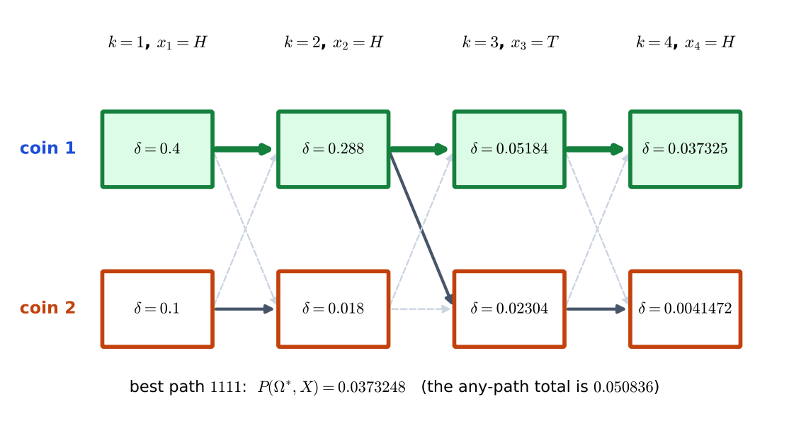
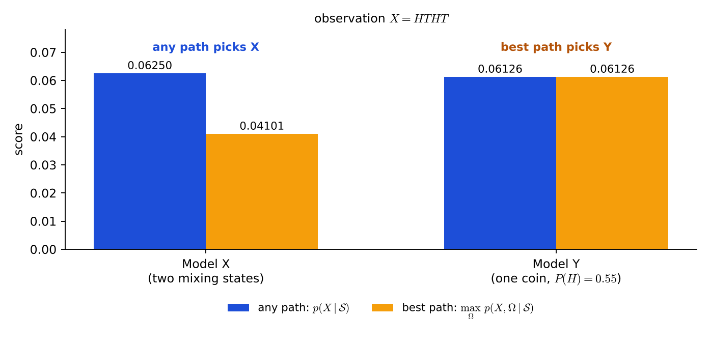

# Lecture 13 · KP04：辨識（二）：最佳路徑法（Recognition II: the best-path method）

> 程度：研究生（grad）／Level: Graduate (grad)
>
> 第 13 週（2026-11-30）｜Context-Dependent Classification · KP04
>
> Week 13 (2026-11-30) | Context-Dependent Classification · KP04

## 學習目標（Learning objectives）

- 說出最佳路徑法與任意路徑法的差別：把求和換成取最大（State the difference between the best-path and the any-path method: the sum is replaced by a maximum）。
- 寫出最佳路徑法的對數成本，並用 Viterbi 遞迴在 HMM 上手算一個例子（Write the log cost of the best-path method and compute an example by hand with the Viterbi recursion on an HMM）。
- 用數字判斷兩種方法是否選出同一個模型（Judge with numbers whether the two methods pick the same model）。
- 說出為什麼最佳路徑法是次優的近似，以及為什麼仍然常用（Explain why the best-path method is a suboptimal approximation and why it is still popular）。

## KP04：辨識（二）：最佳路徑法（Recognition by the best path）

**一句話重點**：最佳路徑法只挑最可能的一條隱藏路徑當代表，把求和換成取最大，直接用 Viterbi 算。

**One-sentence summary**: The best-path method keeps only the most likely hidden path as the representative, replaces the sum by a maximum, and computes it directly with Viterbi.

### 1. 接住上一講的問題（Picking up the question）

上一講的任意路徑法是精確的，但它要把每條路徑的貢獻都加起來。
如果只挑最好的一條，會差多少？
結果又會不會選出不同的模型？

The any-path method of the last lecture is exact, but it adds the contribution of every path.
If we keep only the best one, how much do we lose?
Could the result even pick a different model?

**白話說明**：想像一場團體賽，要比較兩支隊伍。
任意路徑法是把全隊每個人的分數加總。
最佳路徑法是只請每隊最強的一位選手代打。
這個比喻只說明「全員加總 對 一人代表」，沒說明為什麼有時一人代表就夠。

**Plain explanation**: Imagine a team contest comparing two teams.
The any-path method adds up the scores of every member.
The best-path method lets only the strongest member of each team play.
This analogy only shows "everybody added versus one representative"; it does not say why one representative is sometimes enough.

**先備自測**：確認你記得上週 Viterbi 的遞迴與回溯，以及上一講的 $p(X\mid\mathcal{S})$。
不熟的話，回到第 12 週 KP04 與本週 KP03 複習。

**Prerequisite check**: Make sure you remember the Viterbi recursion and traceback of last week and the $p(X\mid\mathcal{S})$ of the last lecture.
If not, review Week 12 KP04 and KP03 of this week.

- Viterbi 在每個節點只留最佳前驅（Viterbi keeps only the best predecessor at each node）。
- 對數把連乘變成連加，也不改變誰最大（The logarithm turns products into sums and does not change which is largest）。
- 任意路徑法的 $p(X\mid\mathcal{S})$ 是所有路徑的和（The $p(X\mid\mathcal{S})$ of the any-path method is the sum over all paths）。

### 2. 把求和換成取最大（Replacing the sum by a maximum）

**正式定義**：**最佳路徑法**是一種較不精確（次優）但很常用的替代做法。
對每個參考模型 $\mathcal{S}$，找出最可能產生觀測 $X$ 的那一條狀態序列，用它的機率當這個模型的分數。

**Formal definition**: The **best-path method** is a less exact (suboptimal) but very common alternative.
For each reference model $\mathcal{S}$, find the single state sequence most likely to produce the observation $X$ and use its probability as the score of that model.

對照兩種做法：

Compare the two:

- 任意路徑（式 $9.23$）：$p(X\mid\mathcal{S})=\sum_i p(X,\Omega_i\mid\mathcal{S})$，用前向 $\alpha$ 遞迴把所有路徑加起來（Any path (Eq. $9.23$): $p(X\mid\mathcal{S})=\sum_i p(X,\Omega_i\mid\mathcal{S})$, adding all paths with the forward $\alpha$ recursion）。
- 最佳路徑：$\max_i p(X,\Omega_i\mid\mathcal{S})$，用 Viterbi 遞迴取最大（Best path: $\max_i p(X,\Omega_i\mid\mathcal{S})$, taking the maximum with the Viterbi recursion）。

兩者用的局部資訊完全一樣：轉移機率乘發射機率。
差別只在合併的方式是 $\sum$ 還是 $\max$。
所以最佳路徑法可以直接套用上週的動態規劃，成本函數取對數：

Both use exactly the same local information: transition probability times emission probability.
The only difference is whether they combine with $\sum$ or $\max$.
So the best-path method can reuse last week's dynamic programming directly, with the cost taken in logarithms:

$$
D=\sum_{k=1}^{N}d(i_k,i_{k-1}),\qquad d(i_k,i_{k-1})=\ln P(i_k\mid i_{k-1})+\ln p(\mathbf{x}_k\mid i_k)\tag{9.29}
$$

辨識時，對每個模型各跑一次 Viterbi，得到最佳累積成本 $D$。
未知序列被分到 $D$ 最大的那個模型。

For recognition, run Viterbi once for each model to get its best accumulated cost $D$.
The unknown sequence is assigned to the model with the largest $D$.

| 符號 | 中文意義 | English meaning |
|---|---|---|
| $\delta(i_k)$ | 到第 $k$ 步停在 $i_k$ 的最佳路徑機率 | Probability of the best path reaching $i_k$ at step $k$ |
| $D$ | 最佳路徑的累積對數成本 | Accumulated log cost of the best path |
| $d(i_k,i_{k-1})$ | 一步的對數成本：對數轉移加對數發射 | One-step log cost: log transition plus log emission |
| $\Omega^{*}$ | 最佳隱藏路徑 | The best hidden path |

**常見迷思**：「最佳路徑法的結果一定和任意路徑法一樣。」
不對。
當一條路徑遠比其他路徑可能時（集中型），兩者很接近。
當很多條路徑貢獻差不多時（分散型），總和會明顯大於最大值，兩種方法可能選出不同的模型。

**Common misconception**: "The best-path method always gives the same result as the any-path method."
That is wrong.
When one path is far more likely than the rest (a concentrated case), the two are close.
When many paths contribute about equally (a spread-out case), the sum is far larger than the maximum, and the two methods may pick different models.

### 3. 主例子：HHTH 的最佳路徑與兩個模型的比較（Main example）

**第一部分：同一個模型，最佳路徑佔總和多少？**
沿用 KP01 與 KP03 的兩枚硬幣模型與觀測 $HHTH$。
Viterbi 用機率域，每個節點取最大：

**Part 1: for the same model, what share of the total is the best path?**
Reuse the two-coin model and the observation $HHTH$ of KP01 and KP03.
Viterbi in the probability domain takes the maximum at every node:

$$
\delta_1(1)=0.4,\ \delta_1(2)=0.1
$$

第 2 步：$\delta_2(1)=\max(0.4\times0.9,\ 0.1\times0.1)\times0.8=0.288$，前驅是硬幣 1。
$\delta_2(2)=\max(0.4\times0.1,\ 0.1\times0.9)\times0.2=0.018$，前驅是硬幣 2。
第 3 步（$T$）：$\delta_3(1)=\max(0.288\times0.9,\ 0.018\times0.1)\times0.2=0.05184$。
$\delta_3(2)=\max(0.288\times0.1,\ 0.018\times0.9)\times0.8=0.02304$，前驅是硬幣 1。
第 4 步：$\delta_4(1)=\max(0.05184\times0.9,\ 0.02304\times0.1)\times0.8=0.0373248$，前驅是硬幣 1。
$\delta_4(2)=\max(0.05184\times0.1,\ 0.02304\times0.9)\times0.2=0.0041472$，前驅是硬幣 2。

Step 2: $\delta_2(1)=\max(0.4\times0.9,\ 0.1\times0.1)\times0.8=0.288$ with predecessor coin 1.
$\delta_2(2)=\max(0.4\times0.1,\ 0.1\times0.9)\times0.2=0.018$ with predecessor coin 2.
Step 3 ($T$): $\delta_3(1)=\max(0.288\times0.9,\ 0.018\times0.1)\times0.2=0.05184$.
$\delta_3(2)=\max(0.288\times0.1,\ 0.018\times0.9)\times0.8=0.02304$ with predecessor coin 1.
Step 4: $\delta_4(1)=\max(0.05184\times0.9,\ 0.02304\times0.1)\times0.8=0.0373248$ with predecessor coin 1.
$\delta_4(2)=\max(0.05184\times0.1,\ 0.02304\times0.9)\times0.2=0.0041472$ with predecessor coin 2.

最後一欄最大的是 $\delta_4(1)=0.0373248$，回溯得最佳路徑 $1111$。
它佔任意路徑總和 $0.050836$ 的 $0.0373248/0.050836\approx73.4\%$。
次佳路徑 $1122$ 的 $0.0041472$ 只佔約 $8\%$。
這是一個集中型的例子，最佳路徑代表了大部分機率。

The largest in the last column is $\delta_4(1)=0.0373248$, and the traceback gives the best path $1111$.
It makes up $0.0373248/0.050836\approx73.4\%$ of the any-path total $0.050836$.
The runner-up $1122$ with $0.0041472$ is only about $8\%$.
This is a concentrated case, and the best path represents most of the probability.



**圖說 `lec13-kp04-best-path-f1-viterbi-trellis`**：先看每個方塊，數字是 $\delta$，綠底的是最佳路徑經過的節點。
再看箭頭，粗綠線是最佳路徑，灰色實線是其他存活前驅，虛線是被淘汰的。
注意第 4 欄硬幣 1 的 $0.0373248$ 遠大於硬幣 2 的 $0.0041472$。〔功能：1、2〕

**Caption `lec13-kp04-best-path-f1-viterbi-trellis`**: Look first at each box: the number is $\delta$ and green boxes are the nodes on the best path.
Then look at the arrows: the thick green line is the best path, gray solid lines are other surviving predecessors, and dashed lines are pruned.
Note that the $0.0373248$ of coin 1 in column 4 is far larger than the $0.0041472$ of coin 2. [Function: 1, 2]

**第二部分：兩個模型，兩種方法選不同的。**
`[補充]` 觀測 $X=H,T,H,T$。
模型 $\mathrm{X}$：兩個狀態，狀態 1 的 $P_1(H)=0.9$，狀態 2 的 $P_2(H)=0.1$，轉移機率全是 $0.5$，起點各 $0.5$。
模型 $\mathrm{Y}$：單枚硬幣，$P(H)=0.55$。

**Part 2: two models, two methods, different choices.**
`[Added]` The observation is $X=H,T,H,T$.
Model X: two states with $P_1(H)=0.9$ in state 1 and $P_2(H)=0.1$ in state 2, all transition probabilities $0.5$, and start $0.5$ each.
Model Y: a single coin with $P(H)=0.55$.

模型 $\mathrm{Y}$ 只有一條路徑：$0.55\times0.45\times0.55\times0.45=0.06125625$。
模型 $\mathrm{X}$ 的任意路徑總和：轉移與起點都是 $0.5$，所以每條路徑的轉移部分都是 $0.5^4=0.0625$。
把 $2^4=16$ 條路徑的發射部分加起來，因為每一步 $0.9+0.1=1$，總和就是 $1$。
所以 $p(X\mid\mathcal{X})=0.0625\times1=0.0625$。
模型 $\mathrm{X}$ 的最佳路徑：每一步挑發射大的，$0.0625\times0.9^4=0.04100625$。

Model Y has only one path: $0.55\times0.45\times0.55\times0.45=0.06125625$.
For model X's any-path total: start and transitions are all $0.5$, so the transition part of every path is $0.5^4=0.0625$.
Adding the emission parts of the $2^4=16$ paths gives $1$, because $0.9+0.1=1$ at every step.
So $p(X\mid\mathcal{X})=0.0625\times1=0.0625$.
Model X's best path takes the larger emission at every step: $0.0625\times0.9^4=0.04100625$.

比較：任意路徑法 $0.0625>0.06125625$，選模型 $\mathrm{X}$。
最佳路徑法 $0.04100625<0.06125625$，選模型 $\mathrm{Y}$。
兩種方法選出不同的模型。
原因是模型 $\mathrm{X}$ 有 $16$ 條路徑各貢獻一點，最佳的一條只佔 $0.04100625/0.0625\approx65.6\%$，最佳路徑法把另外的機率丟掉了。

Comparison: the any-path method has $0.0625>0.06125625$ and picks model X.
The best-path method has $0.04100625<0.06125625$ and picks model Y.
The two methods pick different models.
The reason is that model X has $16$ paths each contributing a little, the best one makes up only $0.04100625/0.0625\approx65.6\%$, and the best-path method throws away the rest of the probability.



**圖說 `lec13-kp04-best-path-f2-sum-vs-max`**：先看左邊模型 $\mathrm{X}$，藍色長條（任意路徑）比橘色長條（最佳路徑）高很多。
再看右邊模型 $\mathrm{Y}$，它只有一條路徑，兩根長條一樣高。
注意藍色的 $\mathrm{X}$ 比 $\mathrm{Y}$ 高，橘色的 $\mathrm{X}$ 卻比 $\mathrm{Y}$ 低，所以結論翻轉。〔功能：1、2〕

**Caption `lec13-kp04-best-path-f2-sum-vs-max`**: Look first at model X on the left: the blue bar (any path) is much taller than the orange bar (best path).
Then look at model Y on the right, which has one path, so its two bars are equally tall.
Note that blue X is taller than Y while orange X is lower than Y, so the conclusion flips. [Function: 1, 2]

### 4. 為什麼仍然常用、限制在哪（Why it is still popular, and where it stops）

**為什麼常用**：計算方式和 Viterbi 完全共用，寫起來簡單。
它還有一個好處：同時得到最佳路徑本身，也就是「哪一步在哪個狀態」，這在語音裡可用來切段。
可以用對數相加，不必處理前向的縮放問題。

**Why it is popular**: The computation is shared completely with Viterbi, which makes it simple to write.
It has another benefit: it also returns the best path itself, that is, "which step is in which state", which can be used to segment speech.
It can add logarithms and needs no scaling as the forward pass does.

**限制**：它是次優的近似。
當觀測有許多條路徑貢獻相近的機率時，只保留一條會低估這個模型，像上面的模型 $\mathrm{X}$。
一般的經驗是：模型的狀態轉移越「集中」（例如左到右、自轉移高），兩種方法越接近。

**Limit**: It is a suboptimal approximation.
When an observation has many paths contributing similar probabilities, keeping only one underestimates the model, as with model X above.
A general rule of thumb: the more "concentrated" the state transitions are (for example left-to-right with high self-transitions), the closer the two methods are.

### 5. 與實作的連結（Connection to implementation）

下面的程式用對數域跑 Viterbi，並與任意路徑的總和比較。
注意 `back[k][i]` 記每個節點的最佳前驅，最後用它回溯。

The code below runs Viterbi in the log domain and compares it with the any-path total.
Note that `back[k][i]` stores the best predecessor of each node and is used for the final traceback.

```python
import numpy as np

A = np.array([[0.9, 0.1], [0.1, 0.9]])
E = np.array([[0.8, 0.2], [0.2, 0.8]])        # 列 = 狀態，欄 = H / T
P0 = np.array([0.5, 0.5]); obs = [0, 0, 1, 0]
N = len(obs)

D = np.zeros((N, 2)); back = np.zeros((N, 2), dtype=int)
D[0] = np.log(P0 * E[:, obs[0]])
for k in range(1, N):
    cand = D[k - 1][:, None] + np.log(A)                  # cand[j, i]：前驅 j 到節點 i
    back[k] = cand.argmax(axis=0)
    D[k] = cand.max(axis=0) + np.log(E[:, obs[k]])
path = [int(D[-1].argmax())]
for k in range(N - 1, 0, -1):
    path.append(int(back[k][path[-1]]))
path = [p + 1 for p in path[::-1]]
print(path, round(float(np.exp(D[-1].max())), 7))        # [1, 1, 1, 1] 0.0373248

alpha = P0 * E[:, obs[0]]                                  # 任意路徑：前向 / any path: forward
for k in range(1, N):
    alpha = (alpha @ A) * E[:, obs[k]]
print(round(float(alpha.sum()), 6), round(float(np.exp(D[-1].max()) / alpha.sum()), 4))   # 0.050836 0.7342
```

**留給下一節的問題**：到目前為止，模型的參數都是已知的。
真正的難題是：參數從哪裡來？
下一節看訓練，先從最常用的 Baum-Welch 開始。

**The question for the next section**: So far the parameters of the model were known.
The real difficulty is: where do the parameters come from?
The next section looks at training, starting with the most common one, Baum-Welch.

### 6. 小練習與解題示範（Practice and worked solutions）

**小練習** `[補充]`：先寫下理由，再看解答。

**Practice** `[Added]`: Write your reasoning before reading the solutions.

1. 題 1：用本講的兩枚硬幣模型，觀測只有 $H,H$。最佳路徑是什麼？它的機率是多少（For the two-coin model and the observation $H,H$ only, what is the best path and its probability）？
2. 題 2：最佳路徑法算出的值一定小於或等於任意路徑法嗎？為什麼（Is the value of the best-path method always less than or equal to that of the any-path method, and why）？
3. 題 3：模型 $\mathrm{X}$ 的觀測改成 $H,H,H,H$，任意路徑總和與最佳路徑各是多少（For model $\mathrm{X}$ with the observation $H,H,H,H$, what are the any-path total and the best path）？

**題 1 解題示範**：$\delta_2(1)=0.288$，$\delta_2(2)=0.018$，最大的是 $0.288$。
回溯：硬幣 1，前驅也是硬幣 1。
最佳路徑是 $1,1$，機率 $0.288$。

**Question 1 worked solution**: $\delta_2(1)=0.288$ and $\delta_2(2)=0.018$, and the largest is $0.288$.
Traceback: coin 1, with predecessor coin 1 as well.
The best path is $1,1$ with probability $0.288$.

**題 2 解題示範**：是。
任意路徑法是所有路徑機率的和，每一項都不小於 $0$，所以總和不小於其中最大的一項。
等號只在其他路徑機率全為 $0$ 時成立。

**Question 2 worked solution**: Yes.
The any-path value is the sum of the probabilities of all paths, each term is at least $0$, so the sum is at least its largest term.
Equality holds only when all other paths have probability $0$.

**題 3 解題示範**：任意路徑：轉移部分 $0.0625$，發射部分每步 $0.9+0.1=1$，總和是 $0.0625$。
最佳路徑：每步取 $0.9$，$0.0625\times0.9^4=0.04100625$。
它和 $HTHT$ 的結果相同，因為模型 $\mathrm{X}$ 的轉移全是 $0.5$，任意路徑的總和與觀測內容無關。

**Question 3 worked solution**: Any path: the transition part is $0.0625$, the emission part is $0.9+0.1=1$ at each step, so the total is $0.0625$.
Best path: take $0.9$ at every step, $0.0625\times0.9^4=0.04100625$.
It equals the result for $HTHT$ because all transitions of model X are $0.5$, and the any-path total does not depend on the observation content.

## 術語表（Glossary）

| 中文術語 | English term |
|---|---|
| 最佳路徑法 | Best-path method |
| 任意路徑法 | Any-path method |
| 次優 | Suboptimal |
| 動態規劃 | Dynamic programming |
| 回溯 | Traceback |
| 累積成本 | Accumulated cost |
| 前驅 | Predecessor |
| 隱藏路徑 | Hidden path |
| 隱藏馬可夫模型（HMM） | Hidden Markov model (HMM) |
| 辨識 | Recognition |

## 銜接與來源（Connections and sources）

下一講開始訓練。
你會看到狀態看不見時，怎麼用期望次數估計參數。

The next lecture starts training.
You will see how to estimate the parameters with expected counts when the state cannot be seen.

- 前一單元：[KP03 辨識（一）：任意路徑與前向—後向遞迴](lec13-kp03-forward-backward.md)（Previous unit: recognition I, the any-path method）。
- 下一單元：[KP05 訓練（一）：Baum-Welch 重估](lec13-kp05-baum-welch.md)（Next unit: training I, Baum-Welch re-estimation）。
- 來源：[Context-Dependent Classification §9.6](https://ndhuccc.github.io/CCC-LNS/PR_115/Ch09-context-dependent-classification/index.html)，讀取日期 2026-11-13（Source accessed 2026-11-13）。
- 書目：Theodoridis and Koutroumbas, *Pattern Recognition*, 4th ed., 2008；見[參考資料](../references/README.md)（See the bibliography）。

本講以自己的文字解釋來源。
把求和換成取最大、式 9.29 的對數成本、用 Viterbi 做辨識與分類到最大 $D$ 的模型、次優近似的說法取自來源。
HHTH 的 Viterbi 手算與佔比、模型 $\mathrm{X}$ 與 $\mathrm{Y}$ 的比較、題解、程式、圖與練習皆為 `[補充]`。

This lecture independently explains the source.
Replacing the sum by a maximum, the log cost of Eq. 9.29, recognition with Viterbi and classification to the model with the largest $D$, and the description as a suboptimal approximation come from the source.
The Viterbi hand computation for HHTH and its share, the comparison of models X and Y, the solutions, the code, the figures and the practice are `[Added]`.
