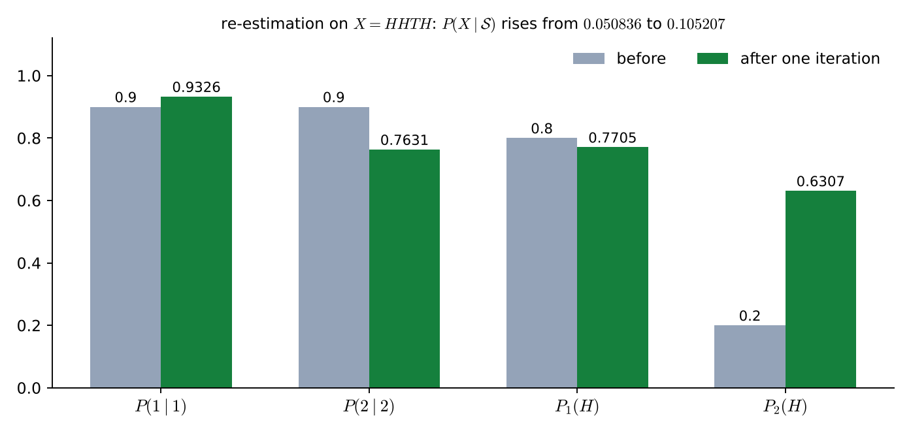
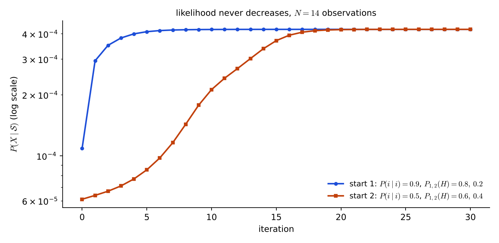

# Lecture 13 · KP05：訓練（一）：Baum-Welch 重估（Training I: Baum-Welch re-estimation）

> 程度：研究生（grad）／Level: Graduate (grad)
>
> 第 13 週（2026-11-30）｜Context-Dependent Classification · KP05
>
> Week 13 (2026-11-30) | Context-Dependent Classification · KP05

## 學習目標（Learning objectives）

- 說出為什麼 HMM 的訓練比辨識難：狀態看不見，不能直接數（State why training an HMM is harder than recognition: the states cannot be seen, so they cannot be counted directly）。
- 寫出 $\xi$、$\gamma$ 的定義，以及轉移、發射、初始機率的重估公式（Write the definitions of $\xi$ and $\gamma$ and the re-estimation formulas of the transition, emission and initial probabilities）。
- 在兩枚硬幣的例子上手算一次完整的重估，並驗證似然沒有下降（Carry out one full re-estimation by hand on the two-coin example and verify that the likelihood did not decrease）。
- 說出 Baum-Welch 就是 $\mathrm{EM}$，以及它的收斂保證與限制（State that Baum-Welch is $\mathrm{EM}$ and give its convergence guarantee and limits）。

## KP05：訓練（一）：Baum-Welch 重估（Baum-Welch re-estimation）

**一句話重點**：Baum-Welch 用目前的模型估計「每個狀態被經過的期望次數」，再把期望次數當成機率重新估計參數，這就是 $\mathrm{EM}$。

**One-sentence summary**: Baum-Welch uses the current model to estimate "the expected number of visits to each state", then treats the expected counts as probabilities to re-estimate the parameters, which is EM.

### 1. 接住上一講的問題（Picking up the question）

前兩講都假設模型的參數已經知道。
訓練要做相反的事：只給一些已知屬於某個模型的觀測，反推轉移、發射與初始機率。
麻煩在於，你看得到觀測，看不到當時的狀態。

The last two lectures assumed that the parameters of the model were known.
Training does the opposite: given some observations known to belong to a model, infer the transition, emission and initial probabilities.
The difficulty is that you can see the observations but not the states.

**白話說明**：想像你要估計兩枚硬幣各自的偏向，但你只看得到正反面，不知道每次是哪一枚。
你可以先猜一組參數，用它算「這一次擲的是硬幣 1 的把握有多大」，再把這個把握當成權重去數正面。
數出來的新偏向再拿去重算把握，一輪一輪修正。
這個比喻只說明「先猜再修正」，沒說明為什麼每一輪都不會變差。

**Plain explanation**: Imagine estimating the bias of two coins when you only see heads and tails and do not know which coin each toss used.
You can first guess a set of parameters, use it to compute "how likely this toss was coin 1", and use that likelihood as a weight when counting heads.
The new biases are then used to recompute the likelihoods, correcting round after round.
This analogy only shows "guess first, then correct"; it does not say why each round gets no worse.

**先備自測**：確認你記得 KP03 的 $\alpha$、$\beta$ 與 $\gamma=\alpha\beta$，以及第 2 週的 $\mathrm{EM}$ 演算法。
不熟的話，回到 KP03 與第 2 週複習。

**Prerequisite check**: Make sure you remember $\alpha$, $\beta$ and $\gamma=\alpha\beta$ of KP03, and the EM algorithm of Week 2.
If not, review KP03 and Week 2.

- $\alpha$ 是過去、$\beta$ 是未來，$\alpha\beta$ 把兩者接起來（$\alpha$ is the past, $\beta$ the future, and $\alpha\beta$ joins them）。
- $\mathrm{EM}$ 先在 $\mathrm{E}$ 步算隱藏變數的期望，再在 $\mathrm{M}$ 步重估參數（$\mathrm{EM}$ computes the expectation of hidden variables in the $\mathrm{E}$ step and re-estimates the parameters in the $\mathrm{M}$ step）。
- 期望次數除以總次數就是機率估計（Expected counts divided by total counts give a probability estimate）。

### 2. 重估公式（The re-estimation formulas）

**正式定義**：訓練的目標是找一組參數，讓已知訓練資料的 $p(X\mid\mathcal{S})$ 越大越好。
這是非線性的最大化問題，要用疊代求解。
先看觀測是離散值 $r=1,2,\dots,L$ 的情形。

**Formal definition**: The goal of training is to find parameters that make $p(X\mid\mathcal{S})$ of the known training data as large as possible.
This is a nonlinear maximization problem solved by iteration.
First consider the case of discrete observations $r=1,2,\dots,L$.

需要兩個量。
$\xi_k(i,j)$：在第 $k$ 步經過狀態 $i$、第 $k+1$ 步經過狀態 $j$ 的機率。
$\gamma_k(i)$：第 $k$ 步經過狀態 $i$ 的機率。
兩者都是在「看過整串觀測 $X$」的條件下的機率，所以都除以 $P(X\mid\mathcal{S})$：

Two quantities are needed.
$\xi_k(i,j)$: the probability of passing state $i$ at step $k$ and state $j$ at step $k+1$.
$\gamma_k(i)$: the probability of passing state $i$ at step $k$.
Both are probabilities given the whole observation $X$, so both are divided by $P(X\mid\mathcal{S})$:

$$
\xi_k(i,j)=\frac{\alpha(i_k=i)\,P(j\mid i)\,p(\mathbf{x}_{k+1}\mid j)\,\beta(i_{k+1}=j)}{P(X\mid\mathcal{S})},\qquad
\gamma_k(i)=\frac{\alpha(i_k=i)\,\beta(i_k=i)}{P(X\mid\mathcal{S})}\tag{9.30–9.32}
$$

$\xi$ 的分子有四段：$\alpha$ 是走到狀態 $i$ 的歷史，$P(j\mid i)\,p(\mathbf{x}_{k+1}\mid j)$ 是 $i\to j$ 這一步的轉移加發射，$\beta$ 是從 $j$ 走到結尾的未來。

The numerator of $\xi$ has four parts: $\alpha$ is the history of reaching state $i$, $P(j\mid i)\,p(\mathbf{x}_{k+1}\mid j)$ is the transition plus emission of the step $i\to j$, and $\beta$ is the future from $j$ to the end.

把機率加起來，得到期望次數：
$\sum_{k=1}^{N-1}\xi_k(i,j)$ 是從 $i$ 轉到 $j$ 的期望次數。
$\sum_{k=1}^{N-1}\gamma_k(i)$ 是從 $i$ 出發的轉移的期望次數。
$\sum_{k=1}^{N}\gamma_k(i)$ 是狀態 $i$ 被經過的期望次數。

Adding the probabilities gives expected counts:
$\sum_{k=1}^{N-1}\xi_k(i,j)$ is the expected number of transitions from $i$ to $j$.
$\sum_{k=1}^{N-1}\gamma_k(i)$ is the expected number of transitions leaving $i$.
$\sum_{k=1}^{N}\gamma_k(i)$ is the expected number of visits to state $i$.

重估公式就是「期望次數的比例」：

The re-estimation formulas are "ratios of expected counts":

$$
\bar P(j\mid i)=\frac{\sum_{k=1}^{N-1}\xi_k(i,j)}{\sum_{k=1}^{N-1}\gamma_k(i)},\quad
\bar P_{\mathbf{x}}(r\mid i)=\frac{\sum_{k:\ \mathbf{x}_k\to r}\gamma_k(i)}{\sum_{k=1}^{N}\gamma_k(i)},\quad
\bar P(i)=\gamma_1(i)\tag{9.33–9.35}
$$

式 $(9.34)$ 的分子只加總「觀測剛好是第 $r$ 個離散值」的那些 $\gamma_k(i)$。

The numerator of Eq. $(9.34)$ adds only those $\gamma_k(i)$ for which the observation is exactly the $r$-th discrete value.

**疊代流程**：先假設一組參數，算 $P(X\mid\mathcal{S})$。
步驟 1：用式 $(9.33)$–$(9.35)$ 得到新模型 $\overline{\mathcal{S}}$。
步驟 2：算 $P(X\mid\overline{\mathcal{S}})$。若增加量大於容許值 $\epsilon$，就令 $\mathcal{S}=\overline{\mathcal{S}}$ 回到步驟 1，否則停止。

**Iteration**: Start with a set of parameters and compute $P(X\mid\mathcal{S})$.
Step 1: obtain the new model $\overline{\mathcal{S}}$ from Eqs. $(9.33)$–$(9.35)$.
Step 2: compute $P(X\mid\overline{\mathcal{S}})$. If the increase exceeds the tolerance $\epsilon$, set $\mathcal{S}=\overline{\mathcal{S}}$ and return to step 1; otherwise stop.

**這就是 $\mathrm{EM}$。**
完整資料應該包含觀測與狀態序列，但狀態看不見，是不完整資料的最大似然問題。
$\mathrm{E}$ 步：用 $\alpha$、$\beta$ 算出 $\xi$、$\gamma$，等於對隱藏狀態取期望。
$\mathrm{M}$ 步：把期望值代入重估公式，得到讓期望對數似然最大的新參數。
$\mathrm{EM}$ 保證，每疊代一次：

**This is EM.**
The complete data should contain the observations and the state sequence, but the states are invisible, so this is a maximum likelihood problem with incomplete data.
E step: compute $\xi$ and $\gamma$ from $\alpha$ and $\beta$, which is taking an expectation over the hidden states.
M step: substitute the expected values into the re-estimation formulas to get the new parameters that maximize the expected log likelihood.
EM guarantees, after every iteration:

$$
P(X\mid\overline{\mathcal{S}})\ \ge\ P(X\mid\mathcal{S})
$$

| 符號 | 中文意義 | English meaning |
|---|---|---|
| $\xi_k(i,j)$ | 第 $k$ 步在 $i$、第 $k+1$ 步在 $j$ 的機率（給定 $X$） | Probability of $i$ at step $k$ and $j$ at step $k+1$ (given $X$) |
| $\gamma_k(i)$ | 第 $k$ 步在 $i$ 的機率（給定 $X$） | Probability of $i$ at step $k$ (given $X$) |
| $\bar P(j\mid i)$ | 重估後的轉移機率 | Re-estimated transition probability |
| $\bar P_{\mathbf{x}}(r\mid i)$ | 重估後狀態 $i$ 發射第 $r$ 個值的機率 | Re-estimated probability that state $i$ emits the $r$-th value |
| $\bar P(i)$ | 重估後的初始機率 | Re-estimated initial probability |
| $\epsilon$ | 停止疊代的容許增量 | Tolerance for stopping the iteration |

**常見迷思**：「Baum-Welch 一定找到最好的模型。」
不對。
$\mathrm{EM}$ 只保證似然「不會變差」，不保證到達全域最大，可能停在局部極大。
實務上常用不同的初始值跑多次，挑結果較好的。

**Common misconception**: "Baum-Welch always finds the best model."
That is wrong.
EM only guarantees that the likelihood "does not get worse"; it does not guarantee reaching the global maximum and may stop at a local maximum.
In practice it is run several times from different initial values and the better result is kept.

### 3. 主例子：HHTH 的一次重估（Main example: one re-estimation on HHTH）

沿用 KP03 的兩枚硬幣模型：$P_1(H)=0.8$、$P_2(H)=0.2$，起點各 $0.5$，留在原硬幣 $0.9$。
觀測 $X=H,H,T,H$。
KP03 已經算好：$P(X\mid\mathcal{S})=0.050836$，各步 $\gamma$ 為

Reuse the two-coin model of KP03: $P_1(H)=0.8$, $P_2(H)=0.2$, start $0.5$ each, stay $0.9$.
The observation is $X=H,H,T,H$.
KP03 has already computed $P(X\mid\mathcal{S})=0.050836$ and the $\gamma$ of each step:

| 步 $k$ | 觀測 | $\gamma_k(1)$ | $\gamma_k(2)$ |
|---|---|---|---|
| 1 | $H$ | $0.9042$ | $0.0958$ |
| 2 | $H$ | $0.8967$ | $0.1033$ |
| 3 | $T$ | $0.7831$ | $0.2169$ |
| 4 | $H$ | $0.8287$ | $0.1713$ |

**$\mathrm{E}$ 步：算 $\xi$。**
以 $\xi_1(1,1)$ 為例（第 1 步在硬幣 1，第 2 步仍在硬幣 1）：
$\alpha_1(1)\times P(1\mid1)\times p(x_2\mid1)\times\beta_2(1)/P(X)=0.4\times0.9\times0.8\times0.154/0.050836=0.8725$。
其他三項同樣算：$\xi_1(1,2)=0.0318$，$\xi_1(2,1)=0.0242$，$\xi_1(2,2)=0.0715$。
四項加起來是 $1$。

**E step: compute $\xi$.**
Take $\xi_1(1,1)$ as an example (coin 1 at step 1 and still coin 1 at step 2):
$\alpha_1(1)\times P(1\mid1)\times p(x_2\mid1)\times\beta_2(1)/P(X)=0.4\times0.9\times0.8\times0.154/0.050836=0.8725$.
The other three entries are computed the same way: $\xi_1(1,2)=0.0318$, $\xi_1(2,1)=0.0242$, $\xi_1(2,2)=0.0715$.
The four add up to $1$.

把 $k=1,2,3$ 三步的 $\xi$ 加起來，得到期望的轉移次數：

Adding the $\xi$ of steps $k=1,2,3$ gives the expected numbers of transitions:

| 從＼到 | 硬幣 1 | 硬幣 2 | 合計 |
|---|---|---|---|
| 硬幣 1 | $2.4100$ | $0.1741$ | $2.5841$ |
| 硬幣 2 | $0.0985$ | $0.3174$ | $0.4159$ |

**$\mathrm{M}$ 步：重估。**
轉移：$\bar P(1\mid1)=2.4100/2.5841=0.9326$，$\bar P(2\mid2)=0.3174/0.4159=0.7631$。
發射：硬幣 1 在 $H$ 那三步的 $\gamma$ 加起來是 $0.9042+0.8967+0.8287=2.6296$，硬幣 1 的總 $\gamma$ 是 $3.4127$，所以 $\bar P_1(H)=2.6296/3.4127=0.7705$。
硬幣 2：$0.3704/0.5873=0.6307$，所以 $\bar P_2(H)=0.6307$。
初始：$\bar P(1)=\gamma_1(1)=0.9042$，$\bar P(2)=0.0958$。

**M step: re-estimate.**
Transitions: $\bar P(1\mid1)=2.4100/2.5841=0.9326$ and $\bar P(2\mid2)=0.3174/0.4159=0.7631$.
Emissions: the $\gamma$ of coin 1 on the three $H$ steps add up to $0.9042+0.8967+0.8287=2.6296$ and the total $\gamma$ of coin 1 is $3.4127$, so $\bar P_1(H)=2.6296/3.4127=0.7705$.
Coin 2: $0.3704/0.5873=0.6307$, so $\bar P_2(H)=0.6307$.
Initial: $\bar P(1)=\gamma_1(1)=0.9042$ and $\bar P(2)=0.0958$.

用新參數重算 $P(X\mid\overline{\mathcal{S}})$：$0.105207$，比 $0.050836$ 大了一倍多。
似然沒有下降，符合 $\mathrm{EM}$ 的保證。

Recomputing $P(X\mid\overline{\mathcal{S}})$ with the new parameters gives $0.105207$, more than double $0.050836$.
The likelihood did not decrease, as the EM guarantee says.



**圖說 `lec13-kp05-baum-welch-f2-parameters`**：先看每一組兩根長條，灰色是重估前，綠色是重估後。
再看硬幣 2 的 $P_2(H)$，它從 $0.2$ 跳到 $0.6307$，變化最大。
注意只用一串 4 個觀測訓練，參數被資料拉得很遠，這是過度擬合的徵兆，真正訓練要用很多串資料。〔功能：1、2〕

**Caption `lec13-kp05-baum-welch-f2-parameters`**: Look first at each pair of bars: gray is before and green is after re-estimation.
Then look at $P_2(H)$ of coin 2, which jumps from $0.2$ to $0.6307$, the largest change.
Note that training on a single string of 4 observations pulls the parameters far toward the data, a sign of overfitting; real training needs many strings. [Function: 1, 2]

**多疊代幾次。**
`[補充]` 用一串 $N=14$ 的觀測 $HHHHTHHTTTTTHT$，從兩組不同的初值各疊代 $30$ 次。
第一組初值（留 $0.9$，$P(H)=0.8,0.2$）的似然從 $1.09\times10^{-4}$ 升到 $4.21\times10^{-4}$。
第二組初值（留 $0.5$，$P(H)=0.6,0.4$）從 $6.1\times10^{-5}$ 升到同一個值。
每一步都沒有下降。

**Several more iterations.**
`[Added]` On a string of $N=14$ observations $HHHHTHHTTTTTHT$, iterate $30$ times from each of two different initial values.
The likelihood of the first start (stay $0.9$, $P(H)=0.8,0.2$) rises from $1.09\times10^{-4}$ to $4.21\times10^{-4}$.
The second start (stay $0.5$, $P(H)=0.6,0.4$) rises from $6.1\times10^{-5}$ to the same value.
No step decreases.



**圖說 `lec13-kp05-baum-welch-f1-likelihood-curve`**：先看縱軸，它是對數刻度。
再看兩條曲線，藍色起點好，一開始就快速上升；橘色起點差，要多走十幾次。
注意兩條都只往上、不下降，最後停在同一條水平線。〔功能：1、2〕

**Caption `lec13-kp05-baum-welch-f1-likelihood-curve`**: Look first at the vertical axis, a logarithmic scale.
Then look at the two curves: blue has a good start and rises quickly at once, while orange has a poor start and needs a dozen more iterations.
Note that both only rise and never fall, and they end on the same horizontal line. [Function: 1, 2]

### 4. 實務注意與限制（Practical notes and limits）

**縮放**：$\alpha$、$\beta$ 是機率的乘積，步數多了會下溢。
常見做法是依步數縮放 $\alpha$，$\beta$ 用同一組縮放因子，相乘時縮放互相抵銷。

**Scaling**: $\alpha$ and $\beta$ are products of probabilities and underflow when there are many steps.
The usual way is to scale $\alpha$ step by step and use the same scaling factors for $\beta$, so that the scaling cancels in the product.

**初始值**：通常隨機初始化，但要遵守問題的限制。
例如不准的轉移要設成 $0$，因為重估公式的分子是 $0$ 乘 $0$ 還是 $0$，這個零會一直保留。
所有機率要合計為 $1$。

**Initial values**: These are usually random, but must obey the constraints of the problem.
For example, a forbidden transition must be set to $0$, because the numerator of the re-estimation formula stays $0$ and the zero is kept forever.
All probabilities must sum to $1$.

**資料量**：觀測序列要夠長（或夠多串），每種轉移才會出現足夠多次。
資料太少時，重估的參數不穩，像上面只用 4 個觀測的例子。

**Amount of data**: The observation sequences must be long enough (or numerous enough) for every transition to occur often.
With too little data the re-estimated parameters are unstable, as in the example above with only 4 observations.

**局部極大**：$\mathrm{EM}$ 的保證只是「不會變差」。
不同初值可能停在不同的局部極大。
`[補充]` 上面兩組初值剛好停在同一值，不代表總是如此。

**Local maxima**: The EM guarantee is only "does not get worse".
Different initial values may stop at different local maxima.
`[Added]` The two starts above happen to end at the same value, which does not mean this is always so.

### 5. 與實作的連結（Connection to implementation）

下面的程式實作一次 Baum-Welch。
注意 `xi[k, i, j]` 用 KP03 的 $\alpha$ 與 $\beta$ 算；發射重估對每個觀測值 $r$，只加總「那一步觀測是 $r$」的 $\gamma$。

The code below implements one Baum-Welch step.
Note that `xi[k, i, j]` is computed from the $\alpha$ and $\beta$ of KP03; for the emission re-estimate and each observed value $r$, only the $\gamma$ of the steps where the observation is $r$ are added.

```python
import numpy as np

def forward_backward(A, E, P0, obs):
    N = len(obs); al = np.zeros((N, 2)); be = np.ones((N, 2))
    al[0] = P0 * E[:, obs[0]]
    for k in range(1, N): al[k] = (al[k - 1] @ A) * E[:, obs[k]]
    for k in range(N - 2, -1, -1): be[k] = A @ (E[:, obs[k + 1]] * be[k + 1])
    return al, be, al[-1].sum()

def baum_welch_step(A, E, P0, obs):
    """回傳新的 (A, E, P0) 與目前模型的 P(X)。"""
    N = len(obs); al, be, px = forward_backward(A, E, P0, obs)
    gamma = al * be / px                                              # 式 9.32
    xi = np.array([[[al[k, i] * A[i, j] * E[j, obs[k + 1]] * be[k + 1, j] / px
                     for j in range(2)] for i in range(2)] for k in range(N - 1)])   # 式 9.31
    A_new = xi.sum(axis=0) / gamma[:-1].sum(axis=0)[:, None]          # 式 9.33
    E_new = np.stack([gamma[np.array(obs) == r].sum(axis=0) for r in range(E.shape[1])], axis=1)
    E_new /= gamma.sum(axis=0)[:, None]                               # 式 9.34
    return A_new, E_new, gamma[0], px                                 # 式 9.35

A = np.array([[0.9, 0.1], [0.1, 0.9]]); E = np.array([[0.8, 0.2], [0.2, 0.8]]); P0 = np.array([0.5, 0.5])
obs = [0, 0, 1, 0]
A2, E2, P2, px = baum_welch_step(A, E, P0, obs)
print(round(px, 6), A2.round(4).tolist(), E2.round(4).tolist())   # 0.050836 [[0.9326, 0.0674], [0.2369, 0.7631]] [[0.7705, 0.2295], [0.6307, 0.3693]]
print(round(forward_backward(A2, E2, P2, obs)[2], 6))                # 0.105207
```

**留給下一節的問題**：Baum-Welch 要對所有路徑取期望，計算不輕。
有沒有一個更簡單的版本？
下一節用最佳路徑，把軟性的期望次數換成硬性的計數。

**The question for the next section**: Baum-Welch takes expectations over all paths, which is not cheap.
Is there a simpler version?
The next section uses the best path and replaces soft expected counts by hard counts.

### 6. 小練習與解題示範（Practice and worked solutions）

**小練習** `[補充]`：先寫下理由，再看解答。

**Practice** `[Added]`: Write your reasoning before reading the solutions.

1. 題 1：重估後的轉移矩陣第 1 列是 $(0.9326,\ 0.0674)$，第 2 列是 $(0.2369,\ 0.7631)$。每列和是多少（The first row of the re-estimated transition matrix is $(0.9326,\ 0.0674)$ and the second is $(0.2369,\ 0.7631)$. What is each row sum）？
2. 題 2：為什麼重估公式的分母是 $\sum_{k=1}^{N-1}\gamma_k(i)$，而不是 $\sum_{k=1}^{N}$（Why is the denominator of the re-estimation formula $\sum_{k=1}^{N-1}\gamma_k(i)$ and not $\sum_{k=1}^{N}$）？
3. 題 3：若把某個轉移的初始值設成 $0$，重估後它會變成多少（If the initial value of some transition is set to $0$, what does it become after re-estimation）？

**題 1 解題示範**：第 1 列 $0.9326+0.0674=1$，第 2 列 $0.2369+0.7631=1$。
重估公式用「從 $i$ 出發的期望總次數」當分母，各格的分子加起來剛好等於它，所以每列和必為 $1$。

**Question 1 worked solution**: Row 1 is $0.9326+0.0674=1$ and row 2 is $0.2369+0.7631=1$.
The re-estimation formula uses "the expected total number of transitions leaving $i$" as the denominator, and the numerators of the cells add up to exactly that, so every row sum must be $1$.

**題 2 解題示範**：轉移是兩步之間的事，$N$ 步只有 $N-1$ 次轉移。
最後一步之後沒有下一步，不能算「從 $i$ 出發」。
發射則每一步都有，所以發射的分母才用到 $N$。

**Question 2 worked solution**: A transition lies between two steps, and $N$ steps have only $N-1$ transitions.
There is no next step after the last one, so it cannot count as "leaving $i$".
Emissions occur at every step, so the denominator of the emission uses $N$.

**題 3 解題示範**：仍然是 $0$。
$\xi_k(i,j)$ 的分子含有 $P(j\mid i)=0$，每一步都是 $0$，加起來還是 $0$。
這就是為什麼左到右模型禁止的轉移要在一開始就設成 $0$，它們會一直保持。

**Question 3 worked solution**: It stays $0$.
The numerator of $\xi_k(i,j)$ contains $P(j\mid i)=0$, so every step gives $0$ and the sum is still $0$.
This is why the forbidden transitions of a left-to-right model are set to $0$ at the start and then stay so.

## 術語表（Glossary）

| 中文術語 | English term |
|---|---|
| 訓練 | Training |
| 重估 | Re-estimation |
| 期望次數 | Expected count |
| 不完整資料 | Incomplete data |
| 最大似然估計 | Maximum likelihood estimation |
| $\mathrm{EM}$ 演算法 | $\mathrm{EM}$ algorithm |
| 局部極大 | Local maximum |
| 縮放 | Scaling |
| 過度擬合 | Overfitting |
| 隱藏馬可夫模型（HMM） | Hidden Markov model (HMM) |
| 前向變數 | Forward variable |
| 後向變數 | Backward variable |

## 銜接與來源（Connections and sources）

下一講用最佳路徑做訓練。
你會看到軟性的期望次數怎麼變成硬性的計數，以及它為什麼叫分段 $k$-means。

The next lecture trains with the best path.
You will see how soft expected counts become hard counts, and why it is called segmental k-means.

- 前一單元：[KP04 辨識（二）：最佳路徑法](lec13-kp04-best-path.md)（Previous unit: recognition II, the best-path method）。
- 下一單元：[KP06 訓練（二）：Viterbi 重估](lec13-kp06-viterbi-reestimation.md)（Next unit: training II, Viterbi re-estimation）。
- 來源：[Context-Dependent Classification §9.6](https://ndhuccc.github.io/CCC-LNS/PR_115/Ch09-context-dependent-classification/index.html)，讀取日期 2026-11-13（Source accessed 2026-11-13）。
- 書目：Theodoridis and Koutroumbas, *Pattern Recognition*, 4th ed., 2008；見[參考資料](../references/README.md)（See the bibliography）。

本講以自己的文字解釋來源。
$\xi$、$\gamma$ 的定義、式 9.30–9.35、疊代流程、「Baum-Welch 就是 $\mathrm{EM}$」與單調不減的保證、局部極大、縮放與初始值與資料量的注意事項取自來源。
HHTH 的一次手算（$\xi$、期望轉移次數、重估值、前後似然）、14 個觀測的疊代曲線、題解、程式、圖與練習皆為 `[補充]`。

This lecture independently explains the source.
The definitions of $\xi$ and $\gamma$, Eqs. 9.30–9.35, the iteration procedure, "Baum-Welch is EM" with the non-decreasing guarantee, local maxima, and the notes on scaling, initial values and amount of data come from the source.
The one-step hand computation on HHTH ($\xi$, expected transition counts, re-estimates, likelihoods before and after), the iteration curves for 14 observations, the solutions, the code, the figures and the practice are `[Added]`.
