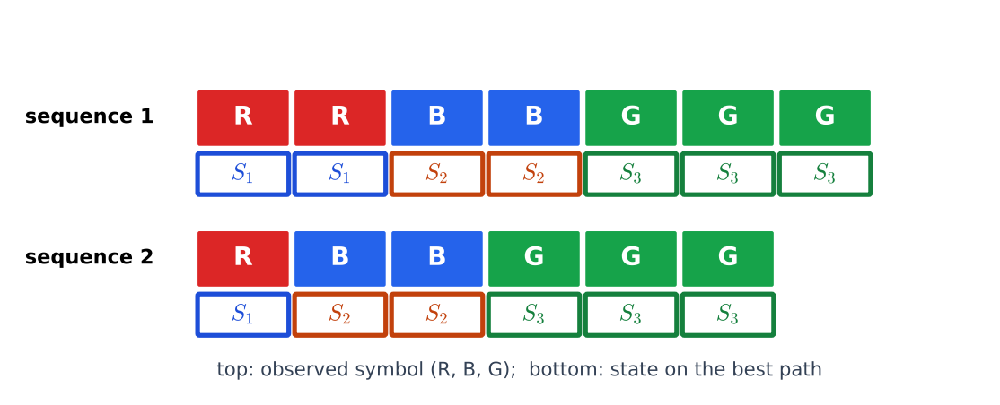
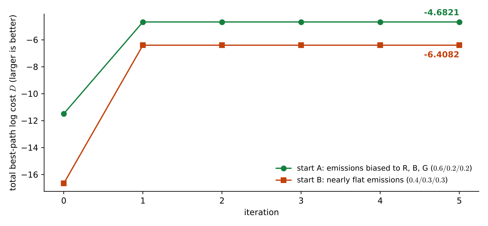

# Lecture 13 · KP06：訓練（二）：Viterbi 重估（Training II: Viterbi re-estimation）

> 程度：研究生（grad）／Level: Graduate (grad)
>
> 第 13 週（2026-11-30）｜Context-Dependent Classification · KP06
>
> Week 13 (2026-11-30) | Context-Dependent Classification · KP06

## 學習目標（Learning objectives）

- 說出 Viterbi 重估和 Baum-Welch 的差別：硬性分派與軟性加權（State how Viterbi re-estimation differs from Baum-Welch: hard assignment versus soft weighting）。
- 用最佳路徑上的計數，重估轉移與發射機率（Re-estimate the transition and emission probabilities from counts along the best path）。
- 在一個三狀態左到右例子上手算兩輪，並讀懂總成本的變化（Carry out two rounds by hand on a three-state left-to-right example and read the change of the total cost）。
- 說出為什麼它叫分段 $k$-means，以及它可能卡在較差的固定點（Explain why it is called segmental $k$-means and why it can get stuck at a poorer fixed point）。

## KP06：訓練（二）：Viterbi 重估（Segmental k-means）

**一句話重點**：先用最佳路徑把每個觀測分給一個狀態，再在這條路徑上直接數次數當作新的機率，交替進行直到成本不再變。

**One-sentence summary**: First assign every observation to a state along the best path, then count directly along this path to get the new probabilities, and alternate until the cost stops changing.

### 1. 接住上一講的問題（Picking up the question）

Baum-Welch 要對所有路徑取期望，每一步都用到 $\alpha$ 與 $\beta$。
有沒有更簡單的做法？
上一節的最佳路徑辨識給了一個想法：既然辨識時只挑一條最佳路徑，訓練時也可以只挑一條。

Baum-Welch takes expectations over all paths and uses $\alpha$ and $\beta$ at every step.
Is there a simpler way?
The best-path recognition of the last section gives an idea: if recognition picks only one best path, training can pick only one too.

**白話說明**：想像老師要把一份名單分給三個小組。
Baum-Welch 是每個人「有 70% 屬於甲組、30% 屬於乙組」，按比例加權。
Viterbi 重估是先決定每個人到底去哪一組，然後單純數各組有幾個人。
這個比喻只說明「按比例」與「直接分派」的差別，沒說明直接分派的風險。

**Plain explanation**: Imagine a teacher dividing a name list among three groups.
Baum-Welch says each person "is 70% in group A and 30% in group B" and weights proportionally.
Viterbi re-estimation first decides which group each person actually goes to, then simply counts the people in each group.
This analogy only shows the difference between "proportional" and "direct assignment"; it does not show the risk of direct assignment.

**先備自測**：確認你記得 KP04 的最佳路徑與回溯，以及 KP05 的重估公式是「期望次數的比例」。
不熟的話，回到 KP04 與 KP05 複習。

**Prerequisite check**: Make sure you remember the best path and traceback of KP04, and that the re-estimation formula of KP05 is a "ratio of expected counts".
If not, review KP04 and KP05.

- 最佳路徑可以用 Viterbi 與回溯得到（The best path is obtained by Viterbi and traceback）。
- 機率估計可以用相對次數（A probability estimate can be a relative frequency）。
- 左到右模型不准往回走（A left-to-right model forbids going back）。

### 2. 計數與重估公式（Counts and the re-estimation formulas）

**正式定義**：先用目前的參數，對每一串訓練觀測找出最佳路徑。
把這條路徑當成「已知的正確狀態標記」，直接像第 12 週已知類別時那樣統計，不必像 Baum-Welch 那樣加權。
在最佳路徑上數四種整數計數：

**Formal definition**: First use the current parameters to find the best path for every training sequence.
Treat this path as "known correct state labels" and count directly as in Week 12 when the classes were known, with no weighting as in Baum-Welch.
Four integer counts are taken along the best path:

- $n_{i\mid j}$：從狀態 $j$ 轉到狀態 $i$ 的次數（The number of transitions from state $j$ to state $i$）。
- $n_{\mid j}$：從狀態 $j$ 出發的轉移次數（The number of transitions leaving state $j$）。
- $n_{i\mid}$：和狀態 $i$ 相關的總次數，用來當發射機率的分母（The total count tied to state $i$, used as the denominator of the emission probability）。
- $n(r\mid i)$：觀測值 $r$ 與狀態 $i$ 同時出現的次數（The number of times observation value $r$ occurs together with state $i$）。

重估就是相對次數：

Re-estimation is a relative frequency:

$$
\bar P(i\mid j)=\frac{n_{i\mid j}}{n_{\mid j}},\qquad \bar P_{\mathbf{x}}(r\mid i)=\frac{n(r\mid i)}{n_{i\mid}}
$$

**疊代流程**：先假設一組參數，找出最佳路徑，算總成本 $D$（和 KP04 的式 $9.29$ 一樣）。
步驟 1：從目前的最佳路徑數計數，重估新參數。
步驟 2：用新參數重找最佳路徑，得到新的總成本 $\bar D$。若 $\bar D-D>\epsilon$，令 $D=\bar D$ 回到步驟 1，否則停止。
常見的前提是起始狀態已知，例如左到右模型一定從第一個狀態開始，所以不必估計初始機率 $P(i)$。

**Iteration**: Start with a set of parameters, find the best paths, and compute the total cost $D$ (the same as Eq. $9.29$ of KP04).
Step 1: count along the current best paths and re-estimate the new parameters.
Step 2: find the best paths again with the new parameters to get the new total cost $\bar D$. If $\bar D-D>\epsilon$, set $D=\bar D$ and return to step 1; otherwise stop.
A common premise is that the starting state is known, for example a left-to-right model always starts in the first state, so the initial probability $P(i)$ need not be estimated.

**為什麼叫分段 $k$-means。**
它的結構和 $k$-means 分群很像。
先用目前的參數把整串觀測「切成」各狀態負責的區段，這相當於 $k$-means 的分派步驟。
再用每個區段內的統計量重估參數，這相當於更新步驟。
兩步交替，直到成本收斂。

**Why it is called segmental $k$-means.**
Its structure is much like $k$-means clustering.
First the current parameters "segment" the observations into the stretches each state is responsible for, like the assignment step of $k$-means.
Then the statistics within each segment re-estimate the parameters, like the update step.
The two steps alternate until the cost converges.

**和 Baum-Welch 的差別：**
Baum-Welch 對所有路徑取期望，是軟性分派，對應任意路徑辨識。
Viterbi 重估只用一條最佳路徑直接數，是硬性分派，對應最佳路徑辨識。
它通常算得較簡單、收斂較快，但只保留一條路徑，可能忽略次佳路徑帶來的資訊。

**Difference from Baum-Welch:**
Baum-Welch takes expectations over all paths, a soft assignment, matching any-path recognition.
Viterbi re-estimation counts directly along one best path, a hard assignment, matching best-path recognition.
It is usually simpler to compute and converges faster, but keeping only one path may ignore the information in runner-up paths.

| 符號 | 中文意義 | English meaning |
|---|---|---|
| $n_{i\mid j}$ | 從 $j$ 到 $i$ 的轉移次數 | Number of transitions from $j$ to $i$ |
| $n_{\mid j}$ | 從 $j$ 出發的轉移次數 | Number of transitions leaving $j$ |
| $n_{i\mid}$ | 發射機率的分母（本例為狀態 $i$ 吐出的觀測總數） | Denominator of the emission probability (in this example the total observations emitted in state $i$) |
| $n(r\mid i)$ | 觀測 $r$ 與狀態 $i$ 同時出現的次數 | Number of times observation $r$ occurs with state $i$ |
| $D$ | 所有訓練串的最佳路徑對數成本合計 | Total best-path log cost over all training sequences |

**常見迷思**：「Viterbi 重估和 Baum-Welch 會得到一樣的參數。」
不對。
前者用整數計數，後者用機率加權的期望次數。
資料量大、路徑集中時兩者接近；路徑不集中時，兩者會不同。

**Common misconception**: "Viterbi re-estimation and Baum-Welch give the same parameters."
That is wrong.
The former uses integer counts and the latter uses probability-weighted expected counts.
With much data and concentrated paths the two are close; with spread-out paths they differ.

### 3. 主例子：三狀態左到右、兩串顏色序列（Main example）

`[補充]` 觀測是三種顏色：紅、藍、綠，圖中的 $\mathrm{R}$、$\mathrm{B}$、$\mathrm{G}$ 依序代表它們。
兩串訓練資料是「紅紅藍藍綠綠綠」與「紅藍藍綠綠綠」，我們希望三個狀態各自負責一種顏色。
模型是三狀態左到右，一定從狀態 1 開始：狀態 1、2 各以 $0.5$ 留下、$0.5$ 前進，狀態 3 只進不出。
初始發射：狀態 1 偏紅，狀態 2 偏藍，狀態 3 偏綠，偏向的顏色 $0.6$，其他各 $0.2$。

`[Added]` The observations are three colors: red, blue and green, represented by $\mathrm{R}$, $\mathrm{B}$ and $\mathrm{G}$ in the figure.
The two training sequences are "red red blue blue green green green" and "red blue blue green green green", and we hope each of the three states is responsible for one color.
The model is a three-state left-to-right model that always starts in state 1: states 1 and 2 each stay with $0.5$ and advance with $0.5$, and state 3 is absorbing.
The initial emissions: state 1 favors red, state 2 favors blue, state 3 favors green, with $0.6$ for the favored color and $0.2$ for each other color.

**第 0 輪：找最佳路徑。**
Viterbi 給出兩串的最佳路徑：$1122333$ 與 $122333$，各自的對數成本是 $-6.3484$ 與 $-5.1444$，總和 $D=-11.4928$。
這個分段正是我們想要的：紅給狀態 1，藍給狀態 2，綠給狀態 3。

**Round 0: find the best paths.**
Viterbi gives the best paths $1122333$ and $122333$ for the two sequences, with log costs $-6.3484$ and $-5.1444$, a total of $D=-11.4928$.
This segmentation is exactly what we wanted: red to state 1, blue to state 2, green to state 3.



**圖說 `lec13-kp06-viterbi-reestimation-f1-segmentation`**：先看每串上方的色塊，它們是觀測到的顏色。
再看下方的方框，框內是最佳路徑給這一步的狀態，三個狀態由左到右依序出現。
注意同一個狀態負責連續的一段，這就是「分段」。〔功能：1、2〕

**Caption `lec13-kp06-viterbi-reestimation-f1-segmentation`**: Look first at the colored blocks on top of each sequence, the observed colors.
Then look at the boxes below, which give the state assigned to that step by the best path, with the three states appearing from left to right.
Note that each state covers one consecutive stretch, which is the "segment". [Function: 1, 2]

**第 1 步：數計數。**
兩串合計，轉移：$n_{1\mid1}=1$、$n_{2\mid1}=2$、$n_{2\mid2}=2$、$n_{3\mid2}=2$、$n_{3\mid3}=4$。
從各狀態出發的次數：$n_{\mid1}=3$、$n_{\mid2}=4$、$n_{\mid3}=4$。
各狀態吐出的觀測：狀態 1 有 $3$ 個（都是紅），狀態 2 有 $4$ 個（都是藍），狀態 3 有 $6$ 個（都是綠）。

**Step 1: count.**
Over both sequences, the transitions are $n_{1\mid1}=1$, $n_{2\mid1}=2$, $n_{2\mid2}=2$, $n_{3\mid2}=2$ and $n_{3\mid3}=4$.
The numbers leaving each state are $n_{\mid1}=3$, $n_{\mid2}=4$ and $n_{\mid3}=4$.
The observations emitted by each state: state 1 has $3$ (all red), state 2 has $4$ (all blue) and state 3 has $6$ (all green).

**第 2 步：重估。**
轉移：$\bar P(1\mid1)=1/3$、$\bar P(2\mid1)=2/3$、$\bar P(2\mid2)=2/4=0.5$、$\bar P(3\mid2)=0.5$、$\bar P(3\mid3)=4/4=1$。
發射：狀態 1 全是紅，$\bar P_{\mathbf{x}}(\text{紅}\mid1)=3/3=1$；狀態 2 全是藍，機率 $1$；狀態 3 全是綠，機率 $1$。

**Step 2: re-estimate.**
Transitions: $\bar P(1\mid1)=1/3$, $\bar P(2\mid1)=2/3$, $\bar P(2\mid2)=2/4=0.5$, $\bar P(3\mid2)=0.5$ and $\bar P(3\mid3)=4/4=1$.
Emissions: state 1 has only red, $\bar P_{\mathbf{x}}(\text{red}\mid1)=3/3=1$; state 2 has only blue, probability $1$; state 3 has only green, probability $1$.

**第 1 輪：用新參數重找路徑。**
最佳路徑仍是 $1122333$ 與 $122333$。
成本是 $\ln(1/3\times2/3\times1/2\times1/2)=-2.8904$ 與 $\ln(2/3\times1/2\times1/2)=-1.7918$，總和 $D=-4.6821$。
比第 0 輪的 $-11.4928$ 好很多。
再做一輪，路徑與計數都不變，$D$ 也不變，演算法停止。

**Round 1: find the paths again with the new parameters.**
The best paths are still $1122333$ and $122333$.
The costs are $\ln(1/3\times2/3\times1/2\times1/2)=-2.8904$ and $\ln(2/3\times1/2\times1/2)=-1.7918$, with the total $D=-4.6821$.
This is much better than the $-11.4928$ of round 0.
One more round leaves the paths, counts and $D$ unchanged, and the algorithm stops.

**卡住的情形。**
`[補充]` 如果換一組較平的初值：停 $0.6$、進 $0.4$，每個狀態對三種顏色的發射是 $0.4$／$0.3$／$0.3$，第 0 輪的分段會變成 $1123333$ 與 $123333$，也就是第二個藍色被分給狀態 3。
總成本 $-16.6631$，一輪後升到 $-6.4082$，之後路徑不再改變，演算法停在這裡。
但這個固定點比上面的 $-4.6821$ 差：狀態 3 同時負責了一個藍色與三個綠色。
一旦分派錯了，下一輪的計數會證明這個錯誤，硬性分派沒有機會修正。

**The stuck case.**
`[Added]` With a flatter start, stay $0.6$ and advance $0.4$, and each state emitting the three colors with $0.4$/$0.3$/$0.3$, the segmentation of round 0 becomes $1123333$ and $123333$, that is, the second blue is assigned to state 3.
The total cost is $-16.6631$ and rises to $-6.4082$ after one round, and then the paths no longer change and the algorithm stops there.
But this fixed point is worse than the $-4.6821$ above: state 3 is responsible for one blue and three greens.
Once an assignment is wrong, the counts of the next round confirm the mistake, and a hard assignment gets no chance to correct it.



**圖說 `lec13-kp06-viterbi-reestimation-f2-cost-curve`**：先看縱軸，它是總對數成本，越大越好。
再看兩條線，都在第 1 輪跳升後變成水平，也就是收斂。
注意橘色線停在 $-6.4082$，比綠色線的 $-4.6821$ 差。〔功能：1、2〕

**Caption `lec13-kp06-viterbi-reestimation-f2-cost-curve`**: Look first at the vertical axis, the total log cost, where larger is better.
Then look at the two lines, both of which jump at round 1 and become flat, that is, converged.
Note that the orange line stops at $-6.4082$, worse than the $-4.6821$ of the green line. [Function: 1, 2]

### 4. 用途與限制（Uses and limits）

**用途**：它比 Baum-Welch 簡單，收斂快。
它還直接給出每個觀測屬於哪個狀態，可以用來切段，也常拿來當 Baum-Welch 的好起點。

**Uses**: It is simpler than Baum-Welch and converges fast.
It also directly says which state each observation belongs to, which can be used for segmentation, and it is often used as a good starting point for Baum-Welch.

**限制一：硬性分派會卡住。**
如上例，初值不好會停在較差的固定點。
解法是用不同初值多跑幾次，或先用 Viterbi 重估，再用 Baum-Welch 微調。

**Limit 1: hard assignment can get stuck.**
As in the example, a poor start stops at a poorer fixed point.
The remedies are to run several times from different starts, or to use Viterbi re-estimation first and fine-tune with Baum-Welch.

**限制二：零機率。**
上例的發射機率出現 $0$ 與 $1$，因為只有兩串、十三個觀測。
真實系統要有夠多的資料，並對沒出現的組合做平滑，否則遇到沒見過的觀測就會得到機率 $0$。

**Limit 2: zero probabilities.**
The emission probabilities in the example have $0$ and $1$ because there are only two sequences and thirteen observations.
Real systems need enough data and smoothing of unseen combinations; otherwise an unseen observation gets probability $0$.

### 5. 與實作的連結（Connection to implementation）

下面的程式做一輪 Viterbi 重估。
注意最佳路徑要限制從狀態 0 開始；零機率用一個很大的負數代替對數。

The code below runs one round of Viterbi re-estimation.
Note that the best path is restricted to start in state 0, and a zero probability is replaced by a very large negative number in the logarithm.

```python
import math
import numpy as np

K = 3
data = [[0, 0, 1, 1, 2, 2, 2], [0, 1, 1, 2, 2, 2]]       # 0 = 紅, 1 = 藍, 2 = 綠
A = np.array([[.5, .5, 0], [0, .5, .5], [0, 0, 1.]])
E = np.array([[.6, .2, .2], [.2, .6, .2], [.2, .2, .6]])
lg = lambda x: math.log(x) if x > 0 else -1e18

def viterbi(A, E, obs):
    N = len(obs); D = np.full((N, K), -1e18); bp = np.zeros((N, K), int)
    D[0, 0] = lg(E[0, obs[0]])                              # 起點固定在狀態 1
    for k in range(1, N):
        for i in range(K):
            c = [D[k - 1, j] + lg(A[j, i]) for j in range(K)]
            bp[k, i] = int(np.argmax(c)); D[k, i] = max(c) + lg(E[i, obs[k]])
    s = int(np.argmax(D[-1])); path = [s]
    for k in range(N - 1, 0, -1): s = bp[k, s]; path.append(int(s))
    return path[::-1], float(D[-1].max())

def reestimate(A, E):
    res = [viterbi(A, E, o) for o in data]
    nij = np.zeros((K, K)); nri = np.zeros((K, 3))
    for (p, _), o in zip(res, data):
        for k in range(len(o)):
            nri[p[k], o[k]] += 1
            if k: nij[p[k - 1], p[k]] += 1
    A2, E2 = A.copy(), E.copy()
    for j in range(K):
        if nij[j].sum() > 0: A2[j] = nij[j] / nij[j].sum()
        if nri[j].sum() > 0: E2[j] = nri[j] / nri[j].sum()
    return A2, E2, [r[0] for r in res], sum(r[1] for r in res)

A1, E1, paths, D0 = reestimate(A, E)
print(["".join(str(s + 1) for s in p) for p in paths], round(D0, 4))      # ['1122333', '122333'] -11.4928
print(round(reestimate(A1, E1)[3], 4))                                    # -4.6821
```

**留給下一節的問題**：到目前為止，觀測都是離散的顏色。
真實的訊號是連續向量。
下一節看連續觀測的 HMM，發射機率改用高斯混合。

**The question for the next section**: So far the observations were discrete colors.
Real signals are continuous vectors.
The next section looks at HMMs with continuous observations, whose emission probabilities use Gaussian mixtures.

### 6. 小練習與解題示範（Practice and worked solutions）

**小練習** `[補充]`：先寫下理由，再看解答。

**Practice** `[Added]`: Write your reasoning before reading the solutions.

1. 題 1：某狀態在最佳路徑上共吐出 $10$ 個觀測，其中 $4$ 個是紅。重估後它發射紅的機率是多少（A state emits $10$ observations along the best path, $4$ of which are red. What is its re-estimated probability of emitting red）？
2. 題 2：左到右模型的狀態 2 在最佳路徑上共出現 $9$ 次，其中 $2$ 次是路徑的最後一步。$n_{\mid2}$ 是多少（State 2 of a left-to-right model occurs $9$ times along the best paths, $2$ of which are the last step of a path. What is $n_{\mid2}$）？
3. 題 3：為什麼說 Viterbi 重估是 Baum-Welch 的近似（Why is Viterbi re-estimation called an approximation of Baum-Welch）？

**題 1 解題示範**：相對次數 $\bar P=4/10=0.4$。

**Question 1 worked solution**: The relative frequency is $\bar P=4/10=0.4$.

**題 2 解題示範**：轉移是「從狀態出發」。
路徑最後一步後沒有下一步，不能算一次轉移。
所以 $n_{\mid2}=9-2=7$。

**Question 2 worked solution**: A transition is "leaving a state".
After the last step of a path there is no next step, which cannot count as a transition.
So $n_{\mid2}=9-2=7$.

**題 3 解題示範**：Baum-Welch 把每個觀測以機率 $\gamma_k(i)$ 分給各個狀態。
當一條路徑的機率遠大於其他路徑時，$\gamma_k(i)$ 接近 $0$ 或 $1$，也就是接近硬性分派。
Viterbi 重估直接把它當成 $0$ 或 $1$，所以是 Baum-Welch 在路徑集中時的簡化。

**Question 3 worked solution**: Baum-Welch assigns each observation to each state with probability $\gamma_k(i)$.
When one path is far more probable than the others, $\gamma_k(i)$ is close to $0$ or $1$, that is, close to a hard assignment.
Viterbi re-estimation takes it as $0$ or $1$ directly, so it is the simplification of Baum-Welch when the paths are concentrated.

## 術語表（Glossary）

| 中文術語 | English term |
|---|---|
| Viterbi 重估 | Viterbi re-estimation |
| 分段 $k$-means | Segmental $k$-means |
| 硬性分派 | Hard assignment |
| 軟性加權 | Soft weighting |
| 最佳路徑 | Best path |
| 相對次數 | Relative frequency |
| 計數 | Count |
| 固定點 | Fixed point |
| 平滑 | Smoothing |
| 左到右模型 | Left-to-right model |
| 累積成本 | Accumulated cost |
| 隱藏馬可夫模型（HMM） | Hidden Markov model (HMM) |

## 銜接與來源（Connections and sources）

下一講處理連續觀測。
你會看到發射機率變成高斯混合，重估公式怎麼多出「哪個成分負責」的一層。

The next lecture handles continuous observations.
You will see the emission probability become a Gaussian mixture and how the re-estimation formulas gain a layer of "which component is responsible".

- 前一單元：[KP05 訓練（一）：Baum-Welch 重估](lec13-kp05-baum-welch.md)（Previous unit: training I, Baum-Welch re-estimation）。
- 下一單元：[KP07 連續觀測 HMM：高斯混合發射](lec13-kp07-continuous-hmm.md)（Next unit: continuous-observation HMM with Gaussian mixture emissions）。
- 來源：[Context-Dependent Classification §9.6](https://ndhuccc.github.io/CCC-LNS/PR_115/Ch09-context-dependent-classification/index.html)，讀取日期 2026-11-13（Source accessed 2026-11-13）。
- 書目：Theodoridis and Koutroumbas, *Pattern Recognition*, 4th ed., 2008；見[參考資料](../references/README.md)（See the bibliography）。

本講以自己的文字解釋來源。
先挑最佳路徑再數次數、四個計數量與重估公式、疊代流程、起始狀態已知的前提、分段 $k$-means 的名稱由來、與 Baum-Welch 的軟硬差別取自來源。
兩串顏色序列的三狀態例子與兩輪手算、卡住的初值對照、題解、程式、圖與練習皆為 `[補充]`。

This lecture independently explains the source.
Picking the best path first and then counting, the four counts and the re-estimation formulas, the iteration procedure, the premise that the starting state is known, the origin of the name segmental $k$-means, and the soft-versus-hard difference from Baum-Welch come from the source.
The three-state example with two color sequences and the two-round hand computation, the comparison with the stuck start, the solutions, the code, the figures and the practice are `[Added]`.
