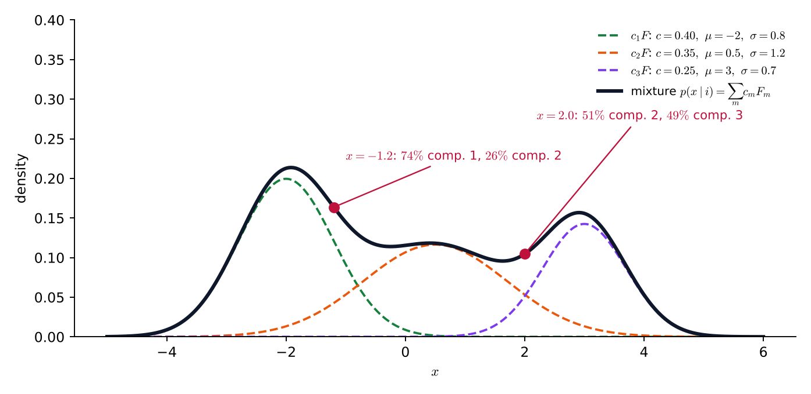
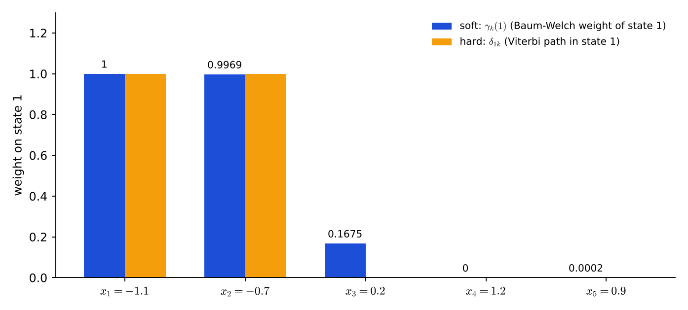

# Lecture 13 · KP07：連續觀測 HMM：高斯混合發射（Continuous-observation HMM with Gaussian mixture emissions）

> 程度：研究生（grad）／Level: Graduate (grad)
>
> 第 13 週（2026-11-30）｜Context-Dependent Classification · KP07
>
> Week 13 (2026-11-30) | Context-Dependent Classification · KP07

## 學習目標（Learning objectives）

- 說出為什麼要用連續觀測 HMM：量化會損失資訊（State why continuous-observation HMMs are used: quantization loses information）。
- 寫出高斯混合發射密度與它的歸一化限制，並算一個點的各成分責任度（Write the Gaussian mixture emission density with its normalization constraint and compute the responsibility of each component at a point）。
- 寫出混合係數、均值、共變異數的重估公式，說出 $\gamma_k(i,m)$ 比離散版多了哪一層（Write the re-estimation formulas of the mixture coefficients, means and covariances and say which layer $\gamma_k(i,m)$ adds over the discrete version）。
- 比較軟性（Baum-Welch）與硬性（Viterbi）的均值重估，並用 tied-mixture 省參數（Compare soft (Baum-Welch) and hard (Viterbi) mean re-estimation, and save parameters with tied mixtures）。

## KP07：連續觀測 HMM：高斯混合發射（Gaussian mixture emissions）

**一句話重點**：連續觀測 HMM 直接對發射機率密度 $p(\mathbf{x}\mid i)$ 建模，最常用的做法是每個狀態一個高斯混合。

**One-sentence summary**: A continuous-observation HMM models the emission density $p(\mathbf{x}\mid i)$ directly, most often with one Gaussian mixture per state.

### 1. 接住上一講的問題（Picking up the question）

前面的訓練都假設觀測是離散值，例如紅、藍、綠。
但語音、影像的特徵是連續向量。
要用離散模型，就得先把向量量化成有限個值。

The training so far assumed discrete observations such as red, blue and green.
But the features of speech and images are continuous vectors.
To use a discrete model the vectors must first be quantized to a finite number of values.

量化會嚴重損失原始訊號的資訊，拖累辨識器。
連續觀測 HMM 改成直接對 $p(\mathbf{x}\mid i)$ 建立參數化模型，避開量化損失。
代價是要先選定機率密度的形狀。

Quantization loses much of the information in the raw signal and hurts the recognizer.
A continuous-observation HMM models $p(\mathbf{x}\mid i)$ with a parametric model directly and avoids the quantization loss.
The price is that the shape of the density must be chosen first.

**白話說明**：想像用「小、中、大」三個標籤描述人的身高。
170.1 與 174.9 都叫「中」，差異就看不見了。
直接記錄公分數，這些差異都保留，但你要決定用什麼分布描述它們。
這個比喻只說明量化丟失細節，沒說明混合分布怎麼描述多峰的資料。

**Plain explanation**: Imagine describing height with the three labels "short, medium, tall".
Both 170.1 and 174.9 are "medium", and the difference is invisible.
Recording the centimeters directly keeps these differences, but you must decide which distribution describes them.
This analogy only shows that quantization drops detail; it does not show how a mixture distribution describes multi-peaked data.

**先備自測**：確認你記得 KP05 的 $\gamma_k(i)$ 與重估公式，以及第 2 章的高斯混合與責任度。
不熟的話，回到 KP05 與第 2 週複習。

**Prerequisite check**: Make sure you remember $\gamma_k(i)$ and the re-estimation formulas of KP05, and the Gaussian mixture and responsibility of Chapter 2.
If not, review KP05 and Week 2.

- 高斯分布由均值與共變異數決定（A Gaussian distribution is set by its mean and covariance）。
- 責任度是某個成分產生這個點的後驗機率（The responsibility is the posterior probability that a component produced this point）。
- 軟性分派用機率加權，硬性分派用 $0$ 或 $1$（Soft assignment weights by probabilities and hard assignment uses $0$ or $1$）。

### 2. 混合發射與重估公式（Mixture emissions and the re-estimation formulas）

**正式定義**：沿用第 2 章的混合模型，把狀態 $i$ 的發射密度寫成 $L$ 個成分密度的加權和：

**Formal definition**: Following the mixture model of Chapter 2, write the emission density of state $i$ as a weighted sum of $L$ component densities:

$$
p(\mathbf{x}\mid i)=\sum_{m=1}^{L}c_{im}\,F(\mathbf{x},\boldsymbol{\mu}_{im},\Sigma_{im})\tag{9.36}
$$

$F$ 取最常用的高斯密度，$\boldsymbol{\mu}_{im}$ 與 $\Sigma_{im}$ 是第 $m$ 個成分的均值向量與共變異數矩陣。
混合係數要歸一化：$\sum_{m=1}^{L}c_{im}=1$，才能讓 $p(\mathbf{x}\mid i)$ 的積分為 $1$。

$F$ is the most common Gaussian density, and $\boldsymbol{\mu}_{im}$ and $\Sigma_{im}$ are the mean vector and covariance matrix of the $m$-th component.
The mixture coefficients must be normalized, $\sum_{m=1}^{L}c_{im}=1$, so that $p(\mathbf{x}\mid i)$ integrates to $1$.

**重估公式**和離散版同一個精神，只是權重換成 $\gamma_k(i,m)$：

The **re-estimation formulas** have the same spirit as the discrete version, with the weights replaced by $\gamma_k(i,m)$:

$$
\bar c_{im}=\frac{\sum_{k=1}^{N}\gamma_k(i,m)}{\sum_{k=1}^{N}\sum_{r=1}^{L}\gamma_k(i,r)},\quad
\bar{\boldsymbol{\mu}}_{im}=\frac{\sum_{k}\gamma_k(i,m)\,\mathbf{x}_k}{\sum_{k}\gamma_k(i,m)},\quad
\bar\Sigma_{im}=\frac{\sum_{k}\gamma_k(i,m)(\mathbf{x}_k-\bar{\boldsymbol{\mu}}_{im})(\mathbf{x}_k-\bar{\boldsymbol{\mu}}_{im})^{\top}}{\sum_{k}\gamma_k(i,m)}\tag{9.37–9.39}
$$

這三個式子就是加權平均與加權共變異數。
$\gamma_k(i,m)$ 是「第 $k$ 步在狀態 $i$，而且 $\mathbf{x}_k$ 由第 $m$ 個成分產生」的機率，由兩層相乘：

These three formulas are a weighted mean and a weighted covariance.
$\gamma_k(i,m)$ is the probability that "step $k$ is in state $i$ and $\mathbf{x}_k$ is produced by the $m$-th component", a product of two layers:

$$
\gamma_k(i,m)=\underbrace{\frac{\alpha(i_k=i)\,\beta(i_k=i)}{\sum_{i_k}\alpha(i_k)\,\beta(i_k)}}_{\text{在不在狀態 }i}\ \times\ \underbrace{\frac{c_{im}F(\mathbf{x}_k,\boldsymbol{\mu}_{im},\Sigma_{im})}{\sum_{r=1}^{L}c_{ir}F(\mathbf{x}_k,\boldsymbol{\mu}_{ir},\Sigma_{ir})}}_{\text{哪個成分負責}}\tag{9.40}
$$

前一層是 KP05 已經有的 $\gamma_k(i)$，後一層是第 2 章混合模型的責任度。
所以 $\gamma_k(i,m)=\gamma_k(i)\times$ 責任度。
Baum-Welch 在連續觀測下仍是 $\mathrm{EM}$：$\mathrm{E}$ 步多算出「屬於哪個成分」的責任度，$\mathrm{M}$ 步多重估每個成分的 $c$、$\boldsymbol{\mu}$、$\Sigma$。

The first layer is the $\gamma_k(i)$ that KP05 already has, and the second is the responsibility of the mixture model of Chapter 2.
So $\gamma_k(i,m)=\gamma_k(i)\times$ responsibility.
Under continuous observations Baum-Welch is still EM: the E step additionally computes the responsibility "which component it belongs to", and the M step additionally re-estimates $c$, $\boldsymbol{\mu}$ and $\Sigma$ of every component.

**Viterbi 版本**：改用最佳路徑時，參數沿路徑直接平均。
單一高斯（$L=1$）的例子：

**Viterbi version**: With the best path, the parameters are averaged directly along the path.
For a single Gaussian ($L=1$):

$$
\boldsymbol{\mu}_i=\frac{1}{N_i}\sum_{k=1}^{N}\mathbf{x}_k\,\delta_{ik},\qquad
\Sigma_i=\frac{1}{N_i}\sum_{k=1}^{N}(\mathbf{x}_k-\boldsymbol{\mu}_i)(\mathbf{x}_k-\boldsymbol{\mu}_i)^{\top}\delta_{ik}
$$

這裡 $\delta_{ik}=1$ 表示第 $k$ 步的最佳路徑正好經過狀態 $i$，否則為 $0$；$N_i$ 是最佳路徑經過狀態 $i$ 的總次數。
這是硬性分派，對比式 $(9.37)$–$(9.39)$ 的軟性加權。

Here $\delta_{ik}=1$ means the best path passes state $i$ exactly at step $k$ and is $0$ otherwise, and $N_i$ is the total number of times the best path passes state $i$.
This is a hard assignment, in contrast with the soft weighting of Eqs. $(9.37)$–$(9.39)$.

**tied-mixture：省參數。**
式 $(9.36)$ 讓每個狀態各有一組混合高斯，狀態一多，要估的參數量就大，資料有限時估計不穩。
**tied-mixture**（共用混合密度）讓所有狀態共用同一組高斯成分，只有混合係數 $c_{im}$ 依狀態而不同。

**Tied mixture: saving parameters.**
Eq. $(9.36)$ gives every state its own Gaussian mixture, and with many states the number of parameters is large and the estimates are unstable when data are limited.
A **tied mixture** lets all states share one set of Gaussian components, and only the mixture coefficients $c_{im}$ differ by state.

| 符號 | 中文意義 | English meaning |
|---|---|---|
| $c_{im}$ | 狀態 $i$ 的第 $m$ 個混合係數 | The $m$-th mixture coefficient of state $i$ |
| $F(\cdot)$ | 成分密度（這裡是高斯） | Component density (Gaussian here) |
| $\boldsymbol{\mu}_{im},\Sigma_{im}$ | 成分的均值向量與共變異數 | Mean vector and covariance of a component |
| $L$ | 每個狀態的混合成分數 | Number of mixture components per state |
| $\gamma_k(i,m)$ | 在狀態 $i$ 且由成分 $m$ 產生 $\mathbf{x}_k$ 的機率 | Probability of being in state $i$ with component $m$ producing $\mathbf{x}_k$ |
| $\delta_{ik}$ | 最佳路徑在第 $k$ 步是否在狀態 $i$（$1$ 或 $0$） | Whether the best path is in state $i$ at step $k$ ($1$ or $0$) |

**常見迷思**：「混合成分數越多，模型越好。」
不對。
成分越多，每個狀態的參數越多，資料不夠時估計不穩，會過度擬合。
成分數和狀態數一樣，要用實驗與驗證資料決定。

**Common misconception**: "The more mixture components, the better the model."
That is wrong.
More components mean more parameters per state and unstable estimates when data are insufficient, which is overfitting.
Like the number of states, the number of components is decided by experiments and validation data.

### 3. 主例子（Main examples）

**第一部分：一個狀態的三成分混合。**
用來源互動圖的設定：三個成分 $c=(0.40,\ 0.35,\ 0.25)$，均值 $\mu=(-2,\ 0.5,\ 3)$，標準差 $\sigma=(0.8,\ 1.2,\ 0.7)$。
算兩個點的密度與責任度。

**Part 1: a three-component mixture for one state.**
Use the setting of the source's interactive figure: three components with $c=(0.40,\ 0.35,\ 0.25)$, means $\mu=(-2,\ 0.5,\ 3)$ and standard deviations $\sigma=(0.8,\ 1.2,\ 0.7)$.
Compute the density and responsibilities at two points.

在 $x=-1.2$：三個成分的貢獻是 $0.12099$、$0.04266$、$0.00000$（第三個小到可以略）。
$p(x\mid i)=0.16364$。
責任度：成分 1 是 $0.12099/0.16364=0.7393$，成分 2 是 $0.2607$。

At $x=-1.2$: the contributions of the three components are $0.12099$, $0.04266$ and $0.00000$ (the third is negligible).
$p(x\mid i)=0.16364$.
Responsibilities: component 1 is $0.12099/0.16364=0.7393$ and component 2 is $0.2607$.

在 $x=2.0$：貢獻是 $0.00000$、$0.05327$、$0.05136$。
$p(x\mid i)=0.10463$。
責任度：成分 2 是 $0.5092$，成分 3 是 $0.4908$，幾乎各一半，這個點落在兩個峰之間。

At $x=2.0$: the contributions are $0.00000$, $0.05327$ and $0.05136$.
$p(x\mid i)=0.10463$.
Responsibilities: component 2 is $0.5092$ and component 3 is $0.4908$, almost half each; this point lies between two peaks.



**圖說 `lec13-kp07-continuous-hmm-f1-gaussian-mixture`**：先看三條虛線，每條是一個成分乘上它的混合係數。
再看黑色粗線，它是三者的和，就是這個狀態的發射密度，有三個起伏。
注意兩個紅點標出的責任度：$x=-1.2$ 幾乎屬於成分 1，$x=2.0$ 在成分 2 與 3 之間難以分辨。〔功能：1、2〕

**Caption `lec13-kp07-continuous-hmm-f1-gaussian-mixture`**: Look first at the three dashed lines; each is a component multiplied by its mixture coefficient.
Then look at the thick black line, their sum, which is the emission density of this state with three bumps.
Note the responsibilities marked by the two red dots: $x=-1.2$ belongs almost entirely to component 1, while $x=2.0$ lies between components 2 and 3 and is hard to tell apart. [Function: 1, 2]

**第二部分：兩狀態 HMM，軟性對硬性。**
`[補充]` 兩個狀態各用單一高斯：狀態 1 是 $N(-1,\ 0.5^2)$，狀態 2 是 $N(1,\ 0.5^2)$。
轉移：留下 $0.8$、換狀態 $0.2$，起點各 $0.5$。
觀測 $X=(-1.1,\ -0.7,\ 0.2,\ 1.2,\ 0.9)$，其中 $0.2$ 落在兩個狀態之間。

**Part 2: a two-state HMM, soft versus hard.**
`[Added]` Both states use a single Gaussian: state 1 is $N(-1,\ 0.5^2)$ and state 2 is $N(1,\ 0.5^2)$.
Transitions: stay $0.8$ and switch $0.2$, start $0.5$ each.
The observation is $X=(-1.1,\ -0.7,\ 0.2,\ 1.2,\ 0.9)$, where $0.2$ lies between the two states.

用 KP03 的前向—後向，把發射機率換成高斯密度，得到 $p(X\mid\mathcal{S})=0.004113$，各步 $\gamma_k(1)$ 是 $1.0000$、$0.9969$、$0.1675$、$0$、$0.0002$。
最佳路徑是 $1,1,2,2,2$。

Using the forward–backward of KP03 with the emission probabilities replaced by Gaussian densities gives $p(X\mid\mathcal{S})=0.004113$, and $\gamma_k(1)$ at the steps is $1.0000$, $0.9969$, $0.1675$, $0$ and $0.0002$.
The best path is $1,1,2,2,2$.

**軟性（Baum-Welch，$L=1$）：**
$\mu_1$ 的新值 $=\sum_k\gamma_k(1)x_k/\sum_k\gamma_k(1)=-0.8150$。
$\mu_2$ 的新值 $=0.7985$。
中間那個 $0.2$ 以 $0.1675$ 的權重算給狀態 1、$0.8325$ 算給狀態 2。

**Soft (Baum-Welch, $L=1$):**
The new $\mu_1=\sum_k\gamma_k(1)x_k/\sum_k\gamma_k(1)=-0.8150$.
The new $\mu_2=0.7985$.
The middle $0.2$ counts with weight $0.1675$ for state 1 and $0.8325$ for state 2.

**硬性（Viterbi）：**
狀態 1 的區段是 $(-1.1,\ -0.7)$，$\mu_1=-0.9000$。
狀態 2 的區段是 $(0.2,\ 1.2,\ 0.9)$，$\mu_2=0.7667$。
$0.2$ 整個算給狀態 2。

**Hard (Viterbi):**
The segment of state 1 is $(-1.1,\ -0.7)$, so $\mu_1=-0.9000$.
The segment of state 2 is $(0.2,\ 1.2,\ 0.9)$, so $\mu_2=0.7667$.
The $0.2$ counts entirely for state 2.

兩者差距不大，因為路徑集中；差別主要來自那個含糊的觀測，軟性把它拆開，硬性整個丟給一邊。

The two are close because the paths are concentrated; the difference comes mainly from the ambiguous observation, which the soft version splits and the hard version gives entirely to one side.



**圖說 `lec13-kp07-continuous-hmm-f2-soft-vs-hard`**：先看每個觀測下方兩根長條，藍色是軟性權重，橘色是硬性的 $0$ 或 $1$。
再看第 3 個觀測 $0.2$，藍色長條只有 $0.1675$，橘色是 $0$。
注意其他四個觀測兩種分派幾乎一樣。〔功能：1、2〕

**Caption `lec13-kp07-continuous-hmm-f2-soft-vs-hard`**: Look first at the two bars under each observation: blue is the soft weight and orange is the hard $0$ or $1$.
Then look at the third observation, $0.2$: the blue bar is only $0.1675$ and the orange is $0$.
Note that for the other four observations the two assignments are almost identical. [Function: 1, 2]

**第三部分：tied-mixture 省多少參數。**
`[補充]` 一維觀測、$K=3$ 個狀態、每個狀態 $L=4$ 個成分。
每個狀態各自的混合：$L-1=3$ 個自由混合係數，加 $L$ 個均值與 $L$ 個變異數 $2L=8$，共 $11$ 個，三個狀態 $33$ 個。
tied-mixture：共用 $4$ 個成分的均值與變異數 $8$ 個，加每個狀態 $3$ 個自由混合係數，$3\times3=9$，共 $17$ 個。

**Part 3: how many parameters tied mixtures save.**
`[Added]` One-dimensional observations, $K=3$ states and $L=4$ components per state.
Separate mixtures per state: $L-1=3$ free mixture coefficients plus $L$ means and $L$ variances, $2L=8$, in total $11$, and $33$ for three states.
Tied mixture: the means and variances of the $4$ shared components, $8$, plus $3$ free mixture coefficients per state, $3\times3=9$, in total $17$.

### 4. 限制與失效情形（Limits and failure cases）

**選形狀的代價**：連續模型要先決定密度的形式，高斯混合是常用但不是唯一的選擇。
形狀選錯，量化的損失避開了，卻換來模型的偏差。

**The cost of choosing a shape**: A continuous model must first decide the form of the density, and the Gaussian mixture is common but not the only choice.
If the shape is wrong, the quantization loss is avoided but a model bias is incurred.

**資料量**：每個成分都有均值與共變異數，維度高時共變異數的參數特別多。
常用對角共變異數或 tied-mixture 來省。

**Amount of data**: Every component has a mean and a covariance, and in high dimensions the covariance has especially many parameters.
Diagonal covariances or tied mixtures are commonly used to save them.

**數值**：高斯密度在遠處趨近 $0$，$\alpha$、$\beta$ 的縮放更重要。
`[補充]` 例子裡 $x=1.2$ 落在狀態 1 的密度小於 $10^{-4}$，連乘幾步就會下溢。

**Numerics**: The Gaussian density goes to $0$ far from the mean, so the scaling of $\alpha$ and $\beta$ matters even more.
`[Added]` In the example, the density of state 1 at $x=1.2$ is below $10^{-4}$, and a few multiplications underflow.

### 5. 與實作的連結（Connection to implementation）

下面的程式算第一部分的混合密度與責任度。
注意責任度是「各成分的貢獻除以總和」，分母就是 $p(x\mid i)$。

The code below computes the mixture density and responsibilities of Part 1.
Note that the responsibility is "the contribution of each component divided by the sum", and the denominator is $p(x\mid i)$.

```python
import math
import numpy as np

c = np.array([0.40, 0.35, 0.25]); mu = np.array([-2.0, 0.5, 3.0]); sg = np.array([0.8, 1.2, 0.7])

def mixture(x):
    """回傳 (p(x|i), 各成分責任度)。"""
    comp = c * np.exp(-0.5 * ((x - mu) / sg) ** 2) / (sg * math.sqrt(2 * math.pi))
    return comp.sum(), comp / comp.sum()

for x in (-1.2, 2.0):
    p, r = mixture(x)
    print(x, round(float(p), 5), r.round(4).tolist())
# -1.2 0.16364 [0.7393, 0.2607, 0.0]
# 2.0 0.10463 [0.0, 0.5092, 0.4908]
```

**留給下一節的問題**：本週的主線到這裡結束。
HMM 讓我們能處理狀態看不見的序列。
來源接著談狀態停留時間與神經網路訓練，那是這一週不涵蓋的延伸。

**The question for the next section**: This week's main line ends here.
The HMM lets us handle sequences whose states cannot be seen.
The source goes on to state durations and neural-network training, extensions that this week does not cover.

### 6. 小練習與解題示範（Practice and worked solutions）

**小練習** `[補充]`：先寫下理由，再看解答。

**Practice** `[Added]`: Write your reasoning before reading the solutions.

1. 題 1：兩個成分的混合係數是 $0.7$ 與 $x$。$x$ 必須是多少（The mixture coefficients of two components are $0.7$ and $x$. What must $x$ be）？
2. 題 2：某個點在兩個成分下的貢獻是 $0.06$ 與 $0.02$。兩個成分的責任度各是多少（The contributions of a point under two components are $0.06$ and $0.02$. What is the responsibility of each）？
3. 題 3：本講的 $K=3$、$L=4$ 若改成 $K=10$，兩種做法各要多少參數（If $K=3$ and $L=4$ of this lecture become $K=10$, how many parameters does each approach need）？

**題 1 解題示範**：混合係數要歸一化，$0.7+x=1$，所以 $x=0.3$。

**Question 1 worked solution**: The mixture coefficients must be normalized, $0.7+x=1$, so $x=0.3$.

**題 2 解題示範**：總和 $0.08$。
責任度是 $0.06/0.08=0.75$ 與 $0.02/0.08=0.25$。

**Question 2 worked solution**: The sum is $0.08$.
The responsibilities are $0.06/0.08=0.75$ and $0.02/0.08=0.25$.

**題 3 解題示範**：各自獨立：$10\times11=110$ 個。
tied-mixture：共用 $8$ 個，加 $10\times3=30$ 個混合係數，共 $38$ 個。
狀態越多，省得越多。

**Question 3 worked solution**: Separate: $10\times11=110$.
Tied mixture: $8$ shared plus $10\times3=30$ mixture coefficients, in total $38$.
The more states, the more is saved.

## 術語表（Glossary）

| 中文術語 | English term |
|---|---|
| 連續觀測 HMM | Continuous-observation HMM |
| 高斯混合 | Gaussian mixture |
| 混合係數 | Mixture coefficient |
| 混合成分 | Mixture component |
| 責任度 | Responsibility |
| 量化 | Quantization |
| 共變異數 | Covariance |
| 軟性加權 | Soft weighting |
| 硬性分派 | Hard assignment |
| 共用混合密度 | Tied-mixture density |
| 歸一化 | Normalization |
| 隱藏馬可夫模型（HMM） | Hidden Markov model (HMM) |
| 過度擬合 | Overfitting |

## 銜接與來源（Connections and sources）

本週的講義到這裡結束。
下週進入分群。

This week's lectures end here.
Next week moves on to clustering.

- 前一單元：[KP06 訓練（二）：Viterbi 重估](lec13-kp06-viterbi-reestimation.md)（Previous unit: training II, Viterbi re-estimation）。
- 下一單元：第 14 週 分群（一）：$k$-means 與階層式分群（Next unit: Week 14, clustering I, $k$-means and hierarchical clustering；尚未製作 / not yet produced）。
- 來源：[Context-Dependent Classification §9.6](https://ndhuccc.github.io/CCC-LNS/PR_115/Ch09-context-dependent-classification/index.html)，讀取日期 2026-11-13（Source accessed 2026-11-13）。
- 書目：Theodoridis and Koutroumbas, *Pattern Recognition*, 4th ed., 2008；見[參考資料](../references/README.md)（See the bibliography）。

本講以自己的文字解釋來源。
量化的損失、式 9.36 的混合發射、歸一化限制、式 9.37–9.40 的重估與 $\gamma_k(i,m)$ 的兩層結構、Viterbi 版本的平均、tied-mixture 的想法、與第 2 章 $\mathrm{EM}$ 的關聯取自來源。
三成分混合在兩個點的密度與責任度（成分參數取自來源互動圖）、兩狀態 HMM 的軟硬均值對照、參數個數的計算、題解、程式、圖與練習皆為 `[補充]`。

This lecture independently explains the source.
The loss from quantization, the mixture emission of Eq. 9.36, the normalization constraint, the re-estimation of Eqs. 9.37–9.40 with the two-layer structure of $\gamma_k(i,m)$, the averaging of the Viterbi version, the idea of tied mixtures, and the link to the EM of Chapter 2 come from the source.
The density and responsibilities of the three-component mixture at two points (component parameters from the source's interactive figure), the soft-versus-hard mean comparison for the two-state HMM, the parameter counts, the solutions, the code, the figures and the practice are `[Added]`.
