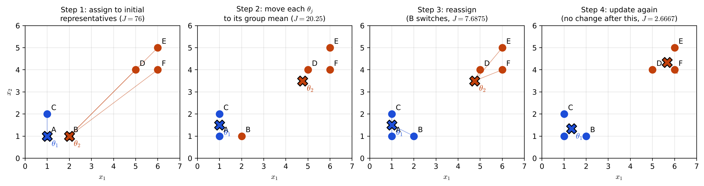
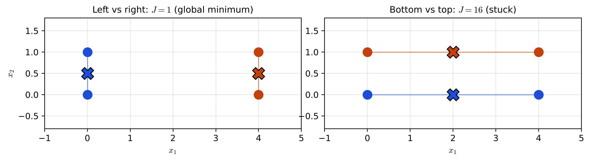
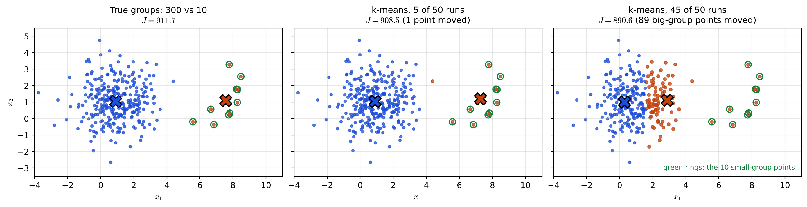

# Lecture 14 · KP01：$k$-means：把每個點交給最近的均值（$k$-means: hand each point to the nearest mean）

> 程度：研究生（grad）／Level: Graduate (grad)
>
> 第 14 週（2026-12-07）｜Clustering (1) – $k$-means & Hierarchical Clustering · KP01
>
> Week 14 (2026-12-07) | Clustering (1) – $k$-means & Hierarchical Clustering · KP01

## 學習目標（Learning objectives）

- 寫出硬分群的隸屬條件與 $k$-means 的代價函數，並說出代價函數在幾何上量的是什麼（Write the membership constraints of hard clustering and the cost function of $k$-means, and say what the cost measures geometrically）。
- 照「指派、更新」兩步，在一個六點例子上手算 $k$-means，並追蹤代價函數每一步的變化（Run $k$-means by hand on a six-point example with the assign and update steps, and track the cost after each step）。
- 用一個四點例子說明 $k$-means 會停在局部最小，並列出常用的初始化對策（Use a four-point example to show that $k$-means can stop at a local minimum, and list common initialization remedies）。
- 說出 $k$-means 的四個限制，並用大小不均的兩團資料解釋它為什麼會切錯（State four limits of $k$-means and explain with two unequal groups why it can split the data wrongly）。

## KP01：$k$-means：把每個點交給最近的均值（$k$-means: hand each point to the nearest mean）

**一句話重點**：$k$-means 讓每個點只屬於一群，交替做「把點交給最近的代表」與「把代表移到該群均值」，每一步都讓群內平方距離的總和不增加。

**One-sentence summary**: $k$-means lets each point belong to exactly one group and alternates between "give each point to the nearest representative" and "move each representative to the mean of its group", and every step keeps the total within-group squared distance from increasing.

### 1. 接住上一週的問題（Picking up the question）

前幾週的分類器都有一個前提：訓練資料已經標好類別。
上一週的 HMM 雖然狀態看不見，每個模型仍然屬於一個已知的類別。

The classifiers of the past weeks all assumed that the training data were already labeled.
Even the HMMs of last week, whose states were hidden, each belonged to a known class.

這一週拿掉標籤。
你手上只有一堆向量，沒有人告訴你哪些是同一類。
**分群**就是在沒有標籤的情況下，把相像的向量放在同一群。

This week removes the labels.
You only have a pile of vectors, and nobody tells you which ones belong together.
**Clustering** puts similar vectors into the same group without any labels.

**白話說明**：想像你要在一座城市開 $m$ 間便利商店。
每位居民都去離家最近的那一間。
你想讓「每位居民走到店的距離平方」加起來最小。
這個比喻只說明「每人只去一間、以距離計價」，沒說明店的位置要怎麼一步步找出來。

**Plain explanation**: Imagine you are opening $m$ convenience stores in a city.
Every resident goes to the store nearest to home.
You want the sum of "each resident's squared walking distance" to be as small as possible.
This analogy only shows "one store per person, priced by distance"; it does not say how to find the store locations step by step.

**先備自測**：確認你記得歐氏距離與均值的算法。
不熟的話，回到第 2 週的距離分類器複習。

**Prerequisite check**: Make sure you remember how to compute the Euclidean distance and a mean.
If not, review the distance classifiers of Week 2.

- 兩點 $\mathbf{x}$、$\mathbf{y}$ 的平方歐氏距離是 $\lVert\mathbf{x}-\mathbf{y}\rVert^2=\sum_k(x_k-y_k)^2$（The squared Euclidean distance between $\mathbf{x}$ and $\mathbf{y}$ is $\lVert\mathbf{x}-\mathbf{y}\rVert^2=\sum_k(x_k-y_k)^2$）。
- 一群點的均值是各座標分別取平均（The mean of a set of points averages each coordinate separately）。
- 一群點到某個中心的平方距離總和，在中心取均值時最小（The total squared distance from a set of points to a center is smallest when the center is their mean）。

### 2. 硬分群與 $k$-means 的代價（Hard clustering and the cost of $k$-means）

**正式定義**：有 $N$ 個向量 $\mathbf{x}_1,\dots,\mathbf{x}_N$，要分成 $m$ 群。
第 $j$ 群用一個**代表** $\boldsymbol{\theta}_j$ 描述。
**隸屬係數** $u_{ij}$ 說明 $\mathbf{x}_i$ 屬不屬於第 $j$ 群。
**硬分群**規定每個點只屬於一群：

**Formal definition**: There are $N$ vectors $\mathbf{x}_1,\dots,\mathbf{x}_N$ to split into $m$ groups.
Group $j$ is described by a **representative** $\boldsymbol{\theta}_j$.
The **membership coefficient** $u_{ij}$ says whether $\mathbf{x}_i$ belongs to group $j$.
**Hard clustering** requires every point to belong to exactly one group:

$$
u_{ij}\in\{0,1\},\qquad \sum_{j=1}^{m}u_{ij}=1\tag{14.79, 14.80}
$$

一組代表與一組隸屬好不好，用代價函數衡量。
$k$-means 用「點代表」加上「平方歐氏距離」：

How good a set of representatives and memberships is, is measured by a cost function.
$k$-means uses "point representatives" and the "squared Euclidean distance":

$$
J(\boldsymbol{\theta},U)=\sum_{i=1}^{N}\sum_{j=1}^{m}u_{ij}\,\lVert\mathbf{x}_i-\boldsymbol{\theta}_j\rVert^{2}\tag{14.85}
$$

因為每個點只有一個 $u_{ij}=1$，$J$ 就是「每個點到自己代表的平方距離」加起來。
它等於第 5 章群內散布矩陣的跡 $\operatorname{trace}(S_w)$。
所以 $J$ 小，代表每一群都很緊密。

Because each point has exactly one $u_{ij}=1$, $J$ is the sum of "each point's squared distance to its own representative".
It equals the trace of the within-class scatter matrix of Chapter 5, $\operatorname{trace}(S_w)$.
So a small $J$ means that every group is tight.

| 符號 | 中文意義 | English meaning |
|---|---|---|
| $N$ | 向量個數 | Number of vectors |
| $m$ | 群數（也就是 $k$-means 的 $k$） | Number of groups (the $k$ in $k$-means) |
| $\mathbf{x}_i$ | 第 $i$ 個向量 | The $i$-th vector |
| $\boldsymbol{\theta}_j$ | 第 $j$ 群的代表 | Representative of group $j$ |
| $u_{ij}$ | $\mathbf{x}_i$ 是否屬於第 $j$ 群（$0$ 或 $1$） | Whether $\mathbf{x}_i$ is in group $j$ ($0$ or $1$) |
| $J$ | 群內平方距離的總和 | Total within-group squared distance |

**兩步交替**：$J$ 同時依賴代表與隸屬，很難一次求最小。
$k$-means 把它拆成兩個容易的子問題，輪流解：

**Two alternating steps**: $J$ depends on both the representatives and the memberships, so it is hard to minimize in one go.
$k$-means splits it into two easy subproblems and solves them in turn:

1. 指派：代表固定，把每個 $\mathbf{x}_i$ 交給最近的代表，記成 $b(i)=j$（Assign: with the representatives fixed, give each $\mathbf{x}_i$ to the nearest one, written $b(i)=j$）。
2. 更新：隸屬固定，把每個 $\boldsymbol{\theta}_j$ 改成所有 $b(i)=j$ 的點的均值（Update: with the memberships fixed, set each $\boldsymbol{\theta}_j$ to the mean of all points with $b(i)=j$）。
3. 重複，直到連續兩次的代表都不再改變（Repeat until the representatives no longer change between two iterations）。

為什麼兩步都不會讓 $J$ 變大？
指派時，每個點換到更近的代表，自己那一項只會變小或不變。
更新時，均值是「讓群內平方距離最小的點」，每一群那幾項也只會變小或不變。
$J$ 有下界 $0$，又一直不增加，所以演算法一定會停。

Why does neither step make $J$ larger?
In the assign step, each point moves to a closer representative, so its own term can only shrink or stay.
In the update step, the mean is "the point that minimizes the within-group squared distance", so the terms of each group can only shrink or stay.
$J$ is bounded below by $0$ and never increases, so the algorithm must stop.

這個演算法也叫 isodata 或 $c$-means。
它是「廣義硬分群」在點代表與平方歐氏下的特例。
換成別的距離，例如 Minkowski 距離，演算法仍會收斂，但不一定收到對應代價的最小。

This algorithm is also called isodata or $c$-means.
It is the special case of "generalized hard clustering" with point representatives and the squared Euclidean distance.
With another distance, such as the Minkowski distance, the algorithm still converges but not necessarily to a minimum of the corresponding cost.

### 3. 主例子：六個點分兩群（Main example: six points in two groups）

`[補充]` 取六個點：$A=(1,1)$、$B=(2,1)$、$C=(1,2)$、$D=(5,4)$、$E=(6,5)$、$F=(6,4)$，分成 $m=2$ 群。
刻意選一個不好的起點：$\boldsymbol{\theta}_1=A$、$\boldsymbol{\theta}_2=B$，兩個代表都擠在左下角。

`[Added]` Take six points, $A=(1,1)$, $B=(2,1)$, $C=(1,2)$, $D=(5,4)$, $E=(6,5)$ and $F=(6,4)$, and split them into $m=2$ groups.
Pick a deliberately poor start, $\boldsymbol{\theta}_1=A$ and $\boldsymbol{\theta}_2=B$, with both representatives crowded in the lower left.

**第 1 步：指派。**
$C$ 到 $A$ 的平方距離是 $1$，到 $B$ 是 $2$，所以 $C$ 跟 $\boldsymbol{\theta}_1$。
$D$、$E$、$F$ 都離 $B$ 較近，於是第 1 群是 $\{A,C\}$，第 2 群是 $\{B,D,E,F\}$。
此時 $J=1+(0+18+32+25)=76$。

**Step 1: assign.**
The squared distance from $C$ to $A$ is $1$ and to $B$ is $2$, so $C$ joins $\boldsymbol{\theta}_1$.
$D$, $E$ and $F$ are all closer to $B$, so group 1 is $\{A,C\}$ and group 2 is $\{B,D,E,F\}$.
Now $J=1+(0+18+32+25)=76$.

**第 2 步：更新。**
$\boldsymbol{\theta}_1$ 改成 $\{A,C\}$ 的均值 $(1,1.5)$。
$\boldsymbol{\theta}_2$ 改成 $\{B,D,E,F\}$ 的均值 $(4.75,3.5)$。
$J$ 降到 $20.25$。

**Step 2: update.**
$\boldsymbol{\theta}_1$ becomes the mean of $\{A,C\}$, $(1,1.5)$.
$\boldsymbol{\theta}_2$ becomes the mean of $\{B,D,E,F\}$, $(4.75,3.5)$.
$J$ drops to $20.25$.

**第 3 步：再指派。**
$B$ 到新的 $\boldsymbol{\theta}_1$ 平方距離是 $1.25$，到 $\boldsymbol{\theta}_2$ 是 $13.8125$，所以 $B$ 換到第 1 群。
$J$ 降到 $7.6875$。

**Step 3: assign again.**
The squared distance from $B$ to the new $\boldsymbol{\theta}_1$ is $1.25$ and to $\boldsymbol{\theta}_2$ is $13.8125$, so $B$ switches to group 1.
$J$ drops to $7.6875$.

**第 4 步：再更新。**
$\boldsymbol{\theta}_1=(1.3333,1.3333)$，$\boldsymbol{\theta}_2=(5.6667,4.3333)$，$J=2.6667$。
再指派一次，沒有點換群，代表也不再變，演算法停止。

**Step 4: update again.**
$\boldsymbol{\theta}_1=(1.3333,1.3333)$ and $\boldsymbol{\theta}_2=(5.6667,4.3333)$, with $J=2.6667$.
One more assign step moves no point and the representatives stay, so the algorithm stops.

| 半步 | 第 1 群 | 第 2 群 | $J$ |
|---|---|---|---|
| 1 指派 | $\{A,C\}$ | $\{B,D,E,F\}$ | $76$ |
| 2 更新 | $\{A,C\}$ | $\{B,D,E,F\}$ | $20.25$ |
| 3 指派 | $\{A,B,C\}$ | $\{D,E,F\}$ | $7.6875$ |
| 4 更新 | $\{A,B,C\}$ | $\{D,E,F\}$ | $2.6667$ |



**圖說 `lec14-kp01-kmeans-f1-iterations`**：先看四個小圖的標題，它們依序是指派、更新、再指派、再更新。
再看叉號，它是代表；細線把每個點連到它被指派的代表。
注意第 3 個小圖裡 $B$ 由橘變藍，而標題裡的 $J$ 一路變小。〔功能：1、2〕

**Caption `lec14-kp01-kmeans-f1-iterations`**: Look first at the titles of the four panels: assign, update, assign again, update again.
Then look at the crosses, which are the representatives; thin lines link each point to its assigned representative.
Note that in the third panel $B$ turns from orange to blue, while $J$ in the titles keeps shrinking. [Function: 1, 2]

### 4. 會停，但不一定停在最好的地方（It stops, but not necessarily at the best place）

上一節證明了 $k$-means 一定會停。
但「停下來」只表示兩步都改不動了，不表示 $J$ 已經是全部分法裡最小的。

The last section showed that $k$-means always stops.
But "stopping" only means neither step can improve anymore; it does not mean $J$ is the smallest over all ways to split.

`[補充]` 看長方形的四個角：$(0,0)$、$(0,1)$、$(4,0)$、$(4,1)$，分兩群。
左右分開時，兩個代表在 $(0,0.5)$ 與 $(4,0.5)$，$J=4\times0.25=1$。
若起點是 $(2,0)$ 與 $(2,1)$，第一次指派就把下面兩點分一群、上面兩點分一群。
更新後代表仍是 $(2,0)$ 與 $(2,1)$，再指派也不會改，$J=4\times4=16$。

`[Added]` Look at the four corners of a rectangle, $(0,0)$, $(0,1)$, $(4,0)$ and $(4,1)$, split into two groups.
With a left-right split the representatives sit at $(0,0.5)$ and $(4,0.5)$ and $J=4\times0.25=1$.
If the start is $(2,0)$ and $(2,1)$, the first assign step puts the two lower points in one group and the two upper points in the other.
After the update the representatives are still $(2,0)$ and $(2,1)$, the next assign step changes nothing, and $J=4\times4=16$.

這就是**局部最小**：附近每一步都改不動，但遠處還有更好的解。
$J=16$ 比 $J=1$ 大了 $16$ 倍，演算法卻卡住了。

This is a **local minimum**: no nearby step can improve it, yet a better solution exists far away.
$J=16$ is $16$ times larger than $J=1$, and the algorithm is stuck.



**圖說 `lec14-kp01-kmeans-f2-local-minimum`**：先看左圖，左右兩群各自很緊，$J=1$。
再看右圖，上下兩群的點離代表都有 $2$ 的距離，$J=16$。
注意兩圖的點完全相同，差別只在起點。〔功能：1、3〕

**Caption `lec14-kp01-kmeans-f2-local-minimum`**: Look first at the left panel: the left and right groups are each tight, with $J=1$.
Then look at the right panel: every point in the bottom and top groups is at distance $2$ from its representative, with $J=16$.
Note that the points are identical in both panels; only the start differs. [Function: 1, 3]

**常用對策**：

**Common remedies**:

- 從資料裡隨機挑 $m$ 個點當起點（Pick $m$ random points from the data as the start）。
- 先用第 12 章的循序演算法粗分，再拿結果當起點（Run a sequential algorithm of Chapter 12 first and use its result as the start）。
- 先把資料隨機切成 $m$ 份，取各份的均值當起點（Randomly split the data into $m$ parts and use their means as the start）。
- 從不同起點跑很多次，留下 $J$ 最小的那一次（Run from many starts and keep the run with the smallest $J$）。

找出全部分法裡最好的那一種是 NP-hard 問題。
模擬退火、遺傳演算法理論上能以一定機率找到全域最小，但計算很貴。

Finding the best of all possible splits is an NP-hard problem.
Simulated annealing and genetic algorithms can in theory find the global minimum with some probability, but they are expensive.

**常見迷思**：「$k$-means 會停，所以它找到的就是最好的分群。」
不對。
它只保證 $J$ 不增加、最後會停，停的地方可能是局部最小，像長方形例子的 $J=16$。

**Common misconception**: "$k$-means stops, so what it finds is the best clustering."
That is wrong.
It only guarantees that $J$ never increases and that it eventually stops; the stopping point may be a local minimum, like $J=16$ in the rectangle example.

### 5. 四個限制：群數、離群點、特徵型態與大小不均（Four limits: number of groups, outliers, feature types and unequal sizes）

就算起點選得好，$k$-means 還有幾個先天限制。

Even with a good start, $k$-means has some built-in limits.

**限制一：要先知道 $m$。**
$m$ 估錯，就挖不出真正的結構。
有些變體用切分、合併、丟棄來調 $m$，但那就不再是單純的最佳化。
也可以先用第 12 章的循序分群估 $m$。

**Limit 1: $m$ must be known in advance.**
With a wrong $m$ the true structure cannot be found.
Some variants adjust $m$ by splitting, merging and discarding, but then it is no longer a pure optimization.
You can also estimate $m$ first with the sequential clustering of Chapter 12.

**限制二：怕離群點。**
離群點也必須被派進某一群，會把那一群的均值拉歪。
小群常常是離群點結成的，有的版本直接丟掉很小的群。
這個缺點催生了下一節的 $k$-medoids。

**Limit 2: sensitivity to outliers.**
An outlier must still be assigned to some group, and it pulls that group's mean away.
Small groups are often made of outliers, and some versions simply drop very small groups.
This weakness led to the $k$-medoids of the next lecture.

**限制三：原則上要連續特徵。**
名義特徵（類別）沒有「平均」可言，不適合直接用。
離散資料有專門的變體，或改用 $k$-medoids。

**Limit 3: features should in principle be continuous.**
Nominal (categorical) features have no meaningful "average", so they do not fit directly.
Discrete data have special variants, or you can use $k$-medoids instead.

**限制四：群的大小差很多時會切錯。**
來源的例子取兩個高斯團：一團中心 $[1,1]^{T}$、共變異數 $1.5I$，抽 $300$ 點；另一團中心 $[8,1]^{T}$、共變異數 $I$，只抽 $10$ 點。
設 $m=2$ 跑 $k$-means，結果大團被切開，右側一塊和那 $10$ 點併成一群。
來源報告的代表是 $\boldsymbol{\theta}_1=[0.54,0.94]^{T}$、$\boldsymbol{\theta}_2=[3.53,0.99]^{T}$，大團有 $61$ 個點被派去和小團同群。

**Limit 4: wrong splits when group sizes differ a lot.**
The source example takes two Gaussian groups: one centered at $[1,1]^{T}$ with covariance $1.5I$ and $300$ points, the other centered at $[8,1]^{T}$ with covariance $I$ and only $10$ points.
Running $k$-means with $m=2$ splits the big group, and a piece on its right joins the $10$ points.
The source reports $\boldsymbol{\theta}_1=[0.54,0.94]^{T}$ and $\boldsymbol{\theta}_2=[3.53,0.99]^{T}$, with $61$ points of the big group sent to the small group.

`[補充]` 為什麼會這樣？我們用同樣的設定重抽一次資料（亂數種子 $0$），再從 $50$ 個隨機起點各跑一次。
真正的分群（$300$ 對 $10$）的 $J$ 是 $911.7$。
$50$ 次裡有 $45$ 次收到切開大團的解，$J$ 約 $890.6$；只有 $5$ 次收到幾乎正確的解，$J=908.5$。
切開大團的解，$J$ 反而**比真正的分群更小**。
所以這不是演算法算錯，而是 $J$ 本身就偏好把大團切開：大團邊緣的點離中心很遠，切出去能省下很多平方距離。

`[Added]` Why does this happen? We redraw data with the same setting (random seed $0$) and run once from each of $50$ random starts.
The true split ($300$ vs $10$) has $J=911.7$.
In $45$ of the $50$ runs the result splits the big group with $J\approx890.6$; only $5$ runs reach an almost correct split with $J=908.5$.
The split of the big group has a **smaller** $J$ than the true grouping.
So the algorithm is not miscalculating: $J$ itself prefers to split the big group, because points on its edge are far from the center and moving them out saves a lot of squared distance.



**圖說 `lec14-kp01-kmeans-f3-imbalanced`**：先看左圖，這是真正的兩團，綠圈標出那 $10$ 個小團的點。
再看右圖，$45$ 次的結果把大團右半邊切給了橘色那群，兩個叉號都落在大團附近。
注意三張圖標題的 $J$：切錯的右圖反而最小。〔功能：2、3〕

**Caption `lec14-kp01-kmeans-f3-imbalanced`**: Look first at the left panel, the true two groups, with green rings marking the $10$ small-group points.
Then look at the right panel: the result of $45$ runs gives the right half of the big group to the orange group, and both crosses sit near the big group.
Note the $J$ in the three titles: the wrongly split right panel has the smallest. [Function: 2, 3]

**為什麼仍然常用**：每次迭代要算每個點到每個代表的距離，時間複雜度是 $O(Nmq)$，$q$ 是收斂所需的迭代次數。
實務上 $m$ 與 $q$ 都遠小於 $N$，所以它能處理大資料。
另有**序列版**：每處理一個點就立刻更新代表，結果會和點被處理的順序有關。

**Why it is still popular**: Each iteration computes the distance from every point to every representative, so the time complexity is $O(Nmq)$, where $q$ is the number of iterations to converge.
In practice $m$ and $q$ are far smaller than $N$, so it can handle large data.
There is also a **sequential version** that updates the representatives right after each point, and its result depends on the order in which the points are processed.

### 6. 與實作的連結（Connection to implementation）

下面的程式從多個隨機起點跑 $k$-means，留下 $J$ 最小的那次。
注意兩件事：起點從資料點中挑；某一群若變空，要另外處理（這裡保留舊代表）。

The code below runs $k$-means from several random starts and keeps the run with the smallest $J$.
Note two points: the starts are picked from the data points, and an empty group needs special handling (here the old representative is kept).

```python
import numpy as np

def kmeans(X, m, n_starts=10, seed=0, max_iter=100):
    """回傳 (J, 代表, 標籤)；從 n_starts 個隨機起點中取 J 最小者。"""
    rng = np.random.default_rng(seed)
    best = None
    for _ in range(n_starts):
        theta = X[rng.choice(len(X), m, replace=False)].copy()      # 起點取自資料點 / start from data points
        for _ in range(max_iter):
            d = ((X[:, None, :] - theta[None]) ** 2).sum(axis=2)    # 平方歐氏距離 / squared distances
            lab = d.argmin(axis=1)                                  # 指派 / assign
            new = np.array([X[lab == j].mean(0) if np.any(lab == j) else theta[j] for j in range(m)])
            if np.allclose(new, theta):                             # 代表不變就停 / stop when unchanged
                break
            theta = new                                             # 更新 / update
        J = float(((X - theta[lab]) ** 2).sum())
        if best is None or J < best[0]:
            best = (J, theta, lab)
    return best

X = np.array([[1, 1], [2, 1], [1, 2], [5, 4], [6, 5], [6, 4]], float)
J, theta, lab = kmeans(X, 2)
print(round(J, 4), theta.round(4).tolist(), lab.tolist())   # 2.6667，兩個代表約 (1.33, 1.33) 與 (5.67, 4.33)
```

**留給下一節的問題**：$k$-means 的代表是「算」出來的均值，離群點一來就被拉走，類別資料也算不出平均。
如果規定代表必須是資料裡的某一個點，會怎樣？
下一節的 $k$-medoids 回答這個問題。

**The question for the next section**: The representative of $k$-means is a mean that is "computed", so it is pulled away by outliers, and categorical data have no average.
What happens if the representative must be one of the data points?
The $k$-medoids of the next lecture answers this question.

### 7. 小練習與解題示範（Practice and worked solutions）

**小練習** `[補充]`：先寫下理由，再看解答。

**Practice** `[Added]`: Write your reasoning before reading the solutions.

1. 題 1：一維資料 $0,1,2,10,11$，$m=2$，起點 $\theta_1=0$、$\theta_2=1$。照兩步交替做到停止，最後的代表與 $J$ 是多少（One-dimensional data $0,1,2,10,11$ with $m=2$ and starts $\theta_1=0$, $\theta_2=1$. Alternate the two steps until it stops. What are the final representatives and $J$）？
2. 題 2：為什麼更新步驟用均值，而不用中位數（Why does the update step use the mean rather than the median）？
3. 題 3：長方形例子裡，若起點是 $(0,0)$ 與 $(4,1)$，會停在哪個解（In the rectangle example, which solution is reached from the starts $(0,0)$ and $(4,1)$）？

**題 1 解題示範**：第 1 次指派：$0$ 給 $\theta_1$，$1,2,10,11$ 給 $\theta_2$；更新後 $\theta_1=0$、$\theta_2=6$。
第 2 次指派：$0,1,2$ 給 $\theta_1$，$10,11$ 給 $\theta_2$；更新後 $\theta_1=1$、$\theta_2=10.5$。
再指派不變，停止。$J=(1+0+1)+(0.25+0.25)=2.5$。

**Question 1 worked solution**: First assign: $0$ goes to $\theta_1$ and $1,2,10,11$ to $\theta_2$; after the update $\theta_1=0$ and $\theta_2=6$.
Second assign: $0,1,2$ go to $\theta_1$ and $10,11$ to $\theta_2$; after the update $\theta_1=1$ and $\theta_2=10.5$.
The next assign changes nothing, so it stops. $J=(1+0+1)+(0.25+0.25)=2.5$.

**題 2 解題示範**：代價是平方歐氏距離的總和。
對一群固定的點，讓平方距離總和最小的中心正好是均值。
若代價改成絕對距離的總和，最小的中心才會是中位數。

**Question 2 worked solution**: The cost is a sum of squared Euclidean distances.
For a fixed set of points, the center that minimizes the total squared distance is exactly the mean.
If the cost were a sum of absolute distances, the minimizing center would be the median.

**題 3 解題示範**：$(0,1)$ 到 $(0,0)$ 的平方距離是 $1$，到 $(4,1)$ 是 $16$，跟 $(0,0)$。
$(4,0)$ 到 $(4,1)$ 是 $1$，到 $(0,0)$ 是 $16$，跟 $(4,1)$。
所以第一次就分成左右兩群，更新後停在 $J=1$ 的全域最小。

**Question 3 worked solution**: $(0,1)$ is at squared distance $1$ from $(0,0)$ and $16$ from $(4,1)$, so it joins $(0,0)$.
$(4,0)$ is at $1$ from $(4,1)$ and $16$ from $(0,0)$, so it joins $(4,1)$.
The first assign already gives the left and right groups, and after the update it stops at the global minimum $J=1$.

## 術語表（Glossary）

| 中文術語 | English term |
|---|---|
| 分群 | Clustering |
| 硬分群 | Hard (crisp) clustering |
| 代表 | Representative |
| 隸屬係數 | Membership coefficient |
| 代價函數 | Cost function |
| 群內散布矩陣 | Within-class scatter matrix |
| 指派 | Assign step |
| 更新 | Update step |
| 局部最小 | Local minimum |
| 全域最小 | Global minimum |
| 離群點 | Outlier |
| 名義特徵 | Nominal feature |
| 序列版 | Sequential version |
| 時間複雜度 | Time complexity |

## 銜接與來源（Connections and sources）

下一講把代表限制成資料裡的點，得到 $k$-medoids。
你會看到它怎麼對付離群點與類別資料，以及代價為什麼變貴。

The next lecture restricts the representatives to data points and obtains $k$-medoids.
You will see how it handles outliers and categorical data, and why its cost grows.

- 前一單元：[第 13 週 KP07 連續觀測 HMM：高斯混合發射](lec13-kp07-continuous-hmm.md)（Previous unit: Week 13 KP07, continuous-observation HMMs）。
- 下一單元：[KP02 $k$-medoids](lec14-kp02-kmedoids.md)（Next unit: $k$-medoids）。
- 來源：[Clustering Algorithms III: Schemes Based on Function Optimization §14.5](https://ndhuccc.github.io/CCC-LNS/PR_115/Ch14-function-optimization-clustering/index.html)，讀取日期 2026-11-13（Source accessed 2026-11-13）。
- 書目：Theodoridis and Koutroumbas, *Pattern Recognition*, 4th ed., 2008；見[參考資料](../references/README.md)（See the bibliography）。

本講以自己的文字解釋來源。
硬分群的隸屬條件、代價函數與 $\operatorname{trace}(S_w)$、演算法步驟、Minkowski 距離的說明、四個限制、初始化對策、序列版、$O(Nmq)$ 與大小不均的例子（$300$ 對 $10$、$61$ 點與兩個代表）取自來源。
便利商店比喻、$J$ 不增加的說明、六點例、長方形例、重抽資料與 $50$ 次起點的實驗、程式、圖與練習皆為 `[補充]`。

This lecture independently explains the source.
The membership constraints of hard clustering, the cost function and $\operatorname{trace}(S_w)$, the algorithm steps, the remark on the Minkowski distance, the four limits, the initialization remedies, the sequential version, $O(Nmq)$ and the unequal-size example ($300$ vs $10$, the $61$ points and the two representatives) come from the source.
The convenience-store analogy, the argument that $J$ never increases, the six-point example, the rectangle example, the redrawn data with $50$ starts, the code, the figures and the practice are `[Added]`.
