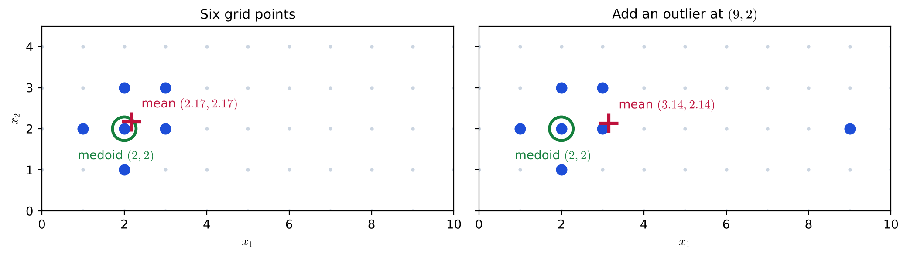
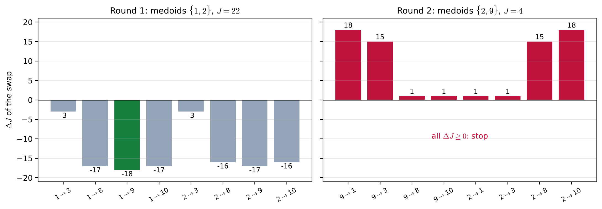
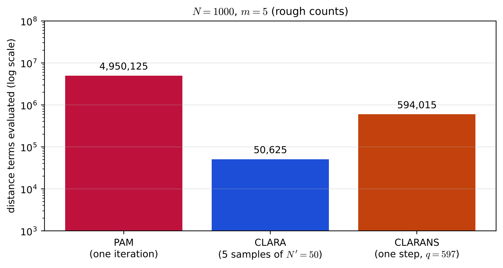

# Lecture 14 · KP02：$k$-medoids：代表必須是資料裡的點（$k$-medoids: the representative must be a data point）

> 程度：研究生（grad）／Level: Graduate (grad)
>
> 第 14 週（2026-12-07）｜Clustering (1) – $k$-means & Hierarchical Clustering · KP02
>
> Week 14 (2026-12-07) | Clustering (1) – $k$-means & Hierarchical Clustering · KP02

## 學習目標（Learning objectives）

- 說出 medoid 的定義，並比較 medoid 與均值在離散資料與離群點上的差別（State the definition of a medoid and compare it with the mean on discrete data and with outliers）。
- 寫出 $k$-medoids 的代價函數，說出 PAM 的「鄰居」是什麼、一共有幾個（Write the cost function of $k$-medoids, and say what a "neighbour" is in PAM and how many there are）。
- 在一個六點例子上手算 PAM 的換點搜尋，判斷何時停止（Carry out the swap search of PAM by hand on a six-point example and decide when it stops）。
- 說出 CLARA 與 CLARANS 各用什麼方式降低 PAM 的計算量，以及它們的參數（State how CLARA and CLARANS each cut the cost of PAM, and give their parameters）。

## KP02：$k$-medoids：代表必須是資料裡的點（$k$-medoids: the representative must be a data point）

**一句話重點**：$k$-medoids 規定每一群的代表必須從資料裡挑，這讓它能處理離散資料、不怕離群點，但找最佳代表比 $k$-means 貴得多。

**One-sentence summary**: $k$-medoids requires each group's representative to be picked from the data, which lets it handle discrete data and resist outliers, but finding the best representatives costs much more than in $k$-means.

### 1. 接住上一講的問題（Picking up the question）

上一講的 $k$-means 用均值當代表。
均值是「算」出來的點，所以有兩個麻煩。
一是離群點會把它拉走；二是類別或格子上的資料，均值可能根本不在資料所在的地方。

The $k$-means of the last lecture uses the mean as the representative.
A mean is a point that is "computed", which causes two problems.
First, outliers pull it away; second, for categorical or grid data the mean may not lie where the data live.

**白話說明**：想像一個班級要選代表去開會。
$k$-means 的做法是把全班的身高、成績平均起來，捏出一個「平均學生」，但這個人並不存在。
$k$-medoids 則規定代表必須是班上真實的某一位同學，挑那位和大家差距總和最小的人。
這個比喻只說明「代表從成員裡挑」，沒說明要怎麼有效率地挑出來。

**Plain explanation**: Imagine a class choosing a representative for a meeting.
The $k$-means way averages the heights and grades of the whole class into an "average student" who does not exist.
$k$-medoids requires the representative to be a real classmate, namely the one whose total difference from everyone is smallest.
This analogy only shows "the representative is picked from the members"; it does not say how to pick efficiently.

**先備自測**：確認你記得上一講的代價函數 $J$，以及「局部最小」的意思。
不熟的話，回到 KP01 複習。

**Prerequisite check**: Make sure you remember the cost function $J$ of the last lecture and what a "local minimum" is.
If not, review KP01.

- $k$-means 的 $J$ 是每個點到自己代表的平方距離總和（The $J$ of $k$-means sums each point's squared distance to its own representative）。
- 每個點交給最近的代表（Each point goes to the nearest representative）。
- 局部最小是「附近每一步都改不動」的停止點（A local minimum is a stopping point where no nearby step helps）。

### 2. medoid 與 $k$-medoids 的代價（Medoids and the cost of $k$-medoids）

**正式定義**：**medoid** 是一群資料中被選出來當代表的那個資料點。
令 $\Theta$ 是 $m$ 個 medoid 的集合，$I_{\Theta}$ 是它們在資料 $X$ 裡的編號，$I_{X-\Theta}$ 是其餘點的編號。
例如 $\Theta=\{\mathbf{x}_1,\mathbf{x}_5,\mathbf{x}_{13}\}$，則 $I_{\Theta}=\{1,5,13\}$。
代價只加總「不是 medoid 的點」到它最近 medoid 的距離：

**Formal definition**: A **medoid** is the data point selected as the representative of a group.
Let $\Theta$ be the set of $m$ medoids, $I_{\Theta}$ their indices in the data $X$, and $I_{X-\Theta}$ the indices of the other points.
For example, if $\Theta=\{\mathbf{x}_1,\mathbf{x}_5,\mathbf{x}_{13}\}$, then $I_{\Theta}=\{1,5,13\}$.
The cost only adds up the distance from each "non-medoid point" to its nearest medoid:

$$
J(\Theta,U)=\sum_{i\in I_{X-\Theta}}\sum_{j\in I_{\Theta}}u_{ij}\,d(\mathbf{x}_i,\mathbf{x}_j)\tag{14.87}
$$

$u_{ij}=1$ 當且僅當 $\mathbf{x}_j$ 是 $\mathbf{x}_i$ 最近的 medoid。
它幾乎就是 $k$-means 的代價，只是代表 $\boldsymbol{\theta}_j$ 換成了資料點 $\mathbf{x}_j$。
距離 $d$ 不必是平方歐氏，任何相異度都可以，這也是它能處理類別資料的原因。

$u_{ij}=1$ if and only if $\mathbf{x}_j$ is the nearest medoid of $\mathbf{x}_i$.
It is almost the cost of $k$-means, except that the representative $\boldsymbol{\theta}_j$ becomes a data point $\mathbf{x}_j$.
The distance $d$ need not be squared Euclidean; any dissimilarity works, which is why it can handle categorical data.

| 符號 | 中文意義 | English meaning |
|---|---|---|
| $\Theta$ | $m$ 個 medoid 的集合 | Set of $m$ medoids |
| $I_{\Theta}$ | medoid 在 $X$ 裡的編號 | Indices of the medoids in $X$ |
| $I_{X-\Theta}$ | 其餘點的編號 | Indices of the other points |
| $d(\mathbf{x}_i,\mathbf{x}_j)$ | 兩點的相異度 | Dissimilarity between two points |
| $u_{ij}$ | $\mathbf{x}_j$ 是否為 $\mathbf{x}_i$ 最近的 medoid | Whether $\mathbf{x}_j$ is the nearest medoid of $\mathbf{x}_i$ |

**兩項優點**：

**Two advantages**:

- 離散資料也能用：格子上一群點的均值可能不在格子上，medoid 一定在（Discrete data work: the mean of grid points may fall off the grid, but a medoid always lies on it）。
- 比較不怕離群點：離群點會明顯拉開均值，卻幾乎拉不動 medoid（Less sensitive to outliers: an outlier moves the mean a lot but barely moves the medoid）。

**兩項缺點**：均值有清楚的幾何與統計意義，medoid 不一定有；而且找最佳的 medoid 集合比 $k$-means 更吃計算。

**Two disadvantages**: The mean has a clear geometric and statistical meaning, while a medoid may not; and finding the best set of medoids costs more computation than $k$-means.

`[補充]` 看六個格點：$(2,2)$、$(1,2)$、$(3,2)$、$(2,1)$、$(2,3)$、$(3,3)$。
它們的均值是 $(2.1667,2.1667)$，不在格點上。
到其他五點的歐氏距離總和最小的是 $(2,2)$，總和約 $5.414$，所以 medoid 是 $(2,2)$。

`[Added]` Look at six grid points, $(2,2)$, $(1,2)$, $(3,2)$, $(2,1)$, $(2,3)$ and $(3,3)$.
Their mean is $(2.1667,2.1667)$, which is not a grid point.
The point with the smallest total Euclidean distance to the other five is $(2,2)$, with a total of about $5.414$, so the medoid is $(2,2)$.

再加一個離群點 $(9,2)$。
均值被拉到 $(3.1429,2.1429)$，右移了將近一格。
medoid 仍是 $(2,2)$。
若離群點移到 $(30,2)$，均值會到 $(6.1429,2.1429)$，medoid 還是 $(2,2)$。

Now add an outlier at $(9,2)$.
The mean is pulled to $(3.1429,2.1429)$, nearly one grid step to the right.
The medoid stays at $(2,2)$.
If the outlier moves to $(30,2)$, the mean goes to $(6.1429,2.1429)$, and the medoid is still $(2,2)$.



**圖說 `lec14-kp02-kmedoids-f1-medoid-vs-mean`**：先看左圖，紅色加號是均值，落在格點之間；綠圈是 medoid，落在資料點上。
再看右圖，加入右邊的離群點後，紅色加號往右移，綠圈原地不動。
注意灰色小點是格子，均值不必在格子上，medoid 一定在。〔功能：1、3〕

**Caption `lec14-kp02-kmedoids-f1-medoid-vs-mean`**: Look first at the left panel: the red plus is the mean, lying between grid points; the green ring is the medoid, sitting on a data point.
Then look at the right panel: after the outlier is added on the right, the red plus moves right while the green ring stays put.
Note that the small gray dots are the grid: the mean need not be on it, but the medoid always is. [Function: 1, 3]

**常見迷思**：「medoid 就是中位數，或就是離均值最近的點。」
不對。
medoid 是讓「到同群其他點的距離總和」最小的資料點。
它在一維、用絕對距離時接近中位數；在一般情形下，它和離均值最近的點不一定相同。

**Common misconception**: "The medoid is the median, or the data point closest to the mean."
That is wrong.
The medoid is the data point that minimizes "the total distance to the other points of its group".
In one dimension with the absolute distance it is close to the median; in general it need not be the point closest to the mean.

### 3. PAM：一次只換一個 medoid（PAM: swap one medoid at a time）

有了代價，下一個問題是怎麼找出好的 medoid 集合。
資料點有限，所以搜尋是在「換掉哪一個」之間進行。

With the cost in hand, the next question is how to find a good set of medoids.
The data points are finite, so the search moves between choices of "which one to swap".

**鄰居**：兩個 $m$ 元 medoid 集合 $\Theta$、$\Theta'$，若共享 $m-1$ 個元素，就互稱鄰居。
也就是把 $\Theta$ 裡的某個 $\mathbf{x}_i$ 換成某個非 medoid 的 $\mathbf{x}_j$，記成 $\Theta_{ij}$。
$\Theta$ 有 $m$ 個可換出的點、$N-m$ 個可換入的點，所以鄰居數是 $m(N-m)$。
換點的代價差記成 $\Delta J_{ij}=J(\Theta_{ij})-J(\Theta)$。

**Neighbours**: Two $m$-element medoid sets $\Theta$ and $\Theta'$ are neighbours if they share $m-1$ elements.
That is, some $\mathbf{x}_i$ in $\Theta$ is replaced by some non-medoid $\mathbf{x}_j$, written $\Theta_{ij}$.
$\Theta$ has $m$ points that can leave and $N-m$ that can enter, so there are $m(N-m)$ neighbours.
The cost change of a swap is $\Delta J_{ij}=J(\Theta_{ij})-J(\Theta)$.

**PAM**（Partitioning Around Medoids）的步驟：

**PAM** (Partitioning Around Medoids) proceeds as follows:

1. 從 $X$ 隨機挑 $m$ 個點當 $\Theta$（Pick $m$ random points of $X$ as $\Theta$）。
2. 算出全部 $m(N-m)$ 個鄰居的 $\Delta J_{ij}$，找出最小的 $\Delta J_{qr}$（Compute $\Delta J_{ij}$ for all $m(N-m)$ neighbours and find the smallest, $\Delta J_{qr}$）。
3. 若 $\Delta J_{qr}<0$，就換成 $\Theta_{qr}$，回到第 2 步；若 $\Delta J_{qr}\ge0$，停在局部最小（If $\Delta J_{qr}<0$, switch to $\Theta_{qr}$ and go back to step 2; if $\Delta J_{qr}\ge0$, stop at a local minimum）。
4. 最後把每個非 medoid 點交給最近的 medoid（Finally give each non-medoid point to its nearest medoid）。

**例子** `[補充]`：一維資料 $1,2,3,8,9,10$，$m=2$，距離用 $\lvert x-y\rvert$。
起點 $\Theta=\{1,2\}$：$3$ 到 $2$ 距離 $1$；$8$、$9$、$10$ 到 $2$ 的距離是 $6$、$7$、$8$，所以 $J=1+6+7+8=22$。
鄰居一共 $2\times(6-2)=8$ 個。
其中把 $1$ 換成 $9$ 的 $\Delta J=-18$ 最小。
換完後 $\Theta=\{2,9\}$：$1$、$3$ 到 $2$ 各是 $1$，$8$、$10$ 到 $9$ 各是 $1$，$J=4$。
第二輪的 $8$ 個 $\Delta J$ 全都 $\ge0$，演算法停止。

**Example** `[Added]`: One-dimensional data $1,2,3,8,9,10$ with $m=2$ and distance $\lvert x-y\rvert$.
Start with $\Theta=\{1,2\}$: $3$ is at distance $1$ from $2$; $8$, $9$ and $10$ are at $6$, $7$ and $8$ from $2$, so $J=1+6+7+8=22$.
There are $2\times(6-2)=8$ neighbours.
Swapping $1$ for $9$ gives the smallest $\Delta J=-18$.
After the swap $\Theta=\{2,9\}$: $1$ and $3$ are each at $1$ from $2$, and $8$ and $10$ are each at $1$ from $9$, so $J=4$.
All $8$ values of $\Delta J$ in the second round are $\ge0$, so the algorithm stops.

| 第 1 輪換點 | $1\to3$ | $1\to8$ | $1\to9$ | $1\to10$ | $2\to3$ | $2\to8$ | $2\to9$ | $2\to10$ |
|---|---|---|---|---|---|---|---|---|
| $\Delta J$ | $-3$ | $-17$ | $-18$ | $-17$ | $-3$ | $-16$ | $-17$ | $-16$ |



**圖說 `lec14-kp02-kmedoids-f2-pam-swaps`**：先看左圖，八根長條是第 1 輪八個鄰居的 $\Delta J$，綠色的 $1\to9$ 最低。
再看右圖，換成 $\{2,9\}$ 後，八根長條全在零以上，所以停止。
注意右圖每一根都至少是 $1$，表示任何一次換點都會讓 $J$ 變大。〔功能：1、2〕

**Caption `lec14-kp02-kmedoids-f2-pam-swaps`**: Look first at the left panel: the eight bars are the $\Delta J$ of the eight neighbours in round 1, and the green $1\to9$ is the lowest.
Then look at the right panel: after switching to $\{2,9\}$, all eight bars are above zero, so it stops.
Note that every bar on the right is at least $1$, meaning any swap would make $J$ larger. [Function: 1, 2]

**怎麼算得快**：$\Delta J_{ij}$ 不必每次重算整個 $J$，可以拆成每個非 medoid 點的貢獻：

**How to compute it fast**: $\Delta J_{ij}$ need not recompute the whole $J$; it splits into the contribution of each non-medoid point:

$$
\Delta J_{ij}=\sum_{b\in I_{X-\Theta}}C_{bij}\tag{14.89}
$$

$C_{bij}$ 是「用 $\mathbf{x}_j$ 取代 $\mathbf{x}_i$」之後，點 $\mathbf{x}_b$ 換不換群造成的差。
來源把它分成四種情形：

$C_{bij}$ is the change caused by whether $\mathbf{x}_b$ switches group after "$\mathbf{x}_j$ replaces $\mathbf{x}_i$".
The source splits it into four cases:

- $\mathbf{x}_b$ 原本跟 $\mathbf{x}_i$，而 $\mathbf{x}_j$ 不比第二近的 medoid $\mathbf{x}_{h2}$ 近：它改跟 $\mathbf{x}_{h2}$，$C_{bij}=d(\mathbf{x}_b,\mathbf{x}_{h2})-d(\mathbf{x}_b,\mathbf{x}_i)\ge0$（$\mathbf{x}_b$ was with $\mathbf{x}_i$ and $\mathbf{x}_j$ is not closer than the second-nearest medoid $\mathbf{x}_{h2}$: it moves to $\mathbf{x}_{h2}$, with $C_{bij}\ge0$）。
- $\mathbf{x}_b$ 原本跟 $\mathbf{x}_i$，而 $\mathbf{x}_j$ 比 $\mathbf{x}_{h2}$ 近：它改跟 $\mathbf{x}_j$，$C_{bij}=d(\mathbf{x}_b,\mathbf{x}_j)-d(\mathbf{x}_b,\mathbf{x}_i)$，正負都有可能（$\mathbf{x}_b$ was with $\mathbf{x}_i$ and $\mathbf{x}_j$ is closer than $\mathbf{x}_{h2}$: it moves to $\mathbf{x}_j$, and $C_{bij}$ can have either sign）。
- $\mathbf{x}_b$ 原本不跟 $\mathbf{x}_i$，舊的最近 medoid 仍不比 $\mathbf{x}_j$ 遠：它不動，$C_{bij}=0$（$\mathbf{x}_b$ was not with $\mathbf{x}_i$ and its old nearest medoid is still no farther than $\mathbf{x}_j$: it stays, with $C_{bij}=0$）。
- $\mathbf{x}_b$ 原本不跟 $\mathbf{x}_i$，但 $\mathbf{x}_j$ 更近：它改跟 $\mathbf{x}_j$，$C_{bij}<0$（$\mathbf{x}_b$ was not with $\mathbf{x}_i$ but $\mathbf{x}_j$ is closer: it moves to $\mathbf{x}_j$, with $C_{bij}<0$）。

即使如此，每一輪仍要對 $m(N-m)$ 個鄰居、各加總 $N-m$ 個 $C_{bij}$，每輪複雜度是 $O\bigl(m(N-m)^2\bigr)$。
資料小時夠用，資料一大就太慢。

Even so, each round must handle $m(N-m)$ neighbours and sum $N-m$ values of $C_{bij}$ for each, so the cost per round is $O\bigl(m(N-m)^2\bigr)$.
That is fine for small data and too slow for large data.

### 4. CLARA 與 CLARANS：用抽樣換速度（CLARA and CLARANS: trade sampling for speed）

PAM 的瓶頸在於每輪都要看完所有鄰居、所有點。
兩個改良版都用隨機抽樣，但抽的對象不同。

The bottleneck of PAM is that every round looks at all neighbours and all points.
Both improvements use random sampling, but they sample different things.

**CLARA**（Clustering LARge Applications）抽的是**資料**。
從 $X$ 隨機抽出大小 $N'$ 的樣本 $X'$，在 $X'$ 上跑 PAM。
若樣本能代表全體的分布，得到的 medoid 就會接近在全資料上跑 PAM 的結果。
為了更穩，它抽 $s$ 份樣本各跑一次，再用整個 $X$ 上的式 $(14.87)$ 挑出最好的一組。
實驗建議 $s=5$、$N'=40+2m$。

**CLARA** (Clustering LARge Applications) samples the **data**.
It draws a random sample $X'$ of size $N'$ from $X$ and runs PAM on $X'$.
If the sample represents the overall distribution, the medoids will be close to those of PAM on the full data.
To be safer, it draws $s$ samples, runs PAM on each, and picks the best set with Eq. $(14.87)$ on the whole $X$.
Experiments suggest $s=5$ and $N'=40+2m$.

**CLARANS**（Clustering Large Applications based on RANdomized Search）抽的是**鄰居**。
它仍在整個 $X$ 上跑，但每一步只隨機看 $q<m(N-m)$ 個鄰居。
看到比目前好的鄰居就立刻換過去；$q$ 個都沒有更好的，就把目前的集合當成一個局部最小。
整個過程從不同起點做 $s$ 次，輸出其中最好的那個。
典型取 $s=2$、$q=\max\bigl(0.12\,m(N-m),\,250\bigr)$。

**CLARANS** (Clustering Large Applications based on RANdomized Search) samples the **neighbours**.
It still runs on the whole $X$, but each step looks at only $q<m(N-m)$ random neighbours.
It switches immediately to any neighbour better than the current set; if none of the $q$ is better, it takes the current set as a local minimum.
The whole process is repeated $s$ times from different starts, and the best result is output.
Typical values are $s=2$ and $q=\max\bigl(0.12\,m(N-m),\,250\bigr)$.

$q$ 越接近 $m(N-m)$，CLARANS 越像 PAM，也越慢。
來源指出，CLARANS 找到的分群品質通常比 CLARA 好，但有些情況下 CLARA 明顯較快。
CLARANS 仍是二次複雜度，非常大的資料並不適合。

The closer $q$ is to $m(N-m)$, the more CLARANS behaves like PAM, and the slower it gets.
The source notes that CLARANS usually finds better clusterings than CLARA, while in some cases CLARA is much faster.
CLARANS is still quadratic and does not suit very large data.

`[補充]` 用 $N=1000$、$m=5$ 粗估一下規模。
PAM 每輪要看 $5\times995=4975$ 個鄰居，距離項約 $5\times995^2=4{,}950{,}125$ 個。
CLARA 的樣本只有 $N'=50$ 點，五份樣本合計約 $5\times5\times45^2=50{,}625$ 個。
CLARANS 每步看 $q=\max(597,250)=597$ 個鄰居，每個要掃過 $995$ 個點，約 $594{,}015$ 個。
這只是數量級的比較，實際時間還要看迭代次數。

`[Added]` A rough estimate of scale with $N=1000$ and $m=5$.
PAM looks at $5\times995=4975$ neighbours per round, about $5\times995^2=4{,}950{,}125$ distance terms.
CLARA works on samples of only $N'=50$ points, about $5\times5\times45^2=50{,}625$ terms for five samples.
CLARANS looks at $q=\max(597,250)=597$ neighbours per step, each scanning $995$ points, about $594{,}015$ terms.
This only compares orders of magnitude; the actual time also depends on the number of iterations.



**圖說 `lec14-kp02-kmedoids-f3-cost`**：先看縱軸，它是對數刻度，每格差 $10$ 倍。
再看三根長條，PAM 最高，CLARA 最低，CLARANS 在中間。
注意這是 $N=1000$、$m=5$ 的粗估，CLARA 省最多是因為它只在小樣本上跑 PAM。〔功能：2〕

**Caption `lec14-kp02-kmedoids-f3-cost`**: Look first at the vertical axis, a logarithmic scale with a factor of $10$ per step.
Then look at the three bars: PAM is highest, CLARA lowest and CLARANS in between.
Note that this is a rough estimate for $N=1000$ and $m=5$; CLARA saves the most because it runs PAM only on small samples. [Function: 2]

**失效情形**：CLARA 的樣本若不能代表全體（例如某個小群剛好沒被抽到），找到的 medoid 就會偏。
CLARANS 的 $q$ 取太小，等於只看少數鄰居，容易過早停下。

**Failure cases**: If a CLARA sample does not represent the whole (for example, a small group happens to be missed), the medoids will be biased.
If the $q$ of CLARANS is too small, it looks at only a few neighbours and tends to stop too early.

### 5. 與實作的連結（Connection to implementation）

下面的程式實作 PAM，每輪看完所有鄰居。
注意兩件事：$J$ 只加非 medoid 點；只在最小的 $\Delta J<0$ 時才換。

The code below implements PAM and looks at all neighbours in every round.
Note two points: $J$ only adds the non-medoid points, and a swap happens only when the smallest $\Delta J<0$.

```python
import numpy as np

def pam(D, medoids):
    """D 是兩兩距離矩陣；回傳 (medoid 編號, J)。"""
    N = len(D)
    def cost(T):
        rest = [i for i in range(N) if i not in T]
        return float(D[np.ix_(rest, T)].min(axis=1).sum())   # 非 medoid 點到最近 medoid / nearest medoid
    T = list(medoids)
    while True:
        best = (0.0, None)
        for a in T:                                        # 換出的 medoid / medoid to leave
            for b in range(N):                             # 換入的非 medoid / point to enter
                if b in T:
                    continue
                T2 = [b if t == a else t for t in T]
                d = cost(T2) - cost(T)
                if d < best[0]:
                    best = (d, T2)
        if best[1] is None:                                # 最小 ΔJ >= 0：局部最小 / local minimum
            return T, cost(T)
        T = best[1]

x = np.array([1, 2, 3, 8, 9, 10], float)
D = np.abs(x[:, None] - x[None, :])
T, J = pam(D, [0, 1])
print(sorted(x[T].tolist()), J)                            # [2.0, 9.0] 4.0
```

**留給下一節的問題**：$k$-means 與 $k$-medoids 都要先指定群數 $m$，一次給出一個分割。
如果不想先決定 $m$，而想看到「從一個點一群，到全部一群」的整個過程，該怎麼做？
下一節的階層分群回答這個問題。

**The question for the next section**: Both $k$-means and $k$-medoids need the number of groups $m$ in advance and give one partition.
What if you do not want to fix $m$ and want to see the whole process "from one point per group to everything in one group"?
The hierarchical clustering of the next lecture answers this question.

### 6. 小練習與解題示範（Practice and worked solutions）

**小練習** `[補充]`：先寫下理由，再看解答。

**Practice** `[Added]`: Write your reasoning before reading the solutions.

1. 題 1：$N=200$、$m=4$ 時，PAM 每輪有幾個鄰居（With $N=200$ and $m=4$, how many neighbours does PAM have per round）？
2. 題 2：一維資料 $1,2,3,100$，求均值與 medoid（距離用 $\lvert x-y\rvert$）（One-dimensional data $1,2,3,100$: find the mean and the medoid, with distance $\lvert x-y\rvert$）。
3. 題 3：$m=4$ 時，CLARA 建議的樣本大小與樣本份數各是多少（With $m=4$, what sample size and number of samples does CLARA suggest）？

**題 1 解題示範**：鄰居數是 $m(N-m)=4\times196=784$。

**Question 1 worked solution**: The number of neighbours is $m(N-m)=4\times196=784$.

**題 2 解題示範**：均值是 $(1+2+3+100)/4=26.5$，被 $100$ 拉得很遠。
各點到其他點的距離總和：$1$ 是 $1+2+99=102$，$2$ 是 $1+1+98=100$，$3$ 是 $2+1+97=100$，$100$ 是 $99+98+97=294$。
$2$ 與 $3$ 平手，medoid 取其中之一，都遠比均值更貼近大部分資料。

**Question 2 worked solution**: The mean is $(1+2+3+100)/4=26.5$, pulled far away by $100$.
Total distances to the other points: $102$ for $1$, $100$ for $2$, $100$ for $3$ and $294$ for $100$.
$2$ and $3$ tie, so either is the medoid, and both stay much closer to most of the data than the mean.

**題 3 解題示範**：$N'=40+2\times4=48$，樣本份數 $s=5$。

**Question 3 worked solution**: $N'=40+2\times4=48$, and the number of samples is $s=5$.

## 術語表（Glossary）

| 中文術語 | English term |
|---|---|
| 中心點（medoid） | Medoid |
| 相異度 | Dissimilarity |
| 鄰居 | Neighbour |
| 換點 | Swap |
| 代價差 | Cost change |
| 局部最小 | Local minimum |
| 離群點 | Outlier |
| 離散資料 | Discrete data |
| 隨機抽樣 | Random sampling |
| 複雜度 | Complexity |
| 圍繞中心點的分割 | Partitioning Around Medoids (PAM) |
| 大型應用分群 | Clustering LARge Applications (CLARA) |
| 隨機搜尋大型應用分群 | Clustering Large Applications based on RANdomized Search (CLARANS) |

## 銜接與來源（Connections and sources）

下一講換一種思路：不先指定群數，而是一步步把最近的兩群黏起來，得到一棵樹。

The next lecture takes a different approach: instead of fixing the number of groups, it merges the two closest groups step by step and obtains a tree.

- 前一單元：[KP01 $k$-means](lec14-kp01-kmeans.md)（Previous unit: $k$-means）。
- 下一單元：[KP03 階層分群與樹狀圖](lec14-kp03-hierarchical-gas.md)（Next unit: hierarchical clustering and the dendrogram）。
- 來源：[Clustering Algorithms III: Schemes Based on Function Optimization §14.5.2](https://ndhuccc.github.io/CCC-LNS/PR_115/Ch14-function-optimization-clustering/index.html)，讀取日期 2026-11-13（Source accessed 2026-11-13）。
- 書目：Theodoridis and Koutroumbas, *Pattern Recognition*, 4th ed., 2008；見[參考資料](../references/README.md)（See the bibliography）。

本講以自己的文字解釋來源。
medoid 的定義與代價函數、兩項優點與兩項缺點、鄰居與 $m(N-m)$、PAM 的步驟、$C_{bij}$ 的四種情形、$O\bigl(m(N-m)^2\bigr)$、CLARA 與 CLARANS 的作法、參數與比較取自來源。
選班代表的比喻、格點與離群點例、一維六點的 PAM、規模粗估、程式、圖與練習皆為 `[補充]`。

This lecture independently explains the source.
The definition and cost of medoids, the two advantages and two disadvantages, neighbours and $m(N-m)$, the PAM steps, the four cases of $C_{bij}$, $O\bigl(m(N-m)^2\bigr)$, and the procedures, parameters and comparison of CLARA and CLARANS come from the source.
The class-representative analogy, the grid and outlier example, the six-point PAM, the rough cost estimate, the code, the figures and the practice are `[Added]`.
