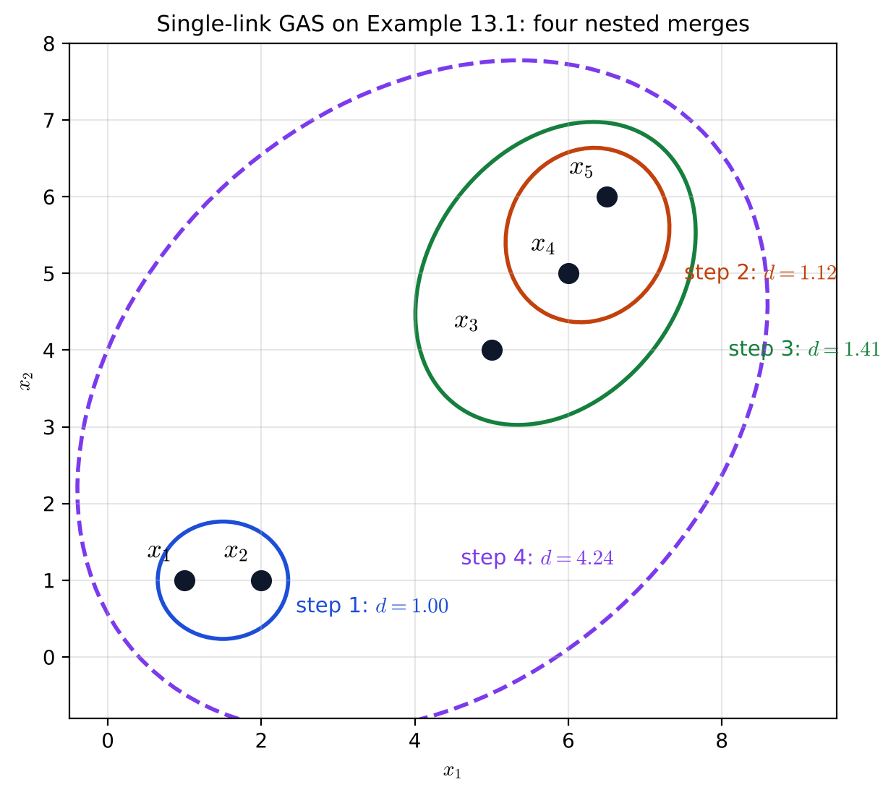
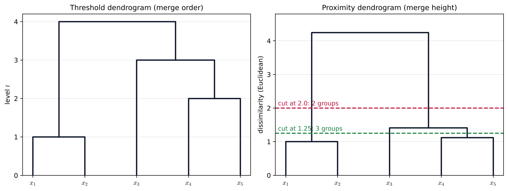

# Lecture 14 · KP03：階層分群：一步黏一對，長成一棵樹（Hierarchical clustering: merge one pair per step and grow a tree）

> 程度：研究生（grad）／Level: Graduate (grad)
>
> 第 14 週（2026-12-07）｜Clustering (1) – $k$-means & Hierarchical Clustering · KP03
>
> Week 14 (2026-12-07) | Clustering (1) – $k$-means & Hierarchical Clustering · KP03

## 學習目標（Learning objectives）

- 判斷兩個分群是否「巢狀」，並說出凝聚法與分裂法的方向差別（Decide whether two clusterings are "nested" and state how the agglomerative and divisive directions differ）。
- 寫出廣義凝聚方案 GAS 的步驟，說出相異度與相似度各要取最小還是最大（Write the steps of the generalized agglomerative scheme GAS and say whether a dissimilarity or a similarity calls for the minimum or the maximum）。
- 由樣式矩陣算出接近矩陣，並在五點例子上用單連跑完 GAS（Compute a proximity matrix from a pattern matrix and run GAS with single link on a five-point example）。
- 讀懂 threshold 與 proximity 兩種樹狀圖，並在指定高度切出一個分群（Read threshold and proximity dendrograms and cut out a clustering at a given height）。

## KP03：階層分群：一步黏一對，長成一棵樹（Hierarchical clustering: merge one pair per step and grow a tree）

**一句話重點**：階層分群不只給一個分群，而是給出一整串一層包一層的分群；凝聚法從每點一群開始，每一步把最近的一對叢集黏起來，最後畫成一棵樹狀圖。

**One-sentence summary**: Hierarchical clustering gives not one clustering but a whole chain of clusterings, each containing the previous one; the agglomerative approach starts with one point per group, merges the closest pair of clusters at each step, and is drawn as a dendrogram.

### 1. 接住上一講的問題（Picking up the question）

前兩講的 $k$-means 與 $k$-medoids 都要先決定群數 $m$，最後只交出一個分割。
可是很多時候你根本不知道該分幾群。
生物分類學、社會科學、考古學常想看的，是「從很細到很粗」的整張地圖。

The $k$-means and $k$-medoids of the last two lectures both need the number of groups $m$ in advance and hand over a single partition.
Yet often you have no idea how many groups there should be.
Fields such as biological taxonomy, social science and archaeology often want the whole map "from very fine to very coarse".

**白話說明**：想像家族族譜。
最底層是每一個人；往上一層，兄弟姊妹併成一家；再往上，堂表兄弟併成一房；最上面是整個家族。
階層分群就是替資料畫出這樣一張族譜。
這個比喻只說明「一層包一層」的結構，沒說明每一步該把誰和誰併在一起。

**Plain explanation**: Think of a family tree.
At the bottom is every person; one level up, siblings join into a household; further up, cousins join into a branch; at the top is the whole family.
Hierarchical clustering draws such a family tree for data.
This analogy only shows the "each level contains the one below" structure; it does not say whom to merge at each step.

**先備自測**：確認你記得兩點的歐氏距離，與集合的子集關係。
不熟的話，回到 KP01 複習。

**Prerequisite check**: Make sure you remember the Euclidean distance between two points and what a subset is.
If not, review KP01.

- 集合 $A$ 是 $B$ 的子集，表示 $A$ 的每個元素都在 $B$ 裡（$A$ is a subset of $B$ if every element of $A$ is in $B$）。
- 距離越小越相像；相似度越大越相像（A smaller distance means more alike; a larger similarity means more alike）。
- 一個分群是把資料切成互不重疊的叢集（A clustering splits the data into non-overlapping clusters）。

### 2. 巢狀、凝聚與分裂（Nesting, agglomeration and division）

**正式定義**：資料是 $X=\{\mathbf{x}_1,\dots,\mathbf{x}_N\}$，一個分群記成 $\Re=\{C_1,\dots,C_m\}$。
若 $\Re_1$ 有 $k$ 個叢集、$\Re_2$ 有 $r<k$ 個叢集，而且 $\Re_1$ 的每一個叢集都是 $\Re_2$ 某個叢集的子集，就說 $\Re_1$ **巢狀於** $\Re_2$，記成 $\Re_1\sqsubset\Re_2$。

**Formal definition**: The data are $X=\{\mathbf{x}_1,\dots,\mathbf{x}_N\}$, and a clustering is written $\Re=\{C_1,\dots,C_m\}$.
If $\Re_1$ has $k$ clusters and $\Re_2$ has $r<k$ clusters, and every cluster of $\Re_1$ is a subset of some cluster of $\Re_2$, then $\Re_1$ is **nested in** $\Re_2$, written $\Re_1\sqsubset\Re_2$.

來源的例子：$\Re_1=\{\{\mathbf{x}_1,\mathbf{x}_3\},\{\mathbf{x}_4\},\{\mathbf{x}_2,\mathbf{x}_5\}\}$ 巢狀於 $\Re_2=\{\{\mathbf{x}_1,\mathbf{x}_3,\mathbf{x}_4\},\{\mathbf{x}_2,\mathbf{x}_5\}\}$。
前兩個叢集被 $\{\mathbf{x}_1,\mathbf{x}_3,\mathbf{x}_4\}$ 包住，第三個剛好相同。
但 $\Re_1$ 不巢狀於 $\{\{\mathbf{x}_1,\mathbf{x}_4\},\{\mathbf{x}_3\},\{\mathbf{x}_2,\mathbf{x}_5\}\}$，因為 $\{\mathbf{x}_1,\mathbf{x}_3\}$ 被拆開了。

The source example: $\Re_1=\{\{\mathbf{x}_1,\mathbf{x}_3\},\{\mathbf{x}_4\},\{\mathbf{x}_2,\mathbf{x}_5\}\}$ is nested in $\Re_2=\{\{\mathbf{x}_1,\mathbf{x}_3,\mathbf{x}_4\},\{\mathbf{x}_2,\mathbf{x}_5\}\}$.
The first two clusters are contained in $\{\mathbf{x}_1,\mathbf{x}_3,\mathbf{x}_4\}$, and the third is the same.
But $\Re_1$ is not nested in $\{\{\mathbf{x}_1,\mathbf{x}_4\},\{\mathbf{x}_3\},\{\mathbf{x}_2,\mathbf{x}_5\}\}$, because $\{\mathbf{x}_1,\mathbf{x}_3\}$ is split apart.

階層演算法跑 $N$ 層，每一層由前一層改寫而來，分成兩類：

A hierarchical algorithm runs through $N$ levels, each rewritten from the previous one, in two kinds:

- **凝聚法**：從 $N$ 個單點叢集開始，每一步併掉一對，最後只剩整個 $X$，得到 $\Re_0\sqsubset\Re_1\sqsubset\cdots\sqsubset\Re_{N-1}$（**Agglomerative**: start from $N$ single-point clusters, merge one pair per step, and end with the whole $X$, giving $\Re_0\sqsubset\Re_1\sqsubset\cdots\sqsubset\Re_{N-1}$）。
- **分裂法**：方向相反，從整個 $X$ 開始，每一步切成更多群，最後是 $N$ 個單點（**Divisive**: the opposite direction, starting from the whole $X$ and splitting into more groups at each step until there are $N$ single points）。

巢狀的直覺是：兩個點一旦在某一層被併進同一群，之後更粗的每一層，它們都會待在一起。
本講與接下來幾講主要談凝聚法，分裂法在 KP06 再談。

The intuition of nesting is that once two points are merged into one group at some level, they stay together at every coarser level.
This and the next few lectures mainly treat the agglomerative approach; the divisive one comes in KP06.

### 3. 廣義凝聚方案 GAS（The generalized agglomerative scheme GAS）

要決定每一步併誰，需要一個叢集與叢集之間的接近度 $g(C_i,C_j)$。
**廣義凝聚方案**（Generalized Agglomerative Scheme, GAS）是所有凝聚法共用的骨架：

To decide whom to merge at each step, you need a proximity $g(C_i,C_j)$ between clusters.
The **generalized agglomerative scheme** (GAS) is the skeleton shared by all agglomerative methods:

1. 初始化：$\Re_0=\{\{\mathbf{x}_1\},\dots,\{\mathbf{x}_N\}\}$，$t=0$（Initialize $\Re_0=\{\{\mathbf{x}_1\},\dots,\{\mathbf{x}_N\}\}$ and $t=0$）。
2. $t\leftarrow t+1$；在 $\Re_{t-1}$ 的所有叢集對中，找出最接近的一對 $(C_i,C_j)$（Set $t\leftarrow t+1$ and find the closest pair $(C_i,C_j)$ among all pairs in $\Re_{t-1}$）。
3. 合併成 $C_q=C_i\cup C_j$，令 $\Re_t=(\Re_{t-1}-\{C_i,C_j\})\cup\{C_q\}$（Merge into $C_q=C_i\cup C_j$ and set $\Re_t=(\Re_{t-1}-\{C_i,C_j\})\cup\{C_q\}$）。
4. 直到所有向量都在同一群（Repeat until all vectors are in one group）。

「最接近」要看 $g$ 是哪一種量：

"Closest" depends on what kind of quantity $g$ is:

$$
g(C_i,C_j)=\begin{cases}\min\limits_{r,s} g(C_r,C_s), & g \text{ is a dissimilarity}\\[4pt] \max\limits_{r,s} g(C_r,C_s), & g \text{ is a similarity}\end{cases}\tag{13.1}
$$

相異度越小越像，所以取最小；相似度越大越像，所以取最大。
搞反了，就會每一步都併到最不像的一對。

A smaller dissimilarity means more alike, so take the minimum; a larger similarity means more alike, so take the maximum.
Getting this backwards merges the least similar pair at every step.

**計算量**：第 $t$ 層有 $N-t$ 個叢集，要比 $\binom{N-t}{2}$ 對。
全部加起來是

**Cost**: Level $t$ has $N-t$ clusters, so $\binom{N-t}{2}$ pairs must be compared.
In total this is

$$
\sum_{t=0}^{N-1}\binom{N-t}{2}=\frac{(N-1)N(N+1)}{6}
$$

對，約與 $N^3$ 成正比。
`[補充]` $N=5$ 時是 $20$ 對；$N=100$ 時是 $166{,}650$ 對；$N=1000$ 時超過一億六千萬對。

pairs, roughly proportional to $N^3$.
`[Added]` For $N=5$ this is $20$ pairs; for $N=100$ it is $166{,}650$; for $N=1000$ it exceeds 160 million.

**巢狀的代價**：早期某一步併錯了，後面沒有機制能拆開重來。
錯誤會一路被鎖在階層裡。

**The price of nesting**: If an early step merges the wrong pair, there is no mechanism to undo it later.
The error stays locked in the hierarchy.

### 4. 主例子：五個點的單連 GAS（Main example: single-link GAS on five points）

**樣式矩陣**$D(X)$ 是 $N\times l$ 的表，第 $i$ 列是第 $i$ 個向量。
**接近矩陣**$P(X)$ 是 $N\times N$ 的表，第 $(i,j)$ 格是兩點的相異度或相似度。
同一個 $D(X)$ 換一種接近度，就得到不同的 $P(X)$。

The **pattern matrix** $D(X)$ is an $N\times l$ table whose $i$-th row is the $i$-th vector.
The **proximity matrix** $P(X)$ is an $N\times N$ table whose $(i,j)$ entry is the dissimilarity or similarity of two points.
The same $D(X)$ gives a different $P(X)$ for a different proximity measure.

**例子**：來源的例 13.1 取五個二維點：

**Example**: Example 13.1 of the source takes five two-dimensional points:

$$
D(X)=\begin{bmatrix}1&1\\2&1\\5&4\\6&5\\6.5&6\end{bmatrix}
$$

用歐氏距離，`[補充]` 算出的相異度矩陣（取三位小數）是

With the Euclidean distance, `[Added]` the dissimilarity matrix (three decimals) is

$$
P(X)=\begin{bmatrix}0&1&5&6.403&7.433\\1&0&4.243&5.657&6.727\\5&4.243&0&1.414&2.5\\6.403&5.657&1.414&0&1.118\\7.433&6.727&2.5&1.118&0\end{bmatrix}
$$

相異度矩陣的對角線全是 $0$，因為點和自己的距離是 $0$。
若改用 Tanimoto 相似度 $s_T(\mathbf{x},\mathbf{y})=\mathbf{x}^{\top}\mathbf{y}/(\lVert\mathbf{x}\rVert^2+\lVert\mathbf{y}\rVert^2-\mathbf{x}^{\top}\mathbf{y})$，對角線全是 $1$，例如 $P'_{12}=0.75$、$P'_{34}\approx0.96$。

The diagonal of a dissimilarity matrix is all $0$, because a point is at distance $0$ from itself.
With the Tanimoto similarity $s_T(\mathbf{x},\mathbf{y})=\mathbf{x}^{\top}\mathbf{y}/(\lVert\mathbf{x}\rVert^2+\lVert\mathbf{y}\rVert^2-\mathbf{x}^{\top}\mathbf{y})$ the diagonal is all $1$, for example $P'_{12}=0.75$ and $P'_{34}\approx0.96$.

現在用**單連**跑 GAS：兩叢集的距離取「兩群之間最近那一對點」的距離。
每一步都在剩下的叢集裡找最小的距離：

Now run GAS with **single link**: the distance between two clusters is the distance of "the closest pair of points across them".
At each step find the smallest distance among the remaining clusters:

| 步驟 | 合併 | 合併時的距離 | 剩下的叢集 |
|---|---|---|---|
| 1 | $\{\mathbf{x}_1\}$、$\{\mathbf{x}_2\}$ | $1$ | $\{\mathbf{x}_1,\mathbf{x}_2\},\{\mathbf{x}_3\},\{\mathbf{x}_4\},\{\mathbf{x}_5\}$ |
| 2 | $\{\mathbf{x}_4\}$、$\{\mathbf{x}_5\}$ | $1.118$ | $\{\mathbf{x}_1,\mathbf{x}_2\},\{\mathbf{x}_3\},\{\mathbf{x}_4,\mathbf{x}_5\}$ |
| 3 | $\{\mathbf{x}_3\}$、$\{\mathbf{x}_4,\mathbf{x}_5\}$ | $1.414$ | $\{\mathbf{x}_1,\mathbf{x}_2\},\{\mathbf{x}_3,\mathbf{x}_4,\mathbf{x}_5\}$ |
| 4 | 兩大群 | $4.243$ | $X$ |

第 3 步的 $1.414$ 是 $\mathbf{x}_3$ 到 $\mathbf{x}_4$ 的距離，比到 $\mathbf{x}_5$ 的 $2.5$ 小，單連取較小的那個。
第 4 步的 $4.243$ 是兩大群之間最近的一對 $\mathbf{x}_2$、$\mathbf{x}_3$。
每一步的分群都巢狀於下一步。

The $1.414$ in step 3 is the distance from $\mathbf{x}_3$ to $\mathbf{x}_4$, smaller than the $2.5$ to $\mathbf{x}_5$, and single link takes the smaller one.
The $4.243$ in step 4 is the closest pair across the two big groups, $\mathbf{x}_2$ and $\mathbf{x}_3$.
Each clustering is nested in the next one.



**圖說 `lec14-kp03-hierarchical-gas-f1-nested-merges`**：先看藍圈與橘圈，它們是第 1、2 步各自併起來的一對點。
再看綠圈把 $x_3$ 和橘圈包在一起，最後紫色虛線把所有點包起來。
注意每個圈只會被更大的圈包住，從不互相交叉，這就是巢狀。〔功能：1、3〕

**Caption `lec14-kp03-hierarchical-gas-f1-nested-merges`**: Look first at the blue and orange rings, the pairs merged in steps 1 and 2.
Then see the green ring enclose $x_3$ together with the orange ring, and finally the purple dashed ring enclose all points.
Note that each ring is only ever enclosed by a larger one and never crosses another; that is nesting. [Function: 1, 3]

### 5. 樹狀圖與切樹（Dendrograms and cutting the tree）

把上面的合併過程畫成一棵樹，叫**樹狀圖**（dendrogram）。
有兩種畫法：

Drawing the merging process above as a tree gives a **dendrogram**.
There are two ways to draw it:

- **threshold 樹狀圖**：縱軸只標合併的順序，每一步是樹的一層（**Threshold dendrogram**: the vertical axis only marks the merge order, one level per step）。
- **proximity 樹狀圖**：縱軸標出兩群第一次合併時的接近度；用相異度時叫 dissimilarity dendrogram，用相似度時叫 similarity dendrogram（**Proximity dendrogram**: the vertical axis shows the proximity at which two groups first merge; with a dissimilarity it is called a dissimilarity dendrogram, and with a similarity a similarity dendrogram）。

在某個高度水平切一刀，被切到的直線數就是群數，切線下方連在一起的葉子就是同一群。
proximity 樹狀圖的高度有意義：一段很長的垂直線，表示「要隔很遠才會併起來」，常是切群的好位置。

Cutting horizontally at some height, the number of vertical lines crossed is the number of groups, and the leaves joined below the cut form one group.
The heights in a proximity dendrogram are meaningful: a long vertical segment means "they only merge across a large distance", which is often a good place to cut.

`[補充]` 在例 13.1 的 proximity 樹狀圖上，切在 $2.0$ 會切到兩條直線，得到 $\{\mathbf{x}_1,\mathbf{x}_2\}$、$\{\mathbf{x}_3,\mathbf{x}_4,\mathbf{x}_5\}$ 兩群。
切在 $1.25$ 會切到三條，得到 $\{\mathbf{x}_1,\mathbf{x}_2\}$、$\{\mathbf{x}_3\}$、$\{\mathbf{x}_4,\mathbf{x}_5\}$ 三群。
從 $1.414$ 到 $4.243$ 這一大段都只有兩群，暗示這份資料自然分成兩群。

`[Added]` On the proximity dendrogram of Example 13.1, a cut at $2.0$ crosses two vertical lines and gives two groups, $\{\mathbf{x}_1,\mathbf{x}_2\}$ and $\{\mathbf{x}_3,\mathbf{x}_4,\mathbf{x}_5\}$.
A cut at $1.25$ crosses three and gives three groups, $\{\mathbf{x}_1,\mathbf{x}_2\}$, $\{\mathbf{x}_3\}$ and $\{\mathbf{x}_4,\mathbf{x}_5\}$.
The whole range from $1.414$ to $4.243$ has only two groups, hinting that the data naturally form two groups.



**圖說 `lec14-kp03-hierarchical-gas-f2-dendrograms`**：先看左圖，縱軸是第幾步，四個水平橫槓等距排開。
再看右圖，縱軸是合併時的距離，最上面的橫槓高高在 $4.243$。
注意右圖的兩條虛線：紅線切出兩群，綠線切出三群；紅線上下有很大一段空白，暗示兩群最自然。〔功能：1、2〕

**Caption `lec14-kp03-hierarchical-gas-f2-dendrograms`**: Look first at the left panel: the vertical axis is the step number, and the four horizontal bars are evenly spaced.
Then look at the right panel: the vertical axis is the merge distance, and the top bar sits high at $4.243$.
Note the two dashed lines on the right: the red one gives two groups and the green one three; the large empty gap around the red line hints that two groups are most natural. [Function: 1, 2]

**常見迷思**：「樹狀圖左右的排列順序代表點有多像。」
不對。
同一層兩個子樹左右交換，樹仍然一樣；資訊只在「誰和誰在哪個高度相連」。
要比較兩點，看它們第一次被連起來的高度，而不是看它們在橫軸上離多近。

**Common misconception**: "The left-right order of a dendrogram tells how similar the points are."
That is wrong.
Swapping the two subtrees at any node leaves the tree unchanged; the information is only in "who joins whom at what height".
To compare two points, look at the height where they first join, not at how close they are on the horizontal axis.

**失效情形**：GAS 的計算量約 $N^3$，資料一大就跑不動；而且一步錯、步步錯。
怎麼定義叢集之間的距離，會大大改變樹的長相，這是下一講的主題。

**Failure cases**: GAS costs about $N^3$ operations and becomes infeasible for large data; one wrong merge also propagates.
How the distance between clusters is defined changes the shape of the tree a lot, which is the topic of the next lecture.

### 6. 與實作的連結（Connection to implementation）

下面的程式從接近矩陣跑單連 GAS，印出每一步的合併與距離。
注意兩件事：叢集距離用「兩群間最小的點距」；每一步只找最小的那一對。

The code below runs single-link GAS from the proximity matrix and prints each merge and its distance.
Note two points: the cluster distance is "the smallest point distance between the two groups", and each step only looks for the smallest pair.

```python
import itertools
import numpy as np

X = np.array([[1, 1], [2, 1], [5, 4], [6, 5], [6.5, 6]])
P = np.sqrt(((X[:, None] - X[None]) ** 2).sum(axis=2))       # 歐氏相異度矩陣 / Euclidean dissimilarities
clusters = [(i,) for i in range(len(X))]                     # 每點一群 / one point per group

def single_link(A, B):
    return min(P[a, b] for a in A for b in B)                # 兩群之間最近的一對 / closest cross pair

step = 0
while len(clusters) > 1:
    A, B = min(itertools.combinations(clusters, 2), key=lambda ab: single_link(*ab))
    step += 1
    print(step, [i + 1 for i in A], [i + 1 for i in B], round(single_link(A, B), 3))
    clusters = [c for c in clusters if c not in (A, B)] + [tuple(sorted(A + B))]
# 1 [1] [2] 1.0
# 2 [4] [5] 1.118
# 3 [3] [4, 5] 1.414
# 4 [1, 2] [3, 4, 5] 4.243
```

**留給下一節的問題**：這一講只用了單連。
如果改用「最遠的一對」或「平均距離」，合併的順序和樹的高度會怎麼變？
下一講用一條遞迴公式，把這些定義統一起來。

**The question for the next section**: This lecture used only single link.
If "the farthest pair" or "the average distance" is used instead, how do the merge order and the tree heights change?
The next lecture unifies these definitions with one recursive formula.

### 7. 小練習與解題示範（Practice and worked solutions）

**小練習** `[補充]`：先寫下理由，再看解答。

**Practice** `[Added]`: Write your reasoning before reading the solutions.

1. 題 1：$\{\{\mathbf{x}_1\},\{\mathbf{x}_2,\mathbf{x}_3\},\{\mathbf{x}_4\}\}$ 是否巢狀於 $\{\{\mathbf{x}_1,\mathbf{x}_2\},\{\mathbf{x}_3,\mathbf{x}_4\}\}$（Is $\{\{\mathbf{x}_1\},\{\mathbf{x}_2,\mathbf{x}_3\},\{\mathbf{x}_4\}\}$ nested in $\{\{\mathbf{x}_1,\mathbf{x}_2\},\{\mathbf{x}_3,\mathbf{x}_4\}\}$）？
2. 題 2：$N=10$ 時，GAS 全程要比幾對叢集（For $N=10$, how many cluster pairs does GAS compare in total）？
3. 題 3：在例 13.1 的 proximity 樹狀圖上，要切出四群，切線高度要在哪個範圍（On the proximity dendrogram of Example 13.1, in what range must the cut lie to give four groups）？

**題 1 解題示範**：不巢狀。
$\{\mathbf{x}_2,\mathbf{x}_3\}$ 的兩個點分別落在 $\{\mathbf{x}_1,\mathbf{x}_2\}$ 與 $\{\mathbf{x}_3,\mathbf{x}_4\}$，它不是任何一個大叢集的子集。

**Question 1 worked solution**: Not nested.
The two points of $\{\mathbf{x}_2,\mathbf{x}_3\}$ fall into $\{\mathbf{x}_1,\mathbf{x}_2\}$ and $\{\mathbf{x}_3,\mathbf{x}_4\}$ respectively, so it is not a subset of any larger cluster.

**題 2 解題示範**：$(N-1)N(N+1)/6=9\times10\times11/6=165$ 對。

**Question 2 worked solution**: $(N-1)N(N+1)/6=9\times10\times11/6=165$ pairs.

**題 3 解題示範**：四群出現在第 1 步之後、第 2 步之前，也就是高度介於 $1$ 與 $1.118$ 之間。
切在 $1.05$ 會得到 $\{\mathbf{x}_1,\mathbf{x}_2\}$、$\{\mathbf{x}_3\}$、$\{\mathbf{x}_4\}$、$\{\mathbf{x}_5\}$。

**Question 3 worked solution**: Four groups exist after step 1 and before step 2, that is, for heights between $1$ and $1.118$.
A cut at $1.05$ gives $\{\mathbf{x}_1,\mathbf{x}_2\}$, $\{\mathbf{x}_3\}$, $\{\mathbf{x}_4\}$ and $\{\mathbf{x}_5\}$.

## 術語表（Glossary）

| 中文術語 | English term |
|---|---|
| 階層分群 | Hierarchical clustering |
| 巢狀 | Nested |
| 凝聚法 | Agglomerative approach |
| 分裂法 | Divisive approach |
| 廣義凝聚方案 | Generalized agglomerative scheme (GAS) |
| 接近度 | Proximity |
| 相異度 | Dissimilarity |
| 相似度 | Similarity |
| 樣式矩陣 | Pattern matrix |
| 接近矩陣 | Proximity matrix |
| 單連 | Single link |
| 樹狀圖 | Dendrogram |

## 銜接與來源（Connections and sources）

下一講介紹叢集之間的各種距離：單連、全連、平均、重心與 Ward，以及把它們統一起來的 Lance–Williams 公式。

The next lecture introduces the various distances between clusters, single link, complete link, average, centroid and Ward, and the Lance–Williams formula that unifies them.

- 前一單元：[KP02 $k$-medoids](lec14-kp02-kmedoids.md)（Previous unit: $k$-medoids）。
- 下一單元：[KP04 連結法與 Lance–Williams 公式](lec14-kp04-linkage.md)（Next unit: linkage methods and the Lance–Williams formula）。
- 來源：[Hierarchical Clustering §13.1–13.2.1](https://ndhuccc.github.io/CCC-LNS/PR_115/Ch13-hierarchical-clustering/index.html)，讀取日期 2026-11-13（Source accessed 2026-11-13）。
- 書目：Theodoridis and Koutroumbas, *Pattern Recognition*, 4th ed., 2008；見[參考資料](../references/README.md)（See the bibliography）。

本講以自己的文字解釋來源。
巢狀的定義與例子、凝聚與分裂、GAS 的步驟與式 (13.1)、叢集對總數、巢狀的代價、樣式與接近矩陣、例 13.1 的資料與合併順序、兩種樹狀圖與切樹取自來源。
族譜比喻、相異度矩陣全表、各 $N$ 的叢集對數、切樹的兩個高度、常見迷思、程式、圖與練習皆為 `[補充]`。

This lecture independently explains the source.
The definition and example of nesting, agglomeration and division, the GAS steps and Eq. (13.1), the total number of cluster pairs, the price of nesting, the pattern and proximity matrices, the data and merge order of Example 13.1, the two kinds of dendrograms and cutting come from the source.
The family-tree analogy, the full dissimilarity matrix, the pair counts for several $N$, the two cut heights, the common misconception, the code, the figures and the practice are `[Added]`.
