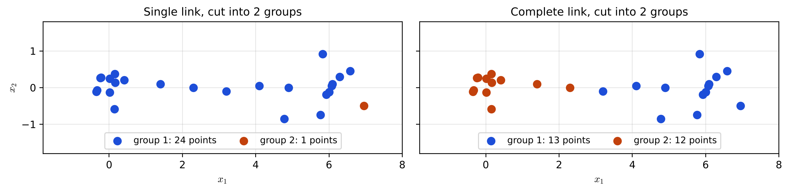
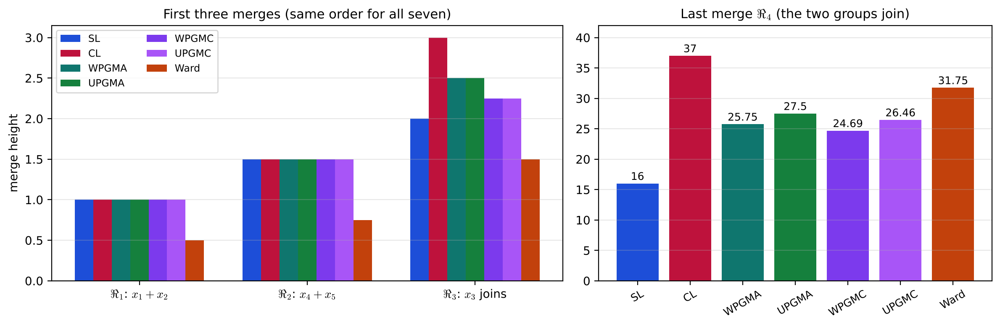

# Lecture 14 · KP04：連結法：叢集之間的距離怎麼算（Linkage: how to measure the distance between clusters）

> 程度：研究生（grad）／Level: Graduate (grad)
>
> 第 14 週（2026-12-07）｜Clustering (1) – $k$-means & Hierarchical Clustering · KP04
>
> Week 14 (2026-12-07) | Clustering (1) – $k$-means & Hierarchical Clustering · KP04

## 學習目標（Learning objectives）

- 說出矩陣更新方案 MUAS 每一步怎麼改寫相異度矩陣，並寫出 Lance–Williams 遞迴公式（State how the matrix updating scheme MUAS rewrites the dissimilarity matrix at each step, and write the Lance–Williams recursion）。
- 由係數代入，算出單連、全連、WPGMA、UPGMA、WPGMC、UPGMC 的新距離（Plug in coefficients to compute the new distance for single link, complete link, WPGMA, UPGMA, WPGMC and UPGMC）。
- 解釋單連的鏈化效應與全連偏好緊密小團的原因，並說出各自適合的資料（Explain the chaining effect of single link and why complete link prefers compact groups, and say what data suit each）。
- 說出 Ward 法在最小化什麼，並讀懂七種方法在同一份資料上的合併高度（State what Ward's method minimizes and read the merge heights of seven methods on the same data）。

## KP04：連結法：叢集之間的距離怎麼算（Linkage: how to measure the distance between clusters）

**一句話重點**：凝聚法每併一次，就要算出新叢集到其他叢集的距離；Lance–Williams 公式只用三個舊距離與四個係數就能算出來，換不同係數就得到單連、全連、平均、重心與 Ward 等不同的連結法。

**One-sentence summary**: Each merge in an agglomerative method needs the distance from the new cluster to every other cluster; the Lance–Williams formula computes it from three old distances and four coefficients, and different coefficients give single link, complete link, average, centroid, Ward and other linkages.

### 1. 接住上一講的問題（Picking up the question）

上一講的 GAS 每一步都要比較「叢集與叢集」的距離。
一開始每群只有一個點，距離就是點距。
併過之後，一個叢集裡有好幾個點，這時兩群之間的距離該怎麼定義？

The GAS of the last lecture compares "cluster to cluster" distances at every step.
At first each group has one point, so the distance is the point distance.
After merging, a cluster holds several points; how should the distance between two groups be defined then?

**白話說明**：想像兩個村莊要決定彼此有多遠。
可以量「兩村最近的兩戶人家」，也可以量「最遠的兩戶」，或「所有住戶兩兩距離的平均」，或「兩村中心點的距離」。
每一種量法都說得通，但會讓「下一個先合併的村莊」不一樣。
這個比喻只說明有很多種量法，沒說明每種量法會造出什麼形狀的叢集。

**Plain explanation**: Imagine two villages deciding how far apart they are.
You could measure "the two closest households", "the two farthest households", "the average over all pairs of households", or "the distance between the two village centers".
Each choice makes sense, but each changes "which villages merge next".
This analogy only shows that there are many ways to measure; it does not say what cluster shapes each produces.

**先備自測**：確認你記得上一講的接近矩陣與 GAS 的步驟。
不熟的話，回到 KP03 複習。

**Prerequisite check**: Make sure you remember the proximity matrix and the GAS steps of the last lecture.
If not, review KP03.

- 接近矩陣的第 $(i,j)$ 格是兩點的相異度（Entry $(i,j)$ of the proximity matrix is the dissimilarity of two points）。
- GAS 每一步併掉最接近的一對叢集（GAS merges the closest pair of clusters at each step）。
- 均值是一群點的重心（The mean is the centroid of a set of points）。

### 2. 矩陣更新與 Lance–Williams 公式（Matrix updating and the Lance–Williams formula）

**正式定義**：**矩陣更新方案** MUAS（Matrix Updating Algorithmic Scheme）是 GAS 的矩陣版。
輸入是 $N\times N$ 的相異度矩陣 $P_0$。
第 $t$ 層把 $C_i$、$C_j$ 併成 $C_q=C_i\cup C_j$ 之後，矩陣做兩件事：
刪掉 $C_i$、$C_j$ 對應的兩列兩行；再加一列一行，填入 $C_q$ 到其他叢集 $C_s$ 的距離。
於是 $P_t$ 是 $(N-t)\times(N-t)$。

**Formal definition**: The **matrix updating algorithmic scheme** MUAS is the matrix version of GAS.
Its input is the $N\times N$ dissimilarity matrix $P_0$.
After level $t$ merges $C_i$ and $C_j$ into $C_q=C_i\cup C_j$, the matrix does two things:
it deletes the two rows and columns of $C_i$ and $C_j$, then adds one row and column holding the distances from $C_q$ to every other cluster $C_s$.
So $P_t$ is $(N-t)\times(N-t)$.

新距離只依賴三個舊距離：

The new distance depends only on three old distances:

$$
d(C_q,C_s)=f\bigl(d(C_i,C_s),\,d(C_j,C_s),\,d(C_i,C_j)\bigr)\tag{13.2}
$$

Lance 與 Williams（1967）發現，許多常用定義都能寫成同一個遞迴式：

Lance and Williams (1967) found that many common definitions fit one recursion:

$$
d(C_q,C_s)=a_i\,d(C_i,C_s)+a_j\,d(C_j,C_s)+b\,d(C_i,C_j)+c\,\bigl\lvert d(C_i,C_s)-d(C_j,C_s)\bigr\rvert\tag{13.3}
$$

好處是：不必每次合併都回到原始的 $N$ 個點重算，只要改矩陣裡受影響的那一列。

The benefit is that you need not go back to the original $N$ points after each merge; you only rewrite the affected row of the matrix.

| 符號 | 中文意義 | English meaning |
|---|---|---|
| $C_q$ | 由 $C_i$、$C_j$ 合併的新叢集 | New cluster merged from $C_i$ and $C_j$ |
| $C_s$ | 其他任一舊叢集 | Any other old cluster |
| $d_{is},d_{js},d_{ij}$ | 三個舊距離 | The three old distances |
| $a_i,a_j,b,c$ | 決定連結法的四個係數 | The four coefficients that set the linkage |
| $n_i,n_j,n_s$ | 三個叢集的點數 | Numbers of points in the three clusters |

**例子** `[補充]`：設 $d_{is}=3$、$d_{js}=5$、$d_{ij}=2$，三群都只有一個點。

**Example** `[Added]`: Let $d_{is}=3$, $d_{js}=5$ and $d_{ij}=2$, with one point in each group.

| 連結法 | $a_i$ | $a_j$ | $b$ | $c$ | 新距離 $d_{qs}$ |
|---|---|---|---|---|---|
| 單連 | $1/2$ | $1/2$ | $0$ | $-1/2$ | $1.5+2.5-1=3$ |
| 全連 | $1/2$ | $1/2$ | $0$ | $1/2$ | $1.5+2.5+1=5$ |
| WPGMA | $1/2$ | $1/2$ | $0$ | $0$ | $4$ |
| WPGMC | $1/2$ | $1/2$ | $-1/4$ | $0$ | $4-0.5=3.5$ |

單連的係數讓公式變成 $\min\{d_{is},d_{js}\}$，全連變成 $\max\{d_{is},d_{js}\}$。
這是因為 $\tfrac12(a+b)-\tfrac12\lvert a-b\rvert=\min(a,b)$，換成加號就是最大值。

The single-link coefficients turn the formula into $\min\{d_{is},d_{js}\}$, and complete link into $\max\{d_{is},d_{js}\}$.
This is because $\tfrac12(a+b)-\tfrac12\lvert a-b\rvert=\min(a,b)$, and with a plus sign it becomes the maximum.

### 3. 兩個極端：單連與全連（Two extremes: single link and complete link）

**單連**取兩群之間最近那一對的距離：

**Single link** takes the distance of the closest pair across the two groups:

$$
d(C_q,C_s)=\min\{d(C_i,C_s),\,d(C_j,C_s)\}\tag{13.4}
$$

**全連**取最遠那一對的距離：

**Complete link** takes the distance of the farthest pair:

$$
d(C_q,C_s)=\max\{d(C_i,C_s),\,d(C_j,C_s)\}\tag{13.5}
$$

若用的是相似度而不是相異度，單連改取最大值，全連改取最小值。

If a similarity is used instead of a dissimilarity, single link takes the maximum and complete link the minimum.

**鏈化效應**：單連只要兩群有任何一對點夠近，就把它們併起來。
於是一串彼此相鄰的點，會像鏈條一樣一路被串成一個大群。
這叫 chaining effect。
全連則要兩群「所有點都夠近」才併，所以偏好小而緊的叢集，叢集在較高的相異度才形成。

**Chaining effect**: Single link merges two groups as soon as any pair of their points is close enough.
So a string of neighbouring points is strung into one big group like a chain.
This is called the chaining effect.
Complete link merges two groups only when "all their points are close enough", so it prefers small, tight clusters, which form at higher dissimilarity levels.

來源的例 13.2 用七個點排成細長的一串，另四個點擠成緊密的一團。
單連的樹狀圖先把細長那串找回來，全連則先找回緊密的小團。

Example 13.2 of the source has seven points in a long thin string and four points packed into a tight group.
The single-link dendrogram recovers the long string first, while complete link recovers the tight group first.

`[補充]` 再看一個更極端的情形：兩團各 $10$ 點，中間有 $5$ 個點排成一座「橋」，點和點相隔約 $1$。
切成兩群時，單連的結果是 $24$ 點對 $1$ 點：整座橋把兩團串成一群，只剩邊上一個點落單。
全連的結果是 $13$ 點對 $12$ 點，兩團被分開，橋從中間斷開。

`[Added]` Now a more extreme case: two groups of $10$ points each, with a "bridge" of $5$ points about $1$ apart between them.
Cut into two groups, single link gives $24$ points versus $1$: the bridge strings both groups into one, leaving one edge point alone.
Complete link gives $13$ points versus $12$: the two groups are separated, and the bridge breaks in the middle.



**圖說 `lec14-kp04-linkage-f1-chaining`**：先看左圖，單連把兩團連同橋全塗成藍色，只有右下一個點是橘色。
再看右圖，全連把左團與橋的左半塗成橘色，右團與橋的右半是藍色。
注意兩圖的點完全相同，差別只在叢集距離的定義。〔功能：1、3〕

**Caption `lec14-kp04-linkage-f1-chaining`**: Look first at the left panel: single link colours both groups and the bridge blue, and only one point at the lower right is orange.
Then look at the right panel: complete link colours the left group and the left half of the bridge orange, and the right group and right half blue.
Note that the points are identical; only the definition of cluster distance differs. [Function: 1, 3]

**常見迷思**：「單連一定比較差，因為它會鏈化。」
不對。
如果資料真的是細長、逐點相連的結構，例如一條河道上的觀測站，單連正好能把它找回來。
沒有哪一種連結法永遠最好，要看資料的形狀。

**Common misconception**: "Single link is always worse because it chains."
That is wrong.
If the data really have a long, point-by-point connected structure, such as observation stations along a river, single link is exactly what recovers it.
No linkage is always best; it depends on the shape of the data.

### 4. 介於兩極端之間：平均、重心與 Ward（Between the extremes: average, centroid and Ward）

單連與全連是式 $(13.3)$ 的兩個極端。
其他五種是折衷，差別在兩件事：要不要依群的大小加權，以及平均的是「群與群的距離」還是「重心」。

Single and complete link are the two extremes of Eq. $(13.3)$.
Five other methods are compromises, differing in two things: whether to weight by group size, and whether they average "group-to-group distances" or "centroids".

- **WPGMA**（加權配對群平均法）：$a_i=a_j=\tfrac12$、$b=c=0$，新距離是兩條舊距離的平均，式 $(13.6)$（**WPGMA**: $a_i=a_j=\tfrac12$, $b=c=0$; the new distance averages the two old ones, Eq. $(13.6)$）。
- **UPGMA**（不加權配對群平均法）：$a_i=\frac{n_i}{n_i+n_j}$、$a_j=\frac{n_j}{n_i+n_j}$、$b=c=0$，大群的影響比較大，式 $(13.7)$（**UPGMA**: $a_i=\frac{n_i}{n_i+n_j}$, $a_j=\frac{n_j}{n_i+n_j}$, $b=c=0$; larger groups weigh more, Eq. $(13.7)$）。
- **UPGMC**（不加權配對群重心法）：在 UPGMA 的係數上加 $b=-\frac{n_in_j}{(n_i+n_j)^2}$，式 $(13.8)$（**UPGMC**: the UPGMA coefficients plus $b=-\frac{n_in_j}{(n_i+n_j)^2}$, Eq. $(13.8)$）。
- **WPGMC**（加權配對群重心法）：$a_i=a_j=\tfrac12$、$b=-\tfrac14$、$c=0$，式 $(13.11)$（**WPGMC**: $a_i=a_j=\tfrac12$, $b=-\tfrac14$, $c=0$, Eq. $(13.11)$）。
- **Ward**（最小變異法）：每次併「合併後群內變異增加最少」的一對（**Ward**: each step merges the pair whose merge increases the within-group variance the least）。

名稱的記法：weighted 開頭的 WPGMA、WPGMC，兩個子群各給 $\tfrac12$；unweighted 開頭的 UPGMA、UPGMC，依點數 $n_i$、$n_j$ 加權。
名稱以 average 結尾的是平均距離，以 centroid 結尾的是重心距離。
若相異度取平方歐氏距離、代表取重心，UPGMC 的 $d_{qs}$ 正好是兩群重心的平方距離：

How to remember the names: the weighted methods WPGMA and WPGMC give each subgroup $\tfrac12$; the unweighted methods UPGMA and UPGMC weight by the point counts $n_i$ and $n_j$.
Names ending in average use the average distance, and names ending in centroid use the centroid distance.
With the squared Euclidean distance and centroid representatives, the $d_{qs}$ of UPGMC is exactly the squared distance between the two centroids:

$$
d_{qs}=\lVert\mathbf{m}_q-\mathbf{m}_s\rVert^{2}\tag{13.10}
$$

WPGMC 有一個要記住的怪現象：新距離有時比兩條舊距離都小，$d_{qs}\le\min(d_{is},d_{js})$。
這會讓樹狀圖出現「後併的反而比較低」，下一講再談。

WPGMC has an odd behaviour worth remembering: the new distance can be smaller than both old ones, $d_{qs}\le\min(d_{is},d_{js})$.
This can make a dendrogram show "a later merge lower than an earlier one", which the next lecture discusses.

**Ward 的距離**是重心平方距離的加權版：

**Ward's distance** is a weighted version of the squared centroid distance:

$$
d'_{ij}=\frac{n_in_j}{n_i+n_j}\,\lVert\mathbf{m}_i-\mathbf{m}_j\rVert^{2}\tag{13.12}
$$

令 $e_r^2=\sum_{\mathbf{x}\in C_r}\lVert\mathbf{x}-\mathbf{m}_r\rVert^2$ 是第 $r$ 群的群內變異。
把 $C_i$、$C_j$ 併成 $C_q$，總變異增加 $e_q^2-e_i^2-e_j^2$，推導後正好等於 $d'_{ij}$。
所以 Ward 每一步選 $d'_{ij}$ 最小的一對，就是選「讓總變異增加最少」的一對。
`[補充]` 兩個相距平方距離 $1$ 的單點合併時，$d'=\tfrac{1\times1}{2}\times1=0.5$，這說明為什麼 Ward 的高度約是其他方法的一半。

Let $e_r^2=\sum_{\mathbf{x}\in C_r}\lVert\mathbf{x}-\mathbf{m}_r\rVert^2$ be the within-group variance of group $r$.
Merging $C_i$ and $C_j$ into $C_q$ raises the total variance by $e_q^2-e_i^2-e_j^2$, which works out to exactly $d'_{ij}$.
So choosing the pair with the smallest $d'_{ij}$ means choosing the pair that "raises the total variance the least".
`[Added]` When two single points at squared distance $1$ merge, $d'=\tfrac{1\times1}{2}\times1=0.5$, which explains why Ward's heights are about half of the others'.

**例子**：來源的例 13.3 有五個向量：$\mathbf{x}_1$、$\mathbf{x}_2$、$\mathbf{x}_3$ 彼此很近，$\mathbf{x}_4$、$\mathbf{x}_5$ 彼此很近，兩團相距很遠。
`[補充]` 我們依來源表 13.1 反推出一個平方歐氏相異度矩陣，並驗證它能重現表上全部數字：

**Example**: Example 13.3 of the source has five vectors: $\mathbf{x}_1$, $\mathbf{x}_2$ and $\mathbf{x}_3$ are close to each other, $\mathbf{x}_4$ and $\mathbf{x}_5$ are close to each other, and the two groups are far apart.
`[Added]` We reconstructed a squared-Euclidean dissimilarity matrix from Table 13.1 of the source and checked that it reproduces every number in the table:

$$
P_0=\begin{bmatrix}0&1&2&26&37\\1&0&3&25&36\\2&3&0&16&25\\26&25&16&0&1.5\\37&36&25&1.5&0\end{bmatrix}
$$

七種方法的合併順序都相同，只有高度不同（Ward 從 $\tfrac12P_0$ 起算）：

All seven methods merge in the same order and differ only in the heights (Ward starts from $\tfrac12P_0$):

| 方法 | $\Re_1$：$\mathbf{x}_1,\mathbf{x}_2$ | $\Re_2$：$\mathbf{x}_4,\mathbf{x}_5$ | $\Re_3$：$\mathbf{x}_3$ 加入 | $\Re_4$：全部 |
|---|---|---|---|---|
| 單連 | $1$ | $1.5$ | $2$ | $16$ |
| 全連 | $1$ | $1.5$ | $3$ | $37$ |
| WPGMA | $1$ | $1.5$ | $2.5$ | $25.75$ |
| UPGMA | $1$ | $1.5$ | $2.5$ | $27.5$ |
| WPGMC | $1$ | $1.5$ | $2.25$ | $24.69$ |
| UPGMC | $1$ | $1.5$ | $2.25$ | $26.46$ |
| Ward | $0.5$ | $0.75$ | $1.5$ | $31.75$ |

讀表的方法：看 $\Re_3$ 那一欄。
$\mathbf{x}_3$ 到 $\mathbf{x}_1$ 是 $2$、到 $\mathbf{x}_2$ 是 $3$。
單連取 $2$，全連取 $3$，兩種平均法取 $2.5$，重心法再減掉一點變成 $2.25$。

How to read the table: look at the $\Re_3$ column.
$\mathbf{x}_3$ is at $2$ from $\mathbf{x}_1$ and $3$ from $\mathbf{x}_2$.
Single link takes $2$, complete link $3$, the two average methods $2.5$, and the centroid methods subtract a little more to get $2.25$.



**圖說 `lec14-kp04-linkage-f2-seven-methods`**：先看左圖，前三次合併的順序七種方法都一樣，只有高度不同；橘色的 Ward 每一格都最矮。
再看右圖最後一次合併，藍色的單連只有 $16$，紅色的全連高到 $37$，其他方法在中間。
注意結構相同時，連結法只改變「樹有多高」，這份資料兩團分得很開，所以七種方法都分得對。〔功能：1、2〕

**Caption `lec14-kp04-linkage-f2-seven-methods`**: Look first at the left panel: the first three merges happen in the same order for all seven methods, differing only in height, and the orange Ward bars are always the lowest.
Then look at the last merge on the right: blue single link is only $16$, red complete link reaches $37$, and the others lie between.
Note that when the structure is the same, the linkage only changes "how tall the tree is"; the two groups here are far apart, so all seven methods split them correctly. [Function: 1, 2]

**失效情形**：例 13.3 這種「兩團分得很開」的資料，幾乎所有方法都分得對；方法的個性要在刁鑽的資料上才看得出來，像上面那座橋。
另外，UPGMA、UPGMC、Ward 的係數依群大小而變，每次合併後都要用新的 $n_i$、$n_j$ 重算；單連、全連、WPGMA、WPGMC 的係數則固定不變。

**Failure cases**: On data like Example 13.3, where the two groups are far apart, almost every method splits correctly; the character of a method only shows on tricky data such as the bridge above.
Also, the coefficients of UPGMA, UPGMC and Ward depend on group sizes and must be recomputed with the new $n_i$ and $n_j$ after each merge, whereas those of single link, complete link, WPGMA and WPGMC stay fixed.

### 5. 與實作的連結（Connection to implementation）

下面的程式只做 Lance–Williams 更新這一步，可以代入任意係數。
注意 UPGMA 的係數要用兩個子群的點數。

The code below performs only the Lance–Williams update and accepts any coefficients.
Note that the UPGMA coefficients use the point counts of the two subgroups.

```python
def lance_williams(d_is, d_js, d_ij, method, n_i=1, n_j=1):
    """回傳新叢集 C_q 到 C_s 的距離（式 13.3）。"""
    coef = {
        "single":   (0.5, 0.5, 0.0, -0.5),
        "complete": (0.5, 0.5, 0.0, 0.5),
        "wpgma":    (0.5, 0.5, 0.0, 0.0),
        "upgma":    (n_i / (n_i + n_j), n_j / (n_i + n_j), 0.0, 0.0),
        "wpgmc":    (0.5, 0.5, -0.25, 0.0),
    }
    a_i, a_j, b, c = coef[method]
    return a_i * d_is + a_j * d_js + b * d_ij + c * abs(d_is - d_js)

for m in ["single", "complete", "wpgma", "upgma", "wpgmc"]:
    print(m, lance_williams(3, 5, 2, m))      # 3.0、5.0、4.0、4.0、3.5
print(lance_williams(2, 3, 1, "upgma", n_i=2, n_j=1))   # 合併大小不同的群 / unequal sizes: 2.333...
```

**留給下一節的問題**：WPGMC 的新距離可能比舊距離還小。
這會讓樹狀圖「後併的反而比較低」嗎？什麼樣的連結法保證不會？
另外，單連與全連還能用圖論的方式來看，下一講一併說明。

**The question for the next section**: The new distance of WPGMC can be smaller than the old ones.
Does that make a dendrogram show "a later merge lower than an earlier one"? Which linkages guarantee it never happens?
Single and complete link can also be seen through graph theory, which the next lecture explains as well.

### 6. 小練習與解題示範（Practice and worked solutions）

**小練習** `[補充]`：先寫下理由，再看解答。

**Practice** `[Added]`: Write your reasoning before reading the solutions.

1. 題 1：$d_{is}=4$、$d_{js}=6$、$d_{ij}=2$，各群一點。求單連、全連、WPGMA、WPGMC 的新距離（With $d_{is}=4$, $d_{js}=6$, $d_{ij}=2$ and one point per group, find the new distance for single link, complete link, WPGMA and WPGMC）。
2. 題 2：$C_i$ 有 $3$ 點、$C_j$ 有 $1$ 點，$d_{is}=2$、$d_{js}=6$。求 UPGMA 的新距離（$C_i$ has $3$ points and $C_j$ has $1$, with $d_{is}=2$ and $d_{js}=6$. Find the UPGMA distance）。
3. 題 3：兩群各 $2$ 點，重心相距平方距離 $4$。合併的 Ward 距離是多少（Two groups of $2$ points each have centroids at squared distance $4$. What is the Ward distance of the merge）？

**題 1 解題示範**：單連 $\min(4,6)=4$；全連 $\max(4,6)=6$；WPGMA $(4+6)/2=5$；WPGMC $5-\tfrac14\times2=4.5$。

**Question 1 worked solution**: Single link $\min(4,6)=4$; complete link $\max(4,6)=6$; WPGMA $(4+6)/2=5$; WPGMC $5-\tfrac14\times2=4.5$.

**題 2 解題示範**：$a_i=3/4$、$a_j=1/4$，新距離 $=0.75\times2+0.25\times6=1.5+1.5=3$。
WPGMA 會給 $4$；UPGMA 比較小，因為大群 $C_i$ 離 $C_s$ 較近，它的權重較大。

**Question 2 worked solution**: $a_i=3/4$ and $a_j=1/4$, so the new distance is $0.75\times2+0.25\times6=1.5+1.5=3$.
WPGMA would give $4$; UPGMA is smaller because the larger group $C_i$ is closer to $C_s$ and weighs more.

**題 3 解題示範**：$d'=\frac{2\times2}{2+2}\times4=1\times4=4$，也就是合併後總群內變異增加 $4$。

**Question 3 worked solution**: $d'=\frac{2\times2}{2+2}\times4=1\times4=4$, so the merge raises the total within-group variance by $4$.

## 術語表（Glossary）

| 中文術語 | English term |
|---|---|
| 連結法 | Linkage |
| 矩陣更新方案 | Matrix updating algorithmic scheme (MUAS) |
| Lance–Williams 公式 | Lance–Williams formula |
| 單連 | Single link |
| 全連 | Complete link |
| 鏈化效應 | Chaining effect |
| 加權配對群平均法 | Weighted pair group method average (WPGMA) |
| 不加權配對群平均法 | Unweighted pair group method average (UPGMA) |
| 不加權配對群重心法 | Unweighted pair group method centroid (UPGMC) |
| 加權配對群重心法 | Weighted pair group method centroid (WPGMC) |
| 最小變異法 | Ward's minimum variance method |
| 重心 | Centroid |
| 群內變異 | Within-group variance |

## 銜接與來源（Connections and sources）

下一講談樹狀圖的單調性與 crossover，並從圖論角度重看單連與全連，包括最小生成樹分群。

The next lecture discusses monotonicity and crossover in dendrograms, and revisits single and complete link through graph theory, including minimum-spanning-tree clustering.

- 前一單元：[KP03 階層分群與樹狀圖](lec14-kp03-hierarchical-gas.md)（Previous unit: hierarchical clustering and the dendrogram）。
- 下一單元：[KP05 單調性與圖論方法](lec14-kp05-monotonicity-graph.md)（Next unit: monotonicity and graph methods）。
- 來源：[Hierarchical Clustering §13.2.2](https://ndhuccc.github.io/CCC-LNS/PR_115/Ch13-hierarchical-clustering/index.html)，讀取日期 2026-11-13（Source accessed 2026-11-13）。
- 書目：Theodoridis and Koutroumbas, *Pattern Recognition*, 4th ed., 2008；見[參考資料](../references/README.md)（See the bibliography）。

本講以自己的文字解釋來源。
MUAS 的兩步更新、式 (13.2)(13.3)、單連與全連的係數與公式、相似度的對調、鏈化效應與例 13.2、五種折衷法的係數與公式、命名規則、WPGMC 的怪現象、Ward 的距離與變異增量、例 13.3 的七種方法高度（表 13.1）取自來源。
村莊比喻、手算例、兩團加橋的資料與結果、常見迷思、依表 13.1 反推的 $P_0$、Ward 一半高度的說明、程式、圖與練習皆為 `[補充]`。

This lecture independently explains the source.
The two-step update of MUAS, Eqs. (13.2) and (13.3), the coefficients and formulas of single and complete link, the swap for similarities, the chaining effect and Example 13.2, the coefficients and formulas of the five compromise methods, the naming rule, the odd behaviour of WPGMC, Ward's distance and the variance increase, and the heights of the seven methods in Example 13.3 (Table 13.1) come from the source.
The village analogy, the hand example, the two-groups-and-bridge data and results, the common misconception, the $P_0$ reconstructed from Table 13.1, the explanation of Ward's halved heights, the code, the figures and the practice are `[Added]`.
