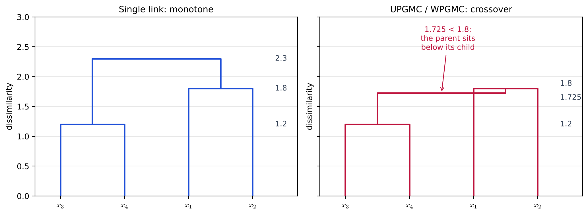
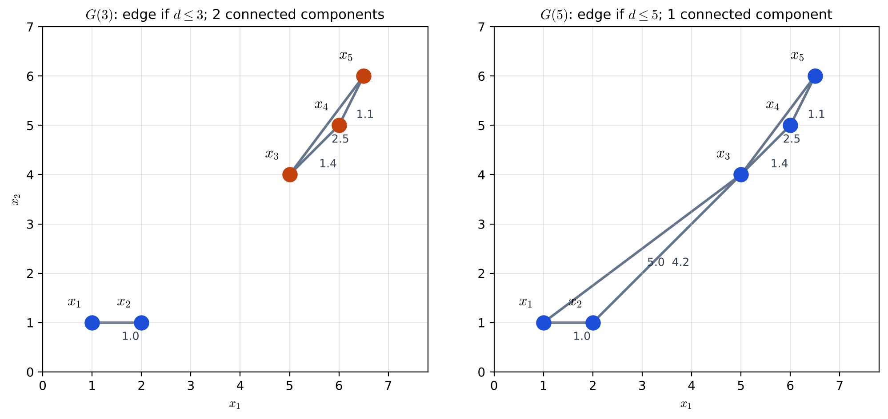
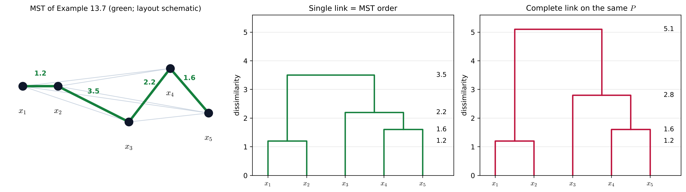

# Lecture 14 · KP05：單調性與圖論方法：從門檻圖到最小生成樹（Monotonicity and graph methods: from threshold graphs to minimum spanning trees）

> 程度：研究生（grad）／Level: Graduate (grad)
>
> 第 14 週（2026-12-07）｜Clustering (1) – $k$-means & Hierarchical Clustering · KP05
>
> Week 14 (2026-12-07) | Clustering (1) – $k$-means & Hierarchical Clustering · KP05

## 學習目標（Learning objectives）

- 說出單調性與 crossover 的定義，並在一個四點例子上算出重心法的 crossover（State the definitions of monotonicity and crossover, and compute the crossover of a centroid method on a four-point example）。
- 用 Lance–Williams 係數判斷一種連結法是否保證單調（Use the Lance–Williams coefficients to decide whether a linkage is guaranteed to be monotone）。
- 由相異度矩陣畫出門檻圖，並說出單連與全連在圖論裡各要求什麼（Draw threshold graphs from a dissimilarity matrix and state what single and complete link require in graph terms）。
- 用 Kruskal 演算法求最小生成樹，說明它為什麼等於單連，以及怎麼剪邊切群（Find a minimum spanning tree with Kruskal's algorithm, explain why it equals single link, and cut edges to form groups）。

## KP05：單調性與圖論方法：從門檻圖到最小生成樹（Monotonicity and graph methods: from threshold graphs to minimum spanning trees）

**一句話重點**：好的樹狀圖應該越往上合併的高度越高，這叫單調性，重心法不保證；把相異度門檻畫成圖之後，單連就是「連通」、全連就是「完全」，而單連的階層可以直接由最小生成樹讀出。

**One-sentence summary**: A good dendrogram should merge at increasing heights as it goes up, which is called monotonicity and is not guaranteed by centroid methods; once a dissimilarity threshold is drawn as a graph, single link means "connected" and complete link means "complete", and the single-link hierarchy can be read directly from a minimum spanning tree.

### 1. 接住上一講的問題（Picking up the question）

上一講提到 WPGMC 的新距離可能比兩條舊距離都小。
樹狀圖的縱軸是「要隔多遠才願意合併」。
如果新距離變小，後面併起來的大群，就可能畫得比它的子群還低。

The last lecture noted that the new distance of WPGMC can be smaller than both old ones.
The vertical axis of a dendrogram is "how far apart groups must be before they merge".
If the new distance shrinks, a big group merged later may be drawn lower than one of its subgroups.

**白話說明**：想像公司的組織圖。
部門經理應該比組長資深，總經理又比部門經理資深。
如果圖上總經理畫在組長下面，這張圖就很難解讀。
這個比喻只說明「越往上應該越高」，沒說明哪些連結法會破壞這個順序。

**Plain explanation**: Picture a company's org chart.
A department manager should be more senior than a team lead, and the general manager more senior still.
If the chart draws the general manager below a team lead, it becomes hard to read.
This analogy only shows "higher levels should be higher"; it does not say which linkages break this order.

**先備自測**：確認你記得上一講的 Lance–Williams 公式與單連、全連的定義。
不熟的話，回到 KP04 複習。

**Prerequisite check**: Make sure you remember the Lance–Williams formula and the definitions of single and complete link from the last lecture.
If not, review KP04.

- 單連取兩群之間最近的一對，全連取最遠的一對（Single link takes the closest cross pair; complete link the farthest）。
- UPGMC 的公式含一個減項 $-\frac{n_in_j}{(n_i+n_j)^2}d_{ij}$（The UPGMC formula contains a negative term $-\frac{n_in_j}{(n_i+n_j)^2}d_{ij}$）。
- 圖由節點與邊組成（A graph consists of nodes and edges）。

### 2. 單調性與 crossover（Monotonicity and crossover）

**正式定義**：若某個叢集在比它的任何一個子群都低的相異度層級形成，就叫 **crossover**。
**單調性**是 crossover 的反面：第 $t$ 層把 $C_i$、$C_j$ 併成 $C_q$ 之後，對其他每個叢集 $C_k$ 都要有

**Formal definition**: If a cluster forms at a lower dissimilarity level than one of its subgroups, this is called **crossover**.
**Monotonicity** is the opposite of crossover: after level $t$ merges $C_i$ and $C_j$ into $C_q$, every other cluster $C_k$ must satisfy

$$
d(C_q,C_k)\ge d(C_i,C_j)
$$

白話：新併好的群，跟外面任何舊群的距離，不能比「當初決定併它們的那個距離」還小。
單調性是演算法的性質，和輸入的相異度矩陣長什麼樣無關。

In plain words: the new group's distance to any outside group must not be smaller than "the distance at which it was formed".
Monotonicity is a property of the algorithm, independent of what the input dissimilarity matrix looks like.

**例子**：來源用一個 $4\times4$ 相異度矩陣示範：

**Example**: The source demonstrates with a $4\times4$ dissimilarity matrix:

$$
P=\begin{bmatrix}0&1.8&2.4&2.3\\1.8&0&2.5&2.7\\2.4&2.5&0&1.2\\2.3&2.7&1.2&0\end{bmatrix}
$$

四種方法的前兩步都一樣：先在 $1.2$ 併 $\mathbf{x}_3$、$\mathbf{x}_4$，再在 $1.8$ 併 $\mathbf{x}_1$、$\mathbf{x}_2$。
差別在最後一步。
單連取 $2.3$，全連取 $2.7$，都比 $1.8$ 高，樹是單調的。

All four methods share the first two steps: first merge $\mathbf{x}_3$ and $\mathbf{x}_4$ at $1.2$, then $\mathbf{x}_1$ and $\mathbf{x}_2$ at $1.8$.
The difference is the last step.
Single link gives $2.3$ and complete link $2.7$, both above $1.8$, so the tree is monotone.

`[補充]` UPGMC 一步步算（各群點數相同時，它和 WPGMC 的係數一樣）：
併 $\{\mathbf{x}_3,\mathbf{x}_4\}$ 之後，它到 $\mathbf{x}_1$ 的距離是 $\tfrac12(2.4)+\tfrac12(2.3)-\tfrac14(1.2)=2.05$，到 $\mathbf{x}_2$ 是 $\tfrac12(2.5)+\tfrac12(2.7)-0.3=2.3$。
這時最小的是 $d_{12}=1.8$，所以先併 $\{\mathbf{x}_1,\mathbf{x}_2\}$。
最後兩群的距離是 $\tfrac12(2.05)+\tfrac12(2.3)-\tfrac14(1.8)=1.725$。
$1.725<1.8$：四點大群畫得比子群 $\{\mathbf{x}_1,\mathbf{x}_2\}$ 還低，這就是 crossover。

`[Added]` UPGMC step by step (with equal group sizes its coefficients match WPGMC):
After merging $\{\mathbf{x}_3,\mathbf{x}_4\}$, its distance to $\mathbf{x}_1$ is $\tfrac12(2.4)+\tfrac12(2.3)-\tfrac14(1.2)=2.05$, and to $\mathbf{x}_2$ is $\tfrac12(2.5)+\tfrac12(2.7)-0.3=2.3$.
The smallest is now $d_{12}=1.8$, so $\{\mathbf{x}_1,\mathbf{x}_2\}$ merges next.
The final distance between the two groups is $\tfrac12(2.05)+\tfrac12(2.3)-\tfrac14(1.8)=1.725$.
$1.725<1.8$: the four-point group is drawn lower than its subgroup $\{\mathbf{x}_1,\mathbf{x}_2\}$, which is crossover.



**圖說 `lec14-kp05-monotonicity-graph-f1-crossover`**：先看左圖，三條橫槓由下往上是 $1.2$、$1.8$、$2.3$，層層升高。
再看右圖，最上面那條橫槓在 $1.725$，反而比右邊子群的 $1.8$ 低，線條往下折回。
注意兩圖的前兩步完全一樣，差別只在最後一步的新距離。〔功能：1、2〕

**Caption `lec14-kp05-monotonicity-graph-f1-crossover`**: Look first at the left panel: the three bars rise from $1.2$ to $1.8$ to $2.3$.
Then look at the right panel: the top bar sits at $1.725$, lower than the $1.8$ of the right subgroup, so the line folds back down.
Note that the first two steps are identical; only the new distance of the last step differs. [Function: 1, 2]

**怎麼判斷一種連結法單調**：來源的命題 1 給了一個充分條件。
若式 $(13.3)$ 的係數滿足 $a_i\ge0$、$a_j\ge0$、$a_i+a_j+b\ge1$，而且 $c\ge0$ 或 $\max\{-a_i,-a_j\}\le c\le0$，演算法就保證單調。

**How to tell whether a linkage is monotone**: Proposition 1 of the source gives a sufficient condition.
If the coefficients of Eq. $(13.3)$ satisfy $a_i\ge0$, $a_j\ge0$, $a_i+a_j+b\ge1$, and either $c\ge0$ or $\max\{-a_i,-a_j\}\le c\le0$, the algorithm is guaranteed to be monotone.

- 保證單調：單連、全連、UPGMA、WPGMA、Ward（Guaranteed monotone: single link, complete link, UPGMA, WPGMA and Ward）。
- 不保證單調：UPGMC、WPGMC，因為 $b<0$ 使 $a_i+a_j+b<1$（Not guaranteed: UPGMC and WPGMC, because $b<0$ makes $a_i+a_j+b<1$）。

`[補充]` 單連的係數是 $a_i=a_j=\tfrac12$、$b=0$、$c=-\tfrac12$：$a_i+a_j+b=1$，而 $c=-\tfrac12$ 正好落在 $[\max\{-\tfrac12,-\tfrac12\},0]$ 裡，所以滿足條件。

`[Added]` Single link has $a_i=a_j=\tfrac12$, $b=0$ and $c=-\tfrac12$: $a_i+a_j+b=1$, and $c=-\tfrac12$ lies exactly in $[\max\{-\tfrac12,-\tfrac12\},0]$, so the condition holds.

**常見迷思**：「重心法會 crossover，所以不能用。」
不對。
命題 1 只是充分條件；不保證單調，不代表每次都會 crossover。
單調也不代表結果一定好，最後還是要看應用。

**Common misconception**: "Centroid methods cause crossover, so they must not be used."
That is wrong.
Proposition 1 is only a sufficient condition; not being guaranteed monotone does not mean crossover always happens.
Being monotone does not guarantee a good result either; it depends on the application.

### 3. 門檻圖：把距離變成邊（Threshold graphs: turning distances into edges）

除了矩陣，階層分群也能用圖來想。
先複習幾個名詞：圖中任兩點都有路徑可走，叫**連通**；任兩點都直接有邊，叫**完全**。
完全一定連通，連通不一定完全。

Besides matrices, hierarchical clustering can also be viewed through graphs.
First some terms: a graph in which every two nodes are joined by some path is **connected**; one in which every two nodes are joined directly by an edge is **complete**.
Complete implies connected, but connected does not imply complete.

**門檻圖**$G(a)$：每個資料點是一個節點，兩點的相異度不超過門檻 $a$ 才連一條邊：

**Threshold graph** $G(a)$: each data point is a node, and two points are joined by an edge only if their dissimilarity does not exceed the threshold $a$:

$$
(v_i,v_j)\in G(a)\quad\text{if}\quad d(\mathbf{x}_i,\mathbf{x}_j)\le a\tag{13.20}
$$

若邊上再標出相異度值，就叫**接近圖** $G_p(a)$。
門檻越小，邊越少、圖越碎；門檻越大，邊越多、越容易全部連在一起。

If the edges also carry the dissimilarity values, it is called a **proximity graph** $G_p(a)$.
A smaller threshold gives fewer edges and a more fragmented graph; a larger one gives more edges and makes everything easier to connect.

用 KP03 的例 13.1：$G(3)$ 只有四條邊，$\mathbf{x}_1$、$\mathbf{x}_2$ 一塊，$\mathbf{x}_3$、$\mathbf{x}_4$、$\mathbf{x}_5$ 一塊，共兩個連通分量。
門檻放寬到 $5$，$d(\mathbf{x}_2,\mathbf{x}_3)=4.2$ 與 $d(\mathbf{x}_1,\mathbf{x}_3)=5$ 也連上，五點全部連通。

With Example 13.1 of KP03: $G(3)$ has only four edges, with $\mathbf{x}_1,\mathbf{x}_2$ in one piece and $\mathbf{x}_3,\mathbf{x}_4,\mathbf{x}_5$ in another, two connected components in total.
Raising the threshold to $5$ also joins $d(\mathbf{x}_2,\mathbf{x}_3)=4.2$ and $d(\mathbf{x}_1,\mathbf{x}_3)=5$, and all five points become connected.



**圖說 `lec14-kp05-monotonicity-graph-f2-threshold-graphs`**：先看左圖 $G(3)$，只有距離不超過 $3$ 的四條邊，點分成藍、橘兩個連通分量。
再看右圖 $G(5)$，多了兩條跨越中間的長邊，五點全變成同一個藍色分量。
注意邊上的數字是兩點的歐氏距離，門檻一放寬，長邊才出現。〔功能：1、3〕

**Caption `lec14-kp05-monotonicity-graph-f2-threshold-graphs`**: Look first at the left panel $G(3)$: only the four edges no longer than $3$ appear, and the points form a blue and an orange component.
Then look at the right panel $G(5)$: two long edges across the middle appear, and all five points become one blue component.
Note that the numbers on the edges are Euclidean distances; the long edges only appear once the threshold is raised. [Function: 1, 3]

**圖論凝聚 GTAS**：把 GAS 改成圖的語言。
兩群能不能在門檻 $a$ 合併，看合併後的子圖在 $G(a)$ 裡滿不滿足某個性質：

**Graph-theoretic agglomeration GTAS**: rewrite GAS in the language of graphs.
Whether two groups can merge at threshold $a$ depends on whether the merged subgraph satisfies some property in $G(a)$:

- 單連只要求合併後**連通**，是最寬鬆的準則，結果和矩陣版單連相同（Single link only requires the merged subgraph to be **connected**, the loosest rule, and gives the same result as the matrix version）。
- 全連要求合併後**完全**，是最嚴格的準則，結果和矩陣版全連相同（Complete link requires the merged subgraph to be **complete**, the strictest rule, and gives the same result as the matrix version）。
- 介於中間的性質 $h(k)$，例如每個節點至少有 $k$ 條邊（節點度），或任兩點之間至少有 $k$ 條互不共用節點的路徑（節點連通度）；$k=1$ 時都退化成單連，$k$ 越大越接近完全（In between are properties $h(k)$, such as every node having at least $k$ edges (node degree), or every two nodes being joined by at least $k$ node-disjoint paths (node connectivity); with $k=1$ they all reduce to single link, and a larger $k$ is closer to complete）。

### 4. 最小生成樹：單連的另一種算法（Minimum spanning trees: another way to compute single link）

**生成樹**是包含所有節點、沒有迴圈的連通圖，任兩點之間只剩一條路。
邊有權重時，權重總和最小的那一棵叫**最小生成樹**（MST）。
邊權全都不同時，MST 是唯一的。
Kruskal 演算法由短到長加邊，跳過會形成迴圈的邊，就能求出 MST。

A **spanning tree** is a connected graph containing all nodes and no loop, so every two nodes are joined by exactly one path.
With weighted edges, the one with the smallest total weight is the **minimum spanning tree** (MST).
If all edge weights differ, the MST is unique.
Kruskal's algorithm adds edges from short to long, skipping any edge that would form a loop, and so finds the MST.

**為什麼等於單連**：單連每一步都在接「目前最近的兩團」，那條最短的跨群邊，正是 Kruskal 下一條會加進來的邊。
所以只要點距全都不同，「只留 MST 最短的 $t$ 條邊」時的連通分量，就是單連第 $t$ 層的叢集。
要切成 $m$ 群，就把 MST 最長的 $m-1$ 條邊剪掉。

**Why it equals single link**: Single link always joins "the two currently closest groups", and that shortest cross-group edge is exactly the next edge Kruskal adds.
So as long as all point distances differ, the connected components "keeping only the $t$ shortest MST edges" are the clusters of single link at level $t$.
To cut into $m$ groups, remove the $m-1$ longest edges of the MST.

**例子**：來源的例 13.7 給一個五點相異度矩陣，邊權都不相同：

**Example**: Example 13.7 of the source gives a five-point dissimilarity matrix with all edge weights distinct:

$$
P=\begin{bmatrix}0&1.2&4.0&4.6&5.1\\1.2&0&3.5&4.2&4.7\\4.0&3.5&0&2.2&2.8\\4.6&4.2&2.2&0&1.6\\5.1&4.7&2.8&1.6&0\end{bmatrix}
$$

由短到長加邊：$(\mathbf{x}_1,\mathbf{x}_2)=1.2$、$(\mathbf{x}_4,\mathbf{x}_5)=1.6$、$(\mathbf{x}_3,\mathbf{x}_4)=2.2$。
下一條 $(\mathbf{x}_3,\mathbf{x}_5)=2.8$ 會形成迴圈，跳過；再來是 $(\mathbf{x}_2,\mathbf{x}_3)=3.5$，加入後五點連通，MST 完成。
單連的合併高度正是 $1.2$、$1.6$、$2.2$、$3.5$。
剪掉最長的 $3.5$，得到 $\{\mathbf{x}_1,\mathbf{x}_2\}$ 與 $\{\mathbf{x}_3,\mathbf{x}_4,\mathbf{x}_5\}$ 兩群。

Add edges from short to long: $(\mathbf{x}_1,\mathbf{x}_2)=1.2$, $(\mathbf{x}_4,\mathbf{x}_5)=1.6$, $(\mathbf{x}_3,\mathbf{x}_4)=2.2$.
The next one, $(\mathbf{x}_3,\mathbf{x}_5)=2.8$, would form a loop and is skipped; then $(\mathbf{x}_2,\mathbf{x}_3)=3.5$ connects all five points and completes the MST.
The single-link merge heights are exactly $1.2$, $1.6$, $2.2$ and $3.5$.
Removing the longest edge, $3.5$, gives two groups, $\{\mathbf{x}_1,\mathbf{x}_2\}$ and $\{\mathbf{x}_3,\mathbf{x}_4,\mathbf{x}_5\}$.

`[補充]` 同一個矩陣用全連，高度是 $1.2$、$1.6$、$2.8$、$5.1$。
前兩步相同；第 3 步全連要等 $\mathbf{x}_3$ 到 $\mathbf{x}_5$ 的 $2.8$ 也到了才併，最後一步取兩群最遠的 $\mathbf{x}_1$、$\mathbf{x}_5$，也就是 $5.1$。

`[Added]` Complete link on the same matrix gives heights $1.2$, $1.6$, $2.8$ and $5.1$.
The first two steps are the same; at step 3 complete link waits until the $2.8$ from $\mathbf{x}_3$ to $\mathbf{x}_5$ is also reached, and the last step takes the farthest pair across the groups, $\mathbf{x}_1$ and $\mathbf{x}_5$, that is $5.1$.



**圖說 `lec14-kp05-monotonicity-graph-f3-mst`**：先看左圖，綠色粗線是 MST 的四條邊，灰色細線是沒被選進來的邊；點的位置只是示意。
再看中圖，單連的四個高度正是 MST 的四個邊權。
注意右圖的全連，後兩步高度比單連高，因為它要等最遠的那一對也夠近。〔功能：1、2〕

**Caption `lec14-kp05-monotonicity-graph-f3-mst`**: Look first at the left panel: the thick green lines are the four MST edges and the thin gray lines are the edges not selected; the node positions are only schematic.
Then look at the middle panel: the four single-link heights are exactly the four MST edge weights.
Note that in the right panel complete link merges higher in the last two steps, because it waits until the farthest pair is close enough too. [Function: 1, 2]

**失效情形**：MST 繼承了單連的鏈化效應：一串相鄰的點，剪最長邊時仍會被留在一起。
點距有相同值時，MST 可能不只一棵，階層也可能不唯一，這是下一講的主題。

**Failure cases**: The MST inherits the chaining effect of single link: a string of neighbouring points still stays together when the longest edges are cut.
When some point distances are equal, there may be more than one MST and the hierarchy may not be unique, which is the topic of the next lecture.

### 5. 與實作的連結（Connection to implementation）

下面的程式用 Kruskal 找 MST，再剪掉最長的邊切成兩群。
注意兩件事：邊依權重由小到大排序；用「找根」的方法判斷加邊會不會形成迴圈。

The code below finds the MST with Kruskal's algorithm and removes the longest edge to cut into two groups.
Note two points: the edges are sorted by weight in increasing order, and "finding the root" decides whether an edge would form a loop.

```python
import numpy as np

P = np.array([[0, 1.2, 4.0, 4.6, 5.1], [1.2, 0, 3.5, 4.2, 4.7], [4.0, 3.5, 0, 2.2, 2.8],
              [4.6, 4.2, 2.2, 0, 1.6], [5.1, 4.7, 2.8, 1.6, 0]])
N = len(P)
parent = list(range(N))
def root(x):
    while parent[x] != x:
        x = parent[x]
    return x

edges = sorted((P[i, j], i, j) for i in range(N) for j in range(i + 1, N))
mst = []
for w, i, j in edges:                       # 由短到長 / short to long
    if root(i) != root(j):                  # 不形成迴圈才加 / add only if no loop
        parent[root(i)] = root(j)
        mst.append((i + 1, j + 1, w))
print(mst)            # [(1, 2, 1.2), (4, 5, 1.6), (3, 4, 2.2), (2, 3, 3.5)]

keep = sorted(mst, key=lambda e: e[2])[:-1] # 剪掉最長的一條 / cut the longest edge
parent = list(range(N))
for i, j, w in keep:
    parent[root(i - 1)] = root(j - 1)
print([root(i) for i in range(N)])          # 兩群的標籤 / labels of the two groups
```

**留給下一節的問題**：如果相異度矩陣裡有兩個值一樣大，該先併哪一對？
單連和全連會不會因此得到不同的樹？
另外，怎麼量「一棵樹有多忠實地保留原本的距離」？
下一講用平手與共表型矩陣回答。

**The question for the next section**: If two entries of the dissimilarity matrix are equal, which pair should merge first?
Can single and complete link end up with different trees because of it?
And how can we measure "how faithfully a tree keeps the original distances"?
The next lecture answers with ties and the cophenetic matrix.

### 6. 小練習與解題示範（Practice and worked solutions）

**小練習** `[補充]`：先寫下理由，再看解答。

**Practice** `[Added]`: Write your reasoning before reading the solutions.

1. 題 1：WPGMA 的係數是 $a_i=a_j=\tfrac12$、$b=c=0$。它是否滿足命題 1（WPGMA has $a_i=a_j=\tfrac12$ and $b=c=0$. Does it satisfy Proposition 1）？
2. 題 2：例 13.7 的矩陣上，$G(2.5)$ 有幾個連通分量（For the matrix of Example 13.7, how many connected components does $G(2.5)$ have）？
3. 題 3：例 13.7 若要切成三群，該剪掉 MST 的哪兩條邊？三群是什麼（To cut Example 13.7 into three groups, which two MST edges should be removed, and what are the groups）？

**題 1 解題示範**：$a_i,a_j\ge0$；$a_i+a_j+b=1\ge1$；$c=0\ge0$。三個條件都成立，所以保證單調。

**Question 1 worked solution**: $a_i,a_j\ge0$; $a_i+a_j+b=1\ge1$; $c=0\ge0$. All three conditions hold, so it is guaranteed to be monotone.

**題 2 解題示範**：不超過 $2.5$ 的邊有 $1.2$、$1.6$、$2.2$ 三條，連起 $\{\mathbf{x}_1,\mathbf{x}_2\}$ 與 $\{\mathbf{x}_3,\mathbf{x}_4,\mathbf{x}_5\}$。共兩個連通分量。

**Question 2 worked solution**: The edges no longer than $2.5$ are $1.2$, $1.6$ and $2.2$, which join $\{\mathbf{x}_1,\mathbf{x}_2\}$ and $\{\mathbf{x}_3,\mathbf{x}_4,\mathbf{x}_5\}$. There are two connected components.

**題 3 解題示範**：剪掉最長的兩條 $3.5$ 與 $2.2$。
留下 $1.2$、$1.6$，三群是 $\{\mathbf{x}_1,\mathbf{x}_2\}$、$\{\mathbf{x}_3\}$、$\{\mathbf{x}_4,\mathbf{x}_5\}$。

**Question 3 worked solution**: Remove the two longest edges, $3.5$ and $2.2$.
Keeping $1.2$ and $1.6$, the three groups are $\{\mathbf{x}_1,\mathbf{x}_2\}$, $\{\mathbf{x}_3\}$ and $\{\mathbf{x}_4,\mathbf{x}_5\}$.

## 術語表（Glossary）

| 中文術語 | English term |
|---|---|
| 單調性 | Monotonicity |
| 交叉 | Crossover |
| 門檻圖 | Threshold graph |
| 接近圖 | Proximity graph |
| 連通 | Connected |
| 完全 | Complete |
| 連通分量 | Connected component |
| 圖論凝聚方案 | Graph theory-based algorithmic scheme (GTAS) |
| 節點度 | Node degree |
| 節點連通度 | Node connectivity |
| 生成樹 | Spanning tree |
| 最小生成樹 | Minimum spanning tree (MST) |
| 迴圈 | Loop |

## 銜接與來源（Connections and sources）

下一講處理相異度平手、共表型矩陣，以及從整團往下切的分裂法。

The next lecture handles ties in dissimilarity, the cophenetic matrix, and the divisive approach that splits from the whole set downward.

- 前一單元：[KP04 連結法與 Lance–Williams 公式](lec14-kp04-linkage.md)（Previous unit: linkage methods and the Lance–Williams formula）。
- 下一單元：[KP06 平手、共表型矩陣與分裂法](lec14-kp06-cophenetic-divisive.md)（Next unit: ties, the cophenetic matrix and divisive methods）。
- 來源：[Hierarchical Clustering §13.2.3、§13.2.5](https://ndhuccc.github.io/CCC-LNS/PR_115/Ch13-hierarchical-clustering/index.html)，讀取日期 2026-11-13（Source accessed 2026-11-13）。
- 書目：Theodoridis and Koutroumbas, *Pattern Recognition*, 4th ed., 2008；見[參考資料](../references/README.md)（See the bibliography）。

本講以自己的文字解釋來源。
crossover 與單調性的定義、$4\times4$ 示範矩陣與四種方法的結論、命題 1 的條件與各方法的歸類、門檻圖與接近圖、例 13.1 的 $G(3)$ 與 $G(5)$、GTAS 的單連與全連、$h(k)$ 性質、生成樹與 MST、MST 等於單連、例 13.7 的矩陣與 MST 取自來源。
組織圖比喻、UPGMC 的逐步計算、單連係數的驗證、常見迷思、例 13.7 的全連高度、程式、圖與練習皆為 `[補充]`。

This lecture independently explains the source.
The definitions of crossover and monotonicity, the $4\times4$ demonstration matrix and the conclusions for four methods, the condition of Proposition 1 and the classification of the methods, threshold and proximity graphs, $G(3)$ and $G(5)$ of Example 13.1, single and complete link in GTAS, the $h(k)$ properties, spanning trees and the MST, the equivalence of the MST and single link, and the matrix and MST of Example 13.7 come from the source.
The org-chart analogy, the step-by-step UPGMC computation, the check of the single-link coefficients, the common misconception, the complete-link heights of Example 13.7, the code, the figures and the practice are `[Added]`.
