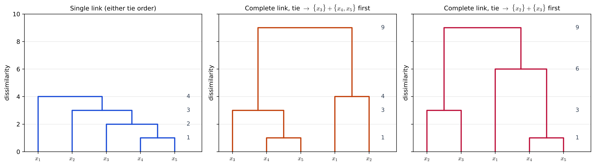
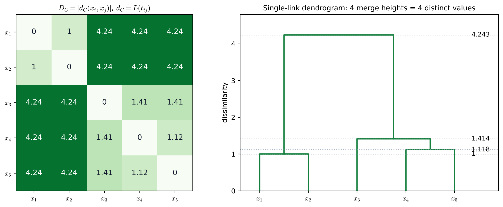
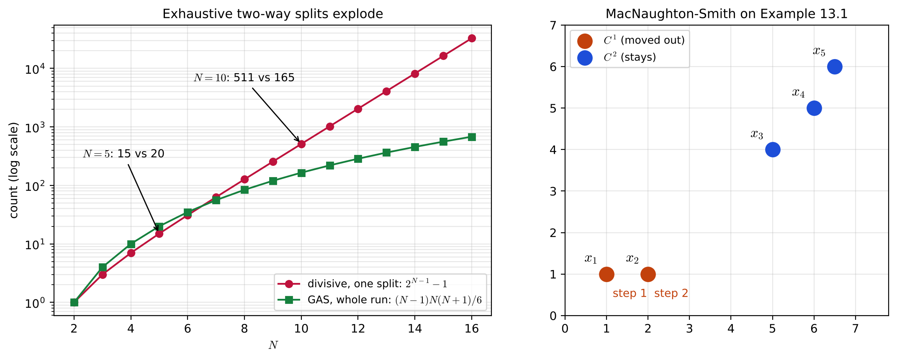

# Lecture 14 · KP06：平手、共表型矩陣與分裂法（Ties, the cophenetic matrix and divisive methods）

> 程度：研究生（grad）／Level: Graduate (grad)
>
> 第 14 週（2026-12-07）｜Clustering (1) – $k$-means & Hierarchical Clustering · KP06
>
> Week 14 (2026-12-07) | Clustering (1) – $k$-means & Hierarchical Clustering · KP06

## 學習目標（Learning objectives）

- 在有平手的相異度矩陣上，說明單連為什麼穩定、全連為什麼會隨處理順序改變（On a dissimilarity matrix with ties, explain why single link is stable and why complete link depends on the processing order）。
- 由樹狀圖寫出共表型矩陣，並驗證它滿足超度量不等式（Write the cophenetic matrix from a dendrogram and check that it satisfies the ultrametric inequality）。
- 說出分裂法的步驟與兩分割數 $2^{N-1}-1$，並用 MacNaughton-Smith 法手算一次兩分割（State the steps of the divisive approach and the number of two-way splits $2^{N-1}-1$, and do one MacNaughton-Smith split by hand）。

## KP06：平手、共表型矩陣與分裂法（Ties, the cophenetic matrix and divisive methods）

**一句話重點**：相異度平手時，單連永遠得到同一棵樹，全連可能因處理順序得到不同的樹；把樹上「兩點第一次合併的高度」填成表，就是共表型矩陣；分裂法從整團往下切，但窮舉兩分割有 $2^{N-1}-1$ 種，要靠 MacNaughton-Smith 這類捷徑。

**One-sentence summary**: When dissimilarities tie, single link always gives the same tree while complete link may give different trees depending on the processing order; filling a table with "the height at which two points first merge" gives the cophenetic matrix; the divisive approach splits from the whole set downward, but there are $2^{N-1}-1$ exhaustive two-way splits, so shortcuts such as MacNaughton-Smith are needed.

### 1. 接住上一講的問題（Picking up the question）

上一講用 MST 說明單連時，假設所有距離都不相同。
這一講先看距離一樣大時會發生什麼，再問：一棵樹到底保留了原始距離的哪些資訊？
最後換個方向，從整團開始往下切。

When the last lecture used the MST to explain single link, it assumed all distances were distinct.
This lecture first looks at what happens when distances are equal, then asks which information about the original distances a tree actually keeps.
Finally it switches direction and splits downward from the whole set.

**白話說明**：想像幾個人排隊報名社團，兩個人同時到櫃台。
如果社團規則是「只要認識隊伍裡任何一人就能加入」，誰先誰後都一樣。
如果規則是「要認識隊伍裡每一個人」，先讓誰進去，就會影響後面的人能不能進。
這個比喻說明順序為何重要，但沒說明樹的高度怎麼讀。

**Plain explanation**: Picture people signing up for clubs, and two arrive at the desk at the same time.
If the rule is "you may join if you know anyone already in the group", the order does not matter.
If the rule is "you must know everyone in the group", who goes in first affects who can join later.
This analogy explains why order matters, but not how to read the heights of a tree.

**先備自測**：確認你會用 KP04 的單連與全連更新距離，也記得 KP05 的單調性。

**Prerequisite check**: Make sure you can update distances with single and complete link from KP04 and remember monotonicity from KP05.

- 單連取最近的跨群距離，全連取最遠的（Single link takes the closest cross distance; complete link the farthest）。
- 單調的樹，越往上合併高度越高（In a monotone tree, merge heights increase going up）。
- 三角不等式是 $d(\mathbf{x},\mathbf{z})\le d(\mathbf{x},\mathbf{y})+d(\mathbf{y},\mathbf{z})$（The triangle inequality is $d(\mathbf{x},\mathbf{z})\le d(\mathbf{x},\mathbf{y})+d(\mathbf{y},\mathbf{z})$）。

### 2. 相異度平手（Ties in dissimilarity）

特徵是連續數值時，兩個距離剛好相等的機率很小。
特徵是順序尺度（例如滿意度 1–5 分）時，平手就很常見。
平手的意思是：$P$ 主對角線上方至少有兩個相同的數。

When features are continuous, the chance that two distances are exactly equal is small.
When features are ordinal (for example satisfaction scores 1–5), ties are common.
A tie means that at least two entries above the main diagonal of $P$ are equal.

**例子**：來源的例 13.8 用這個矩陣，注意 $P(2,3)=P(3,4)=3$：

**Example**: Example 13.8 of the source uses this matrix; note that $P(2,3)=P(3,4)=3$:

$$
P=\begin{bmatrix}0&4&9&6&5\\4&0&3&8&7\\9&3&0&3&2\\6&8&3&0&1\\5&7&2&1&0\end{bmatrix}
$$

`[補充]` 用矩陣版的連結法一步步算。
第 1 步都在 $1$ 併 $\mathbf{x}_4$、$\mathbf{x}_5$。

`[Added]` Compute step by step with the matrix version of the linkages.
Step 1 always merges $\mathbf{x}_4$ and $\mathbf{x}_5$ at $1$.

- **單連**：$\mathbf{x}_3$ 到 $\{\mathbf{x}_4,\mathbf{x}_5\}$ 是 $\min(3,2)=2$，在 $2$ 加入；接著 $\mathbf{x}_2$ 在 $3$ 加入，$\mathbf{x}_1$ 在 $4$ 加入。兩條平手邊先走哪一條都一樣（**Single link**: the distance from $\mathbf{x}_3$ to $\{\mathbf{x}_4,\mathbf{x}_5\}$ is $\min(3,2)=2$, so it joins at $2$; then $\mathbf{x}_2$ joins at $3$ and $\mathbf{x}_1$ at $4$. Either tied edge gives the same result）。
- **全連**：$\mathbf{x}_3$ 到 $\{\mathbf{x}_4,\mathbf{x}_5\}$ 是 $\max(3,2)=3$，剛好和 $d(\mathbf{x}_2,\mathbf{x}_3)=3$ 平手，必須選一個（**Complete link**: the distance from $\mathbf{x}_3$ to $\{\mathbf{x}_4,\mathbf{x}_5\}$ is $\max(3,2)=3$, which ties exactly with $d(\mathbf{x}_2,\mathbf{x}_3)=3$, so one must be chosen）。
  - 先併 $\mathbf{x}_3$ 與 $\{\mathbf{x}_4,\mathbf{x}_5\}$：接著 $\{\mathbf{x}_1,\mathbf{x}_2\}$ 在 $4$ 合併，最後在 $9$ 合併（Merge $\mathbf{x}_3$ with $\{\mathbf{x}_4,\mathbf{x}_5\}$ first: then $\{\mathbf{x}_1,\mathbf{x}_2\}$ merges at $4$, and the last merge is at $9$）。
  - 先併 $\mathbf{x}_2$、$\mathbf{x}_3$：$\{\mathbf{x}_2,\mathbf{x}_3\}$ 到 $\{\mathbf{x}_4,\mathbf{x}_5\}$ 變成 $8$，所以 $\mathbf{x}_1$ 改在 $6$ 加入 $\{\mathbf{x}_4,\mathbf{x}_5\}$，最後在 $9$ 合併（Merge $\mathbf{x}_2$ and $\mathbf{x}_3$ first: the distance from $\{\mathbf{x}_2,\mathbf{x}_3\}$ to $\{\mathbf{x}_4,\mathbf{x}_5\}$ becomes $8$, so $\mathbf{x}_1$ instead joins $\{\mathbf{x}_4,\mathbf{x}_5\}$ at $6$, and the last merge is at $9$）。

兩種順序切成兩群時，一個是 $\{\mathbf{x}_1,\mathbf{x}_2\}$ 對 $\{\mathbf{x}_3,\mathbf{x}_4,\mathbf{x}_5\}$，另一個是 $\{\mathbf{x}_2,\mathbf{x}_3\}$ 對 $\{\mathbf{x}_1,\mathbf{x}_4,\mathbf{x}_5\}$：結論完全不同。

Cut into two groups, one order gives $\{\mathbf{x}_1,\mathbf{x}_2\}$ versus $\{\mathbf{x}_3,\mathbf{x}_4,\mathbf{x}_5\}$, and the other gives $\{\mathbf{x}_2,\mathbf{x}_3\}$ versus $\{\mathbf{x}_1,\mathbf{x}_4,\mathbf{x}_5\}$: entirely different conclusions.



**圖說 `lec14-kp06-cophenetic-divisive-f1-ties`**：先看左圖，單連的四個高度是 $1$、$2$、$3$、$4$，平手順序不影響它。
再看中、右兩圖，同樣是全連，只因平手時先處理的一對不同，第 3 步高度一個是 $4$、一個是 $6$，在 $3$ 合併的成員也不同。
注意最上面都是 $9$，差別藏在中間的分組。〔功能：1、2〕

**Caption `lec14-kp06-cophenetic-divisive-f1-ties`**: Look first at the left panel: the four single-link heights are $1$, $2$, $3$ and $4$, unaffected by the tie order.
Then look at the middle and right panels: both are complete link, but because a different pair is handled first at the tie, the third height is $4$ in one and $6$ in the other, and the members merged at $3$ differ too.
Note that both tops are at $9$; the difference hides in the grouping in the middle. [Function: 1, 2]

**為什麼單連穩**：單連只問「有沒有一條夠短的邊把兩團接起來」。
兩條一樣短的邊，不論先走哪條，到了這個高度兩條都已經接上，結果相同。
全連問「最遠的那一對夠不夠近」，先把誰鎖進同一團，就改變了後面的最遠距離。

**Why single link is stable**: Single link only asks "is there a short enough edge joining the two groups?".
For two equally short edges, whichever is taken first, both are joined by that height, so the result is the same.
Complete link asks "is the farthest pair close enough?", so whoever is locked into a group first changes the farthest distances later on.

來源接著把 $P(1,2)$ 與 $P(2,3)$ 對調，得到 $P_1$。
這時平手的是 $(1,2)$ 與 $(3,4)$。
`[補充]` 這兩對不共用點，先併哪一對都不影響另一對，所以全連又變穩定，高度都是 $1$、$3$、$3$、$9$。

The source then swaps $P(1,2)$ and $P(2,3)$ to get $P_1$.
The tied pairs are now $(1,2)$ and $(3,4)$.
`[Added]` These two pairs share no point, so merging one first does not affect the other, and complete link becomes stable again, with heights $1$, $3$, $3$ and $9$.

**常見迷思**：「全連會受平手影響，所以比單連差。」
不對。
來源明說這不代表其他演算法比較差，好不好仍看問題。
重點是：不用單連時，要先檢查 $P$ 有沒有平手，並固定、記錄處理順序。

**Common misconception**: "Complete link is affected by ties, so it is worse than single link."
That is wrong.
The source states that this does not make the other algorithms worse; which one works better still depends on the problem.
The point is: when not using single link, check $P$ for ties first, and fix and record the processing order.

### 3. 共表型矩陣（The cophenetic matrix）

**正式定義**：令 $t_{ij}$ 是 $\mathbf{x}_i$ 與 $\mathbf{x}_j$ 第一次落在同一叢集的那一層，$L(t_{ij})$ 是該層在樹狀圖上的高度。
**共表型距離**定義為

**Formal definition**: Let $t_{ij}$ be the level at which $\mathbf{x}_i$ and $\mathbf{x}_j$ first fall into the same cluster, and $L(t_{ij})$ the height of that level on the dendrogram.
The **cophenetic distance** is defined as

$$
d_C(\mathbf{x}_i,\mathbf{x}_j)=L(t_{ij})
$$

整張表 $D_C=[d_C(\mathbf{x}_i,\mathbf{x}_j)]$ 叫**共表型矩陣**。
所以一個階層演算法，可以看成把接近矩陣 $P$ 映成一張 $D_C$。

The whole table $D_C=[d_C(\mathbf{x}_i,\mathbf{x}_j)]$ is called the **cophenetic matrix**.
So a hierarchical algorithm can be viewed as mapping the proximity matrix $P$ to a $D_C$.

**超度量不等式**：在單調的前提下，任三點都滿足

**Ultrametric inequality**: Under monotonicity, every three points satisfy

$$
d_C(\mathbf{x}_i,\mathbf{x}_r)\le\max\{d_C(\mathbf{x}_i,\mathbf{x}_j),\,d_C(\mathbf{x}_j,\mathbf{x}_r)\}\tag{13.27}
$$

白話：$\mathbf{x}_i$ 和 $\mathbf{x}_j$ 已經同群、$\mathbf{x}_j$ 和 $\mathbf{x}_r$ 也已經同群時，三點早就在同一群，$\mathbf{x}_i$ 和 $\mathbf{x}_r$ 的合併高度不會更高。
它比三角不等式更嚴：右邊用「較大的一個」，而不是「兩個相加」。
結果是任三點的三個 $d_C$ 裡，最大的兩個一定相等。

In plain words: once $\mathbf{x}_i,\mathbf{x}_j$ share a group and $\mathbf{x}_j,\mathbf{x}_r$ share a group, all three are already together, so the merge height of $\mathbf{x}_i$ and $\mathbf{x}_r$ cannot be higher.
It is stricter than the triangle inequality: the right side uses "the larger one" instead of "the sum of both".
As a result, among the three values of $d_C$ for any three points, the two largest are always equal.

**例子**：例 13.9 用 KP03 的五點做單連。
合併高度依序約為 $1$、$1.118$、$1.414$、$4.243$（來源四捨五入寫成 $1$、$1.1$、$1.4$、$4.2$）：

**Example**: Example 13.9 applies single link to the five points of KP03.
The merge heights are about $1$, $1.118$, $1.414$ and $4.243$ (rounded in the source to $1$, $1.1$, $1.4$ and $4.2$):

$$
D_C=\begin{bmatrix}0&1&4.2&4.2&4.2\\1&0&4.2&4.2&4.2\\4.2&4.2&0&1.4&1.4\\4.2&4.2&1.4&0&1.1\\4.2&4.2&1.4&1.1&0\end{bmatrix}
$$

非對角只有 $N-1=4$ 種不同的值，因為一棵樹只有 $N-1$ 次合併。

There are only $N-1=4$ distinct off-diagonal values, because a tree has only $N-1$ merges.



**圖說 `lec14-kp06-cophenetic-divisive-f2-cophenetic`**：先看右圖，四條虛線標出四個合併高度。
再看左圖，每一格的數字就是那兩點在右圖第一次接上的高度，同一高度的格子顏色相同，所以整張表只有四種非零值。
注意右上的 $3\times2$ 深綠塊全是 $4.24$：跨兩大團的點對都在最後一步才合併。〔功能：1、3〕

**Caption `lec14-kp06-cophenetic-divisive-f2-cophenetic`**: Look first at the right panel: the four dotted lines mark the four merge heights.
Then look at the left panel: each number is the height at which the two points first join on the right, and cells with the same height share a colour, so the table has only four nonzero values.
Note that the dark green $3\times2$ block at the top right is all $4.24$: point pairs across the two big groups merge only at the last step. [Function: 1, 3]

`[補充]` $D_C$ 會改寫原始距離。
$d(\mathbf{x}_1,\mathbf{x}_5)=7.433$，但 $d_C(\mathbf{x}_1,\mathbf{x}_5)=4.243$；$d(\mathbf{x}_1,\mathbf{x}_3)=5$，也被寫成 $4.243$。
把 $P$ 與 $D_C$ 上三角的十個值做相關係數，得到 $0.9277$，稱為共表型相關係數，數字越接近 $1$，樹越忠實。
第 16 章會用這張表檢驗階層的好壞。

`[Added]` $D_C$ rewrites the original distances.
$d(\mathbf{x}_1,\mathbf{x}_5)=7.433$, but $d_C(\mathbf{x}_1,\mathbf{x}_5)=4.243$; $d(\mathbf{x}_1,\mathbf{x}_3)=5$ is also written as $4.243$.
The correlation between the ten upper-triangle values of $P$ and $D_C$ is $0.9277$, called the cophenetic correlation coefficient; the closer to $1$, the more faithful the tree.
Chapter 16 uses this table to check the quality of a hierarchy.

`[補充]` 回到例 13.8：全連的兩種平手順序，會得到兩張不同的 $D_C$。
例如 $d_C(\mathbf{x}_1,\mathbf{x}_2)$ 一張是 $4$，另一張是 $9$。

`[Added]` Back to Example 13.8: the two tie orders of complete link give two different $D_C$.
For example, $d_C(\mathbf{x}_1,\mathbf{x}_2)$ is $4$ in one and $9$ in the other.

### 4. 分裂法（The divisive approach）

分裂法走凝聚法的反方向。
第 $0$ 層只有一群 $\Re_0=\{X\}$，第 $t$ 層有 $t+1$ 群，一路切到每點自成一群。

The divisive approach goes in the opposite direction of agglomeration.
Level $0$ has a single group $\Re_0=\{X\}$, level $t$ has $t+1$ groups, and it splits all the way until every point is its own group.

**廣義分裂方案 GDS**：設 $g(C_i,C_j)$ 是兩群的相異度。

**Generalized divisive scheme GDS**: let $g(C_i,C_j)$ be the dissimilarity between two groups.

1. 初始化 $\Re_0=\{X\}$，$t=0$（Initialize $\Re_0=\{X\}$, $t=0$）。
2. $t\leftarrow t+1$；對目前每一群，在它所有的兩分割裡找出使 $g$ 最大的一刀（$t\leftarrow t+1$; for each current group, find the cut among all its two-way splits that maximizes $g$）。
3. 在這些候選裡，只執行 $g$ 最大的那一刀，把該群換成切出來的兩群（Among these candidates, carry out only the cut with the largest $g$, replacing that group with the two new groups）。
4. 重複到每點自成一群（Repeat until every point is its own group）。

**為什麼慢**：把 $N$ 點切成兩個非空集合，兩邊不分名字，共有 $2^{N-1}-1$ 種。
$N=5$ 時是 $15$，$N=10$ 時是 $511$，$N=30$ 時超過五億。

**Why it is slow**: There are $2^{N-1}-1$ ways to split $N$ points into two nonempty unlabeled sets.
That is $15$ for $N=5$, $511$ for $N=10$, and over half a billion for $N=30$.

`[補充]` 為什麼是 $2^{N-1}-1$：每點選左或右有 $2^N$ 種，扣掉一邊全空的 $2$ 種，再因左右不分名字除以 $2$，得 $(2^N-2)/2=2^{N-1}-1$。

`[Added]` Why $2^{N-1}-1$: each point chooses left or right, giving $2^N$ ways; removing the $2$ ways with an empty side and dividing by $2$ because the sides are unlabeled gives $(2^N-2)/2=2^{N-1}-1$.



**圖說 `lec14-kp06-cophenetic-divisive-f3-divisive`**：先看左圖，縱軸是對數刻度；紅線是分裂法**第一刀**的候選數，綠線是凝聚法**整個過程**要比較的配對數。
$N\le6$ 時紅線還較低，從 $N=7$ 起紅線就超過綠線並越拉越開。
再看右圖，MacNaughton-Smith 只花兩步，就把左下兩點搬出去。〔功能：1、2〕

**Caption `lec14-kp06-cophenetic-divisive-f3-divisive`**: Look first at the left panel, whose vertical axis is logarithmic; the red line is the number of candidates for the divisive **first cut**, and the green line is the number of pairs agglomeration compares over the **whole run**.
For $N\le6$ the red line is still lower, but from $N=7$ on it passes the green line and pulls further away.
Then look at the right panel: MacNaughton-Smith moves the two bottom-left points out in only two steps. [Function: 1, 2]

**MacNaughton-Smith 捷徑**：只處理「把一群 $C_i$ 切成兩塊」那一步，不窮舉。

**The MacNaughton-Smith shortcut**: it handles only the step "split one group $C_i$ into two" without exhaustive search.

1. 起點 $C_i^1=\emptyset$、$C_i^2=C_i$（Start with $C_i^1=\emptyset$ and $C_i^2=C_i$）。
2. 把「跟其他點平均相異度最大」的點搬到 $C_i^1$（Move the point with the largest average dissimilarity to the others into $C_i^1$）。
3. 對 $C_i^2$ 裡每個 $\mathbf{x}$ 算 $D(\mathbf{x})=g(\mathbf{x},C_i^2-\{\mathbf{x}\})-g(\mathbf{x},C_i^1)$，即「跟留下的人有多不像」減「跟搬出去的人有多不像」（For each $\mathbf{x}$ in $C_i^2$ compute $D(\mathbf{x})=g(\mathbf{x},C_i^2-\{\mathbf{x}\})-g(\mathbf{x},C_i^1)$, that is "how unlike the stayers" minus "how unlike the movers"）。
4. 若所有 $D(\mathbf{x})<0$ 就停；否則把 $D$ 最大的點搬過去，回到第 3 步（Stop if every $D(\mathbf{x})<0$; otherwise move the point with the largest $D$ and return to step 3）。

`[補充]` 用 KP03 的五點、歐氏距離、$g$ 取平均距離手算：

`[Added]` Work it by hand on the five points of KP03 with Euclidean distance and $g$ as the average distance:

- 第 1 步：各點到其他四點的平均距離是 $4.959$、$4.407$、$3.289$、$3.648$、$4.444$；$\mathbf{x}_1$ 最大，搬出去（Step 1: the average distances to the other four points are $4.959$, $4.407$, $3.289$, $3.648$ and $4.444$; $\mathbf{x}_1$ is largest and moves out）。
- 第 2 步：$D(\mathbf{x}_2)=4.542$，其他三點都是負的；搬 $\mathbf{x}_2$（Step 2: $D(\mathbf{x}_2)=4.542$ and the other three are negative; move $\mathbf{x}_2$）。
- 第 3 步：剩下三點的 $D$ 是 $-2.664$、$-4.764$、$-5.271$，全為負，停止（Step 3: the remaining three have $D=-2.664$, $-4.764$ and $-5.271$, all negative, so stop）。

結果是 $\{\mathbf{x}_1,\mathbf{x}_2\}$ 與 $\{\mathbf{x}_3,\mathbf{x}_4,\mathbf{x}_5\}$，和單連最後一刀相同，只算了三輪，不用比較 $15$ 種切法。

The result is $\{\mathbf{x}_1,\mathbf{x}_2\}$ and $\{\mathbf{x}_3,\mathbf{x}_4,\mathbf{x}_5\}$, the same as the last cut of single link, after only three rounds instead of comparing $15$ splits.

**兩種切法**：一次用全部特徵決定怎麼切，叫 **polythetic**，本書的演算法幾乎都是這類；每一步只看一維特徵，叫 **monothetic**。

**Two kinds of split**: deciding a cut with all features at once is called **polythetic**, and almost all algorithms in the book are of this kind; looking at only one feature per step is called **monothetic**.

**失效情形**：MacNaughton-Smith 是貪婪的，搬出去的點不會再搬回來，不保證找到 $g$ 最大的切法。
而且分裂法一刀切錯，之後的所有層都改不回來，這和凝聚法「黏錯不能拆」是同一類問題。

**Failure cases**: MacNaughton-Smith is greedy; moved points never move back, so it does not guarantee the split with the largest $g$.
And a wrong cut in the divisive approach cannot be undone at any later level, the same kind of problem as "a wrong merge cannot be split" in agglomeration.

### 5. 與實作的連結（Connection to implementation）

下面的程式由合併紀錄建出共表型矩陣，並逐一檢查超度量不等式。
注意兩件事：每次合併時，兩邊各取一點的所有點對都填同一個高度；超度量要對三點的三種排列都檢查。

The code below builds the cophenetic matrix from the merge record and checks the ultrametric inequality one triple at a time.
Note two points: at each merge, every pair with one point from each side gets the same height, and the ultrametric inequality must be checked for all three arrangements of a triple.

```python
import numpy as np
from itertools import combinations

# 例 13.9 的單連合併紀錄 (成員 A, 成員 B, 高度)，點編號從 0 起
# Single-link merge record of Example 13.9 (members A, members B, height), points numbered from 0
merges = [((0,), (1,), 1.0), ((3,), (4,), 1.118), ((2,), (3, 4), 1.414), ((0, 1), (2, 3, 4), 4.243)]
N = 5
DC = np.zeros((N, N))
for A, B, h in merges:
    for a in A:
        for b in B:
            DC[a, b] = DC[b, a] = h          # 第一次同群的高度 / first height in the same group
print(DC)

ok = all(DC[i, r] <= max(DC[i, j], DC[j, r])
         for p in combinations(range(N), 3)
         for i, j, r in (p, p[1:] + p[:1], p[2:] + p[:2]))
print("ultrametric:", ok)                      # True
print("splits for N=10:", 2 ** (10 - 1) - 1)   # 511
```

**留給下一節的問題**：有了一棵樹，最後要交出幾群？
該在哪個高度下刀？
下一講用「叢集的壽命」與自我相似度來回答。

**The question for the next section**: Given a tree, how many groups should we finally hand in?
At what height should we cut?
The next lecture answers with "cluster lifetime" and self-similarity.

### 6. 小練習與解題示範（Practice and worked solutions）

**小練習** `[補充]`：先寫下理由，再看解答。

**Practice** `[Added]`: Write your reasoning before reading the solutions.

1. 題 1：$N=6$ 時，窮舉兩分割有幾種（How many exhaustive two-way splits are there for $N=6$）？
2. 題 2：例 13.9 的 $D_C$ 中，取 $\mathbf{x}_1$、$\mathbf{x}_3$、$\mathbf{x}_4$ 三點，驗證超度量不等式，並指出哪兩個值相等（In $D_C$ of Example 13.9, take $\mathbf{x}_1$, $\mathbf{x}_3$ and $\mathbf{x}_4$, check the ultrametric inequality, and say which two values are equal）。
3. 題 3：例 13.8 全連先併 $\mathbf{x}_2$、$\mathbf{x}_3$ 時，為什麼 $\mathbf{x}_1$ 會在 $6$ 加入 $\{\mathbf{x}_4,\mathbf{x}_5\}$（In Example 13.8, when complete link merges $\mathbf{x}_2$ and $\mathbf{x}_3$ first, why does $\mathbf{x}_1$ join $\{\mathbf{x}_4,\mathbf{x}_5\}$ at $6$）？

**題 1 解題示範**：$2^{6-1}-1=31$ 種。

**Question 1 worked solution**: $2^{6-1}-1=31$ splits.

**題 2 解題示範**：三個值是 $d_C(\mathbf{x}_1,\mathbf{x}_3)=4.2$、$d_C(\mathbf{x}_1,\mathbf{x}_4)=4.2$、$d_C(\mathbf{x}_3,\mathbf{x}_4)=1.4$。
每一個都不超過另外兩個的較大者，例如 $1.4\le\max\{4.2,4.2\}$。
最大的兩個 $4.2$ 相等。

**Question 2 worked solution**: The three values are $d_C(\mathbf{x}_1,\mathbf{x}_3)=4.2$, $d_C(\mathbf{x}_1,\mathbf{x}_4)=4.2$ and $d_C(\mathbf{x}_3,\mathbf{x}_4)=1.4$.
Each is no larger than the larger of the other two, for example $1.4\le\max\{4.2,4.2\}$.
The two largest, both $4.2$, are equal.

**題 3 解題示範**：此時三群兩兩的全連距離是 $d(\mathbf{x}_1,\{\mathbf{x}_2,\mathbf{x}_3\})=\max(4,9)=9$、$d(\mathbf{x}_1,\{\mathbf{x}_4,\mathbf{x}_5\})=\max(6,5)=6$、$d(\{\mathbf{x}_2,\mathbf{x}_3\},\{\mathbf{x}_4,\mathbf{x}_5\})=\max(8,7,3,2)=8$。
最小的是 $6$，所以 $\mathbf{x}_1$ 在 $6$ 加入 $\{\mathbf{x}_4,\mathbf{x}_5\}$。

**Question 3 worked solution**: The pairwise complete-link distances of the three groups are now $d(\mathbf{x}_1,\{\mathbf{x}_2,\mathbf{x}_3\})=\max(4,9)=9$, $d(\mathbf{x}_1,\{\mathbf{x}_4,\mathbf{x}_5\})=\max(6,5)=6$ and $d(\{\mathbf{x}_2,\mathbf{x}_3\},\{\mathbf{x}_4,\mathbf{x}_5\})=\max(8,7,3,2)=8$.
The smallest is $6$, so $\mathbf{x}_1$ joins $\{\mathbf{x}_4,\mathbf{x}_5\}$ at $6$.

## 術語表（Glossary）

| 中文術語 | English term |
|---|---|
| 平手 | Tie |
| 順序尺度 | Ordinal scale |
| 共表型距離 | Cophenetic distance |
| 共表型矩陣 | Cophenetic matrix |
| 超度量不等式 | Ultrametric inequality |
| 共表型相關係數 | Cophenetic correlation coefficient |
| 分裂法 | Divisive approach |
| 廣義分裂方案 | Generalized divisive scheme (GDS) |
| 兩分割 | Two-way split |
| 多元切分 | Polythetic |
| 單元切分 | Monothetic |

## 銜接與來源（Connections and sources）

下一講處理最後一步：從一整棵樹裡挑出要交出的分群。

The next lecture handles the final step: choosing the clustering to hand in from a whole tree.

- 前一單元：[KP05 單調性與圖論方法](lec14-kp05-monotonicity-graph.md)（Previous unit: monotonicity and graph methods）。
- 下一單元：[KP07 在哪一層切樹](lec14-kp07-cut-level.md)（Next unit: where to cut the tree）。
- 來源：[Hierarchical Clustering §13.2.6、§13.3、§13.4](https://ndhuccc.github.io/CCC-LNS/PR_115/Ch13-hierarchical-clustering/index.html)，讀取日期 2026-11-13（Source accessed 2026-11-13）。
- 書目：Theodoridis and Koutroumbas, *Pattern Recognition*, 4th ed., 2008；見[參考資料](../references/README.md)（See the bibliography）。

本講以自己的文字解釋來源。
平手的意義、例 13.8 的矩陣與單連穩定、全連受順序影響的結論、對調後的 $P_1$、共表型距離與矩陣的定義、超度量不等式、例 13.9 的 $D_C$、GDS 步驟、兩分割數 $2^{N-1}-1$、MacNaughton-Smith 步驟、polythetic 與 monothetic 取自來源。
社團比喻、矩陣版的逐步計算、$P_1$ 穩定的理由、常見迷思、$D_C$ 與原始距離的比較、共表型相關係數、兩分割數的推導、MacNaughton-Smith 的手算例、失效情形、程式、圖與練習皆為 `[補充]`。

This lecture independently explains the source.
The meaning of ties, the matrix of Example 13.8 and the conclusions that single link is stable and complete link depends on the order, the swapped $P_1$, the definitions of cophenetic distance and matrix, the ultrametric inequality, $D_C$ of Example 13.9, the GDS steps, the number of two-way splits $2^{N-1}-1$, the MacNaughton-Smith steps, and polythetic versus monothetic come from the source.
The club analogy, the step-by-step matrix computation, the reason $P_1$ is stable, the common misconception, the comparison of $D_C$ with the original distances, the cophenetic correlation coefficient, the derivation of the number of splits, the worked MacNaughton-Smith example, the failure cases, the code, the figures and the practice are `[Added]`.
