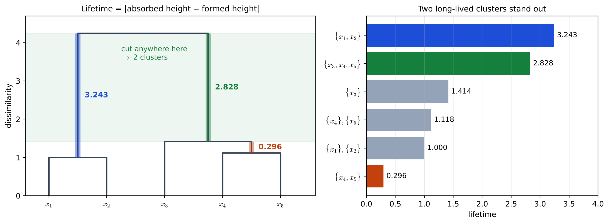
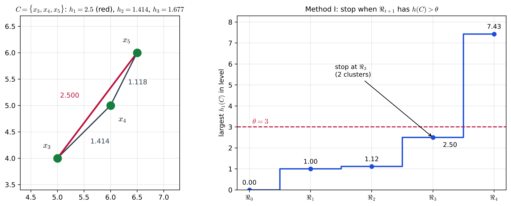
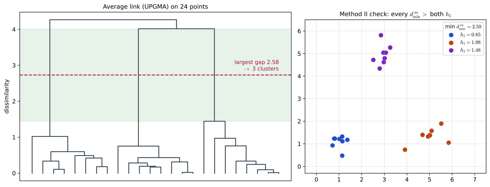

# Lecture 14 · KP07：在哪一層切樹（Where to cut the tree）

> 程度：研究生（grad）／Level: Graduate (grad)
>
> 第 14 週（2026-12-07）｜Clustering (1) – $k$-means & Hierarchical Clustering · KP07
>
> Week 14 (2026-12-07) | Clustering (1) – $k$-means & Hierarchical Clustering · KP07

## 學習目標（Learning objectives）

- 由樹狀圖算出每個叢集的壽命，並用壽命決定要切成幾群（Compute the lifetime of every cluster from a dendrogram and use it to decide how many groups to cut）。
- 算出一個叢集的三種群內相異度 $h_1$、$h_2$、$h_3$，並用 Method I 的門檻決定停在哪一層（Compute the three within-cluster dissimilarities $h_1$, $h_2$ and $h_3$ of a cluster, and use the threshold of Method I to decide where to stop）。
- 用 Method II 檢查一個分群是否合格，並說明它為什麼只是必要條件（Use Method II to check whether a clustering qualifies, and explain why it is only a necessary condition）。

## KP07：在哪一層切樹（Where to cut the tree）

**一句話重點**：一棵樹的每一層都是合法的分群，要交出答案就得選一層；直觀做法是找壽命最長的叢集，正式一點可以設門檻限制群內的散度（Method I），或要求群與群分得比群內還開（Method II），但這些都是啟發式指標，不是證明。

**One-sentence summary**: Every level of a tree is a valid clustering, so handing in an answer means choosing a level; the intuitive approach looks for the longest-lived clusters, while more formal approaches set a threshold on within-cluster spread (Method I) or require groups to be farther apart than they are spread inside (Method II), but all of these are heuristic indicators, not proofs.

### 1. 接住上一講的問題（Picking up the question）

前面幾講都在長樹。
可是報告裡不能交一整棵樹，要說「資料分成幾群、每群是誰」。
選哪一層，就等於回答「最佳叢集數是多少」。

The previous lectures all grew trees.
But a report cannot hand in a whole tree; it has to say "how many groups the data has and who is in each".
Choosing a level is the same as answering "what is the best number of clusters".

**白話說明**：想像用望遠鏡看夜空，慢慢調焦距。
有些星團只在某個焦距下看起來是一團，稍微一調就散了或併進更大的星群。
真正的星團，在很寬的焦距範圍裡都保持成一團。
這個比喻說明「穩定才可信」，但沒說明穩定要怎麼量。

**Plain explanation**: Picture looking at the night sky through a telescope while slowly turning the focus.
Some star groups look like a cluster only at one focus setting; a small turn and they scatter or merge into a bigger group.
A real star cluster stays together across a wide range of focus settings.
This analogy shows "stable means trustworthy", but not how to measure stability.

**先備自測**：確認你會讀樹狀圖的合併高度，並記得 KP06 的群間距離。

**Prerequisite check**: Make sure you can read merge heights on a dendrogram and remember the between-group distances of KP06.

- 樹狀圖從下到上，第 $t$ 層有 $N-t$ 群（From bottom to top, level $t$ of a dendrogram has $N-t$ groups）。
- 兩群的最小點對距離記作 $d_{\min}^{ss}$（The minimum point-pair distance between two groups is written $d_{\min}^{ss}$）。
- 中位數是排序後位在中間的數（The median is the middle value after sorting）。

### 2. 叢集的壽命（Cluster lifetime）

**正式定義**：一個叢集的**壽命**，是它被吸進更大叢集時的高度，減去它形成時的高度，取絕對值。
單點在高度 $0$ 形成。
壽命越長，表示這一團在越寬的高度範圍裡都還存在。

**Formal definition**: The **lifetime** of a cluster is the absolute difference between the height at which it is absorbed into a larger cluster and the height at which it forms.
A single point forms at height $0$.
A longer lifetime means the group survives over a wider range of heights.

**例子**：KP03 的五點做單連，合併高度是 $1$、$1.118$、$1.414$、$4.243$。

**Example**: Single link on the five points of KP03 merges at heights $1$, $1.118$, $1.414$ and $4.243$.

- $\{\mathbf{x}_1,\mathbf{x}_2\}$ 在 $1$ 形成、$4.243$ 被吸收，壽命 $3.243$（$\{\mathbf{x}_1,\mathbf{x}_2\}$ forms at $1$ and is absorbed at $4.243$, lifetime $3.243$）。
- $\{\mathbf{x}_3,\mathbf{x}_4,\mathbf{x}_5\}$ 在 $1.414$ 形成、$4.243$ 被吸收，壽命 $2.828$（$\{\mathbf{x}_3,\mathbf{x}_4,\mathbf{x}_5\}$ forms at $1.414$ and is absorbed at $4.243$, lifetime $2.828$）。
- $\{\mathbf{x}_4,\mathbf{x}_5\}$ 在 $1.118$ 形成、$1.414$ 就被吸收，壽命只有 $0.296$（$\{\mathbf{x}_4,\mathbf{x}_5\}$ forms at $1.118$ and is absorbed already at $1.414$, a lifetime of only $0.296$）。

兩個壽命最長的叢集正好是兩大團，所以切成兩群。
在 $1.414$ 到 $4.243$ 之間任何高度下刀，都得到同樣的兩群。

The two longest-lived clusters are exactly the two big groups, so we cut into two groups.
Cutting at any height between $1.414$ and $4.243$ gives the same two groups.



**圖說 `lec14-kp07-cut-level-f1-lifetime`**：先看左圖，彩色粗線段是三個叢集從形成到被吸收的那一段，長度就是壽命；綠色色帶是「切在這裡都得到兩群」的高度範圍。
再看右圖，藍、綠兩條最長，明顯高於其他叢集。
注意橘色的 $\{\mathbf{x}_4,\mathbf{x}_5\}$ 只活了 $0.296$，不像一個站得住的群。〔功能：1、2〕

**Caption `lec14-kp07-cut-level-f1-lifetime`**: Look first at the left panel: each thick coloured segment runs from the moment a cluster forms to the moment it is absorbed, and its length is the lifetime; the green band is the range of heights where "a cut gives two groups".
Then look at the right panel: the blue and green bars are the longest, well above the other clusters.
Note that the orange $\{\mathbf{x}_4,\mathbf{x}_5\}$ lives only $0.296$, which does not look like a group that holds up. [Function: 1, 2]

`[補充]` 實作上常用的等價說法：找相鄰兩次合併高度之間「最大的間隔」，切在間隔中間。
本例的間隔依序是 $1$、$0.118$、$0.296$、$2.828$，最大的在最後，所以切成兩群。

`[Added]` An equivalent rule often used in practice: find the "largest gap" between two consecutive merge heights and cut in the middle of it.
Here the gaps are $1$, $0.118$, $0.296$ and $2.828$; the largest is the last one, so we cut into two groups.

**常見迷思**：「看樹狀圖就能客觀決定群數。」
不對。
來源提醒，原文圖 13.17a 看起來像兩大群、13.17b 像只有一個主群，但判斷仍要靠人眼，帶有主觀成分。
樹的形狀也會隨連結法改變。

**Common misconception**: "Looking at a dendrogram decides the number of groups objectively."
That is wrong.
The source points out that Figure 13.17a looks like two big groups and 13.17b like one main group, but the judgment still relies on the human eye and is partly subjective.
The shape of the tree also changes with the linkage method.

### 3. Method I：用門檻限制群內散度（Method I: a threshold on within-cluster spread）

先定義 $h(C)$ 來量一群裡的點有多不像，也就是群的「自我相似度」。
常見三種：

First define $h(C)$ to measure how unlike the points in a group are, that is, the group's "self-similarity".
Three common choices are:

$$
h_1(C)=\max\{d(\mathbf{x},\mathbf{y}):\mathbf{x},\mathbf{y}\in C\}\tag{13.34}
$$

$$
h_2(C)=\operatorname{med}\{d(\mathbf{x},\mathbf{y}):\mathbf{x},\mathbf{y}\in C\}\tag{13.35}
$$

$$
h_3(C)=\frac{1}{2n_C}\sum_{\mathbf{x}\in C}\sum_{\mathbf{y}\in C}d(\mathbf{x},\mathbf{y})\tag{13.36}
$$

$h_1$ 是群內最遠的一對（直徑），$h_2$ 是群內距離的中位數，$h_3$ 要求 $d$ 是度量，$n_C$ 是群的點數。

$h_1$ is the farthest pair in the group (its diameter), $h_2$ is the median of the within-group distances, $h_3$ requires $d$ to be a metric, and $n_C$ is the number of points in the group.

**規則**：使用者給門檻 $\theta$。
若下一層 $\Re_{t+1}$ 已經出現某群 $h(C_j)>\theta$，就停在目前這層 $\Re_t$。
白話：再併下去，就會有一群內部散過頭，那就不併了。
凝聚演算法因此不必把整棵樹長完。

**Rule**: The user gives a threshold $\theta$.
If the next level $\Re_{t+1}$ already contains a group with $h(C_j)>\theta$, stop at the current level $\Re_t$.
In plain words: merging further would create a group that is too spread out inside, so do not merge.
The agglomerative algorithm therefore does not need to grow the whole tree.

**例子** `[補充]`：取 $C=\{\mathbf{x}_3,\mathbf{x}_4,\mathbf{x}_5\}$，三個點對距離是 $1.414$、$2.5$、$1.118$。
所以 $h_1=2.5$，$h_2=1.414$。
$h_3$ 的雙重和把每對算兩次，得 $2\times5.032$，再除以 $2\times3$，得 $1.677$。

**Example** `[Added]`: Take $C=\{\mathbf{x}_3,\mathbf{x}_4,\mathbf{x}_5\}$; the three pair distances are $1.414$, $2.5$ and $1.118$.
So $h_1=2.5$ and $h_2=1.414$.
The double sum in $h_3$ counts each pair twice, giving $2\times5.032$, which divided by $2\times3$ gives $1.677$.

用 $h_1$ 與 $\theta=3$：第 $3$ 層兩群的 $h_1$ 是 $1$ 與 $2.5$，都不超過 $3$。
第 $4$ 層只剩一群，$h_1=7.433>3$，所以停在第 $3$ 層，兩群。

With $h_1$ and $\theta=3$: at level $3$ the two groups have $h_1$ equal to $1$ and $2.5$, both at most $3$.
Level $4$ has a single group with $h_1=7.433>3$, so we stop at level $3$ with two groups.



**圖說 `lec14-kp07-cut-level-f2-method1`**：先看左圖，三條線是 $\{\mathbf{x}_3,\mathbf{x}_4,\mathbf{x}_5\}$ 的三個點對距離，紅線最長，就是 $h_1$。
再看右圖，藍色階梯是每一層裡最大的 $h_1$，紅虛線是門檻 $\theta=3$。
注意 $\Re_3$ 還在門檻下，下一步跳到 $7.43$ 就越線，所以停在 $\Re_3$。〔功能：1、3〕

**Caption `lec14-kp07-cut-level-f2-method1`**: Look first at the left panel: the three lines are the three pair distances of $\{\mathbf{x}_3,\mathbf{x}_4,\mathbf{x}_5\}$, and the longest, red one is $h_1$.
Then look at the right panel: the blue staircase is the largest $h_1$ in each level, and the red dashed line is the threshold $\theta=3$.
Note that $\Re_3$ is still below the threshold, and the next step jumps to $7.43$ and crosses it, so we stop at $\Re_3$. [Function: 1, 3]

**門檻怎麼給**：直接猜 $\theta$ 很難，來源建議改寫成 $\theta=\mu+\lambda\sigma$。
$\mu$ 是資料中任兩點距離的平均，$\sigma$ 描述這些距離的散布，$\lambda$ 由使用者給。
這把「門檻要多大」轉成比較好估的 $\lambda$。

**How to set the threshold**: Guessing $\theta$ directly is hard, so the source suggests rewriting it as $\theta=\mu+\lambda\sigma$.
$\mu$ is the average distance between any two points of the data, $\sigma$ describes the spread of these distances, and $\lambda$ is given by the user.
This turns "how large should the threshold be" into an easier estimate of $\lambda$.

`[補充]` 原文稱 $\sigma$ 為變異數；要和 $\mu$ 同單位，實作常用標準差，本講的計算也用標準差。

`[Added]` The source calls $\sigma$ the variance; to share units with $\mu$, implementations often use the standard deviation, and so does this lecture.

### 4. Method II：群間要比群內分得開（Method II: groups farther apart than their inner spread）

Method II 不跟使用者要門檻，只看資料本身。
最後交出的分群 $\Re_t$，每一對群都要滿足

Method II asks the user for no threshold and looks only at the data itself.
In the final clustering $\Re_t$, every pair of groups must satisfy

$$
d_{\min}^{ss}(C_i,C_j)>\max\{h(C_i),h(C_j)\}
$$

白話：兩群最近的那對點，也要比兩群各自內部的散度還遠。
這只是**必要條件**：不滿足就不夠格，滿足了也不一定是最佳。

In plain words: even the closest pair of points across two groups must be farther apart than the inner spread of each group.
This is only a **necessary condition**: failing it disqualifies a clustering, but passing it does not make it the best.

`[補充]` 回到五點：兩群時 $d_{\min}^{ss}=4.243>\max\{1,2.5\}$，合格。
可是三、四、五群也都合格（單點群的 $h$ 是 $0$），所以 Method II 單獨用時選不出唯一答案，要和壽命或 Method I 一起看。

`[Added]` Back to the five points: with two groups $d_{\min}^{ss}=4.243>\max\{1,2.5\}$, so it qualifies.
But three, four and five groups also qualify (a single-point group has $h=0$), so Method II alone cannot pick a unique answer and should be used together with lifetimes or Method I.

**較大的例子** `[補充]`：三團各 $8$ 點、共 $24$ 點的示範資料，用平均連結（UPGMA）。

**A larger example** `[Added]`: demonstration data with three groups of $8$ points, $24$ points in all, using average link (UPGMA).

- 最後五次合併高度是 $0.968$、$1.019$、$1.442$、$4.018$、$4.267$；最大間隔 $2.576$ 在 $1.442$ 與 $4.018$ 之間，切成三群（The last five merge heights are $0.968$, $1.019$, $1.442$, $4.018$ and $4.267$; the largest gap, $2.576$, lies between $1.442$ and $4.018$, giving three groups）。
- Method I 用 $h_1$：$\mu=3.099$、$\sigma=1.711$；$\lambda$ 從 $-0.5$ 到 $1$ 都停在三群，$\lambda=-1$ 時門檻太小，停在五群（Method I with $h_1$: $\mu=3.099$ and $\sigma=1.711$; every $\lambda$ from $-0.5$ to $1$ stops at three groups, while $\lambda=-1$ makes the threshold too small and stops at five）。
- Method II 用 $h_1$：三群的直徑是 $0.85$、$1.477$、$1.977$，三對群的 $d_{\min}^{ss}$ 最小是 $2.59$，合格（Method II with $h_1$: the diameters of the three groups are $0.85$, $1.477$ and $1.977$, and the smallest $d_{\min}^{ss}$ among the three pairs is $2.59$, so it qualifies）。



**圖說 `lec14-kp07-cut-level-f3-three-groups`**：先看左圖，綠色色帶是最大的高度間隔，紅虛線切在中間，正好切出三支。
再看右圖，三種顏色是切出的三群，圖例列出各群的直徑 $h_1$ 與最小的群間距離 $2.59$。
注意 $2.59$ 比最大的直徑 $1.98$ 還大，所以通過 Method II。〔功能：1、3〕

**Caption `lec14-kp07-cut-level-f3-three-groups`**: Look first at the left panel: the green band is the largest gap in height, and the red dashed line cuts through its middle, giving exactly three branches.
Then look at the right panel: the three colours are the three groups, and the legend lists each group's diameter $h_1$ and the smallest between-group distance $2.59$.
Note that $2.59$ is larger than the largest diameter, $1.98$, so the clustering passes Method II. [Function: 1, 3]

**失效情形** `[補充]`：式 $(13.36)$ 的 $h_3$ 其實是「點對距離總和除以 $n_C$」，約等於 $\frac{n_C-1}{2}$ 倍的平均點對距離，群越大值越大。
在上面的資料裡，每群 $8$ 點，$h_3$ 約是平均點對距離的 $3.5$ 倍，最大到 $2.744$，超過 $2.59$，三群反而不合格。
所以用 $h_3$ 搭配 Method II 時，要留意群的大小。

**Failure cases** `[Added]`: $h_3$ in Eq. $(13.36)$ is really "the sum of pair distances divided by $n_C$", about $\frac{n_C-1}{2}$ times the average pair distance, so it grows with group size.
In the data above, each group has $8$ points, so $h_3$ is about $3.5$ times the average pair distance, reaching $2.744$, which exceeds $2.59$, so the three groups fail.
So when combining $h_3$ with Method II, watch the group sizes.

來源最後提醒：這些方法都有啟發式成分，只能當「最佳分群」的參考指標。

The source closes with a reminder: all these methods are partly heuristic and serve only as indicators of "the best clustering".

### 5. 與實作的連結（Connection to implementation）

下面的程式由合併高度找最大間隔，再用 Method I 的 $h_1$ 規則做同一件事。
注意兩件事：間隔要用排序後相鄰的高度相減；Method I 檢查的是「下一層」有沒有越線。

The code below finds the largest gap from the merge heights, then does the same with the $h_1$ rule of Method I.
Note two points: gaps are differences of consecutive sorted heights, and Method I checks whether the "next level" crosses the threshold.

```python
import numpy as np

X = np.array([[1, 1], [2, 1], [5, 4], [6, 5], [6.5, 6]], float)
P = np.sqrt(((X[:, None] - X[None]) ** 2).sum(2))
heights = [1.0, 1.118, 1.414, 4.243]                 # 單連合併高度 / single-link merge heights
gaps = np.diff([0.0] + heights)
t = int(np.argmax(gaps))                              # 最大間隔之前已合併 t 次 / t merges before the largest gap
print("gaps:", gaps.round(3), "-> groups:", len(X) - t)   # 2

levels = [[[0], [1], [2], [3], [4]], [[0, 1], [2], [3], [4]], [[0, 1], [2], [3, 4]],
          [[0, 1], [2, 3, 4]], [[0, 1, 2, 3, 4]]]
h1 = lambda C: max([P[a, b] for a in C for b in C], default=0.0)   # 直徑 / diameter
theta = 3.0
stop = next(t for t in range(len(levels) - 1) if any(h1(C) > theta for C in levels[t + 1]))
print("Method I stops at level", stop, levels[stop])   # 3 [[0, 1], [2, 3, 4]]
```

**留給下一節的問題**：前面所有方法都要算 $N\times N$ 的相異度矩陣。
$N$ 是幾十萬時，記憶體和時間都撐不住；資料是類別型時，距離也不好定義。
下一講介紹為大資料設計的三種階層方法。

**The question for the next section**: All the methods so far compute an $N\times N$ dissimilarity matrix.
When $N$ is in the hundreds of thousands, neither memory nor time can cope, and for categorical data distance is hard to define.
The next lecture introduces three hierarchical methods designed for large data.

### 6. 小練習與解題示範（Practice and worked solutions）

**小練習** `[補充]`：先寫下理由，再看解答。

**Practice** `[Added]`: Write your reasoning before reading the solutions.

1. 題 1：KP05 例 13.7 的單連高度是 $1.2$、$1.6$、$2.2$、$3.5$。依最大間隔該切成幾群（The single-link heights of Example 13.7 in KP05 are $1.2$, $1.6$, $2.2$ and $3.5$. How many groups does the largest gap give）？
2. 題 2：同一例用 Method I、$h_1$、$\theta=2.5$，停在第幾層（For the same example with Method I, $h_1$ and $\theta=2.5$, at which level does it stop）？
3. 題 3：為什麼單點群一定通過 Method II 的條件（Why does a single-point group always pass the Method II condition）？

**題 1 解題示範**：間隔是 $1.2$、$0.4$、$0.6$、$1.3$，最大的 $1.3$ 在最後，切成兩群：$\{\mathbf{x}_1,\mathbf{x}_2\}$ 與 $\{\mathbf{x}_3,\mathbf{x}_4,\mathbf{x}_5\}$。

**Question 1 worked solution**: The gaps are $1.2$, $0.4$, $0.6$ and $1.3$; the largest, $1.3$, is the last one, giving two groups: $\{\mathbf{x}_1,\mathbf{x}_2\}$ and $\{\mathbf{x}_3,\mathbf{x}_4,\mathbf{x}_5\}$.

**題 2 解題示範**：第 $3$ 層 $\{\mathbf{x}_3,\mathbf{x}_4,\mathbf{x}_5\}$ 的直徑是 $d(\mathbf{x}_3,\mathbf{x}_5)=2.8>2.5$，已經越線。
所以檢查第 $2$ 層會發現下一層越線，停在第 $2$ 層：$\{\mathbf{x}_1,\mathbf{x}_2\}$、$\{\mathbf{x}_3\}$、$\{\mathbf{x}_4,\mathbf{x}_5\}$ 三群。

**Question 2 worked solution**: At level $3$ the diameter of $\{\mathbf{x}_3,\mathbf{x}_4,\mathbf{x}_5\}$ is $d(\mathbf{x}_3,\mathbf{x}_5)=2.8>2.5$, which already crosses the threshold.
So checking level $2$ finds that the next level crosses it, and we stop at level $2$ with three groups: $\{\mathbf{x}_1,\mathbf{x}_2\}$, $\{\mathbf{x}_3\}$ and $\{\mathbf{x}_4,\mathbf{x}_5\}$.

**題 3 解題示範**：單點群沒有點對，$h=0$；不同點的距離都大於 $0$，所以只要另一群也是單點，$d_{\min}^{ss}>0=\max\{h,h\}$ 必定成立。
這也說明 Method II 只是必要條件。

**Question 3 worked solution**: A single-point group has no pairs, so $h=0$; distances between distinct points are all positive, so as long as the other group is also a single point, $d_{\min}^{ss}>0=\max\{h,h\}$ always holds.
This also shows why Method II is only a necessary condition.

## 術語表（Glossary）

| 中文術語 | English term |
|---|---|
| 壽命 | Lifetime |
| 最佳叢集數 | Best number of clusters |
| 群內相異度 | Within-cluster dissimilarity |
| 自我相似度 | Self-similarity |
| 直徑 | Diameter |
| 中位數 | Median |
| 門檻 | Threshold |
| 外在方法 | Extrinsic method |
| 內在方法 | Intrinsic method |
| 必要條件 | Necessary condition |
| 啟發式 | Heuristic |

## 銜接與來源（Connections and sources）

下一講介紹 CURE、ROCK、Chameleon 三種為大資料或類別資料設計的階層方法。

The next lecture introduces CURE, ROCK and Chameleon, three hierarchical methods designed for large or categorical data.

- 前一單元：[KP06 平手、共表型矩陣與分裂法](lec14-kp06-cophenetic-divisive.md)（Previous unit: ties, the cophenetic matrix and divisive methods）。
- 下一單元：[KP08 大資料的階層分群](lec14-kp08-large-data-hierarchical.md)（Next unit: hierarchical clustering for large data）。
- 來源：[Hierarchical Clustering §13.6](https://ndhuccc.github.io/CCC-LNS/PR_115/Ch13-hierarchical-clustering/index.html)，讀取日期 2026-11-13（Source accessed 2026-11-13）。
- 書目：Theodoridis and Koutroumbas, *Pattern Recognition*, 4th ed., 2008；見[參考資料](../references/README.md)（See the bibliography）。

本講以自己的文字解釋來源。
選層等於選叢集數、壽命的定義、圖 13.17 的兩種樹與人眼判斷的主觀性、Method I 的 $h_1$、$h_2$、$h_3$ 與停止規則、$\theta=\mu+\lambda\sigma$、Method II 的條件與必要條件的性質、啟發式的提醒取自來源。
望遠鏡比喻、例 13.1 的壽命計算、最大間隔的等價說法、常見迷思、$\{\mathbf{x}_3,\mathbf{x}_4,\mathbf{x}_5\}$ 的 $h$ 計算、Method I 與 Method II 在五點上的應用、$\sigma$ 取標準差的說明、三團示範資料、$h_3$ 隨群大小變大的失效情形、程式、圖與練習皆為 `[補充]`。

This lecture independently explains the source.
That choosing a level means choosing the number of clusters, the definition of lifetime, the two trees of Figure 13.17 and the subjectivity of judging by eye, $h_1$, $h_2$, $h_3$ and the stopping rule of Method I, $\theta=\mu+\lambda\sigma$, the condition of Method II and its being a necessary condition, and the reminder about heuristics come from the source.
The telescope analogy, the lifetime computation for Example 13.1, the equivalent largest-gap rule, the common misconception, the computation of $h$ for $\{\mathbf{x}_3,\mathbf{x}_4,\mathbf{x}_5\}$, applying Method I and Method II to the five points, the note on using the standard deviation for $\sigma$, the three-group demonstration data, the failure case of $h_3$ growing with group size, the code, the figures and the practice are `[Added]`.
