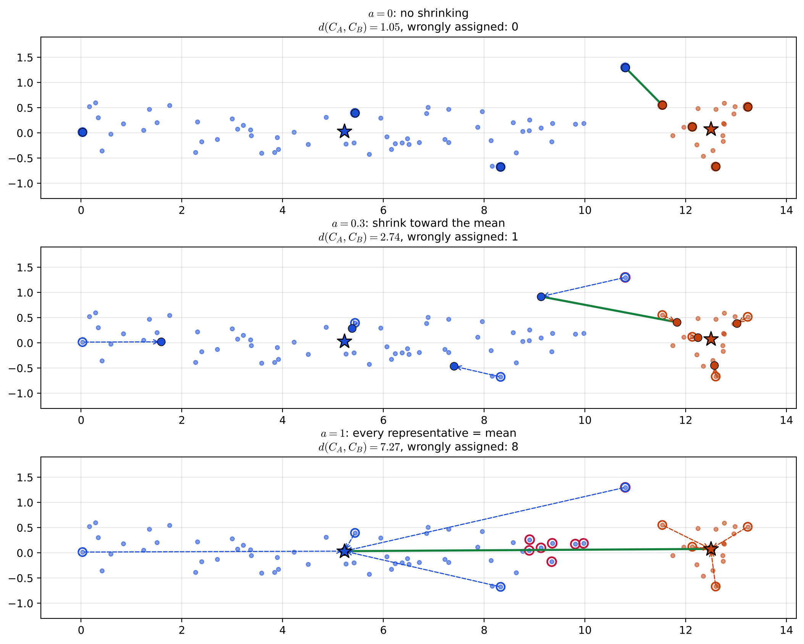
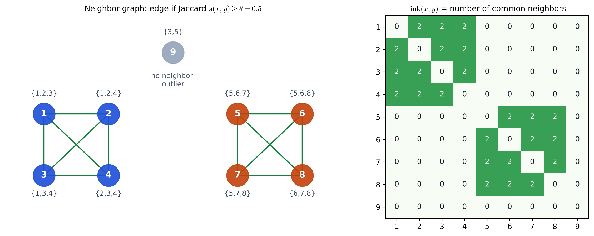
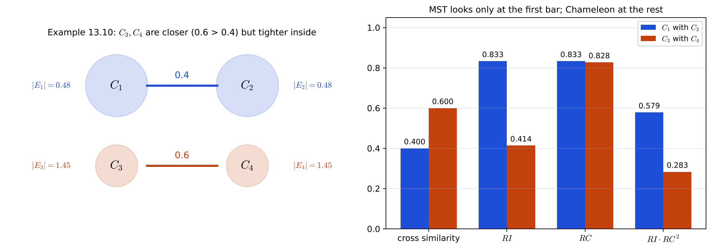

# Lecture 14 · KP08：大資料的階層分群：CURE、ROCK 與 Chameleon（Hierarchical clustering for large data: CURE, ROCK and Chameleon）

> 程度：研究生（grad）／Level: Graduate (grad)
>
> 第 14 週（2026-12-07）｜Clustering (1) – $k$-means & Hierarchical Clustering · KP08
>
> Week 14 (2026-12-07) | Clustering (1) – $k$-means & Hierarchical Clustering · KP08

## 學習目標（Learning objectives）

- 說明 CURE 如何用多個收縮後的代表點描述一群，以及收縮因子 $a$ 與抽樣的作用（Explain how CURE describes a group with several shrunken representatives, and the roles of the shrinking factor $a$ and sampling）。
- 在名義資料上算出 ROCK 的鄰居、link 與合併分數 $g$（Compute ROCK's neighbors, links and merging score $g$ on nominal data）。
- 用相對互連 $RI$ 與相對靠近 $RC$ 解釋 Chameleon 在例 13.10 為什麼不合併較近的那一對（Use relative interconnectivity $RI$ and relative closeness $RC$ to explain why Chameleon does not merge the closer pair in Example 13.10）。

## KP08：大資料的階層分群：CURE、ROCK 與 Chameleon（Hierarchical clustering for large data: CURE, ROCK and Chameleon）

**一句話重點**：一般的凝聚法至少要 $O(N^2)$，資料一大就跑不動；CURE 用幾個往均值收縮的代表點描群形並搭配抽樣，ROCK 對類別資料改數「共同鄰居」，Chameleon 則看兩群的連接相對於各自內部夠不夠強。

**One-sentence summary**: Ordinary agglomeration needs at least $O(N^2)$ and cannot cope with large data; CURE outlines a group's shape with a few representatives shrunk toward the mean and adds sampling, ROCK counts "common neighbors" for categorical data, and Chameleon asks whether the connection between two groups is strong enough relative to their own interiors.

### 1. 接住上一講的問題（Picking up the question）

前面的凝聚方案 GAS，工作量大約是 $N^3$，再怎麼改也很難低於 $O(N^2)$。
`[補充]` $N=100{,}000$ 時，相異度矩陣的上三角就有 $4{,}999{,}950{,}000$ 個數，光存下來就很吃力。
網頁探勘、生物資訊這類資料常常這麼大，所以需要專為大資料設計的階層法。

The generalized agglomerative scheme GAS needs about $N^3$ work, and even improved versions hardly go below $O(N^2)$.
`[Added]` For $N=100{,}000$, the upper triangle of the dissimilarity matrix already has $4{,}999{,}950{,}000$ entries, which is hard just to store.
Data in web mining and bioinformatics are often this large, so hierarchical methods designed for large data are needed.

**白話說明**：想像要替全國的學生分班。
一個一個比對所有學生的兩兩相似度做不完。
比較實際的做法是：每班只看幾個代表學生（CURE）、看誰跟誰有共同朋友（ROCK），或看兩班之間的交流跟班內的交流比起來夠不夠多（Chameleon）。
這個比喻只說明三種想法的方向，沒說明各自怎麼計算。

**Plain explanation**: Picture assigning every student in the country to classes.
Comparing every pair of students one by one is impossible.
A more practical approach is to look at only a few representative students per class (CURE), at who shares friends with whom (ROCK), or at whether the contact between two classes is strong compared with the contact inside each class (Chameleon).
This analogy only shows the direction of the three ideas, not how each one computes.

**先備自測**：確認你記得 KP04 的單連與 KP05 的 MST。

**Prerequisite check**: Make sure you remember single link from KP04 and the MST from KP05.

- 單連用兩群之間最近的一對點量距離（Single link measures distance by the closest pair across two groups）。
- 單連容易鏈化，會把細長的群接起來（Single link chains easily and joins elongated groups）。
- 圖由頂點與帶權重的邊組成（A graph consists of vertices and weighted edges）。

### 2. CURE：多個代表點往均值收縮（CURE: several representatives shrunk toward the mean）

CURE 是 Clustering Using REpresentatives 的縮寫。
它不用單一中心代表一群，而用 $k>1$ 個代表點組成的集合 $R_C$。
多個代表點比較能描出細長或不圓的群形。

CURE stands for Clustering Using REpresentatives.
Instead of a single center, it represents a group by a set $R_C$ of $k>1$ representatives.
Several representatives can outline elongated or non-round shapes better.

**挑代表與收縮**：

**Choosing and shrinking representatives**:

1. 先挑離均值 $\mathbf{m}_C$ 最遠的點放進 $R_C$（First put the point farthest from the mean $\mathbf{m}_C$ into $R_C$）。
2. 之後每次挑離目前 $R_C$ 最遠的點，直到有 $\min\{k,n_C\}$ 個；這樣挑出的是群裡最散開的點（Then repeatedly pick the point farthest from the current $R_C$ until there are $\min\{k,n_C\}$ of them; these are the most spread-out points of the group）。
3. 每個代表都往均值收縮：$\mathbf{x}\leftarrow(1-a)\mathbf{x}+a\,\mathbf{m}_C$，$a$ 是收縮因子（Shrink every representative toward the mean: $\mathbf{x}\leftarrow(1-a)\mathbf{x}+a\,\mathbf{m}_C$, where $a$ is the shrinking factor）。

最外圍的點常常是離群點，直接當代表會被它帶跑；往內縮一點，可以壓住離群點的影響。
兩群的距離取代表點對的最小值：

The outermost points are often outliers, and using them directly would let them mislead the result; shrinking inward suppresses their influence.
The distance between two groups is the minimum over pairs of representatives:

$$
d(C_i,C_j)=\min_{\mathbf{x}\in R_{C_i},\,\mathbf{y}\in R_{C_j}}d(\mathbf{x},\mathbf{y})\tag{13.28}
$$

有了這個距離，CURE 就是 GAS 的特例：每次併最近的兩群。
合併後只從原來兩群共 $2k$ 個代表中再挑 $k$ 個，不重掃全部點。
得到 $m$ 群後，沒當代表的點派給最近代表所屬的群。

With this distance, CURE is a special case of GAS: it always merges the two closest groups.
After a merge, it picks $k$ new representatives from only the $2k$ representatives of the two old groups, without rescanning all points.
Once $m$ groups are formed, every non-representative point goes to the group of its nearest representative.

**例子** `[補充]`：一條細長群 $A$（$60$ 點，其中一點是偏離的離群點）與一團圓形群 $B$（$20$ 點）緊貼在 $A$ 的右端外側。
取 $k=4$，比較三種收縮：

**Example** `[Added]`: a long group $A$ ($60$ points, one of them an outlier) and a round group $B$ ($20$ points) sitting just outside the right end of $A$.
With $k=4$, compare three amounts of shrinking:

- $a=0$：$A$ 的離群點本身當了代表，兩群距離只有 $1.05$，很可能太早被併在一起（$a=0$: the outlier of $A$ itself becomes a representative, and the distance between the groups is only $1.05$, so they may be merged too early）。
- $a=0.3$：離群點的代表被拉回，距離變成 $2.74$；派點時只有離群點本身跟了 $B$（$a=0.3$: the outlier's representative is pulled back and the distance becomes $2.74$; when assigning points, only the outlier itself goes with $B$）。
- $a=1$：所有代表都縮成均值，等於「一群一個中心」；$A$ 右端有 $8$ 點因為離 $B$ 的均值較近而被派錯（$a=1$: all representatives collapse to the mean, which is "one center per group"; $8$ points at the right end of $A$ are wrongly assigned because they are closer to the mean of $B$）。



**圖說 `lec14-kp08-large-data-hierarchical-f1-cure`**：先看上圖，空心圈是挑出的最散代表，實心點是收縮後的位置，星號是均值，綠線是式 $(13.28)$ 選中的最近代表對。
再看中圖，虛線箭頭把代表往星號推，離群點不再主導兩群距離。
注意下圖代表全縮進星號，紅圈標出 $A$ 右端被派錯的點：細長群只用一個中心是不夠的。〔功能：1、2〕

**Caption `lec14-kp08-large-data-hierarchical-f1-cure`**: Look first at the top panel: hollow circles are the most spread-out representatives, solid dots are their shrunken positions, stars are the means, and the green line is the closest representative pair chosen by Eq. $(13.28)$.
Then look at the middle panel: the dashed arrows push the representatives toward the stars, so the outlier no longer dominates the distance between groups.
Note that in the bottom panel all representatives collapse into the stars, and red circles mark the wrongly assigned points at the right end of $A$: one center is not enough for an elongated group. [Function: 1, 2]

**抽樣加速**：CURE 最壞仍是 $O(N^2\log_2N)$。
它先隨機抽 $N'$ 點，$N'$ 要夠大才不會把整個群漏掉。
再把資料切成 $p=N/N'$ 份，每份先凝聚到約 $N'/q$ 群（$q>1$ 由使用者給），合計最多 $N/q$ 個小群，再做第二次合併到 $m$ 群。
抽樣後最壞約 $O(N'^2\log_2N')$。

**Speed-up by sampling**: CURE's worst case is still $O(N^2\log_2N)$.
It first draws a random sample of $N'$ points, large enough not to miss a whole group.
It then splits the data into $p=N/N'$ parts, agglomerates each part to about $N'/q$ groups ($q>1$ given by the user), giving at most $N/q$ small groups in all, and merges these in a second pass down to $m$ groups.
After sampling the worst case is about $O(N'^2\log_2N')$.

`[補充]` 以 $N=100{,}000$、$N'=2{,}500$（原文實驗建議的 $2.5\%$）來算，$N^2\log_2N$ 是 $N'^2\log_2N'$ 的約 $2354$ 倍。

`[Added]` With $N=100{,}000$ and $N'=2{,}500$ (the $2.5\%$ suggested by the experiments in the source), $N^2\log_2N$ is about $2354$ times $N'^2\log_2N'$.

**參數**：$k$ 要夠大才抓得住形狀；$a$ 很小時行為像 MST，$a=1$ 時像一群只留一個均值。
若離群點自己結成很小的群，演算法結束前會把人數很少的群當離群點移除。

**Parameters**: $k$ must be large enough to capture shapes; with a very small $a$ it behaves like the MST, and with $a=1$ like keeping one mean per group.
If outliers form tiny groups of their own, the algorithm removes groups with very few points as outliers before it finishes.

### 3. ROCK：用共同鄰居當鏈結（ROCK: common neighbors as links）

ROCK 是 RObust Clustering using linKs 的縮寫，適合名義（類別）特徵。
這類資料的均值沒有意義，$\ell_p$ 距離也量不好「有多像」。

ROCK stands for RObust Clustering using linKs and suits nominal (categorical) features.
For such data the mean is meaningless, and $\ell_p$ distances do not measure "how alike" well.

**正式定義**：選相似度函數 $s(\cdot)$ 與門檻 $\theta$，若 $s(\mathbf{x},\mathbf{y})\ge\theta$，就說兩點是**鄰居**。
$\operatorname{link}(\mathbf{x},\mathbf{y})$ 是兩點的**共同鄰居**個數。
把鄰居關係畫成圖，它正好是連接兩點、長度為 $2$ 的不同路徑條數。

**Formal definition**: Choose a similarity function $s(\cdot)$ and a threshold $\theta$; two points are **neighbors** if $s(\mathbf{x},\mathbf{y})\ge\theta$.
$\operatorname{link}(\mathbf{x},\mathbf{y})$ is the number of **common neighbors** of the two points.
Drawing neighbor relations as a graph, it is exactly the number of distinct paths of length $2$ joining the two points.

原文假設群 $C_i$ 的每一點在群內約有 $n_i^{f(\theta)}$ 個鄰居，所以群內期望的 link 總數約是 $n_i^{1+2f(\theta)}$。
兩群的合併分數用「觀察到的跨群 link」除以「期望的跨群 link」：

The source assumes that each point of group $C_i$ has about $n_i^{f(\theta)}$ neighbors inside it, so the expected total number of links inside the group is about $n_i^{1+2f(\theta)}$.
The merging score of two groups divides "observed cross links" by "expected cross links":

$$
g(C_i,C_j)=\frac{\operatorname{link}(C_i,C_j)}{(n_i+n_j)^{1+2f(\theta)}-n_i^{1+2f(\theta)}-n_j^{1+2f(\theta)}}\tag{13.29}
$$

其中 $\operatorname{link}(C_i,C_j)=\sum_{\mathbf{x}\in C_i,\,\mathbf{y}\in C_j}\operatorname{link}(\mathbf{x},\mathbf{y})$。
每次合併 $g$ 最大的一對，直到剩 $m$ 群，或所有跨群 link 都是 $0$。
文獻建議 $f(\theta)=(1-\theta)/(1+\theta)$；這是很強的假設，群的結構不符合時結果可能變差。

Here $\operatorname{link}(C_i,C_j)=\sum_{\mathbf{x}\in C_i,\,\mathbf{y}\in C_j}\operatorname{link}(\mathbf{x},\mathbf{y})$.
Each iteration merges the pair with the largest $g$, until $m$ groups remain or every cross link is $0$.
The literature suggests $f(\theta)=(1-\theta)/(1+\theta)$; this is a strong assumption, and results may suffer when the group structure does not fit it.

**例子** `[補充]`：九筆購物籃，每筆是一組商品編號；相似度用 Jaccard 係數（共同商品數除以聯集商品數），$\theta=0.5$。

**Example** `[Added]`: nine shopping baskets, each a set of item numbers; similarity is the Jaccard coefficient (common items divided by items in the union), with $\theta=0.5$.

- 籃 $1$ 到 $4$ 都由商品 $1$–$4$ 中的三樣組成，兩兩 Jaccard 都是 $2/4=0.5$，互為鄰居（Baskets $1$ to $4$ each hold three of items $1$–$4$; every pair has Jaccard $2/4=0.5$, so they are all neighbors）。
- 籃 $5$ 到 $8$ 同理用商品 $5$–$8$（Baskets $5$ to $8$ are built the same way from items $5$–$8$）。
- 籃 $9=\{3,5\}$ 跟其他籃子的 Jaccard 最多只有 $0.25$，沒有鄰居（Basket $9=\{3,5\}$ has Jaccard at most $0.25$ with any other basket, so it has no neighbor）。

籃 $1$ 與籃 $2$ 的共同鄰居是籃 $3$、$4$，所以 link 是 $2$。
$f(0.5)=1/3$，指數是 $5/3$，兩個單點群的期望 link 是 $2^{5/3}-2=1.1748$，所以 $g=2/1.1748=1.7024$。
依 $g$ 合併，兩組籃子各自併成一群；之後跨群 link 全是 $0$，演算法停在三群，籃 $9$ 自成一群，可以當離群點處理。

The common neighbors of baskets $1$ and $2$ are baskets $3$ and $4$, so their link is $2$.
$f(0.5)=1/3$ and the exponent is $5/3$; the expected link between two single-point groups is $2^{5/3}-2=1.1748$, so $g=2/1.1748=1.7024$.
Merging by $g$, each set of baskets becomes one group; then every cross link is $0$, so the algorithm stops at three groups, and basket $9$ stays alone and can be treated as an outlier.



**圖說 `lec14-kp08-large-data-hierarchical-f2-rock`**：先看左圖，綠線連起 Jaccard 至少 $0.5$ 的籃子，兩組各成一個完全圖，籃 $9$ 沒有任何邊。
再看右圖，每格是兩籃的共同鄰居數，兩個綠色方塊對應兩組。
注意跨組的格子全是 $0$，所以 ROCK 不會把兩組併在一起。〔功能：1、3〕

**Caption `lec14-kp08-large-data-hierarchical-f2-rock`**: Look first at the left panel: green lines join baskets with Jaccard at least $0.5$, each set forms a complete graph, and basket $9$ has no edge.
Then look at the right panel: each cell is the number of common neighbors of two baskets, and the two green blocks correspond to the two sets.
Note that all cells across the sets are $0$, so ROCK never merges the two sets. [Function: 1, 3]

**為什麼用期望值當分母**：大群光靠人數就會有很多 link。
除以「這麼大的兩群理當有多少 link」，才能比較不同大小的群。

**Why divide by the expected value**: Large groups have many links just because of their size.
Dividing by "how many links two groups this large should have" makes groups of different sizes comparable.

資料很大時，ROCK 也先抽樣；沒抽到的點 $\mathbf{z}$，派給讓 $N_i/(n_{L_i}+1)^{f(\theta)}$ 最大的群，其中 $N_i$ 是 $\mathbf{z}$ 在群的子集 $L_i$ 裡的鄰居數。
在某些條件下 ROCK 的群就是 link 圖的連通分量，因此有只找連通分量的快速版 QROCK。

For large data ROCK also samples first; a point $\mathbf{z}$ not in the sample goes to the group maximizing $N_i/(n_{L_i}+1)^{f(\theta)}$, where $N_i$ is the number of neighbors of $\mathbf{z}$ in a subset $L_i$ of the group.
Under certain conditions ROCK's groups are the connected components of the link graph, so there is a fast version, QROCK, that only finds connected components.

### 4. Chameleon：相對互連與相對靠近（Chameleon: relative interconnectivity and relative closeness）

CURE 每群固定用 $k$ 個代表，ROCK 用 $f(\theta)$ 限制群的結構，兩者都先假設群的長相。
Chameleon 改看相對量：兩群之間的連接，跟各自內部比起來夠不夠強。

CURE fixes $k$ representatives per group and ROCK constrains group structure through $f(\theta)$; both assume what groups look like in advance.
Chameleon looks at relative quantities instead: is the connection between two groups strong compared with each group's interior?

**圖的名詞**：每點是一個頂點，邊權是兩點的相似度。
把一群切成兩塊時，橫跨兩邊的邊叫**割**；權重和最小的叫**最小割**；再要求兩邊人數大致相等，最小的叫**最小割二等分**。

**Graph terms**: each point is a vertex, and edge weights are similarities.
When a group is cut into two parts, the edges crossing between them form a **cut**; the one with the smallest total weight is the **minimum cut**; adding the requirement that both sides have about the same size gives the **minimum cut bisector**.

令 $|E_{ij}|$ 是連接 $C_i$、$C_j$ 的邊權總和，$|E_i|$ 是 $C_i$ 的最小割二等分的權重和；$S_{ij}$、$S_i$ 是對應的平均邊權。

Let $|E_{ij}|$ be the total weight of edges joining $C_i$ and $C_j$, and $|E_i|$ the total weight of the minimum cut bisector of $C_i$; $S_{ij}$ and $S_i$ are the corresponding average edge weights.

$$
RI_{ij}=\frac{|E_{ij}|}{\frac{|E_i|+|E_j|}{2}}\tag{13.30}
$$

$$
RC_{ij}=\frac{S_{ij}}{\frac{n_i}{n_i+n_j}S_i+\frac{n_j}{n_i+n_j}S_j}\tag{13.31}
$$

$RI$ 比較跨群邊的總量與兩群內部割的平均，$RC$ 比較跨群邊的平均強度與內部邊的平均強度。
內部越緊的群，分母越大，越不容易被併掉。

$RI$ compares the total of cross edges with the average inner cut of the two groups, and $RC$ compares the average strength of cross edges with that of inner edges.
The tighter a group is inside, the larger the denominator and the harder it is to merge away.

**流程**：先分裂、再凝聚。

**Procedure**: split first, then agglomerate.

1. 建 $k$ 近鄰圖：只要一方把另一方算進自己的 $k$ 近鄰就連邊，$k$ 常取 $5$ 到 $20$（Build a $k$-nearest-neighbor graph: connect two points if either counts the other among its $k$ nearest neighbors; $k$ is usually $5$ to $20$）。
2. 分裂：每次切開目前最大的群，割的權重和盡量小，且每塊至少佔原頂點的 $25\%$；直到每群點數少於 $q$（常取總點數的 $1\%$ 到 $5\%$）（Split: repeatedly cut the current largest group with as small a cut weight as possible, each part keeping at least $25\%$ of the vertices, until every group has fewer than $q$ points, often $1\%$ to $5\%$ of the total）。
3. 凝聚：兩群同時滿足 $RI_{ij}\ge T_{RI}$ 且 $RC_{ij}\ge T_{RC}$ 才合併（式 13.32）；或改成最大化 $RI_{ij}\,RC_{ij}^{a}$（式 13.33），$a$ 常取 $1.5$ 到 $3$（Agglomerate: merge two groups only if $RI_{ij}\ge T_{RI}$ and $RC_{ij}\ge T_{RC}$ both hold (Eq. 13.32); or instead maximize $RI_{ij}\,RC_{ij}^{a}$ (Eq. 13.33), with $a$ usually $1.5$ to $3$）。

**例子**：例 13.10 有四群。
$C_1$、$C_2$ 之間的相似度是 $0.4$，$C_3$、$C_4$ 之間是 $0.6$，後者較近；但 $C_3$、$C_4$ 內部緊得多。
原文數字為 $|E_1|=|E_2|=0.48$、$|E_3|=|E_4|=1.45$、$S_1=S_2=0.48$、$S_3=S_4=0.725$、$|E_{12}|=S_{12}=0.4$、$|E_{34}|=S_{34}=0.6$。

**Example**: Example 13.10 has four groups.
The similarity between $C_1$ and $C_2$ is $0.4$ and between $C_3$ and $C_4$ is $0.6$, so the latter pair is closer; but $C_3$ and $C_4$ are much tighter inside.
The source's numbers are $|E_1|=|E_2|=0.48$, $|E_3|=|E_4|=1.45$, $S_1=S_2=0.48$, $S_3=S_4=0.725$, $|E_{12}|=S_{12}=0.4$ and $|E_{34}|=S_{34}=0.6$.

- $RI_{12}=0.4/0.48=0.833$，$RI_{34}=0.6/1.45=0.414$（$RI_{12}=0.4/0.48=0.833$ and $RI_{34}=0.6/1.45=0.414$）。
- $RC_{12}=0.4/0.48=0.833$，$RC_{34}=0.6/0.725=0.828$；`[補充]` 因為 $S_i=S_j$，權重 $n_i$、$n_j$ 不影響結果（$RC_{12}=0.4/0.48=0.833$ and $RC_{34}=0.6/0.725=0.828$; `[Added]` because $S_i=S_j$, the weights $n_i$ and $n_j$ do not affect the result）。

兩個相對分數都支持 $C_1$、$C_2$，所以 Chameleon 合併 $C_1$、$C_2$；MST 只看跨群邊，會先合併較近的 $C_3$、$C_4$。
`[補充]` 用式 $(13.33)$、$a=2$：$C_1$、$C_2$ 得 $0.579$，$C_3$、$C_4$ 得 $0.283$，結論相同。

Both relative scores favour $C_1$ and $C_2$, so Chameleon merges $C_1$ and $C_2$; the MST looks only at cross edges and would merge the closer $C_3$ and $C_4$ first.
`[Added]` With Eq. $(13.33)$ and $a=2$: $C_1,C_2$ score $0.579$ and $C_3,C_4$ score $0.283$, the same conclusion.



**圖說 `lec14-kp08-large-data-hierarchical-f3-chameleon`**：先看左圖，兩條線上的數字是跨群相似度，群旁的 $|E_i|$ 是內部割，橘色兩群畫得較小，表示內部較緊。
再看右圖，第一組長條（跨群相似度）橘色較高，這是 MST 看的；後三組藍色都較高，這是 Chameleon 看的。
注意 $RC$ 兩者很接近，真正拉開差距的是 $RI$。〔功能：1、2〕

**Caption `lec14-kp08-large-data-hierarchical-f3-chameleon`**: Look first at the left panel: the numbers on the two lines are cross similarities, $|E_i|$ beside each group is its inner cut, and the two orange groups are drawn smaller to show they are tighter inside.
Then look at the right panel: in the first set of bars (cross similarity) orange is taller, which is what the MST looks at; in the other three sets blue is taller, which is what Chameleon looks at.
Note that the two $RC$ values are close; the real gap comes from $RI$. [Function: 1, 2]

**成本與限制**：Chameleon 對 $k$、$q$、$a$ 不太敏感，但需要較多資料，內部割與跨群邊才估得準。
$N$ 很大時最壞約 $O(N(\log_2N+m))$，$m$ 是分裂後的群數。
另一個超大資料方法 BIRCH 先把摘要存進記憶體中的 CF-tree，再對摘要做凝聚，可做到 $O(N)$。

**Cost and limits**: Chameleon is not very sensitive to $k$, $q$ and $a$, but it needs more data to estimate inner cuts and cross edges accurately.
For large $N$ the worst case is about $O(N(\log_2N+m))$, where $m$ is the number of groups after splitting.
Another method for very large data, BIRCH, stores summaries in an in-memory CF-tree and agglomerates the summaries, reaching $O(N)$.

**常見迷思**：「兩群越近，就越該先合併。」
不一定。
例 13.10 中 $C_3$、$C_4$ 比較近，但它們各自內部更緊，跨群那條邊相對來說不算什麼；Chameleon 因此先併 $C_1$、$C_2$。

**Common misconception**: "The closer two groups are, the sooner they should merge."
Not necessarily.
In Example 13.10, $C_3$ and $C_4$ are closer, but each is even tighter inside, so the cross edge counts for little relatively; Chameleon therefore merges $C_1$ and $C_2$ first.

### 5. 與實作的連結（Connection to implementation）

下面的程式算出購物籃的 Jaccard 鄰居與 link，再算出例 13.10 的 $RI$、$RC$。
注意兩件事：link 矩陣可以用鄰接矩陣自乘得到（對角線不算）；$RI$ 的分母是兩群內部割的平均。

The code below computes the Jaccard neighbors and links of the baskets, then $RI$ and $RC$ for Example 13.10.
Note two points: the link matrix is the adjacency matrix multiplied by itself (ignoring the diagonal), and the denominator of $RI$ is the average inner cut of the two groups.

```python
import numpy as np

B = [{1, 2, 3}, {1, 2, 4}, {1, 3, 4}, {2, 3, 4}, {5, 6, 7}, {5, 6, 8}, {5, 7, 8}, {6, 7, 8}, {3, 5}]
theta = 0.5
jac = lambda a, b: len(a & b) / len(a | b)
A = np.array([[int(i != j and jac(B[i], B[j]) >= theta) for j in range(9)] for i in range(9)])
L = A @ A                                   # 長度 2 的路徑數 / number of length-2 paths
np.fill_diagonal(L, 0)
print("link(1,2) =", L[0, 1], " link(1,5) =", L[0, 4])     # 2 0
e = 1 + 2 * (1 - theta) / (1 + theta)       # 1 + 2 f(theta) = 5/3
print("g(1,2) =", round(L[0, 1] / (2 ** e - 1 - 1), 4))    # 1.7024

RI = lambda Eij, Ei, Ej: Eij / ((Ei + Ej) / 2)
RC = lambda Sij, Si, Sj: Sij / (0.5 * Si + 0.5 * Sj)      # 兩群等大 / equal sizes
print(round(RI(0.4, 0.48, 0.48), 3), round(RI(0.6, 1.45, 1.45), 3))      # 0.833 0.414
print(round(RC(0.4, 0.48, 0.48), 3), round(RC(0.6, 0.725, 0.725), 3))    # 0.833 0.828
```

**留給下一節的問題**：本週的分群法，不論 $k$-means 還是階層法，每個點都只屬於一群。
如果一個點介於兩群之間，能不能讓它「部分屬於」兩群？
後續章節會用模糊與機率式分群處理。

**The question for the next section**: In this week's methods, both $k$-means and hierarchical ones, every point belongs to exactly one group.
If a point lies between two groups, can it "partly belong" to both?
Later chapters handle this with fuzzy and probabilistic clustering.

### 6. 小練習與解題示範（Practice and worked solutions）

**小練習** `[補充]`：先寫下理由，再看解答。

**Practice** `[Added]`: Write your reasoning before reading the solutions.

1. 題 1：代表點 $\mathbf{x}=[10,2]^T$、群均值 $\mathbf{m}_C=[4,0]^T$、$a=0.5$，收縮後在哪裡（A representative $\mathbf{x}=[10,2]^T$, group mean $\mathbf{m}_C=[4,0]^T$, $a=0.5$: where is it after shrinking）？
2. 題 2：三點兩兩互為鄰居（三角形），每對的 link 是多少？若只有兩點互為鄰居、沒有第三點呢（Three points that are pairwise neighbors (a triangle): what is the link of each pair? What if only two points are neighbors and there is no third point）？
3. 題 3：例 13.10 若 $|E_{34}|$ 提高到 $1.2$，$RI_{34}$ 是多少？會改變 $RI$ 的結論嗎（In Example 13.10, if $|E_{34}|$ rises to $1.2$, what is $RI_{34}$, and does it change the $RI$ conclusion）？

**題 1 解題示範**：$(1-0.5)[10,2]^T+0.5[4,0]^T=[7,1]^T$，正好在代表點與均值的中點。

**Question 1 worked solution**: $(1-0.5)[10,2]^T+0.5[4,0]^T=[7,1]^T$, exactly midway between the representative and the mean.

**題 2 解題示範**：三角形中每對的共同鄰居只有第三點，所以 link 都是 $1$。
只有兩點時沒有第三點可當共同鄰居，link 是 $0$，即使兩點互為鄰居。

**Question 2 worked solution**: In a triangle the only common neighbor of each pair is the third point, so every link is $1$.
With only two points there is no third point to be a common neighbor, so the link is $0$, even though the two points are neighbors.

**題 3 解題示範**：$RI_{34}=1.2/1.45=0.828<0.833=RI_{12}$，$RI$ 仍略偏向 $C_1$、$C_2$。
跨群相似度要超過 $1.45\times0.833\approx1.21$，$RI$ 的結論才會翻轉。

**Question 3 worked solution**: $RI_{34}=1.2/1.45=0.828<0.833=RI_{12}$, so $RI$ still slightly favours $C_1$ and $C_2$.
The cross similarity must exceed $1.45\times0.833\approx1.21$ before the $RI$ conclusion flips.

## 術語表（Glossary）

| 中文術語 | English term |
|---|---|
| 代表點 | Representative |
| 收縮因子 | Shrinking factor |
| 隨機抽樣 | Random sampling |
| 名義特徵 | Nominal feature |
| 鄰居 | Neighbor |
| 鏈結 | Link |
| 共同鄰居 | Common neighbor |
| Jaccard 係數 | Jaccard coefficient |
| 割 | Cut |
| 最小割二等分 | Minimum cut bisector |
| 相對互連 | Relative interconnectivity |
| 相對靠近 | Relative closeness |
| $k$ 近鄰圖 | $k$-nearest-neighbor graph |

## 銜接與來源（Connections and sources）

本講是第 14 週的最後一個單元；下一週進入其他分群方法。

This lecture is the last unit of week 14; the next week moves on to other clustering methods.

- 前一單元：[KP07 在哪一層切樹](lec14-kp07-cut-level.md)（Previous unit: where to cut the tree）。
- 本週第一單元：[KP01 $k$-means](lec14-kp01-kmeans.md)（First unit of the week: $k$-means）。
- 來源：[Hierarchical Clustering §13.5](https://ndhuccc.github.io/CCC-LNS/PR_115/Ch13-hierarchical-clustering/index.html)，讀取日期 2026-11-13（Source accessed 2026-11-13）。
- 書目：Theodoridis and Koutroumbas, *Pattern Recognition*, 4th ed., 2008；見[參考資料](../references/README.md)（See the bibliography）。

本講以自己的文字解釋來源。
GAS 的複雜度、CURE 的代表點挑選與收縮、式 $(13.28)$、合併後重挑代表、派點、抽樣與兩次合併、複雜度、參數敏感度與離群點處理、ROCK 的鄰居、link、$f(\theta)$、期望 link、式 $(13.29)$、停止條件、抽樣後派點、建議的 $f(\theta)$ 與 QROCK、Chameleon 的割與最小割二等分、式 $(13.30)$ 至 $(13.33)$、分裂與凝聚流程、例 13.10 的數字與結論、成本與 BIRCH 取自來源。
全國分班比喻、矩陣大小的估算、細長群與圓形群的 CURE 例子、工作量比、購物籃的 ROCK 例子、$RC$ 不受權重影響的說明、$a=2$ 的分數、常見迷思、程式、圖與練習皆為 `[補充]`。

This lecture independently explains the source.
The complexity of GAS; CURE's choice and shrinking of representatives, Eq. $(13.28)$, re-choosing representatives after a merge, assigning points, sampling with two merging passes, complexity, parameter sensitivity and outlier handling; ROCK's neighbors, links, $f(\theta)$, expected links, Eq. $(13.29)$, the stopping rule, assigning points after sampling, the suggested $f(\theta)$ and QROCK; Chameleon's cuts and minimum cut bisector, Eqs. $(13.30)$ to $(13.33)$, the split-then-agglomerate procedure, the numbers and conclusion of Example 13.10, the cost, and BIRCH come from the source.
The national class-assignment analogy, the estimate of the matrix size, the CURE example with a long and a round group, the work ratio, the ROCK shopping-basket example, the note that $RC$ is unaffected by the weights, the scores with $a=2$, the common misconception, the code, the figures and the practice are `[Added]`.
