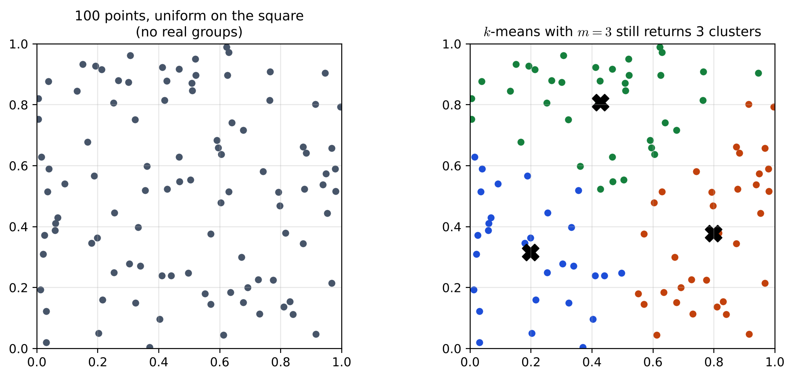
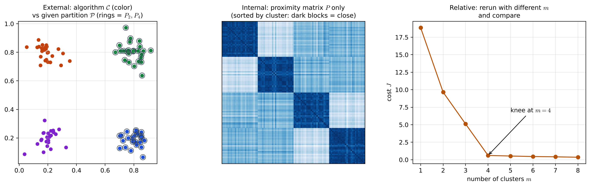
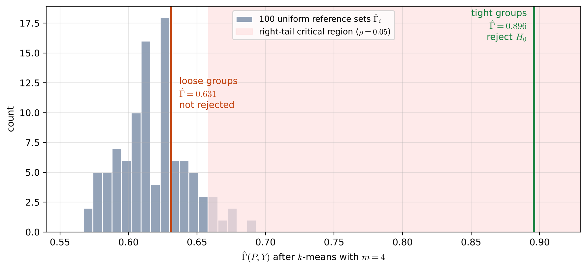

# Lecture 15 · KP01：為什麼要驗證分群結果（Why clustering results must be validated）

> 程度：研究生（grad）／Level: Graduate (grad)
>
> 第 15 週（2026-12-14）｜Clustering (2) – Evaluation · KP01
>
> Week 15 (2026-12-14) | Clustering (2) – Evaluation · KP01

## 學習目標（Learning objectives）

- 說明為什麼分群演算法的輸出不能直接相信，並分辨「分群傾向」與「叢集效度」（Explain why the output of a clustering algorithm cannot be trusted as is, and distinguish clustering tendency from cluster validity）。
- 說出外部、內部、相對三種效度準則各自拿什麼來比（State what each of the external, internal and relative criteria compares against）。
- 描述效度檢定的骨架：隨機結構的虛無假設、參考族群、統計量與 Monte Carlo 右尾判讀（Describe the skeleton of a validity test: a null hypothesis of random structure, a reference population, a statistic and a Monte Carlo right-tail decision）。

## KP01：為什麼要驗證分群結果（Why clustering results must be validated）

**一句話重點**：分群演算法就算面對沒有結構的資料，也會硬切出叢集；所以要先問資料有沒有分群傾向，再用外部、內部或相對準則評估這次的結果，而外部與內部準則的判斷方式，是拿結果和「隨機結構」的參考族群比較。

**One-sentence summary**: A clustering algorithm will carve out clusters even from data with no structure; so we first ask whether the data have a clustering tendency, then assess the result with external, internal or relative criteria, and the external and internal criteria judge a result by comparing it with a reference population of "random structure".

### 1. 接住上一週的問題（Picking up the question）

前兩週學了 $k$-means、$k$-medoids 與階層分群，每一種都會交出一個分群結果。
可是第 14 週的例子也提醒過：$k$-means 會停在局部最小，會把大團切開，階層法換一種連結法樹就變樣。
這一週要問：拿到一個分群結果之後，怎麼知道它可不可信？

The last two weeks covered $k$-means, $k$-medoids and hierarchical clustering, and each one hands back a clustering.
But the examples of Week 14 also warned that $k$-means can stop at a local minimum or split a large group, and that a hierarchical tree changes with the linkage.
This week asks: once we have a clustering, how do we know whether it can be trusted?

**白話說明**：想像用一把切蛋糕的刀，規定一定要切成三塊。
不管蛋糕上有沒有三種口味，刀子都會切出三塊。
切出三塊，不代表蛋糕真的分成三種口味。
這個比喻只說明「演算法一定有輸出」，沒說明要怎麼檢查輸出。

**Plain explanation**: Picture a cake knife that is required to cut exactly three pieces.
Whether or not the cake has three flavors, the knife will produce three pieces.
Getting three pieces does not mean the cake really has three flavors.
This analogy only shows that "the algorithm always produces an output"; it does not say how to check that output.

**先備自測**：確認你記得 $k$-means 的代價 $J$、接近矩陣，以及第 5 章假設檢定的基本用語。

**Prerequisite check**: Make sure you remember the $k$-means cost $J$, the proximity matrix, and the basic terms of hypothesis testing from Chapter 5.

- 接近矩陣 $P$ 的第 $(i,j)$ 格是兩點的相異度或相似度（Entry $(i,j)$ of the proximity matrix $P$ is the dissimilarity or similarity of two points）。
- $k$-means 的群數 $m$ 要事先給（The number of groups $m$ of $k$-means must be given in advance）。
- 虛無假設 $H_0$ 為真卻被拒絕，叫型一誤差（Rejecting a true null hypothesis $H_0$ is a type I error）。

### 2. 演算法會強加結構（Algorithms impose structure）

前面幾章的演算法有個共同癖好：它們會把分群結構強加到資料 $X$ 上。
如果 $X$ 其實沒有那種結構，跑出來的結果就不能代表 $X$ 的真實樣貌。

The algorithms of the previous chapters share a habit: they impose a clustering structure on the data $X$.
If $X$ does not actually have that structure, the result does not represent what $X$ really looks like.

**例子** `[補充]`：在正方形裡均勻亂撒 $100$ 個點，點和點之間沒有任何真正的群。
用 $k$-means、$m=3$ 去分，它照樣交出三群，大小是 $29$、$34$、$37$，三個代表分別落在左下、右下與上方。
結果看起來很整齊，但這只是演算法照規定切出來的。

**Example** `[Added]`: Scatter $100$ points uniformly in a square, with no real groups among them.
Splitting them with $k$-means and $m=3$ still returns three groups, of sizes $29$, $34$ and $37$, with representatives in the lower left, lower right and top.
The result looks tidy, but it is only what the algorithm was told to cut.



**圖說 `lec15-kp01-validity-intro-f1-imposed-structure`**：先看左圖，$100$ 個灰點在正方形裡均勻散開，沒有看得出的群。
再看右圖，$k$-means 把同一批點塗成三種顏色，黑色叉號是三個代表。
注意兩圖的點完全相同，三群是演算法加上去的。〔功能：1、3〕

**Caption `lec15-kp01-validity-intro-f1-imposed-structure`**: Look first at the left panel: $100$ gray points spread uniformly over the square, with no visible groups.
Then look at the right panel: $k$-means colors the same points with three colors, and the black crosses are the three representatives.
Note that the points in both panels are identical; the three groups were added by the algorithm. [Function: 1, 3]

因此，在套用演算法之前，最好先有跡象顯示向量真的成群。
不先找出群、只檢查 $X$ 有沒有分群結構，這件事叫**分群傾向**（clustering tendency），在 KP07 再談。
確認有結構之後，還要對演算法的產出做量化評估，這整套工作叫**叢集效度**（cluster validity）。

So before applying an algorithm, there should preferably be some sign that the vectors really form groups.
Checking whether $X$ has a clustering structure, without finding the groups, is called **clustering tendency**, discussed in KP07.
Once structure is confirmed, the algorithm's output still needs a quantitative assessment; this whole body of work is called **cluster validity**.

**常見迷思**：「分群結果很整齊，所以資料一定有群。」
不對。
整齊只表示演算法完成了它的工作，上面均勻資料的例子就很整齊。
效度方法也只是專家手上的工具，不是自動給出真理的機器。

**Common misconception**: "The clustering looks tidy, so the data must have groups."
That is wrong.
Tidiness only means the algorithm finished its job; the uniform example above is also tidy.
Validity methods are tools for an expert, not machines that output truth automatically.

### 3. 三種效度準則（Three kinds of validity criteria）

**正式定義**：令 $\mathcal{C}$ 是對 $X$ 套用分群演算法得到的結構。
它可以是階層演算法的一整串劃分，也可以是單一劃分。
評估 $\mathcal{C}$ 有三個方向：

**Formal definition**: Let $\mathcal{C}$ be the structure obtained by applying a clustering algorithm to $X$.
It can be a whole sequence of partitions from a hierarchical algorithm, or a single partition.
There are three directions for assessing $\mathcal{C}$:

- **外部準則**：拿一個獨立給定、反映你對結構直覺的劃分 $\mathcal{P}$ 來評 $\mathcal{C}$（**External criteria**: assess $\mathcal{C}$ against an independently given partition $\mathcal{P}$ that reflects your intuition about the structure）。
- **內部準則**：只用 $X$ 本身的量，例如接近矩陣，來評 $\mathcal{C}$（**Internal criteria**: assess $\mathcal{C}$ using only quantities of $X$ itself, such as the proximity matrix）。
- **相對準則**：把 $\mathcal{C}$ 和同一演算法改參數、或換一種演算法得到的結構互相比較（**Relative criteria**: compare $\mathcal{C}$ with the structures obtained from the same algorithm with other parameters, or from other algorithms）。

**例子** `[補充]`：用四團各 $25$ 點、標準差 $0.06$ 的資料示範三個方向（下圖）。
外部準則把 $k$-means 的顏色和真正的四組標籤對照；內部準則只看點和點的距離；相對準則把 $m$ 從 $1$ 換到 $8$，看代價 $J$ 在哪裡轉彎。

**Example** `[Added]`: Data with four groups of $25$ points and standard deviation $0.06$ illustrate the three directions (figure below).
The external criterion compares the $k$-means colors with the true four-group labels; the internal criterion looks only at the distances between points; the relative criterion changes $m$ from $1$ to $8$ and sees where the cost $J$ bends.



**圖說 `lec15-kp01-validity-intro-f2-three-directions`**：先看左圖，顏色是演算法的 $\mathcal{C}$，外加圓圈的點屬於外部劃分的 $P_2$、$P_4$，兩者對得很整齊。
再看中圖，接近矩陣依群排序後出現四個深色方塊，表示群內距離近。
最後看右圖，$J$ 從 $m=1$ 一路下降，到 $m=4$ 轉成幾乎持平。〔功能：1、3〕

**Caption `lec15-kp01-validity-intro-f2-three-directions`**: Look first at the left panel: the colors are the algorithm's $\mathcal{C}$, and the ringed points belong to $P_2$ and $P_4$ of the external partition; the two line up neatly.
Then look at the middle panel: sorted by cluster, the proximity matrix shows four dark blocks, meaning within-group distances are small.
Finally look at the right panel: $J$ falls steadily from $m=1$ and turns almost flat at $m=4$. [Function: 1, 3]

**怎麼選方向**：有獨立的標籤劃分時走外部；只有資料本身時走內部；想挑參數或挑演算法時走相對。
三個方向回答的問題不同，指數再漂亮，方向選錯也是答非所問。

**How to choose a direction**: use external criteria when an independent labeled partition exists; internal criteria when only the data are available; relative criteria when choosing parameters or algorithms.
The three directions answer different questions; even a beautiful index answers the wrong question if the direction is wrong.

### 4. 效度檢定的骨架（The skeleton of a validity test）

外部與內部準則都依賴統計假設檢定。
這裡不推導，只帶出本週要用的結論。

External and internal criteria both rely on statistical hypothesis testing.
We do not derive it here; we only bring out the conclusions needed this week.

**虛無假設改成「隨機結構」**：一般的檢定問「某個參數等不等於某個值」。
效度檢定問的是：$X$ 的結構是不是隨機的。
所以虛無假設 $H_0$ 是「$X$ 的結構是隨機的」。

**The null hypothesis becomes "random structure"**: an ordinary test asks whether a parameter equals some value.
A validity test asks whether the structure of $X$ is random.
So the null hypothesis $H_0$ is "the structure of $X$ is random".

做法分兩步：先在隨機假設下產生一群參考資料；再定義一個能反映結構的統計量 $q$，把真實 $X$ 的 $q$ 和參考族群的值比較。

The procedure has two steps: first generate a reference population of data under the randomness hypothesis; then define a statistic $q$ that reflects structure, and compare the $q$ of the real $X$ with the values of the reference population.

產生參考族群有三種常見假設：

There are three common hypotheses for generating the reference population:

- **隨機位置**：適合比率尺度的資料，把 $N$ 個點依均勻分布丟進某個區域，例如超立方體；外部、內部準則都可用（**Random position**: for ratio-scale data, drop $N$ points uniformly into a region such as a hypercube; usable for both external and internal criteria）。
- **隨機圖**：適合只有序數接近度的資料，把 $1$ 到 $N(N-1)/2$ 的名次隨機填進秩序矩陣的上三角（**Random graph**: for data with only ordinal proximities, fill the ranks $1$ to $N(N-1)/2$ randomly into the upper triangle of a rank matrix）。
- **隨機標籤**：假設把 $X$ 分成 $m$ 群的所有貼標籤方式同樣可能，用來檢驗外部給定的劃分是否和資料吻合（**Random label**: assume all ways of labeling $X$ into $m$ groups are equally likely; used to test whether an externally given partition agrees with the data）。

**Monte Carlo 判讀**：統計量在 $H_0$ 下的分布通常算不出來，就用模擬估計。
產生 $r$ 份參考資料，各算一個 $q_i$，用直方圖近似分布。
本週的指數多半是「越大越吻合」，走右尾：在顯著水準 $\rho$ 下，若觀測的 $q$ 大於 $(1-\rho)r$ 個 $q_i$，就拒絕 $H_0$。

**Monte Carlo decision**: the distribution of the statistic under $H_0$ usually cannot be computed, so it is estimated by simulation.
Generate $r$ reference data sets, compute a $q_i$ for each, and approximate the distribution with a histogram.
Most indices this week are "larger means better agreement" and use the right tail: at significance level $\rho$, reject $H_0$ if the observed $q$ is larger than $(1-\rho)r$ of the $q_i$.

拒絕 $H_0$ 卻其實為真，是型一誤差，機率是 $\rho$；接受 $H_0$ 卻其實為假，是型二誤差。
資料有限時，也可以用 bootstrap，從 $X$ 有放回地抽樣做假資料集，$r$ 常取 $100$ 到 $200$。

Rejecting $H_0$ when it is true is a type I error, with probability $\rho$; accepting $H_0$ when it is false is a type II error.
When data are limited, bootstrapping draws fake data sets from $X$ with replacement, usually with $r$ between $100$ and $200$.

**例子** `[補充]`：用隨機位置假設跑一次完整的檢定。
統計量 $q$ 取 $\hat{\Gamma}(P,Y)$：$P$ 是歐氏距離矩陣，$Y(i,j)=1$ 表示兩點被 $k$-means（$m=4$）分到不同群，$\hat{\Gamma}$ 是兩者上三角的相關（KP02 會正式介紹）。
參考族群是 $100$ 份在正方形裡均勻亂撒的資料，各跑同樣的 $k$-means，得到的 $\hat{\Gamma}_i$ 落在 $0.567$ 到 $0.693$，第 $95$ 百分位是 $0.659$。

**Example** `[Added]`: Run a complete test under the random position hypothesis.
The statistic $q$ is $\hat{\Gamma}(P,Y)$: $P$ is the Euclidean distance matrix, $Y(i,j)=1$ means the two points were put in different groups by $k$-means ($m=4$), and $\hat{\Gamma}$ is the correlation of their upper triangles (formally introduced in KP02).
The reference population is $100$ data sets scattered uniformly in the square, each run through the same $k$-means; the resulting $\hat{\Gamma}_i$ lie between $0.567$ and $0.693$, with the $95$th percentile at $0.659$.

- 四團緊密（標準差 $0.06$）：$\hat{\Gamma}=0.896$，大於全部 $100$ 個 $\hat{\Gamma}_i$，在 $\rho=0.05$ 下拒絕 $H_0$（Tight groups (standard deviation $0.06$): $\hat{\Gamma}=0.896$, larger than all $100$ values of $\hat{\Gamma}_i$, so $H_0$ is rejected at $\rho=0.05$）。
- 四團鬆散（標準差 $0.2$）：$\hat{\Gamma}=0.631$，只大於 $74$ 個，不到 $95$ 個，不拒絕 $H_0$（Loose groups (standard deviation $0.2$): $\hat{\Gamma}=0.631$, larger than only $74$, fewer than $95$, so $H_0$ is not rejected）。



**圖說 `lec15-kp01-validity-intro-f3-monte-carlo`**：先看灰色直方圖，它是 $100$ 份均勻資料的 $\hat{\Gamma}_i$，也就是「隨機時會長怎樣」。
再看淡紅色的右尾，那是 $\rho=0.05$ 的臨界區。
注意綠線遠在臨界區裡，橘線卻落在直方圖中間，看不出和隨機有差別。〔功能：2、3〕

**Caption `lec15-kp01-validity-intro-f3-monte-carlo`**: Look first at the gray histogram: it shows $\hat{\Gamma}_i$ for $100$ uniform data sets, that is, "what randomness looks like".
Then look at the light red right tail, which is the critical region for $\rho=0.05$.
Note that the green line lies far inside the critical region, while the orange line falls in the middle of the histogram and cannot be told apart from randomness. [Function: 2, 3]

**失效情形**：不拒絕 $H_0$ 不等於證明資料沒有結構，可能只是結構太弱，或統計量不夠敏感。
假設也要選對：對比率資料硬套隨機圖，做出的參考族群就不合法，檢定會失真。
Monte Carlo 每份參考資料都要重跑一次演算法，計算量很大，這也是相對準則存在的理由。

**Failure cases**: Not rejecting $H_0$ does not prove that the data have no structure; the structure may be weak, or the statistic not sensitive enough.
The hypothesis must also fit: forcing the random graph hypothesis on ratio data produces an invalid reference population and a distorted test.
Monte Carlo reruns the algorithm on every reference set, which is expensive; this is one reason relative criteria exist.

### 5. 與實作的連結（Connection to implementation）

下面的程式示範右尾 Monte Carlo 判讀：數出觀測值比幾個參考值大，再和 $(1-\rho)r$ 比。
注意兩件事：參考值要用和真實資料相同的演算法與設定算出；比較的是「大於幾個」，不是平均值。

The code below shows the right-tail Monte Carlo decision: count how many reference values the observed value exceeds, then compare with $(1-\rho)r$.
Note two points: the reference values must come from the same algorithm and settings as the real data, and the comparison counts "how many it exceeds", not an average.

```python
import numpy as np

def mc_right_tail(q, q_ref, rho=0.05):
    """回傳 (大於幾個參考值, 是否拒絕 H0)；右尾規則見 §16.2。"""
    k = int(np.sum(q > np.asarray(q_ref)))       # 觀測值大於幾個 q_i / how many q_i it exceeds
    return k, k > (1 - rho) * len(q_ref)         # 超過 (1-rho) r 個就拒絕 / reject beyond (1-rho) r

rng = np.random.default_rng(0)
q_ref = rng.normal(0.62, 0.025, 100)             # 示意用的參考值 / illustrative reference values
print(mc_right_tail(0.896, q_ref))               # (100, True)：拒絕 / reject
print(mc_right_tail(0.631, q_ref))               # 約 60–70 個，不拒絕 / about 60–70, not rejected
```

**留給下一節的問題**：外部準則要怎麼把「演算法的分群」和「給定的劃分」變成一個數字？
兩個劃分的群數不同、編號不同時，又該怎麼比？
下一講用「成對計數」回答。

**The question for the next section**: How does an external criterion turn "the algorithm's clustering" and "the given partition" into one number?
And how can they be compared when the two partitions have different numbers of groups and different labels?
The next lecture answers with "pair counting".

### 6. 小練習與解題示範（Practice and worked solutions）

**小練習** `[補充]`：先寫下理由，再看解答。

**Practice** `[Added]`: Write your reasoning before reading the solutions.

1. 題 1：你手上只有資料的距離矩陣，沒有任何標籤，想知道 $k$-means 的結果可不可信，該用哪一種準則（You only have the distance matrix of the data and no labels, and want to know whether a $k$-means result is trustworthy. Which kind of criterion should you use）？
2. 題 2：$r=200$、$\rho=0.05$ 的右尾檢定，觀測值要大於幾個參考值才拒絕 $H_0$（In a right-tail test with $r=200$ and $\rho=0.05$, how many reference values must the observed value exceed to reject $H_0$）？
3. 題 3：上例鬆散四團的檢定沒有拒絕 $H_0$，能不能說「這份資料沒有群」（The test for the loose four groups above did not reject $H_0$. Can we say "these data have no groups"）？

**題 1 解題示範**：內部準則。它只用資料本身的量，例如接近矩陣，不需要外部標籤。

**Question 1 worked solution**: An internal criterion. It uses only quantities of the data themselves, such as the proximity matrix, and needs no external labels.

**題 2 解題示範**：$(1-0.05)\times200=190$，要大於超過 $190$ 個參考值才拒絕。

**Question 2 worked solution**: $(1-0.05)\times200=190$, so it must exceed more than $190$ reference values to reject $H_0$.

**題 3 解題示範**：不能。
不拒絕只表示這個統計量看不出和隨機有差別；資料其實是四團，只是太鬆散，訊號被蓋過了。

**Question 3 worked solution**: No.
Not rejecting only means this statistic cannot tell the result apart from randomness; the data really are four groups, only too loose, so the signal is masked.

## 術語表（Glossary）

| 中文術語 | English term |
|---|---|
| 叢集效度 | Cluster validity |
| 分群傾向 | Clustering tendency |
| 外部準則 | External criteria |
| 內部準則 | Internal criteria |
| 相對準則 | Relative criteria |
| 虛無假設 | Null hypothesis |
| 臨界區 | Critical region |
| 型一誤差 | Type I error |
| 型二誤差 | Type II error |
| 隨機位置假設 | Random position hypothesis |
| 隨機圖假設 | Random graph hypothesis |
| 隨機標籤假設 | Random label hypothesis |
| 蒙地卡羅模擬 | Monte Carlo simulation |
| 自助抽樣 | Bootstrapping |

## 銜接與來源（Connections and sources）

下一講從外部準則開始，把兩個劃分的吻合程度變成數字。

The next lecture starts with external criteria and turns the agreement of two partitions into numbers.

- 上一單元：[第 14 週 KP07 切樹的層級選擇](lec14-kp07-cut-level.md)（Previous unit: where to cut the tree）。
- 下一單元：[KP02 外部準則](lec15-kp02-external-indices.md)（Next unit: external criteria）。
- 來源：[Cluster Validity §16.1–§16.3](https://ndhuccc.github.io/CCC-LNS/PR_115/Ch16-cluster-validity/index.html)，讀取日期 2026-11-13（Source accessed 2026-11-13）。
- 書目：Theodoridis and Koutroumbas, *Pattern Recognition*, 4th ed., 2008；見[參考資料](../references/README.md)（See the bibliography）。

本講以自己的文字解釋來源。
演算法會強加結構、分群傾向與叢集效度的區分、$\mathcal{C}$ 的兩種形式、外部／內部／相對三方向、效度方法只是專家工具、虛無假設為隨機結構、三種隨機假設、Monte Carlo 的右尾規則、型一型二誤差、bootstrap 的 $r$ 取 $100$ 到 $200$ 取自來源。
蛋糕比喻、均勻資料的 $k$-means 例子、四團資料的三方向圖、隨機位置檢定的完整模擬、常見迷思、失效情形、程式、圖與練習皆為 `[補充]`。

This lecture independently explains the source.
That algorithms impose structure, the distinction between clustering tendency and cluster validity, the two forms of $\mathcal{C}$, the external, internal and relative directions, that validity methods are only expert tools, the null hypothesis of random structure, the three randomness hypotheses, the Monte Carlo right-tail rule, type I and type II errors, and bootstrapping with $r$ from $100$ to $200$ come from the source.
The cake analogy, the $k$-means example on uniform data, the three-direction figure on four-group data, the complete simulation of a random-position test, the common misconception, the failure cases, the code, the figures and the practice are `[Added]`.
