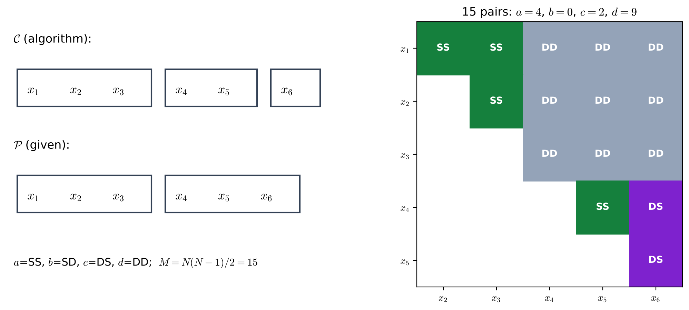
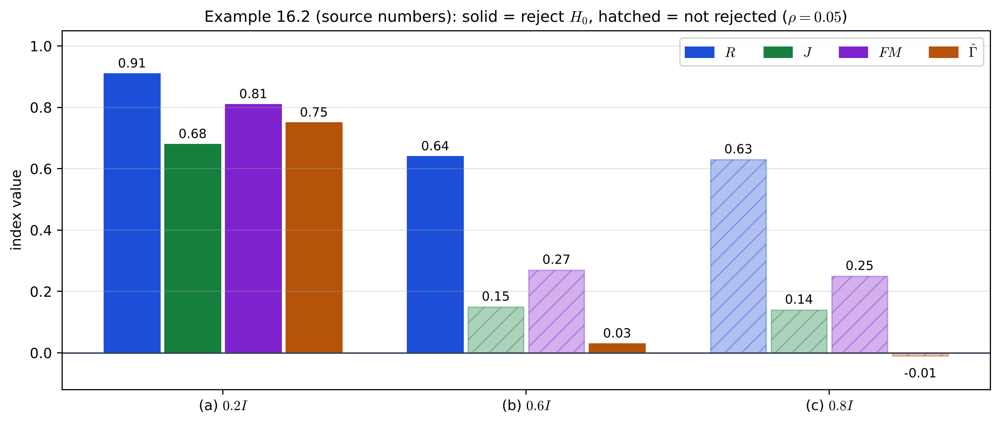
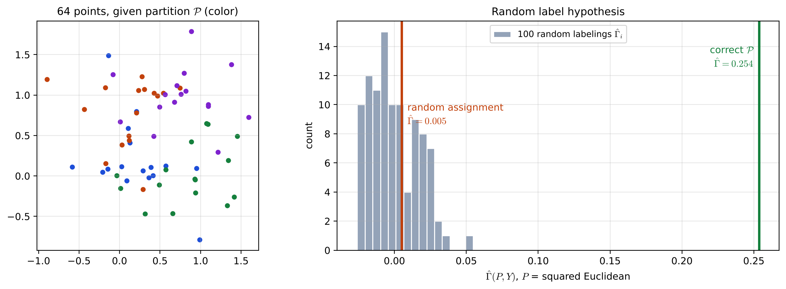

# Lecture 15 · KP02：外部準則：兩個劃分有多吻合（External criteria: how well two partitions agree）

> 程度：研究生（grad）／Level: Graduate (grad)
>
> 第 15 週（2026-12-14）｜Clustering (2) – Evaluation · KP02
>
> Week 15 (2026-12-14) | Clustering (2) – Evaluation · KP02

## 學習目標（Learning objectives）

- 把兩個劃分的所有點對分成 SS、SD、DS、DD 四類，並算出 $a$、$b$、$c$、$d$（Classify all point pairs of two partitions into SS, SD, DS and DD, and compute $a$, $b$, $c$ and $d$）。
- 由 $a$、$b$、$c$、$d$ 算出 Rand、Jaccard、Fowlkes–Mallows 與 Hubert $\hat{\Gamma}$，並說出它們的差別（Compute the Rand, Jaccard, Fowlkes–Mallows and Hubert $\hat{\Gamma}$ indices from $a$, $b$, $c$ and $d$, and state how they differ）。
- 用接近矩陣與標籤矩陣 $Y$ 檢驗一個外部劃分是否和資料的距離結構吻合（Test whether an external partition agrees with the distance structure of the data, using the proximity matrix and a label matrix $Y$）。

## KP02：外部準則：兩個劃分有多吻合（External criteria: how well two partitions agree）

**一句話重點**：外部準則拿獨立給定的劃分 $\mathcal{P}$ 和演算法的分群 $\mathcal{C}$ 比，先把每一對點依「兩邊是否都同群」分成四類，再算 Rand、Jaccard、FM 與 $\hat{\Gamma}$；這些指數越大越吻合，判讀走右尾。

**One-sentence summary**: External criteria compare an independently given partition $\mathcal{P}$ with the algorithm's clustering $\mathcal{C}$: classify every pair of points into four kinds by "are they together on both sides", then compute Rand, Jaccard, FM and $\hat{\Gamma}$; larger values mean better agreement, and the decision uses the right tail.

### 1. 接住上一講的問題（Picking up the question）

上一講說，外部準則要拿一個獨立的劃分 $\mathcal{P}$ 來評演算法的結果 $\mathcal{C}$。
可是 $\mathcal{C}$ 和 $\mathcal{P}$ 的群數可以不同，群的編號也沒有對應關係。
這一講要把「兩個劃分有多一致」變成數字。

The last lecture said that external criteria assess the algorithm's result $\mathcal{C}$ against an independent partition $\mathcal{P}$.
But $\mathcal{C}$ and $\mathcal{P}$ can have different numbers of groups, and their group labels do not correspond.
This lecture turns "how consistent two partitions are" into numbers.

**白話說明**：想像兩位老師各自把同一班學生分組，組數不同、組名也不同。
直接比「第一組是不是第一組」行不通。
改問：任挑兩個學生，兩位老師是不是都把他們放同組，或都放不同組？
同意的對數越多，兩種分法越一致。

**Plain explanation**: Picture two teachers each splitting the same class into groups, with different numbers of groups and different group names.
Comparing "is group 1 the same as group 1" does not work.
Instead ask: for any two students, did both teachers put them together, or both put them apart?
The more pairs they agree on, the more consistent the two splits are.

**先備自測**：確認你記得上一講的三種準則與右尾判讀。

**Prerequisite check**: Make sure you remember the three kinds of criteria and the right-tail decision from the last lecture.

- $N$ 個點共有 $N(N-1)/2$ 對（$N$ points form $N(N-1)/2$ pairs）。
- 外部準則需要一個獨立給定的劃分（External criteria need an independently given partition）。
- 右尾檢定：觀測值大於 $(1-\rho)r$ 個參考值就拒絕 $H_0$（Right-tail test: reject $H_0$ if the observed value exceeds $(1-\rho)r$ reference values）。

### 2. 成對計數：SS、SD、DS、DD（Pair counting: SS, SD, DS, DD）

**正式定義**：令 $\mathcal{C}=\{C_1,\dots,C_m\}$、$\mathcal{P}=\{P_1,\dots,P_s\}$，$m$ 不必等於 $s$。
對每一對向量 $(\mathbf{x}_v,\mathbf{x}_u)$，依兩邊是否同群分成四類：

**Formal definition**: Let $\mathcal{C}=\{C_1,\dots,C_m\}$ and $\mathcal{P}=\{P_1,\dots,P_s\}$, where $m$ need not equal $s$.
Each pair of vectors $(\mathbf{x}_v,\mathbf{x}_u)$ is classified into four kinds by whether it is together on each side:

| 類別 | 在 $\mathcal{C}$ | 在 $\mathcal{P}$ | 對數 |
|---|---|---|---|
| SS | 同群 | 同組 | $a$ |
| SD | 同群 | 異組 | $b$ |
| DS | 異群 | 同組 | $c$ |
| DD | 異群 | 異組 | $d$ |

四類加起來是總對數：$a+b+c+d=M$，其中 $M=N(N-1)/2$。
再令 $m_1=a+b$ 是在 $\mathcal{C}$ 同群的對數，$m_2=a+c$ 是在 $\mathcal{P}$ 同組的對數。

The four kinds add up to the total number of pairs: $a+b+c+d=M$, where $M=N(N-1)/2$.
Let $m_1=a+b$ be the number of pairs together in $\mathcal{C}$, and $m_2=a+c$ the number together in $\mathcal{P}$.

**例子**：來源的例 16.1 有 $N=6$ 個點：

**Example**: Example 16.1 of the source has $N=6$ points:

$$
\mathcal{C}=\{\{\mathbf{x}_1,\mathbf{x}_2,\mathbf{x}_3\},\{\mathbf{x}_4,\mathbf{x}_5\},\{\mathbf{x}_6\}\},\qquad \mathcal{P}=\{\{\mathbf{x}_1,\mathbf{x}_2,\mathbf{x}_3\},\{\mathbf{x}_4,\mathbf{x}_5,\mathbf{x}_6\}\}
$$

`[補充]` 逐對數一次：$\mathbf{x}_1,\mathbf{x}_2,\mathbf{x}_3$ 兩兩是 SS，共 $3$ 對，加上 $(\mathbf{x}_4,\mathbf{x}_5)$ 也是 SS，所以 $a=4$。
$\mathbf{x}_6$ 在 $\mathcal{C}$ 自成一群、在 $\mathcal{P}$ 和 $\mathbf{x}_4,\mathbf{x}_5$ 同組，$(\mathbf{x}_4,\mathbf{x}_6)$、$(\mathbf{x}_5,\mathbf{x}_6)$ 是 DS，$c=2$。
沒有 SD，$b=0$；其餘跨兩大組的 $9$ 對都是 DD，$d=9$。

`[Added]` Count pair by pair: $\mathbf{x}_1,\mathbf{x}_2,\mathbf{x}_3$ give $3$ SS pairs, and $(\mathbf{x}_4,\mathbf{x}_5)$ is also SS, so $a=4$.
$\mathbf{x}_6$ is alone in $\mathcal{C}$ but with $\mathbf{x}_4,\mathbf{x}_5$ in $\mathcal{P}$, so $(\mathbf{x}_4,\mathbf{x}_6)$ and $(\mathbf{x}_5,\mathbf{x}_6)$ are DS, $c=2$.
There is no SD, $b=0$; the remaining $9$ pairs across the two big groups are DD, $d=9$.



**圖說 `lec15-kp02-external-indices-f1-pair-counts`**：先看左圖，上面是演算法的 $\mathcal{C}$，下面是給定的 $\mathcal{P}$，差別只在 $\mathbf{x}_6$。
再看右圖，每一格是一對點，顏色是它的類別：綠 SS、紫 DS、灰 DD。
注意兩格紫色都牽涉 $\mathbf{x}_6$，這就是兩個劃分唯一不一致的地方。〔功能：1、2〕

**Caption `lec15-kp02-external-indices-f1-pair-counts`**: Look first at the left panel: the top is the algorithm's $\mathcal{C}$ and the bottom is the given $\mathcal{P}$; they differ only at $\mathbf{x}_6$.
Then look at the right panel: each cell is one pair, colored by its kind: green SS, purple DS, gray DD.
Note that both purple cells involve $\mathbf{x}_6$; that is the only place where the two partitions disagree. [Function: 1, 2]

### 3. 四個指數（Four indices）

**Rand、Jaccard、FM**：

**Rand, Jaccard, FM**:

$$
R=\frac{a+d}{M},\qquad J=\frac{a}{a+b+c},\qquad FM=\frac{a}{\sqrt{m_1m_2}}=\sqrt{\frac{a}{a+b}\cdot\frac{a}{a+c}}\tag{16.5–16.7}
$$

- Rand 是「兩邊都同意同群」加上「兩邊都同意異群」佔總對數的比例（Rand is the fraction of pairs on which both sides agree, either together or apart）。
- Jaccard 同樣的想法，但不算 $d$，避免大量「異群異組」的對把分數灌高（Jaccard follows the same idea but leaves out $d$, so the many "apart and apart" pairs cannot inflate the score）。
- FM 是兩個比例的幾何平均：$\mathcal{C}$ 同群的對裡有多少在 $\mathcal{P}$ 也同組，反過來也一樣（FM is the geometric mean of two fractions: how many pairs together in $\mathcal{C}$ are also together in $\mathcal{P}$, and vice versa）。

$R$、$J$ 介於 $0$ 與 $1$；通常要 $m=s$ 才可能達到最大值。

$R$ and $J$ lie between $0$ and $1$; reaching the maximum usually requires $m=s$.

**Hubert $\Gamma$**：把兩個 $N\times N$ 矩陣 $X$、$Y$ 的上三角對應元素相乘再平均：

**Hubert $\Gamma$**: multiply corresponding upper-triangle entries of two $N\times N$ matrices $X$ and $Y$ and average:

$$
\Gamma=\frac{1}{M}\sum_{i=1}^{N-1}\sum_{j=i+1}^{N}X(i,j)\,Y(i,j)\tag{16.8}
$$

標準化版 $\hat{\Gamma}$ 先把元素減去平均、再除以兩邊的標準差，值落在 $-1$ 與 $1$ 之間，其實就是兩組上三角數值的相關係數（式 16.9）。
若 $X(i,j)=1$ 表示兩點在 $\mathcal{C}$ 同群、$Y$ 對 $\mathcal{P}$ 同理，它可以只用 $a$、$m_1$、$m_2$ 算出：

The standardized $\hat{\Gamma}$ subtracts the means and divides by the two standard deviations, giving a value between $-1$ and $1$; it is the correlation coefficient of the two sets of upper-triangle values (Eq. 16.9).
If $X(i,j)=1$ means the two points are together in $\mathcal{C}$, and $Y$ does the same for $\mathcal{P}$, it can be computed from $a$, $m_1$ and $m_2$ alone:

$$
\hat{\Gamma}=\frac{Ma-m_1m_2}{\sqrt{m_1m_2(M-m_1)(M-m_2)}}\tag{16.10}
$$

**例子** `[補充]`：用例 16.1 代入。
$M=15$，$m_1=4$，$m_2=6$。
$R=(4+9)/15=0.867$，$J=4/6=0.667$，$FM=4/\sqrt{4\times6}=0.816$。
$\hat{\Gamma}=(15\times4-24)/\sqrt{24\times11\times9}=36/48.75=0.739$；直接算兩個 $0/1$ 矩陣上三角的相關，也得到 $0.739$。

**Example** `[Added]`: Substitute Example 16.1.
$M=15$, $m_1=4$ and $m_2=6$.
$R=(4+9)/15=0.867$, $J=4/6=0.667$ and $FM=4/\sqrt{4\times6}=0.816$.
$\hat{\Gamma}=(15\times4-24)/\sqrt{24\times11\times9}=36/48.75=0.739$; computing the correlation of the upper triangles of the two $0/1$ matrices directly also gives $0.739$.

這四個指數都是越大越吻合，所以檢定走右尾；$\lvert\hat{\Gamma}\rvert$ 異常大表示 $\mathcal{C}$ 和 $\mathcal{P}$ 吻合。

All four indices are "larger means better agreement", so the tests use the right tail; an unusually large $\lvert\hat{\Gamma}\rvert$ means $\mathcal{C}$ and $\mathcal{P}$ agree.

**怎麼判讀**：精確分布難求，用上一講的 Monte Carlo 加隨機位置假設：產生 $r$ 份均勻資料，依 $\mathcal{P}$ 把標籤貼到對應位置，跑同一演算法得 $\mathcal{C}_i$，算出 $q_i$，再看真實的 $q$ 大於幾個。

**How to decide**: the exact distribution is hard to find, so use Monte Carlo with the random position hypothesis from the last lecture: generate $r$ uniform data sets, attach the labels of $\mathcal{P}$ at the corresponding positions, run the same algorithm to get $\mathcal{C}_i$, compute $q_i$, and see how many of them the real $q$ exceeds.

**例子**：來源的例 16.2 在三維超立方體裡放四團、各 $25$ 點，用 isodata、$m=4$、$r=100$、$\rho=0.05$，改變團的散度：

**Example**: Example 16.2 of the source places four groups of $25$ points in a three-dimensional hypercube and uses isodata with $m=4$, $r=100$ and $\rho=0.05$, changing how spread out the groups are:

- (a) 緊密，共變異 $0.2I$：$R=0.91$、$J=0.68$、$FM=0.81$、$\hat{\Gamma}=0.75$，四個都大於全部 $100$ 個參考值，全部拒絕 $H_0$（(a) Tight, covariance $0.2I$: $R=0.91$, $J=0.68$, $FM=0.81$, $\hat{\Gamma}=0.75$; all four exceed all $100$ reference values, so all reject $H_0$）。
- (b) 較散，$0.6I$：$R=0.64$、$J=0.15$、$FM=0.27$、$\hat{\Gamma}=0.03$；$R$ 大於 $99$ 個、$\hat{\Gamma}$ 大於 $98$ 個而拒絕，$J$、$FM$ 各只大於 $94$ 個而不拒絕（(b) Looser, $0.6I$: $R=0.64$, $J=0.15$, $FM=0.27$, $\hat{\Gamma}=0.03$; $R$ exceeds $99$ and $\hat{\Gamma}$ exceeds $98$, so they reject, while $J$ and $FM$ exceed only $94$ each and do not reject）。
- (c) 幾乎無結構，$0.8I$：$R=0.63$、$J=0.14$、$FM=0.25$、$\hat{\Gamma}=-0.01$，都不夠極端，全部不拒絕（(c) Almost no structure, $0.8I$: $R=0.63$, $J=0.14$, $FM=0.25$, $\hat{\Gamma}=-0.01$; none is extreme enough, so none rejects）。



**圖說 `lec15-kp02-external-indices-f2-example-16-2`**：先看三組長條，由左到右團越來越散，四個指數都跟著變小。
再看實心與斜線：實心是拒絕 $H_0$，斜線是不拒絕。
注意中間 (b) 組，同一份資料，$R$ 和 $\hat{\Gamma}$ 拒絕，$J$ 和 $FM$ 不拒絕。〔功能：2〕

**Caption `lec15-kp02-external-indices-f2-example-16-2`**: Look first at the three groups of bars: from left to right the groups get looser and all four indices shrink.
Then look at solid versus hatched: solid means $H_0$ is rejected, hatched means it is not.
Note group (b) in the middle: on the same data, $R$ and $\hat{\Gamma}$ reject while $J$ and $FM$ do not. [Function: 2]

**常見迷思**：「Rand 是 $0.63$，超過一半，所以分群算不錯。」
不對。
例 16.2 (c) 幾乎沒有結構，$R$ 仍有 $0.63$，因為大量 DD 的對讓 $a+d$ 本來就很大。
指數的高低要和隨機參考比，不能看絕對值。

**Common misconception**: "Rand is $0.63$, more than half, so the clustering is decent."
That is wrong.
Example 16.2 (c) has almost no structure, yet $R$ is still $0.63$, because the many DD pairs make $a+d$ large to begin with.
An index must be compared with the random reference, not read as an absolute number.

`[補充]` 這也是來源提出**校正統計量**的原因：$q'=\dfrac{q-E(q)}{\max(q)-E(q)}$，其中 $E(q)$ 是 $H_0$ 下的期望值。
完全吻合時 $q'$ 接近最大，純屬碰巧時接近最小；難處是估 $E(q)$ 與 $\max(q)$。

`[Added]` This is also why the source introduces a **corrected statistic**: $q'=\dfrac{q-E(q)}{\max(q)-E(q)}$, where $E(q)$ is the expectation under $H_0$.
It approaches its maximum for perfect agreement and its minimum when the agreement is by chance; the difficulty is estimating $E(q)$ and $\max(q)$.

### 4. 外部劃分對接近矩陣（An external partition against the proximity matrix）

外部準則也可以不跑任何演算法，直接問：給定的劃分 $\mathcal{P}$ 和資料的接近矩陣 $P$ 合不合？
把 $\mathcal{P}$ 看成把每個點映到標籤的映射 $g$，定義

External criteria can also skip the algorithm and ask directly: does the given partition $\mathcal{P}$ agree with the data's proximity matrix $P$?
Viewing $\mathcal{P}$ as a mapping $g$ from each point to a label, define

$$
Y(i,j)=\begin{cases}1,&g(\mathbf{x}_i)\neq g(\mathbf{x}_j)\\0,&\text{otherwise}\end{cases}\tag{16.12}
$$

再算 $\Gamma(P,Y)$ 或 $\hat{\Gamma}(P,Y)$。
不同組的點在 $P$ 上通常比較遠，對應 $Y=1$，所以標籤正確時相關偏高。
判讀用隨機標籤假設：產生 $r$ 個隨機映射 $g_i$，各算一個 $\hat{\Gamma}_i$。

Then compute $\Gamma(P,Y)$ or $\hat{\Gamma}(P,Y)$.
Points in different groups are usually farther apart in $P$, which matches $Y=1$, so the correlation is high when the labels are correct.
The decision uses the random label hypothesis: generate $r$ random mappings $g_i$ and compute a $\hat{\Gamma}_i$ for each.

**例子**：來源的例 16.3 有 $64$ 個二維點，四組各 $16$ 點，均值在 $[0.2,0.2]^{\top}$、$[0.2,0.8]^{\top}$、$[0.8,0.2]^{\top}$、$[0.8,0.8]^{\top}$，共變異 $0.15I$，$P$ 用平方歐氏距離，$\rho=0.05$。
正確的外部劃分得 $\hat{\Gamma}=0.77$，大於全部 $100$ 個隨機劃分的值，拒絕 $H_0$；把點隨機分組得 $\hat{\Gamma}=-0.01$，只小於 $70$ 個，接受隨機性假設。

**Example**: Example 16.3 of the source has $64$ two-dimensional points in four groups of $16$, with means $[0.2,0.2]^{\top}$, $[0.2,0.8]^{\top}$, $[0.8,0.2]^{\top}$ and $[0.8,0.8]^{\top}$, covariance $0.15I$, $P$ the squared Euclidean distance, and $\rho=0.05$.
The correct external partition gives $\hat{\Gamma}=0.77$, larger than all $100$ values from random partitions, so $H_0$ is rejected; assigning the points to groups at random gives $\hat{\Gamma}=-0.01$, smaller than $70$ of them, so the randomness hypothesis is accepted.

`[補充]` 我們照同樣設定重抽一次資料（亂數種子 $3$）。
共變異 $0.15I$ 的標準差約 $0.39$，四組重疊得很厲害，所以正確劃分的 $\hat{\Gamma}$ 只有 $0.254$，比來源的 $0.77$ 小得多；但它仍大於全部 $100$ 個隨機標籤的值（範圍 $-0.026$ 到 $0.055$），一樣拒絕 $H_0$。
隨機指派得 $0.005$，只大於 $63$ 個，不拒絕。
數值會隨資料改變，但「正確標籤遠大於隨機、隨機指派落在隨機裡」的方向一致。

`[Added]` We redrew data with the same setting (random seed $3$).
A covariance of $0.15I$ means a standard deviation of about $0.39$, so the four groups overlap heavily and the correct partition gives only $\hat{\Gamma}=0.254$, much smaller than the source's $0.77$; but it still exceeds all $100$ random-label values (range $-0.026$ to $0.055$), so $H_0$ is rejected as well.
The random assignment gives $0.005$, exceeding only $63$, so it is not rejected.
The numbers change with the data, but the direction is the same: the correct labels sit far above randomness, and the random assignment sits inside it.



**圖說 `lec15-kp02-external-indices-f3-partition-vs-proximity`**：先看左圖，$64$ 個點依給定劃分上色，四組重疊得很明顯。
再看右圖，灰色直方圖是 $100$ 個隨機標籤的 $\hat{\Gamma}_i$。
注意綠線遠在直方圖右邊，橘線卻落在直方圖裡面。〔功能：2、3〕

**Caption `lec15-kp02-external-indices-f3-partition-vs-proximity`**: Look first at the left panel: the $64$ points are colored by the given partition, and the four groups clearly overlap.
Then look at the right panel: the gray histogram shows $\hat{\Gamma}_i$ for $100$ random labelings.
Note that the green line lies far to the right of the histogram, while the orange line falls inside it. [Function: 2, 3]

**失效情形**：外部準則需要一個可靠的 $\mathcal{P}$；實務上很少有事先給定的整棵階層，所以驗證階層樹較少見。
而在邊界情況下，不同指數可能給出不同結論，像例 16.2 (b)，選哪個指數會影響判斷。

**Failure cases**: External criteria need a reliable $\mathcal{P}$; in practice a whole pre-specified hierarchy is rare, so validating a hierarchical tree this way is uncommon.
And in borderline cases different indices can reach different conclusions, as in Example 16.2 (b), so the choice of index affects the judgment.

### 5. 與實作的連結（Connection to implementation）

下面的程式數出 $a$、$b$、$c$、$d$，再算四個指數。
注意兩件事：只看 $i<j$ 的點對；$\hat{\Gamma}$ 用式 16.10，不必建矩陣。

The code below counts $a$, $b$, $c$ and $d$, then computes the four indices.
Note two points: only pairs with $i<j$ are counted, and $\hat{\Gamma}$ uses Eq. 16.10 without building matrices.

```python
import numpy as np

def external_indices(C, P):
    a = b = c = d = 0
    N = len(C)
    for i in range(N):
        for j in range(i + 1, N):                 # 每對只算一次 / each pair once
            same_c, same_p = C[i] == C[j], P[i] == P[j]
            if same_c and same_p: a += 1          # SS
            elif same_c: b += 1                   # SD
            elif same_p: c += 1                   # DS
            else: d += 1                          # DD
    M, m1, m2 = a + b + c + d, a + b, a + c
    return dict(a=a, b=b, c=c, d=d, R=(a + d) / M, J=a / (a + b + c), FM=a / np.sqrt(m1 * m2),
                G=(M * a - m1 * m2) / np.sqrt(m1 * m2 * (M - m1) * (M - m2)))

r = external_indices([0, 0, 0, 1, 1, 2], [0, 0, 0, 1, 1, 1])     # 例 16.1 / Example 16.1
print({k: round(float(v), 3) for k, v in r.items()})
# {'a': 4, 'b': 0, 'c': 2, 'd': 9, 'R': 0.867, 'J': 0.667, 'FM': 0.816, 'G': 0.739}
```

**留給下一節的問題**：外部準則需要一個獨立的劃分，但多數時候我們根本沒有標籤。
只靠資料本身，能不能判斷一棵樹或一個分群貼不貼近資料？
下一講介紹內部準則。

**The question for the next section**: External criteria need an independent partition, but most of the time we have no labels at all.
Using only the data themselves, can we judge whether a tree or a clustering fits the data?
The next lecture introduces internal criteria.

### 6. 小練習與解題示範（Practice and worked solutions）

**小練習** `[補充]`：先寫下理由，再看解答。

**Practice** `[Added]`: Write your reasoning before reading the solutions.

1. 題 1：$\mathcal{C}=\{\{\mathbf{x}_1,\mathbf{x}_2\},\{\mathbf{x}_3,\mathbf{x}_4\}\}$、$\mathcal{P}=\{\{\mathbf{x}_1,\mathbf{x}_2,\mathbf{x}_3\},\{\mathbf{x}_4\}\}$，求 $a$、$b$、$c$、$d$（With $\mathcal{C}=\{\{\mathbf{x}_1,\mathbf{x}_2\},\{\mathbf{x}_3,\mathbf{x}_4\}\}$ and $\mathcal{P}=\{\{\mathbf{x}_1,\mathbf{x}_2,\mathbf{x}_3\},\{\mathbf{x}_4\}\}$, find $a$, $b$, $c$ and $d$）。
2. 題 2：承題 1，求 $R$ 與 $J$（Continuing Question 1, find $R$ and $J$）。
3. 題 3：為什麼 Jaccard 比 Rand 更不容易被「大量異群異組的對」灌高（Why is Jaccard less easily inflated than Rand by "many apart-and-apart pairs"）？

**題 1 解題示範**：共 $6$ 對。$(\mathbf{x}_1,\mathbf{x}_2)$ 是 SS；$(\mathbf{x}_3,\mathbf{x}_4)$ 是 SD；$(\mathbf{x}_1,\mathbf{x}_3)$、$(\mathbf{x}_2,\mathbf{x}_3)$ 是 DS；$(\mathbf{x}_1,\mathbf{x}_4)$、$(\mathbf{x}_2,\mathbf{x}_4)$ 是 DD。
所以 $a=1$、$b=1$、$c=2$、$d=2$。

**Question 1 worked solution**: There are $6$ pairs. $(\mathbf{x}_1,\mathbf{x}_2)$ is SS; $(\mathbf{x}_3,\mathbf{x}_4)$ is SD; $(\mathbf{x}_1,\mathbf{x}_3)$ and $(\mathbf{x}_2,\mathbf{x}_3)$ are DS; $(\mathbf{x}_1,\mathbf{x}_4)$ and $(\mathbf{x}_2,\mathbf{x}_4)$ are DD.
So $a=1$, $b=1$, $c=2$ and $d=2$.

**題 2 解題示範**：$R=(1+2)/6=0.5$；$J=1/(1+1+2)=0.25$。

**Question 2 worked solution**: $R=(1+2)/6=0.5$ and $J=1/(1+1+2)=0.25$.

**題 3 解題示範**：Rand 的分子有 $d$，群數多時大部分的對都是 DD，$R$ 很容易偏高。
Jaccard 的分子分母都不含 $d$，只看至少有一邊同群的對，所以不會被 DD 灌高。

**Question 3 worked solution**: Rand has $d$ in the numerator, and with many groups most pairs are DD, so $R$ easily runs high.
Jaccard leaves $d$ out of both numerator and denominator and looks only at pairs that are together on at least one side, so DD pairs cannot inflate it.

## 術語表（Glossary）

| 中文術語 | English term |
|---|---|
| 成對計數 | Pair counting |
| Rand 統計量 | Rand statistic |
| Jaccard 係數 | Jaccard coefficient |
| Fowlkes–Mallows 指數 | Fowlkes–Mallows index |
| Hubert $\Gamma$ 統計量 | Hubert's $\Gamma$ statistic |
| 標準化 $\Gamma$ | Normalized $\Gamma$ |
| 校正統計量 | Corrected statistic |
| 外部劃分 | External partition |
| 標籤映射 | Label mapping |

## 銜接與來源（Connections and sources）

下一講只用資料本身，檢驗一棵樹或一個分群貼不貼近接近矩陣。

The next lecture uses only the data themselves to test whether a tree or a clustering fits the proximity matrix.

- 前一單元：[KP01 為什麼要驗證分群結果](lec15-kp01-validity-intro.md)（Previous unit: why clustering results must be validated）。
- 下一單元：[KP03 內部準則](lec15-kp03-internal-indices.md)（Next unit: internal criteria）。
- 來源：[Cluster Validity §16.3.1](https://ndhuccc.github.io/CCC-LNS/PR_115/Ch16-cluster-validity/index.html)，讀取日期 2026-11-13（Source accessed 2026-11-13）。
- 書目：Theodoridis and Koutroumbas, *Pattern Recognition*, 4th ed., 2008；見[參考資料](../references/README.md)（See the bibliography）。

本講以自己的文字解釋來源。
SS／SD／DS／DD 與 $a$、$b$、$c$、$d$ 的定義、例 16.1 的劃分與 $a=4$、$b=0$、$c=2$、$d=9$、Rand／Jaccard／FM／Hubert $\Gamma$ 與 $\hat{\Gamma}$ 的公式、右尾判讀、Monte Carlo 加隨機位置的流程、例 16.2 的設定與全部數字、校正統計量、式 16.12 的 $Y$、隨機標籤假設、例 16.3 的設定與 $0.77$、$-0.01$ 的結果取自來源。
兩位老師的比喻、逐對計數的過程、例 16.1 的四個指數值、常見迷思、例 16.3 設定的重抽模擬、失效情形、程式、圖與練習皆為 `[補充]`。

This lecture independently explains the source.
The definitions of SS, SD, DS, DD and $a$, $b$, $c$, $d$, the partitions of Example 16.1 with $a=4$, $b=0$, $c=2$, $d=9$, the formulas of Rand, Jaccard, FM, Hubert $\Gamma$ and $\hat{\Gamma}$, the right-tail decision, the Monte Carlo procedure with random positions, the setting and all numbers of Example 16.2, the corrected statistic, $Y$ of Eq. 16.12, the random label hypothesis, and the setting of Example 16.3 with its results $0.77$ and $-0.01$ come from the source.
The two-teacher analogy, the pair-by-pair count, the four index values for Example 16.1, the common misconception, the resimulation of the Example 16.3 setting, the failure cases, the code, the figures and the practice are `[Added]`.
