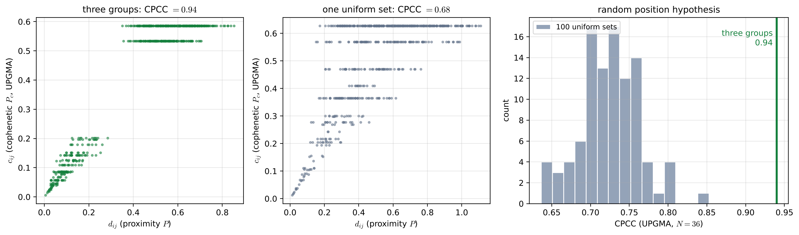
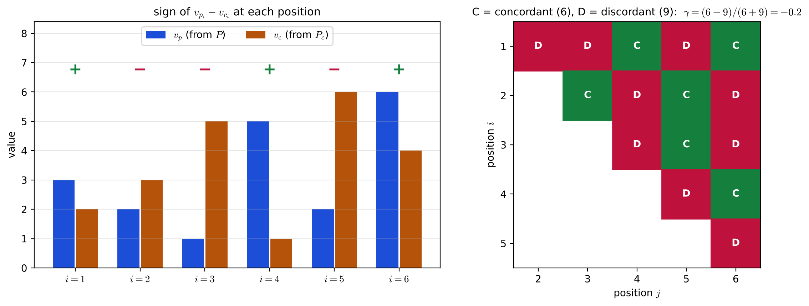
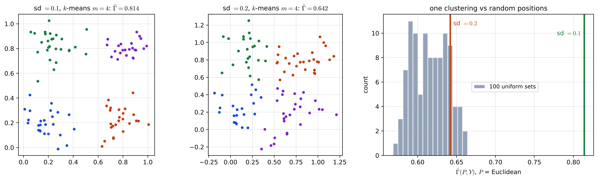

# Lecture 15 · KP03：內部準則：結果貼不貼近資料本身（Internal criteria: does the result fit the data itself）

> 程度：研究生（grad）／Level: Graduate (grad)
>
> 第 15 週（2026-12-14）｜Clustering (2) – Evaluation · KP03
>
> Week 15 (2026-12-14) | Clustering (2) – Evaluation · KP03

## 學習目標（Learning objectives）

- 用 CPCC、$\gamma$ 與 Kendall $\tau$ 衡量一棵階層樹的共表型矩陣 $P_c$ 和接近矩陣 $P$ 的吻合程度（Use CPCC, $\gamma$ and Kendall's $\tau$ to measure how well the cophenetic matrix $P_c$ of a hierarchical tree agrees with the proximity matrix $P$）。
- 數出一致對與不一致對，算出 $\gamma$ 與 $\tau$，並說出兩者的分母差在哪裡（Count concordant and discordant pairs, compute $\gamma$ and $\tau$, and state how their denominators differ）。
- 用 $\Gamma(P,Y)$ 與隨機位置假設檢驗單一分群結果（Test a single clustering with $\Gamma(P,Y)$ and the random position hypothesis）。

## KP03：內部準則：結果貼不貼近資料本身（Internal criteria: does the result fit the data itself）

**一句話重點**：內部準則不用任何外部標籤，只拿資料本身的接近矩陣 $P$ 當標準：階層樹用共表型矩陣 $P_c$ 和 $P$ 比（CPCC、$\gamma$、$\tau$），單一分群用 $Y$ 和 $P$ 比（$\Gamma$），再用 Monte Carlo 估「沒有結構時」的分布。

**One-sentence summary**: Internal criteria use no external labels and take the data's own proximity matrix $P$ as the standard: a hierarchical tree is compared with $P$ through its cophenetic matrix $P_c$ (CPCC, $\gamma$, $\tau$), a single clustering through $Y$ ($\Gamma$), and Monte Carlo estimates the distribution "when there is no structure".

### 1. 接住上一講的問題（Picking up the question）

上一講的外部準則需要一個獨立給定的劃分 $\mathcal{P}$。
多數時候我們手上只有資料，沒有標籤。
這一講只用資料本身，問演算法的結果貼不貼近資料。

The external criteria of the last lecture need an independently given partition $\mathcal{P}$.
Most of the time we have only the data and no labels.
This lecture uses only the data themselves and asks whether the algorithm's result fits them.

**白話說明**：沒有標準答案時，還可以檢查「整理結果和原始資料說的是不是同一件事」。
就像把一班同學依座位遠近畫成樹狀分組圖：如果圖上很早就合在一起的兩人，實際座位也很近，這張圖就忠實；如果圖上很早合併的兩人其實坐得很遠，圖就扭曲了資料。

**Plain explanation**: Without an answer key, we can still check whether "the summarized result and the raw data say the same thing".
It is like drawing a tree of a class grouped by how close the seats are: if two students merged early in the tree also sit close together, the tree is faithful; if two students merged early actually sit far apart, the tree distorts the data.

**先備自測**：確認你記得第 14 週的共表型矩陣與上一講的 $\hat{\Gamma}$。

**Prerequisite check**: Make sure you remember the cophenetic matrix from Week 14 and $\hat{\Gamma}$ from the last lecture.

- 共表型矩陣 $P_c$ 的第 $(i,j)$ 格是 $\mathbf{x}_i$、$\mathbf{x}_j$ 在樹上第一次合併時的高度（Entry $(i,j)$ of the cophenetic matrix $P_c$ is the height at which $\mathbf{x}_i$ and $\mathbf{x}_j$ first merge in the tree）。
- $\hat{\Gamma}$ 是兩個矩陣上三角數值的相關係數（$\hat{\Gamma}$ is the correlation coefficient of the upper-triangle values of two matrices）。
- 右尾判讀：觀測值大於 $(1-\rho)r$ 個參考值就拒絕 $H_0$（Right-tail decision: reject $H_0$ if the observed value exceeds $(1-\rho)r$ reference values）。

### 2. CPCC：樹和距離的相關（CPCC: correlation between the tree and the distances）

**正式定義**：$P$ 與 $P_c$ 都對稱、對角為 $0$，所以只看 $M=N(N-1)/2$ 個上三角元素。
記 $d_{ij}$、$c_{ij}$ 為 $P$、$P_c$ 的 $(i,j)$ 元素，$\mu_p$、$\mu_c$ 是它們的平均。
共表型相關係數（cophenetic correlation coefficient）是

**Formal definition**: $P$ and $P_c$ are both symmetric with zero diagonals, so only the $M=N(N-1)/2$ upper-triangle entries matter.
Let $d_{ij}$ and $c_{ij}$ be the $(i,j)$ entries of $P$ and $P_c$, with means $\mu_p$ and $\mu_c$.
The cophenetic correlation coefficient is

$$
CPCC=\frac{\frac{1}{M}\sum_{i<j}d_{ij}c_{ij}-\mu_p\mu_c}{\sqrt{\left(\frac{1}{M}\sum_{i<j}d_{ij}^{2}-\mu_p^{2}\right)\left(\frac{1}{M}\sum_{i<j}c_{ij}^{2}-\mu_c^{2}\right)}}\tag{16.13}
$$

它就是 $d_{ij}$ 與 $c_{ij}$ 的 Pearson 相關，適用於區間或比率尺度，值在 $-1$ 與 $1$ 之間，越接近 $1$ 越吻合。
它的分布依賴 $N$、演算法與距離，$H_0$ 下難以求得，所以用隨機位置假設做 Monte Carlo：產生 $r$ 組均勻資料，各跑同一個階層演算法，各算一個 CPCC。

It is just the Pearson correlation of $d_{ij}$ and $c_{ij}$, suited to interval or ratio scales, with values between $-1$ and $1$; closer to $1$ means better agreement.
Its distribution depends on $N$, the algorithm and the distance, so it is hard to obtain under $H_0$; instead use Monte Carlo with the random position hypothesis: generate $r$ uniform data sets, run the same hierarchical algorithm on each, and compute a CPCC for each.

**例子** `[補充]`：三團各 $12$ 點（共 $N=36$），每團標準差 $0.06$，用歐氏距離與 UPGMA 得 $CPCC=0.94$；single link 得 $0.93$。
再產生 $100$ 組 $36$ 點的均勻資料：UPGMA 的 CPCC 落在 $0.64$ 到 $0.85$，中位數 $0.73$；single link 落在 $0.43$ 到 $0.81$。
三團資料的值大於全部 $100$ 個參考值，拒絕 $H_0$。

**Example** `[Added]`: Three groups of $12$ points each ($N=36$), each with standard deviation $0.06$, give $CPCC=0.94$ with Euclidean distance and UPGMA, and $0.93$ with single link.
Then generate $100$ uniform data sets of $36$ points: the UPGMA CPCC ranges from $0.64$ to $0.85$, median $0.73$; single link ranges from $0.43$ to $0.81$.
The three-group value exceeds all $100$ reference values, so $H_0$ is rejected.



**圖說 `lec15-kp03-internal-indices-f2-cpcc`**：先看左圖，三團資料的每一對點畫成一點，橫軸是距離 $d_{ij}$、縱軸是合併高度 $c_{ij}$，近的對合併得低，遠的對合併得高。
再看中圖，一組均勻資料的點雲比較散，CPCC 只有 $0.68$。
注意右圖：均勻資料的 CPCC 本來就有 $0.64$ 到 $0.85$，三團資料的綠線遠在右邊。〔功能：2、3〕

**Caption `lec15-kp03-internal-indices-f2-cpcc`**: Look first at the left panel: every pair of the three-group data is one dot, with distance $d_{ij}$ on the horizontal axis and merge height $c_{ij}$ on the vertical axis; close pairs merge low and far pairs merge high.
Then look at the middle panel: one uniform data set gives a looser cloud and a CPCC of only $0.68$.
Note the right panel: uniform data already give CPCC from $0.64$ to $0.85$, and the green line of the three-group data lies far to the right. [Function: 2, 3]

**常見迷思**：「CPCC 有 $0.8$，所以樹忠實反映了資料的群。」
不對。
上面的均勻資料沒有任何群，UPGMA 的 CPCC 仍可到 $0.85$。
來源也提醒：在 UPGMA 下，即使 CPCC 接近 $0.9$，也不保證 $P_c$ 真的貼近 $P$。
高低要和同樣演算法、同樣 $N$ 的隨機參考比。

**Common misconception**: "CPCC is $0.8$, so the tree faithfully reflects the groups in the data."
That is wrong.
The uniform data above have no groups at all, yet the UPGMA CPCC can still reach $0.85$.
The source also warns that under UPGMA, even a CPCC near $0.9$ does not guarantee that $P_c$ truly fits $P$.
The value must be compared with a random reference using the same algorithm and the same $N$.

### 3. $\gamma$ 與 $\tau$：只看大小順序（$\gamma$ and $\tau$: order only）

資料是序數尺度時，只有大小順序有意義，改用序數指標。
把 $P$、$P_c$ 的上三角依列排成兩個長度 $M$ 的向量 $\mathbf{v}_p$、$\mathbf{v}_c$。

When the data are on an ordinal scale, only the order is meaningful, so ordinal indices are used.
Arrange the upper triangles of $P$ and $P_c$ row by row into two vectors $\mathbf{v}_p$ and $\mathbf{v}_c$ of length $M$.

**正式定義**：來源對位置 $i$、$j$ 這一對的定義是：

**Formal definition**: The source defines the pair of positions $i$ and $j$ as:

- 一致（concordant）：$v_{p_i}<v_{c_i}$ 且 $v_{p_j}<v_{c_j}$，或 $v_{p_i}>v_{c_i}$ 且 $v_{p_j}>v_{c_j}$（Concordant: $v_{p_i}<v_{c_i}$ and $v_{p_j}<v_{c_j}$, or $v_{p_i}>v_{c_i}$ and $v_{p_j}>v_{c_j}$）。
- 不一致（discordant）：兩個位置的大小關係相反（Discordant: the two positions have opposite relations）。
- 若 $v_{p_i}=v_{c_i}$ 或 $v_{p_j}=v_{c_j}$，兩者都不算（If $v_{p_i}=v_{c_i}$ or $v_{p_j}=v_{c_j}$, the pair counts as neither）。

記 $S_+$、$S_-$ 為一致與不一致的對數：

Let $S_+$ and $S_-$ be the numbers of concordant and discordant pairs:

$$
\gamma=\frac{S_+-S_-}{S_++S_-}\tag{16.14}
$$

$$
\tau=\frac{S_+-S_-}{\text{全部配對數（number of all pairs）}}\tag{16.15}
$$

兩者都在 $-1$ 與 $1$ 之間。
差別只在分母：$\tau$ 除以全部配對，$\gamma$ 排除「兩者都不算」的配對。
來源把 $\tau$ 的分母寫成 $N(N-1)/2$；`[補充]` 這裡的 $N$ 指被配對的元素個數，也就是向量長度，所以例 16.4 的長度 $6$ 給出 $15$ 對。

Both lie between $-1$ and $1$.
They differ only in the denominator: $\tau$ divides by all pairs, while $\gamma$ leaves out the pairs that count as neither.
The source writes the denominator of $\tau$ as $N(N-1)/2$; `[Added]` here $N$ is the number of elements being paired, that is, the vector length, so length $6$ in Example 16.4 gives $15$ pairs.

**例子**：來源的例 16.4 取 $\mathbf{v}_p=[3,2,1,5,2,6]^{\top}$、$\mathbf{v}_c=[2,3,5,1,6,4]^{\top}$，得 $S_+=6$、$S_-=9$，所以 $\gamma=-3/15=-0.2$。

**Example**: Example 16.4 of the source takes $\mathbf{v}_p=[3,2,1,5,2,6]^{\top}$ and $\mathbf{v}_c=[2,3,5,1,6,4]^{\top}$ and gets $S_+=6$ and $S_-=9$, so $\gamma=-3/15=-0.2$.

`[補充]` 逐位置看 $v_{p_i}-v_{c_i}$ 的正負號：位置 $1$、$4$、$6$ 是正，位置 $2$、$3$、$5$ 是負，沒有相等。
同號的配對是一致：$3$ 個正號互配 $3$ 對、$3$ 個負號互配 $3$ 對，$S_+=6$。
異號的配對是不一致：$3\times3=9$ 對，$S_-=9$。
沒有「都不算」的配對，所以 $\tau=(6-9)/15=-0.2$，和 $\gamma$ 相同。

`[Added]` Look at the sign of $v_{p_i}-v_{c_i}$ position by position: positions $1$, $4$ and $6$ are positive, positions $2$, $3$ and $5$ are negative, and none is zero.
Same-sign pairs are concordant: $3$ pairs among the positives and $3$ among the negatives, so $S_+=6$.
Opposite-sign pairs are discordant: $3\times3=9$, so $S_-=9$.
No pair counts as neither, so $\tau=(6-9)/15=-0.2$, the same as $\gamma$.



**圖說 `lec15-kp03-internal-indices-f1-concordance`**：先看左圖，每個位置有藍色 $v_p$ 與橘色 $v_c$ 兩根長條，上方標出藍減橘的正負號。
再看右圖，每一格是一對位置：綠格標 $\mathrm{C}$ 是同號（一致），紅格標 $\mathrm{D}$ 是異號（不一致）。
注意綠格 $6$ 個、紅格 $9$ 個，正好是 $S_+$ 與 $S_-$。〔功能：1、2〕

**Caption `lec15-kp03-internal-indices-f1-concordance`**: Look first at the left panel: each position has a blue bar $v_p$ and an orange bar $v_c$, with the sign of blue minus orange marked above.
Then look at the right panel: each cell is a pair of positions; green $\mathrm{C}$ means the same sign (concordant) and red $\mathrm{D}$ means opposite signs (discordant).
Note that there are $6$ green cells and $9$ red cells, exactly $S_+$ and $S_-$. [Function: 1, 2]

**常見迷思** `[補充]`：「所有教科書的 $\gamma$ 都是同一個算法。」
不一定。
常見的 Goodman–Kruskal $\gamma$ 比的是同一向量內的順序：$(v_{p_i}-v_{p_j})(v_{c_i}-v_{c_j})>0$ 算一致。
用這個定義，例 16.4 得 $S_+=4$、$S_-=10$、$\gamma=-0.429$，和來源的 $-0.2$ 不同。
使用套件時要先確認它採哪一種定義。

**Common misconception** `[Added]`: "Every textbook computes $\gamma$ the same way."
Not necessarily.
The common Goodman–Kruskal $\gamma$ compares the order within each vector: $(v_{p_i}-v_{p_j})(v_{c_i}-v_{c_j})>0$ counts as concordant.
With that definition, Example 16.4 gives $S_+=4$, $S_-=10$ and $\gamma=-0.429$, different from the source's $-0.2$.
When using a library, first check which definition it adopts.

**怎麼判讀**：$\gamma$ 的分布同樣難求，來源改用隨機圖假設：產生 $r$ 張沒有平手的隨機秩接近矩陣 $P_i$，各跑同一演算法，各算 $\gamma(P_i,P_{c_i})$。
來源也提到一個猜想：single link 與 complete link 下，$N\gamma-a\ln N$ 近似標準常態，$a=1.1$（single）、$a=1.8$（complete）；若採信，可省掉 Monte Carlo。
$\gamma$ 也能拿來比較兩個不同階層演算法的結果。

**How to decide**: the distribution of $\gamma$ is also hard to find, so the source uses the random graph hypothesis: generate $r$ random rank proximity matrices $P_i$ without ties, run the same algorithm on each, and compute $\gamma(P_i,P_{c_i})$.
The source also mentions a conjecture: under single and complete link, $N\gamma-a\ln N$ is approximately standard normal, with $a=1.1$ (single) and $a=1.8$ (complete); if accepted, the Monte Carlo can be skipped.
$\gamma$ can also compare the results of two different hierarchical algorithms.

### 4. 單一分群：$\Gamma(P,Y)$（A single clustering: $\Gamma(P,Y)$）

結構不一定是一整棵樹，也可能是一個 $m$ 群的分群 $\mathcal{C}$。
仍用 $P$ 代表資料的結構，並依 $\mathcal{C}$ 造

The structure need not be a whole tree; it can be a single clustering $\mathcal{C}$ with $m$ groups.
$P$ still represents the structure of the data, and from $\mathcal{C}$ we build

$$
Y(i,j)=\begin{cases}1,&\mathbf{x}_i\text{ 與 }\mathbf{x}_j\text{ 屬於不同叢集（in different clusters）}\\0,&\text{否則（otherwise）}\end{cases}\tag{16.16}
$$

再算 $\Gamma(P,Y)$ 或 $\hat{\Gamma}(P,Y)$。
它和上一講式 16.12 的 $Y$ 長得一樣，差別在標籤來源：這裡的標籤來自演算法自己的輸出，不是外部給定。
所以參考族群要用隨機位置假設：每份均勻資料 $X_i$ 都重跑當初產生 $\mathcal{C}$ 的同一演算法，得 $\mathcal{C}_i$、$Y_i$，再算 $\Gamma_i$。

Then compute $\Gamma(P,Y)$ or $\hat{\Gamma}(P,Y)$.
It looks the same as $Y$ in Eq. 16.12 of the last lecture; the difference is where the labels come from: here they are the algorithm's own output, not given externally.
So the reference population uses the random position hypothesis: on every uniform data set $X_i$, rerun the same algorithm that produced $\mathcal{C}$ to get $\mathcal{C}_i$ and $Y_i$, then compute $\Gamma_i$.

**例子**：來源的例 16.5 有 $100$ 個二維點，四組各 $25$ 點，均值在 $[0.2,0.2]^{\top}$、$[0.8,0.2]^{\top}$、$[0.2,0.8]^{\top}$、$[0.8,0.8]^{\top}$，共變異 $0.1I$，用 isodata 分群。
算得 $\hat{\Gamma}=0.5704$，大於 $100$ 個隨機資料的 $\hat{\Gamma}_i$ 中的 $99$ 個，在 $\rho=0.05$ 下拒絕 $H_0$。
共變異改成 $0.2I$ 時，$\hat{\Gamma}$ 只大於 $86$ 個，不拒絕 $H_0$。

**Example**: Example 16.5 of the source has $100$ two-dimensional points in four groups of $25$, with means $[0.2,0.2]^{\top}$, $[0.8,0.2]^{\top}$, $[0.2,0.8]^{\top}$ and $[0.8,0.8]^{\top}$, covariance $0.1I$, clustered with isodata.
It obtains $\hat{\Gamma}=0.5704$, larger than $99$ of the $100$ values $\hat{\Gamma}_i$ from random data, so $H_0$ is rejected at $\rho=0.05$.
With covariance $0.2I$, $\hat{\Gamma}$ exceeds only $86$ of them, so $H_0$ is not rejected.

`[補充]` 我們用 $k$-means（$m=4$）代替 isodata、歐氏距離當 $P$，重做一次。
若照字面把散度讀成共變異 $0.1I$，標準差約 $0.32$，四組幾乎糊成一團，$\hat{\Gamma}=0.559$，比 $100$ 份均勻資料的值（$0.568$ 到 $0.664$）全都小，不拒絕。
若把 $0.1$、$0.2$ 讀成標準差，得 $\hat{\Gamma}=0.814$，大於全部 $100$ 個而拒絕；以及 $\hat{\Gamma}=0.642$，大於 $86$ 個而不拒絕，和來源的兩個結論一致。
這次重做顯示：結論對資料的分散程度很敏感，而且均勻資料硬分成四群時，$\hat{\Gamma}$ 本來就有約 $0.6$。

`[Added]` We redo it with $k$-means ($m=4$) instead of isodata and Euclidean distance as $P$.
Reading the spread literally as covariance $0.1I$ gives a standard deviation of about $0.32$; the four groups nearly merge into one, and $\hat{\Gamma}=0.559$ is smaller than all $100$ values from uniform data ($0.568$ to $0.664$), so $H_0$ is not rejected.
Reading $0.1$ and $0.2$ as standard deviations gives $\hat{\Gamma}=0.814$, larger than all $100$, so it rejects; and $\hat{\Gamma}=0.642$, larger than $86$, so it does not reject, matching both conclusions of the source.
This redo shows that the conclusion is very sensitive to how spread out the data are, and that uniform data forced into four groups already give $\hat{\Gamma}$ around $0.6$.



**圖說 `lec15-kp03-internal-indices-f3-single-clustering`**：先看左邊兩張散點圖，顏色是 $k$-means 的四群；標準差 $0.1$ 時四團分得開，$0.2$ 時邊界附近混在一起。
再看右圖，灰色直方圖是 $100$ 份均勻資料的 $\hat{\Gamma}_i$，大約在 $0.57$ 到 $0.66$。
注意綠線（標準差 $0.1$）遠在右邊，橘線（標準差 $0.2$）卻落在直方圖裡。〔功能：2、3〕

**Caption `lec15-kp03-internal-indices-f3-single-clustering`**: Look first at the two scatter plots on the left, colored by the four $k$-means groups; with standard deviation $0.1$ the groups separate, and with $0.2$ they mix near the borders.
Then look at the right panel: the gray histogram shows $\hat{\Gamma}_i$ for $100$ uniform data sets, roughly $0.57$ to $0.66$.
Note that the green line (standard deviation $0.1$) lies far to the right, while the orange line (standard deviation $0.2$) falls inside the histogram. [Function: 2, 3]

**失效情形**：內部準則把 $P$ 當成標準，所以 $P$ 選錯（例如尺度不一致的特徵直接算歐氏距離），檢定就在驗證錯的東西。
Monte Carlo 的參考族群必須用同一演算法、同樣的 $N$ 與 $m$，否則比較沒有意義；每份參考資料都要重跑演算法，計算量大。

**Failure cases**: Internal criteria treat $P$ as the standard, so if $P$ is chosen badly (for example, Euclidean distance on features with inconsistent scales), the test validates the wrong thing.
The Monte Carlo reference must use the same algorithm and the same $N$ and $m$, otherwise the comparison is meaningless; every reference set requires rerunning the algorithm, which is expensive.

### 5. 與實作的連結（Connection to implementation）

下面的程式照來源的定義數一致與不一致的對，並算 $\gamma$ 與 $\tau$。
注意：先取每個位置的正負號，再比較每一對位置的正負號是否相同；有 $0$ 的配對兩邊都不算。

The code below counts concordant and discordant pairs with the source's definition and computes $\gamma$ and $\tau$.
Note that it first takes the sign at each position, then checks whether each pair of positions has the same sign; a pair involving $0$ counts as neither.

```python
import itertools
import numpy as np

def gamma_tau(vp, vc):
    s = np.sign(np.array(vp) - np.array(vc))       # 每個位置的正負號 / sign at each position
    Sp = Sm = 0
    for i, j in itertools.combinations(range(len(s)), 2):
        if s[i] * s[j] > 0: Sp += 1                # 同號：一致 / same sign: concordant
        elif s[i] * s[j] < 0: Sm += 1              # 異號：不一致 / opposite: discordant
    n_pairs = len(s) * (len(s) - 1) // 2
    return Sp, Sm, (Sp - Sm) / (Sp + Sm), (Sp - Sm) / n_pairs

print(gamma_tau([3, 2, 1, 5, 2, 6], [2, 3, 5, 1, 6, 4]))   # 例 16.4 / Example 16.4
# (6, 9, -0.2, -0.2)
```

**留給下一節的問題**：外部與內部準則都要做 Monte Carlo，每份參考資料重跑一次演算法，代價很高。
如果只想在幾個候選結果（例如不同的 $m$）之間挑出最好的一個，有沒有不必做假設檢定的辦法？
下一講介紹相對準則。

**The question for the next section**: Both external and internal criteria need Monte Carlo, rerunning the algorithm on every reference set, which is costly.
If we only want to pick the best among a few candidate results (for example, different values of $m$), is there a way that avoids hypothesis testing?
The next lecture introduces relative criteria.

### 6. 小練習與解題示範（Practice and worked solutions）

**小練習** `[補充]`：先寫下理由，再看解答。

**Practice** `[Added]`: Write your reasoning before reading the solutions.

1. 題 1：$\mathbf{v}_p=[1,4,2,5]^{\top}$、$\mathbf{v}_c=[2,3,2,4]^{\top}$，照來源定義求 $S_+$、$S_-$、$\gamma$ 與 $\tau$（With $\mathbf{v}_p=[1,4,2,5]^{\top}$ and $\mathbf{v}_c=[2,3,2,4]^{\top}$, find $S_+$, $S_-$, $\gamma$ and $\tau$ with the source's definition）。
2. 題 2：一棵 UPGMA 樹的 CPCC 是 $0.82$，同樣 $N$ 的均勻資料 CPCC 落在 $0.64$ 到 $0.85$。這棵樹可信嗎（A UPGMA tree has CPCC $0.82$, and uniform data of the same $N$ give CPCC from $0.64$ to $0.85$. Is the tree trustworthy）？
3. 題 3：為什麼驗證單一分群時，每份均勻資料都要重跑同一個演算法，而不是直接拿 $\mathcal{C}$ 的標籤去貼（When validating a single clustering, why must the same algorithm be rerun on every uniform data set instead of reusing the labels of $\mathcal{C}$）？

**題 1 解題示範**：正負號依序是 $-$、$+$、$0$、$+$。
位置 $3$ 是 $0$，牽涉它的 $3$ 對都不算。
其餘三個位置配成 $3$ 對：$(2,4)$ 同號，一致；$(1,2)$、$(1,4)$ 異號，不一致。
所以 $S_+=1$、$S_-=2$，$\gamma=(1-2)/3=-0.333$，$\tau=(1-2)/6=-0.167$。

**Question 1 worked solution**: The signs are $-$, $+$, $0$, $+$ in order.
Position $3$ is $0$, so the $3$ pairs involving it count as neither.
The other three positions form $3$ pairs: $(2,4)$ has the same sign, concordant; $(1,2)$ and $(1,4)$ have opposite signs, discordant.
So $S_+=1$ and $S_-=2$, giving $\gamma=(1-2)/3=-0.333$ and $\tau=(1-2)/6=-0.167$.

**題 2 解題示範**：不可信。
$0.82$ 落在均勻資料的範圍裡，大於 $(1-\rho)r$ 個參考值的條件不成立，不能拒絕「沒有結構」。
CPCC 的絕對值高，不代表樹抓到了真正的群。

**Question 2 worked solution**: It is not trustworthy.
$0.82$ falls inside the range of the uniform data, so the condition of exceeding $(1-\rho)r$ reference values fails, and "no structure" cannot be rejected.
A high absolute CPCC does not mean the tree has captured real groups.

**題 3 解題示範**：$\mathcal{C}$ 的標籤是演算法對這份資料「量身切出來」的，演算法本來就會讓同群的點彼此靠近。
要公平比較，隨機資料也必須經過同樣的「量身切割」，才能看出真實資料的 $\hat{\Gamma}$ 是否超過「演算法對沒有結構的資料也能做到的程度」。

**Question 3 worked solution**: The labels of $\mathcal{C}$ were cut by the algorithm specifically for these data, and the algorithm naturally makes points in the same group close to each other.
For a fair comparison, the random data must go through the same tailored cut, so that we can see whether the real $\hat{\Gamma}$ exceeds "what the algorithm can achieve even on data without structure".

## 術語表（Glossary）

| 中文術語 | English term |
|---|---|
| 內部準則 | Internal criteria |
| 共表型矩陣 | Cophenetic matrix |
| 共表型相關係數 | Cophenetic correlation coefficient (CPCC) |
| 一致對 | Concordant pair |
| 不一致對 | Discordant pair |
| $\gamma$ 統計量 | $\gamma$ statistic |
| Kendall $\tau$ | Kendall's $\tau$ |
| 隨機圖假設 | Random graph hypothesis |
| 隨機位置假設 | Random position hypothesis |
| 序數尺度 | Ordinal scale |

## 銜接與來源（Connections and sources）

下一講不做假設檢定，改在一組候選結果之間比較，挑出最貼近資料的一個。

The next lecture skips hypothesis testing and compares a set of candidate results to pick the one that best fits the data.

- 前一單元：[KP02 外部準則](lec15-kp02-external-indices.md)（Previous unit: external criteria）。
- 下一單元：[KP04 相對準則](lec15-kp04-relative-criteria.md)（Next unit: relative criteria）。
- 來源：[Cluster Validity §16.3.2](https://ndhuccc.github.io/CCC-LNS/PR_115/Ch16-cluster-validity/index.html)，讀取日期 2026-11-13（Source accessed 2026-11-13）。
- 書目：Theodoridis and Koutroumbas, *Pattern Recognition*, 4th ed., 2008；見[參考資料](../references/README.md)（See the bibliography）。

本講以自己的文字解釋來源。
內部準則只用接近矩陣、CPCC 的式 16.13 與其範圍、隨機位置假設的 Monte Carlo、UPGMA 下 CPCC 接近 $0.9$ 仍須小心的提醒、一致與不一致的定義、式 16.14 與 16.15、例 16.4 的向量與 $S_+=6$、$S_-=9$、$\gamma=-0.2$、隨機圖假設、$N\gamma-a\ln N$ 的猜想與 $a$ 值、式 16.16 的 $Y$、例 16.5 的設定與 $0.5704$、$99$、$86$ 的結果取自來源。
座位比喻、三團資料與均勻資料的 CPCC 模擬、例 16.4 的逐位置正負號說明、$\tau$ 分母的說明、Goodman–Kruskal 定義的對照、例 16.5 設定的兩種讀法重做、失效情形、程式、圖與練習皆為 `[補充]`。

This lecture independently explains the source.
The idea that internal criteria use only the proximity matrix, Eq. 16.13 for CPCC and its range, the Monte Carlo with the random position hypothesis, the warning that a CPCC near $0.9$ under UPGMA still needs caution, the definitions of concordant and discordant, Eqs. 16.14 and 16.15, the vectors of Example 16.4 with $S_+=6$, $S_-=9$ and $\gamma=-0.2$, the random graph hypothesis, the conjecture on $N\gamma-a\ln N$ with its values of $a$, $Y$ of Eq. 16.16, and the setting of Example 16.5 with the results $0.5704$, $99$ and $86$ come from the source.
The seating analogy, the CPCC simulation of three-group and uniform data, the position-by-position sign explanation of Example 16.4, the note on the denominator of $\tau$, the comparison with the Goodman–Kruskal definition, the two-reading redo of the Example 16.5 setting, the failure cases, the code, the figures and the practice are `[Added]`.
