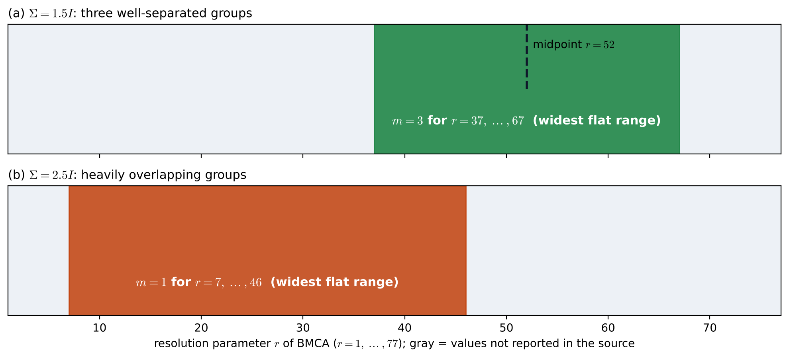
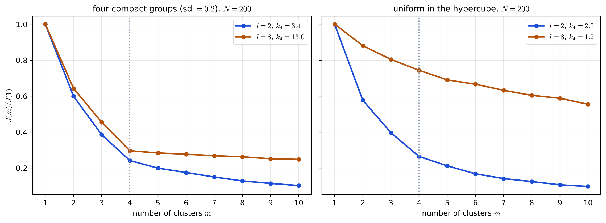
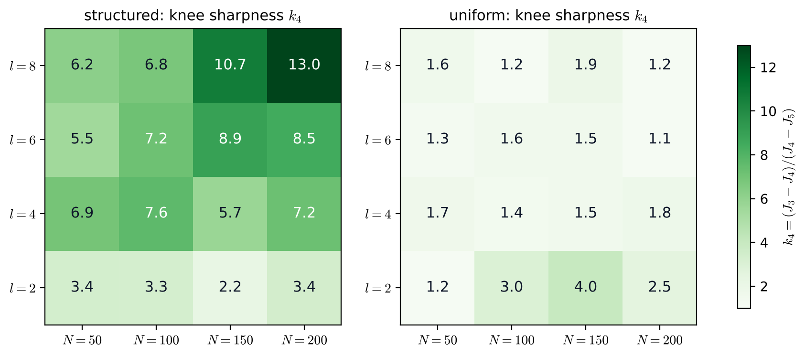

# Lecture 15 · KP04：相對準則：改參數，找最穩的結構（Relative criteria: vary the parameters, find the most stable structure）

> 程度：研究生（grad）／Level: Graduate (grad)
>
> 第 15 週（2026-12-14）｜Clustering (2) – Evaluation · KP04
>
> Week 15 (2026-12-14) | Clustering (2) – Evaluation · KP04

## 學習目標（Learning objectives）

- 說明相對準則和外部、內部準則的差別：不做假設檢定，而是在一組候選結果之間比較（Explain how relative criteria differ from external and internal criteria: no hypothesis test, only comparison among candidate results）。
- 參數不含群數 $m$ 時，用「$m$ 保持不變的最寬參數區間」選參數並認出 $m$（When the parameters do not include the number of clusters $m$, choose the parameter and identify $m$ from the widest interval over which $m$ stays constant）。
- 參數含 $m$ 時，畫指標對 $m$ 的曲線，依有無趨勢找極值或膝點（When the parameters include $m$, plot the index against $m$ and look for an extremum or a knee depending on whether there is a trend）。

## KP04：相對準則：改參數，找最穩的結構（Relative criteria: vary the parameters, find the most stable structure）

**一句話重點**：相對準則不靠外部標籤、也不做隨機假設檢定，而是把同一演算法的參數掃一遍：不含 $m$ 時找 $m$ 保持不變的最寬區間取中點，含 $m$ 時畫指標對 $m$ 的曲線找極值或膝點。

**One-sentence summary**: Relative criteria use no external labels and no random-hypothesis test; they sweep the parameters of one algorithm: without $m$, take the midpoint of the widest interval where $m$ stays constant; with $m$, plot an index against $m$ and look for an extremum or a knee.

### 1. 接住上一講的問題（Picking up the question）

外部與內部準則都要做 Monte Carlo，每份參考資料都重跑一次演算法，計算量很大。
實務上常見的問題其實比較單純：同一個演算法，參數該設多少？$m$ 該取幾群？
這一講不問「是不是隨機」，只問「哪一個候選結果最貼近資料」。

External and internal criteria both need Monte Carlo, rerunning the algorithm on every reference set, which is expensive.
The common practical question is simpler: for one algorithm, what should the parameters be, and how many groups $m$ should we take?
This lecture does not ask "is it random"; it asks only "which candidate result fits the data best".

**白話說明**：拿望遠鏡看遠處的一排燈，焦距從很小慢慢轉大。
焦距太小，一盞燈會碎成好幾個光點；焦距太大，所有燈糊成一片。
中間有一段焦距，不管怎麼微調都看到同樣三盞燈，這段越寬，越能相信真的有三盞。

**Plain explanation**: Look at a row of distant lamps through a telescope and slowly turn the focus from small to large.
Too small, and one lamp breaks into several spots; too large, and all the lamps blur into one.
In between there is a range of focus where every small adjustment still shows the same three lamps; the wider that range, the more we can trust that there really are three.

**先備自測**：確認你記得 $k$-means 的代價 $J$ 與第 14 週「在哪裡切樹」的討論。

**Prerequisite check**: Make sure you remember the $k$-means cost $J$ and the Week 14 discussion of where to cut a tree.

- $k$-means 的 $J$ 是每點到所屬代表的距離平方和（The $k$-means cost $J$ is the sum of squared distances from each point to its representative）。
- 群數 $m$ 越大，最佳的 $J$ 越小（The larger the number of groups $m$, the smaller the best $J$）。
- 有些演算法的參數不是 $m$，而是門檻或解析度（Some algorithms have a threshold or resolution as their parameter instead of $m$）。

### 2. 參數不含 $m$：找最寬的平坦區間（Parameters without $m$: find the widest flat interval）

**正式定義**：令 $\mathcal{A}$ 為演算法的參數集合。
若 $\mathcal{A}$ 不含群數 $m$（例如圖論、形態學、邊界偵測類的演算法），假設是：資料若真有結構，$m$ 會在一段很寬的參數區間內保持不變，通常 $m\ll N$。
做法：在很寬的範圍內掃參數，找 $m$ 保持常數的最寬區間，取該區間的中點當參數；這同時認出底層的 $m$。

**Formal definition**: Let $\mathcal{A}$ be the set of parameters of an algorithm.
If $\mathcal{A}$ does not contain the number of clusters $m$ (for example graph-theoretic, morphological or boundary-detection algorithms), the assumption is: if the data really have structure, $m$ stays constant over a wide interval of the parameter, usually with $m\ll N$.
Procedure: sweep the parameter over a wide range, find the widest interval over which $m$ is constant, and take its midpoint as the parameter; this also identifies the underlying $m$.

**例子**：來源的例 16.6 有三團各 $100$ 個二維點，均值 $[0,0]^{\top}$、$[8,4]^{\top}$、$[8,0]^{\top}$。
用二元形態學分群演算法 BMCA，結構元素 $3\times3$，解析參數 $r=1,\dots,77$。

**Example**: Example 16.6 of the source has three groups of $100$ two-dimensional points with means $[0,0]^{\top}$, $[8,4]^{\top}$ and $[8,0]^{\top}$.
It uses the binary morphology clustering algorithm BMCA with a $3\times3$ structuring element and resolution parameter $r=1,\dots,77$.

- (a) 共變異 $1.5I$，三團緊密、分得開：$r\in[37,67]$ 時 $m$ 恆為 $3$，這是最寬的平坦區間，取中點 $r=(37+67)/2=52$，結論是三群（(a) Covariance $1.5I$, three tight and well-separated groups: $m$ stays $3$ for $r\in[37,67]$, the widest flat interval; its midpoint is $r=(37+67)/2=52$, and the conclusion is three clusters）。
- (b) 共變異 $2.5I$，三團重疊到幾乎分不開：$r=7,\dots,46$ 時 $m$ 恆為 $1$，這時最寬的平坦區間說「看起來像一團」（(b) Covariance $2.5I$, groups overlapping so much they can hardly be told apart: $m$ stays $1$ for $r=7,\dots,46$, and the widest flat interval now says "it looks like one group"）。



**圖說 `lec15-kp04-relative-criteria-f1-flat-range`**：先看橫軸，是 BMCA 的解析參數 $r$，從 $1$ 到 $77$。
再看兩條色帶：上方綠帶是 (a) 的 $m=3$ 區間，虛線是中點 $r=52$；下方橘帶是 (b) 的 $m=1$ 區間。
注意灰色部分是來源沒有列出 $m$ 的參數值，圖只畫來源給的兩段。〔功能：2〕

**Caption `lec15-kp04-relative-criteria-f1-flat-range`**: Look first at the horizontal axis: the BMCA resolution parameter $r$, from $1$ to $77$.
Then look at the two bands: the upper green band is the $m=3$ interval of (a), with the dashed midpoint at $r=52$; the lower orange band is the $m=1$ interval of (b).
Note that gray marks parameter values whose $m$ the source does not report; the figure draws only the two intervals the source gives. [Function: 2]

**失效情形** `[補充]`：「最寬」是相對於掃描範圍而言。
參數大到一定程度，幾乎所有演算法都會把資料併成一群，$m=1$ 的區間可以無限延長。
所以掃描範圍要事先依資料尺度設好，並在報告裡寫明；範圍不同，「最寬」的區間可能不同。

**Failure cases** `[Added]`: "Widest" is relative to the sweep range.
Once the parameter is large enough, almost every algorithm merges the data into one group, so the $m=1$ interval can be stretched indefinitely.
The sweep range must therefore be set in advance according to the data's scale and stated in the report; with a different range, the "widest" interval may change.

### 3. 參數含 $m$：找極值或膝點（Parameters with $m$: find an extremum or a knee）

若 $\mathcal{A}$ 含 $m$（例如第 14 章的硬分群或模糊分群），另選一個表現指標 $q$。
對每個 $m\in[m_{\min},m_{\max}]$ 跑 $r$ 次（其他參數用不同初值），記下每個 $m$ 的最佳 $q$，畫成 $q$ 對 $m$ 的曲線：

If $\mathcal{A}$ contains $m$ (for example the hard or fuzzy clustering of Chapter 14), choose a performance index $q$.
For each $m\in[m_{\min},m_{\max}]$, run $r$ times (other parameters with different initial values), record the best $q$ for each $m$, and plot $q$ against $m$:

- $q$ 對 $m$ 沒有趨勢：直接找最大值或最小值（No trend in $q$ against $m$: look for the maximum or minimum directly）。
- $q$ 隨 $m$ 單調上升或下降：改找「顯著的局部變化」，也就是曲線上的膝點（knee）；膝點暗示底層的群數，找不到膝點可能表示沒有分群結構（$q$ rises or falls monotonically with $m$: look instead for a "significant local change", the knee of the curve; a knee suggests the underlying number of clusters, and no knee may mean there is no clustering structure）。

**例子**：來源的例 16.7 用 $k$-means 類的 isodata 與代價 $J$：

**Example**: Example 16.7 of the source uses isodata (a $k$-means type algorithm) and its cost $J$:

- (a) 有結構：$16$ 組資料，維度 $l=2,4,6,8$，每個維度各有 $N=50,100,150,200$；每組在超立方體 $H_l$ 內有四個緊密、分得開的常態團，均值分別是「全 $0.2$」「前半 $0.2$、後半 $0.8$」「前半 $0.8$、後半 $0.2$」「全 $0.8$」，共變異 $0.2I_l$。
  每組跑 $m=1,\dots,10$，畫 $J$ 對 $m$：維度越高，$m=4$ 的膝點越尖；資料量越大，即使低維膝點也變尖（(a) With structure: $16$ data sets with dimension $l=2,4,6,8$ and $N=50,100,150,200$ for each dimension; each has four compact, well-separated normal groups inside the hypercube $H_l$, with means "all $0.2$", "first half $0.2$, second half $0.8$", "first half $0.8$, second half $0.2$" and "all $0.8$", covariance $0.2I_l$. Each runs $m=1,\dots,10$ and plots $J$ against $m$: the higher the dimension, the sharper the knee at $m=4$; the more data, the sharper the knee even in low dimensions）。
- (b) 無結構：同樣 $16$ 組大小，但點在 $H_l$ 內均勻分布，曲線沒有明顯的尖膝（(b) Without structure: the same $16$ sizes, but the points are uniform in $H_l$, and the curves show no sharp knee）。

**正式定義** `[補充]`：要比較膝點「多尖」，可以看 $m$ 前後兩段下降量的比值：

**Formal definition** `[Added]`: To compare how sharp a knee is, look at the ratio of the drops before and after $m$:

$$
k_m=\frac{J(m-1)-J(m)}{J(m)-J(m+1)}
$$

$k_m$ 遠大於 $1$，表示到 $m$ 之前降得很快、過了 $m$ 幾乎不再下降，這就是尖膝；$k_m$ 在 $1$ 附近則表示曲線平順。
$k_m$ 只是方便比較的量，來源沒有規定膝點的數值判準。

A $k_m$ much larger than $1$ means $J$ drops fast up to $m$ and hardly drops after it, which is a sharp knee; a $k_m$ near $1$ means a smooth curve.
$k_m$ is only a convenient comparison measure; the source does not prescribe a numerical rule for a knee.

`[補充]` 我們照例 16.7 的設計重做 $16+16$ 組，用 $k$-means（每個 $m$ 取 $5$ 個起點中最好的），每維標準差取 $0.2$。
有結構時，$l=8$、$N=200$ 的 $k_4=13.0$，曲線在 $m=4$ 明顯轉平；$l=2$ 時 $k_4$ 只有 $2.2$ 到 $3.4$。
均勻資料的 $k_4$ 在 $1.1$ 到 $4.0$ 之間，最大的 $4.0$ 出現在 $l=2$。
所以在二維、團又有重疊時，有結構與無結構的膝點差不多尖，單看曲線分不出來；維度提高後差別才明顯，和來源的觀察一致。

`[Added]` We redid $16+16$ data sets following the design of Example 16.7, using $k$-means (the best of $5$ starts for each $m$) with a standard deviation of $0.2$ per dimension.
With structure, $l=8$ and $N=200$ give $k_4=13.0$, and the curve clearly flattens at $m=4$; with $l=2$, $k_4$ is only $2.2$ to $3.4$.
Uniform data give $k_4$ between $1.1$ and $4.0$, with the largest value $4.0$ at $l=2$.
So in two dimensions with overlapping groups, the knees with and without structure are about equally sharp and the curve alone cannot tell them apart; the difference becomes clear only in higher dimensions, consistent with the source's observation.



**圖說 `lec15-kp04-relative-criteria-f2-knee`**：先看左圖，四團資料的 $J(m)/J(1)$：橘線（$l=8$）到 $m=4$ 之後幾乎變平，藍線（$l=2$）的轉折較緩。
再看右圖，均勻資料的兩條線都一路平順下降。
注意左右兩條藍線形狀很像，這就是低維時膝點不可靠的原因。〔功能：2、3〕

**Caption `lec15-kp04-relative-criteria-f2-knee`**: Look first at the left panel, $J(m)/J(1)$ for the four-group data: the orange line ($l=8$) becomes almost flat after $m=4$, while the blue line ($l=2$) bends more gently.
Then look at the right panel: both lines for uniform data decrease smoothly all the way.
Note that the two blue lines on the left and right look alike; that is why the knee is unreliable in low dimensions. [Function: 2, 3]



**圖說 `lec15-kp04-relative-criteria-f3-knee-grid`**：先看左圖，列是維度 $l$、欄是資料量 $N$，格內是有結構時的 $k_4$，越綠越尖。
再看右圖，均勻資料的 $k_4$ 幾乎都在 $1$ 到 $2$。
注意左圖最下列（$l=2$）和右圖最下列的數字有重疊。〔功能：2〕

**Caption `lec15-kp04-relative-criteria-f3-knee-grid`**: Look first at the left panel: rows are dimension $l$, columns are data size $N$, and each cell is $k_4$ with structure; greener means sharper.
Then look at the right panel: for uniform data $k_4$ is almost always between $1$ and $2$.
Note that the bottom row ($l=2$) of the left panel overlaps in value with the bottom row of the right panel. [Function: 2]

**常見迷思**：「$J$ 一直在降，就選 $J$ 最小的 $m$。」
不對。
$J$ 隨 $m$ 單調下降，$m=N$ 時 $J=0$，選最小值永遠會選到每點自成一群。
有單調趨勢的指標要找膝點，沒有趨勢的指標（下一講的 Dunn、DB）才直接找極值。

**Common misconception**: "$J$ keeps decreasing, so pick the $m$ with the smallest $J$."
That is wrong.
$J$ decreases monotonically with $m$ and reaches $0$ at $m=N$, so picking the minimum always chooses one point per group.
An index with a monotone trend calls for a knee; only an index without a trend (Dunn and DB in the next lectures) is read at its extremum.

**失效情形**：膝點靠肉眼判斷，主觀成分大；團有重疊或維度低時，有結構與無結構的曲線可能一樣平順。
相對準則只在候選結果之間比較，不能回答「這個結構是否比隨機更好」；需要那個答案時，仍要回到前兩講的檢定。

**Failure cases**: The knee is judged by eye, which is subjective; when groups overlap or the dimension is low, curves with and without structure can look equally smooth.
Relative criteria only compare candidate results and cannot answer "is this structure better than random"; for that answer, return to the tests of the previous two lectures.

### 4. 與實作的連結（Connection to implementation）

下面的程式從 $J(1),\dots,J(10)$ 算出每個 $m$ 的 $k_m$，回傳最尖的位置與它的 $k_m$。
注意：$k_m$ 需要 $m$ 前後各一個點，所以只能對 $m=2,\dots,9$ 計算。

The code below computes $k_m$ for each $m$ from $J(1),\dots,J(10)$ and returns the sharpest position with its $k_m$.
Note that $k_m$ needs one point before and one after $m$, so it can only be computed for $m=2,\dots,9$.

```python
import numpy as np

def sharpest_knee(J):
    drop = -np.diff(J)                  # J(m-1)-J(m)，m=2..10 / drop at each m
    k = drop[:-1] / drop[1:]            # k_m，m=2..9
    m = int(np.argmax(k)) + 2           # 索引 0 對應 m=2 / index 0 is m=2
    return m, round(float(k.max()), 1)

J_struct = [1.0, 0.644, 0.455, 0.297, 0.284, 0.277, 0.269, 0.263, 0.252, 0.249]   # l=8, N=200，四團
J_unif = [1.0, 0.881, 0.805, 0.744, 0.691, 0.666, 0.633, 0.605, 0.588, 0.555]     # l=8, N=200，均勻
print(sharpest_knee(J_struct), sharpest_knee(J_unif))
# (4, 12.2) (5, 2.1)
```

這裡輸入的是取到小數第三位的 $J(m)/J(1)$，所以 $k_4=12.2$，和未四捨五入時的 $13.0$ 略有差異。

The inputs here are $J(m)/J(1)$ rounded to three decimals, so $k_4=12.2$, slightly different from the unrounded $13.0$.

**留給下一節的問題**：$J$ 有單調趨勢，只能靠膝點這種主觀判斷。
有沒有沒有單調趨勢、可以直接取極值的指標，把「群內緊密」和「群間分開」一起量進去？
下一講介紹 modified Hubert 與 Dunn 指標。

**The question for the next section**: $J$ has a monotone trend, so we must rely on the subjective knee.
Is there an index without a monotone trend, read directly at its extremum, that measures both "compact within groups" and "separated between groups"?
The next lecture introduces the modified Hubert and Dunn indices.

### 5. 小練習與解題示範（Practice and worked solutions）

**小練習** `[補充]`：先寫下理由，再看解答。

**Practice** `[Added]`: Write your reasoning before reading the solutions.

1. 題 1：某演算法掃門檻 $\theta=1,\dots,40$，$m$ 依序在 $\theta=1$–$5$ 為 $9$、$6$–$12$ 為 $4$、$13$–$30$ 為 $2$、$31$–$40$ 為 $1$。依相對準則該取哪個 $\theta$ 與 $m$（An algorithm sweeps a threshold $\theta=1,\dots,40$; $m$ is $9$ for $\theta=1$–$5$, $4$ for $6$–$12$, $2$ for $13$–$30$ and $1$ for $31$–$40$. Which $\theta$ and $m$ does the relative criterion choose）？
2. 題 2：$J(2)$ 到 $J(6)$ 依序為 $60$、$40$、$12$、$10$、$9$，求 $k_3$ 與 $k_4$，膝點在哪裡（With $J(2)$ to $J(6)$ equal to $60$, $40$, $12$, $10$ and $9$, find $k_3$ and $k_4$; where is the knee）？
3. 題 3：例 16.6 (b) 最寬的平坦區間是 $m=1$。這代表演算法失敗了嗎（In Example 16.6 (b) the widest flat interval has $m=1$. Does this mean the algorithm failed）？

**題 1 解題示範**：四段寬度分別是 $5$、$7$、$18$、$10$，最寬的是 $\theta=13$–$30$，$m=2$。
取中點 $\theta=(13+30)/2=21.5$，結論是兩群。

**Question 1 worked solution**: The four intervals have widths $5$, $7$, $18$ and $10$; the widest is $\theta=13$–$30$ with $m=2$.
Its midpoint is $\theta=(13+30)/2=21.5$, and the conclusion is two clusters.

**題 2 解題示範**：$k_3=(60-40)/(40-12)=20/28=0.71$；$k_4=(40-12)/(12-10)=28/2=14$。
$k_4$ 遠大於 $1$，膝點在 $m=4$。

**Question 2 worked solution**: $k_3=(60-40)/(40-12)=20/28=0.71$; $k_4=(40-12)/(12-10)=28/2=14$.
$k_4$ is much larger than $1$, so the knee is at $m=4$.

**題 3 解題示範**：不代表失敗。
三團重疊到幾乎分不開時，資料在這個尺度上本來就像一團。
相對準則如實回報「最穩定的答案是一群」，這正是它不硬加結構的地方。

**Question 3 worked solution**: It does not mean failure.
When the three groups overlap so much that they can hardly be told apart, the data really do look like one group at this scale.
The relative criterion honestly reports "the most stable answer is one group", which is exactly how it avoids imposing structure.

## 術語表（Glossary）

| 中文術語 | English term |
|---|---|
| 相對準則 | Relative criteria |
| 參數掃描 | Parameter sweep |
| 平坦區間 | Flat interval |
| 解析參數 | Resolution parameter |
| 膝點 | Knee |
| 膝點尖銳度 | Knee sharpness |
| 表現指標 | Performance index |
| 二元形態學分群演算法 | Binary morphology clustering algorithm (BMCA) |

## 銜接與來源（Connections and sources）

下一講介紹兩個沒有單調趨勢、可以直接取極值的硬分群指標。

The next lecture introduces two hard-clustering indices without a monotone trend that can be read directly at their extremum.

- 前一單元：[KP03 內部準則](lec15-kp03-internal-indices.md)（Previous unit: internal criteria）。
- 下一單元：[KP05 修正 Hubert 與 Dunn 指標](lec15-kp05-dunn-hubert.md)（Next unit: the modified Hubert and Dunn indices）。
- 來源：[Cluster Validity §16.4](https://ndhuccc.github.io/CCC-LNS/PR_115/Ch16-cluster-validity/index.html)，讀取日期 2026-11-13（Source accessed 2026-11-13）。
- 書目：Theodoridis and Koutroumbas, *Pattern Recognition*, 4th ed., 2008；見[參考資料](../references/README.md)（See the bibliography）。

本講以自己的文字解釋來源。
相對準則不靠標籤與假設檢定、參數集合 $\mathcal{A}$ 不含與含 $m$ 的兩種情形、最寬平坦區間取中點的做法、例 16.6 的設定與 $[37,67]$、$r=52$、$r=7,\dots,46$ 的結果、含 $m$ 時找極值或膝點的規則、例 16.7 的設定與「維度越高、資料越多膝點越尖，均勻資料無尖膝」的觀察取自來源。
望遠鏡比喻、掃描範圍的失效情形、膝點尖銳度 $k_m$、例 16.7 設計的重做與數字、常見迷思、程式、圖 2 與圖 3、練習皆為 `[補充]`；圖 1 只畫來源給的兩段區間。

This lecture independently explains the source.
The idea that relative criteria use neither labels nor hypothesis tests, the two cases where the parameter set $\mathcal{A}$ does or does not contain $m$, the midpoint of the widest flat interval, the setting of Example 16.6 with the results $[37,67]$, $r=52$ and $r=7,\dots,46$, the rule of seeking an extremum or a knee when $m$ is a parameter, and the setting of Example 16.7 with the observation that higher dimension and more data sharpen the knee while uniform data show no sharp knee come from the source.
The telescope analogy, the failure case about the sweep range, the knee sharpness $k_m$, the redo of the Example 16.7 design and its numbers, the common misconception, the code, Figures 2 and 3, and the practice are `[Added]`; Figure 1 draws only the two intervals given by the source.
