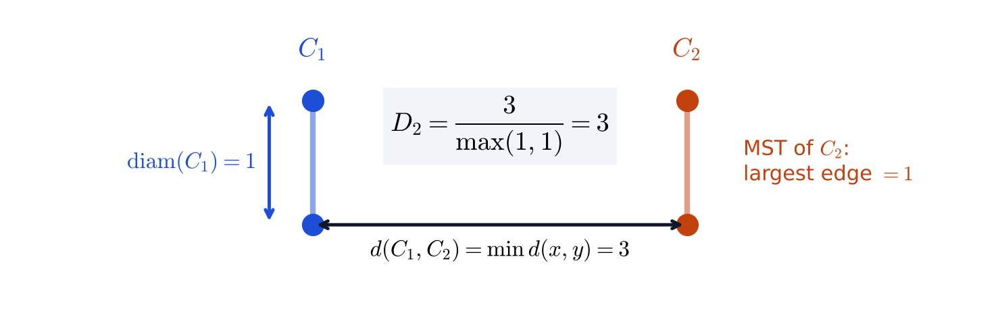
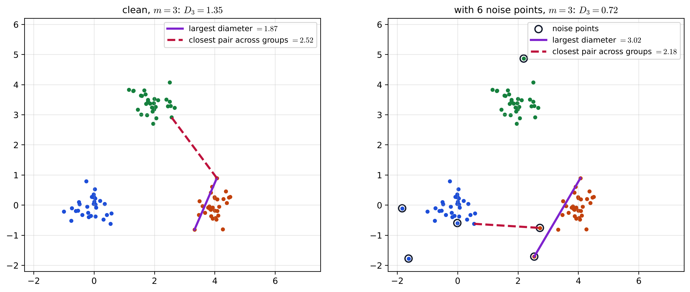
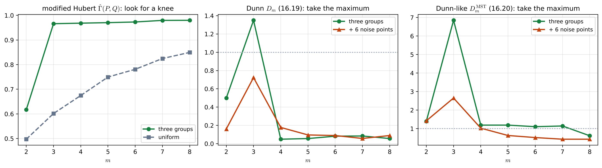

# Lecture 15 · KP05：修正 Hubert 與 Dunn 指標（The modified Hubert and Dunn indices）

> 程度：研究生（grad）／Level: Graduate (grad)
>
> 第 15 週（2026-12-14）｜Clustering (2) – Evaluation · KP05
>
> Week 15 (2026-12-14) | Clustering (2) – Evaluation · KP05

## 學習目標（Learning objectives）

- 建立代表點距離矩陣 $Q$，用修正 Hubert $\hat{\Gamma}(P,Q)$ 對 $m$ 的曲線找膝點（Build the representative-distance matrix $Q$ and look for the knee of the modified Hubert $\hat{\Gamma}(P,Q)$ against $m$）。
- 由群間最近距離與群直徑算出 Dunn 指標 $D_m$，並在 $D_m$ 對 $m$ 的曲線上取最大值（Compute the Dunn index $D_m$ from the closest inter-group distance and the group diameters, and take the maximum of $D_m$ against $m$）。
- 說明 Dunn 指標為什麼怕雜訊，以及 MST 版 $D_m^{\mathrm{MST}}$ 改了哪兩個量（Explain why the Dunn index is sensitive to noise and which two quantities the MST version $D_m^{\mathrm{MST}}$ changes）。

## KP05：修正 Hubert 與 Dunn 指標（The modified Hubert and Dunn indices）

**一句話重點**：硬分群的相對準則要量「群內緊、群間開」：修正 Hubert $\hat{\Gamma}$ 看點距離 $P$ 和代表點距離 $Q$ 是否同步，找膝點；Dunn 指標是「最近的群間距離」除以「最大的群直徑」，越大越好，取最大值，但容易被雜訊拉低。

**One-sentence summary**: Relative criteria for hard clustering measure "tight within, apart between": the modified Hubert $\hat{\Gamma}$ checks whether the point distances $P$ and the representative distances $Q$ move together, read at a knee; the Dunn index divides "the closest inter-group distance" by "the largest group diameter", larger is better and its maximum is taken, but noise easily drags it down.

### 1. 接住上一講的問題（Picking up the question）

上一講的 $J$ 隨 $m$ 單調下降，只能靠主觀的膝點判斷。
這一講介紹兩個專為緊密叢集設計的指標：一個仍看膝點，但有隨機資料可對照；另一個沒有單調趨勢，可以直接取最大值。

The cost $J$ of the last lecture decreases monotonically with $m$, so we could only rely on a subjective knee.
This lecture introduces two indices designed for compact clusters: one still uses a knee but has random data to compare against; the other has no monotone trend and can be read directly at its maximum.

**白話說明**：好的分組像幾個彼此離得遠的小圈圈。
要判斷分得好不好，同時看兩件事：圈和圈之間最窄的縫有多寬，以及最胖的那個圈有多大。
縫越寬、圈越瘦，分得越好；只看其中一件會被騙。

**Plain explanation**: A good grouping looks like a few small circles far apart.
To judge it, look at two things at once: how wide the narrowest gap between circles is, and how big the fattest circle is.
The wider the gap and the slimmer the circles, the better; looking at only one of them can mislead.

**先備自測**：確認你記得上一講的膝點規則與第 14 週的最小生成樹。

**Prerequisite check**: Make sure you remember the knee rule of the last lecture and the minimum spanning tree of Week 14.

- 指標隨 $m$ 單調變化時找膝點，沒有趨勢時找極值（Look for a knee when an index changes monotonically with $m$, and an extremum when it has no trend）。
- 最小生成樹（MST）用最少的總邊長把所有點連起來（A minimum spanning tree (MST) connects all points with the least total edge length）。
- $\hat{\Gamma}$ 是兩個矩陣上三角的相關係數（$\hat{\Gamma}$ is the correlation of the upper triangles of two matrices）。

### 2. 修正 Hubert 統計量（The modified Hubert statistic）

**正式定義**：令 $c_i=k$ 表示 $\mathbf{x}_i$ 屬於叢集 $C_k$，$\mathbf{w}_k$ 是 $C_k$ 的代表點。
定義 $N\times N$ 矩陣

**Formal definition**: Let $c_i=k$ mean that $\mathbf{x}_i$ belongs to cluster $C_k$, and let $\mathbf{w}_k$ be the representative of $C_k$.
Define the $N\times N$ matrix

$$
Q(i,j)=d\left(\mathbf{w}_{c_i},\mathbf{w}_{c_j}\right)
$$

也就是 $\mathbf{x}_i$、$\mathbf{x}_j$ 所屬兩群代表點之間的距離。
把式 16.8 的 Hubert $\Gamma$ 套到資料接近矩陣 $P$ 與 $Q$ 上（兩邊用同一種距離），就是修正 Hubert $\Gamma$；同樣可以算標準化的 $\hat{\Gamma}$。

that is, the distance between the representatives of the groups containing $\mathbf{x}_i$ and $\mathbf{x}_j$.
Applying the Hubert $\Gamma$ of Eq. 16.8 to the proximity matrix $P$ and $Q$ (with the same distance on both sides) gives the modified Hubert $\Gamma$; the normalized $\hat{\Gamma}$ can be computed in the same way.

資料若真有緊密的團，兩點的距離 $d(\mathbf{x}_i,\mathbf{x}_j)$ 會接近它們代表點的距離，$P$ 與 $Q$ 高度一致，$\hat{\Gamma}$ 偏高。
用法是畫 $\hat{\Gamma}$ 對 $m$ 的圖，找顯著上升的膝點，膝點的 $m$ 就是估計的群數。
注意 $m=1$ 與 $m=N$ 時這個指標沒有定義。
對隨機資料，$\hat{\Gamma}$ 常隨 $m$ 增大而一路上升；有分群結構時，過了正確的 $m$ 曲線會變平。

If the data really have compact groups, the distance $d(\mathbf{x}_i,\mathbf{x}_j)$ is close to the distance between their representatives, so $P$ and $Q$ agree strongly and $\hat{\Gamma}$ is high.
In use, plot $\hat{\Gamma}$ against $m$ and look for a knee of significant increase; the $m$ at the knee is the estimated number of clusters.
Note that the index is undefined at $m=1$ and $m=N$.
For random data, $\hat{\Gamma}$ often keeps rising as $m$ grows; with clustering structure, the curve flattens after the correct $m$.

**例子** `[補充]`：三團各 $30$ 點，均值 $(0,0)$、$(4,0)$、$(2,3.5)$，每維標準差 $0.4$，用 $k$-means 分 $m=2,\dots,8$ 群，代表點取各群均值。
$\hat{\Gamma}(P,Q)$ 從 $m=2$ 的 $0.617$ 跳到 $m=3$ 的 $0.966$，之後只緩慢升到 $0.980$，膝點在 $m=3$。
同範圍內 $90$ 個均勻點的 $\hat{\Gamma}$ 則從 $0.497$ 一路升到 $0.850$，沒有明顯轉折。

**Example** `[Added]`: Three groups of $30$ points with means $(0,0)$, $(4,0)$ and $(2,3.5)$ and standard deviation $0.4$ per dimension, clustered by $k$-means into $m=2,\dots,8$ groups, with group means as representatives.
$\hat{\Gamma}(P,Q)$ jumps from $0.617$ at $m=2$ to $0.966$ at $m=3$, then rises only slowly to $0.980$; the knee is at $m=3$.
For $90$ uniform points over the same region, $\hat{\Gamma}$ rises steadily from $0.497$ to $0.850$ without a clear bend.

### 3. Dunn 指標（The Dunn index）

**正式定義**：先定義兩群的相異度（兩群中最近兩點的距離）與一群的直徑（群內最遠兩點的距離）：

**Formal definition**: First define the dissimilarity of two groups (the distance between their closest two points) and the diameter of a group (the distance between its farthest two points):

$$
d(C_i,C_j)=\min_{\mathbf{x}\in C_i,\,\mathbf{y}\in C_j}d(\mathbf{x},\mathbf{y})\tag{16.17}
$$

$$
\operatorname{diam}(C)=\max_{\mathbf{x},\mathbf{y}\in C}d(\mathbf{x},\mathbf{y})\tag{16.18}
$$

Dunn 指標是最近的群間相異度除以最大的群直徑：

The Dunn index divides the smallest inter-group dissimilarity by the largest group diameter:

$$
D_m=\min_{i=1,\dots,m}\left\{\min_{j=i+1,\dots,m}\left(\frac{d(C_i,C_j)}{\max_{k=1,\dots,m}\operatorname{diam}(C_k)}\right)\right\}\tag{16.19}
$$

資料含有緊密且分得開的團時，$D_m$ 會大；反過來，大的 $D_m$ 也暗示這種結構。
$D_m$ 對 $m$ 沒有單調趨勢，所以在 $D_m$ 對 $m$ 的圖上取最大值。
來源指出：若某個分群滿足 $D_m>1$，它就含有緊密且分得開的叢集。

When the data contain compact, well-separated groups, $D_m$ is large; conversely, a large $D_m$ suggests such structure.
$D_m$ has no monotone trend in $m$, so take the maximum of the $D_m$-versus-$m$ plot.
The source states that if a clustering satisfies $D_m>1$, it contains compact and well-separated clusters.

**例子**：來源的手算例 $C_1=\{(0,0),(0,1)\}$、$C_2=\{(3,0),(3,1)\}$。
最近的跨群點對距離 $d(C_1,C_2)=3$，兩群的直徑都是 $1$，所以 $D_2=3/1=3>1$。

**Example**: The source's hand example has $C_1=\{(0,0),(0,1)\}$ and $C_2=\{(3,0),(3,1)\}$.
The closest cross-group pair is at distance $d(C_1,C_2)=3$, and both diameters are $1$, so $D_2=3/1=3>1$.



**圖說 `lec15-kp05-dunn-hubert-f1-dunn-parts`**：先看底部的黑色雙箭頭，它是兩群最近兩點的距離 $3$，放在分子。
再看左邊的藍色雙箭頭，它是 $C_1$ 的直徑 $1$；兩群直徑的最大值放在分母。
注意右邊 $C_2$ 的 MST 只有一條邊，長度也是 $1$，下一節的 MST 版會用到它。〔功能：1、2〕

**Caption `lec15-kp05-dunn-hubert-f1-dunn-parts`**: Look first at the black double arrow at the bottom: it is the distance $3$ between the closest points of the two groups, which goes in the numerator.
Then look at the blue double arrow on the left: it is the diameter $1$ of $C_1$; the larger of the two diameters goes in the denominator.
Note that the MST of $C_2$ on the right has a single edge of length $1$, which the MST version in the next section uses. [Function: 1, 2]

**例子** `[補充]`：同樣的三團資料，$D_m$ 在 $m=3$ 取最大值 $1.35$，大於 $1$；$m=2$ 時只有 $0.50$，$m\ge4$ 時掉到 $0.05$ 到 $0.08$，因為把一團切開後，被切開的兩半靠得很近。

**Example** `[Added]`: For the same three-group data, $D_m$ reaches its maximum $1.35$ at $m=3$, which exceeds $1$; it is only $0.50$ at $m=2$ and drops to $0.05$–$0.08$ for $m\ge4$, because splitting a group leaves two halves very close to each other.

### 4. 雜訊與 MST 版（Noise and the MST version）

Dunn 指標的缺點是計算量大，而且對雜訊敏感：一個離群點被併進某一群，就會把那群的直徑撐大，分母一變大，$D_m$ 就下降。

The drawbacks of the Dunn index are its computational cost and its sensitivity to noise: one outlier absorbed into a group stretches that group's diameter, and a larger denominator lowers $D_m$.

**例子** `[補充]`：在三團資料外加 $6$ 個均勻散布的雜訊點，$m=3$ 時最大直徑從 $1.87$ 變成 $3.02$，最近的跨群點對從 $2.52$ 變成 $2.18$，$D_3$ 從 $1.35$ 掉到 $0.72$，跌破 $1$。
最大值仍落在 $m=3$，但「$D_m>1$」這個判準已經不成立。

**Example** `[Added]`: Add $6$ uniformly scattered noise points to the three-group data; at $m=3$ the largest diameter grows from $1.87$ to $3.02$, the closest cross-group pair shrinks from $2.52$ to $2.18$, and $D_3$ falls from $1.35$ to $0.72$, below $1$.
The maximum still lies at $m=3$, but the criterion "$D_m>1$" no longer holds.



**圖說 `lec15-kp05-dunn-hubert-f3-noise`**：先看左圖，紫色實線是最大的群直徑，紅色虛線是最近的跨群點對。
再看右圖，黑圈是雜訊點：橘色群收進一個雜訊點後，紫線變長；另一個雜訊點夾在兩群之間，紅線變短。
注意兩張圖的分群幾乎一樣，$D_3$ 卻從 $1.35$ 掉到 $0.72$。〔功能：2、3〕

**Caption `lec15-kp05-dunn-hubert-f3-noise`**: Look first at the left panel: the solid purple line is the largest group diameter, and the dashed red line is the closest cross-group pair.
Then look at the right panel, where black circles mark noise points: after the orange group absorbs one noise point the purple line gets longer, and another noise point between two groups makes the red line shorter.
Note that the two clusterings are almost the same, yet $D_3$ falls from $1.35$ to $0.72$. [Function: 2, 3]

**正式定義**：Dunn-like 指標改用最小生成樹量直徑。
對叢集 $C_i$ 建完全圖（邊權是點距），取它的 MST，直徑 $\operatorname{diam}_i^{\mathrm{MST}}$ 定義為 MST 的最大邊權；群間相異度改用均值距離 $d(C_i,C_j)=d(\mathbf{m}_i,\mathbf{m}_j)$：

**Formal definition**: The Dunn-like index measures the diameter with a minimum spanning tree.
Build the complete graph of cluster $C_i$ (edge weights are point distances) and take its MST; the diameter $\operatorname{diam}_i^{\mathrm{MST}}$ is the largest MST edge weight, and the inter-group dissimilarity uses the distance between means, $d(C_i,C_j)=d(\mathbf{m}_i,\mathbf{m}_j)$:

$$
D_m^{\mathrm{MST}}=\min_{i=1,\dots,m}\left\{\min_{j=i+1,\dots,m}\left(\frac{d(C_i,C_j)}{\max_{k}\operatorname{diam}_k^{\mathrm{MST}}}\right)\right\}\tag{16.20}
$$

同樣在 $D_m^{\mathrm{MST}}$ 對 $m$ 的圖上取最大值；用相對鄰域圖（RNG）或 Gabriel 圖（GG）的版本，論證類似。
MST 的最大邊量的是「群內最大的缺口」，不是「最遠兩點」，所以一團拉長或多一個點，不一定讓它暴增。

Again take the maximum of the $D_m^{\mathrm{MST}}$-versus-$m$ plot; versions using the relative neighborhood graph (RNG) or the Gabriel graph (GG) follow a similar argument.
The largest MST edge measures "the largest gap inside a group", not "the two farthest points", so an elongated group or one extra point does not necessarily make it explode.

**例子** `[補充]`：三團資料的 $D_m^{\mathrm{MST}}$ 在 $m=3$ 取最大值 $6.85$；加雜訊後降為 $2.65$，最大值仍在 $m=3$，而且仍大於 $1$。
來源手算例裡，兩群的 MST 都只有一條長 $1$ 的邊，均值距離是 $3$，所以 $D_2^{\mathrm{MST}}=3$，和 $D_2$ 相同。

**Example** `[Added]`: For the three-group data, $D_m^{\mathrm{MST}}$ reaches its maximum $6.85$ at $m=3$; with noise it drops to $2.65$, still maximal at $m=3$ and still above $1$.
In the source's hand example, each group's MST is a single edge of length $1$ and the means are $3$ apart, so $D_2^{\mathrm{MST}}=3$, the same as $D_2$.



**圖說 `lec15-kp05-dunn-hubert-f2-indices-vs-m`**：先看左圖，綠線是三團資料的 $\hat{\Gamma}(P,Q)$，在 $m=3$ 跳上去後變平；灰色虛線是均勻資料，一路上升。
再看中圖與右圖，綠線是乾淨資料、橘線是加雜訊的資料，點線標出 $1$。
注意中圖的橘線峰值跌到 $1$ 以下，右圖的橘線峰值仍在 $1$ 以上。〔功能：2、3〕

**Caption `lec15-kp05-dunn-hubert-f2-indices-vs-m`**: Look first at the left panel: the green line is $\hat{\Gamma}(P,Q)$ for the three-group data, which jumps at $m=3$ and then flattens; the dashed gray line for uniform data keeps rising.
Then look at the middle and right panels: green is the clean data, orange is the data with noise, and the dotted line marks $1$.
Note that the orange peak in the middle panel falls below $1$, while the orange peak in the right panel stays above $1$. [Function: 2, 3]

**常見迷思**：「$D_m<1$，所以資料沒有分群結構。」
不對。
來源給的是單向判準：$D_m>1$ 表示含有緊密分開的團，反過來不成立。
上面加雜訊的例子，三團結構還在，$D_3$ 卻因為幾個雜訊點跌到 $0.72$。

**Common misconception**: "$D_m<1$, so the data have no clustering structure."
That is wrong.
The source gives a one-way criterion: $D_m>1$ means there are compact, separated groups; the converse does not hold.
In the noisy example above, the three-group structure is still there, yet a few noise points drop $D_3$ to $0.72$.

**失效情形**：這兩個指標都假設叢集是緊密的團；細長、環狀或大小差很多的叢集，用代表點或直徑描述會失真。
Dunn 指標要算所有點對的距離，$N$ 大時計算很重。

**Failure cases**: Both indices assume compact groups; for elongated, ring-shaped or very unequal clusters, describing them by representatives or diameters is misleading.
The Dunn index needs all pairwise distances, which is heavy when $N$ is large.

### 5. 與實作的連結（Connection to implementation）

下面的程式照式 16.17–16.19 算 Dunn 指標。
注意：分子取「所有群對裡最近的跨群點對」，分母取「所有群裡最大的直徑」，兩者是分開找的。

The code below computes the Dunn index following Eqs. 16.17–16.19.
Note that the numerator takes "the closest cross-group pair over all group pairs" and the denominator takes "the largest diameter over all groups"; the two are found separately.

```python
import numpy as np

def dunn(X, lab):
    X, lab = np.asarray(X, float), np.asarray(lab)
    D = np.sqrt(((X[:, None] - X[None]) ** 2).sum(-1))       # 點距離矩陣 / pairwise distances
    ks = np.unique(lab)
    diam = max(D[np.ix_(lab == k, lab == k)].max() for k in ks)                       # 式 16.18 的最大值
    sep = min(D[np.ix_(lab == a, lab == b)].min() for i, a in enumerate(ks) for b in ks[i + 1:])   # 式 16.17 的最小值
    return sep / diam                                                                  # 式 16.19

print(dunn([[0, 0], [0, 1], [3, 0], [3, 1]], [0, 0, 1, 1]))   # 手算例 / hand example
# 3.0
```

**留給下一節的問題**：Dunn 指標只看「最差的那一對」：最近的兩群、最胖的一群。
能不能讓每一群都找自己最像的鄰居，再平均起來？如果資料可以用機率模型描述，又能不能直接比較不同群數的模型？
下一講介紹 Davies–Bouldin 指標與資訊準則。

**The question for the next section**: The Dunn index looks only at "the worst pair": the closest two groups and the fattest group.
Could each group find its most similar neighbor and then average? And if the data can be described by a probability model, can models with different numbers of groups be compared directly?
The next lecture introduces the Davies–Bouldin index and information criteria.

### 6. 小練習與解題示範（Practice and worked solutions）

**小練習** `[補充]`：先寫下理由，再看解答。

**Practice** `[Added]`: Write your reasoning before reading the solutions.

1. 題 1：$C_1=\{(0,0),(2,0)\}$、$C_2=\{(5,0),(6,0)\}$，求 $d(C_1,C_2)$、兩群直徑與 $D_2$（With $C_1=\{(0,0),(2,0)\}$ and $C_2=\{(5,0),(6,0)\}$, find $d(C_1,C_2)$, both diameters and $D_2$）。
2. 題 2：承題 1，求 $D_2^{\mathrm{MST}}$（Continuing Question 1, find $D_2^{\mathrm{MST}}$）。
3. 題 3：為什麼修正 Hubert 要找膝點，Dunn 卻直接取最大值（Why does the modified Hubert index call for a knee while Dunn is read at its maximum）？

**題 1 解題示範**：最近的跨群點對是 $(2,0)$ 與 $(5,0)$，$d(C_1,C_2)=3$。
直徑分別是 $2$ 與 $1$，最大值是 $2$。
所以 $D_2=3/2=1.5>1$。

**Question 1 worked solution**: The closest cross-group pair is $(2,0)$ and $(5,0)$, so $d(C_1,C_2)=3$.
The diameters are $2$ and $1$, with maximum $2$.
So $D_2=3/2=1.5>1$.

**題 2 解題示範**：均值是 $(1,0)$ 與 $(5.5,0)$，距離 $4.5$。
兩群的 MST 都只有一條邊，長度分別是 $2$ 與 $1$，最大值是 $2$。
所以 $D_2^{\mathrm{MST}}=4.5/2=2.25$。

**Question 2 worked solution**: The means are $(1,0)$ and $(5.5,0)$, at distance $4.5$.
Each group's MST is a single edge, of lengths $2$ and $1$, with maximum $2$.
So $D_2^{\mathrm{MST}}=4.5/2=2.25$.

**題 3 解題示範**：群數越多，每群越小，代表點越接近各點本身，$Q$ 就越接近 $P$，所以 $\hat{\Gamma}(P,Q)$ 本來就會隨 $m$ 上升，只能找膝點。
Dunn 指標在群數太少時直徑大、太多時群間距離小，兩邊都會變差，沒有單調趨勢，所以可以直接取最大值。

**Question 3 worked solution**: With more groups, each group is smaller and its representative gets closer to its points, so $Q$ approaches $P$ and $\hat{\Gamma}(P,Q)$ naturally rises with $m$; only a knee is informative.
The Dunn index suffers on both sides, with large diameters when there are too few groups and small inter-group distances when there are too many, so it has no monotone trend and can be read at its maximum.

## 術語表（Glossary）

| 中文術語 | English term |
|---|---|
| 修正 Hubert 統計量 | Modified Hubert statistic |
| 代表點距離矩陣 | Representative-distance matrix |
| Dunn 指標 | Dunn index |
| 群間相異度 | Inter-cluster dissimilarity |
| 群直徑 | Cluster diameter |
| 緊密叢集 | Compact cluster |
| 最小生成樹 | Minimum spanning tree (MST) |
| Dunn-like 指標 | Dunn-like index |

## 銜接與來源（Connections and sources）

下一講介紹兩個常用的選群數工具：Davies–Bouldin 指標與 AIC、BIC、MDL 資訊準則。

The next lecture introduces two common tools for choosing the number of groups: the Davies–Bouldin index and the AIC, BIC and MDL information criteria.

- 前一單元：[KP04 相對準則](lec15-kp04-relative-criteria.md)（Previous unit: relative criteria）。
- 下一單元：[KP06 Davies–Bouldin 與資訊準則](lec15-kp06-db-information.md)（Next unit: Davies–Bouldin and information criteria）。
- 來源：[Cluster Validity §16.4.1](https://ndhuccc.github.io/CCC-LNS/PR_115/Ch16-cluster-validity/index.html)，讀取日期 2026-11-13（Source accessed 2026-11-13）。
- 書目：Theodoridis and Koutroumbas, *Pattern Recognition*, 4th ed., 2008；見[參考資料](../references/README.md)（See the bibliography）。

本講以自己的文字解釋來源。
$Q$ 的定義、修正 Hubert $\Gamma$ 與 $\hat{\Gamma}$、找膝點的用法、$m=1$ 與 $m=N$ 無定義、隨機資料曲線上升的說明、式 16.17–16.20、Dunn 取最大值、$D_m>1$ 的判準、計算量大且怕雜訊的缺點、MST 直徑與均值距離的定義、RNG 與 GG 版本，以及手算例 $C_1$、$C_2$ 與 $D_2=3$ 取自來源。
圈圈比喻、三團資料與均勻資料的模擬數字、雜訊實驗、手算例的 $D_2^{\mathrm{MST}}$、常見迷思、失效情形、程式、圖與練習皆為 `[補充]`。

This lecture independently explains the source.
The definition of $Q$, the modified Hubert $\Gamma$ and $\hat{\Gamma}$, the knee rule, the index being undefined at $m=1$ and $m=N$, the remark that the curve rises for random data, Eqs. 16.17–16.20, taking the maximum of Dunn, the criterion $D_m>1$, the drawbacks of cost and noise sensitivity, the definitions of the MST diameter and the mean distance, the RNG and GG versions, and the hand example with $C_1$, $C_2$ and $D_2=3$ come from the source.
The circle analogy, the simulated numbers for the three-group and uniform data, the noise experiment, $D_2^{\mathrm{MST}}$ of the hand example, the common misconception, the failure cases, the code, the figures and the practice are `[Added]`.
