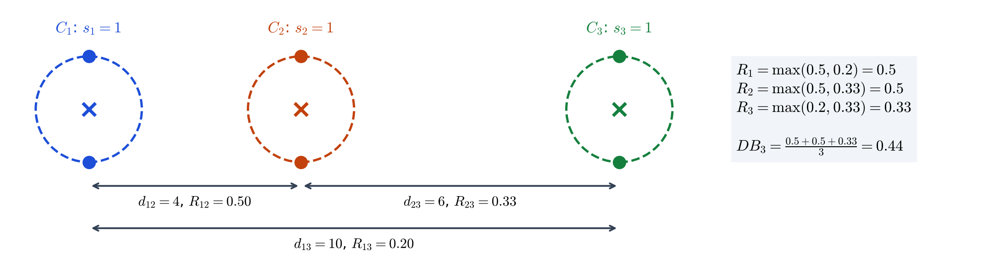
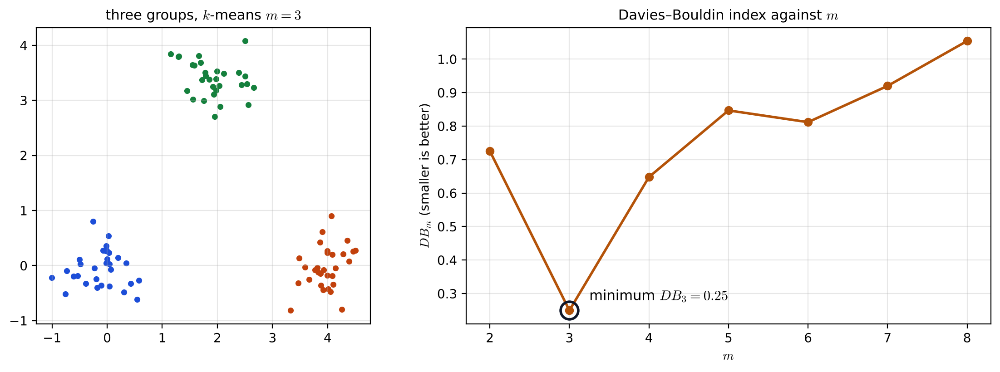
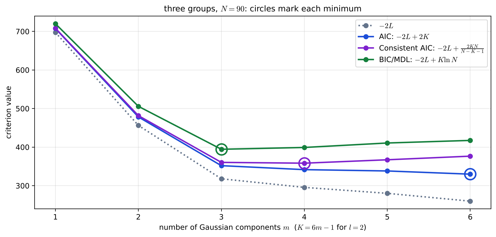

# Lecture 15 · KP06：Davies–Bouldin 指標與資訊準則（The Davies–Bouldin index and information criteria）

> 程度：研究生（grad）／Level: Graduate (grad)
>
> 第 15 週（2026-12-14）｜Clustering (2) – Evaluation · KP06
>
> Week 15 (2026-12-14) | Clustering (2) – Evaluation · KP06

## 學習目標（Learning objectives）

- 由群散度 $s_i$ 與群間距離 $d_{ij}$ 算出 $R_{ij}$、$R_i$ 與 $DB_m$，並在 $DB_m$ 對 $m$ 的曲線上取最小值（Compute $R_{ij}$, $R_i$ and $DB_m$ from the group spreads $s_i$ and inter-group distances $d_{ij}$, and take the minimum of $DB_m$ against $m$）。
- 寫出資訊準則 $C(\boldsymbol{\theta},K)=-2L(\boldsymbol{\theta})+\phi(K)$，說出 AIC、Consistent AIC、BIC／MDL 的懲罰項差在哪裡（Write the information criterion $C(\boldsymbol{\theta},K)=-2L(\boldsymbol{\theta})+\phi(K)$ and state how the penalties of AIC, Consistent AIC and BIC/MDL differ）。
- 算出 $m$ 個 $l$ 維高斯混合的參數個數 $K$，並用資訊準則選群數（Compute the number of parameters $K$ of a mixture of $m$ Gaussians in $l$ dimensions and use an information criterion to choose the number of groups）。

## KP06：Davies–Bouldin 指標與資訊準則（The Davies–Bouldin index and information criteria）

**一句話重點**：Davies–Bouldin 指標讓每一群找出和自己最像的鄰居，把這些「最像」的程度平均起來，越小越好；資訊準則則用 $-2L+\phi(K)$ 在擬合程度與模型複雜度之間取捨，AIC、Consistent AIC、BIC／MDL 只差在懲罰項 $\phi(K)$。

**One-sentence summary**: The Davies–Bouldin index lets each group find its most similar neighbor and averages these "most similar" levels, smaller being better; information criteria trade off fit against model complexity with $-2L+\phi(K)$, and AIC, Consistent AIC and BIC/MDL differ only in the penalty $\phi(K)$.

### 1. 接住上一講的問題（Picking up the question）

上一講的 Dunn 指標只看最差的情況：最近的兩群和最胖的一群，所以一個雜訊點就能改變它。
這一講先看一個「每一群都算進來」的指標，再換一個角度：如果資料可以用機率模型描述，直接比較不同群數的模型好不好。

The Dunn index of the last lecture looks only at the worst case, the closest two groups and the fattest group, so a single noise point can change it.
This lecture first looks at an index in which every group counts, then changes perspective: if the data can be described by a probability model, compare models with different numbers of groups directly.

**白話說明**：想像評一個班級的分組，每一組都問一句：「哪一組和你最容易搞混？」
兩組越鬆散、離得越近，越容易搞混。
把每一組「最容易搞混」的程度平均起來，平均越低，整體分得越清楚。

**Plain explanation**: Picture rating how a class is grouped by asking each group: "Which group are you most easily confused with?"
Two groups are more easily confused when they are looser and closer.
Average each group's "most confusable" level; the lower the average, the more clearly the class is divided overall.

**先備自測**：確認你記得上一講的「群內緊、群間開」，以及第 2 章的最大概似估計。

**Prerequisite check**: Make sure you remember "tight within, apart between" from the last lecture and maximum likelihood estimation from Chapter 2.

- 群的代表點 $\mathbf{w}_i$ 常取群內均值（The representative $\mathbf{w}_i$ of a group is often its mean）。
- 對數概似 $L(\boldsymbol{\theta})$ 越大，模型越能解釋資料（A larger log-likelihood $L(\boldsymbol{\theta})$ means the model explains the data better）。
- 沒有單調趨勢的指標直接取極值（An index without a monotone trend is read directly at its extremum）。

### 2. Davies–Bouldin 指標（The Davies–Bouldin index）

**正式定義**：令 $s_i$ 為叢集 $C_i$ 的散度（相對於其代表點的散布），$d_{ij}=d(C_i,C_j)$ 為兩群的相異度。
兩群的相似度 $R_{ij}$ 要滿足幾個條件，例如非負、對稱、兩群都縮成一點時 $R_{ij}=0$。
一個簡單且符合條件的選擇是

**Formal definition**: Let $s_i$ be the spread of cluster $C_i$ (how scattered it is around its representative) and $d_{ij}=d(C_i,C_j)$ the dissimilarity of two groups.
The similarity $R_{ij}$ of two groups must satisfy several conditions, such as being nonnegative, symmetric, and $0$ when both groups shrink to a point.
A simple choice that satisfies them is

$$
R_{ij}=\frac{s_i+s_j}{d_{ij}}\tag{16.21}
$$

再讓每一群取它最像的鄰居，並把結果平均：

Then let each group take its most similar neighbor, and average the results:

$$
R_i=\max_{j=1,\dots,m,\;j\neq i}R_{ij},\qquad DB_m=\frac{1}{m}\sum_{i=1}^{m}R_i\tag{16.22–16.23}
$$

群與群越不像越好，所以要找 $DB_m$ 最小的分群；小的 $DB_m$ 也表示群緊密且分得開。
$DB_m$ 對 $m$ 沒有單調趨勢，在 $DB_m$ 對 $m$ 的圖上取最小值。
來源給的具體形式是 $d_{ij}=\lVert\mathbf{w}_i-\mathbf{w}_j\rVert_q$（式 16.24）與 $s_i=\left(\frac{1}{n_i}\sum_{\mathbf{x}\in C_i}\lVert\mathbf{x}-\mathbf{w}_i\rVert^{r}\right)^{1/r}$（式 16.25），其中 $n_i$ 是 $C_i$ 的點數；另有用 MST、RNG、GG 量散度的 DB-like 變體，同樣取最小值。

Groups should be as dissimilar as possible, so we seek the clustering with the smallest $DB_m$; a small $DB_m$ also means compact, well-separated groups.
$DB_m$ has no monotone trend in $m$, so take the minimum of the $DB_m$-versus-$m$ plot.
The source gives the concrete forms $d_{ij}=\lVert\mathbf{w}_i-\mathbf{w}_j\rVert_q$ (Eq. 16.24) and $s_i=\left(\frac{1}{n_i}\sum_{\mathbf{x}\in C_i}\lVert\mathbf{x}-\mathbf{w}_i\rVert^{r}\right)^{1/r}$ (Eq. 16.25), where $n_i$ is the number of points in $C_i$; there are also DB-like variants that measure spread with MST, RNG or GG, again read at the minimum.

**例子** `[補充]`：取 $q=r=2$（歐氏距離）。
三群各兩點：$C_1=\{(0,0),(0,2)\}$、$C_2=\{(4,0),(4,2)\}$、$C_3=\{(10,0),(10,2)\}$。
代表點是 $(0,1)$、$(4,1)$、$(10,1)$，每點到代表點的距離都是 $1$，所以 $s_1=s_2=s_3=1$。
$d_{12}=4$、$d_{23}=6$、$d_{13}=10$，得 $R_{12}=2/4=0.5$、$R_{23}=2/6=0.33$、$R_{13}=2/10=0.2$。
$R_1=\max(0.5,0.2)=0.5$，$R_2=\max(0.5,0.33)=0.5$，$R_3=\max(0.2,0.33)=0.33$，所以 $DB_3=(0.5+0.5+0.33)/3=0.44$。

**Example** `[Added]`: Take $q=r=2$ (Euclidean distance).
Three groups of two points each: $C_1=\{(0,0),(0,2)\}$, $C_2=\{(4,0),(4,2)\}$ and $C_3=\{(10,0),(10,2)\}$.
The representatives are $(0,1)$, $(4,1)$ and $(10,1)$, and every point is at distance $1$ from its representative, so $s_1=s_2=s_3=1$.
With $d_{12}=4$, $d_{23}=6$ and $d_{13}=10$, we get $R_{12}=2/4=0.5$, $R_{23}=2/6=0.33$ and $R_{13}=2/10=0.2$.
$R_1=\max(0.5,0.2)=0.5$, $R_2=\max(0.5,0.33)=0.5$ and $R_3=\max(0.2,0.33)=0.33$, so $DB_3=(0.5+0.5+0.33)/3=0.44$.



**圖說 `lec15-kp06-db-information-f1-db-hand`**：先看三個虛線圓，圓心叉號是代表點，半徑是散度 $s_i=1$。
再看下方三條雙箭頭，標出兩群代表點的距離 $d_{ij}$ 與相似度 $R_{ij}$。
注意右側的方框：每一群只取最大的 $R_{ij}$，$C_1$ 和 $C_2$ 都被彼此拖到 $0.5$。〔功能：1、2〕

**Caption `lec15-kp06-db-information-f1-db-hand`**: Look first at the three dashed circles: each cross is a representative and each radius is the spread $s_i=1$.
Then look at the three double arrows below, labeled with the representative distance $d_{ij}$ and the similarity $R_{ij}$.
Note the box on the right: each group keeps only its largest $R_{ij}$, and $C_1$ and $C_2$ pull each other up to $0.5$. [Function: 1, 2]

**例子** `[補充]`：上一講的三團資料（三團各 $30$ 點）用 $k$-means 分 $m=2,\dots,8$ 群，$DB_m$ 在 $m=3$ 取最小值 $0.25$；$m=2$ 時是 $0.73$，$m=4$ 時是 $0.65$，之後大致上升到 $m=8$ 的 $1.05$。

**Example** `[Added]`: Clustering the three-group data of the last lecture (three groups of $30$ points) by $k$-means into $m=2,\dots,8$ groups, $DB_m$ reaches its minimum $0.25$ at $m=3$; it is $0.73$ at $m=2$ and $0.65$ at $m=4$, then rises roughly to $1.05$ at $m=8$.



**圖說 `lec15-kp06-db-information-f2-db-vs-m`**：先看左圖，三團資料依 $m=3$ 的分群上色。
再看右圖，$DB_m$ 在 $m=3$ 掉到最低，圓圈標出最小值。
注意 $m=2$ 和 $m=4$ 兩邊都比較高：群太少時散度大，群太多時被切開的兩半距離小。〔功能：2〕

**Caption `lec15-kp06-db-information-f2-db-vs-m`**: Look first at the left panel: the three-group data colored by the $m=3$ clustering.
Then look at the right panel: $DB_m$ drops to its lowest at $m=3$, with the minimum circled.
Note that both $m=2$ and $m=4$ are higher: too few groups give large spreads, and too many give split halves that are close together. [Function: 2]

**常見迷思**：「群和群離得遠，$DB$ 就一定小。」
不對。
$R_{ij}$ 的分子是兩群散度的和，距離遠但兩群都很鬆散時，$R_{ij}$ 仍然大。
DB 要同時看散度與距離。

**Common misconception**: "If the groups are far apart, $DB$ must be small."
That is wrong.
The numerator of $R_{ij}$ is the sum of the two spreads, so if two groups are far apart but both very loose, $R_{ij}$ is still large.
DB must look at spread and distance together.

### 3. 資訊準則（Information criteria）

另一條路是把分群看成機率模型，問「哪一個模型最貼資料」。
多加一群幾乎一定能提高概似，所以要加上隨模型大小遞增的懲罰：

Another route views clustering as a probability model and asks "which model fits the data best".
Adding a group almost always raises the likelihood, so a penalty that grows with model size is added:

$$
C(\boldsymbol{\theta},K)=-2L(\boldsymbol{\theta})+\phi(K)\tag{16.33}
$$

其中 $L$ 是對數概似，$K=\dim(\boldsymbol{\theta})$ 是模型階數（參數個數），$\phi$ 隨 $K$ 遞增。
常見的選擇：

Here $L$ is the log-likelihood, $K=\dim(\boldsymbol{\theta})$ is the model order (number of parameters), and $\phi$ increases with $K$.
Typical choices are:

- $\phi(K)=2K$：AIC（$\phi(K)=2K$: AIC）。
- $\phi(K)=\dfrac{2KN}{N-K-1}$：Consistent AIC（$\phi(K)=\dfrac{2KN}{N-K-1}$: Consistent AIC）。
- $\phi(K)=K\ln N$：MDL 與 BIC（$\phi(K)=K\ln N$: MDL and BIC）。

$K$ 隨群數 $m$ 嚴格遞增。
以 $m$ 個 $l$ 維高斯的加權混合為例，參數有 $ml$ 個均值、$m\,l(l+1)/2$ 個共變異元素，以及 $m-1$ 個權重（權重和為 $1$，少一個自由度），所以

$K$ increases strictly with the number of groups $m$.
For a weighted mixture of $m$ Gaussians in $l$ dimensions, the parameters are $ml$ means, $m\,l(l+1)/2$ covariance entries and $m-1$ weights (the weights sum to $1$, removing one degree of freedom), so

$$
K=\left(l+\frac{l(l+1)}{2}+1\right)m-1
$$

做法：先固定模型的形式，對每個 $m_i\in[m_{\min},m_{\max}]$ 用最大概似估出 $\boldsymbol{\theta}_i$，再在所有 $(\boldsymbol{\theta}_i,m_i)$ 中選 $C$ 最小的一對，它的 $m$ 就是估計的群數。
AIC 懲罰較輕；Consistent AIC 與 BIC／MDL 在 $N$ 大時懲罰較重，較不容易切太多群。

Procedure: fix the form of the model, estimate $\boldsymbol{\theta}_i$ by maximum likelihood for each $m_i\in[m_{\min},m_{\max}]$, then pick the pair $(\boldsymbol{\theta}_i,m_i)$ with the smallest $C$; its $m$ is the estimated number of groups.
AIC penalizes lightly; Consistent AIC and BIC/MDL penalize more heavily when $N$ is large and are less prone to splitting into too many groups.

**例子** `[補充]`：二維（$l=2$）時 $K=(2+3+1)m-1=6m-1$，$m=3$ 得 $K=17$。
用同樣的三團資料（$N=90$），以 EM 擬合完整共變異的高斯混合，$m=1,\dots,6$。
$-2L$ 從 $697.5$ 一路降到 $259.9$，越多群越小。
BIC 在 $m=3$ 最小（$394.4$），Consistent AIC 在 $m=4$ 最小（$358.3$，比 $m=3$ 的 $360.4$ 只低一點），AIC 在 $m=6$ 最小（$329.9$），而且在掃描範圍內仍在下降。
三個準則只差懲罰項，選出的群數就從 $3$ 到 $6$ 不等。

**Example** `[Added]`: In two dimensions ($l=2$), $K=(2+3+1)m-1=6m-1$, so $m=3$ gives $K=17$.
Using the same three-group data ($N=90$), fit full-covariance Gaussian mixtures by EM for $m=1,\dots,6$.
$-2L$ falls steadily from $697.5$ to $259.9$; more groups always give a smaller value.
BIC is smallest at $m=3$ ($394.4$), Consistent AIC at $m=4$ ($358.3$, only slightly below $360.4$ at $m=3$), and AIC at $m=6$ ($329.9$), still decreasing within the scanned range.
The three criteria differ only in the penalty, yet they choose anywhere from $3$ to $6$ groups.



**圖說 `lec15-kp06-db-information-f3-information`**：先看灰色點線 $-2L$，它隨 $m$ 一路下降，沒有最小值可選。
再看三條實線，各加上不同的懲罰，圓圈標出各自的最小值。
注意綠線 BIC 在 $m=3$ 就轉頭向上，藍線 AIC 到 $m=6$ 還在降。〔功能：2、3〕

**Caption `lec15-kp06-db-information-f3-information`**: Look first at the dotted gray line $-2L$: it keeps falling with $m$ and offers no minimum to choose.
Then look at the three solid lines, each with a different penalty, with circles at their minima.
Note that the green BIC line turns upward right after $m=3$, while the blue AIC line is still falling at $m=6$. [Function: 2, 3]

**失效情形**：資訊準則的前提是模型形式選對了；資料的團不是高斯形狀時，可能要用多個高斯去拼一個團，選出的 $m$ 會偏大。
EM 只找到局部最大，每個 $m$ 都要多試幾個初值；$N$ 小而 $K$ 大時，Consistent AIC 的分母 $N-K-1$ 會變得很小，甚至不能用。
DB 和上一講的指標一樣假設緊密的團，對細長或環狀的叢集不適用。

**Failure cases**: Information criteria assume the model form is right; when the groups are not Gaussian in shape, several Gaussians may be needed to fit one group, and the chosen $m$ comes out too large.
EM finds only a local maximum, so several initializations are needed for each $m$; when $N$ is small and $K$ large, the denominator $N-K-1$ of Consistent AIC becomes very small or even unusable.
Like the indices of the last lecture, DB assumes compact groups and does not suit elongated or ring-shaped clusters.

### 4. 與實作的連結（Connection to implementation）

下面的程式照式 16.21–16.25（$q=r=2$）算 DB 指標。
注意：$R_i$ 取的是最大值，不是平均；平均是在最後一步對 $R_i$ 做的。

The code below computes the DB index following Eqs. 16.21–16.25 with $q=r=2$.
Note that $R_i$ takes the maximum, not the average; the average is taken over $R_i$ in the last step.

```python
import numpy as np

def davies_bouldin(X, lab):
    X, lab = np.asarray(X, float), np.asarray(lab)
    ks = np.unique(lab)
    w = np.array([X[lab == k].mean(0) for k in ks])                         # 代表點 / representatives
    s = np.array([np.sqrt(np.mean(np.sum((X[lab == k] - w[i]) ** 2, 1))) for i, k in enumerate(ks)])   # 式 16.25
    m = len(ks)
    R_i = [max((s[i] + s[j]) / np.linalg.norm(w[i] - w[j]) for j in range(m) if j != i) for i in range(m)]  # 式 16.21–16.22
    return float(np.mean(R_i))                                               # 式 16.23

X = [[0, 0], [0, 2], [4, 0], [4, 2], [10, 0], [10, 2]]
print(round(davies_bouldin(X, [0, 0, 1, 1, 2, 2]), 3))   # 三群手算例 / three-group hand example
# 0.444
```

**留給下一節的問題**：這一週的所有方法，都是在分群之後評估結果。
可是演算法對沒有結構的資料也會硬切出群；能不能在分群之前，先檢查資料到底有沒有值得分的結構？
下一講介紹分群傾向。

**The question for the next section**: Every method this week evaluates a result after clustering.
But algorithms carve out groups even from data with no structure; can we check, before clustering, whether the data have any structure worth clustering?
The next lecture introduces clustering tendency.

### 5. 小練習與解題示範（Practice and worked solutions）

**小練習** `[補充]`：先寫下理由，再看解答。

**Practice** `[Added]`: Write your reasoning before reading the solutions.

1. 題 1：兩群的散度 $s_1=1$、$s_2=3$，代表點距離 $d_{12}=8$，求 $DB_2$（Two groups have spreads $s_1=1$ and $s_2=3$ and representative distance $d_{12}=8$. Find $DB_2$）。
2. 題 2：三維（$l=3$）高斯混合有 $m=4$ 個成分，求 $K$（A Gaussian mixture in three dimensions ($l=3$) has $m=4$ components. Find $K$）。
3. 題 3：某資料 $N=100$，模型 $A$ 的 $-2L=500$、$K=10$，模型 $B$ 的 $-2L=470$、$K=20$。AIC 與 BIC 各選哪一個（For data with $N=100$, model $A$ has $-2L=500$ and $K=10$, and model $B$ has $-2L=470$ and $K=20$. Which does AIC choose, and which does BIC choose）？

**題 1 解題示範**：$m=2$ 時每群只有一個鄰居，$R_1=R_2=R_{12}=(1+3)/8=0.5$。
所以 $DB_2=(0.5+0.5)/2=0.5$。

**Question 1 worked solution**: With $m=2$ each group has only one neighbor, so $R_1=R_2=R_{12}=(1+3)/8=0.5$.
So $DB_2=(0.5+0.5)/2=0.5$.

**題 2 解題示範**：每個成分有 $l=3$ 個均值、$l(l+1)/2=6$ 個共變異元素、$1$ 個權重，共 $10$ 個。
$K=10\times4-1=39$。

**Question 2 worked solution**: Each component has $l=3$ means, $l(l+1)/2=6$ covariance entries and $1$ weight, $10$ in total.
$K=10\times4-1=39$.

**題 3 解題示範**：AIC：$A$ 是 $500+20=520$，$B$ 是 $470+40=510$，選 $B$。
BIC：$\ln100\approx4.61$；$A$ 是 $500+46.1=546.1$，$B$ 是 $470+92.1=562.1$，選 $A$。
BIC 懲罰較重，不認為多出的 $10$ 個參數值得那 $30$ 的概似改善。

**Question 3 worked solution**: AIC: $A$ gives $500+20=520$ and $B$ gives $470+40=510$, so $B$ is chosen.
BIC: $\ln100\approx4.61$; $A$ gives $500+46.1=546.1$ and $B$ gives $470+92.1=562.1$, so $A$ is chosen.
BIC penalizes more heavily and does not consider the extra $10$ parameters worth the improvement of $30$ in likelihood.

## 術語表（Glossary）

| 中文術語 | English term |
|---|---|
| Davies–Bouldin 指標 | Davies–Bouldin index |
| 群散度 | Cluster spread |
| 群間相似度 | Inter-cluster similarity |
| 資訊準則 | Information criterion |
| 對數概似 | Log-likelihood |
| 模型階數 | Model order |
| 赤池資訊準則 | Akaike information criterion (AIC) |
| 貝氏資訊準則 | Bayesian information criterion (BIC) |
| 最小描述長度 | Minimum description length (MDL) |
| 高斯混合模型 | Gaussian mixture model |

## 銜接與來源（Connections and sources）

下一講是自主學習：在分群之前，先檢查資料有沒有分群傾向。

The next lecture is for self-study: before clustering, check whether the data have a clustering tendency.

- 前一單元：[KP05 修正 Hubert 與 Dunn 指標](lec15-kp05-dunn-hubert.md)（Previous unit: the modified Hubert and Dunn indices）。
- 下一單元：[KP07 分群傾向](lec15-kp07-clustering-tendency.md)（Next unit: clustering tendency）。
- 來源：[Cluster Validity §16.4.1](https://ndhuccc.github.io/CCC-LNS/PR_115/Ch16-cluster-validity/index.html)，讀取日期 2026-11-13（Source accessed 2026-11-13）。
- 書目：Theodoridis and Koutroumbas, *Pattern Recognition*, 4th ed., 2008；見[參考資料](../references/README.md)（See the bibliography）。

本講以自己的文字解釋來源。
$s_i$、$d_{ij}$ 與 $R_{ij}$ 的條件、式 16.21–16.25、DB 取最小值且無單調趨勢、MST／RNG／GG 的 DB-like 變體、式 16.33、AIC、Consistent AIC、BIC／MDL 的懲罰項、高斯混合的 $K$ 公式、先最大概似再選最小 $C$ 的做法，以及 AIC 懲罰較輕的比較取自來源。
班級比喻、三群手算例、三團資料的 $DB_m$ 與資訊準則模擬、常見迷思、失效情形、程式、圖與練習皆為 `[補充]`。

This lecture independently explains the source.
The conditions on $s_i$, $d_{ij}$ and $R_{ij}$, Eqs. 16.21–16.25, reading DB at its minimum with no monotone trend, the DB-like variants with MST, RNG and GG, Eq. 16.33, the penalties of AIC, Consistent AIC and BIC/MDL, the formula for $K$ of a Gaussian mixture, the procedure of maximum likelihood followed by picking the smallest $C$, and the remark that AIC penalizes lightly come from the source.
The class analogy, the three-group hand example, the simulated $DB_m$ and information criteria for the three-group data, the common misconception, the failure cases, the code, the figures and the practice are `[Added]`.
