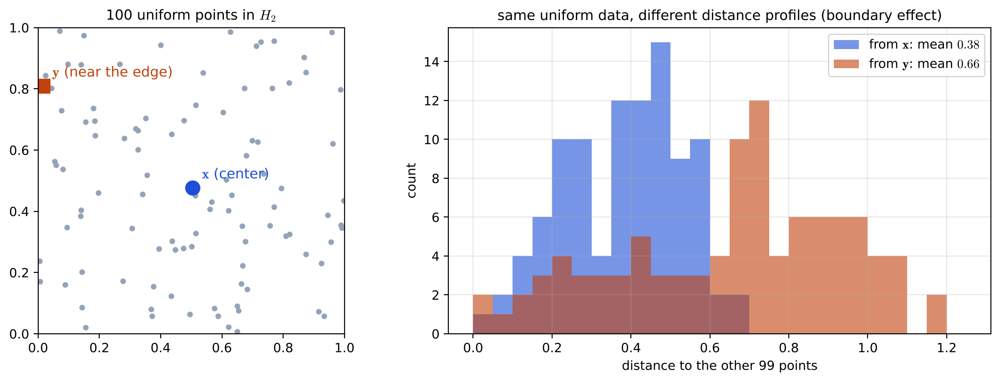
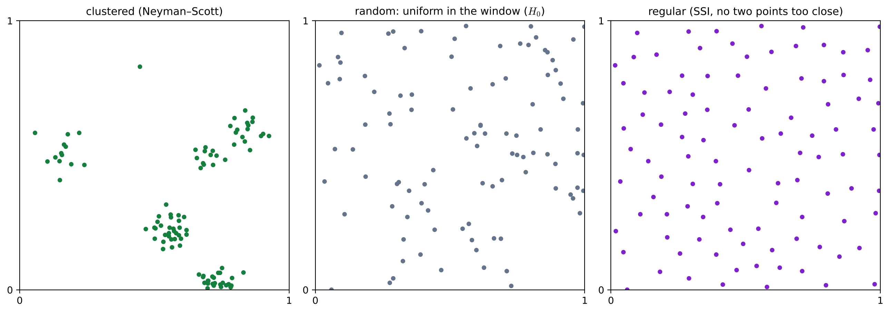
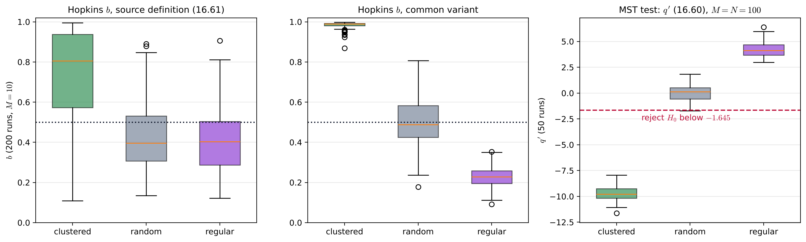

# Lecture 15 · KP07：分群傾向：資料值不值得分群（Clustering tendency: are the data worth clustering）

> 程度：研究生（grad）／Level: Graduate (grad)
>
> 第 15 週（2026-12-14）｜Clustering (2) – Evaluation · KP07
>
> Week 15 (2026-12-14) | Clustering (2) – Evaluation · KP07

## 學習目標（Learning objectives）

- 說出分群傾向的三種假設（隨機、規則、叢集），以及取樣窗與邊界效應為什麼會影響檢定（State the three hypotheses of clustering tendency (random, regular, clustered) and why the sampling window and the boundary effect affect the tests）。
- 說明如何產生叢集、規則與隨機三種對照資料（Explain how to generate clustered, regular and random reference data）。
- 用 MST 結構圖檢定、Hopkins 檢定與 Cox–Lewis 檢定的統計量方向，判斷資料偏向叢集、規則或隨機（Use the direction of the MST structural-graph, Hopkins and Cox–Lewis statistics to judge whether data lean clustered, regular or random）。

## KP07：分群傾向：資料值不值得分群（Clustering tendency: are the data worth clustering）

**一句話重點**：分群演算法對沒有結構的資料也會切出群，所以分群前先檢查分群傾向：虛無假設是「點在取樣窗內均勻分布」，對立是規則或叢集；MST 檢定的 $q$ 小、Hopkins 的 $b$ 大、Cox–Lewis 的 $R$ 小都偏向叢集。

**One-sentence summary**: Clustering algorithms carve out groups even from data with no structure, so check the clustering tendency before clustering: the null hypothesis is "points are uniform in the sampling window", the alternatives are regularity or clustering; a small $q$ in the MST test, a large $b$ in Hopkins and a small $R$ in Cox–Lewis all lean toward clustering.

### 1. 接住上一講的問題（Picking up the question）

這一週前六講都是分群之後才評估結果。
KP01 已經看過：均勻亂撒的點，$k$-means 照樣切出三群。
這一講把檢查移到分群之前：資料本身到底有沒有值得分的結構？

The first six lectures of this week all assess a result after clustering.
KP01 already showed that $k$-means still cuts uniformly scattered points into three groups.
This lecture moves the check before clustering: do the data themselves have any structure worth clustering?

**白話說明**：想像從高處看廣場上的人。
有時人群聚成幾堆（叢集），有時大家刻意保持距離、排得很勻（規則），有時就是隨便走（隨機）。
只有第一種值得「分群」；後兩種硬分，只會得到沒有意義的群。

**Plain explanation**: Picture looking down at people in a square.
Sometimes they gather in a few clumps (clustered), sometimes they deliberately keep their distance and spread evenly (regular), and sometimes they just wander (random).
Only the first is worth "clustering"; forcing the other two into groups yields meaningless clusters.

**先備自測**：確認你記得 KP01 的假設檢定骨架與第 14 週的最小生成樹。

**Prerequisite check**: Make sure you remember the hypothesis-testing skeleton of KP01 and the minimum spanning tree of Week 14.

- 虛無假設 $H_0$ 是「沒有結構」的描述（The null hypothesis $H_0$ describes "no structure"）。
- 最小生成樹（MST）用最少的總邊長連起所有點（A minimum spanning tree (MST) connects all points with the least total edge length）。
- 最近鄰距離是一點到其他點的最短距離（The nearest-neighbor distance is the shortest distance from a point to the others）。

### 2. 三種假設與取樣窗（Three hypotheses and the sampling window）

**正式定義**：針對緊密叢集、維度 $l\ge2$，三種假設是：

**Formal definition**: For compact clusters in dimension $l\ge2$, the three hypotheses are:

- 隨機（$H_0$）：資料向量在取樣窗（sampling window）內依均勻分布隨機散布（Random ($H_0$): the vectors are scattered uniformly at random inside the sampling window）。
- 規則：向量在窗內規則排列，彼此不會靠得太近（Regular: the vectors are arranged regularly in the window and are not too close to each other）。
- 叢集：向量形成叢集（Clustered: the vectors form clusters）。

接受隨機或規則假設時，就不該硬跑分群，改用別的方式詮釋資料。
檢定表現受兩件事影響：維度 $l$（影響不直觀，常靠模擬了解），以及取樣窗。
實務上取樣窗通常不知道；若選錯窗，例如用一個比資料範圍大很多的窗，原本均勻的點看起來就會像擠在一起，$H_0$ 檢定可能出錯。

If the random or regular hypothesis is accepted, clustering should not be forced; the data should be interpreted another way.
Test performance depends on two things: the dimension $l$ (whose effect is not intuitive and is usually studied by simulation) and the sampling window.
In practice the window is usually unknown; with a wrong window, for example one much larger than the data's extent, points that are actually uniform look crowded together, and the $H_0$ test can go wrong.

**邊界效應**：窗是有限的，靠近邊界的點，往外沒有鄰居，它的距離統計和中心的點不同。
緩解方法包括把取樣窗週期延拓，或只在窗內較小的取樣框（sampling frame）裡取點做統計，但估計時仍可借用框外、窗內的點。

**Boundary effect**: the window is finite, and a point near the boundary has no neighbors beyond it, so its distance statistics differ from those of a point at the center.
Remedies include extending the window periodically, or computing statistics only for points inside a smaller sampling frame within the window, while still using points outside the frame but inside the window for the estimates.

**例子**：來源的例 16.9 在 $H_2$ 內均勻放 $N=100$ 個點；中心附近的點 $\mathbf{x}=[0.5045,0.4764]^{\top}$ 與靠近邊界的點 $\mathbf{y}=[0.0159,0.8089]^{\top}$，到其餘點的距離分布明顯不同。
`[補充]` 我們用 $98$ 個均勻點加上這兩點重做：從 $\mathbf{x}$ 出發的平均距離 $0.38$、最大 $0.68$；從 $\mathbf{y}$ 出發的平均距離 $0.66$、最大 $1.19$。

**Example**: Example 16.9 of the source places $N=100$ points uniformly in $H_2$; the point near the center $\mathbf{x}=[0.5045,0.4764]^{\top}$ and the point near the boundary $\mathbf{y}=[0.0159,0.8089]^{\top}$ have clearly different distributions of distances to the other points.
`[Added]` We redid it with $98$ uniform points plus these two: from $\mathbf{x}$ the mean distance is $0.38$ and the maximum $0.68$; from $\mathbf{y}$ the mean is $0.66$ and the maximum $1.19$.



**圖說 `lec15-kp07-clustering-tendency-f2-boundary-effect`**：先看左圖，灰點是均勻資料，藍點 $\mathbf{x}$ 在中心，橘方塊 $\mathbf{y}$ 靠近左邊界。
再看右圖，藍色直方圖是 $\mathbf{x}$ 到其餘點的距離，橘色是 $\mathbf{y}$ 的。
注意橘色整體往右移：資料一樣是均勻的，只因位置靠邊，距離就變長。〔功能：2、3〕

**Caption `lec15-kp07-clustering-tendency-f2-boundary-effect`**: Look first at the left panel: gray dots are uniform data, the blue dot $\mathbf{x}$ is at the center, and the orange square $\mathbf{y}$ is near the left edge.
Then look at the right panel: the blue histogram is the distances from $\mathbf{x}$ to the other points, the orange one those from $\mathbf{y}$.
Note that the orange histogram is shifted right as a whole: the data are equally uniform, yet a position near the edge makes the distances longer. [Function: 2, 3]

**估計取樣窗**：可以用資料的凸包（convex hull），但檢定分布就綁死在手上這份資料，而且凸包計算很貴。
實務上常用替代：以資料均值為中心、剛好包住一半向量的超球當取樣窗；另一半資料在這個階段丟掉也可以，因為此時只想知道有沒有分群結構，有的話再對全部資料分群。

**Estimating the window**: the convex hull of the data can be used, but then the test distribution is tied to this particular data set, and the convex hull is expensive to compute.
A common practical substitute is a hypersphere centered at the data mean that just contains half of the vectors; discarding the other half at this stage is acceptable, because the only question now is whether there is clustering structure, and if there is, the full data are clustered afterward.

### 3. 產生三種對照資料（Generating the three kinds of reference data）

要用 Monte Carlo 估統計量在規則或叢集假設下的分布，就要能產生對照資料：

To estimate the distribution of a statistic under the regular or clustered hypothesis by Monte Carlo, we must be able to generate reference data:

- 叢集資料（Neyman–Scott 程序）：在窗內隨機放中心，每團點數服從 Poisson 分布（強度 $\lambda$），點以 $N(\mathbf{y}_i,\sigma^2I)$ 繞中心產生，超出窗就重抽，直到湊滿 $N$ 點（Clustered data (the Neyman–Scott procedure): place centers at random in the window, draw the number of points per group from a Poisson distribution with intensity $\lambda$, generate points around each center from $N(\mathbf{y}_i,\sigma^2I)$, redraw any point that leaves the window, and continue until there are $N$ points）。
- 規則資料：在凸包上放格點，或用簡單循序抑制（SSI）：逐一放點，每點帶一個半徑 $r$ 的超球，新點的超球不能和已有的相交，直到點數夠了或再也塞不進（Regular data: place a lattice on the convex hull, or use simple sequential inhibition (SSI): add points one at a time, each with a hypersphere of radius $r$, where a new point's hypersphere may not intersect existing ones, until the number of points is reached or no more fit）。
- 隨機資料：在窗內依均勻分布放點即可（Random data: simply place points uniformly in the window）。

SSI 的填充程度可用填充密度衡量：

The fullness of SSI can be measured by the packing density:

$$
\rho=\frac{L}{V}V_r,\qquad V_r=Ar^{l},\qquad A=\frac{\pi^{l/2}}{\Gamma(l/2+1)}\tag{16.55–16.57}
$$

其中 $L$ 是點數，$V$ 是取樣窗的體積，$V_r$ 是半徑 $r$ 的 $l$ 維超球體積，這裡的 $\Gamma$ 是 gamma 函數。

Here $L$ is the number of points, $V$ the volume of the sampling window, $V_r$ the volume of an $l$-dimensional hypersphere of radius $r$, and $\Gamma$ here is the gamma function.



**圖說 `lec15-kp07-clustering-tendency-f1-three-patterns`**：先看左圖，Neyman–Scott 產生的點聚成幾團。
再看中圖，均勻隨機的點有的擠、有的空。
注意右圖 SSI 的點分布得很勻，沒有兩點靠得很近；中圖的空洞和小擠堆在右圖都看不到。〔功能：1、2〕

**Caption `lec15-kp07-clustering-tendency-f1-three-patterns`**: Look first at the left panel: points generated by Neyman–Scott gather into a few clumps.
Then look at the middle panel: uniformly random points are crowded in some places and empty in others.
Note that the SSI points in the right panel are spread very evenly with no two points close together; the holes and small crowds of the middle panel are absent on the right. [Function: 1, 2]

### 4. 三種空間隨機性檢定（Three tests of spatial randomness）

下面三種檢定都適用一般維度，而且都要知道取樣窗。

The three tests below apply to general dimensions, and all require the sampling window.

**MST 結構圖檢定**：在資料所在的凸區域內均勻產生 $M$ 個點構成 $X'$（通常 $M=N$），對 $X\cup X'$ 建 MST，令 $q$ 為「一端在 $X$、一端在 $X'$」的邊數。
資料有叢集時，叢集內的點彼此相連，跨集合的邊少，所以 $q$ 小；$q$ 大則暗示規則排列。
令 $e$ 為共用一個頂點的 MST 邊對數，$L=M+N$。在 $H_0$ 下

**MST structural-graph test**: generate $M$ points uniformly in the convex region containing the data to form $X'$ (usually $M=N$), build the MST of $X\cup X'$, and let $q$ be the number of edges with one end in $X$ and the other in $X'$.
With clustered data, points within a cluster connect to each other and few edges cross between the sets, so $q$ is small; a large $q$ suggests a regular arrangement.
Let $e$ be the number of pairs of MST edges sharing a vertex, and $L=M+N$. Under $H_0$,

$$
E(q\mid H_0)=\frac{2MN}{M+N}\tag{16.58}
$$

$$
\operatorname{var}(q\mid e,H_0)=\frac{2MN}{L(L-1)}\left[\frac{2MN-L}{L}+\frac{e-L+2}{(L-2)(L-3)}\bigl(L(L-1)-4MN+2\bigr)\right]\tag{16.59}
$$

$$
q'=\frac{q-E(q\mid H_0)}{\sqrt{\operatorname{var}(q\mid e,H_0)}}\tag{16.60}
$$

$M$、$N$ 都很大且 $M/N$ 不太接近 $0$ 或 $\infty$ 時，$q'$ 近似標準常態；顯著水準 $\rho$ 下，$q'$ 小於標準常態的 $\rho$ 分位數就拒絕 $H_0$。
這個檢定對叢集傾向的檢定力高，對規則性的檢定力弱。

When $M$ and $N$ are both large and $M/N$ is not too close to $0$ or $\infty$, $q'$ is approximately standard normal; at significance level $\rho$, reject $H_0$ if $q'$ is below the $\rho$ quantile of the standard normal.
This test has high power against clustering and low power against regularity.

**Hopkins 檢定**：在窗內均勻放 $M$ 個點 $X'=\{\mathbf{y}_j\}$（$M\ll N$），再從 $X$ 隨機抽 $M$ 點得 $X_1$。
令 $d_j$ 為 $\mathbf{y}_j$ 到 $X_1$ 中最近點 $\mathbf{x}_j$ 的距離，$\delta_j$ 為 $\mathbf{x}_j$ 到 $X_1\setminus\{\mathbf{x}_j\}$ 中最近點的距離：

**Hopkins test**: place $M$ points $X'=\{\mathbf{y}_j\}$ uniformly in the window ($M\ll N$), and draw $M$ points at random from $X$ to form $X_1$.
Let $d_j$ be the distance from $\mathbf{y}_j$ to its nearest point $\mathbf{x}_j$ in $X_1$, and $\delta_j$ the distance from $\mathbf{x}_j$ to its nearest point in $X_1\setminus\{\mathbf{x}_j\}$:

$$
b=\frac{\sum_{j=1}^{M}d_j^{l}}{\sum_{j=1}^{M}d_j^{l}+\sum_{j=1}^{M}\delta_j^{l}}\tag{16.61}
$$

有叢集時，資料點彼此靠得近（$\delta_j$ 小），窗內均勻的探針卻離資料遠（$d_j$ 大），所以 $b$ 大；規則時 $\sum d_j^{l}$ 往往小於 $\sum\delta_j^{l}$，$b$ 小；$b$ 約 $1/2$ 暗示隨機。
在 $H_0$ 下且最近鄰距離彼此獨立時，$b$ 服從 $\mathrm{Beta}(M,M)$。
來源的模擬（超立方體窗、週期邊界、$l=2,\dots,5$）顯示它對規則性檢定力高，對叢集傾向則有限。

With clusters, data points are close to each other ($\delta_j$ small) while uniform probes in the window are far from the data ($d_j$ large), so $b$ is large; with regularity, $\sum d_j^{l}$ tends to be smaller than $\sum\delta_j^{l}$, so $b$ is small; $b$ near $1/2$ suggests randomness.
Under $H_0$, with independent nearest-neighbor distances, $b$ follows $\mathrm{Beta}(M,M)$.
The source's simulations (hypercube window, periodic boundary, $l=2,\dots,5$) show high power against regularity and limited power against clustering.

**Cox–Lewis 檢定**：同樣在窗內放 $X'$，但不另抽 $X_1$。
對每個 $\mathbf{y}_j$ 找 $X$ 中最近的 $\mathbf{x}_j$，再找 $X\setminus\{\mathbf{x}_j\}$ 中離 $\mathbf{x}_j$ 最近的 $\mathbf{x}_i$，令 $d_j=\lVert\mathbf{y}_j-\mathbf{x}_j\rVert$、$\delta_j=\lVert\mathbf{x}_j-\mathbf{x}_i\rVert$。
只保留 $2d_j/\delta_j\ge1$ 的 $\mathbf{y}_j$（共 $M'$ 個），對它們定義適當的函數 $R_j$，再取平均：

**Cox–Lewis test**: again place $X'$ in the window, but without drawing $X_1$.
For each $\mathbf{y}_j$ find its nearest $\mathbf{x}_j$ in $X$, then the point $\mathbf{x}_i$ in $X\setminus\{\mathbf{x}_j\}$ nearest to $\mathbf{x}_j$, and let $d_j=\lVert\mathbf{y}_j-\mathbf{x}_j\rVert$ and $\delta_j=\lVert\mathbf{x}_j-\mathbf{x}_i\rVert$.
Keep only the $\mathbf{y}_j$ with $2d_j/\delta_j\ge1$ ($M'$ of them), define a suitable function $R_j$ for each, and average:

$$
R=\frac{1}{M'}\sum_{j=1}^{M'}R_j\tag{16.62}
$$

$H_0$ 下 $R$ 近似常態、平均 $1/2$。$R$ 小偏向叢集，$R$ 大偏向規則，接近平均則偏向隨機。
模擬顯示：面對叢集的對立假設，它不如 Hopkins；面對規則假設則未必較差。
另有兩種 $T$-squared 取樣檢定，模擬顯示整體不如 Hopkins 與 Cox–Lewis。

Under $H_0$, $R$ is approximately normal with mean $1/2$. A small $R$ leans clustered, a large $R$ leans regular, and a value near the mean leans random.
Simulations show that against the clustered alternative it is weaker than Hopkins, while against regularity it is not necessarily worse.
There are also two $T$-squared sampling tests, which simulations show to be generally weaker than Hopkins and Cox–Lewis.

**例子** `[補充]`：取樣窗是單位正方形，三種點型各 $N=100$ 點。
MST 檢定（$M=N=100$，各跑 $50$ 次）：$E(q\mid H_0)=2\cdot100\cdot100/200=100$；叢集資料的 $q$ 平均 $31.4$、$q'$ 平均 $-9.74$，$50$ 次全部拒絕；隨機資料的 $q$ 平均 $99.5$，拒絕率 $0.04$，接近 $\rho=0.05$；規則資料的 $q$ 平均 $129.8$、$q'$ 平均 $+4.23$，左尾檢定從不拒絕，但 $q$ 明顯偏大，符合「大 $q$ 暗示規則」。

**Example** `[Added]`: The window is the unit square, and each of the three point patterns has $N=100$ points.
MST test ($M=N=100$, $50$ runs each): $E(q\mid H_0)=2\cdot100\cdot100/200=100$; clustered data give mean $q=31.4$ and mean $q'=-9.74$, rejecting in all $50$ runs; random data give mean $q=99.5$ with a rejection rate of $0.04$, close to $\rho=0.05$; regular data give mean $q=129.8$ and mean $q'=+4.23$, never rejected by the left-tail test, but $q$ is clearly large, consistent with "a large $q$ suggests regularity".

`[補充]` Hopkins 檢定（$M=10$，各跑 $200$ 次）照來源定義：叢集 $b$ 平均 $0.73$，隨機 $0.43$，規則 $0.42$，三者的分布重疊很多。
隨機資料的平均低於 $1/2$，一個原因是我們沒有做週期邊界；另一個原因是 $\delta_j$ 只在 $M=10$ 個點的 $X_1$ 裡找最近鄰，而且 $\mathbf{x}_j$ 是離探針最近的點，不是隨機抽出的點。
文獻上常見的變體改成「$d_j$ 是探針到 $X$ 全體的最近距離，$\delta_j$ 是隨機抽出的資料點到 $X$ 其餘點的最近距離」；同樣的資料下，叢集 $0.98$、隨機 $0.50$、規則 $0.23$，三種點型分得很開。
使用套件時要先確認它用的是哪一種定義。

`[Added]` The Hopkins test ($M=10$, $200$ runs each) with the source's definition gives mean $b$ of $0.73$ for clustered, $0.43$ for random and $0.42$ for regular data, with heavily overlapping distributions.
The random mean falls below $1/2$ partly because we used no periodic boundary, and partly because $\delta_j$ looks for a nearest neighbor only among the $M=10$ points of $X_1$, and $\mathbf{x}_j$ is the point nearest to a probe rather than a randomly drawn one.
A variant common in the literature instead takes "$d_j$ as the distance from a probe to the nearest point of all of $X$, and $\delta_j$ as the distance from a randomly drawn data point to the nearest other point of $X$"; on the same data it gives $0.98$ for clustered, $0.50$ for random and $0.23$ for regular data, separating the three patterns well.
When using a library, first check which definition it uses.



**圖說 `lec15-kp07-clustering-tendency-f3-tests`**：先看左圖，照來源定義的 Hopkins $b$，三個箱形重疊很多，點線是 $1/2$。
再看中圖，常見變體的 $b$：叢集貼近 $1$、隨機在 $1/2$ 附近、規則偏低，三者分開。
注意右圖的 MST 檢定：叢集的 $q'$ 全在紅色虛線 $-1.645$ 以下而被拒絕，規則的 $q'$ 偏向正值。〔功能：2、3〕

**Caption `lec15-kp07-clustering-tendency-f3-tests`**: Look first at the left panel: Hopkins $b$ with the source's definition, where the three boxes overlap heavily and the dotted line marks $1/2$.
Then look at the middle panel: $b$ for the common variant, with clustered near $1$, random near $1/2$ and regular lower, all separated.
Note the MST test in the right panel: the clustered $q'$ values all lie below the dashed red line at $-1.645$ and are rejected, while the regular $q'$ values lean positive. [Function: 2, 3]

**常見迷思**：「檢定沒有拒絕 $H_0$，所以資料是隨機的。」
不對。
每種檢定只對某一類對立假設有檢定力：MST 的左尾檢定擅長抓叢集，對規則幾乎沒反應；上面的規則資料 $q'$ 約 $+4$，左尾檢定照樣不拒絕。
選檢定要先想清楚要防的是叢集還是規則。

**Common misconception**: "The test did not reject $H_0$, so the data are random."
That is wrong.
Each test has power only against a certain kind of alternative: the left-tail MST test is good at catching clusters and barely responds to regularity; for the regular data above, $q'$ is about $+4$ and the left-tail test still does not reject.
Before choosing a test, decide whether you are guarding against clustering or regularity.

**失效情形**：三種檢定都需要知道取樣窗；窗選錯，連真正均勻的資料都可能被判成非隨機。
有限的窗會帶來邊界效應，沒有週期延拓或取樣框時，統計量在 $H_0$ 下的分布會偏離理論值。

**Failure cases**: All three tests require the sampling window; with the wrong window, even truly uniform data can be judged non-random.
A finite window introduces the boundary effect; without periodic extension or a sampling frame, the distribution of the statistic under $H_0$ deviates from theory.

### 5. 與實作的連結（Connection to implementation）

下面的程式照式 16.61 的來源定義算 Hopkins $b$。
注意：$\delta_j$ 是在 $X_1$ 裡找最近鄰，而且起點是離探針最近的那個 $\mathbf{x}_j$。

The code below computes Hopkins $b$ with the source's definition in Eq. 16.61.
Note that $\delta_j$ looks for the nearest neighbor within $X_1$, starting from the point $\mathbf{x}_j$ nearest to the probe.

```python
import numpy as np

def hopkins_b(Y, X1, l=2):
    Y, X1 = np.asarray(Y, float), np.asarray(X1, float)
    dY = np.sqrt(((Y[:, None] - X1[None]) ** 2).sum(-1))        # 探針到 X1 的距離 / probes to X1
    j, d = dY.argmin(1), dY.min(1)                               # x_j 與 d_j
    D1 = np.sqrt(((X1[:, None] - X1[None]) ** 2).sum(-1))
    np.fill_diagonal(D1, np.inf)                                 # 排除自己 / exclude itself
    delta = D1[j].min(1)                                         # δ_j：x_j 到 X1\{x_j}
    return float((d ** l).sum() / ((d ** l).sum() + (delta ** l).sum()))

X1 = [[0.10, 0.10], [0.12, 0.10], [0.90, 0.90], [0.90, 0.92]]   # 兩個小團 / two small clumps
Y = [[0.50, 0.50], [0.20, 0.80]]                                 # 兩個探針 / two probes
print(round(hopkins_b(Y, X1), 3))
# 0.999
```

兩個小團內部的最近鄰距離只有 $0.02$，探針卻離資料很遠，所以 $b$ 接近 $1$，偏向叢集。

Within the two small clumps the nearest-neighbor distance is only $0.02$, while the probes are far from the data, so $b$ is close to $1$ and leans clustered.

**留給下一節的問題**：本週到此結束。
下一週是彈性週，用來期末複習與準備專題；做專題時本週的態度仍然適用：任何演算法給的結構，都要先問它是不是真的存在。

**The question for the next section**: This week ends here.
Next week is a flexible week for final review and project preparation; this week's attitude still applies to the projects: for any structure an algorithm returns, first ask whether it really exists.

### 6. 小練習與解題示範（Practice and worked solutions）

**小練習** `[補充]`：先寫下理由，再看解答。

**Practice** `[Added]`: Write your reasoning before reading the solutions.

1. 題 1：MST 檢定中 $M=N=50$，求 $E(q\mid H_0)$。若觀測到 $q=12$，資料偏向哪一種假設（In the MST test with $M=N=50$, find $E(q\mid H_0)$. If $q=12$ is observed, which hypothesis do the data lean toward）？
2. 題 2：Hopkins 檢定 $l=2$、$M=2$，$d_1=0.3$、$d_2=0.4$、$\delta_1=0.1$、$\delta_2=0.2$，求 $b$ 並判讀（In the Hopkins test with $l=2$ and $M=2$, $d_1=0.3$, $d_2=0.4$, $\delta_1=0.1$ and $\delta_2=0.2$; find $b$ and interpret it）。
3. 題 3：為什麼取樣窗選得比資料範圍大很多，均勻的資料會被誤判成叢集（Why does a sampling window much larger than the data's extent make uniform data look clustered）？

**題 1 解題示範**：$E(q\mid H_0)=2\cdot50\cdot50/100=50$。
$q=12$ 遠小於 $50$，跨集合的邊很少，資料偏向叢集。

**Question 1 worked solution**: $E(q\mid H_0)=2\cdot50\cdot50/100=50$.
$q=12$ is far below $50$, so few edges cross between the sets, and the data lean clustered.

**題 2 解題示範**：$\sum d_j^2=0.09+0.16=0.25$，$\sum\delta_j^2=0.01+0.04=0.05$。
$b=0.25/(0.25+0.05)=0.833$，大於 $1/2$ 很多，偏向叢集。

**Question 2 worked solution**: $\sum d_j^2=0.09+0.16=0.25$ and $\sum\delta_j^2=0.01+0.04=0.05$.
$b=0.25/(0.25+0.05)=0.833$, well above $1/2$, so the data lean clustered.

**題 3 解題示範**：檢定把「窗內均勻」當成虛無假設。
窗太大時，資料只佔窗的一小塊，相對於整個窗，資料就像擠在一起的一團；探針大多落在沒有資料的地方，距離資料很遠，統計量會偏向叢集。

**Question 3 worked solution**: The test takes "uniform in the window" as the null hypothesis.
When the window is too large, the data occupy only a small part of it and look like one crowded clump relative to the whole window; most probes land where there are no data and are far from them, pushing the statistic toward clustering.

## 術語表（Glossary）

| 中文術語 | English term |
|---|---|
| 分群傾向 | Clustering tendency |
| 取樣窗 | Sampling window |
| 取樣框 | Sampling frame |
| 邊界效應 | Boundary effect |
| 規則性 | Regularity |
| 簡單循序抑制 | Simple sequential inhibition (SSI) |
| 填充密度 | Packing density |
| 結構圖檢定 | Structural graph test |
| Hopkins 檢定 | Hopkins test |
| Cox–Lewis 檢定 | Cox–Lewis test |

## 銜接與來源（Connections and sources）

本講是第 15 週的最後一講，把效度檢查延伸到分群之前。

This is the last lecture of Week 15, extending validity checks to before clustering.

- 前一單元：[KP06 Davies–Bouldin 與資訊準則](lec15-kp06-db-information.md)（Previous unit: Davies–Bouldin and information criteria）。
- 回顧：[KP01 為什麼要驗證分群結果](lec15-kp01-validity-intro.md)（Review: why clustering results must be validated）。
- 來源：[Cluster Validity §16.6](https://ndhuccc.github.io/CCC-LNS/PR_115/Ch16-cluster-validity/index.html)，讀取日期 2026-11-13（Source accessed 2026-11-13）。
- 書目：Theodoridis and Koutroumbas, *Pattern Recognition*, 4th ed., 2008；見[參考資料](../references/README.md)（See the bibliography）。

本講以自己的文字解釋來源。
三種假設的定義、接受隨機或規則時不該硬分群、維度與取樣窗的影響、錯窗的問題、邊界效應與週期延拓、取樣框、例 16.9 的設定與兩點座標、凸包與半數超球的估窗方式、Neyman–Scott 與 SSI 的產生程序、式 16.55–16.62、MST 檢定的判讀方向與檢定力、Hopkins 的判讀方向、$\mathrm{Beta}(M,M)$ 與模擬結論、Cox–Lewis 的程序、判讀方向與比較，以及 $T$-squared 取樣檢定較弱的結論取自來源。
廣場比喻、例 16.9 的重做數字、三種點型的 MST 與 Hopkins 模擬、Hopkins 常見變體的對照、常見迷思、失效情形、程式、圖與練習皆為 `[補充]`。

This lecture independently explains the source.
The definitions of the three hypotheses, not forcing clustering when randomness or regularity is accepted, the effects of dimension and the sampling window, the wrong-window problem, the boundary effect and periodic extension, the sampling frame, the setting of Example 16.9 with the two points' coordinates, estimating the window by the convex hull or the half-data hypersphere, the Neyman–Scott and SSI procedures, Eqs. 16.55–16.62, the direction and power of the MST test, the direction of Hopkins, $\mathrm{Beta}(M,M)$ and the simulation conclusions, the Cox–Lewis procedure, direction and comparison, and the conclusion that the $T$-squared sampling tests are weaker come from the source.
The town-square analogy, the redo numbers for Example 16.9, the MST and Hopkins simulations on three point patterns, the comparison with the common Hopkins variant, the common misconception, the failure cases, the code, the figures and the practice are `[Added]`.
